# 주식 — 성공 사례 분석: 사례별 자세히 #1–#40

`analysis.md` 의 9번 (같은 # 번호). 자동 생성 — `tools/success_analysis.py` v1.5 (2026-10-21 09:07 UTC). ※ 연구·교육용 — 투자 권유가 아님.

### 1. 적자인데 300억? 가능한 이유 ∣ 회계사가 말아주는 리센느 소속사 더뮤즈엔터

- https://www.youtube.com/watch?v=kJx_AzV9w9c · 전지적회계사시점 · 구독자 867 · 조회수 317,084 (×365.7, 하루 6,691.5) · 좋아요 1,271 (0.4%) · 21.4분 · 2026-09-03 · 주제 묶음 6. 종목 고르기·분석 · 형식 브이로그·직접 해본 이야기 · 폴더 `W_kJx_AzV9w9c` (웹 승인)
- 썸네일: 
- 챕터: 0:00 오프닝 하이라이트 · 0:23 거제 야호로 시작된 리센느 이야기 · 1:13 숫자로 보는 더뮤즈: 8억에서 300억까지 · 2:20 리센느의 인기, 어느 정도일까 · 4:19 더뮤즈엔터테인먼트는 어떤 회사인가 · 6:06 중소 엔터사가 VC 투자를 받는 이유 · 8:11 모태펀드가 만든 중소돌의 기적 · 9:04 투자 히스토리: 5천만 원에서 시리즈A까지 · 11:44 멀티플로 계산해 본 비상장 기업가치 · 14:26 이익배수로 다시 본 300억의 조건 · 16:04 300억이 되려면 매출은 얼마나 필요할까 · 18:00 리센느 정산은 언제부터 가능할까 · 19:40 결론: 300억은 가능한 숫자인가
- 설명 앞부분: "거제야호로 시작된 리센느 열풍. 소속사 더뮤즈엔터의 가치는 얼마일까요?" 지금 대한민국에서 가장 핫한 걸그룹 리센느, 그리고 소속사 더뮤즈엔터테인먼트의 기업가치를 회계사의 시선으로 분석해봤습니다. 설립 밸류 8억에서 5년 만에 300억, 37.5배가 뛴 이 회사의 투자 히스토리를 따라가면서 비상장 기업의 가치평가가 실제로 어떻게 이루어지는지 알기 쉽게 풀어 드립니다. 그리고 25년말 56억 적자에 자본잠식이였던 리센느 소속사가 어떻게 300억의 가치를 인정 받을 수 있었는지, 중소 엔터사가 VC 투자를 받는 이유부터 아이돌 정산…
- 같은 채널 평소 대비 ×290.8 (채널 최근 롱폼 중앙값 1,090회) · 평소 영상: 결혼 못 해도 돈은 낸다 ∣ 매출 483억 찍은 ‘결혼해듀오’ (1,223회) / 배그 방플 논란, 베트남은 크래프톤에 얼마나 중요할까? ∣ 회계사가 뜯어본 크래프톤 재무… (958회)
- 대본 (음성인식(앞 5분), 5.9 음절/초) — 앞부분만, 흐름은 그 안까지 첫 20초: “최근에 리셋는 더뮤즈웨어 엔터테인먼트가 몇백억을 같이 로투자를 받았다 이런 얘기가 많잖아요 그래서 이 회사의 가치가 지금 얼마일까 그리고 얼마까지 갈 수 있을까 작년 매출이 17억 8천만 원인데 영업 손실에 50.2천만 원이거든요 그리고 2025년 말에 자본을 보니까 마이너스 11억 5천만 원 데뷔 8년차에다가 포스닥 상장사가 880만 원이 있는데” — 도입부 유형: 질문으로 시작, 숫자로 시작
- 첫 1분: “최근에 리셋는 더뮤즈웨어 엔터테인먼트가 몇백억을 같이 로투자를 받았다 이런 얘기가 많잖아요 그래서 이 회사의 가치가 지금 얼마일까 그리고 얼마까지 갈 수 있을까 작년 매출이 17억 8천만 원인데 영업 손실에 50.2천만 원이거든요 그리고 2025년 말에 자본을 보니까 마이너스 11억 5천만 원 데뷔 8년차에다가 포스닥 상장사가 880만 원이 있는데 더뮤즈웨어 엔터가 300억 가치를 지냈다 회사님 거제 야구 아세요? 잘 알죠 요새 유튜브에 굉장히 핫하잖아요 저도 거제 야구가 뜨기 시작할 때 그때부터 리셋는 유튜브를 좀 많이 봤는데 굉장히 재밌더라고요 사실 제가 또 TMI긴 하지만 저희 어머니가 좀 외곽아 거제에 있거든요 유튜브에서 거제 영상을 보면서 약간 눈에 익은 그런 화면들이 많이 나오더라고요 유튜브도 알”
- 흐름 (90초마다 첫 문장): 0:00 최근에 리셋는 더뮤즈웨어 엔터테인먼트가 → 1:31 그러니까 이제 8억에서 300억 → 3:02 스탭에게 뭐 1분만 더 달라 → 4:31 그리고 이제 뭐 잘 아시는 것처럼
- 댓글 219/219: 좋은 점 — 영상 2 · 감사·응원 14 · 더 알고 싶은 것 0 · 아쉬운 점 — 영상 2 · 반박·불만 — 의견 다름 4 · 정치·사회 0 · 경험 공유 11 · 구독·다음 기대 2
  - 좋은 점 — 영상 👍10 “더뮤즈에 대해 궁금한 것을 많았는데... 좋은 정보 감사합니다.”
  - 좋은 점 — 영상 👍2 “겉으로 보여지는 아이돌 그룹의 그늘 혹은 화려함에 가리워진 이면에, 냉정한 생존법칙에서, 엔터테인먼트 기획사의 존폐 여부가 어떻게 가시적으로 수치화 돼서 추정되고 결정되는 지 일목요연하게 짚어주는 이런 컨셉 정말 유익합니다. 응원합니다!!!”
  - 감사·응원 👍344 “대중은 중소를 응원하지만 중소티가 나면 고개를 돌리는것 같습니다. 적자상황에서도 의상과 곡퀄리티를 유지한게 단순 응원하는 사람에서 팬덤으로 바뀌게 된 핵심이유같네요.”
  - 감사·응원 👍20 “리센느 팬이라 보고 갑니다 감사합니다”
  - 아쉬운 점 — 영상 👍1 “마이크가 있기는한데 뭔가 목소리 울리는 소리가 많이 들어가는게 조금 아쉽네요😂 재밌는 영상 잘 보고갑니다!”
  - 아쉬운 점 — 영상 👍1 “요약좀....”
  - 반박·불만 — 의견 다름 👍10 “아니 나 진짜 궁금했음; 왜 다들 정산이 힘들거라고 하는건지.. 어떤 분들은 매출이 180억이 나와도 정산이 힘들수있다는데 이해가 너무안감 누적적자 70억은 알겠는데 대형 기획사처럼 컴백할때 진짜 뭐 백몇십억씩 쏟아붓고 마케팅비용 포함해서 활동비로 수십억씩 쓰는 회사…”
  - 경험 공유 👍15 “내가 살다살다 아이돌덕질하다 회사 회계까지 보고있네”
  - 경험 공유 👍6 “올해 리센느가 3년차였네요. 진짜 다행입니다 ^^”
  - 구독·다음 기대 👍18 “리마인이면 리센느 소속사 더뮤즈 재무관리 영상도 챙겨 봐야한다는 사실😂”
  - 구독·다음 기대 👍0 “국내는 현제 말할것도 없고, 전세계적으로도 조금씩 알려지고 있으며 특히 일본에서 근래에 많은 유튜브 영상들이 퍼지고 있으며 팬층도 많이 늘어나고 있던데 조만간 일본 활동에 불씨가 붙으면 롱런 롱흑자 기대됩니다 무엇보다 리센느는 아이돌로서 다음 앨범이 아주 중요하기도 …”

### 2. 왜 내가 사면 떨어지고 팔면 오를까? 개미가 주식으로 돈 못 버는 4가지 이유

- https://www.youtube.com/watch?v=fdlfOCtDBqc · 오피디의 머니노트 · 구독자 1,170 · 조회수 395,338 (×337.9, 하루 65,578.6) · 좋아요 1,548 (0.4%) · 13.6분 · 2026-10-15 · 주제 묶음 8. 투자 심리·실패 · 형식 오디오북·낭독 (명언·인생조언) · 폴더 `W_fdlfOCtDBqc` (웹 승인)
- 썸네일: 
- 챕터: 0:00 하이닉스 꼭대기에서 산 사람들 · 0:43 노벨상 심리학자 대니얼 카너먼의 답 · 1:12 이유 1. 주식을 도박처럼 한다 – 최근 편향 · 2:45 이유 2. 욕심에 몰빵한다 – 레버리지, 신용융자, … · 4:34 이유 3. 잃는 걸 못 견딘다 – 손실 회피, 처분 … · 6:24 이유 4. 남들 따라 들어간다 – 포모(FOMO), … · 7:51 개인투자자가 주식으로 돈 버는 방법 · 8:08 공부 – PER, 사업보고서, 마음 공부 · 9:49 지수 ETF – 코스피200, S&P500 · 10:31 장기 투자 · 11:29 적립식 투자 · 12:37 정리
- 설명 앞부분: 하이닉스 290만 원, 삼성전자 37만 원 꼭대기에서 사신 분들 많으시죠? 왜 개인 투자자는 늘 꼭대기에서 사고 바닥에서 팔까요? 노벨 경제학상을 받은 심리학자 대니얼 카너먼의 연구로, 개미가 주식으로 돈을 못 버는 4가지 이유와 해결 방법을 정리했습니다. 💬 여러분은 이번 하락장에서 어떻게 대응하셨나요? 댓글로 남겨 주세요.
- 대본 없음 (설명) — 음성인식이 끝나면 도입부·흐름이 들어감
- 댓글 244/243: 좋은 점 — 영상 3 · 감사·응원 5 · 더 알고 싶은 것 1 · 아쉬운 점 — 영상 0 · 반박·불만 — 의견 다름 3 · 정치·사회 14 · 경험 공유 9 · 구독·다음 기대 0
  - 좋은 점 — 영상 👍2 “공감합니다😂주식투자는 10년 이상 적립식으로 꾸준이 모아가는 게 제일 무난한 투자방법이라고 믿어요~ ❤”
  - 좋은 점 — 영상 👍0 “좋은영상 감사합니다”
  - 감사·응원 👍1 “고맙습니다 ㅠㅠ”
  - 감사·응원 👍0 “좋은영상 감사합니다”
  - 더 알고 싶은 것 👍2 “월요일에 하이닉스 120만원대에 올인해도 되나요? 250만원 되면 미련 없이 팔 생각인데...”
  - 반박·불만 — 의견 다름 👍3 “웃기는 소리 그만하고 k국장에서 주식하는 넘만 바보지. 절대 회사 믿지 마라 절대 오래 투자 한다고 수익 나지 않는다. 안하는게 정답이다”
  - 반박·불만 — 의견 다름 👍2 “교과서적인 이야기이네요..주식은 교과서대로 되는것이 아닙니다..노력을 하세요...차트공부도 하시고..단타로 가세요..국장은 장기투자 하는것아닙니다”
  - 정치·사회 👍6 “이재명이가 조작하는거지머”
  - 정치·사회 👍1 “제일 중요한 것......... 대한민국 주식장은 도박판이기 때문이고, 그 이유는 회사 CEO가 주주들의 이익보다 자신의 이익만 생각하기 때문. 하이닉스, 삼전이 펀더멘틀이 좋음에도 망하는 이유는 정부가 레버리지 상품을 만들어놨기 때문....... 레버리지만 없었어도…”
  - 경험 공유 👍22 “지금 안사만 나만 바보된다 말나오면 이렇게 해석해야합니다. " 지금 사면 나도 바보된다 !! "”
  - 경험 공유 👍5 “국장은 도박이 맞아..장기간 1%라도 우상향해야지 하루에도 10% 오르다가 내리다가 이게 신뢰가 가서 장투가 가능하겠냐... QQQ에 SPY는 아무리 적어도 10%는 꾸준히 상향하고 매일매일 1%씩 오르락 내리락한다. 장투에 대한 신뢰감도 있고 수급도 크고 조금씩 상…”

### 3. 마이너스 주식 계좌 가장 쉽게 탈출하는 방법 물타기? 존버? 고민하지 않아도 되는 물린 종목 최대한 손실을 줄이며 정리하는 현명한 방법

- https://www.youtube.com/watch?v=v6rUCbULG2A · 머니스트랩 · 구독자 538 · 조회수 96,208 (×178.8, 하루 1,621.4) · 좋아요 1,118 (1.2%) · 30.5분 · 2026-08-23 · 주제 묶음 8. 투자 심리·실패 · 형식 정보·해설 (그 밖) · 폴더 `W_v6rUCbULG2A` (웹 승인)
- 썸네일: 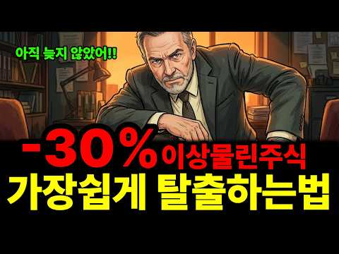
- 설명 앞부분: 지수는 사상 최고를 찍었는데 왜 내 계좌만 파란색일까요. 개인 투자자 240만 명의 계좌를 열어본 자료에서 출발해, 물린 종목을 손실을 줄이며 정리하고 제대로 된 자리로 옮기는 순서를 정리했습니다. 이 영상에서 다루는 내용
- 같은 채널 평소 대비 ×156.7 (채널 최근 롱폼 중앙값 614회) · 평소 영상: 28년째 핫도그세트가 2,000원, 코스트코가 진짜 돈 버는 방법 "핫도그로는 안 남깁니… (652회) / "1억 모으는데 12년 4개월" 실수령 200만원이 1억 모으는 시간을 5년 당기는 5가… (576회)
- 대본 (음성인식(앞 5분), 4.9 음절/초) — 앞부분만, 흐름은 그 안까지 첫 20초: “물려 있다는 사실을 잊고 계셨다면 그나마 나은 쪽입니다. 진짜 문제는 매일 확인하면서도 아무것도 못하는 경우입니다. 아마 셋 중 하나일 겁니다. 계좌에 있는 줄도 모르고 몇 년을 지나친 종목. 매일 열어보지만 몇 년째 빠져나오지 못한 종목. 그리고 지금 팔면 정말 끝이라 참아 손을 못 떼는 종목.”
- 첫 1분: “물려 있다는 사실을 잊고 계셨다면 그나마 나은 쪽입니다. 진짜 문제는 매일 확인하면서도 아무것도 못하는 경우입니다. 아마 셋 중 하나일 겁니다. 계좌에 있는 줄도 모르고 몇 년을 지나친 종목. 매일 열어보지만 몇 년째 빠져나오지 못한 종목. 그리고 지금 팔면 정말 끝이라 참아 손을 못 떼는 종목. 마지막에 해당하신다면 오늘은 끝까지 보셔야 합니다. 그 결정을 미루는 동안 여러분 계좌에서 무엇이 사라지고 있는지 숫자로 보여드리겠습니다. 2025년 10월 31이었습니다. 그날 아침 뉴스의 첫 곡지는 코스피가 사상 최고치를 갈아치웠다는 소식이었죠. 빨간 숫자로 가득 찬 전광판 화면이 하루 종일 흘러 나왔고 증권 방송에서는 축포 같은 표현들이 오갔습니다. 바로 그날 한 대형증권사가 자사 고객의 계좌를 통째로 들여다”
- 흐름 (90초마다 첫 문장): 0:00 물려 있다는 사실을 잊고 계셨다면 그나마 나은 쪽입니다. → 1:35 물론 모두가 같은 크기로 물려 있는 건 아닙니다. → 3:00 우리는 보통 이 둘을 하나로 놓고 생각합니다. → 4:31 16번 통째로 갈아옵는다는 뜻이죠.
- 댓글 38/38: 좋은 점 — 영상 2 · 감사·응원 4 · 더 알고 싶은 것 1 · 아쉬운 점 — 영상 0 · 반박·불만 — 의견 다름 0 · 정치·사회 2 · 경험 공유 1 · 구독·다음 기대 0
  - 좋은 점 — 영상 👍16 “많은 도움이 됬습니다 로봇주애 _47% 물려있는데 하락장애서 매도 찬스를 놓쳐서 ㅠㅠ 처음엔 물타기 하다가 그때마다 하락해서 더 나락.ㅠㅠ 지근은 포기하고 분할매도 하고 반 남았는데 나머지도 분할매도 할 예정입니다”
  - 좋은 점 — 영상 👍1 “좋은 강의입니다.👍👍👍”
  - 감사·응원 👍8 “감사합니다..........”
  - 감사·응원 👍6 “카카오 안산다 ㅋ 감사 합니다”
  - 더 알고 싶은 것 👍0 “그럼 오른건 언제파나요?”
  - 정치·사회 👍5 “이재명 대통령님 응원합니다.”
  - 정치·사회 👍0 “웃기지마라 개미들 구십프로가 아작이났는데 뭐가 오십 팔프로라고 개소리 그만해 이번주식시장은 정부가 외국펀드투자판을 깔아준것인데 무슨 개소리 개미가 아무리 잘한다해도 거대한 자본으로 죠지는데 무슨 뾰쪽한수가 있나 솔직히 말해서 지금은 개미들 돈이 없어서 주식시장에 가고…”
  - 경험 공유 👍3 “내가 ㅅㅂ 이걸 28분을 들었어 아 진짜 내시간 금같은 내시간 이 목소리 절대듣지말자 늘 그랬건만 ㅅㅂ 아ㅅㅂ 진짜 내시간”

### 4. [풀영상] 월급 10%로 당장 시작하는 존리의 자산 증식 치트키

- https://www.youtube.com/watch?v=q1fYjAwma3s · 여의돈스트리트 · 구독자 1,360 · 조회수 208,990 (×153.7, 하루 6,253.2) · 좋아요 1,287 (0.6%) · 36분 · 2026-09-17 · 주제 묶음 1. 주식 기초·초보 · 형식 인터뷰·강연·대담 · 폴더 `W_q1fYjAwma3s` (웹 승인)
- 썸네일: 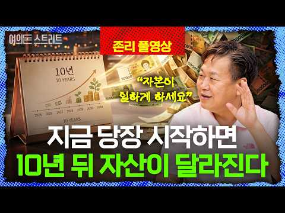
- 챕터: 0:00 인트로 · 0:50 ‘존리의 부자학교’, 어떤 곳인가요? · 1:09 우리나라 금융 수준, 정말 높아졌나요? · 2:39 빨리 부자가 되는 투자, 가능한가요? · 4:53 장기 투자, 어떤 ETF를 사야 할까요? · 6:53 평범한 사람은 어떻게 부자가 되나요? · 8:30 주식 투자에 전문가가 없다? · 10:24 레버리지 투자는 왜 위험한가요? · 11:31 한국주식, 지금도 투자할 만한가요? · 12:16 투자 뉴스는 어디까지 봐야 할까요? · 14:44 부동산 비중이 높으면 위험한가요? · 16:45 주식 투자의 진짜 목적은 무엇인가요? · 17:26 좋은 기업은 어떻게 고르나요? · 20:19 장기 투자 중 기업 상황이 나빠진다면? · 21:09 박스권에 갇힌 현재 증시 진단 · 22:23 AI 버블 우려 속 올바른 매수 시기 · 23:30 안전해 보이는 ‘원금 보장’ 상품의 함정 · 25:01 반도체·대형주 쏠림 계좌, 포트폴리오 개선 조언 · 27:15 시황 뉴스·차트·리포트의 올바른 활용법 · 29:35 직장인 월급 대비 적정 투자 비중 및 방법
- 설명 앞부분: 매일 오르내리는 주가, 금리 인상 뉴스... 언제 사고 언제 팔아야 할지 늘 스트레스받고 계시나요? 혹은 원금 손실이 두려워 아직도 투자를 망설이고 계신가요? 이번 풀영상에서는 '존리의 부자학교' 존리 대표님을 모시고 평범한 사람이 스트레스 없이 진짜 부자가 되는 투자의 본질부터 구체적인 실천 방법까지 모두 담았습니다. 단기간에 부자가 되려는 조급함과 마켓 타이밍을 재는 습관을 버리고, 내 자본이 스스로 일하게 만드는 진짜 투자법을 짚어봅니다. 또한, 인플레이션 시대에 돈을 예적금에만 두는 것이 왜 자산 가치를 갉아먹는 가장 위험…
- 같은 채널 평소 대비 ×195.1 (채널 최근 롱폼 중앙값 1,071회) · 평소 영상: 주식시장 100명중 90명은 무조건 손실 봅니다. 상위 10%만 아는 '진짜' 수익 내는… (1,071회) / 리딩방에서 추천받은 종목이 올랐다면? 이미 당신은 ‘먹잇감’입니다 [선생님 이건 건강한 … (1,122회)
- 대본 (음성인식(앞 5분), 6.0 음절/초) — 앞부분만, 흐름은 그 안까지 첫 20초: “좀 빠르게 내가 부자가 되고 싶다. 시간이 지날수록 나는 그 위스크로 줄어들고 시작한 지 지날수록 나는 부관들어나거든요. 또는 일을 안 하고 이불 속에서 안 나오는 거예요. 예금. 지금 만약에 1,000만 원이 20년 후에는 1,000만 원 아니라 한 300만 원으로 줄어들어있는 거예요. 90%의 정보는 필요 없는 정보예요. 정보가 하나도 중요하지 않죠.”
- 첫 1분: “좀 빠르게 내가 부자가 되고 싶다. 시간이 지날수록 나는 그 위스크로 줄어들고 시작한 지 지날수록 나는 부관들어나거든요. 또는 일을 안 하고 이불 속에서 안 나오는 거예요. 예금. 지금 만약에 1,000만 원이 20년 후에는 1,000만 원 아니라 한 300만 원으로 줄어들어있는 거예요. 90%의 정보는 필요 없는 정보예요. 정보가 하나도 중요하지 않죠. 충분해요. 두 개만 갖고도. 두 개만 갖고도 충분하다. 반응하는 많이 해라. 어떻게 젊으신 분들은. 안녕하세요. 여의돈스트리트 이광수입니다. 우리는 도대체 어떻게 투자해야 부자가 될 수 있을까요? 스트레스 받지 않고 투자하려면 또 어떻게 해야 될까요? 다녁컨대 이에 대한 해답을 알고 계시는 분. 어렵게 이 자리에 모셨습니다. 졸리의 부자학교의 졸리 대표님”
- 흐름 (90초마다 첫 문장): 0:00 좀 빠르게 내가 부자가 되고 싶다. → 1:31 실제로 대표님께서 현장에서 보시면 → 3:01 그렇게 해서 좀 빠르게 → 4:30 너무 힘듭니다 대표님.
- 댓글 113/113: 좋은 점 — 영상 3 · 감사·응원 14 · 더 알고 싶은 것 2 · 아쉬운 점 — 영상 0 · 반박·불만 — 의견 다름 4 · 정치·사회 1 · 경험 공유 13 · 구독·다음 기대 0
  - 좋은 점 — 영상 👍4 “이분하고 궁합이 잘맞음 참 좋은말씀”
  - 감사·응원 👍25 “존리 선생님 덕분에 3년전부터 노후준비를, 장기투자를 목표로 삼게 되었습니다. 좋은 투자철학을 가르쳐주셔서 감사합니다❤”
  - 감사·응원 👍19 “존리대표님 덕분에 투자를 시작했습니다 감사드립니다”
  - 더 알고 싶은 것 👍0 “에스엔피 500이 미장인지 국장인지 어떤걸해야하나요?”
  - 반박·불만 — 의견 다름 👍4 “이게 말이 쉽지 2002년 닷컴 버블 경험하고 이제 회복되나 싶었더니 2008년 금융위기 오고 투자 14년 차인데 투입원금보다도 계좌에 쌓인 돈이 없고 그러면 진짜 현타옵니다. 복리의 힘이라는게 말이 쉽지 일정금액 이상이 쌓이지 않으면 기별도 안 오고, 녹아내리는 계…”
  - 반박·불만 — 의견 다름 👍0 “개인적으로 무조건적이고 비판없는 의견을 따르실 필요는 없습니다. 모든 투자는 개인의 책임이니 신중하게 생각해보고 투자하시길 바랍니다. 그렇다고 존 리님이 무조건 좋다 나쁘다 이렇게 생각하는 게아니라 본인에게 맞는 투자를 하시라는 말씀 꼭 드리고 싶습니다. 장기투자라고…”
  - 정치·사회 👍0 “박정희 대통령이 나라의 문맹을 퇴지했는데 존리대표님은 금융문맹을 퇴치하러 열일 하신다”
  - 경험 공유 👍24 “연금저축+isa ETF 5년차 적립중인데 희망이 생겨서 든든합니다😊 더 빨리 깨우쳤어야 했는데 ㅠㅠ”
  - 경험 공유 👍4 “이게 말이 쉽지 2002년 닷컴 버블 경험하고 이제 회복되나 싶었더니 2008년 금융위기 오고 투자 14년 차인데 투입원금보다도 계좌에 쌓인 돈이 없고 그러면 진짜 현타옵니다. 복리의 힘이라는게 말이 쉽지 일정금액 이상이 쌓이지 않으면 기별도 안 오고, 녹아내리는 계…”

### 5. S&P500은 최고인데 내 ETF는 마이너스… 지금 환헤지로 갈아타면 늦는 진짜 이유

- https://www.youtube.com/watch?v=UcHK1WoTPtY · 뒤집는경제 · 구독자 421 · 조회수 59,488 (×141.3, 하루 12,887.2) · 좋아요 274 (0.5%) · 23.2분 · 2026-10-16 · 주제 묶음 2. 장기투자·ETF·지수 · 형식 정보·해설 (그 밖) · 폴더 `W_UcHK1WoTPtY` (웹 승인)
- 썸네일: 
- 챕터: 0:00 S&P500 최고인데 내 ETF는 마이너스 · 1:47 수익을 만드는 두 개의 숫자 · 5:00 1,550원에서 1,331원까지, 넉 달의 반전 · 7:38 7개월 만에 뒤집힌 증권가 전망 · 11:00 환헤지는 공짜가 아니다 · 13:22 환노출형에 달린 공짜 에어백 · 15:20 버틴 사람 vs 갈아탄 사람, 숫자 맞대결 · 18:00 적립식 투자자에게 원화 강세란 · 19:25 흔들리지 않는 세 가지 기준
- 설명 앞부분: S&P500은 사상 최고치를 찍었는데, 증권 앱 속 내 S&P500 ETF는 파란색입니다. 같은 지수를 따라가는 ETF인데 최근 3개월 수익률이 마이너스 7%와 플러스 3%로 10%포인트 넘게 갈렸습니다. 그래서 다들 "지금이라도 환헤지(H)로 갈아탈까?"를 고민하고 계실 겁니다. 범인은 지수가 아니라 환율입니다. 원·달러 환율은 석 달 만에 1,554원에서 1,340원까지 13% 넘게 빠졌습니다. 그런데 7개월 전 증권가는 "환노출이 유리하다"고 했고, 지금은 "환헤지가 대세"라고 말합니다. 뉴스를 따라 갈아타면 늘 한 박자 늦…
- 대본 없음 (설명) — 음성인식이 끝나면 도입부·흐름이 들어감
- 댓글 28/28: 좋은 점 — 영상 0 · 감사·응원 0 · 더 알고 싶은 것 0 · 아쉬운 점 — 영상 0 · 반박·불만 — 의견 다름 0 · 정치·사회 3 · 경험 공유 0 · 구독·다음 기대 0
  - 정치·사회 👍13 “환율 처올린 이재명의 똥. 이게 다 이재명 때문이다.”
  - 정치·사회 👍1 “미 중간선거 민주당이 압승할 경우 약달러 확정이고 달러가 강하면 미채권 팔려고 할테고 그럼 달러 복사할테고 삼전닉스 달러 내년에는 더 벌어온다고 하고.. 환햇지로 가야할듯한데 에휴”

### 6. 이재명 "집 팔아 주식 사라더니…" 코스피 폭락에 국민연금 증발 실태 #이재명 #코스피 #국민연금

- https://www.youtube.com/watch?v=c3vq8lj05Yk · 정치시간 · 구독자 37 · 조회수 11,392 (×113.9, 하루 2,576.3) · 좋아요 175 (1.5%) · 18.9분 · 2026-10-16 · 주제 묶음 5. 국내주식 · 형식 정보·해설 (그 밖) · 폴더 `W_c3vq8lj05Yk` (웹 승인)
- 썸네일: 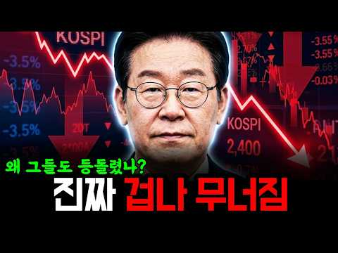
- 설명 앞부분: 최근 코스피 지수가 연이은 하락세를 보이며 증시 변동성이 극대화되고 있습니다. 삼성전자와 SK하이닉스 등 주요 대형주의 실적 발표 및 자사주 소각 이슈에도 불구하고, 외국인 투자자들의 대규모 매도세와 국민연금의 주식 비중 조정 여파로 투자자들의 불안감이 커지고 있습니다.
- 대본 없음 (설명) — 음성인식이 끝나면 도입부·흐름이 들어감
- 댓글 28/28: 좋은 점 — 영상 0 · 감사·응원 0 · 더 알고 싶은 것 0 · 아쉬운 점 — 영상 0 · 반박·불만 — 의견 다름 0 · 정치·사회 14 · 경험 공유 1 · 구독·다음 기대 0
  - 정치·사회 👍16 “1년사이 개쓰레기나라가 되가고 있다.”
  - 정치·사회 👍8 “믿을인간들 한테 믿어야지 나라가 어느한군데 온전한데가 없내”
  - 경험 공유 👍5 “이대통령 자주하는말...내가 언제 그랬어요?”

### 7. 단타 5년차가 알려준 ＂잃지 않는 법＂ 딱 3가지 ｜ 코스피 9000시대 생존법

- https://www.youtube.com/watch?v=WnuVkKRjcuI · 돈의흐름도 · 구독자 1,380 · 조회수 153,221 (×111.0, 하루 2,101.2) · 좋아요 2,650 (1.7%) · 13.5분 · 2026-08-09 · 주제 묶음 5. 국내주식 · 형식 정보·해설 (그 밖) · 폴더 `W_WnuVkKRjcuI` (웹 승인)
- 썸네일: 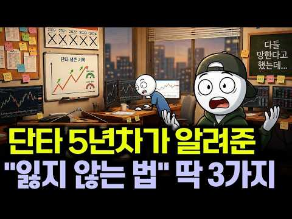
- 설명 앞부분: 단타 5년차가 알려준 ＂잃지 않는 법＂ 딱 3가지 ｜ 코스피 9000시대 생존법 경제를 제대로, 그리고 쉽게. 🏴‍☠ 이 채널에서 다루는 것들 주식·ETF·배당주 투자 분석 환율·금리·인플레이션 경제 해설 미국·한국 증시 및 글로벌 시장 동향 부동산·원자재·달러 등 자산 시장 분석 재테크 초보를 위한 경제 상식 어렵고 딱딱하게만 느껴지던 경제 뉴스, 경제해적단과 함께라면 달라집니다. 복잡한 시장의 흐름을 단순하고 명확하게 짚어드립니다. 월급쟁이도, 사회초년생도, 재테크를 막 시작한 분도 경제해적단과 함께라면 경제가 보이기 시작합니…
- 같은 채널 평소 대비 ×9,286.1 (채널 최근 롱폼 중앙값 16회) · 평소 영상: 50세 매달 200만원, 2가지만 알면 70세에 10억 만들어집니다 (17회) / ＂50대 노후 3억, 매달 100만원 만드는 법 (연금·복리·종잣돈)＂ (17회)
- 대본 (음성인식(앞 5분), 5.5 음절/초) — 앞부분만, 흐름은 그 안까지 첫 20초: “제가 아는 동생 중에 단타로 5년째 먹고 사는 친구가 있어요 전업으로요? 처음엔 저도 안 믿었어요 다들 망한다는 단타로 어떻게 5년을 버티냐고요 근데 옆에서 매매하는 걸 보고 깜짝 놀랐어요 종목을 신들린 듯 고를 줄 알았는데 의외로 사곱하는 건 되게 단순하더라고요 대신 딱 하나 남들이 절대 안 지키는 걸 기계처럼 지키고 있었어요” — 도입부 유형: 질문으로 시작, 숫자로 시작, 내 이야기·사연
- 첫 1분: “제가 아는 동생 중에 단타로 5년째 먹고 사는 친구가 있어요 전업으로요? 처음엔 저도 안 믿었어요 다들 망한다는 단타로 어떻게 5년을 버티냐고요 근데 옆에서 매매하는 걸 보고 깜짝 놀랐어요 종목을 신들린 듯 고를 줄 알았는데 의외로 사곱하는 건 되게 단순하더라고요 대신 딱 하나 남들이 절대 안 지키는 걸 기계처럼 지키고 있었어요 그게 뭐냐고 물어봤죠 그 친구가 한 말이 잊지 않아요 형 단타는 잘 사는 기술이 아니라 잘 버티는 기술이에요 차트 공부 100날 해봐야 소용 없다는 거예요 오늘 그 동생이 5년 동안 지켜온 그 한 가지를 여러분한테 그대로 풀어드릴게요 그리고 100만 원으로 그걸 어떻게 몸에 익히는지까지요 이거 하나만 가져가셔도 오늘 영상 값은 하실 거예요 끝까지 보세요 좋아요, 구독, 알림 설정 꼭”
- 흐름 (90초마다 첫 문장): 0:00 제가 아는 동생 중에 단타로 5년째 먹고 사는 친구가 있어요 → 1:31 이런 장을 보면 무슨 생각이 들까요? → 3:02 수익률은 오히려 더 낮았어요 → 4:31 근데 손실이 난 종목은 22%만 팔아요
- 댓글 96/96: 좋은 점 — 영상 3 · 감사·응원 2 · 더 알고 싶은 것 3 · 아쉬운 점 — 영상 4 · 반박·불만 — 의견 다름 3 · 정치·사회 0 · 경험 공유 7 · 구독·다음 기대 1
  - 좋은 점 — 영상 👍6 “너무 꼭 맞는 말씀입니다. 100원만 수익을 본다하더라도 100만원 1000만원 욕심을 버리기까지...다겪어봐야 조금 느끼게 되더라구요..”
  - 좋은 점 — 영상 👍2 “도움이 많이 됐습니다.참고하도록할께요.잠시 잊고 단타를 해서 손절 많이 했는데 이영상보고 뜨끔했네요.좋은영상 감사합니다”
  - 감사·응원 👍2 “도움이 많이 됐습니다.참고하도록할께요.잠시 잊고 단타를 해서 손절 많이 했는데 이영상보고 뜨끔했네요.좋은영상 감사합니다”
  - 더 알고 싶은 것 👍1 “구독, 좋아요,,,알림설정. 알려주세요.”
  - 아쉬운 점 — 영상 👍4 “단타 30년차로 잃지 않는 방법을 알려준다면 당장 주식을 접어라 그게 유일한 방법이다 그래도 주식을 하고 싶다면 종목을 보고 매매 하지말고 시장을 보고 매매해라 시장이 아니라고 하는데 시장을 이길라고 덤비면 백퍼 망한다 종목 차트 백날 선으로 찍찍 그어봐야 시장폭락하…”
  - 아쉬운 점 — 영상 👍2 “에이라.. 뻔한 이야기 가지고.. 뭐 특별한 비법이 있는 거 마냥...”
  - 반박·불만 — 의견 다름 👍5 “챠트 보는 법도 아니라 하고, 보조지표 보는 것도 아니라 하고, 종목 찍는 법도 아니라하는 건 제대로 공부를 안 했거나, 남들 말과 책에 쓰인 대로 맹신하며 투자하기 때문임. 제대로 알면 확률은 엄청난데 어설피 배우고 익힌 실력으로 하다가 매번 실패하는 경우가 많게 …”
  - 반박·불만 — 의견 다름 👍0 “영상 좋아요. 그런데 영상 후반부에 내가 이런 걸 지킬 자신이 있는가라고 자문해보라고 하시는데, 이런건 머리로 상상으로 자문한다고 알 수 있는 건 아니죠. 결국 몸으로 경험해봐야 내가 될놈인지 안될놈인지 체득할 수 있죠.”
  - 경험 공유 👍17 “많은 시련을 겪고 나서야만이 이 영상의 의미가 얾마나 중요한지를 깨닫게 되지요.”
  - 경험 공유 👍14 “단타는 잃지 않는게 중요.. 내가 정한 매도 포인트에서 기계적으로 매도해야함. 욕심내는 순간 지옥으로 떨어짐.”
  - 구독·다음 기대 👍1 “구독, 좋아요,,,알림설정. 알려주세요.”

### 8. The Story Behind India's Biggest Stock Market Scam ∣ Scam 1992 Explain ∣ 2D Animation

- https://www.youtube.com/watch?v=zay8CuiBUQ8 · DOKio · 구독자 7,650 · 조회수 717,441 (×93.8, 하루 6,658.0) · 좋아요 7,052 (1.0%) · 27분 · 2026-07-05 · 주제 묶음 기타 · 형식 정보·해설 (그 밖) · 폴더 `W_zay8CuiBUQ8` (웹 승인)
- 썸네일: 
- 설명 앞부분: ₹4,000 Crore ka Scam... Stock Market me record tod tezi... aur phir ek aisa khulasa jisne poore India ki Financial System ko hila diya! 😱 Kya sirf shares ki prices badhakar koi insaan hazaron crore rupaye ka game khel sakta hai? Kaise ek aam Stock Broker "The Big Bull" bana aur phir India ke sabse …
- 같은 채널 평소 대비 ×57.8 (채널 최근 롱폼 중앙값 12,416회) · 평소 영상: How Nirav Modi Stole PNB ₹14,000 Crore ∣ Nirav Mo… (15,391회) / How DMart Became One of India’s Biggest Retailers… (9,441회)
- 대본 없음 (설명) — 음성인식이 끝나면 도입부·흐름이 들어감
- 댓글 194/197: 좋은 점 — 영상 0 · 감사·응원 0 · 더 알고 싶은 것 0 · 아쉬운 점 — 영상 0 · 반박·불만 — 의견 다름 0 · 정치·사회 0 · 경험 공유 0 · 구독·다음 기대 0

### 9. I Own 300 Shares of SCHD - Here's My Dividend Payout

- https://www.youtube.com/watch?v=Z_-PJGzUdD4 · Cade Invests · 구독자 1,800 · 조회수 155,958 (×86.6, 하루 1,886.0) · 좋아요 2,005 (1.3%) · 10.5분 · 2026-07-30 · 주제 묶음 2. 장기투자·ETF·지수 · 형식 정보·해설 (그 밖) · 폴더 `W_Z_-PJGzUdD4` (웹 승인)
- 썸네일: 
- 챕터: 0:00 Intro · 0:37 SCHD ETF Overview · 2:05 SCHD Holdings · 3:00 My SCHD Position · 4:15 SCHD Dividend Income · 6:38 SCHD vs VOO vs QQQ · 9:10 My SCHD Plan
- 설명 앞부분: I have over $10,000 invested in the dividend ETF SCHD. In today's video I'm breaking down my SCHD dividend payouts from every year and if I plan to continue investing in SCHD in the future. FREE PDF Download: SCHD is one of the most popular dividend ETFs out there today. That is for good reason as …
- 같은 채널 평소 대비 ×315.7 (채널 최근 롱폼 중앙값 494회) · 평소 영상: The BEST Purchases To Make In Your 20s (Tier List) (506회) / 10 Things To Know About ETFs Before Investing (fo… (482회)
- 대본 없음 (설명) — 음성인식이 끝나면 도입부·흐름이 들어감
- 댓글 338/338: 좋은 점 — 영상 0 · 감사·응원 0 · 더 알고 싶은 것 0 · 아쉬운 점 — 영상 0 · 반박·불만 — 의견 다름 0 · 정치·사회 0 · 경험 공유 0 · 구독·다음 기대 0

### 10. 같은 TQQQ에 1억, 한 사람은 2만 원 한 사람은 388억 (실제 데이터)

- https://www.youtube.com/watch?v=d2_oRUcx5Uo · 머니언박싱 · 구독자 2,200 · 조회수 190,198 (×86.5, 하루 8,124.0) · 좋아요 865 (0.4%) · 8.1분 · 2026-09-27 · 주제 묶음 2. 장기투자·ETF·지수 · 형식 정보·해설 (그 밖) · 폴더 `W_d2_oRUcx5Uo` (웹 승인)
- 썸네일: 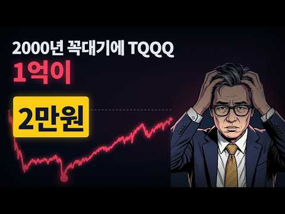
- 챕터: 0:00 두 개의 계좌 · 0:24 3배 레버리지는 어떻게 움직이나 · 0:54 박 부장, 2000년 3월 꼭대기에서 1억 · 1:20 1년 만에 496만 원 · 1:42 2만 원까지 · 2:06 지수는 돌아왔는데 · 2:35 26년 뒤 박 부장 · 2:56 만약 2009년 바닥에서 샀다면 · 3:42 이 대리, TQQQ 상장일에 1억 · 4:00 16년 뒤, 그러나 · 4:25 만약 2021년 11월에 들어갔다면 · 5:05 최 사원, 매달 50만 원 · 5:32 94억에서 20억으로 · 5:56 만약 2022년에 팔았다면 · 6:29 결과 공개 · 6:56 이 결과를 믿기 전에 · 7:24 레버리지를 산다면
- 설명 앞부분: 같은 TQQQ, 같은 1억 원. 한 사람은 계좌가 한때 2만 원이 됐고, 다른 사람은 지금 388억 원입니다. 무엇이 두 사람을 갈랐을까요? 그리고 같은 상품을 매달 조금씩 산 사람은 어떻게 됐을까요? 박 부장: 2000년 3월 27일, 나스닥100 꼭대기에 1억 원을 3배 레버리지로 이 대리: 2010년 2월 11일, TQQQ 상장일에 1억 원 최 사원: 2000년 4월부터 매달 50만 원씩 3배 레버리지 (세 사람은 가상 인물이고, 숫자는 전부 실제 데이터로 계산했습니다) 계산 조건 2010년 2월 이전 3배·2배는 실제 상품…
- 같은 채널 평소 대비 ×54.9 (채널 최근 롱폼 중앙값 3,465회) · 평소 영상: 1억 모으기: 지금 당장 시작해야 하는 이유 l 복리의 마법 (3,465회) / VOO와 QQQ, 반반 섞으면 덜 떨어질까? 비율별 비교 (3,294회)
- 대본 (음성인식(앞 5분), 4.9 음절/초) — 앞부분만, 흐름은 그 안까지 첫 20초: “여기 두 개의 계좌가 있습니다. 둘 다 1억원으로 시작했고 둘 다 같은 상품을 샀습니다. 나스딱백을 매일 세 배로 따라가는 레버리지 tqq입니다. 그런데 한 계좌는 한때 2만원이 됐고 다른 계좌는 지금 388억원입니다. 무엇이 이 둘을 갈랐을까요? 그리고 같은 상품을 매달 조금씩 산 사람은 어떻게 됐을까요? 오늘은 세 사람의 레버리지 계좌를 실제 데이터로 끝까지 따라가 보겠습니다.”
- 첫 1분: “여기 두 개의 계좌가 있습니다. 둘 다 1억원으로 시작했고 둘 다 같은 상품을 샀습니다. 나스딱백을 매일 세 배로 따라가는 레버리지 tqq입니다. 그런데 한 계좌는 한때 2만원이 됐고 다른 계좌는 지금 388억원입니다. 무엇이 이 둘을 갈랐을까요? 그리고 같은 상품을 매달 조금씩 산 사람은 어떻게 됐을까요? 오늘은 세 사람의 레버리지 계좌를 실제 데이터로 끝까지 따라가 보겠습니다. tqq는 나스딱백 지수가 하루에 1% 오르면 3% 1% 내리면 3% 움직이도록 만든 상품입니다. 중요한 건 매일이라는 말입니다. 1년에 3배가 아니라 매일 3배를 다시 맞춥니다. 그리고 3배를 만들기 위해 빌린 돈의 이자와 운영 보수가 매일 조금씩 빠져나갑니다. tqq는 2010년에 처음 나왔기 때문에 그 이전은 나스딱백의 실제”
- 흐름 (90초마다 첫 문장): 0:00 여기 두 개의 계좌가 있습니다. 둘 다 1억원으로 시작했고 둘 다 같은… → 1:34 2002년 10월 3배 계자에는 84000원이 남아 있었습니다. 1억 … → 3:04 새로 1억 원을 3배 레버리지에 넣었다고 해보겠습니다. 지금 이 계자는… → 4:35 이번에도 실제 기록입니다. 1년 뒤 2022년 12월 계자는 81.7%…
- 댓글 144/144: 좋은 점 — 영상 7 · 감사·응원 7 · 더 알고 싶은 것 8 · 아쉬운 점 — 영상 1 · 반박·불만 — 의견 다름 3 · 정치·사회 0 · 경험 공유 10 · 구독·다음 기대 1
  - 좋은 점 — 영상 👍8 “너무 좋은 영상 감사합니다 보고 먾이 배웠습니다. 사람들은 단순히 세배의 장점만 보는데 박부장의 케이스는 너무 무섭네요 관점을 바꾸는 좋은 계기가 되었습니다 감사합니다!”
  - 좋은 점 — 영상 👍8 “진짜 좋은 영상이네요 👍”
  - 감사·응원 👍8 “너무 좋은 영상 감사합니다 보고 먾이 배웠습니다. 사람들은 단순히 세배의 장점만 보는데 박부장의 케이스는 너무 무섭네요 관점을 바꾸는 좋은 계기가 되었습니다 감사합니다!”
  - 감사·응원 👍3 “궁금한 게 있습니다! 적립식이 중요하다는 건 알겠는데 Tqqq를 투자하면 결국 적립식으로 해도 초반은 방어가 되지만 장기투자하고 후반에 금액이 커진 상황에 대폭락이 오면 qqq보다 훨씬 낮아질 확률이 꽤 있지 않나요? TQQQ 관련 내용 책이나 좋은 자료 혹시 있다면…”
  - 더 알고 싶은 것 👍3 “Soxl도 궁금합니다😮”
  - 더 알고 싶은 것 👍3 “궁금한 게 있습니다! 적립식이 중요하다는 건 알겠는데 Tqqq를 투자하면 결국 적립식으로 해도 초반은 방어가 되지만 장기투자하고 후반에 금액이 커진 상황에 대폭락이 오면 qqq보다 훨씬 낮아질 확률이 꽤 있지 않나요? TQQQ 관련 내용 책이나 좋은 자료 혹시 있다면…”
  - 아쉬운 점 — 영상 👍0 “정말 무서운 건 지난 20년이 나스닥 역사상 가장 전성기였다는 사실. 닷컴버블도 아무리 길게 잡아도 3년. 10년 횡보장이었다면 QQQ 투자자는 우울한 정도지만, 폭락 후 버티는 QLD, TQQQ 투자자는 인생 망하는 케이스. 역사는 반복된다?? 아닙니다. 그 시대를…”
  - 반박·불만 — 의견 다름 👍6 “이미 흐름을 알고있는 과거시기를 극적으로 발취하여,,,,,감동적인효과는 알겠는데,,,, 솔직히 현실적투자환경속 투자자라면 실현가능한 일은 아니죠.의지력을 키우라는 교훈성”
  - 반박·불만 — 의견 다름 👍0 “정말 무서운 건 지난 20년이 나스닥 역사상 가장 전성기였다는 사실. 닷컴버블도 아무리 길게 잡아도 3년. 10년 횡보장이었다면 QQQ 투자자는 우울한 정도지만, 폭락 후 버티는 QLD, TQQQ 투자자는 인생 망하는 케이스. 역사는 반복된다?? 아닙니다. 그 시대를…”
  - 경험 공유 👍8 “매달 초마다 200만원 환전해서 TQQQ 매수합니다. 환율/주가 생각 안하고 삽니다 파는건 일년에 250만원만 하고 있습니다. 이제 1년차이고 앞으로 9년 남았네요 😊”
  - 경험 공유 👍6 “무서워서 그냥 연저펀 타이거 s&p500, isa 코덱스 나스닥100 두가지만 3년차 풀매수중입니다 😊”
  - 구독·다음 기대 👍4 “영상보고 바로 구독했습니다”

### 11. 【資産公開】S&P500に1000万入れて5年間放置した結果（めちゃ増えた）｜31歳会社員・新NISA

- https://www.youtube.com/watch?v=Lb9ht5PE0vU · ぼんじり【平凡会社員のずぼら投資術】 · 구독자 4,470 · 조회수 360,727 (×80.7, 하루 3,798.0) · 좋아요 2,166 (0.6%) · 13.9분 · 2026-07-18 · 주제 묶음 2. 장기투자·ETF·지수 · 형식 정보·해설 (그 밖) · 폴더 `W_Lb9ht5PE0vU` (웹 승인)
- 썸네일: 
- 챕터: 0:00 今日のテーマ · 1:04 結論:5年でこれだけ増えました · 1:47 5年間の全記録（2021~2026） · 7:23 そもそも最初の元手をどうやって作った？ · 8:33 5年の運用で理解したインデックス投資の3つの本質 · 11:00 S&P500への積立を辞めた理由 · 12:56 まとめ
- 설명 앞부분: ③【新NISA】米国株信者だった僕がS＆P500から日経平均に乗り換えた8つの理由
- 같은 채널 평소 대비 ×39.2 (채널 최근 롱폼 중앙값 9,202회) · 평소 영상: 【実録】資産3000万円まで最短で達成させるためにやって良かった7つのこと・後悔している3つのこと… (9,296회) / 【実録】資産2000万で人生が激変する5つの理由と最速で到達する方法｜28歳会社員の実体験 (9,108회)
- 대본 없음 (설명) — 음성인식이 끝나면 도입부·흐름이 들어감
- 댓글 141/141: 좋은 점 — 영상 0 · 감사·응원 0 · 더 알고 싶은 것 0 · 아쉬운 점 — 영상 0 · 반박·불만 — 의견 다름 0 · 정치·사회 0 · 경험 공유 0 · 구독·다음 기대 0

### 12. 나스닥 투자하기 전에 이 영상 꼭 보세요 ∣ QLD만 모아가는 이유

- https://www.youtube.com/watch?v=g10Y6ZA7rng · 올레버 · 구독자 1,580 · 조회수 116,701 (×73.9, 하루 827.3) · 좋아요 1,632 (1.4%) · 5.7분 · 2026-06-02 · 주제 묶음 2. 장기투자·ETF·지수 · 형식 정보·해설 (그 밖) · 폴더 `W_g10Y6ZA7rng` (웹 승인)
- 썸네일: 
- 챕터: 0:00 도입 — QLD를 추천하는 이유 · 0:12 레버리지의 음의 복리(Volatility Decay)… · 1:31 나스닥에서 음의 복리가 반은 틀린 이유 · 2:02 QQQ / QLD / TQQQ 수익률 비교 (2010… · 3:05 왜 TQQQ보다 QLD인가 — 최적 레버리지 배율 · 4:01 2021년 차트로 보는 변동성 비교 · 4:29 장기 투자자에게 QLD가 적합한 이유 · 4:52 개인 목표 (10년 순자산 30억) 기준으로 본 QLD · 5:18 리스크 안내 및 마무리
- 설명 앞부분: 나스닥 ETF, 어떤 걸 사야 할까요? QQQ, QLD, TQQQ. 다들 나스닥 기반인데 뭐가 다른지, 그리고 왜 저는 QLD를 선택했는지 오늘 얘기해볼게요. 이런 분들께 추천드려요 나스닥 ETF 투자를 고민 중인 분 QQQ, QLD, TQQQ 차이가 궁금한 분 레버리지 ETF가 위험하다고 들었는데 궁금한 분 📊 영상에서 다루는 내용 QQQ / QLD / TQQQ 각각 뭐가 다른가 레버리지는 장기 보유하면 녹는다? 진실은 나스닥 각 배율별 10년 수익률 비교 10년 뒤 30억을 위해 필요한 수익률 🎯 목표 : 순자산 30억 파이어…
- 같은 채널 평소 대비 ×163.2 (채널 최근 롱폼 중앙값 715회) · 평소 영상: 배달 뛰다가 워렌버핏의 말을 이해했습니다 ∣ 투자관을 바꾸게 된 계기 (715회) / 이제 저축 안 늘립니다. 30억 파이어족 계획 (552회)
- 대본 없음 (설명) — 음성인식이 끝나면 도입부·흐름이 들어감
- 댓글 347/347: 좋은 점 — 영상 4 · 감사·응원 18 · 더 알고 싶은 것 24 · 아쉬운 점 — 영상 1 · 반박·불만 — 의견 다름 5 · 정치·사회 0 · 경험 공유 17 · 구독·다음 기대 2
  - 좋은 점 — 영상 👍7 “구독 눌렀어요 좋은정보 앞으로도 부탁드려요😂”
  - 좋은 점 — 영상 👍7 “10~25 년까지는 초저금리 기반 빅테크 대상승장이었죠. 닷컴버블 직후(00~10년)처럼 10년 동안 박스권 횡보장세였다면 진정한 음의 복리 마법을 맛봤을 겁니다.. 그리고 큰 MDD 낙폭은 실제로 겪지 않으면 그게 어떤 느낌인지 피부로 안 와닿아요. 내 투자자산이 …”
  - 감사·응원 👍12 “1.닷컴버블 폭락 기간: 약 2년 6개월 (31개월) 회복 기간: 약 4년 5개월 (53개월) 내 돈이 묶인 총 기간: 약 7년 1개월 2. 리먼 브라더스 사태 폭락 기간: 약 1년 5개월 (17개월) 회복 기간: 약 4년 (48개월) 내 돈이 묶인 총 기간: 약 5…”
  - 감사·응원 👍3 “저도 맘 편해서 QLD 매달 100 좀 넘게 모아갑니다. 최근 하락시 좀 더 사서 모으고 ㅎㅎ 앞으로도 파이팅입니다~😊”
  - 더 알고 싶은 것 👍8 “도움 많이 되었네요! 근데 4:44초에 저런 비교 데이터는 어디에서 볼 수 있을까요?!”
  - 더 알고 싶은 것 👍7 “구독 눌렀어요 좋은정보 앞으로도 부탁드려요😂”
  - 아쉬운 점 — 영상 👍0 “연저펀에 못담는게 아쉽네요.”
  - 반박·불만 — 의견 다름 👍41 “QLD 6년차, 만5년 매도 없이 모아가는 중입니다. 여러분, 레버리지는 하락장 횡보장에 다 녹는 다는 말에 너무 매몰 되지 마세요. 하락후 반드시 찾아오게 되는 긴 상승장에서의 양의 복리는 퍼포먼스가 두배가 아닙니다. 속된말로 존나 오릅니다. 횡보, 하락장에서 추종…”
  - 반박·불만 — 의견 다름 👍13 “하락장 자신없는분은 건드리지도 마세요. 좋다좋다그래도 레버리지는 막 하는거 아닙니다”
  - 경험 공유 👍41 “QLD 6년차, 만5년 매도 없이 모아가는 중입니다. 여러분, 레버리지는 하락장 횡보장에 다 녹는 다는 말에 너무 매몰 되지 마세요. 하락후 반드시 찾아오게 되는 긴 상승장에서의 양의 복리는 퍼포먼스가 두배가 아닙니다. 속된말로 존나 오릅니다. 횡보, 하락장에서 추종…”
  - 경험 공유 👍19 “폭락을 경험해보지도 않은 이런 핏덩이들이 레버리지 좋다고 주절 대는게 너무 귀엽네 ㅋㅋ”
  - 구독·다음 기대 👍3 “구독했습니다~~ 혹시 경상도 이신가요? ㅎㅎ”

### 13. 50대 옥탑방 부부, "그 나이에 왜 주식을..."

- https://www.youtube.com/watch?v=FRzyTNO9mNI · 반백살, 옥탑방 이야기 · 구독자 601 · 조회수 42,862 (×71.3, 하루 2,397.2) · 좋아요 419 (1.0%) · 6.3분 · 2026-10-03 · 주제 묶음 1. 주식 기초·초보 · 형식 정보·해설 (그 밖) · 폴더 `W_FRzyTNO9mNI` (웹 승인)
- 썸네일: 
- 설명 앞부분: 지난 영상 이후, 50대 옥탑방 부부인 저희의 주식 도전에 많은 분들이 걱정과 조언을 남겨주셨습니다. 진심으로 감사드립니다. "그 나이에 왜 위험하게 주식을 하느냐"는 물음에 오늘 제 진솔한 속마음을 전합니다. 사기와 빚을 겪으며 깨달은 금융 무지의 서러움, 그리고 평생 일할 수 없다는 현실 앞에 저희에게 파이어족은 노후를 위한 '마지막 생존 전략"입니다. 지치지 않고 끝까지 걸어갈 수 있도록 많은 응원과 격려 부탁드립니다. 오늘도 시청해 주셔서 감사합니다.
- 같은 채널 평소 대비 ×13.3 (채널 최근 롱폼 중앙값 3,222회) · 평소 영상: 8월 폭염 속, 침침해진 눈으로 배달을 나섭니다. (3,342회) / "여보 제발 나가지 마!" 돈 없는데 비 온다고 일 안 못나가는 이유 (3,103회)
- 대본 (음성인식(앞 5분), 4.2 음절/초) — 앞부분만, 흐름은 그 안까지 첫 20초: “안녕하세요 구독자 여러분 50대 옥탑방 아내입니다. 어느 덧 바람 끝이 제법 선선해진 가을이 왔네요. 하늘도 높아지고 날씨가 참 좋습니다. 우리 구독자분들도 오늘 하루 기분 좋게 잘 보내고 계신가요? 옥탑방에서 바라보는 하늘은 계절이 바뀔 때마다 괜히 마음을 몽글몽글하게 만드는 것 같아요.” — 도입부 유형: 숫자로 시작, 시청자 부르기
- 첫 1분: “안녕하세요 구독자 여러분 50대 옥탑방 아내입니다. 어느 덧 바람 끝이 제법 선선해진 가을이 왔네요. 하늘도 높아지고 날씨가 참 좋습니다. 우리 구독자분들도 오늘 하루 기분 좋게 잘 보내고 계신가요? 옥탑방에서 바라보는 하늘은 계절이 바뀔 때마다 괜히 마음을 몽글몽글하게 만드는 것 같아요. 오늘 이렇게 영상을 제작하는 것은 지난 영상 이후에 정말 많은 분들이 남겨주신 댓글에 마음 깊이 감사하다는 말씀을 전하고 싶어서 입니다. 제가 주식공부에 보겠다고 말씀드린 이후로 걱정 어린 마음으로 따뜻한 조언과 충고를 남겨주신 분들이 정말 많았어요. 주식은 위험하다 잘못하면 큰일 난다 하며 자기 일처럼 걱정해주시는 마음 하나하나 읽으면서 얼마나 감사했는지 모릅니다.”
- 흐름 (90초마다 첫 문장): 0:00 안녕하세요 구독자 여러분 50대 옥탑방 아내입니다. → 1:36 나이가 한 살 한 살 들수록 느끼는 게 있어요. → 3:06 그 분야에 제대로 뛰어들려면 정말 피나는 공부와 노력이 필요하다는 것을… → 4:36 지금은 남편과 제가 노동소득으로 벌고 있지만 저라도 자본소득을 공부하고…
- 댓글 187/187: 좋은 점 — 영상 6 · 감사·응원 27 · 더 알고 싶은 것 3 · 아쉬운 점 — 영상 1 · 반박·불만 — 의견 다름 3 · 정치·사회 2 · 경험 공유 20 · 구독·다음 기대 0
  - 좋은 점 — 영상 👍10 “목소리가 좋으시네요 편안하고 듣기에 좋아요 비슷한 나이인데 주식을 해 보고 있어요 손절하여서 손해도 보았지만 그러면서 배우고 있어요 같은 생각으로 하며 접근하고 있어요 성투하시길 바래요🎉”
  - 좋은 점 — 영상 👍4 “목소리가 차분하고 편안해서 듣기 좋습니다~~ 힘내시고 파이팅 하세요~~”
  - 감사·응원 👍17 “목소리 좋으시네요 아무것도 안하면 아무것도 될 수 없을 껍니다 화이팅 하시길요”
  - 감사·응원 👍16 “저도 주식하면 패가 망신한다는 부모님 말씀을 금과옥조로 여기며 살다가, 50세가 넘은 나이에, 금기의 영역으로 생각했던 주식을 시작했어요. 개별주는 하나도 안하고, 미국지수, 국내지수만 투자하는데...진작 시작할걸 싶네요. 3년전부터 했는데 5년전, 10년전 시작할걸…”
  - 더 알고 싶은 것 👍2 “영상 자주 올려주세요❤ 주식공부도 열심히 하시고 화이팅입니다 ❤”
  - 더 알고 싶은 것 👍2 “뭐하나 물어볼게요..주식하셔서 얼마나 버셔서 만족 하실가요? 그냥 전 풍차돌리기 예금이나 적금 추천드리고...인생 한방 절대 없습니다. 소수의 행운이 나에게 올 확률이 정말 힘들다는거 다시 한번 이 나이에 잊지 마시길 부탁드립니다.”
  - 아쉬운 점 — 영상 👍1 “위 제목 아래에 AI라고 써있는데요 목소리는 ai같지않고 영상도 ai같지않은데..어느것이 Ai 인가요?”
  - 반박·불만 — 의견 다름 👍2 “하지마시고 한국 미국 반반 지수 장기투자하세요. 몇달한다고 되는게 아닙니다.”
  - 반박·불만 — 의견 다름 👍0 “안녕하세요 52인데요^^ 너무 공감합니다. ISA계좌 연금저축계좌 먼저만드세여 ISA계좌는 한해2천만원해서5년1억가능합니다.연금계좌는 1800까지가능합니다. 우리가족모두 만들어서 하고있네여. 종목추천은아닙니다 제가하는겁니다. ISA계좌에서 하시면 배당세금없이 재투자 …”
  - 정치·사회 👍1 “대통령이 하라해서 ㅡㅡㅡㅡ. 돈번것들은 재용 태원이ㅡㅡㅡㅡ”
  - 정치·사회 👍0 “제 경험을 말씀드려 볼게요. 현재 54살 노총각입니다. 24년 하반기부터 10년 이상 다니던 직장이 경기가 안좋아지면서 해고 위기가 느껴졌습니다. 당시까지 모아둔 돈이라곤 현금 3억 조금 넘게 가지고 있었고 집은 월세 45만원 오피스텔에 살고 있었죠. 당장 짤리면 4…”
  - 경험 공유 👍26 “목소리가 참 좋으시네요😊 저도 50대 중반이고 주식으로 노후자금 준비를 하고있어요 이제는 근로소득만 가지고 자산을 늘리는 시대는 끝났다고 봅니다 부동산은 목돈이 들어가니 서민들은 주식이 접근하기 쉽죠 저도 처음에 주식.금융공부 많이 하고 시작했는데요, 결국 공부보다 …”
  - 경험 공유 👍16 “저도 주식하면 패가 망신한다는 부모님 말씀을 금과옥조로 여기며 살다가, 50세가 넘은 나이에, 금기의 영역으로 생각했던 주식을 시작했어요. 개별주는 하나도 안하고, 미국지수, 국내지수만 투자하는데...진작 시작할걸 싶네요. 3년전부터 했는데 5년전, 10년전 시작할걸…”

### 14. 레버리지 ETF 상장폐지 논란🔥도박판 코스피 알고도 레버리지 ETF 상폐 못하는 이유🔥위험 알고도 도장 찍은 사람🔥금리인상 악제🔥역대급 반도체 실적 국민돈증발🔥…

- https://www.youtube.com/watch?v=O4-jY0zyhDo · 리얼경제 · 구독자 1,340 · 조회수 93,660 (×69.9, 하루 975.9) · 좋아요 2,368 (2.5%) · 15분 · 2026-07-17 · 주제 묶음 9. 빚투·레버리지 · 형식 정보·해설 (그 밖) · 폴더 `W_O4-jY0zyhDo` (웹 승인)
- 썸네일: 
- 챕터: 0:00 인트로 — 89조 잔치인데 국민 돈은 증발 · 0:44 검은 월요일 — 올해만 서킷브레이커 7번 · 2:01 범인의 등장 — 5월 27일 상장된 그 '상품' · 3:35 세 개의 함정 — 왜 도박판이 됐나 · 7:07 대(大)아이러니 — 실적 최대인데 주가 최대 폭락, … · 9:44 앞으로 어떻게 되나 — 상폐 못 하는 이유와 정부의 … · 13:31 착지 — 호황의 나라에서 국민이 죽는다
- 설명 앞부분: 🔎 삼성전자가 2분기 영업이익 89조 4천억 원으로 3분기 연속 최대를 기록하고, 7월 반도체 수출은 193% 폭증해 사상 최대를 찍었습니다. 나라는 반도체로 호황입니다. 그런데 바로 그 삼성전자와 SK하이닉스를 '미끼'로 만든 단일종목 레버리지 ETF에 국민 돈 10조 원이 넘게 묶인 채 녹아내리고, 올해에만 서킷브레이커가 일곱 번 울렸습니다. 실적은 최대인데 주가는 최대 폭락하는 기막힌 아이러니. 세계 1등 실적을 낸 나라에서 어쩌다 국민이 도박판에 앉게 됐는지, 레버리지 ETF의 세 가지 함정(복리손실·지수 착시·리밸런싱 증…
- 같은 채널 평소 대비 ×495.6 (채널 최근 롱폼 중앙값 189회) · 평소 영상: 삼성노조가 800조 호남 반도체 메가프로젝트 막아선 진짜 이유...부메랑 노란봉투법 삼성… (189회) / 엔비디아 손잡은 네이버 집중분석🔎아시아 AI 인프라회사로?🔥14조 유치🔥GPU 6만장🔥1… (147회)
- 대본 (음성인식(앞 5분), 5.5 음절/초) — 앞부분만, 흐름은 그 안까지 첫 20초: “여러분 지금 우리나라는 반도체로 잔치집입니다. 삼성전자가 한분기에 89조를 벌었어요. 3분기 연속, 역대 최대입니다. 그야말로 세계가 우리 반도체 앞에 앞다터 줄을 선 거예요. 그런데 말입니다. 바로 그 삼성을 믿기로 만든 어떤 상품에 지금 국민 돈 10조가 도박판처럼 놓고 있습니다. 올해에만 주식거래를 통째로 멈춰세우는 비상벨이 7번 울렸어요.” — 도입부 유형: 시청자 부르기
- 첫 1분: “여러분 지금 우리나라는 반도체로 잔치집입니다. 삼성전자가 한분기에 89조를 벌었어요. 3분기 연속, 역대 최대입니다. 그야말로 세계가 우리 반도체 앞에 앞다터 줄을 선 거예요. 그런데 말입니다. 바로 그 삼성을 믿기로 만든 어떤 상품에 지금 국민 돈 10조가 도박판처럼 놓고 있습니다. 올해에만 주식거래를 통째로 멈춰세우는 비상벨이 7번 울렸어요. 모두가 외칩니다. 그 상품, 없애버리라고. 그런데 당국은 답합니다. 뾰족한 수가 없다, 두 손을 든 겁니다. 세계 1등 실적을 낸 나라에서 왜 국민만 도박판에 앉았을까요? 그리고 이 판, 앞으로 대체 어떻게 되는 걸까요? 오늘 그 이야기 처음부터 끝까지 아주 속시원이 다 풀어드리겠습니다. 지금 바로 시작합니다. 2026년 7월 13일 사람들이 검은 월요일이라 부르는”
- 흐름 (90초마다 첫 문장): 0:00 여러분 지금 우리나라는 반도체로 잔치집입니다. → 1:31 20분 동안 모든 거래를 강제로 멈춰 세우는 → 3:00 도박의 판 돈이 붙은 셈이죠. → 4:30 그 출렁임 자체가 비용이 돼서
- 댓글 648/648: 좋은 점 — 영상 2 · 감사·응원 10 · 더 알고 싶은 것 1 · 아쉬운 점 — 영상 1 · 반박·불만 — 의견 다름 5 · 정치·사회 150 · 경험 공유 17 · 구독·다음 기대 0
  - 좋은 점 — 영상 👍1 “유익한 정보 감사합니다 ㅎㅎ”
  - 좋은 점 — 영상 👍1 “좋은 설명이네.”
  - 감사·응원 👍4 “자세한 설명 감사합니다 아무리 실적 좋아도 레버리지 2배 때문에 주식시장을 쑥대밭을 만드네요 매일 서커브레이크 카지노 도박판 실적분석 필요없어요 코스닥 돈빼 레버리지 산다고합니다 아휴 답답 한숨 정부지도자들 자기들은 강건너 불구경 힘드네요”
  - 감사·응원 👍1 “감사합니다.”
  - 아쉬운 점 — 영상 👍1 “왜? 이렇게 Ai목소리가 듣기싫지 직접방송하라”
  - 반박·불만 — 의견 다름 👍1 “헛소리 그만하고 오늘 일단 3일 연속 써킷 갑니다.”
  - 반박·불만 — 의견 다름 👍1 “외국주식시장은 레버리지 2배이상짜리도 많은데 어떻게 돌아가냐 미국주식시장 같으면 벌써 망했어야 정상아니냐~ 선전선동질 그만해라 그놈의 남탓 ㅋㅋㅋㅋ”
  - 정치·사회 👍135 “이상품에 직접투자한 사람들만의 손실이 문제가 아니다ㆍ덕분에 수급쏠림으로 인한 코스닥의 붕괴다ㆍ챠트를보면 전쟁터진 나라보다 더 폭락해버렸다ㆍ그리고 정부는 모르쇠로 일관ㆍ배신감이 분노로 바뀌고 결국 정부의 정체성까지 의심하고있다ㆍ머슴이 주인을 물어뜯고 과연 무사할까?”
  - 정치·사회 👍82 “이정부는 결국 주식으로 국민의 신뢰를 얻다가 주식으로 신뢰를 잃어가고 망해가고있네 참 세상이 아이러니하네”
  - 경험 공유 👍19 “도박 좋아하는 놈들이 정책을 해서. 나라 전체를 강원랜드로 만들고 .저평가 가치주까지 다른 종목 다 반토막. 미장은 이렇게 안 망가졌다. 내가 하면 투자.니가 하면 투기”
  - 경험 공유 👍10 “이래서.. 내가 국내주식을 안하는 이유다 미국우량주식만 장기매수하는 거 그 게 그나마 맘편하다”

### 15. I Reinvested Dividends for 30 Years — Here's What Actually Happened

- https://www.youtube.com/watch?v=oZqWOuMZwdA · BudgetMoney · 구독자 2,550 · 조회수 163,423 (×64.1, 하루 1,242.8) · 좋아요 2,204 (1.4%) · 11.3분 · 2026-06-11 · 주제 묶음 기타 · 형식 정보·해설 (그 밖) · 폴더 `W_oZqWOuMZwdA` (웹 승인)
- 썸네일: 
- 챕터: 0:00 What 30 Years Actually Taught… · 1:19 What a Dividend Actually Is · 2:13 The Three Choices: Spend, Rei… · 3:03 30-Year Proof: Dividend Growt… · 6:55 The Tax Reality Nobody Warns … · 8:22 The One Number Nobody Checks:… · 10:07 Rich vs. Wealth — The Real Di…
- 설명 앞부분: I started reinvesting dividends in 1995. For 30 years I watched what compound dividend growth actually does to a portfolio — and it's not what most beginners expect.In this video I break down dividend growth investing from the ground up: what a dividend actually is, the three choices you have every…
- 같은 채널 평소 대비 ×587.9 (채널 최근 롱폼 중앙값 278회) · 평소 영상: 30 Years of Investing Taught Me That Less Activit… (278회) / The Real Reason You Can't Find a Starter Home (276회)
- 대본 (자막, 0.0 음절/초) 첫 20초: “I started investing in 1995. I was 26 years old. I'd read about compound interest. I'd read about dividend reinvesting. I understood the math. But understanding it on paper and watching it work for 30 years, those are not the same thing. And after three decades, I can tell you there's a difference b” — 도입부 유형: 숫자로 시작
- 첫 1분: “I started investing in 1995. I was 26 years old. I'd read about compound interest. I'd read about dividend reinvesting. I understood the math. But understanding it on paper and watching it work for 30 years, those are not the same thing. And after three decades, I can tell you there's a difference between reading about compounding and watching it happen in your own account. Here's an early McDonal”
- 흐름 (90초마다 첫 문장): 0:00 I started investing in 1995. I was 26 → 1:32 business or pay some of it out to the → 3:00 came from. → 4:32 Let me Let me show you what that → 6:02 roughly around 3%, 3 and 1/2% over the → 7:31 what it is, and then they move on. → 9:01 that dividend is at risk. But here's → 10:30 that's what builds wealth.
- 댓글 336/336: 좋은 점 — 영상 0 · 감사·응원 0 · 더 알고 싶은 것 0 · 아쉬운 점 — 영상 0 · 반박·불만 — 의견 다름 0 · 정치·사회 0 · 경험 공유 0 · 구독·다음 기대 0

### 16. S&P 500에 투자하면 노후 걱정 전혀 없습니다! 주식으로 부자 되는 가장 빠른 방법

- https://www.youtube.com/watch?v=_fnvM4hpX44 · 오피디의 머니노트 · 구독자 1,170 · 조회수 69,057 (×59.0, 하루 17,938.5) · 좋아요 300 (0.4%) · 16.4분 · 2026-10-17 · 주제 묶음 2. 장기투자·ETF·지수 · 형식 정보·해설 (그 밖) · 폴더 `W__fnvM4hpX44` (웹 승인)
- 썸네일: 
- 챕터: 0:00 인트로 · 0:59 버핏의 S&P 500 유언 · 2:13 S&P 500은 무엇인가 · 4:08 S&P 500의 과거 수익률 · 6:02 20년 전 S&P 500에 100만원 투자했다면 · 8:25 버핏은 왜 S&P 500을 골랐을까 · 9:45 지금 반도체에 물려 있다면 · 10:55 거치식 vs 적립식 · 13:41 S&P 500의 단점 · 15:23 마무리
- 설명 앞부분: 워런 버핏은 아내에게 남길 돈의 90%를 S&P 500 인덱스펀드에 넣으라고 했습니다. 20년 전 1,000만 원을 S&P 500에 넣었다면 지금 1억 1,600만 원, 코스피였다면 4,270만 원입니다. S&P 500이 무엇인지, 과거 수익률과 폭락 후 회복, 사상 최고치에서 사도 되는지, 거치식과 적립식 중 어떤 주식투자 방법이 나은지, VOO·SPY·IVV 차이와 환율·세금 같은 단점까지 실제 데이터로 정리했습니다.
- 대본 없음 (설명) — 음성인식이 끝나면 도입부·흐름이 들어감
- 댓글 63/63: 좋은 점 — 영상 0 · 감사·응원 2 · 더 알고 싶은 것 0 · 아쉬운 점 — 영상 0 · 반박·불만 — 의견 다름 1 · 정치·사회 0 · 경험 공유 9 · 구독·다음 기대 0
  - 감사·응원 👍7 “저는 한국주식도 좋지만 KODEX 미국S&P500에 매수할 예정입니다. ❤ 감사합니다.”
  - 경험 공유 👍13 “결론 = s&p500은 노후준비용으로 젊었을때부터 해라 은퇴시기에 들어갔다가 그게 고점이면 내가 죽을때쯤 복구될수도 있다”
  - 경험 공유 👍8 “올해까지 3년차 연금저축펀드 타이거 s&p500 풀매수 했습니다 😊진짜 너무 만족합니다 아닥 s&p500 ㅋㅋㅋㅋㅋㅋㅋ”

### 17. Dividend Stocks vs. Growth Stocks: The Math Most Investors Ignore

- https://www.youtube.com/watch?v=4bg3bjvjCjE · Finance Simplified · 구독자 3,520 · 조회수 203,994 (×58.0, 하루 4,017.6) · 좋아요 1,202 (0.6%) · 20.2분 · 2026-08-31 · 주제 묶음 기타 · 형식 정보·해설 (그 밖) · 폴더 `W_4bg3bjvjCjE` (웹 승인)
- 썸네일: 
- 챕터: 0:00 The $54,000 Question · 0:13 Yield vs. Appreciation vs. To… · 2:30 Where Every $1 of Profit Actu… · 5:00 The $32,000 Head-to-Head Test · 8:00 The Dividend Reinvestment Eff… · 10:30 The Tax Drag Most Comparisons… · 13:00 The High-Yield Trap · 15:00 The Growth-Stock Trap · 17:00 The Fair Test: Total Return v… · 18:30 Who Each Approach Actually Su… · 19:30 Final Verdict
- 설명 앞부분: Dividend Stocks vs. Growth Stocks: The Math Most Investors Ignore Dividend stocks vs. growth stocks — but compared correctly this time. Most investors argue "4% yield" against "12% growth," and those aren't even the same kind of number. In this breakdown we run both strategies through identical mat…
- 같은 채널 평소 대비 ×43.9 (채널 최근 롱폼 중앙값 4,642회) · 평소 영상: How Much Do You Need to Invest to Earn $5,900 a M… (4,685회) / Pay Off a 6% Mortgage Early vs. Invest in Index F… (4,600회)
- 대본 없음 (설명) — 음성인식이 끝나면 도입부·흐름이 들어감
- 댓글 321/330: 좋은 점 — 영상 0 · 감사·응원 0 · 더 알고 싶은 것 0 · 아쉬운 점 — 영상 0 · 반박·불만 — 의견 다름 0 · 정치·사회 0 · 경험 공유 0 · 구독·다음 기대 0

### 18. Corporate Slave to Financially Free: The Passive Income 🐐

- https://www.youtube.com/watch?v=knkqhQrQS60 · The Retail Rundown · 구독자 1,490 · 조회수 84,794 (×56.9, 하루 2,956.8) · 좋아요 795 (0.9%) · 80분 · 2026-09-22 · 주제 묶음 2. 장기투자·ETF·지수 · 형식 정보·해설 (그 밖) · 폴더 `W_knkqhQrQS60` (웹 승인)
- 썸네일: 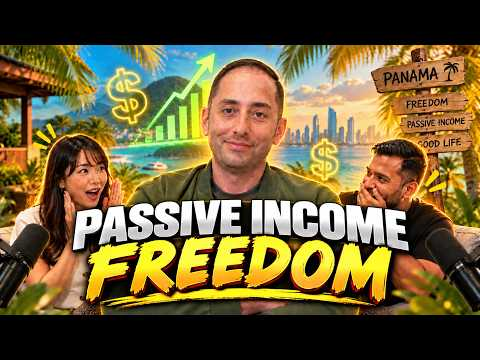
- 챕터: 0:00 Intro · 2:05 Adriano's start in trading · 4:53 Discovering dividends & cover… · 9:00 Selling the condo & hitting f… · 14:26 Quitting their jobs · 16:04 Moving to Panama tax-free · 19:37 Becoming a Canadian non-resid… · 26:51 Cost of living & healthcare i… · 44:05 Income investing & the 25% le… · 58:35 Why covered call ETFs get so … · 70:49 Portfolio reveal: $50K/month …
- 설명 앞부분: That journey led them to quit their jobs in their mid-30s, sell everything, and move to Panama full-time, where a territorial tax system means they pay almost nothing on their income. Adriano breaks down how he built his portfolio from a messy 120-holding starter fund into a focused covered call st…
- 같은 채널 평소 대비 ×12.3 (채널 최근 롱폼 중앙값 6,889회) · 평소 영상: Turning $15 into $4000: The Most UNHINGED Side Hu… (6,942회) / Veteran Portfolio Manager on AI Bubble, Market Cr… (6,836회)
- 대본 (자막, 0.0 음절/초) 첫 20초: “My wife and I were focusing on paying down the mortgage as a priority. So, we paid off our 20-year mortgage in seven years. Now, I would call my banker and say, "Increase the mortgage, increase the mortgage, increase the mortgage." >> Cuz I know Panama is very great for taxes. >> A couple of our fri”
- 첫 1분: “My wife and I were focusing on paying down the mortgage as a priority. So, we paid off our 20-year mortgage in seven years. Now, I would call my banker and say, "Increase the mortgage, increase the mortgage, increase the mortgage." >> Cuz I know Panama is very great for taxes. >> A couple of our friends are moved there, including you. I think you kind of started the whole trend. >> Yeah. I mean, w”
- 흐름 (90초마다 첫 문장): 0:00 My wife and I were focusing on paying → 1:31 call ETFs retirement is never the word → 3:00 um I started well I didn't really know → 4:30 long time ago. We were basically focused → 6:01 worry, I got you. Um, I really like the → 7:31 you were you still paying off your → 9:01 you're not going to get rich off → 10:31 month in Montreal like very comfortably → 12:00 >> Wait, so I want to backtrack a little → 13:30 every single second there's revenue → 15:01 >> She quit first. I continued on still → 16:32 >> So, we started looking into places a… → 18:01 within → 19:31 >> I I still have a Canadian bank accou… → 21:00 >> the day what we left or the day we → 22:31 secondary, a business. Secondary ties → 24:00 cash account. So how it works, you know, → 25:30 don't refund is Canadian eligible → 27:00 become a non-resident. You lose all the → 28:30 would say is
- 댓글 134/141: 좋은 점 — 영상 0 · 감사·응원 0 · 더 알고 싶은 것 0 · 아쉬운 점 — 영상 0 · 반박·불만 — 의견 다름 0 · 정치·사회 0 · 경험 공유 0 · 구독·다음 기대 0

### 19. 5월 나스닥 폭락설? 아무도 안 알려준 돈의 이동설

- https://www.youtube.com/watch?v=DsUbusxqaL8 · 한알경제 · 구독자 1,590 · 조회수 88,509 (×55.7, 하루 503.1) · 좋아요 825 (0.9%) · 8.5분 · 2026-04-28 · 주제 묶음 2. 장기투자·ETF·지수 · 형식 정보·해설 (그 밖) · 폴더 `W_DsUbusxqaL8` (웹 승인)
- 썸네일: 
- 챕터: 0:00 5월 나스닥 위기, 진짜 범인은 일론 머스크? · 0:23 나스닥을 흔드는 거대한 '다이아몬드 알'의 정체 · 0:46 삼성전자 12개 체급, SpaceX 상장 소식 · 1:15 스타링크: 머스크의 진짜 돈 버는 엔진 · 1:58 SpaceX와 xAI의 결합, 엔비디아가 긴장하는 이유 · 2:37 역대급 몸값, 왜 고작 75억 달러만 조달할까? · 3:18 5월 텍사스, 스타쉽 12차 발사가 중요한 이유 · 3:52 머스크가 일반인에게 주식 30%를 주는 진짜 의도 · 4:24 나스닥 대이동: 우량주 폭락이 기회인 이유 · 5:10 반드시 알아야 할 SpaceX 투자 리스크 3가지 · 6:14 머스크의 독단적 결정권과 '도지코인' 변수 · 7:15 한국에서 SpaceX 주식 청약하는 방법 (미래에셋) · 7:42 결론: 광풍 속에서 진짜 '황금 알'을 줍는 법
- 설명 앞부분: 5월, 나스닥이 흔들리는 진짜 이유. 폭락이 아니라 돈의 이동입니다. 일론 머스크, 테슬라, SpaceX, AI 흐름까지 지금 시장 구조를 한 번에 정리했습니다. 왜 삼성전자 같은 대형주까지 영향을 받는지, 지금 구간이 기회인지 위험인지 기준을 잡아드립니다. 지금은 하락장이 아니라 판이 바뀌는 구간입니다. [투자 면책] 타임테이블
- 같은 채널 평소 대비 ×636.8 (채널 최근 롱폼 중앙값 139회) · 평소 영상: 금값 올랐다는데 왜 팔면 손해일까? 장롱 속 금반지 지금 팔아야 할까 (139회) / 모더나 190달러, 지금 추격해도 될까? 10월 24일이 진짜 시험입니다 (149회)
- 대본 없음 (설명) — 음성인식이 끝나면 도입부·흐름이 들어감
- 댓글 100/100: 좋은 점 — 영상 2 · 감사·응원 4 · 더 알고 싶은 것 1 · 아쉬운 점 — 영상 0 · 반박·불만 — 의견 다름 0 · 정치·사회 1 · 경험 공유 1 · 구독·다음 기대 0
  - 좋은 점 — 영상 👍1 “좋은 이야기입니다. 주가가 오르겠네요.”
  - 감사·응원 👍0 “영상 감사합니다.😊”
  - 감사·응원 👍0 “감사합니다”
  - 더 알고 싶은 것 👍0 “영상 잘 봤습니다 앞으로 전력공급이 수요를 못 따라가는건 당연해 보이는데 그렇다면 그리드위즈(Gridwiz)사업은 필수 아닐까 싶은데 어떻게 보시나요? 사업내용 요약 전력 효율을 높이고 에너지 비용을 줄이기 위한 에너지 IT 솔루션 기업입니다. 쉽게 말해, “전기를 …”
  - 정치·사회 👍2 “트럼프는 지금도 개판이지만 선거가 다가오기전 지지율 반전모색을 위하여 막판 뒤집기 뻘짓하고도 남을 것 같네요~~~”
  - 경험 공유 👍2 “제발 대공황식으로 대폭락이 와야 내가 돈을 번다 ㅋㅋㅋ 미국이 완전망해야한다”

### 20. AI로 주식 자동 매매하면 어떻게 될까?

- https://www.youtube.com/watch?v=9E9OrcoMCjk · 이영배 · 구독자 19,000 · 조회수 1,040,110 (×54.7, 하루 8,461.8) · 좋아요 5,431 (0.5%) · 11.3분 · 2026-06-20 · 주제 묶음 7. 매매·전략 · 형식 정보·해설 (그 밖) · 폴더 `W_9E9OrcoMCjk` (웹 승인)
- 썸네일: 
- 같은 채널 평소 대비 ×9.0 (채널 최근 롱폼 중앙값 115,908회) · 평소 영상: AI에게 유튜브 채널을 운영시키면 구독자를 몇 명 모을까? (68,445회) / AI에게 인스타그램 운영을 시키면 팔로워를 몇 명 모을까? (222,621회)
- 대본 (음성인식(앞 5분), 6.8 음절/초) — 앞부분만, 흐름은 그 안까지 첫 20초: “지금부터 AI 두 개로 주식거래 대결 시켜볼 겁니다 누가 더 돈을 많이 벌어올까요? 제가 직접 한번 해보겠습니다 저는 제돈 천만 원을 AI 두 개에게 맡겨봤습니다 하나는 클로드의 오프스 4.8 다른 하나는 오픈 AI의 GPT 5.5인데요 둘 다 현재 최고의 성능을 자랑하는 각 회사의 최신 모델입니다 규칙은 간단합니다 실제 돈 500만 원을 받고 2주, 공일 제외 9 거래일 동안 최대 수익을 내면 됩니다” — 도입부 유형: 질문으로 시작
- 첫 1분: “지금부터 AI 두 개로 주식거래 대결 시켜볼 겁니다 누가 더 돈을 많이 벌어올까요? 제가 직접 한번 해보겠습니다 저는 제돈 천만 원을 AI 두 개에게 맡겨봤습니다 하나는 클로드의 오프스 4.8 다른 하나는 오픈 AI의 GPT 5.5인데요 둘 다 현재 최고의 성능을 자랑하는 각 회사의 최신 모델입니다 규칙은 간단합니다 실제 돈 500만 원을 받고 2주, 공일 제외 9 거래일 동안 최대 수익을 내면 됩니다 가장 먼저 클로드 코드로 거래를 할 수 있는 프로그램을 뚝딱 만들어냈고요 상태를 확인할 수 있는 데시보드도 구현해놨습니다 그래도 2주 동안 함께 하는 녀석들 아닙니까? 그래서 제가 이름도 한번 붙여봤는데 클로드가 짱이냐, 체치 PT가 짱이냐 이걸 정하는 거니까 휠짱이, 체짱이 이렇게 하겠습니다 그렇게 휠짱이와”
- 흐름 (90초마다 첫 문장): 0:00 지금부터 AI 두 개로 주식거래 대결 시켜볼 겁니다 → 1:30 일단 시장을 쭉 관망을 해요 → 3:01 삼성전자를 잇절해서 14만 원을 벌었다고 전 보고를 했단 말이죠 → 4:31 아니 왜 제가 시작하니까 갑자기 이런 일이 생기는 거죠?
- 댓글 578/584: 좋은 점 — 영상 6 · 감사·응원 17 · 더 알고 싶은 것 34 · 아쉬운 점 — 영상 3 · 반박·불만 — 의견 다름 8 · 정치·사회 7 · 경험 공유 34 · 구독·다음 기대 21
  - 좋은 점 — 영상 👍4 “딕션도 좋고 설명이 좋아요 컨텐츠만 좋으면 크게 되실분이다!!화이팅!!”
  - 좋은 점 — 영상 👍2 “영상 잘봤습니다. 앞으로 쭉쭉 좋은 영상 만들어주세요! 응원할게요”
  - 감사·응원 👍4 “딕션도 좋고 설명이 좋아요 컨텐츠만 좋으면 크게 되실분이다!!화이팅!!”
  - 감사·응원 👍3 “형들 마지막에 유튜버분 말들엇지? 현업코딩전문개발자들이 ai사용해서 장기적으로 수익이안나..이말은 전문지식으로 완벽하다 할만큼 만드는데도 지랄발광하면서 디버깅터지고 마이너스맞는거야.. 괜히 난 아이디어가 특별해 하면서 부여잡지마 현업개발자들이 아직 깡깡멀엇다함 미토스…”
  - 더 알고 싶은 것 👍3 “422번째 구독자입니다 올해안에 10만 가실 듯 앞으로도 재밌는 영상부탁드려요!”
  - 더 알고 싶은 것 👍2 “영상 잘봤습니다. 앞으로 쭉쭉 좋은 영상 만들어주세요! 응원할게요”
  - 아쉬운 점 — 영상 👍8 “영상 잘 봤습니다. 우연히 알고리즘 추천에 떠서 봤습니다. 편집이나 말씀 하시는 것도 되게 깔끔하고 보기 좋았습니다.”
  - 아쉬운 점 — 영상 👍4 “영상편집이나 진행. 딕션까지. 우연히 알고리즘에 떠서 봤는데 잼있네요. 구독하고가요”
  - 반박·불만 — 의견 다름 👍200 “재밌어요. 구독자 68명 퀄이아닌데요 머지”
  - 반박·불만 — 의견 다름 👍1 “영상 재밌게 봤습니다. 저도 개인 자동매매 시스템을 직접 개발해서 운영 중인데, 이 영상 보면서 왜 이런 결과가 나왔는지 조금 다른 각도에서 짚어보고 싶어요. **1. "가격을 임의로 예측해서 넣은" 그 버그가 핵심입니다** 영상에서 매도가를 못 불러와서 봇이 알아서…”
  - 정치·사회 👍0 “6월4일이면 선거 끝나고네 선가 전에 주가 올리고 선거끝나고 주가빠지고”
  - 정치·사회 👍0 “대한 외국인이네 딛,ㄹ 곱게 자란 인간들”
  - 경험 공유 👍147 “저도 직접 자동매매 시스템 만들어서 실제 운용 중인데, 느낀 점이 AI한테 판단을 맡기는 게 아니라 내 철학을 코드로 번역하는 게 핵심이더라고요. 언제 사고 언제 파느냐를 AI가 즉흥으로 결정하게 두면 결국 감정매매랑 다를 게 없어요. 시스템이 일관성을 갖추려면 철학…”
  - 경험 공유 👍13 “저도 ai로 코딩하여 자동매매 돌리는중인데 결국은 ai는 프로그램 만드는 툴로만 써야하고 전략은 내가짜야됨..”
  - 구독·다음 기대 👍16 “영상주기만 빨라지만 훨씬 대형채널이 될거같네요 저점매수 구독하고갑니다”
  - 구독·다음 기대 👍9 “이야 ㅋㅋㅋㅋ 주제 ㅅㅌㅊ 돈 잃었으니 바아로 구독합니다”

### 21. 나스닥은 버티는데 아이온큐가 일주일 새 20% 빠진 건 망해서가 아닙니다 — 가트너가 말한 퇴출 명단은 따로 있습니다 #미국주식 #아이온큐 #리게티 #경제노트

- https://www.youtube.com/watch?v=IbkLrISwBiU · 경제전략노트 · 구독자 747 · 조회수 36,207 (×48.5, 하루 5,360.2) · 좋아요 198 (0.5%) · 14.4분 · 2026-10-14 · 주제 묶음 4. 미국·해외주식 · 형식 정보·해설 (그 밖) · 폴더 `W_IbkLrISwBiU` (웹 승인)
- 썸네일: 
- 설명 앞부분: 10월 6일부터 13일까지 5거래일 동안 아이온큐(IONQ)는 19.8% 빠졌고, 나스닥 100은 2.1% 내리는 데 그쳤습니다. 가트너는 올해 전 세계 양자컴퓨팅 매출을 8억 6,990만 달러, 내년을 약 11억 달러로 전망했습니다. 보도에 따르면 가트너는 매출이 모자란 양자 스타트업 절반 이상이 2030년까지 문을 닫을 것으로 봤습니다. 아이온큐의 올해 매출 전망 2억 8천만~2억 9천만 달러는 그 시장의 약 3분의 1입니다(집계 기준 차이 가능). 리게티(RGTI)는 2분기 매출 510만 달러, 빚 없이 현금 5억 4,130…
- 같은 채널 평소 대비 ×36.2 (채널 최근 롱폼 중앙값 999회) · 평소 영상: 템퍼스AI 첫 흑자는 검사로 번 돈이 아닙니다 — 주당 3달러에 받아둔 퍼스널리스 주식 … (1,024회) / 템퍼스가 하루 11% 오른 건 AI 때문이 아닙니다 — 같은 검사의 가격표가 바뀝니다, … (974회)
- 대본 없음 (설명) — 음성인식이 끝나면 도입부·흐름이 들어감
- 댓글 10/10: 좋은 점 — 영상 0 · 감사·응원 1 · 더 알고 싶은 것 0 · 아쉬운 점 — 영상 0 · 반박·불만 — 의견 다름 0 · 정치·사회 0 · 경험 공유 0 · 구독·다음 기대 0
  - 감사·응원 👍0 “빠른정보 감사합니다”

### 22. 트럼프의 폭탄 선언으로 삼성전자와 한국 주식시장, 조정 올 수 있는 이유! #박시동 #매불쇼

- https://www.youtube.com/watch?v=3tIO_BBDMMo · 스타판 · 구독자 3,930 · 조회수 190,454 (×48.5, 하루 1,204.5) · 좋아요 3,010 (1.6%) · 22분 · 2026-05-16 · 주제 묶음 8. 투자 심리·실패 · 형식 오디오북·낭독 (명언·인생조언) · 폴더 `W_3tIO_BBDMMo` (웹 승인)
- 썸네일: 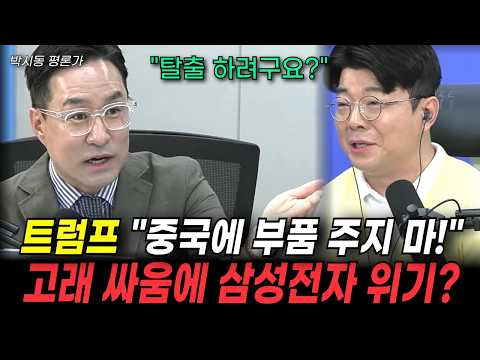
- 설명 앞부분: 따뜻한 위로와 냉철한 조언으로 힘을 주는 명언을 모았습니다 모두의 성공적인 미래가 되도록 응원합니다.
- 대본 없음 (설명) — 음성인식이 끝나면 도입부·흐름이 들어감
- 댓글 133/133: 좋은 점 — 영상 1 · 감사·응원 0 · 더 알고 싶은 것 1 · 아쉬운 점 — 영상 1 · 반박·불만 — 의견 다름 5 · 정치·사회 6 · 경험 공유 2 · 구독·다음 기대 0
  - 좋은 점 — 영상 👍2 “이분은 참 이해하기 쉽게 말씀을 해주시는것 같음”
  - 더 알고 싶은 것 👍12 “역사 그걸 알고 하는 말씀이신지 어디서 읽고 그냥 하는 얘기인지 자료를 좀 보여주면서 얘기해 주세요.”
  - 아쉬운 점 — 영상 👍1 “썸네일 제목이 너무 자극적이네요. 무슨 큰일난줄.”
  - 반박·불만 — 의견 다름 👍16 “최진봉교수는 왜 아직도 프로답지 못하게 최욱한테 너는 어쩌구 개인방송도 아닌데 주의하세요!”
  - 반박·불만 — 의견 다름 👍6 “발음도 애매하고 틀렸다고 지적하는데도 생까는 최진봉 아웃. 제발.”
  - 정치·사회 👍7 “중국이 따라잡고 있는데 한국은 노조가 돈더달라고 이난리 ..민주당아 노봉법개정해라 지선이문제야지금?”
  - 정치·사회 👍6 “민주당이 만든 노란봉투법 반드시 폐지해야합니다”
  - 경험 공유 👍70 “삼성노조중 삼성전자 주식으로 지들회사 투자하는놈들이 몇명인 묻고싶다.코로나이후로 삼전투자해온 투자자로 노저것들 정도껏해야지.나도 처음으로 노조욕하게되네”

### 23. 물린 주식 10년, 결국 전부 팔았습니다 (feat. 복구 심리의 함정)

- https://www.youtube.com/watch?v=OKHm1gUNyPA · 어쩌다마흔 · 구독자 1,840 · 조회수 82,553 (×44.9, 하루 1,029.2) · 좋아요 1,805 (2.2%) · 9.9분 · 2026-08-02 · 주제 묶음 8. 투자 심리·실패 · 형식 인터뷰·강연·대담 · 폴더 `W_OKHm1gUNyPA` (웹 승인)
- 썸네일: 
- 설명 앞부분: 10년 넘게 국내 개별주식에 투자했습니다. 수익 난 종목도 있었지만, 물린 종목이 더 많았습니다. 전체로 보면 꽤 큰 손실. 결국 얼마 전, 며칠에 걸쳐 전부 팔았습니다. 이번 영상은 계산이나 시장 분석이 아니라 제 이야기입니다. 왜 손실을 확정하면서까지 전량 매도를 택했는지, 그 이유 세 가지와 매도 이후에도 흔들렸던 '복구 심리'까지 솔직하게 담았습니다. 계좌에 물린 종목을 몇 년째 들고 고민 중이시라면, 오늘 영상이 판단에 참고가 되시길 바랍니다.
- 같은 채널 평소 대비 ×10.5 (채널 최근 롱폼 중앙값 7,826회) · 평소 영상: 40대 유부남, 월 500만원 모으려고 이것부터 끊었습니다 (7,861회) / 환율 1,350원 깨지고 미국주식 올인 했습니다 (7,791회)
- 대본 (음성인식(앞 5분), 4.3 음절/초) — 앞부분만, 흐름은 그 안까지 첫 20초: “10년 넘게 하던 국내 주식을 며칠 전 전부 팔고 정리했습니다. 수익이 나서 판 건 아닙니다. 손실을 확정하면서 팔았습니다. 오늘은 쓰라리게 아팠던 제 최근 이야기입니다.” — 도입부 유형: 숫자로 시작
- 첫 1분: “10년 넘게 하던 국내 주식을 며칠 전 전부 팔고 정리했습니다. 수익이 나서 판 건 아닙니다. 손실을 확정하면서 팔았습니다. 오늘은 쓰라리게 아팠던 제 최근 이야기입니다. 안녕하세요 어쩌다 마흔입니다. 오늘은 계산도 시장 얘기도 아닙니다. 제 얘기를 해볼까 합니다. 이번 주도 금요일을 제외하고는 계속 카락장이 이어져서 멘탈이 힘든 한주였습니다. 그리고 저는 계좌에 일부 있던 국내 개별 주식을 며칠에 걸쳐 전부 정리했습니다. 10년 넘게 개별 주 투자를 해온 사람이 그것도 손실을 확정하면서 왜 마흔이 넘어 전부 팔았는지 그 이후 3가지를 오늘 말씀드려볼까 합니다. 이 결정이 결코 정답이라는 얘기가 아닙니다. 다만 저와 비슷한 시기에 계좌에 물린 종목을 들고 고민 중인 분이라면”
- 흐름 (90초마다 첫 문장): 0:00 10년 넘게 하던 국내 주식을 며칠 전 전부 팔고 정리했습니다. → 1:32 수익이 난 종목도 있었습니다. → 3:05 이러도 복구할 시간이 있었으니까요. → 4:31 시간을 쓰고 어느 정도 벌었어도 다시 생각해볼 문제인데
- 댓글 957/957: 좋은 점 — 영상 13 · 감사·응원 36 · 더 알고 싶은 것 5 · 아쉬운 점 — 영상 11 · 반박·불만 — 의견 다름 14 · 정치·사회 16 · 경험 공유 90 · 구독·다음 기대 4
  - 좋은 점 — 영상 👍3 “너무 아쉬워서 댓글올립니다. 현재재무상황과 현재밸류로 하면 당연히 수익이 어렵더라구요.ㅠ 확실한미래성장과 촉매(주가가 부각될 트리거)감안하여, 투자하시면 분명 성과가 있더라구요. 고전(그레이엄,피터린치,코스톨라니,레이달리오.등의 )책을 좀 읽으시면 ETF 선정하시는대…”
  - 좋은 점 — 영상 👍3 “좋은 이야기도 있는데 말하는 사고방식이 본인은 안다고 생각할수도 있겠지만 워렌 버팟의 본질을 전혀 이해 못하고 있다고 할까나 😅 말이나 설명을 하는 사고방식이 아직도 트레이더에요 . 트레이더의 탐욕에 절여진 전혀 벗어나있지를 않는. 좋게 봐줘도 하워드 막스의 통찰을 …”
  - 감사·응원 👍70 “많은 고민이 묻어 나옵니다. 고생하셨습니다. 저도 심각히 고민중입니다. 국장은 절대 개미가 도전할 시장은 아니라는 생각입니다. 말씀 새겨서 결정에 참고하겠습니다. 감사드립니다.”
  - 감사·응원 👍23 “속은 쓰리시겠지만, 길게 보면 잘하셨습니다^^ 저도 과거 오랫동안 개별주로만 투자를 했고, 괜찮은 수익을 얻었지만, 지금은 ETF 투자로 주로 하고, 개별주는 정말 소액만 투자하고 있습니다. 회계사 생활을 오랫동안 하면서, 기업분석과 투자에 나름 자신도 있었지만, 언…”
  - 더 알고 싶은 것 👍1 “얼마 손해 보셨나요?”
  - 더 알고 싶은 것 👍1 “리스크라쓰고 불확실성이라읽어야되여 그불확실에대해 어떤일을 했나요? 추세판단은했나요? 자금을잃지않으려는노력은 그무엇보다중요해요 .. 그러려면예비비확보 분할매매 9시 12시 오후3시 그리고온갖쏟아지는 착시만주는노이즈에대해선어떻게 대응했는지요? 자금 안 읽고오래 시장에 머…”
  - 아쉬운 점 — 영상 👍13 “주식은 자기가 좋아하는 기업 응원하는 마음으로 사서 고수익은 아니더라도 은행금리만큼정도는 이득 아니면 손해일거라 생각했는데, 결국은 큰손들의 도박장인게 너무 실망스럽니다.”
  - 아쉬운 점 — 영상 👍2 “아...한달만 빨리 정리했어도 어쩌면 수익이 났을지도 모르는데 아쉽네요.”
  - 반박·불만 — 의견 다름 👍63 “하루에 지수가 10프로 등락하는 국장은 정상이 아니죠”
  - 반박·불만 — 의견 다름 👍5 “공부해서 주식하려면 미장가세요.. 여기는 상식적인 시장이 아닙니다”
  - 정치·사회 👍24 “그냥주식은 도박이에요 정부에서 인정한 오르고 내리고 하는거 그냥 짜고치는 고스돕같은거 다연기 공부필요없어요 그냥 정부와 기업이 맘대로 올리고 내리고 전 이걸아는순간 이젠안해요 금은사지”
  - 정치·사회 👍6 “국장은 그냥 수급 사줄 놈이 없으면 안올라가지요. 삼닉이 1000조를 벌어도 사줄 놈이 없어요 이번 금요일 국내 탑5 전부 상한가 갔지요? 전부 환호하지만 실상은 외국인들이 10조만 있어도 모든 종목 상한가 보낼 수 있다는 경고 같았어요. 저도 8년 국장하고 이번에 …”
  - 경험 공유 👍113 “저도 다 팔고 미장으로 옮겼습니다. 돈이 문제가 아니라 널뛰기 국장에서는 일상생활이 안됩니다.”
  - 경험 공유 👍70 “많은 고민이 묻어 나옵니다. 고생하셨습니다. 저도 심각히 고민중입니다. 국장은 절대 개미가 도전할 시장은 아니라는 생각입니다. 말씀 새겨서 결정에 참고하겠습니다. 감사드립니다.”
  - 구독·다음 기대 👍6 “같은나이대라 그런지 공감이 많이 됩니다. 늘 영상 기다려요. 응원합니다.^^”
  - 구독·다음 기대 👍2 “감사합니다 구독하고 볼게요 sk하이닉스 들어갈려고했는데 도저히 자신이 없네요”

### 24. Eric Sprott Is Buying These 5 Junior Mining Stocks Right Now

- https://www.youtube.com/watch?v=lZZ0VA9ihF0 · Resource Room · 구독자 985 · 조회수 40,684 (×41.3, 하루 6,943.9) · 좋아요 659 (1.6%) · 9.9분 · 2026-10-15 · 주제 묶음 기타 · 형식 정보·해설 (그 밖) · 폴더 `W_lZZ0VA9ihF0` (웹 승인)
- 썸네일: 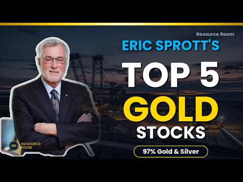
- 설명 앞부분: Eric Sprott has roughly 97% of his assets deployed in gold and silver at all times. He personally leads private placements, files early warning reports, and keeps buying through price increases. When he moves on a junior mining stock, the entire sector pays attention. In this video I tracked down 5…
- 같은 채널 평소 대비 ×4.4 (채널 최근 롱폼 중앙값 9,261회) · 평소 영상: Top 5 Silver Stocks For 2026 You Don't Want To Mi… (9,261회) / Michael Gentile's Top 5 Gold Stocks Right Now (10,874회)
- 대본 없음 (설명) — 음성인식이 끝나면 도입부·흐름이 들어감
- 댓글 75/75: 좋은 점 — 영상 0 · 감사·응원 0 · 더 알고 싶은 것 0 · 아쉬운 점 — 영상 0 · 반박·불만 — 의견 다름 0 · 정치·사회 0 · 경험 공유 0 · 구독·다음 기대 0

### 25. 오늘부터 오후 8시까지 애프터마켓 오픈!! 주식패턴 ‘이렇게’ 완전히 바뀐다

- https://www.youtube.com/watch?v=wwrCztntACs · 잘되라대한민국 · 구독자 5,960 · 조회수 243,763 (×40.9, 하루 6,574.7) · 좋아요 964 (0.4%) · 8.2분 · 2026-09-14 · 주제 묶음 기타 · 형식 정보·해설 (그 밖) · 폴더 `W_wwrCztntACs` (웹 승인)
- 썸네일: 
- 챕터: 0:00 오늘부터 열리는 주식 애프터마켓 전격 도입 배경 · 1:00 거래소 애프터마켓 이용 방법 및 주요 거래 규칙 · 2:21 정규장과 애프터마켓의 결정적 차이 (시장가 주문 불가… · 3:00 넥스트레이드와 KRX 애프터마켓의 관계 · 4:47 한국거래소가 애프터마켓을 도입한 진짜 이유와 우려스러… · 6:25 개인 투자자가 꼭 알아야 할 애프터마켓 투자 체크포인트
- 설명 앞부분: [겸공_12시에만나요 260914] 오늘부터 본격적으로 시작된 한국거래소(KRX) 애프터마켓 개시 소식과 투자자 체크포인트를 완벽하게 분석해 드립니다. 오후 4시부터 저녁 8시까지 연장된 거래 시간, 시장가 주문 불가와 자동 승계 미지원 등 기존 정규장과 달라지는 핵심 규칙들을 낱낱이 파헤쳐 봅니다. 새로운 제도 도입에 따른 숨겨진 변동성 위험과 투자 전략을 지금 바로 확인해 보세요! 타임라인
- 같은 채널 평소 대비 ×7.1 (채널 최근 롱폼 중앙값 34,375회) · 평소 영상: 엔비디아, 베라루빈이 우리 구원자될까? 삼성전자,하이닉스 대규모 반도체 팔 수 있는 기회 (34,375회) / 엔비디아, 자사주 매입 200조 한도↑ 삼성전기 반도체 기판 증설 선수금 비중 大 (31,157회)
- 대본 (음성인식(앞 5분), 5.4 음절/초) — 앞부분만, 흐름은 그 안까지 첫 20초: “그러면 이제 전혀 새로운 패턴이 또 나올 수 있다는 걸 좀 염두에 두셔야 될 것 같아요. 왜냐하면 4시 넘어서 그동안 거래 안 되는 종목이 거래되는 600개고 이제 새로 열리면 한 1500개 이상 이제 새로 될 텐데 그러면 이제 8시까지 거의 본장 이어지는 셈이나 마찬가지거든요. 그럼 우리 본장에서 미국 선물을 그대로 보면서 할 수 있는 상황이 되는 거니까”
- 첫 1분: “그러면 이제 전혀 새로운 패턴이 또 나올 수 있다는 걸 좀 염두에 두셔야 될 것 같아요. 왜냐하면 4시 넘어서 그동안 거래 안 되는 종목이 거래되는 600개고 이제 새로 열리면 한 1500개 이상 이제 새로 될 텐데 그러면 이제 8시까지 거의 본장 이어지는 셈이나 마찬가지거든요. 그럼 우리 본장에서 미국 선물을 그대로 보면서 할 수 있는 상황이 되는 거니까 오늘부터 저녁 8시까지 주식 거래가 가능해진다는 사실 알고 계셨나요? 본장에서 미국 선물을 보면서 투자할 수 있게 되는데요. 이렇게 되면 앞으로는 주식시장의 전혀 새로운 패턴이 시작될 예정입니다. 과연 우리에게 독이 될지 아니면 새로운 기회가 될지 그 숨겨진 이야기가 지금 바로 공개됩니다. 그래서 왜 오늘부터 애프터마켓이 오픈되는 겁니다? 저녁 8시까지”
- 흐름 (90초마다 첫 문장): 0:00 그러면 이제 전혀 새로운 패턴이 또 나올 수 있다는 걸 좀 염두에 두셔… → 1:33 그래서 별도입니다. → 3:00 그래서 얘네들이 아침에 8시에 프리로 한 번 열고 또 저녁에 3시 40분 → 4:33 박시동 대표님 말씀처럼 한국 거래소가 단순히 돈 벌려고 자기네들이
- 댓글 253/253: 좋은 점 — 영상 0 · 감사·응원 0 · 더 알고 싶은 것 4 · 아쉬운 점 — 영상 0 · 반박·불만 — 의견 다름 2 · 정치·사회 45 · 경험 공유 3 · 구독·다음 기대 0
  - 더 알고 싶은 것 👍32 “아니 예수금은 다음날 언제 받는건가요? 대체 거래소 에프터장은 이리쉽게 뚝딱 처리하연서~~~”
  - 더 알고 싶은 것 👍4 “정부에 항의부탁드립니다 정말 답답하고 화가납니다 왜 주식시장 을 개판으로 만드는 나쁜놈들”
  - 반박·불만 — 의견 다름 👍0 “잣됐다 대한민국. 선동질하지마라.”
  - 정치·사회 👍35 “이걸 정책으로 시행하라고 허가를 해준 정부가 문제죠? 국민들 의견은 들어보지 않고, 결국 국민들이 주식판 보는 시간만 늘어나서 일을 못하게 합니다. 진짜 이건 누구 생각인지 그리고 또 누가 허가를 했는지 조사해야 합니다.”
  - 정치·사회 👍24 “이재명은 지지율이 왜그렇게빠지는지 진정 모르나??? 개인자산을 건드려서인걸 모르네”
  - 경험 공유 👍1 “난 얘들보면 선대인하고 밧데리아저씨가 오버렙이 되더라고... 과거에 선대인이 원랜 부동산 전문가 코스프레를 하면서 지금 이광수가 했던 소리와 판박이같은 소릴하면서 폭락 기우제를 지냈는데 그때도 그 소리 믿고 쪽박찬 인간들 엄청나게 양산했어. 그러다니 어느날 갑자기 대…”
  - 경험 공유 👍0 “난 이잼 정부 지지자이고 문조털래유최 까지 계속 까던 사람이다 . 그리고 국장만 2009년 부터 해왔고 근데 이게 먼 개 ㅈㄹ 이냐 이걸 승인한 놈들이나 이잼도 이번에 생각좀 해줬으면 한다 . 1주라도 주식 매수 매도 한 사람들 투표 하던지 이건 뭐 주식투자자들과 아…”

### 26. 배당주 20년 vs S&P500 20년, 3억 원이 만든 충격적인 자산과 삶의 격차 [ 재테크/미국주식/ETF/배당주/노후준비 ]

- https://www.youtube.com/watch?v=cqgVNBbMYew · 박대리와 황과장의 경제이야기 · 구독자 1,930 · 조회수 78,763 (×40.8, 하루 948.4) · 좋아요 1,113 (1.4%) · 20.5분 · 2026-07-30 · 주제 묶음 4. 미국·해외주식 · 형식 정보·해설 (그 밖) · 폴더 `W_cqgVNBbMYew` (웹 승인)
- 썸네일: 
- 설명 앞부분: 같은 3억 원으로 시작해 20년 동안 완전히 다른 길을 걸어간 두 사람. 미국 배당 성장주에 투자해 매달 현금흐름을 굴린 박 대리와, S&P 500 지수 전체에 투자해 자본의 성장을 노린 황 과장. 20년이라는 긴 세월이 흐른 뒤, 두 사람의 계좌에 찍힌 숫자는 어떻게 달라졌을까요? 그리고 더 중요한 것, 은퇴 후 두 사람의 '진짜 삶의 모습'은 어떻게 갈렸을까요? 단순히 "어느 쪽이 더 많이 벌었나"를 넘어, 자산 형성기에서 은퇴기까지 우리가 투자를 바라보는 관점 자체를 바꿔줄 20년의 실측 데이터 서사를 확인해 보세요. [영상…
- 같은 채널 평소 대비 ×14.2 (채널 최근 롱폼 중앙값 5,551회) · 평소 영상: 같은 1억으로 시작한 두 사람, 한 명은 자꾸 다시 쓰고 한 명은 그냥 뒀더니 (10년 … (5,551회) / 박대리는 1억에서 멈췄고 황과장은 계속 굴렸다 ∣ 10년 뒤 계좌가 2배로 벌어진 진짜 … (5,384회)
- 대본 (음성인식(앞 5분), 4.9 음절/초) — 앞부분만, 흐름은 그 안까지 첫 20초: “배당주와 지수 주식, 이 두 가지 자산은 같은 주식시장 안에서 가장 오랜 기간 라이벌 관계로 불려왔습니다. 시장이 폭발적인 성장을 온 몸으로 받아내며 지수의 팽창을 누릴 것인가, 새 된 챈 챈 누릴 것인가. 아니면 기업이 만들어내는 당장의 현금 흐름을 매달 꼬박꼬박 재투자하여 복리의 눈덩이를 굴릴 것인가.”
- 첫 1분: “배당주와 지수 주식, 이 두 가지 자산은 같은 주식시장 안에서 가장 오랜 기간 라이벌 관계로 불려왔습니다. 시장이 폭발적인 성장을 온 몸으로 받아내며 지수의 팽창을 누릴 것인가, 새 된 챈 챈 누릴 것인가. 아니면 기업이 만들어내는 당장의 현금 흐름을 매달 꼬박꼬박 재투자하여 복리의 눈덩이를 굴릴 것인가. 오늘 다룰 이야기는 바로 이 질문에서 출발합니다. 출발서는 똑같았습니다. 두 사람에게는 20년 전 각자 핏땀 흘려 모은 종자똥 3억 원이 손에 쥐어져 있었습니다. 대기업 직장인으로 오랜 기간 함께 근무하며 같은 월급을 받고, 같은 점심을 먹고, 같은 퇴근길을 걸었던 박 대리와 황 과장, 두 사람은 어느 날 점심을 먹고 회사 근처 공원 벤치에 앉아 서로의 통장을 열어보았습니다. 각자의 계좌에는 약속이라도 한”
- 흐름 (90초마다 첫 문장): 0:00 배당주와 지수 주식, 이 두 가지 자산은 같은 주식시장 안에서 가장 오… → 1:32 박 대리가 선택한 것은 미국 시장을 대표하는 배당 성장 자산이었습니다. → 3:07 황 과장은 배당에 목매지 않았습니다. → 4:35 S&P 500 역시 연 1.5% 안팎에 소소한 배당을 지급했지만 황과장…
- 댓글 162/162: 좋은 점 — 영상 3 · 감사·응원 4 · 더 알고 싶은 것 3 · 아쉬운 점 — 영상 1 · 반박·불만 — 의견 다름 3 · 정치·사회 5 · 경험 공유 9 · 구독·다음 기대 0
  - 좋은 점 — 영상 👍4 “좋은정보 감사드립니다”
  - 좋은 점 — 영상 👍1 “오 좋은내용감사합니다”
  - 감사·응원 👍4 “좋은정보 감사드립니다”
  - 감사·응원 👍1 “정말 궁금했는데 감사합니당”
  - 더 알고 싶은 것 👍3 “18:07 더이상 근로소득을 기대할수 없는 시점인데 어떻게 생활비로 한푼도 안쓰고 배당 재투자를 할수가 잇을까요?”
  - 더 알고 싶은 것 👍0 “3억 20년 넣고 기다릴 사람이 얼마나될까요? 시드 금액이 넘 큼..1억이면 몰라도.”
  - 아쉬운 점 — 영상 👍0 “지수 팔아서 배당 사면 되는데 결론이 많이 아쉽네요.”
  - 반박·불만 — 의견 다름 👍0 “주식투자에서 가장중요한게 투자기법 심리? 아닙니다 그냥 가만히 있는겁니다 대부분 폭락장에서 90%가 공포에 다던지죠.ㅋㅋ 인간이 가장 힘들어 하는게 가~만히 있는거죠”
  - 반박·불만 — 의견 다름 👍0 “말도 안되는 소리를 하네. 은퇴싯점에 S&P를 팔아서 배당주로 옮기면 되지. 물론, 22%의 양도소득세를 내야 하는데, 그걸 감안해도 황과장이 무조건 이겼구만.”
  - 정치·사회 👍47 “한국 정부는 개인의 노후도 보장 안해주면서, 세계에서 유일하게 세금을 안내는 사람이 세금을 내는 사람보다 혜택이 더욱 많고, 은퇴하면 세금이 더 늘어나고, 중국인을 위해 한국국민이 세금을 더 내게 만든 유일한 나라…”
  - 정치·사회 👍6 “빚내서 그냥 레버타라 정부에서 빚 탕감해준다”
  - 경험 공유 👍5 “운용하기 나름인듯 다만 지수는 손이좀 가고 배당은 손이 조금 덜간다는 차이가 있을뿐. 그리고 배당을 받는경우는 세금문제도 생각해야하고. 수입이 안끊어졌다는 전제로 하락장때 추매를 하면 안되는거였나? 아니면 3억을 한번에 몰아넣지 말고 적립식으로 했었다면?? 지수에 넣…”
  - 경험 공유 👍0 “저는 모든 수익의 절반을 투자 및 재투자하는 방식을 하고 있습니다. 배당주 위주로 하고 있고요. 월급의 절반도 투자, 배당금의 절반도 재투자. 내가 쓸 수 있는 현금도 매년 늘어나고, 배당금도 재투자가 계속 이루어져서 매년 늘어나는 구조죠. 배당금이 2천만원 넘어가면…”

### 27. "원금 안 깎여요" 진화형 커버드콜 ETF 황금 포트폴리오 공개

- https://www.youtube.com/watch?v=yGuybuoroRI · 투자360 · 구독자 15,900 · 조회수 643,623 (×40.5, 하루 5,798.1) · 좋아요 6,245 (1.0%) · 22.2분 · 2026-07-02 · 주제 묶음 2. 장기투자·ETF·지수 · 형식 브이로그·직접 해본 이야기 · 폴더 `W_yGuybuoroRI` (웹 승인)
- 썸네일: 
- 설명 앞부분: 커버드콜 ETF는 정말 원금을 깎아먹는 상품일까요? 한국투자신탁운용 염정인 부장과 함께 커버드콜 ETF의 오해와 진실, 활용법까지 알아봤습니다. 국내 주식형 커버드콜이 절세에 유리한 이유는 무엇인지, 미국 주식형 커버드콜은 왜 연금저축·IRP 계좌에서 활용하는 것이 좋은지도 함께 짚어봅니다. 또한 국내 커버드콜, 해외 커버드콜, 파킹형 ETF 또는 채권형 ETF으로 구성하는 포트폴리오 전략과 계좌별 인출 순서까지 정리했습니다. 노후자금을 지키면서 매달 현금흐름을 만들고 싶은 분들이라면 끝까지 시청해 주세요. 핵심만 골라보기
- 같은 채널 평소 대비 ×17.8 (채널 최근 롱폼 중앙값 36,213회) · 평소 영상: 환율 내린 지금이 기회! 삼전닉스 팔아서 현금 '여기로' 옮기세요 #부자탐사대 #효라클 … (38,407회) / “지금까지 금투자 방법 다 틀렸습니다” 금 투자, 개미는 ‘이렇게’ 사야 돈 법니다 ∣ … (33,649회)
- 대본 (음성인식(앞 5분), 5.7 음절/초) — 앞부분만, 흐름은 그 안까지 첫 20초: “그러니까 한마디로 원금 깎아 먹지 않고 오히려 원금을 늘려가면서 꾸준한 분배율도 제공하고 있다 예를 들어 산 5억원 정도 은퇴자금이 있고 여기서 매달 300만 원씩 꺼냈으면 이제 20년이 최안되는 사이에 원금이 다 없어지거든요 제가 보통 추천을 드리는 거는 40, 40, 20씩 이제 말씀을 드려요 커버드 콜 매달 높은 배당금을 준다고 하니” — 도입부 유형: 숫자로 시작
- 첫 1분: “그러니까 한마디로 원금 깎아 먹지 않고 오히려 원금을 늘려가면서 꾸준한 분배율도 제공하고 있다 예를 들어 산 5억원 정도 은퇴자금이 있고 여기서 매달 300만 원씩 꺼냈으면 이제 20년이 최안되는 사이에 원금이 다 없어지거든요 제가 보통 추천을 드리는 거는 40, 40, 20씩 이제 말씀을 드려요 커버드 콜 매달 높은 배당금을 준다고 하니 눈길이 가지만 이러다 이거 결국 내 원금 까먹으면서 쓴 돈 아닌가 하는 생각도 듭니다 오늘은 한국 투자신탁 운용 염정인 부장님과 함께 커버드 콜의 오해와 진실을 명쾌하게 풀어드리고 또 소득 공백기 동안 원금 손실 없이 안전하게 월급을 꺼냈을 수 있는 실전 연금 세팅법까지 상세하게 알아보겠습니다 부장님 안녕하세요 안녕하세요 반갑습니다 부장님과 함께 저희가 이제 소중한 노후”
- 흐름 (90초마다 첫 문장): 0:00 그러니까 한마디로 원금 깎아 먹지 않고 → 1:33 내가 운 좋게 정년까지 갔다 하더라도 → 3:03 커버드콜 말은 좀 어렵지만 → 4:32 나는 그냥 배당만 받고
- 댓글 577/578: 좋은 점 — 영상 4 · 감사·응원 19 · 더 알고 싶은 것 29 · 아쉬운 점 — 영상 8 · 반박·불만 — 의견 다름 7 · 정치·사회 1 · 경험 공유 24 · 구독·다음 기대 0
  - 좋은 점 — 영상 👍10 “그렇게 노다지 좋으면 혼자만 알고있지 왜 동네방네 소문 내고 다니는지 이해가 잘 안가네요..”
  - 감사·응원 👍41 “3:37 거위가 어느 정도 이상으로 홀쭉해지고 나면, 다시는 이전 상태만큼 살이 오르지 "않을지도 모른다는" 위험성을 알려주시는게 맞지 않을까요? 4:40 옛날 커버드콜 상품들은 그러했지만, 최근 출시된 상품들은 이제 그러한 문제점을 개선했다 라고 주장하기엔, 닷컴버…”
  - 감사·응원 👍35 “댓글로도 배웁니다 감사합니다 😊”
  - 더 알고 싶은 것 👍7 “상품을 예시로 설명해주셨으면 좋을거같은데요”
  - 더 알고 싶은 것 👍6 “커버드콜 상품은 기본적으로 주가가올라도 상승에 제한이 있는상품입니다. 지금은 주가 상승기이니 커버콜 상품이 판을치는듯 합니다. 하락시기에는 어떨까요? 판단은 개인몫 2022년 같은 장기 하락기에도 커버콜 상품 권하는분 있을까요? 약장사들 많습니다. 차라리 S&P500…”
  - 아쉬운 점 — 영상 👍1 “본주가 하락하먼 원금도 떨어지는데 제목 어그로가 좀 있네요. 정확히는 배당 준다고 원금 까먹지 않은 커버드콜이 있는거겠지요.”
  - 아쉬운 점 — 영상 👍0 “커버드콜은 누가 돈을 법니까? 옵션장사로 수익내서 분배하는것이기 때문에 옵션장사를 하는 증권사가 수수료를 가져갑니다. 주식이나 주식100% ETF는요? 수수료 경쟁때문에 증권사 수수료가 거의 없다시피 합니다. 누가 돈을버는지 핵심만 이해하면 뭘 해야하는지 뭘 안해야하…”
  - 반박·불만 — 의견 다름 👍28 “지금 시장이 상승하고 있으니까 원금 보장 된다고 떠드는데 하락장 들어가면 바로 원금 박살나고 원금에서 배당 나간다. 위험없이 연15% 배당 나오는 상품이 있는데 세계적인 투자자들이 멍청해서 투자 안하고 있을거라 생각하는지 정말 웃기는 인생들 많구나...ㅉㅉㅉ”
  - 반박·불만 — 의견 다름 👍12 “원금 깎이는게 나쁜게 아닙니다. 세금전략 짤때 배당과 양도, 종합소득 사이의 간격 맞출때 사용함 그리고 사회초년생이면 배당주는 사지마세요 가장 비싼 시간가치를 배당이란 헐값에 파는거임”
  - 경험 공유 👍30 “커버드콜 3년째 하고 있는데ᆢ 좋습니다 ^^ 하락장이오든ᆢ 상승장이 오든 신경끄고 있을수 있어서ᆢ 짱입니다^^”
  - 경험 공유 👍5 “커버드콜 2년째 하고 있는데 개별주보다 훨씬 좋습니다 당연히 분산투자가 되어야 하고 국내지수, 미국지수, 반도체, 미배당, 금 etf 등등 성장도 하고 하락장에는 어느정도 방어되는 섹터도 있어야 되는겁니다 커버드콜의 최고의 매력은 하락장에도 꾸준히 나오는 분배금으로 …”

### 28. Can You Retire With Just SCHD? ∣ SCHD Expert Explains

- https://www.youtube.com/watch?v=lRlUmwigNYU · The Mispriced Podcast · 구독자 3,220 · 조회수 127,869 (×39.7, 하루 2,040.5) · 좋아요 1,826 (1.4%) · 36.6분 · 2026-08-19 · 주제 묶음 2. 장기투자·ETF·지수 · 형식 정보·해설 (그 밖) · 폴더 `W_lRlUmwigNYU` (웹 승인)
- 썸네일: 
- 챕터: 0:00 Introduction · 1:28 Why Craig started investing i… · 5:15 His $1 million SCHD goal · 6:51 What drives SCHD’s dividend g… · 11:16 SCHD’s long-term performance · 13:18 Can someone retire with only … · 16:58 Pairing SCHD with option-inco… · 21:57 Can SCHD keep outperforming i… · 26:24 SCHD’s expected 2026 dividend… · 30:06 Which stock is currently misp… · 34:29 SCHD and sequence-of-returns …
- 설명 앞부분: In this episode of Mispriced, I sit down with Craig, better known as “SCHD Stan,” to discuss his journey investing in SCHD and his goal of building a $1 million position in the fund. We break down what makes SCHD’s methodology unique, how the ETF has consistently grown its dividend, and whether som…
- 같은 채널 평소 대비 ×8.8 (채널 최근 롱폼 중앙값 14,589회) · 평소 영상: Dividend Investing vs The 4% Rule ∣ David Bahnsen… (14,589회) / 5 Dividend Stocks to Beat Inflation for the Next … (13,211회)
- 대본 (자막, 0.0 음절/초) 첫 20초: “Welcome back everyone. Today we are joined by a very special guest. We are joined by Craig aka SCHD Stan. And if you aren't familiar with Craig, he has become one of the leading experts on SCHD and generally speaking his goal is to one day live off SCHD dividends. So Craig, thank you so much for joi”
- 첫 1분: “Welcome back everyone. Today we are joined by a very special guest. We are joined by Craig aka SCHD Stan. And if you aren't familiar with Craig, he has become one of the leading experts on SCHD and generally speaking his goal is to one day live off SCHD dividends. So Craig, thank you so much for joining us. >> Thank you, Eli. I'm honored to be to be invited on your show. I've been following your d”
- 흐름 (90초마다 첫 문장): 0:03 Welcome back everyone. Today we are → 1:30 accounts and back then it was mutual → 3:01 people started kind of dying on it. → 4:31 a new all-time high, trading around → 6:00 So and I'm at right now I'm at over → 7:30 And that's it. And and look how well → 9:01 finding → 10:32 of built-in → 12:02 total stock market index. So again, when → 13:31 Um → 15:00 honestly think that that SCHD over the → 16:30 hold up much better as well. So, it's → 18:01 my idea's been okay, well really if you → 19:30 GPIQ, the GPIX, but again they tend to → 21:01 time if that net asset value continues → 22:30 but in your opinion, does SCHD have the → 24:03 the beginning of the year when we → 25:30 look like. But, if you're wanting to → 27:02 I don't like to always throw out a a → 28:31 could lead to like
- 댓글 343/343: 좋은 점 — 영상 0 · 감사·응원 0 · 더 알고 싶은 것 0 · 아쉬운 점 — 영상 0 · 반박·불만 — 의견 다름 0 · 정치·사회 0 · 경험 공유 0 · 구독·다음 기대 0

### 29. 주식투자 5년간 수익이 없던 내가 드디어 깨달은 '이것'

- https://www.youtube.com/watch?v=uqsGXwRgP68 · 리채피 richappy · 구독자 4,490 · 조회수 166,291 (×37.0, 하루 7,112.6) · 좋아요 2,110 (1.3%) · 27.8분 · 2026-09-28 · 주제 묶음 11. 투자 일반 · 형식 정보·해설 (그 밖) · 폴더 `W_uqsGXwRgP68` (웹 승인)
- 썸네일: 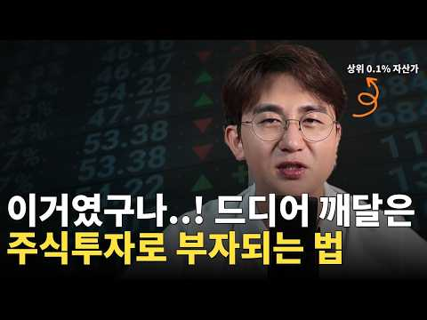
- 챕터: 0:00 인트로 · 1:10 5년 동안 제가 주식으로 번 돈은 0원이었습니다 · 3:01 제일 괴로웠던 건 손실이 아니었습니다 · 5:15 2019년, 제가 모으던 건 정답이었습니다 · 11:59 기준을 배운 직후에 무너졌습니다 · 17:59 코로나 폭락, 계좌가 70~80퍼센트 빠졌습니다 · 24:22 드라마 제작사 투자로 자산이 3배가 됐습니다 · 26:56 2022년 금리 인상기, 마이너스 30퍼센트
- 설명 앞부분: 매주 수요일 오후 9시에 라이브를 진행합니다. 많은 분들이 공부한 만큼 계좌가 따라오지 않는 이유를 아직 공부가 부족해서라고 생각하지만, 실제로는 배운 것을 실제 비중과 행동에 옮기지 못한 데서 오는 경우가 많습니다. 여기에 시장이 오를 때 확인 절차를 건너뛰게 만드는 수익의 착각이 겹치면 같은 자리를 다시 맴돌게 됩니다. 한지우는 2016년에 투자를 시작해 5년 동안 책과 강의, 새벽까지 이어진 기업 분석에 매달렸지만 그 기간 주식으로 번 돈은 없었습니다. 2019년 가치투자 스터디에서 만난 투자자들이 종목이 아니라 기준을 이야…
- 같은 채널 평소 대비 ×18.0 (채널 최근 롱폼 중앙값 9,240회) · 평소 영상: 주식투자는 포모를 이겨내고 '이걸' 알아야 성공합니다. (9,776회) / 주식투자 5년을 헤매던 내가 전문가 전망보다 먼저 알게 된 '이것' (8,705회)
- 대본 (음성인식(앞 5분), 5.2 음절/초) — 앞부분만, 흐름은 그 안까지 첫 20초: “요즘은 투자 공부를 할 수 있는 곳이 정말 많습니다. 책도 많고 강의도 많고 예전과는 비교하기 어려울 정도죠. 그런데 공부한 만큼 계좌가 따라오느냐는 또 다른 이야기일 수 있습니다. 저도 그랬습니다. 무려 5년 동안 주식 공부를 했는데도 계좌는 제 자리였습니다. 주변에서는 그 정도 공부했으면 이제 충분하지 않냐는 말까지 들었죠.”
- 첫 1분: “요즘은 투자 공부를 할 수 있는 곳이 정말 많습니다. 책도 많고 강의도 많고 예전과는 비교하기 어려울 정도죠. 그런데 공부한 만큼 계좌가 따라오느냐는 또 다른 이야기일 수 있습니다. 저도 그랬습니다. 무려 5년 동안 주식 공부를 했는데도 계좌는 제 자리였습니다. 주변에서는 그 정도 공부했으면 이제 충분하지 않냐는 말까지 들었죠. 그런데 정작 저는 5년 동안 뭔가를 놓치고 있었습니다. 열심히 공부했지만 제가 놓치고 있었던 건 따로 있었던 겁니다. 그리고 그걸 이해하고 나서부터는 본격적으로 수익이 나기 시작했습니다. 그리고 지금은 경제적 자유를 이루게 됐습니다. 오늘은 제가 그 5년 동안 무엇을 놓치고 있었는지 그리고 수많은 시행차고 끝에 무엇을 깨달았는지 말씀드리겠습니다. 이 영상을 끝까지 보시면 저처럼 오랜”
- 흐름 (90초마다 첫 문장): 0:00 요즘은 투자 공부를 할 수 있는 곳이 정말 많습니다. → 1:30 벌었다가 잃었다가 또 벌었다가 다시 잃었습니다. → 3:01 그런데 무엇보다 돈을 크게 잃었을 때보다 → 4:31 그걸 몰랐던 거죠 3년 차까지는.
- 댓글 111/112: 좋은 점 — 영상 7 · 감사·응원 15 · 더 알고 싶은 것 3 · 아쉬운 점 — 영상 0 · 반박·불만 — 의견 다름 0 · 정치·사회 0 · 경험 공유 12 · 구독·다음 기대 2
  - 좋은 점 — 영상 👍17 “차분하고 솔직한 설명 공감이 가고 참 감동 입니다”
  - 좋은 점 — 영상 👍6 “목소리가 맑고 깨끗해서 듣기좋아요. 마이크가 너무 섬세해서 스피커에 울림이와서 많이거슬려요!”
  - 감사·응원 👍14 “잘봤습니다. 구독. 감사합니다. 뒤늦게 주식에 뛰어든 70초반 입니다. 우선은 오래 버티고 싶습니다.”
  - 감사·응원 👍6 “궁금해서 구독했어요 응원합니다”
  - 더 알고 싶은 것 👍6 “궁금해서 구독했어요 응원합니다”
  - 더 알고 싶은 것 👍0 “반갑습니다60세후반입니다.종가베팅을알고싶어요.참아어렵고힘들어요배움도짧고알고싶어요배움을주세요.감사합니다.”
  - 경험 공유 👍8 “매우 좋은 메시지입니다. 저도 주식에 전념하기로 한 저에게 많은 방향을 주셨습니다.”
  - 경험 공유 👍6 “철저한 절재!!! 다 내려놓고 그걸 행동으로 옮기자. 그 자그만한 행동이 나을 변화 시킨다 다 내꺼가 아니다~ 3년.5개월차에 느낌입니다 잘 하다 크게맞고 또 잘하다 크게맞고 두번 하고 나니까. 아~내가 이런 행동땜에 큰 던을 잊는구나 느끼고 내려놓고 행동으로 옮기니…”
  - 구독·다음 기대 👍6 “궁금해서 구독했어요 응원합니다”
  - 구독·다음 기대 👍4 “구독하고갑니다 감사합니다”

### 30. I Just Bought 1,600 Shares Of SCHD: Here's my Dividend payment

- https://www.youtube.com/watch?v=d23iMmo2w4o · Bald Man Finance  · 구독자 392 · 조회수 14,311 (×36.5, 하루 4,003.3) · 좋아요 36 (0.2%) · 19.3분 · 2026-10-17 · 주제 묶음 기타 · 형식 정보·해설 (그 밖) · 폴더 `W_d23iMmo2w4o` (웹 승인)
- 썸네일: 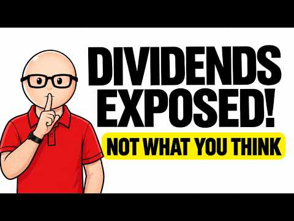
- 설명 앞부분: I Just Bought 1,600 Shares Of SCHD: Here's my Dividend payment
- 같은 채널 평소 대비 ×49.7 (채널 최근 롱폼 중앙값 288회) · 평소 영상: The SpaceX Bubble Crash Is Worse Than You Think (297회) / This 'Boring' Portfolio Pays me $2,474 Every Mont… (279회)
- 대본 없음 (설명) — 음성인식이 끝나면 도입부·흐름이 들어감
- 댓글 15/15: 좋은 점 — 영상 0 · 감사·응원 0 · 더 알고 싶은 것 0 · 아쉬운 점 — 영상 0 · 반박·불만 — 의견 다름 0 · 정치·사회 0 · 경험 공유 0 · 구독·다음 기대 0

### 31. 단타 천재가 개발한 초간단 매매법(기본 차트 분석법)

- https://www.youtube.com/watch?v=knblsnwXsfg · 차트9단 · 구독자 469 · 조회수 16,282 (×34.7, 하루 139.2) · 좋아요 416 (2.5%) · 20분 · 2026-06-26 · 주제 묶음 6. 종목 고르기·분석 · 형식 인터뷰·강연·대담 · 폴더 `W_knblsnwXsfg` (웹 승인)
- 썸네일: 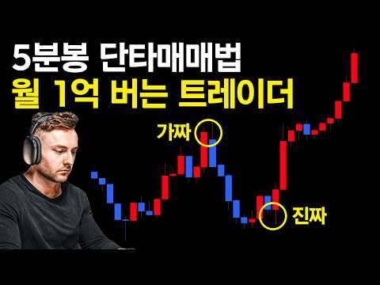
- 챕터: 0:00 시작 · 0:28 이평선 하나면 된다 · 2:21 이평선 사용법 · 5:04 탑다운 매매법 · 8:50 이평선 단타매매법
- 설명 앞부분: 단타 천재가 개발한 초간단 매매법(기본 차트 분석법) 거래량 델타 지표 무료 신청하기 트레이딩 매매법 강의 무료 신청하기 100억 트레이더의 비법서 신청하기 편리한 자동 거래봇 이용 신청하기
- 같은 채널 평소 대비 ×24.7 (채널 최근 롱폼 중앙값 660회) · 평소 영상: 단타 매매법은 딱 두가지만 알면 끝입니다. (이동평균선 거래량 차트보는법) (660회) / 5년동안 단타로 200억 벌어들인 트레이더의 개쉬운 매매법 (248회)
- 대본 없음 (설명) — 음성인식이 끝나면 도입부·흐름이 들어감
- 댓글 7/7: 좋은 점 — 영상 1 · 감사·응원 5 · 더 알고 싶은 것 1 · 아쉬운 점 — 영상 0 · 반박·불만 — 의견 다름 0 · 정치·사회 0 · 경험 공유 0 · 구독·다음 기대 0
  - 좋은 점 — 영상 👍0 “좋은 정보 감사합니다”
  - 감사·응원 👍0 “좋은지표입니다 수고많아요 감사합니다”
  - 감사·응원 👍0 “많이 배웁니다.감사합니다.”
  - 더 알고 싶은 것 👍0 “안녕하십니까 차트9단님 델타거래량지표을 신청합니다 부탁드립니다 감사합니다”

### 32. 국민연금 빈칸 메우는 한국 ETF 3개 — 월 200만 원 평생 월급 만들기

- https://www.youtube.com/watch?v=7rtO_hfLvF8 · 술술 경제학 · 구독자 17,600 · 조회수 608,737 (×34.6, 하루 3,479.4) · 좋아요 9,030 (1.5%) · 16.8분 · 2026-04-29 · 주제 묶음 2. 장기투자·ETF·지수 · 형식 정보·해설 (그 밖) · 폴더 `W_7rtO_hfLvF8` (웹 승인)
- 썸네일: 
- 설명 앞부분: 국민연금만 믿고 노후를 준비하고 계신가요? 부부 합산 노령연금이 약 220만 원이라 해도, 적정 생활비 298만 원에 비하면 매달 80만 원이라는 '구조적 결손'이 발생합니다. 이 빈칸을 방치하면 노후 내내 통장에 구멍이 뚫린 채 살아가야 합니다. 하지만 2026년부터 완전히 답이 달라졌습니다. 한국 세법이 두 가지(고배당 분리과세, 자사주 소각 의무화)나 바뀌면서, 미국 주식이 아닌 한국 ETF만으로도 이 구멍을 완벽하게 메울 수 있는 길이 열렸기 때문입니다. 오늘 영상에서는 13년 동안 배당이 깎인 적 없는 기둥 같은 ETF부…
- 같은 채널 평소 대비 ×100.6 (채널 최근 롱폼 중앙값 6,050회) · 평소 영상: 10억 모아도 매달 세금 폭탄 맞습니다! 합법적으로 다 피해 가는 4가지 절세 전략 (배… (6,050회) / S&P500 ETF 절세 3대장 2026 ∣ 같은 종목인데 1600만원 차이? (연금·I… (6,319회)
- 대본 없음 (설명) — 음성인식이 끝나면 도입부·흐름이 들어감
- 댓글 284/284: 좋은 점 — 영상 19 · 감사·응원 47 · 더 알고 싶은 것 22 · 아쉬운 점 — 영상 1 · 반박·불만 — 의견 다름 3 · 정치·사회 3 · 경험 공유 9 · 구독·다음 기대 2
  - 좋은 점 — 영상 👍28 “좋은 정보 감사합니다. 구독, 좋아요 누르고 보고 있습니다.”
  - 좋은 점 — 영상 👍22 “ETF 3종 좋은 정보 감사합니다”
  - 감사·응원 👍227 “67세 입니다 지난달부터 isa계좌(3년)만들어 200넣어 매수매도로 공부하는 초보(빌딩 미화원)입니다 저에게는 꼭 필요 정보이기에 감사함 느끼면 주식교실로 입학합니다😂😂😂”
  - 감사·응원 👍28 “좋은 정보 감사합니다. 구독, 좋아요 누르고 보고 있습니다.”
  - 더 알고 싶은 것 👍14 “어디서 어텋게 가입하는지도 가르쳐주셔요”
  - 더 알고 싶은 것 👍14 “제발 대표님 저에게도 꼭 좀 알려 주세요 손주한명 대리고 살기가 넘 힘들어요 부탁드립니다 .”
  - 반박·불만 — 의견 다름 👍1 “10년뒤 20년뒤를 목표로 한다면 배당투자말고 성장주 투자하는게 맞고요. 당장 은퇴해서 현금흐름을 만들려면 3세대 커버드콜 하는게 맞습니다. 물론 커버드콜 투자하려면 현금비중 항상 채워두시고 리벨런싱 하셔야 하고요. 결론은 이러나 저러나 일반 배당주투자는 글쎄요..”
  - 반박·불만 — 의견 다름 👍1 “국민연금 직장생활4년포함 작년까지 총20년 꾸준히 넣었는데도 지금 조회해 봐도 겨우 56만원 받는다고 나옴.... 110만원 아닙니다! 기본가입금이 작년까지는 9만원이였는데 이게 9%인데, 올해 1월부터 갑자기 9만 5천원으로 올랐고 & 그게 끝이 아니라 매년 0.5…”
  - 정치·사회 👍22 “내란 정권 교체되면 생각해 볼 수 있겠으나,현 갈취 정권하엔 국장 투자할 생각 없음.”
  - 경험 공유 👍11 “45세 젊다면 젊은 나이. 많다면 많은 나이에 이런걸 알게 되어 조금씩 손대고 있습니다. 15년뒤 60세에는 우리 집사람 사모님 소리 듣게 해 주겠다고 했는데 결혼전엔 잠자는 숲속의 공주처럼 모시겠다는 약속도 못 지킨 지금 15년뒤 그 약속을 지킬수 있을까요? 아니 …”
  - 경험 공유 👍9 “주식은 변동성이 있어도 제자리로 반드시 돌아옵니다 단 우량주라야겠지요 부정적으로 하락할때만 생각한다면 은행 적금만해야겠지요 주린이 4년차인데 꾸준히 적립매수하고 이제는 연봉만큼 제 자본이 일을하고 있읍니다”
  - 구독·다음 기대 👍8 “오늘 처음 보는데 구독했습니다.”
  - 구독·다음 기대 👍1 “좋은정보 감사합니다.......!! 구독하고 갑니다........자주 방문할께요.....꾸벅...!!”

### 33. Indonesia's Stock Market Crashes 11%: What Went Wrong? ∣ Century Financial

- https://www.youtube.com/watch?v=dFuTChJdF5M · Century Financial · 구독자 9,980 · 조회수 340,757 (×34.1, 하루 70,334.6) · 좋아요 1,110 (0.3%) · 5.2분 · 2026-10-16 · 주제 묶음 기타 · 형식 정보·해설 (그 밖) · 폴더 `W_dFuTChJdF5M` (웹 승인)
- 썸네일: 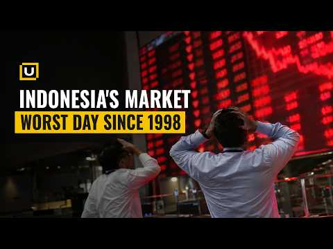
- 설명 앞부분: Indonesia's stock market plunged as much as 11%, putting the Jakarta Composite on track for its worst day since the 1998 Asian financial crisis. But what triggered such a dramatic sell-off? And how could a single announcement from MSCI put billions in foreign investment and Indonesia's emerging-mar…
- 대본 없음 (설명) — 음성인식이 끝나면 도입부·흐름이 들어감
- 댓글 271/271: 좋은 점 — 영상 0 · 감사·응원 0 · 더 알고 싶은 것 0 · 아쉬운 점 — 영상 0 · 반박·불만 — 의견 다름 0 · 정치·사회 0 · 경험 공유 1 · 구독·다음 기대 0
  - 경험 공유 👍0 “내가보기에는 미국보다는 나은것같은데”

### 34. 복리가 부를 만드는 진짜 시작점｜언제부터 돈이 스스로 일하기 시작할까

- https://www.youtube.com/watch?v=JExUQaROk40 · 돈의 통찰 · 구독자 3,920 · 조회수 132,960 (×33.9, 하루 1,461.2) · 좋아요 1,543 (1.2%) · 17.8분 · 2026-07-22 · 주제 묶음 1. 주식 기초·초보 · 형식 정보·해설 (그 밖) · 폴더 `W_JExUQaROk40` (웹 승인)
- 썸네일: 
- 설명 앞부분: 복리는 단순히 이자를 더해주는 원리가 아닙니다. 대부분의 사람들은 복리의 힘이 나타나기 전에 포기합니다. 이 영상에서는 복리가 언제부터 눈에 보이는 자산 성장으로 이어지는지, 돈이 스스로 일하기 시작하는 진짜 전환점은 언제인지 실제 숫자와 사례를 통해 쉽게 설명합니다. 장기 투자, 경제적 자유, 자산 증식을 목표로 한다면 꼭 끝까지 시청해 보세요.
- 같은 채널 평소 대비 ×9.3 (채널 최근 롱폼 중앙값 14,309회) · 평소 영상: 부유한 은퇴자들이 돈이 있어도 절대 사지 않는 10가지 물건. (14,354회) / 나이에 비해 가진 게 없다면… 당신은 정말 뒤처진 걸까? (14,264회)
- 대본 없음 (설명) — 음성인식이 끝나면 도입부·흐름이 들어감
- 댓글 103/103: 좋은 점 — 영상 9 · 감사·응원 15 · 더 알고 싶은 것 1 · 아쉬운 점 — 영상 0 · 반박·불만 — 의견 다름 1 · 정치·사회 0 · 경험 공유 12 · 구독·다음 기대 1
  - 좋은 점 — 영상 👍15 “도움되는 영상!구독했어요.기억할께요.복리의 힘.주식시장 떠나지 말고 세월로 돈을 엉덩이로 깔고 않아서 건강만 챙기기.감사합니다.”
  - 좋은 점 — 영상 👍8 “좋은 영상 감사합니다”
  - 감사·응원 👍15 “도움되는 영상!구독했어요.기억할께요.복리의 힘.주식시장 떠나지 말고 세월로 돈을 엉덩이로 깔고 않아서 건강만 챙기기.감사합니다.”
  - 감사·응원 👍8 “좋은 영상 감사합니다”
  - 반박·불만 — 의견 다름 👍7 “늦으면 복리의 마법에 못올라타는게 아니다.. 예를들어 50만원씩 매월 납입을 했다고 가정하면 약 1년 8개월 정도면 1천만원을 달성한다.. 그럼 나는 딱 12개월뒤에 1천만원을 넣었다면? 복리가 답인것 같지만 실제는 원금의 규모다, 개별주로 자금을 불리는 사람도 있다…”
  - 경험 공유 👍96 “제가 4년전 2022년 1~2월달 무렵 그당시 요식업 식당 다니고 있을때 어렵게 모은 종잣돈 8천7백만원이 있었어요...그때 이 돈으로 장사해볼까 정말 고민의 고민을 했어요ㅠ실행 직전까지 갔는데 마지막에 내 자신도 컨트롤 못하는데 내가 요식업 차려서 직원을 잘 컨트롤…”
  - 경험 공유 👍32 “진짜 맞말입니다 이제 고작 3년차 연저펀 에쎈피500 하고있는데요 시간이...와ㅏㅏㅏㅏ 아주 맞는말 😊”
  - 구독·다음 기대 👍15 “도움되는 영상!구독했어요.기억할께요.복리의 힘.주식시장 떠나지 말고 세월로 돈을 엉덩이로 깔고 않아서 건강만 챙기기.감사합니다.”

### 35. Stop Guessing! Growth vs Dividend Stocks Explained in 20 Minutes

- https://www.youtube.com/watch?v=hkRXzD3CH3c · Finance Simplified · 구독자 3,520 · 조회수 117,798 (×33.5, 하루 1,325.2) · 좋아요 2,069 (1.8%) · 21.2분 · 2026-07-24 · 주제 묶음 기타 · 형식 정보·해설 (그 밖) · 폴더 `W_hkRXzD3CH3c` (웹 승인)
- 썸네일: 
- 챕터: 0:00 The Truth Nobody Tells You Ab… · 0:25 The Biggest Investing Myth · 3:00 What Is a Growth Stock? ($10,… · 5:45 What Is a Dividend Stock? (4%… · 8:30 The $100,000 Challenge: 30-Ye… · 12:15 Who Should Buy Growth Stocks? · 14:15 Who Should Buy Dividend Stock… · 16:15 The Millionaire Strategy (80/… · 18:15 The 6 Biggest Mistakes Invest… · 20:30 The Final Verdict
- 설명 앞부분: Growth vs Dividend Stocks Growth stocks vs dividend stocks — which one actually builds more wealth? We ran the real math on $100,000 over 30 years, and the result surprised us. Most investors pick a side based on a feeling, not a number. Dividends feel safe because cash hits your account every thre…
- 같은 채널 평소 대비 ×25.1 (채널 최근 롱폼 중앙값 4,685회) · 평소 영상: How Much Do You Need to Invest to Earn $5,900 a M… (4,685회) / Pay Off a 6% Mortgage Early vs. Invest in Index F… (4,600회)
- 대본 없음 (설명) — 음성인식이 끝나면 도입부·흐름이 들어감
- 댓글 191/191: 좋은 점 — 영상 0 · 감사·응원 0 · 더 알고 싶은 것 0 · 아쉬운 점 — 영상 0 · 반박·불만 — 의견 다름 0 · 정치·사회 0 · 경험 공유 0 · 구독·다음 기대 0

### 36. 삼성전자 지금 팔아야 하나? 코스피 서킷브레이커 날, 버틸지 팔지 가를 기준 2가지

- https://www.youtube.com/watch?v=ICByZXkRrLg · 경제야! 놀자~ · 구독자 3,510 · 조회수 101,848 (×29.0, 하루 16,587.1) · 좋아요 583 (0.6%) · 13.5분 · 2026-10-15 · 주제 묶음 5. 국내주식 · 형식 정보·해설 (그 밖) · 폴더 `W_ICByZXkRrLg` (웹 승인)
- 썸네일: 
- 챕터: 0:00 하이라이트 — 팔면 안 될 때, 팔아야 할 때 · 0:16 [경제야놀자 해설] 서킷브레이커, 팔아야 하나? · 0:36 사자고 했던 근거 ① 이익 증가 ② 저평가 · 1:45 근거 ③ 배당 30~40% 증가 · 자사주 소각 · 2:19 [경제야놀자 해설] 사자고 했던 근거 3가지 · 2:40 빠지는 이유 ① 금리 · 2:59 ② AI 투자 버블론 ③ 중동 · 물가 · 3:39 "훼손된 게 있나요?" — 아직은 없다 · 4:15 양대 시장 서킷브레이커 · 메모리 사이클 불신 · 5:28 [경제야놀자 해설] 서킷브레이커 · 메모리 사이클 · 5:53 박시동 — "3~4일에 20%씩 빠질 일이냐" · 7:13 성장통이냐, 희망고문이냐 · 8:53 판단 기준 두 갈래 · 비중 줄이기 · 10:05 [경제야놀자 해설] 성장통이냐 희망고문이냐 · 10:26 박시동 — 시가배당률 5%, 은행이자보다 많다 · 11:55 정리 — 지금 새로 사는 건 아니다 · 12:40 [경제야놀자 해설] 오늘의 세 줄 정리
- 설명 앞부분: [10월 15일 · 12시에 만나요] 코스닥에 이어 코스피까지 8% 넘게 빠지며 두 시장 모두 서킷브레이커가 걸린 날, 방송은 "지금 어떻게 해야 하나"를 붙들고 길게 이야기했다. 이광수 대표는 그동안 한국 주식을 사자고 했던 근거 세 가지 — 기업 이익 증가, 이익 대비 저평가, 배당과 자사주 소각으로 바뀌는 시장 — 를 다시 짚고, 아직 훼손된 것은 없다고 봤다. 권다영 앵커는 메모리 반도체가 사이클이라는 오랜 경험 때문에 시장이 "이번엔 다르다"를 믿지 못한다고 해석했다. 이 대표는 지금 하락이 오르는 길의 성장통인지, 저점…
- 같은 채널 평소 대비 ×9.5 (채널 최근 롱폼 중앙값 10,736회) · 평소 영상: 코스피 6000 붕괴, 하이닉스만 제자리, 솔리다임 상장의 파장 (10,736회) / 금리 인상, 올해가 마지막? 코스피 6000 깨졌다 반등한 이유 3가지 (9,904회)
- 대본 없음 (설명) — 음성인식이 끝나면 도입부·흐름이 들어감
- 댓글 296/296: 좋은 점 — 영상 0 · 감사·응원 0 · 더 알고 싶은 것 2 · 아쉬운 점 — 영상 0 · 반박·불만 — 의견 다름 8 · 정치·사회 19 · 경험 공유 8 · 구독·다음 기대 0
  - 더 알고 싶은 것 👍14 “오늘은 뭐라 하는지 궁금해서 들어 와봣더니.. 역시나..ㅠㅠㅠ”
  - 더 알고 싶은 것 👍2 “이주완 아날리스트의 삼전닉스 비관론에 대해서 합리적인 반론 좀 부탁드려요.”
  - 반박·불만 — 의견 다름 👍13 “대 전제가 틀렸다. 주식시장은 애초에 합리적인 분석대로 움직이는 장이 아니다. 이게 내 결론임.”
  - 반박·불만 — 의견 다름 👍11 “영국은 겨우 방직기 하나 개발해놓고 100년을 거품을 몰고 다녔습니다. 왜 한국만 지금 바보짓을 합니까? 좀 이 업계 모르는 분들은 입닫고 조용히 기업들이 하는일 지켜보세요. 기업들 바보 아닙니다. 겨우 중국발 기사 2줄에 검증되지 않은 내용으로 아무나 떠드는것에 신…”
  - 정치·사회 👍27 “정부는 아무 대책 없네~~ 미국이 이정도면 난리 났다 ~~종지가 9퍼가 빠진다는게 현실이냐 삼전이 1주일 만에 -30퍼가 말이 되나교 국민 거지 만들기 프로젝트 가종중이냐? 주식 시장은 아침 8시부터 저녁 8시까지 하라는 이야기냐?”
  - 정치·사회 👍8 “증권당국이 기업죽든말든 개인죽든말든 나라가죽든말든 증권사의무능수치다”
  - 경험 공유 👍15 “저분들 때문에 여러명 죽네 어제가. 바닥이라고 햇던거 같은데 저런 말은 나도 하겠네요”
  - 경험 공유 👍10 “귀에걸면 귀걸이 코에걸면 코걸이 나도하겠다.”

### 37. QLD 직투 vs ISA, 잘못 선택했다가는 10년 뒤 수 천만 원 날립니다

- https://www.youtube.com/watch?v=PEOHCf2930w · 투자각성 · 구독자 382 · 조회수 10,953 (×28.7, 하루 1,633.0) · 좋아요 75 (0.7%) · 8.9분 · 2026-10-14 · 주제 묶음 10. 노후·연금 투자 · 형식 정보·해설 (그 밖) · 폴더 `W_PEOHCf2930w` (웹 승인)
- 썸네일: 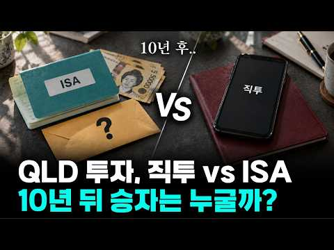
- 챕터: 0:00 ISA 가입자 1,000만 명, 나는 어디에 담을까 · 1:51 1억 넣으면 세금 1,400만 원 차이 · 6:01 ISA 나스닥 2배, 환율도 2배라고? · 8:01 그래서, 어디에 얼마를 넣을까 · 9:11 10년 전 천만 원, 지금 얼마일까 · 10:45 2배가 3배를 이긴 이유 · 12:48 2008년 같은 폭락이 오면? · 13:59 정리, 그리고 1만 달러 새 계좌
- 설명 앞부분: 나스닥 2배, ISA로 살까 미국 직투로 살까? 1년에 천만 원씩 10년이면 세금만 1,400만 원 가까이 갈립니다. 어느 통장에 얼마를 넣을지, 그리고 왜 장기로는 QLD인지 레버리지 7년 차의 시각으로 정리했습니다.
- 같은 채널 평소 대비 ×20.9 (채널 최근 롱폼 중앙값 523회) · 평소 영상: 하수들은 진짜 정반대로 합니다. 이렇게 대응하세요. (591회) / 반도체 폭락 뒤에 숨겨진 세력 다툼 비밀 (455회)
- 대본 없음 (설명) — 음성인식이 끝나면 도입부·흐름이 들어감
- 댓글 31/31: 좋은 점 — 영상 2 · 감사·응원 5 · 더 알고 싶은 것 2 · 아쉬운 점 — 영상 0 · 반박·불만 — 의견 다름 0 · 정치·사회 0 · 경험 공유 0 · 구독·다음 기대 1
  - 좋은 점 — 영상 👍2 “유익한 영상입니다 감사합니다🎉🎉”
  - 감사·응원 👍2 “유익한 영상입니다 감사합니다🎉🎉”
  - 감사·응원 👍1 “영상 감사합니다^^ 요즘 isa에서 한국폰 qld를 사려면 1000만원이 있어야 해서 고민입니다..1000만원을 일시로 넣고 적립식매수해도 가능한건가요?”
  - 더 알고 싶은 것 👍2 “영상 잘 보았습니다~!^^그럼 isa 계좌에서 3년 납입후 연장하고 부동산이나 큰돈 들어갈때 해지 하고 싶으면 4년후에는 해지해도 세금 해택 받을 수 있는걸까요?그리고 환헷지가 가능한 h가 붙은 상품으로이 나을지 고견 부탁드립니다~🙏이제 막 계좌 개설해서 시작 하려는…”

### 38. [문남중 출연] "코스피 바닥, 7월29일에 이미 확인 끝! 전고점 회복 근거? '이것' 보시면 됩니다" #문남중 _261019

- https://www.youtube.com/watch?v=btSUFhvYPwk · 경제통마늘 · 구독자 11,500 · 조회수 309,310 (×26.9, 하루 137,284.9) · 좋아요 2,036 (0.7%) · 10.2분 · 2026-10-19 · 주제 묶음 5. 국내주식 · 형식 오디오북·낭독 (명언·인생조언) · 폴더 `W_btSUFhvYPwk` (웹 승인)
- 썸네일: 
- 설명 앞부분: 전문가 "10월 대폭락은 과도..7천선 회복 한달내로도 가능할 것" '7만전자·20만닉스' 전망? 마이크론, TSMC 실적으로 설명하고파 TSMC, 4분기 매출 전분기 대비 +14%, 전년 동기 대비 +58% 삼전닉스 역시 예상치 상회하는 실적 흐름 예상 글로벌증시 방향성 결정하는 美 증시 반등하면, 코스피도 반등 미 9월 소비자물가 예상치 상회, 매파적 통화정책, 코어위브 회사채 급락 등 모든 문제는 미국에서 시작됐지만, 그럼에도 미 증시 '평온' 美 중간선거 이후, 3년차까지 S&P500지수 계속 올랐던 과거 경험상, 내년 증…
- 같은 채널 평소 대비 ×129.1 (채널 최근 롱폼 중앙값 2,396회) · 평소 영상: 센터장도 '당황' 삼전 잘 나가는데 도대체 왜 떨어지나 "이유 굳이 굳이 꼽자면…"_26… (2,396회) / "'삼전 25, 하닉 160, 코스피 6200' 증시 마지노선"_261013 (3,495회)
- 대본 없음 (설명) — 음성인식이 끝나면 도입부·흐름이 들어감
- 댓글 225/225: 좋은 점 — 영상 3 · 감사·응원 14 · 더 알고 싶은 것 1 · 아쉬운 점 — 영상 0 · 반박·불만 — 의견 다름 7 · 정치·사회 13 · 경험 공유 10 · 구독·다음 기대 0
  - 좋은 점 — 영상 👍2 “시기가 조금씩 정확하게는 어렵지만 방향성을 항상 잘 맞았던거 같아요 그래서 너무 도움이 됩니다 삼성 sdi 말씀해 주셔서 작지만 수익 감사해요 오늘도 강하네요”
  - 좋은 점 — 영상 👍1 “열심히 보고 있습니당 ! 꾸준히 우상향 하다가 이번 하락은 중국반도체 때문인것 같은데, 막말로 이걸 어떻게 예측해요 자기네 회사에서도 기밀일텐데..,ㅋㅋ 일시적인거고 다시 꾸준히 우상향 한다고 계속 말씀하시니까 맘놓고 지켜볼께용 이번 하락에도 저만 아무렇지 않았던것 …”
  - 감사·응원 👍36 “시기를 맞추는건 신도 모를듯. 방향성만 잡아주시는 것만해도 감사합니다.~~”
  - 감사·응원 👍8 “문남중 위원님 오늘말씀도 감사합니다 위원님 말씀찾아들으러왔습니다 차분히대응하겠습니다 정말 감사합니다~^^”
  - 더 알고 싶은 것 👍0 “그냥 바닥 좀 알려주세요. 줏어 먹게요.”
  - 반박·불만 — 의견 다름 👍16 “7월폭락맞춘거말고 다틀렸다니까 자꾸 띄워주냐 7월폭락도 제대로된 이유로 맞춘게아니라 얻어걸린느낌임”
  - 반박·불만 — 의견 다름 👍6 “이 사람 말이 한번은 맞았죠... 그외는 완전 틀렸어요. 주식은 복잡한변수가 작용하는데... 물가와 금리만 보니.. 폭락 몇일전, 코스피 오천선갈일이 없고 오를일만 남았다고 했죠.. 그래서 현금넣었더니 오천으로 폭락!”
  - 정치·사회 👍38 “1400만 개미투자자를 기만하는 ‘무늬만’ 주주 보호법인 ‘의무공개매수제도’, ‘주가 누르기 방지법’의 전면 재검토 및 수정 입법 요청에 관한 청원 국회전자청원 참여 부탁드려요.”
  - 정치·사회 👍25 “외국인들 매수세 그리 강하지 않네요. ㅠㅠ”
  - 경험 공유 👍14 “이 사람 빨아주는 인간들 왜 이리 많냐. 내가 이 사람 5년 넘게 지켜 봤는데, 완전 반대방향으로 정말 턱도 없는 예측 한 경우도 여러번 봤다. 신도 모르는게 주식이다. 신의 영역에 도전을 하는 이런 류의 쓸데 없는 직업군 사람들 말 맹신하지 마라.”
  - 경험 공유 👍5 “주식은 신도 모른다...내가 볼텐 연말에 한번 더 빠질 것 같다...”

### 39. 매일 아침 7시, 내 포트폴리오를 관리해주는 AI 주식 비서를 만들어봤습니다

- https://www.youtube.com/watch?v=ITzgH6CeZns · 스티브의 파도타기 | AI 시대 일하는 법 · 구독자 26,700 · 조회수 693,440 (×26.0, 하루 4,757.0) · 좋아요 16,242 (2.3%) · 14.8분 · 2026-05-28 · 주제 묶음 2. 장기투자·ETF·지수 · 형식 정보·해설 (그 밖) · 폴더 `W_ITzgH6CeZns` (웹 승인)
- 썸네일: 
- 챕터: 0:00 Intro · 1:44 시작 전 꼭 알아야 할 것 · 2:37 1단계 - 주식 가격 정확하게 가져오기 · 3:40 2단계 - 관련 뉴스 가져오기 (날짜 문제 해결) · 6:20 3단계 - 브리핑으로 묶기 · 7:54 4단계 - 카카오톡으로 받기 (PlayMCP 연결) · 11:17 5단계 - 매일 아침 7시 자동 실행 (스케줄 등록) · 13:09 다음날 아침, 실제로 작동하는지 확인
- 설명 앞부분: Claude 하나로 매일 아침 7시, 코딩을 모르는 누구나 만들 수 있을만큼 쉽습니다. AI 자동화 콘텐츠가 넘쳐납니다. "주식 자동 매매", "포트폴리오 자동 운영" 같은 것들이요. 저는 개인적으로 추천드리지 않습니다. AI가 주식 판단을 대신할 수 있다면, AI 쓰는 사람들 모두 부자가 됐겠죠. AI는 미래를 알지 못합니다. 반복 노동은 AI에게 넘기고 진짜 중요한 판단은 내가 하는 것. 이게 제가 생각하는 AI 시대의 일하는 방식입니다. 타임라인 ○ 이렇게 AI를 활용하는 법을 직접 배우고 싶다면?
- 같은 채널 평소 대비 ×487.1 (채널 최근 롱폼 중앙값 1,424회) · 평소 영상: 아버지 회사에 AI를 만들어드렸습니다 ep.1 영업비서 (1,693회) / 신입사원이 아닌, AI에게 인수인계합니다 ∣ 업무를 회사에 남기는 법 (1,154회)
- 대본 없음 (설명) — 음성인식이 끝나면 도입부·흐름이 들어감
- 댓글 388/391: 좋은 점 — 영상 23 · 감사·응원 34 · 더 알고 싶은 것 38 · 아쉬운 점 — 영상 2 · 반박·불만 — 의견 다름 0 · 정치·사회 1 · 경험 공유 12 · 구독·다음 기대 5
  - 좋은 점 — 영상 👍11 “클로드 코웤.... 대단한 기능이네요. 꼭 주식이 아니더라도 회사 업무 관련 시장 분석에도 활용해봐야겠습니다. 좋은 정보 감사합니다”
  - 좋은 점 — 영상 👍4 “좋은 정보 입니다 정말 감사드립니다”
  - 감사·응원 👍55 “주식 투자를 하는 사람으로서 정말 감사합니다. 혹시 텔레그램에 팔로우하는 채널들에 수많은 주식 정보가 있는데 그걸 요약해서 브리핑하는 것도 가능할까요? 검토 부탁드립니다.”
  - 감사·응원 👍11 “클로드 코웤.... 대단한 기능이네요. 꼭 주식이 아니더라도 회사 업무 관련 시장 분석에도 활용해봐야겠습니다. 좋은 정보 감사합니다”
  - 더 알고 싶은 것 👍55 “주식 투자를 하는 사람으로서 정말 감사합니다. 혹시 텔레그램에 팔로우하는 채널들에 수많은 주식 정보가 있는데 그걸 요약해서 브리핑하는 것도 가능할까요? 검토 부탁드립니다.”
  - 더 알고 싶은 것 👍4 “내용이 너무 좋아서 저도 해보고 싶은데, 컴퓨터가 켜져 있어야 한다는 부분이 가장 아쉬운 지점이네요... 근데 궁금한게 클로드는 기본적으로 서버에서 작동하는 거 아닌가요? 근데 왜 마치 로컬 프로그램인 것처럼 내 컴퓨터가 켜져 있어야 한다고 하는지 모르겠네요... 대…”
  - 아쉬운 점 — 영상 👍0 “실제로 투자에 사용하기에는 과거데이터를 참고 해서 주거나 잘못된 정보를 주기도 하니 잘 걸러 내야 합니다..”
  - 아쉬운 점 — 영상 👍0 “감사합니다. 주어진 자료 바탕으로 제가 이틀정도 더 씨름하면서 제 스타일로 변동하였습니다. 문제가 되었던 부분들과 제가 수정한 방안 모두 감사한 마음으로 정리해봅니다. 1. 먼저 큰 틀에서 이 영상대로 잘 따라하시면 됩니다 . 전 하루에 3번은 받았으면 해서 8시 1…”
  - 경험 공유 👍4 “컴맹인 제가 해냈어요 . 친절한 설명 감사드립니다.”
  - 경험 공유 👍4 “내용이 너무 좋아서 저도 해보고 싶은데, 컴퓨터가 켜져 있어야 한다는 부분이 가장 아쉬운 지점이네요... 근데 궁금한게 클로드는 기본적으로 서버에서 작동하는 거 아닌가요? 근데 왜 마치 로컬 프로그램인 것처럼 내 컴퓨터가 켜져 있어야 한다고 하는지 모르겠네요... 대…”
  - 구독·다음 기대 👍0 “오~구독했습니다~바로 공유하고~좋아요^^ 이런 유요한 꿀팁이 클로드 써보면서 이런정보가 있는지😅”
  - 구독·다음 기대 👍0 “너무 좋은 정보 감사합니다. 구독하고 갑니다.~”

### 40. '5천피' 예언적중한 문남중 "코스피 저점? 5040 봅니다, 지금은 아무것도 하지 마세요" #문남중 _260730

- https://www.youtube.com/watch?v=SrwNTk6GT9U · 경제통마늘 · 구독자 11,500 · 조회수 295,264 (×25.7, 하루 3,547.0) · 좋아요 4,517 (1.5%) · 19.6분 · 2026-07-30 · 주제 묶음 5. 국내주식 · 형식 정보·해설 (그 밖) · 폴더 `W_SrwNTk6GT9U` (웹 승인)
- 썸네일: 
- 설명 앞부분: 여기서 더 떨어진다고? '5천피' 적중한 전문가 "지금 아무 것도 하지마라!" '5천피' 예언적중? 슬픈 예감은 틀린 적이 없어요 지금은 펀더멘털보다는 기술적 분석에 의존해야하는 시기 6월부터 부각된 물가, 금리불안, 이란전쟁 재확전, 美 관세부과로 인한 미 증시 하락 등 살펴야 낙폭 과대하지만, 코스피 '저점' 섣부른 예단 안돼..추가하락 염두해야 코스피 급락, 이번주가 '클라이막스' 증시 반등 시점? 4분기 예상..반도체 주가 급등할 것 펀더멘탈 훼손은 없어...문제는 '가치' 아닌 '이 것' (가격) 코스피 4일연속 음봉, …
- 같은 채널 평소 대비 ×123.2 (채널 최근 롱폼 중앙값 2,396회) · 평소 영상: 센터장도 '당황' 삼전 잘 나가는데 도대체 왜 떨어지나 "이유 굳이 굳이 꼽자면…"_26… (2,396회) / "'삼전 25, 하닉 160, 코스피 6200' 증시 마지노선"_261013 (3,495회)
- 대본 없음 (설명) — 음성인식이 끝나면 도입부·흐름이 들어감
- 댓글 989/989: 좋은 점 — 영상 9 · 감사·응원 33 · 더 알고 싶은 것 8 · 아쉬운 점 — 영상 1 · 반박·불만 — 의견 다름 22 · 정치·사회 122 · 경험 공유 58 · 구독·다음 기대 0
  - 좋은 점 — 영상 👍6 “좋은말씀 감사드려요🎉😂❤”
  - 좋은 점 — 영상 👍2 “저는 2년전 전세놓구 투자를한 1인 입니다. 그래서 문위원님 방송 2년 내도록 잘..경청했구 많은 도움이 됐습니다. 특히 미국주식 5월이 고점이라고.. 5,6월에 걸쳐 정리하고 지금은 맘편히 관망중 입니다. 너무 감사드리고 더위 조심하시고 오래도록 방송해 주세요^^”
  - 감사·응원 👍166 “V자 반등은 바라지도 않아요 야금야금 이라도 오르면 고맙겠습니다”
  - 감사·응원 👍123 “평생 노동판 돌며 노후자금으로 모아둔. 2억. 무슨 욕심이생겨. 8000. 털리고 이제 제정신이들어 몇천 손해감수하고 빠져나갈려니 너무후회스럽고. 내욕심을. 내자신을. 미워합니다. 이글 보신모든분 힘내 건투를바랍니다”
  - 더 알고 싶은 것 👍2 “저는 2년전 전세놓구 투자를한 1인 입니다. 그래서 문위원님 방송 2년 내도록 잘..경청했구 많은 도움이 됐습니다. 특히 미국주식 5월이 고점이라고.. 5,6월에 걸쳐 정리하고 지금은 맘편히 관망중 입니다. 너무 감사드리고 더위 조심하시고 오래도록 방송해 주세요^^”
  - 더 알고 싶은 것 👍2 “이분 롱도 맞추나요? 오르면 조정과 숏만 외치는 상황인가요? 이번에 처음 알게된 전문가라서 궁금하네요”
  - 반박·불만 — 의견 다름 👍756 “이분이 이번에 맞췄다고 해서 다음에 또 맞추는건 아닙니다. 남의 말 듣지말고 자기 주관대로 해야 후회가 남지 않습니다”
  - 반박·불만 — 의견 다름 👍114 “돌이켜보니 이 사람 예측이 제일 정확했다...5000대 초반까지 떨어질 수 있다고 한 유일한 사람임...그 때는 말도 안되는 소리라 생각했는데 정확했음”
  - 정치·사회 👍192 “외국인 주식 놀이터 만들고 개미들 핏눈물 책임질 사람 아무도 없네ㅠㅠㅠ”
  - 정치·사회 👍169 “국민연금 리밸런싱 방치, 외국인 수백조 먹튀기회 제공~~~~~ 특검수사대상이다!!!!!!!”
  - 경험 공유 👍32 “잼데믹 김용범 레버리지 사이드카 서킷 브레이크가 일상이 된 국장 진짜 한번도 경험해 보지 못한 나라 꼬라지”
  - 경험 공유 👍12 “나도 5천피 예상했는데 적중했음…하지만 4천피까지 갈거라 다시 한번 예상함..우리나라 경제 등을 비춰볼때 3~4천피가 적정 수준임..그동안 정부 주도 주가 조작을 잘 보았다..”

