# 주식 — 성공 사례 분석: 사례별 자세히 #1–#40

`analysis.md` 의 9번 (같은 # 번호). 자동 생성 — `tools/success_analysis.py` v1.6.1 (2026-11-28 11:24 UTC). ※ 연구·교육용 — 투자 권유가 아님.

### 1. 테슬라·스페이스X 4,600조 합병 협상…서학개미에게 벌어질 일

- https://www.youtube.com/watch?v=oI4Er3-UwPQ · 월가인사이트 · 구독자 130 · 조회수 80,120 (×616.3, 하루 7,230.7) · 좋아요 341 (0.4%) · 9.8분 · 2026-11-17 · 주제 묶음 8. 투자 심리·실패 · 형식 정보·해설 (그 밖) · 폴더 `W_oI4Er3-UwPQ` (웹 승인)
- 썸네일: 
- 설명 앞부분: 블룸버그는 11월 12일, 테슬라·스페이스X 합병 협상이 진전을 보고 있으며 이르면 12월 발표, 늦으면 내년 초라고 보도했습니다. 두 회사 몸값을 합치면 약 4,600조 원, 올해 나라 예산의 6배가 넘습니다. 한국 투자자가 가진 테슬라·스페이스X 주식은 33조 원이 넘습니다. 일론 머스크는 "합병이 확정됐다고 보는 건 과장"이라면서도 "좋은 생각이냐면, 네"라고 했고, 테슬라 주주인 게리 블랙은 "스페이스X 주식을 받으면 바로 팔겠다"고 말합니다. 이 합병에서 정해진 건 무엇이고 아직 소문인 건 무엇일까요? 안 팔아도 세금이 …
- 같은 채널 평소 대비 ×580.6 (채널 최근 롱폼 중앙값 138회) · 평소 영상: 미국 반도체 하루 −12% 폭락…"이제 시작"일까, 일시적 조정일까? (138회) / 머스크 선거에 6,300억 쓰고 "바보 같았다"…테슬라에 벌어질 일 (184회)
- 대본 없음 (설명) — 음성인식이 끝나면 도입부·흐름이 들어감
- 댓글 24/24: 좋은 점 — 영상 0 · 감사·응원 0 · 더 알고 싶은 것 0 · 아쉬운 점 — 영상 0 · 반박·불만 — 의견 다름 1 · 정치·사회 0 · 경험 공유 2 · 구독·다음 기대 0
  - 경험 공유 👍8 “진짜 재미있는점은 머스크의 의견이 중요한게 아니라 테슬라 주식을 갖고 있는 기관과 개인들의 의견인데 어떤 유튜버도 언론도 이 문제를 심도있게 다루지 않는다. . 머스크는 당연히 합병을 원하겠지만 주주들은 다르다. 스엑의 꽃길은 몇년간 막대한 투자금이 필요하다. 테슬라…”
  - 경험 공유 👍4 “개리블랙은 몇 주 가지고 있지 않다고 들었어요. 그런 사람의 말을 자꾸 테슬라랑 엮는 것도 정말... 개리가 테슬라 주식을 팔든 말든 뭔 상관~~ 게리 블랙이 가지고 있는 주식 다 합쳐도 내가 가지고 있는 것보다 못 가지고 있을 것 같은데. 어디서 입을 함부로 놀리는…”

### 2. 삼성전자 배당금 30조 풀었는데 주당 4601원인 이유 #삼성전자배당금 #SK하이닉스

- https://www.youtube.com/watch?v=ldNVHUOHnV4 · 경제 계기판 · 구독자 771 · 조회수 492,694 (×639.0, 하루 17,733.2) · 좋아요 1,404 (0.3%) · 13.7분 · 2026-10-31 · 주제 묶음 3. 배당 · 형식 정보·해설 (그 밖) · 폴더 `W_ldNVHUOHnV4` (웹 승인)
- 썸네일: 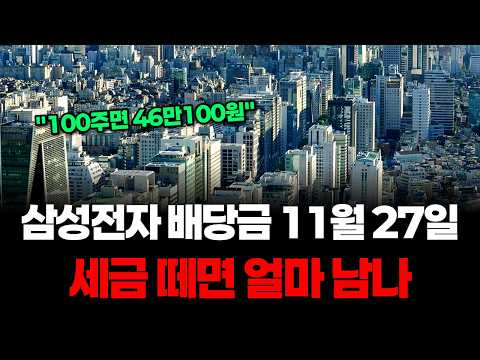
- 챕터: 0:00 주당 배당의 착시 — 107조 벌고 30조 배당, 그… · 4:22 실망의 실체 — 남은 55조~75조원, 2027년 1… · 8:11 반쪽짜리 실적 — 반도체 106조5000억원 vs 완… · 9:57 내 계좌·국민연금 — 100주·1000주 세후 금액,… · 11:55 정리 — 시설투자 84조4000억원과 주주환원 사이
- 설명 앞부분: 삼성전자가 10월 29일 2026년 3분기 확정 실적을 공시했습니다. 매출 195조2532억원, 영업이익 107조4405억원으로, 회사는 «글로벌 테크 기업 중 최초로 분기 영업이익 100조원을 돌파했다»고 밝혔습니다. 같은 날 보통주·우선주 모두 주당 4601원, 총액 30조30억원의 3분기 배당을 결정했습니다. 하루 전 SK하이닉스는 영업이익 83조3338억원에 주당 2만원(총액 약 14조1035억원)을 발표했습니다. 돈은 삼성이 더 벌었고 배당 총액도 약 2.1배인데, 한 주당 배당은 하이닉스의 4분의 1이 안 됩니다. 그리…
- 같은 채널 평소 대비 ×484.0 (채널 최근 롱폼 중앙값 1,018회) · 평소 영상: 30년 만에 3.1%, 일본 재정을 덮친 숫자의 정체 #일본국채 #금리인상 (1,018회) / 젠슨황 스캔들 사과, 코스피 절반이 왜 떨까? #젠슨황 #코스피 (1,037회)
- 대본 없음 (설명) — 음성인식이 끝나면 도입부·흐름이 들어감
- 댓글 53/53: 좋은 점 — 영상 1 · 감사·응원 1 · 더 알고 싶은 것 0 · 아쉬운 점 — 영상 0 · 반박·불만 — 의견 다름 0 · 정치·사회 1 · 경험 공유 0 · 구독·다음 기대 0
  - 좋은 점 — 영상 👍0 “피자를 90조각 내느냐 10조각 내느냐 비유 듣고 바로 이해됐어요. 오늘 드디어 입금됐네요~”
  - 감사·응원 👍0 “감사 합니다”
  - 정치·사회 👍0 “푼돈 알량한 배당금보다 자사주 매입 소각해서 주가 관리나 해라~~ 무능한 이죄명 정권은 쓸데 없는 짓거리만 하지 말고 공매도 금지 시켜서 주가 안정 좀 시켜라.”

### 3. 반도체지수 하루 -10.73% 폭락, 월요일 코스피는? #엔비디아 #반도체 #코스피

- https://www.youtube.com/watch?v=3wbMHT_WF-0 · 세계 풍향계 · 구독자 1,560 · 조회수 260,618 (×167.1, 하루 35,081.9) · 좋아요 1,176 (0.4%) · 9.1분 · 2026-11-20 · 주제 묶음 5. 국내주식 · 형식 정보·해설 (그 밖) · 폴더 `W_3wbMHT_WF-0` (웹 승인)
- 썸네일: 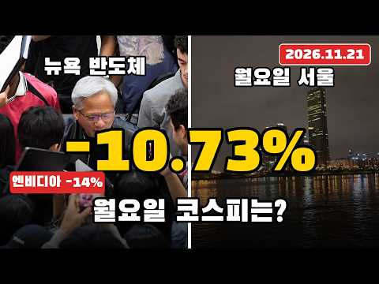
- 챕터: 0:00 이번 주 숫자 · 0:33 나스닥, 일주일 만에 10%가 사라졌다 · 1:35 반도체에서 무슨 일이 있었나 · 3:30 서울은 먼저 맞았다, 그런데 · 4:51 월요일 서울로 오는 세 갈래 · 6:15 그래도 버팀목이 될 숫자 · 7:57 월요일 아침 볼 숫자 3개 · 8:47 자료 출처
- 설명 앞부분: 금요일 뉴욕 반도체지수 하루 -10.73%, 서울은 이미 -5.21% → 월요일 아침 볼 숫자 3개 ※ 나레이션: AI 음성 (ElevenLabs) [목차] 미국 시간 11월 20일(금) 필라델피아 반도체지수 -10.73%, 엔비디아 -14.01%, 마이크론 -13.89%, AMD -13.25%, 브로드컴 -12.19%. S&P500 -3.70%(6,910.39, 7거래일 연속 하락), 나스닥 -5.28%, 다우 -1.93%. CNBC는 S&P500과 다우가 조정 구간(최고 종가 대비 10% 넘게 하락)에 들어갔다고 전했습니다. …
- 같은 채널 평소 대비 ×908.1 (채널 최근 롱폼 중앙값 287회) · 평소 영상: 연준 이사 "0.25%p만 올리면 신뢰가 위험"…미국 물가 쇼크, 코스피는? - 2026… (287회) / ‘사실상 완판’ 하이닉스, 왜 24% 빠졌나 #반도체 (397회)
- 대본 없음 (설명) — 음성인식이 끝나면 도입부·흐름이 들어감
- 댓글 435/435: 좋은 점 — 영상 1 · 감사·응원 6 · 더 알고 싶은 것 3 · 아쉬운 점 — 영상 3 · 반박·불만 — 의견 다름 1 · 정치·사회 36 · 경험 공유 11 · 구독·다음 기대 2
  - 좋은 점 — 영상 👍3 “분석 관점 설명이 좋습니다~~따봉”
  - 감사·응원 👍45 “곡소리 나겠네 다들 힘내세요 위로가 안되겠지만”
  - 감사·응원 👍40 “어쩌다가 한바탕 턱 빠지게 웃는다 그리고는 아픔을 그 웃음에 묻는다 그저 와준 "300"이 고맙기는 하여도 죽어도 오고 마는 "90"이 두렵다 아, 닉스형 주가가 왜이래 ? 왜 이렇게 힘들어....”
  - 더 알고 싶은 것 👍1 “월욜?? 궁금해요? 조때써요.”
  - 아쉬운 점 — 영상 👍1 “월요일 코스피는 상승 화요일은 하락 뻔한거 잖아ㅋ”
  - 아쉬운 점 — 영상 👍1 “환율은 오르고 하닉은 갭하락 시작으로 9%하락찍고 5~7% 사이 하락하겠지 뻔한거 아닌감? 안봐도 비됴얌”
  - 정치·사회 👍63 “그래도 이재명정부가 잘하네요. 모든국민이 평등하게 살아가게 만드는것. 다같이 거지로 살아가면 평등하네요. 기득권과 정치권만 잘사는건 이건 뭐 공산국가랑 느낌이 비슷하노”
  - 정치·사회 👍24 “이재명이 국민을 부자로 만들어줄것같냐”
  - 경험 공유 👍25 “재맹이 내가 언제 주식 하라고 했어요 할거다 ㅋㅋ”
  - 경험 공유 👍2 “월요일은 하락이 아니라 폭락예상! 힘내세요! 제가 조금이라도 매입해서 도움드릴께요”
  - 구독·다음 기대 👍4 “정보가 깔끔하고 좋아요. 저는 유투버 구독에 많이 인색한 편인데 구독하고갑니다.”
  - 구독·다음 기대 👍2 “영상정리가 깔끔하네요! 구독하고갑니다!!”

### 4. 사상 초유의 이틀 연속 서킷브레이커! 폭락장에서 투자자가 절대 해서는 안 될 행동 ∣ 존리 대표

- https://www.youtube.com/watch?v=un5SAQlJFcY · 증시직격 · 구독자 117 · 조회수 19,707 (×168.4, 하루 2,134.4) · 좋아요 324 (1.6%) · 23분 · 2026-10-12 · 주제 묶음 11. 투자 일반 · 형식 인터뷰·강연·대담 · 폴더 `W_un5SAQlJFcY` (웹 승인)
- 설명 앞부분: 증시가 이틀 연속 서킷브레이커를 기록하는 극심한 변동성에 빠진다면 투자자는 어떻게 대응해야 할까요? 시장이 급락할수록 공포에 휩쓸려 성급한 결정을 내리기 쉽지만, 이럴 때일수록 투자 원칙을 점검하는 것이 중요합니다. 이번 영상에서는 존리 대표와 함께 폭락장에서 개인 투자자들이 주의해야 할 행동과 시장 변동성에 대응하는 투자 자세를 살펴봅니다. 단기적인 주가 움직임에 흔들리지 않고 장기적인 관점에서 투자 전략을 세우는 방법과 위기 상황에서 점검해야 할 핵심 원칙을 알아봅니다. 급락장 속에서 소중한 투자 자산을 지키고 싶다면, 지금 …
- 대본 없음 (설명) — 음성인식이 끝나면 도입부·흐름이 들어감
- 댓글 0/17: 좋은 점 — 영상 0 · 감사·응원 0 · 더 알고 싶은 것 0 · 아쉬운 점 — 영상 0 · 반박·불만 — 의견 다름 0 · 정치·사회 0 · 경험 공유 0 · 구독·다음 기대 0

### 5. KODEX 200타겟위클리커버드콜 지금 사도 될까?｜1억 투자 백테스트·JEPQ·SCHD 세금 비교

- https://www.youtube.com/watch?v=mgGzzZkOybI · 월급졸업반 · 구독자 173 · 조회수 29,320 (×169.5, 하루 2,276.9) · 좋아요 310 (1.1%) · 23.3분 · 2026-11-15 · 주제 묶음 11. 투자 일반 · 형식 정보·해설 (그 밖) · 폴더 `W_mgGzzZkOybI` (웹 승인)
- 썸네일: 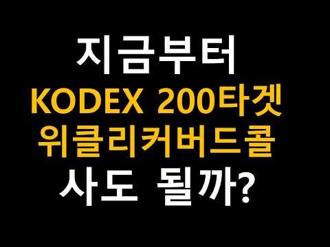
- 설명 앞부분: 💰 **1억 원 투자하면 매달 176만 원을 받을 수 있다? 최근 높은 월분배금으로 주목받고 있는 **KODEX 200타겟위클리커버드콜 ETF! 과거 12개월 분배금을 기준으로 계산한 분배율은 무려 연 20%를 넘습니다. 그렇다면 지금 투자해도 괜찮을까요? 이번 영상에서는 KODEX 200타겟위클리커버드콜의 실제 상장 이후 수익률과 분배금 데이터를 분석하고, 미국의 대표 배당 ETF인 **JEPQ, SCHD와 수익률부터 세금까지 비교**해 봤습니다. 📊 **이번 영상에서 확인할 내용 KODEX 200타겟위클리커버드콜, 지금 사도 …
- 같은 채널 평소 대비 ×162.0 (채널 최근 롱폼 중앙값 181회) · 평소 영상: 하락장에서 배당으로 살아남는 방법 ｜SCHD 완벽 정리 (181회) / 지금부터 S&P500 ETF 사도 될까? (287회)
- 대본 없음 (설명) — 음성인식이 끝나면 도입부·흐름이 들어감
- 댓글 27/27: 좋은 점 — 영상 0 · 감사·응원 0 · 더 알고 싶은 것 1 · 아쉬운 점 — 영상 0 · 반박·불만 — 의견 다름 0 · 정치·사회 1 · 경험 공유 1 · 구독·다음 기대 0
  - 정치·사회 👍1 “현재로써는 최고 최선의 커버드콜임 그러나 정부가 가만히 두고볼까요 세법이 바뀔수 있습니다”

### 6. “SOXL 개미 다 털렸다”…6.2조 원 걸린 서학개미, 계산해 보니

- https://www.youtube.com/watch?v=Pl2RJoUXP_4 · 월가의 진실 · 구독자 3,650 · 조회수 351,786 (×96.4, 하루 47,661.3) · 좋아요 1,284 (0.4%) · 10.6분 · 2026-11-21 · 주제 묶음 8. 투자 심리·실패 · 형식 정보·해설 (그 밖) · 폴더 `W_Pl2RJoUXP_4` (웹 승인)
- 썸네일: 
- 챕터: 0:00 “SOXL 개미 다 털렸다”는 말 · 1:29 퍼진 말 다섯 가지 · 1:50 ① SOXL 고점 대비 −90% · 2:40 ② SOXL 서학개미 다 털렸다 · 4:57 ③ SOXL 3분의 1이 한국인 · 5:43 중간 정리 · 5:54 ④ 미 연준, 한국인 SOXL 과매수 경고 · 7:48 ⑤ SOXL 하루 만에 0원 · 9:24 판정표 · 9:50 내 SOXL 손익 재는 법
- 설명 앞부분: “SOXL 간 서학개미 오늘 다 털렸다, 대부분 −70~90%.” 11월 20일(현지) SOXL이 하루 −31.74%로 30.92달러까지 빠지자 이런 글이 돌았습니다. 서학개미는 이 상품을 6.2조 원어치(11/18 보관) 들고 있습니다. 퍼진 말 다섯 가지를 나스닥 공식 시세(산 날별 손익은 직접 계산), 한국예탁결제원 집계, 연준 금융안정보고서, 디렉시온 투자설명서(SEC 497K)로 확인했습니다. 시세는 11월 20일 뉴욕 종가 기준입니다. [판정 요약] “SOXL 고점 대비 −90%” — 사실 (6/22 최고 종가 300.…
- 같은 채널 평소 대비 ×18.8 (채널 최근 롱폼 중앙값 18,705회) · 평소 영상: “SOXL로 손실 복구”…나흘 만에 61%, 원금 계산해 보니 (18,705회) / “TQQQ 물타도 탈출 못 한다”…3,200억 원 더 산 서학개미, 계산해 보니 (17,210회)
- 대본 없음 (설명) — 음성인식이 끝나면 도입부·흐름이 들어감
- 댓글 1,042/1,042: 좋은 점 — 영상 3 · 감사·응원 5 · 더 알고 싶은 것 3 · 아쉬운 점 — 영상 2 · 반박·불만 — 의견 다름 3 · 정치·사회 13 · 경험 공유 23 · 구독·다음 기대 0
  - 좋은 점 — 영상 👍16 “SOXL은 1자리수 가격에서 매수, 2자리수 가격에서 매도라 배웠는데..ㅎ”
  - 좋은 점 — 영상 👍3 “유익한 채널이네요”
  - 감사·응원 👍0 “ㅜㅜ 힘내세요”
  - 감사·응원 👍0 “유익한 영상 감사드립니다. TQQQ15퍼정도 손실인데 전망 어떻게 보시나요?”
  - 더 알고 싶은 것 👍0 “유익한 영상 감사드립니다. TQQQ15퍼정도 손실인데 전망 어떻게 보시나요?”
  - 아쉬운 점 — 영상 👍1 “저 속쓸 평단 12달러임 ㅠ 중간에 절반 팔긴 했는데 200달러 이상에서 다 못판게 아쉽네요”
  - 아쉬운 점 — 영상 👍1 “Ai목소리에요? 성우분이에요? 사극? 예전역사 소개하는분목소리랑비슷”
  - 반박·불만 — 의견 다름 👍0 “누가 언제샀냐가 머가중요하냐 ㅡㅡ 삼전이 38만원갔다가 19만원 반토막갔다는 뉴스나오면 산시점마다 반토막은 아닙니다 이말이하고싶은거야?”
  - 정치·사회 👍2 “국장에서 잃고 대통령탓 금융위원장탓 하는데 미장에서는 누굴 욕할려나”
  - 정치·사회 👍0 “한국에 돈 뿌렸다! 외국인 들이여 여기가 황금어장이다! 니희는 가만히 있어도 정부와 언론이 돈 몰아준다!”
  - 경험 공유 👍11 “160에서 떨어지기 시작할때부터 샀는데 지금 1.6억에 평단 69... 1.3억일떄 평단 80이었는데 몇년째 물탈 각오는 되어있음. 어제 33.8불 평단에 1500만원어치 더 샀음. 이렇게 되면 속슬이 뒤지나 내가 뒤지나 끝까지 가보자 7불 오면 올인해야지.”
  - 경험 공유 👍1 “​"내가 어디서 죽을지 알기만 한다면, 나는 절대 그곳에 가지 않을 것이다." -찰리 멍거-”

### 7. 왜 내가 사면 떨어지고 팔면 오를까? 개미가 주식으로 돈 못 버는 4가지 이유

- https://www.youtube.com/watch?v=fdlfOCtDBqc · 오피디의 머니노트 · 구독자 2,260 · 조회수 856,086 (×378.8, 하루 19,428.6) · 좋아요 2,602 (0.3%) · 13.6분 · 2026-10-15 · 주제 묶음 8. 투자 심리·실패 · 형식 오디오북·낭독 (명언·인생조언) · 폴더 `W_fdlfOCtDBqc` (웹 승인)
- 썸네일: 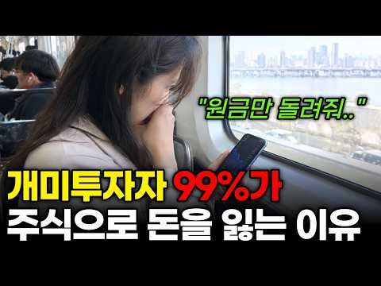
- 챕터: 0:00 하이닉스 꼭대기에서 산 사람들 · 0:43 노벨상 심리학자 대니얼 카너먼의 답 · 1:12 이유 1. 주식을 도박처럼 한다 – 최근 편향 · 2:45 이유 2. 욕심에 몰빵한다 – 레버리지, 신용융자, … · 4:34 이유 3. 잃는 걸 못 견딘다 – 손실 회피, 처분 … · 6:24 이유 4. 남들 따라 들어간다 – 포모(FOMO), … · 7:51 개인투자자가 주식으로 돈 버는 방법 · 8:08 공부 – PER, 사업보고서, 마음 공부 · 9:49 지수 ETF – 코스피200, S&P500 · 10:31 장기 투자 · 11:29 적립식 투자 · 12:37 정리
- 설명 앞부분: 하이닉스 290만 원, 삼성전자 37만 원 꼭대기에서 사신 분들 많으시죠? 왜 개인 투자자는 늘 꼭대기에서 사고 바닥에서 팔까요? 노벨 경제학상을 받은 심리학자 대니얼 카너먼의 연구로, 개미가 주식으로 돈을 못 버는 4가지 이유와 해결 방법을 정리했습니다. 💬 여러분은 이번 하락장에서 어떻게 대응하셨나요? 댓글로 남겨 주세요.
- 같은 채널 평소 대비 ×718.2 (채널 최근 롱폼 중앙값 1,192회) · 평소 영상: 주식 초보가 사면 떨어지고 팔면 오르는 이유 ∣ 하이닉스 물린 개미들의 공통점 (1,650회) / 나스닥 폭락, 지금 사도 될까? 주식 40년 데이터로 본 적립식의 결과 (541회)
- 대본 (음성인식(앞 5분), 5.9 음절/초) — 앞부분만, 흐름은 그 안까지 첫 20초: “하이닉스, 290만원에 사셨나요? 그럼 지금 계좌 반토막 나 있을 겁니다 5월 말, 하이닉스가 처음으로 2대 만원을 넘던 날 뉴스도, 유튜브도, 회사 단톡방도 온통 반도체 얘기였죠 지금 안 사면 나만 바보된다 주식에 관심 없던 사람들까지 그때 처음 하이닉스랑 삼성전자를 샀습니다 그리고 5달 뒤” — 도입부 유형: 질문으로 시작, 숫자로 시작
- 첫 1분: “하이닉스, 290만원에 사셨나요? 그럼 지금 계좌 반토막 나 있을 겁니다 5월 말, 하이닉스가 처음으로 2대 만원을 넘던 날 뉴스도, 유튜브도, 회사 단톡방도 온통 반도체 얘기였죠 지금 안 사면 나만 바보된다 주식에 관심 없던 사람들까지 그때 처음 하이닉스랑 삼성전자를 샀습니다 그리고 5달 뒤 2대 98만원까지 갔던 하이닉스는 130만원 대로 37만원을 찍었던 삼성전자는 21만원 대로 내려왔습니다 빚까지 내서 선분들은 증권사가 주식을 강제로 팔아버렸고요 근데 이상하지 않나요? 같은 하이닉스를 누구는 연초에 65만원에 사서 몇 배를 벌었고 누구는 꼭대기에서 사서 반토막이 났습니다 회사는 똑같은데 결과는 정반대입니다 보통은 운이 나빴다고 생각하잖아요 그런데 심리학자들은 운이 아니라고 말합니다 노벨 경제학상을 받”
- 흐름 (90초마다 첫 문장): 0:00 하이닉스, 290만원에 사셨나요? → 1:30 그런데 많은 분들이 회사가 뭘 하는지는 잘 모르고 → 3:01 기자들이 쉽게 설명해달라고 하자 이렇게 말했다고 합니다 → 4:30 논문 제목도
- 댓글 244/363: 좋은 점 — 영상 3 · 감사·응원 5 · 더 알고 싶은 것 1 · 아쉬운 점 — 영상 0 · 반박·불만 — 의견 다름 3 · 정치·사회 14 · 경험 공유 9 · 구독·다음 기대 0
  - 좋은 점 — 영상 👍2 “공감합니다😂주식투자는 10년 이상 적립식으로 꾸준이 모아가는 게 제일 무난한 투자방법이라고 믿어요~ ❤”
  - 좋은 점 — 영상 👍0 “좋은영상 감사합니다”
  - 감사·응원 👍1 “고맙습니다 ㅠㅠ”
  - 감사·응원 👍0 “좋은영상 감사합니다”
  - 더 알고 싶은 것 👍2 “월요일에 하이닉스 120만원대에 올인해도 되나요? 250만원 되면 미련 없이 팔 생각인데...”
  - 반박·불만 — 의견 다름 👍3 “웃기는 소리 그만하고 k국장에서 주식하는 넘만 바보지. 절대 회사 믿지 마라 절대 오래 투자 한다고 수익 나지 않는다. 안하는게 정답이다”
  - 반박·불만 — 의견 다름 👍2 “교과서적인 이야기이네요..주식은 교과서대로 되는것이 아닙니다..노력을 하세요...차트공부도 하시고..단타로 가세요..국장은 장기투자 하는것아닙니다”
  - 정치·사회 👍6 “이재명이가 조작하는거지머”
  - 정치·사회 👍1 “제일 중요한 것......... 대한민국 주식장은 도박판이기 때문이고, 그 이유는 회사 CEO가 주주들의 이익보다 자신의 이익만 생각하기 때문. 하이닉스, 삼전이 펀더멘틀이 좋음에도 망하는 이유는 정부가 레버리지 상품을 만들어놨기 때문....... 레버리지만 없었어도…”
  - 경험 공유 👍22 “지금 안사만 나만 바보된다 말나오면 이렇게 해석해야합니다. " 지금 사면 나도 바보된다 !! "”
  - 경험 공유 👍5 “국장은 도박이 맞아..장기간 1%라도 우상향해야지 하루에도 10% 오르다가 내리다가 이게 신뢰가 가서 장투가 가능하겠냐... QQQ에 SPY는 아무리 적어도 10%는 꾸준히 상향하고 매일매일 1%씩 오르락 내리락한다. 장투에 대한 신뢰감도 있고 수급도 크고 조금씩 상…”

### 8. 테슬라·스페이스X 합병되면, 안 팔아도 세금? 22% vs 49.5% 갈리는 '한 줄'

- https://www.youtube.com/watch?v=_9okPshQQvU · 임지강 세무사 · 구독자 141 · 조회수 34,414 (×244.1, 하루 1,046.4) · 좋아요 208 (0.6%) · 8.5분 · 2026-10-26 · 주제 묶음 4. 미국·해외주식 · 형식 정보·해설 (그 밖) · 폴더 `W__9okPshQQvU` (웹 승인)
- 썸네일: 
- 챕터: 0:00 안 팔아도 세금이 나올 수 있습니다 · 0:23 지금 어디까지 왔나, 그리고 A씨 · 1:05 안 팔았는데 왜 세금인가 · 2:04 22%냐, 49.5%까지냐 · 4:14 계약서에서 볼 '한 줄' · 5:10 A씨, 세금은 얼마일까 · 6:15 계약서 전에 미리 준비할 4가지 · 7:53 오늘 기억하실 것
- 설명 앞부분: 테슬라와 스페이스X가 합병하면, 주식을 팔지 않은 테슬라 주주도 세금을 낼 수 있습니다. 합병 구조에 따라 양도소득(22%)이 될 수도, 배당소득(최고 49.5%)이 될 수도 있습니다. 해외주식을 보유한 직장인·투자자라면 합병 계약서가 나오기 전에 꼭 확인해 보세요. 건곤세무회계 ∣ 세무사 임지강 서울 중랑구 망우로 305, 6층 602호 (상봉역 1번 출구) ※ 본 영상은 2026년 10월 현재 세법 기준의 일반적 정보이며, 영상 속 A씨 사례는 가상 사례입니다. 개별 사안은 사실관계와 실제 합병 계약 내용에 따라 결론이 달라질…
- 같은 채널 평소 대비 ×61.9 (채널 최근 롱폼 중앙값 556회) · 평소 영상: 이자·배당 2천만 원 넘으면, 세금이 확 늘어날까요? 건강보험료·해외 ETF까지 (556회) / 자녀에게 5천만 원 증여하기 전에, 세무사가 확인하는 네 가지 (857회)
- 대본 없음 (설명) — 음성인식이 끝나면 도입부·흐름이 들어감
- 댓글 45/45: 좋은 점 — 영상 5 · 감사·응원 7 · 더 알고 싶은 것 5 · 아쉬운 점 — 영상 0 · 반박·불만 — 의견 다름 1 · 정치·사회 2 · 경험 공유 0 · 구독·다음 기대 0
  - 좋은 점 — 영상 👍3 “훌륭합니다. 목소리가 좋아서 귀에 쏙쏙 살길을 찾아봅니다...”
  - 좋은 점 — 영상 👍1 “유익한 정보 감사합니다. 합병 계약서가 공개된 후 합병 효력이 발생하기전에 주식을 매도하거나 계속 들고 가거나를 결정할 시간적 여유가 있을까요?”
  - 감사·응원 👍7 “공론화에 힘써주셔서 감사합니다...!! 세무사님”
  - 감사·응원 👍7 “유용한 정보 감사합니다 ^^~”
  - 더 알고 싶은 것 👍2 “아직 안봤는데 테슬라 미국직투 말고 한국증권사에서 테슬라 직투 투자하는 ETF는 어떻게 되는지 궁금하네요.”
  - 더 알고 싶은 것 👍1 “유익한 정보 감사합니다. 합병 계약서가 공개된 후 합병 효력이 발생하기전에 주식을 매도하거나 계속 들고 가거나를 결정할 시간적 여유가 있을까요?”
  - 정치·사회 👍1 “https://petitions.assembly.go.kr/proceed/onGoingAll/5CE947CCAE0B43A2E064B49691C6967B 이 어처구니 없는 법에 대한 국회 청원 링크입니다. 테슬라 주주뿐 아니라 해외주식 하는 모든 분들이 관심을 가져서 …”
  - 정치·사회 👍0 “그록, 제미나이에게 물어보니, 이렇게 의제배당과세로 적용이 안될꺼리고 하는데 양도소득세(자본이득세)로 적용될 가능성이 매우 높으며, 의제배당과세로 보기 어렵습니다. 한국 세법 기준으로 현재 유권해석·사례를 종합하면 이 결론이 타당합니다. 핵심 법리와 적용 소득세법 제…”

### 9. 삼성전자 앞자리 6이 보인다?! 전주 1등 만신에게 삼성전자 '이재용' 사주만 드렸더니..?? "더 이상의 하락은 없다!!"/이재용, 삼성전자, 삼성전자주가전망

- https://www.youtube.com/watch?v=r5SabgPIDJw · 만연정사 서연보살 · 구독자 1,530 · 조회수 163,449 (×106.8, 하루 7,382.9) · 좋아요 1,105 (0.7%) · 14.9분 · 2026-11-06 · 주제 묶음 기타 · 형식 정보·해설 (그 밖) · 폴더 `W_r5SabgPIDJw` (웹 승인)
- 썸네일: 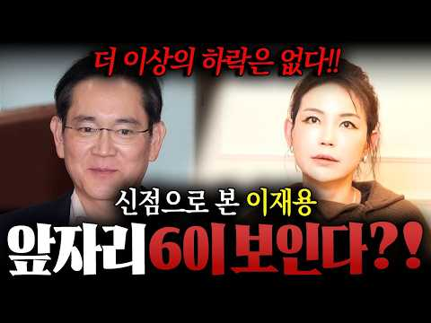
- 설명 앞부분: 안녕하세요 😊 전라북도 전주에서 신당을 운영하고 있는 만연정사 서연보살입니다! 더 많은 분들과 따뜻하게 소통하고 좋은 인연을 나누고 싶어 채널을 개설하게 되었습니다. 살다 보면 답답하고 막막한 순간들이 있지만, 그럴 때 가볍게 들러 편하게 이야기 듣고 가실 수 있는 공간이 되었으면 합니다. 부담 없이 보시면서 작은 힌트라도 얻어가시고, 마음이 한결 편안해지셨으면 좋겠습니다. 항상 진실된 마음으로, 바른 길을 전하는 신의 제자가 되겠습니다. 좋은 기운, 따뜻한 인연으로 함께해요 🙏 📍 위치 : 전라북도 전주 ※ 상담 예약 외 연락은…
- 같은 채널 평소 대비 ×4.2 (채널 최근 롱폼 중앙값 39,062회) · 평소 영상: 대한민국에 피바람이 분다?! 예언 전문 무당에게 2027년 정미년 대한민국 국운예언을 부… (39,062회) / 대한민국 정상에 올라가는게 보인다?! 신점으로 본 '김태규' 사주만 드렸더니..?? "나… (34,634회)
- 대본 없음 (설명) — 음성인식이 끝나면 도입부·흐름이 들어감
- 댓글 105/105: 좋은 점 — 영상 1 · 감사·응원 15 · 더 알고 싶은 것 0 · 아쉬운 점 — 영상 0 · 반박·불만 — 의견 다름 1 · 정치·사회 0 · 경험 공유 3 · 구독·다음 기대 0
  - 좋은 점 — 영상 👍17 “❤❤❤좋은정보 제공하시여 감사합니다 큰힘이 되고있읍니다 사랑합니다 화이팅입니다 🎉🎉🎉🎉🎉🎉🎉”
  - 감사·응원 👍32 “희망적인 점사 감사합니다. 선생님 sk하이닉스도 해주세요.”
  - 감사·응원 👍30 “제발 🙏 꼭 이루어지기 바랍니다 감사합니다”
  - 반박·불만 — 의견 다름 👍0 “ㅋㅋㅋㅋㅋㅋㅋ 지가 말하기두 어이없어보이니 풉거리네”
  - 경험 공유 👍24 “참으로 용하시네요 여러무당선생님들의 종합판이라 생각하면 되겠네요 제가 여러무당들의 내용을 보고 내린 결론입니다 ㅋㅋ 좀더 고생하고 견디다보면 봄이 오것지요 개미님들 힘닙시다 주식은 견딤의 겜이라네요 ㅎㅎ”
  - 경험 공유 👍0 “6만원?? ㅠㅠ 이제 알고리즘에 점까지 뜨네 내가 미쳐가나”

### 10. “SOXL 물타도 탈출 못 한다”…7,800억 원 더 산 서학개미, 계산해 보니

- https://www.youtube.com/watch?v=PMsjSTUpOS8 · 월가의 진실 · 구독자 3,650 · 조회수 226,807 (×62.1, 하루 16,759.5) · 좋아요 845 (0.4%) · 10.2분 · 2026-11-14 · 주제 묶음 8. 투자 심리·실패 · 형식 정보·해설 (그 밖) · 폴더 `W_PMsjSTUpOS8` (웹 승인)
- 썸네일: 
- 챕터: 0:00 “SOXL 물타도 탈출 못 한다”는 말 · 1:02 퍼진 말 다섯 가지 · 1:28 ① 폭락 뒤 8천억 원 더 샀다 · 2:50 ② 2022년에도 있었던 일 · 3:59 ③ SOXL은 원금이 녹는다 · 5:36 중간 정리 · 5:47 ④ 아무리 물타도 탈출 못 한다 · 7:44 ⑤ 반등해도 본전은 어렵다 · 8:50 판정표 · 9:27 직접 계산하는 법
- 설명 앞부분: “SOXL은 아무리 물을 타도 탈출하지 못한다”… 하루 −38.7% 폭락 뒤 유튜브에 퍼진 말입니다. 서학개미는 그 직후 한 주(11/6~12)에 SOXL을 7,791억 원어치 더 샀고, 11월 13일 SOXL은 다시 하루 11% 내렸습니다. 퍼진 말 다섯 가지를 운용사 투자설명서(SEC), 나스닥 공식 시세, 한국예탁결제원 숫자로 확인하고, 지난 두 번의 폭락 때 물을 탄 사람이 어떻게 됐는지 직접 계산했습니다. 주가는 11월 13일 뉴욕 종가 기준입니다. [판정 요약] “폭락 뒤 8천억 원 더 샀다” — 사실 (11/6~12 …
- 같은 채널 평소 대비 ×12.1 (채널 최근 롱폼 중앙값 18,705회) · 평소 영상: “SOXL로 손실 복구”…나흘 만에 61%, 원금 계산해 보니 (18,705회) / “TQQQ 물타도 탈출 못 한다”…3,200억 원 더 산 서학개미, 계산해 보니 (17,210회)
- 대본 없음 (설명) — 음성인식이 끝나면 도입부·흐름이 들어감
- 댓글 520/520: 좋은 점 — 영상 1 · 감사·응원 2 · 더 알고 싶은 것 1 · 아쉬운 점 — 영상 0 · 반박·불만 — 의견 다름 7 · 정치·사회 0 · 경험 공유 7 · 구독·다음 기대 0
  - 감사·응원 👍1 “ㅋㅋㅋ 7불에 들어가서 180불주터 쭉 팔고 240불에 반팔고 계속 가지고 있음요 당시 5마일이라는 유튜버님 말씀이 너무 좋았는데 지금은 채널삭제 되었는데 감사합니다”
  - 더 알고 싶은 것 👍1 “이자율 올리면 어떻게 될까요?”
  - 반박·불만 — 의견 다름 👍4 “시드 10억이상 Soxl 7년째 투자중입니다 언제 물려도 탈출 가능하고요 사팔사팔을 하지 않으면 큰 수익 볼 수 있습니다 그렇다고 쉽다는 말은 아닙니다 10배 상승장중에도 -50% 오는 상황들이 흔하게 찾아옵니다”
  - 반박·불만 — 의견 다름 👍0 “다 라우어진 뭔지 무한매수보고 말도안되는걸 따라 하는 사람 많은듯요”
  - 경험 공유 👍8 “내가 22~23년에 soxl물려서 평단이 21불이었는데 7불까지 빠짐... 그때만해도 탈출 못할거 같았음... 근데 결국 어떻게 됐지? 올해 300불까지 갔음. 300불에 매도 하진 못했지만 그래도 수익내고 나왔다. soxl 탈출 못한다는건 개구라다.”
  - 경험 공유 👍4 “시드 10억이상 Soxl 7년째 투자중입니다 언제 물려도 탈출 가능하고요 사팔사팔을 하지 않으면 큰 수익 볼 수 있습니다 그렇다고 쉽다는 말은 아닙니다 10배 상승장중에도 -50% 오는 상황들이 흔하게 찾아옵니다”

### 11. [긴급속보]💥손실 계좌, 혼자힘으론 힘듭니다 ∣ 끌려다니는 매매 이제 그만

- https://www.youtube.com/watch?v=t50RkPvL16k · 고래미디어 · 구독자 65 · 조회수 15,519 (×155.2, 하루 407.8) · 좋아요 1 (0.0%) · 5.2분 · 2026-10-21 · 주제 묶음 7. 매매·전략 · 형식 정보·해설 (그 밖) · 폴더 `W_t50RkPvL16k` (웹 승인)
- 썸네일: 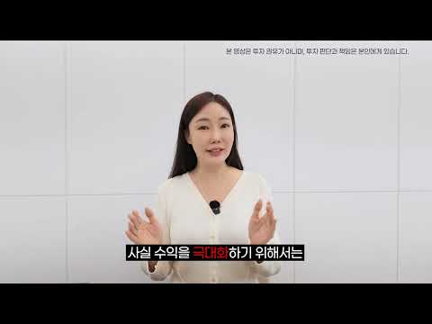
- 설명 앞부분: 손실 보는 분들 공통점이 어떻게 될까요? 바로 손실을 인정 안 한다는 겁니다. 그러니까 자꾸 무리한 매매가 시작되고 조금만 기다리면 회복되지 않을까? 하는 기대감에 막연히 아직도 기다리는 매매를 하신다면 당장 그만두셔야 합니다. 사업자명 : 고래미디어컴퍼니 사업자번호 : 703-10-03070 사업장주소 : 서울특별시 강남구 도곡로84길 6, B1층 25-26(대치동) 저희는 유사투자자문업자로서 개별적인 투자 상담과 자금 운용이 불가합니다. 투자 결과에 따라 투자 원금의 손실이 발생할 수 있으며 그 손실은 투자자에게 귀속됩니다.
- 같은 채널 평소 대비 ×226.6 (채널 최근 롱폼 중앙값 68회) · 평소 영상: 🚨9/9 속보｜양자컴퓨터 말고 '진짜 먼저 클 곳'… 양자보안 관련주 주목 (73회) / 🚨 두산이 거의 1조를 쏟는다… AI CCL 투자 + 자사주 12% 소각 (64회)
- 대본 없음 (설명) — 음성인식이 끝나면 도입부·흐름이 들어감
- 댓글 1/1: 좋은 점 — 영상 0 · 감사·응원 0 · 더 알고 싶은 것 0 · 아쉬운 점 — 영상 0 · 반박·불만 — 의견 다름 0 · 정치·사회 0 · 경험 공유 0 · 구독·다음 기대 0

### 12. 적자인데 300억? 가능한 이유 ∣ 회계사가 말아주는 리센느 소속사 더뮤즈엔터

- https://www.youtube.com/watch?v=kJx_AzV9w9c · 전지적회계사시점 · 구독자 961 · 조회수 318,712 (×331.6, 하루 3,731.1) · 좋아요 1,277 (0.4%) · 21.4분 · 2026-09-03 · 주제 묶음 6. 종목 고르기·분석 · 형식 브이로그·직접 해본 이야기 · 폴더 `W_kJx_AzV9w9c` (웹 승인)
- 썸네일: 
- 챕터: 0:00 오프닝 하이라이트 · 0:23 거제 야호로 시작된 리센느 이야기 · 1:13 숫자로 보는 더뮤즈: 8억에서 300억까지 · 2:20 리센느의 인기, 어느 정도일까 · 4:19 더뮤즈엔터테인먼트는 어떤 회사인가 · 6:06 중소 엔터사가 VC 투자를 받는 이유 · 8:11 모태펀드가 만든 중소돌의 기적 · 9:04 투자 히스토리: 5천만 원에서 시리즈A까지 · 11:44 멀티플로 계산해 본 비상장 기업가치 · 14:26 이익배수로 다시 본 300억의 조건 · 16:04 300억이 되려면 매출은 얼마나 필요할까 · 18:00 리센느 정산은 언제부터 가능할까 · 19:40 결론: 300억은 가능한 숫자인가
- 설명 앞부분: "거제야호로 시작된 리센느 열풍. 소속사 더뮤즈엔터의 가치는 얼마일까요?" 지금 대한민국에서 가장 핫한 걸그룹 리센느, 그리고 소속사 더뮤즈엔터테인먼트의 기업가치를 회계사의 시선으로 분석해봤습니다. 설립 밸류 8억에서 5년 만에 300억, 37.5배가 뛴 이 회사의 투자 히스토리를 따라가면서 비상장 기업의 가치평가가 실제로 어떻게 이루어지는지 알기 쉽게 풀어 드립니다. 그리고 25년말 56억 적자에 자본잠식이였던 리센느 소속사가 어떻게 300억의 가치를 인정 받을 수 있었는지, 중소 엔터사가 VC 투자를 받는 이유부터 아이돌 정산…
- 같은 채널 평소 대비 ×171.8 (채널 최근 롱폼 중앙값 1,855회) · 평소 영상: 위고비·마운자로 열풍, 헬스장 정말 안갈까?? ∣ 회계사가 분석한 비만치료제와 헬스 시장 (1,855회) / 비슷한 웹툰 속, 스타 작가는 얼마나 벌까? ∣ 회계사가 뜯어본 네이버웹툰 (1,291회)
- 대본 (음성인식(앞 5분), 5.9 음절/초) — 앞부분만, 흐름은 그 안까지 첫 20초: “최근에 리셋는 더뮤즈웨어 엔터테인먼트가 몇백억을 같이 로투자를 받았다 이런 얘기가 많잖아요 그래서 이 회사의 가치가 지금 얼마일까 그리고 얼마까지 갈 수 있을까 작년 매출이 17억 8천만 원인데 영업 손실에 50.2천만 원이거든요 그리고 2025년 말에 자본을 보니까 마이너스 11억 5천만 원 데뷔 8년차에다가 포스닥 상장사가 880만 원이 있는데” — 도입부 유형: 질문으로 시작, 숫자로 시작
- 첫 1분: “최근에 리셋는 더뮤즈웨어 엔터테인먼트가 몇백억을 같이 로투자를 받았다 이런 얘기가 많잖아요 그래서 이 회사의 가치가 지금 얼마일까 그리고 얼마까지 갈 수 있을까 작년 매출이 17억 8천만 원인데 영업 손실에 50.2천만 원이거든요 그리고 2025년 말에 자본을 보니까 마이너스 11억 5천만 원 데뷔 8년차에다가 포스닥 상장사가 880만 원이 있는데 더뮤즈웨어 엔터가 300억 가치를 지냈다 회사님 거제 야구 아세요? 잘 알죠 요새 유튜브에 굉장히 핫하잖아요 저도 거제 야구가 뜨기 시작할 때 그때부터 리셋는 유튜브를 좀 많이 봤는데 굉장히 재밌더라고요 사실 제가 또 TMI긴 하지만 저희 어머니가 좀 외곽아 거제에 있거든요 유튜브에서 거제 영상을 보면서 약간 눈에 익은 그런 화면들이 많이 나오더라고요 유튜브도 알”
- 흐름 (90초마다 첫 문장): 0:00 최근에 리셋는 더뮤즈웨어 엔터테인먼트가 → 1:31 그러니까 이제 8억에서 300억 → 3:02 스탭에게 뭐 1분만 더 달라 → 4:31 그리고 이제 뭐 잘 아시는 것처럼
- 댓글 219/219: 좋은 점 — 영상 2 · 감사·응원 14 · 더 알고 싶은 것 0 · 아쉬운 점 — 영상 2 · 반박·불만 — 의견 다름 4 · 정치·사회 0 · 경험 공유 11 · 구독·다음 기대 2
  - 좋은 점 — 영상 👍10 “더뮤즈에 대해 궁금한 것을 많았는데... 좋은 정보 감사합니다.”
  - 좋은 점 — 영상 👍2 “겉으로 보여지는 아이돌 그룹의 그늘 혹은 화려함에 가리워진 이면에, 냉정한 생존법칙에서, 엔터테인먼트 기획사의 존폐 여부가 어떻게 가시적으로 수치화 돼서 추정되고 결정되는 지 일목요연하게 짚어주는 이런 컨셉 정말 유익합니다. 응원합니다!!!”
  - 감사·응원 👍344 “대중은 중소를 응원하지만 중소티가 나면 고개를 돌리는것 같습니다. 적자상황에서도 의상과 곡퀄리티를 유지한게 단순 응원하는 사람에서 팬덤으로 바뀌게 된 핵심이유같네요.”
  - 감사·응원 👍20 “리센느 팬이라 보고 갑니다 감사합니다”
  - 아쉬운 점 — 영상 👍1 “마이크가 있기는한데 뭔가 목소리 울리는 소리가 많이 들어가는게 조금 아쉽네요😂 재밌는 영상 잘 보고갑니다!”
  - 아쉬운 점 — 영상 👍1 “요약좀....”
  - 반박·불만 — 의견 다름 👍10 “아니 나 진짜 궁금했음; 왜 다들 정산이 힘들거라고 하는건지.. 어떤 분들은 매출이 180억이 나와도 정산이 힘들수있다는데 이해가 너무안감 누적적자 70억은 알겠는데 대형 기획사처럼 컴백할때 진짜 뭐 백몇십억씩 쏟아붓고 마케팅비용 포함해서 활동비로 수십억씩 쓰는 회사…”
  - 경험 공유 👍15 “내가 살다살다 아이돌덕질하다 회사 회계까지 보고있네”
  - 경험 공유 👍6 “올해 리센느가 3년차였네요. 진짜 다행입니다 ^^”
  - 구독·다음 기대 👍18 “리마인이면 리센느 소속사 더뮤즈 재무관리 영상도 챙겨 봐야한다는 사실😂”
  - 구독·다음 기대 👍0 “국내는 현제 말할것도 없고, 전세계적으로도 조금씩 알려지고 있으며 특히 일본에서 근래에 많은 유튜브 영상들이 퍼지고 있으며 팬층도 많이 늘어나고 있던데 조만간 일본 활동에 불씨가 붙으면 롱런 롱흑자 기대됩니다 무엇보다 리센느는 아이돌로서 다음 앨범이 아주 중요하기도 …”

### 13. 원달러 환율 역설, 10월 주식 26조 유출에도 왜? #원달러환율 #외국인자금

- https://www.youtube.com/watch?v=uPaTBL75zVo · 경제 계기판 · 구독자 771 · 조회수 31,359 (×40.7, 하루 2,792.0) · 좋아요 152 (0.5%) · 16.8분 · 2026-11-17 · 주제 묶음 4. 미국·해외주식 · 형식 정보·해설 (그 밖) · 폴더 `W_uPaTBL75zVo` (웹 승인)
- 썸네일: 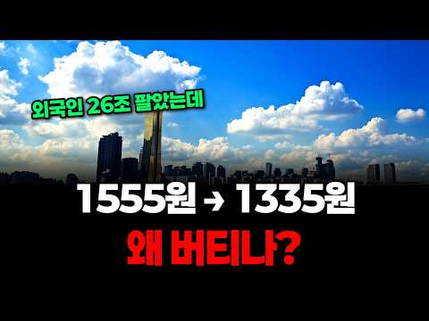
- 챕터: 0:00 외국인이 26조를 빼 갔는데 — 교과서대로라면 환율이… · 0:42 역설 — 7월 1555.8원에서 1330원대로 · 1:30 이 영상의 약속 — 전망·환전 권유 없이 숫자만 · 2:01 11월 16일 — 코스피 -3.59%, 달러인덱스 1… · 2:57 24시간 외환시장 — «주간 종가»가 무엇인가 · 3:35 58.3% — 달러가 오른 다음 날 원화가 오른 날들 · 4:32 누르는 힘 ① 반도체 기업의 달러 매도(네고) · 5:09 누르는 힘 ② 수출 +111.9%, 9월 경상흑자 6… · 5:33 누르는 힘 ③ WGBI 편입과 외국인 채권 자금 56… · 5:56 반론 — 경상흑자가 곧 달러 매도는 아니다 · 6:24 연말 장부 마감 — 거래가 얇아지면 생기는 일 · 7:21 올리는 힘 — 외국인 주식 이탈 193억1000만 달러 · 7:42 서학개미 — 10월 54억2000만 달러, 3배 레버… · 8:40 강달러 — 미국 물가 0.4%, 10년물 5.1%대 · 9:02 국민연금 — 환 헤지 중단과 외환스와프 650억 달러 · 10:05 줄다리기 — 10월 말 1334.3원과 16일 133… · 11:16 내 지갑 ① 환전·여행 — 1000달러에 10만610… · 12:17 내 지갑 ② 미국 주식 — 주가 그대로여도 -7.4%… · 13:13 내 지갑 ③ 물가 — 수입물가 -1.8%, 그래도 1… · 14:51 이번 주 일정 — 미 소매판매·엔비디아 실적·APEC…
- 설명 앞부분: 한국은행 집계로 10월 외국인 주식 투자자금은 193억1000만 달러(약 26조원) 순유출됐고, 11월 1~11일에도 외국인은 코스피에서 9조8180억원을 순매도했습니다. 16일에는 코스피가 3.59% 내린 5100.50으로 마감하고 달러인덱스가 장중 103.48까지 올라 약 1년 7개월 만에 가장 높았지만, 오후 3시 30분 원/달러 환율은 1335.7원으로 13일보다 오히려 1.0원 내렸습니다. 올해 종가 최고였던 7월 2일 1555.8원에서 크게 내려온 환율은 10월 말 1334.3원과 16일 1335.7원 사이 1.4원 차…
- 같은 채널 평소 대비 ×30.8 (채널 최근 롱폼 중앙값 1,018회) · 평소 영상: 30년 만에 3.1%, 일본 재정을 덮친 숫자의 정체 #일본국채 #금리인상 (1,018회) / 젠슨황 스캔들 사과, 코스피 절반이 왜 떨까? #젠슨황 #코스피 (1,037회)
- 대본 없음 (설명) — 음성인식이 끝나면 도입부·흐름이 들어감
- 댓글 8/8: 좋은 점 — 영상 0 · 감사·응원 0 · 더 알고 싶은 것 0 · 아쉬운 점 — 영상 1 · 반박·불만 — 의견 다름 0 · 정치·사회 1 · 경험 공유 0 · 구독·다음 기대 0
  - 아쉬운 점 — 영상 👍0 “재미없고 뻔한얘기를 길게도하네. 지겹게 반복하고.”
  - 정치·사회 👍0 “대한민국 호구다 주식 올려주고 외국인 은 팔고 삼성 액면가 100 원 30 만윈 올 라으니”

### 14. S&P500 적립식, 다들 거꾸로 하고 있습니다… 5천만원 갈리는 진짜 이유

- https://www.youtube.com/watch?v=h5Cu52-q0oE · 뒤집는경제 · 구독자 1,450 · 조회수 236,610 (×163.2, 하루 4,824.6) · 좋아요 950 (0.4%) · 24.9분 · 2026-10-10 · 주제 묶음 2. 장기투자·ETF·지수 · 형식 정보·해설 (그 밖) · 폴더 `W_h5Cu52-q0oE` (웹 승인)
- 챕터: 0:00 같은 50만 원, 다른 결과 · 1:35 S&P500을 사는 세 갈래 길 · 4:48 15.4%가 함정이 되는 순간 · 9:24 세율 22% 해외 직투의 반격 · 13:21 진짜 돈이 새는 곳, 환헤지 H · 15:26 월 50만 원과 연금저축의 비밀 · 18:33 네 가지 길, 최종 성적표 · 19:30 계좌 옮기기 전 체크할 세 가지 · 22:42 결론과 상황별 정리
- 설명 앞부분: S&P500 적립식을 시작할 때 누구나 한 번쯤 고민합니다. 해외 직투는 양도소득세 22%, 국내상장 ETF는 15.4%. 세율만 보면 답은 정해져 있는 것 같죠. 그런데 월 50만 원씩 20년을 끝까지 계산해 보면, 세율이 가장 낮아 보이던 쪽이 꼴찌를 합니다. 같은 S&P500, 같은 월 50만 원, 같은 20년인데 마지막에 손에 쥐는 돈은 5천만 원 넘게 벌어집니다. 차이를 만드는 건 수익률이 아니라 금융소득종합과세, 매년 사라지는 250만 원 공제, 환헤지 비용, 그리고 연금저축·ISA라는 계좌 이름 하나였습니다. 이번 영…
- 같은 채널 평소 대비 ×47.3 (채널 최근 롱폼 중앙값 5,006회) · 평소 영상: 돈이 일하기 시작해도 회사는 못 그만둡니다… 10년이면 된다는 말이 반만 맞는 진짜 이유… (5,079회) / S&P500 하루 4% 폭락…적립식 멈추면 290만 원 덜 버는 진짜 이유 (4,934회)
- 대본 없음 (설명) — 음성인식이 끝나면 도입부·흐름이 들어감
- 댓글 70/70: 좋은 점 — 영상 2 · 감사·응원 2 · 더 알고 싶은 것 3 · 아쉬운 점 — 영상 0 · 반박·불만 — 의견 다름 0 · 정치·사회 0 · 경험 공유 4 · 구독·다음 기대 0
  - 좋은 점 — 영상 👍8 “와 이건 생각도 못했네요. 너무 좋은 정보입니다.”
  - 좋은 점 — 영상 👍1 “잘 배우고 갑니다 😅”
  - 더 알고 싶은 것 👍5 “금투자 방법도 정리 부탁드립니다.^^”
  - 더 알고 싶은 것 👍4 “8년 후 주택구매를 위해 2년째 ISA 계좌를 통해 국내상장 해외etf(나스닥100,s&p500)를 모으고 있고, 향후 3년간 더 매수할 계획입니다(5년간 1억원 매수) 그 후에 5년간 isa 계좌에 그대로 놔두면서 주식 단가 상승에 따른 이익(연 8% 내외)을 실현…”
  - 경험 공유 👍5 “저는 지금까지 모아온 예적금으로 연금저축펀드 1800, isa 나스닥100 풀매수 3년차 풀매수했습니다!! 연금저축펀드 600이상 금액은 급한일있으면 세금없이 찾아쓸슈있다고 들어서요! 그래서 달러로 튜자안했는데..ㅎ 어떤가요 😂”
  - 경험 공유 👍4 “8년 후 주택구매를 위해 2년째 ISA 계좌를 통해 국내상장 해외etf(나스닥100,s&p500)를 모으고 있고, 향후 3년간 더 매수할 계획입니다(5년간 1억원 매수) 그 후에 5년간 isa 계좌에 그대로 놔두면서 주식 단가 상승에 따른 이익(연 8% 내외)을 실현…”

### 15. 롤드컵 우승 상금 14억, T1의 진짜 수입원은? ∣ 회계사가 뜯어본 롤 구단 재무제표

- https://www.youtube.com/watch?v=37BJl0y52xk · 전지적회계사시점 · 구독자 961 · 조회수 119,376 (×124.2, 하루 3,142.1) · 좋아요 141 (0.1%) · 19.6분 · 2026-10-21 · 주제 묶음 6. 종목 고르기·분석 · 형식 정보·해설 (그 밖) · 폴더 `W_37BJl0y52xk` (웹 승인)
- 썸네일: 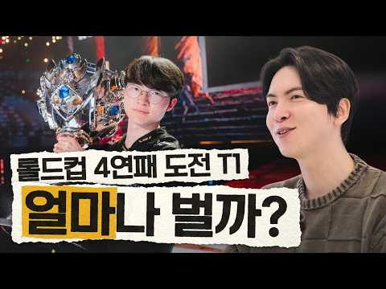
- 챕터: 0:00 인트로 · 0:23 2026 롤드컵 개막과 T1의 3연패 · 1:46 세계 최강팀의 5년 연속 영업손실 · 2:47 T1 장부 6년 치: 매출 7배에도 적자 · 4:00 돈은 어디로 갔나? 구단 운영비 307억 · 4:55 프로게이머 연봉 양극화와 균형지출 제도 · 6:46 중국의 연봉 2천만 달러 제안을 거절한 페이커 · 8:07 첫 흑자의 비밀은 상금이 아닌 굿즈 · 10:21 LCK 5개 구단 장부 비교와 디플러스 기아 자본잠식 · 12:15 T1 기업가치 2,921억과 낮아진 매출 멀티플 · 14:25 장부 속 페이커: 미등기 임원 스톡옵션과 실수령액 · 18:19 최종 정리
- 설명 앞부분: "세계 최강 T1, 롤드컵 3연패를 하고도 왜 적자였을까요?" 2026 롤드컵 개막에 맞춰 페이커 선수의 팀 T1의 감사보고서 6년 치를 회계사의 시선으로 분석해 드립니다. 우승 상금 14억 원이 매출 886억 원의 회사에서 어떤 의미인지, 5년 연속 영업손실을 끊어낸 첫 흑자의 배경은 무엇인지 숫자로 짚어봅니다. 다른 LCK 구단의 재무 상태와 T1의 기업가치, 그리고 공시 원문 속 페이커 선수의 스톡옵션까지 함께 살펴봅니다. [이번 영상의 핵심] 1. 우승해도 적자 T1은 2020년부터 2024년까지 5년 연속 영업손실을 냈고…
- 같은 채널 평소 대비 ×64.4 (채널 최근 롱폼 중앙값 1,855회) · 평소 영상: 위고비·마운자로 열풍, 헬스장 정말 안갈까?? ∣ 회계사가 분석한 비만치료제와 헬스 시장 (1,855회) / 비슷한 웹툰 속, 스타 작가는 얼마나 벌까? ∣ 회계사가 뜯어본 네이버웹툰 (1,291회)
- 대본 없음 (설명) — 음성인식이 끝나면 도입부·흐름이 들어감
- 댓글 36/36: 좋은 점 — 영상 0 · 감사·응원 0 · 더 알고 싶은 것 0 · 아쉬운 점 — 영상 0 · 반박·불만 — 의견 다름 0 · 정치·사회 0 · 경험 공유 2 · 구독·다음 기대 0
  - 경험 공유 👍41 “저는 11년째 페이커팬인 68년생 할머니예요 게임을 하지는못해도 야구나축구보듯 10년넘게 보다보니 70%정도 이해하는~~ 제가 롤을 챙겨보는것도 당연히 페이커선수때문이기도하구요 올해는 큰맘먹고 대구에서 T1사옥 찾아가서 옷도 싸고 가방도싸고 아들보다 페이커선수우선이다…”

### 16. SOXL -90% 극한의 공포 1조달러 배팅을 꺼냈다 ∣ 반도체 의도된 폭락? 개인은 팔았고 월가는 받았다

- https://www.youtube.com/watch?v=pZDTJKVDdxQ · 뉴욕대디 다니엘 · 구독자 15,400 · 조회수 336,781 (×21.9, 하루 48,173.1) · 좋아요 3,629 (1.1%) · 21.2분 · 2026-11-21 · 주제 묶음 기타 · 형식 정보·해설 (그 밖) · 폴더 `W_pZDTJKVDdxQ` (웹 승인)
- 썸네일: 
- 챕터: 0:00 훅·오프닝 — 블룸버그 마감 "반도체 −11%, 고점… · 1:30 1장. 어제 하루 — 나스닥 주간 −10%, 엔비디아… · 3:53 2장. 왜 이렇게 심각한가 — SEC 회계 조사·젠슨… · 7:43 3장. 거품인가, 재평가인가 — PER 70배 vs … · 12:11 4장. 전설은 지금 뭘 하나 — 드러켄밀러 vs 손정… · 16:52 5장. 숏은 결국 털린다 — 체크리스트, 한국 월요일 · 20:36 정리. 지켜야 할 선
- 설명 앞부분: 어제 하루 나스닥 −5.28%, 주간 −10%로 2020년 이후 최악의 한 주였습니다. 엔비디아 −14%, 마이크론 −14%, AMD −13%, 브로드컴 −12%. 반도체 3배 레버리지 SOXL은 하루 −32%, 6월 고점 300달러에서 30달러로 −90%. 본전까지 9배가 올라야 합니다. 한국 개인 투자자는 나흘 만에 약 21억 달러를 잃었습니다. 그런데 시장의 질문은 갈려 있습니다. 의도된 폭락인가, 시작인가. 거품이 터진 건가, 다시 값을 매기는 중인가. 영상 함께 하시고 주말 맛있는 음식 드시고 투자는 조금만 멀리하고 푹 …
- 같은 채널 평소 대비 ×33.7 (채널 최근 롱폼 중앙값 10,007회) · 평소 영상: 젠슨황 떠나자마자 중국 수상한 움직임 ∣ AI 반도체 전쟁 중국 이길 방법은 단 하나 ∣… (10,007회) / 반도체 폭락 뒤 반드시 찾아오는 대폭등의 역사, 9배 '파멸적 상승' 월가가 기다리는 단… (10,291회)
- 대본 없음 (설명) — 음성인식이 끝나면 도입부·흐름이 들어감
- 댓글 510/510: 좋은 점 — 영상 17 · 감사·응원 44 · 더 알고 싶은 것 4 · 아쉬운 점 — 영상 7 · 반박·불만 — 의견 다름 10 · 정치·사회 19 · 경험 공유 31 · 구독·다음 기대 8
  - 좋은 점 — 영상 👍34 “뉴욕대디 다니엘, 좋은 영상으로 많은 힘을 얻습니다. 주식으로 마음이 힘들어도 정말로 소중한 건 지켜야겠네요. 오늘 하루는 내 인생의 남은 날들 중 귀한 하루이니까요.”
  - 좋은 점 — 영상 👍9 “어제 미증시 폭락에 멘탈 깨진 사람들이 보면 좋은 영상... 주가에 대한 전망이 아니라 투자를 보는 가치관과 마음가짐을 설명해주는 채널.... 오늘 첨봤는데 구독 박고 갑니다.”
  - 감사·응원 👍192 “야 ! 이런 사이트도 있네 주식30년 인생 마음에 드는 영상이네요 ㅎ 제가 거의 주식하고 15년동안 가족과 즐거워 하면서 밥을 먹지 못했고 .. 여행을 다니지 못했습니다 ... 이 영상 만드신분은 정말 주식을 잘 아시는 분이네요 ..제가 주식하면서 정상적인 생활이 가…”
  - 감사·응원 👍145 “하루종일 죽고싶은 마음뿐이였는데 마지막 코멘트에 다시 힘내보려합니다 ㅠ 살아남겠습니다 감사학니다”
  - 더 알고 싶은 것 👍1 “근데 인버스좀 사놓은 사람은 괜찮은 건가요 어떤가요 ???”
  - 더 알고 싶은 것 👍0 “영상 내용이 내가 듣고 싶은 내용이고 아니고를 떠나서 코스피 1만 간다던 증권사와 유튜브 좆문가들보다 100배는 낫네요. 바로 구독 박았습니다. 앞으로 좋은 영상 많이 부탁드려요.”
  - 아쉬운 점 — 영상 👍7 “이야 너무 많이 배우고 갑니다. 수많은 투자 유투버들이 있지만 다르네요 사실내용 기반으로 정보를 전달하고 코멘트를 전하고 그리고 마지막 멘트까지 참 좋은말이네요. 내용에 비하면 구독자수가 아쉽습니다. 훗날 2026년 11월이 바닥이였다고 이야기하는날이 왔으면 좋겠네요”
  - 아쉬운 점 — 영상 👍5 “정말 조목조목 핵심만 간결하게 설명해 주니 참 전문가들 나와서 떠드는것만 보다 훨씬 유익하네요 구독 박았습니다 ^^”
  - 반박·불만 — 의견 다름 👍22 “섣부른 판단은 금물이라지만 그동안의 폭락장과 다른 게 fomc의 금리 인상입니다. 그것도 빅스텝 이야기가 나오는 중이죠. 그 동안의 폭락장은 모두 금리 인하쪽이어서 지금의 폭락은 골이 더 깊을 수 있습니다. 웃기는 소리같지만 어차피 내가 안팔면 주가는 계속 떨어집니다…”
  - 반박·불만 — 의견 다름 👍14 “집 팔아서 주식 사라고 선동한 😅”
  - 정치·사회 👍2 “드라켄밀러 이제와서 제로인척 ㅋㅋㅋㅋㅋㅋㅋㅋㅋㅋㅋㅋㅋㅋㅋㅋ 너 쿠팡 제대로 물렸자나 ㅋㅋㅋㅋㅋㅋㅋㅋㅋㅋ 쿠팡도 팔았나 ㅋㅋㅋㅋㅋㅋㅋ 손실본 종목 많으면서 자기는 손실안본척 좀 짜치네 그리고 손정의 너가 뭔데 하이닉스를 통재로 사 ㅋㅋㅋㅋㅋㅋㅋㅋ 한국정부가 가만히 있을…”
  - 정치·사회 👍0 “유대인이 문제.이스라hell의 보복!!월가 &헤지펀드 &미민주당!!저것들의 밀실 담합이지 않았을까?황 12월에 국회 끌려갔다 나온 후 반등!!!!”
  - 경험 공유 👍192 “야 ! 이런 사이트도 있네 주식30년 인생 마음에 드는 영상이네요 ㅎ 제가 거의 주식하고 15년동안 가족과 즐거워 하면서 밥을 먹지 못했고 .. 여행을 다니지 못했습니다 ... 이 영상 만드신분은 정말 주식을 잘 아시는 분이네요 ..제가 주식하면서 정상적인 생활이 가…”
  - 경험 공유 👍76 “역사적인날을 겪었네 ㅎㄷㄷㄷ 역사에 남을 날.”
  - 구독·다음 기대 👍9 “구독합니다. 가장 마음에 와닿는 것같습니다. 6월2주에 전부익절하고, 이상하게 포모가 와서.. 내돈 익절한돈 2억과 대출 1억을 전부 반도체 이티에프에 넣어서 번돈뿐만아니라 원금까지 다 녹앗습니다. 정말 어려운상황입니다. 마지막 포인트에서 힘들 조금 얻어갑니다 감사합…”
  - 구독·다음 기대 👍7 “구독박습니다”

### 17. KODEX 200 위클리 타겟 커버드콜, 지금 사도 좋을까? 숫자로 돌려봤습니다

- https://www.youtube.com/watch?v=p9xZNeibTtI · 옵티쩡 · 구독자 1,710 · 조회수 78,298 (×45.8, 하루 5,202.4) · 좋아요 349 (0.4%) · 7.9분 · 2026-11-13 · 주제 묶음 기타 · 형식 정보·해설 (그 밖) · 폴더 `W_p9xZNeibTtI` (웹 승인)
- 썸네일: 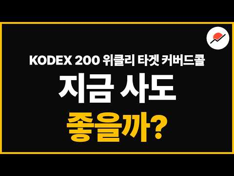
- 챕터: 0:00 결론 먼저: 코스피200을 90% 넘게 따라간다 · 0:49 무엇을 사는 건가 (바구니 + 위클리 콜옵션) · 1:42 지금까지 성적 (총수익·내린 장·석 달 구간) · 3:29 분배금의 정체 (분배율·11월 예상·착시) · 4:47 세금 (분배금 과세·매매차익) · 5:36 지금 사면? (시나리오·점검 질문) · 6:52 정리와 질문
- 설명 앞부분: KODEX 200타겟위클리커버드콜(498400)을 지금 사도 괜찮을까요? 매달 분배금을 주는 인기 ETF의 구조, 상장 이후 성적, 분배금의 정체, 세금, 그리고 과거 석 달 구간 비교를 코스피200 대비로 돌려 봤습니다. 사라·사지 말라는 영상이 아니라, 내 기준을 세우는 데 쓰는 숫자 정리예요. ■ 한눈에 보는 숫자 (2026년 11월 10일 종가 기준) 가격: 6/22 종가 28,585원 → 11/10 15,180원 (−46.9%, 분배금 제외) 분배금 포함 총수익: 상장(2024.12.3) 이후 +111% (KODEX 20…
- 같은 채널 평소 대비 ×102.4 (채널 최근 롱폼 중앙값 765회) · 평소 영상: 국민연금 회의록 2030년까지 비공개, 코스피를 얼마나 받쳐 줄까? (765회) / 코스피 -42.5%, "하락의 60%는 정부 책임" 맞을까? 숫자로 돌려봤습니다 (752회)
- 대본 없음 (설명) — 음성인식이 끝나면 도입부·흐름이 들어감
- 댓글 115/115: 좋은 점 — 영상 1 · 감사·응원 0 · 더 알고 싶은 것 1 · 아쉬운 점 — 영상 0 · 반박·불만 — 의견 다름 2 · 정치·사회 12 · 경험 공유 2 · 구독·다음 기대 0
  - 더 알고 싶은 것 👍2 “국장 커버드콜 할까 말까 고민했지만 그냥 세금 내고 미장 커버드콜 합니다... 다음에 라코밸 설명 한 번 부탁드립니다”
  - 반박·불만 — 의견 다름 👍0 “차트보니 개좃같은 이티에프 인데 ㅎㅎㅎㅎㅎㅎ요즘 인기있는 미국 커버드콜 배당주 차트는 적어도 이정도는 아닌데”
  - 정치·사회 👍15 “국장 하면 그냥 거지 됩니다........ 주가가 올라도 문제가 환율이 올라갑니다.... 정권 바뀌고 해도 늦지 않습니다..”
  - 정치·사회 👍12 “국민연금으로 주가조작하다가 국민들 평생 벌어놓은돈 날려버리게 하고 집 팔아서 주식하라고 꼬드기더니 코스피 폭락하니까 누가 주식하래? 요딴말이나 하고 이게 대통령이냐? 순 사기꾼이지 이제 국민연금도 위험하다 내 노후가 녹아내린다”

### 18. 이번 하락은 어디에 가까울까 ∣ 공포탐욕지수 39번으로 본 금리와 물가

- https://www.youtube.com/watch?v=QG40SUfIML8 · 차트 너머 · 구독자 5,180 · 조회수 339,421 (×65.5, 하루 14,220.7) · 좋아요 2,795 (0.8%) · 11.1분 · 2026-11-04 · 주제 묶음 2. 장기투자·ETF·지수 · 형식 정보·해설 (그 밖) · 폴더 `W_QG40SUfIML8` (웹 승인)
- 챕터: 0:00 10월의 하락 · 0:47 공포탐욕지수와 39번 · 1:34 공포에 사면 더 나았을까 · 1:54 2021년과 2023년 · 3:06 차이는 금리 · 4:33 다섯 가지 경우 · 5:51 두 번째·세 번째·네 번째 · 7:43 다섯 번째, 가장 나빴던 때 · 9:09 이번은 어디에 가까울까 · 10:00 남은 매 · 10:45 마무리
- 설명 앞부분: 지난 15년(2011~2026) CNN 공포탐욕지수가 25 밑으로 떨어진 39번을 전부 찾아, 그날 샀다면 어땠는지와 반등이 언제 왔는지 직접 확인했습니다. 공포에 산다고 평소보다 나은 건 아니었습니다. 결과를 가른 건 사건이 아니라 그때의 금리와 물가였습니다. CNN Fear & Greed Index (2011-01-03 ~ 2026-09-23) S&P 500·필라델피아 반도체 지수 종가: Yahoo Finance 미국 기준금리(FEDFUNDS)·소비자물가(CPIAUCSL)·10년물 국채 금리(DGS10): FRED, St. L…
- 같은 채널 평소 대비 ×15.3 (채널 최근 롱폼 중앙값 22,162회) · 평소 영상: 엔비디아는 제2의 시스코일까? 닷컴버블 세계 1위의 25년 (25,538회) / 레전드 CEO들의 사퇴의 역사, 그 뒤 회사는 어떻게 됐나 (18,786회)
- 대본 없음 (설명) — 음성인식이 끝나면 도입부·흐름이 들어감
- 댓글 209/210: 좋은 점 — 영상 10 · 감사·응원 8 · 더 알고 싶은 것 2 · 아쉬운 점 — 영상 1 · 반박·불만 — 의견 다름 6 · 정치·사회 6 · 경험 공유 11 · 구독·다음 기대 2
  - 좋은 점 — 영상 👍7 “엄청유익한영상이네요 구독조아요박음”
  - 좋은 점 — 영상 👍6 “최근 본 영상 중 가장 유익합니다. 감사합니다”
  - 감사·응원 👍6 “최근 본 영상 중 가장 유익합니다. 감사합니다”
  - 감사·응원 👍2 “진짜 찐으로 녹음한 영상 오랜만이네... 침삼키는 소리까지 녹음되어있음ㅋㅋ 딕션도 좋고... 고생많으셨을듯. 감사합니다. 잘봤어요~”
  - 더 알고 싶은 것 👍2 “좋은영상 입니다. 앞으로도 계속 부탁드립니다. 구독 좋아요 했습니다.”
  - 반박·불만 — 의견 다름 👍3 “1년뒤 수익률이 중요한게아니죠. 어짜피 시장은 우상향합니다. 얼마나 더빠질지. 현금비중을 얼마가 적당할지에따라 미래수익이 변합니다”
  - 경험 공유 👍16 “내가 항상 친구들이나 지인들한테 하는 말임. 어차피 주식 놔두면 오르는거 사는게 어렵나?ㅋㅋ 하면서 꺼드럭대면 그렇게 머리가 나빠보일 수가 없음”
  - 경험 공유 👍4 “이틀전에 대출해서 미장 레버들어감 투자 9년차 파이어족인데 이번에도 내가 옳았다.”
  - 구독·다음 기대 👍2 “와 미친영상이네 구독박고감”
  - 구독·다음 기대 👍0 “유익한 영상 감사합니다:) 구독하고 좋아요 누르고 가요”

### 19. 부자들은 끊임없이 공부합니다 부자 필수 과목 6가지

- https://www.youtube.com/watch?v=7cBFkwyzVzM · 돈사냥꾼-TV · 구독자 3,490 · 조회수 273,782 (×78.5, 하루 8,856.4) · 좋아요 1,655 (0.6%) · 22.4분 · 2026-10-28 · 주제 묶음 1. 주식 기초·초보 · 형식 정보·해설 (그 밖) · 폴더 `W_7cBFkwyzVzM` (웹 승인)
- 썸네일: 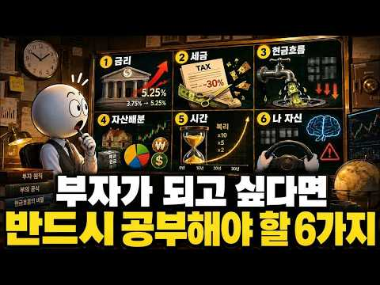
- 설명 앞부분: KBS 기자 KBS 디지털 뉴스 본부장 KBS 울산 방송국 본부장, KBS 해설위원, KBS 교통공무원노조 위원장 등을 역임하며 미디어와 저널리즘 분야에서 풍부한 경험을 쌓아 왔습니다. 이러한 실무 경험을 바탕으로, 현재 미디어 환경에 대한 정확한 정보, 심층 분석, 그리고 솔직한 시각을 제공하기 위해 최선을 다하고 있습니다. 여러분의 지지와 협력은 투명하고 신뢰받는 저널리즘을 향한 저희의 지속적인 노력에 원동력이 됩니다.
- 같은 채널 평소 대비 ×99.7 (채널 최근 롱폼 중앙값 2,747회) · 평소 영상: ＂지금 예적금 하지 마세요＂ 현금 안전하게 굴리는 방법 (2,747회) / 100년 데이터가 증명한 부자 공식ㅣ코스피 신고가에 지금 사도 되는 이유 (2,582회)
- 대본 없음 (설명) — 음성인식이 끝나면 도입부·흐름이 들어감
- 댓글 12/12: 좋은 점 — 영상 0 · 감사·응원 1 · 더 알고 싶은 것 1 · 아쉬운 점 — 영상 0 · 반박·불만 — 의견 다름 1 · 정치·사회 1 · 경험 공유 1 · 구독·다음 기대 0
  - 감사·응원 👍1 “감사합니다.”
  - 더 알고 싶은 것 👍9 “금리 부탁드립니다”
  - 정치·사회 👍6 “상속세 올리거나 유지하는이유 국회의원들이 외국자본에 다넘어감 돈이 있어야 정치질하지요 그돈은 다시 투자자에게 갈려면 법을 개정해야죠 국회의원들은 당이나 자본가에게 충성을하지”
  - 경험 공유 👍3 “내가 공부 해보면서 느낀게 이거는 ㅋㅋ 돈을 굴리는 대가리가 그냥 좋아야 ㅋㅋ 돈 버는거지 나는 좀 한계를 느끼기도 했고 뭣보다 관심이 크게 안가더라고 자본 자체가 많으면 안전하게 굴리면 되긴 하는데 나는 자본 자체가 적으니 공부를 해도 별 의미가 없음 결론은 캐시플…”

### 20. 환율 1300원, 코스피 5000 폭락..!! 한국경제 대위기 터진다..??

- https://www.youtube.com/watch?v=uY8bXDJHswg · 경제읽어주는남자 · 구독자 1,590 · 조회수 143,680 (×90.4, 하루 3,996.7) · 좋아요 828 (0.6%) · 13.8분 · 2026-10-23 · 주제 묶음 5. 국내주식 · 형식 정보·해설 (그 밖) · 폴더 `W_uY8bXDJHswg` (웹 승인)
- 썸네일: 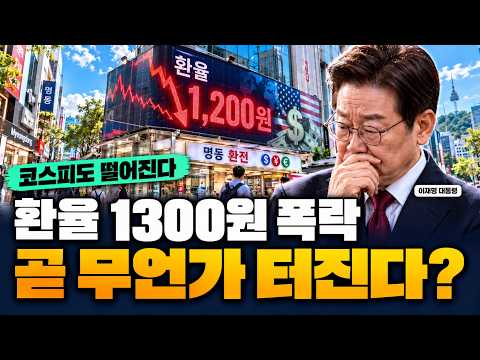
- 챕터: 0:00 환율 1,324원, 5일째 연저점 · 0:10 한은 총재 "초여름 고환율은 비정상" · 1:08 1만 달러에 217만 원 증발 · 1:31 10월 수출 616억 달러, 반도체 3배 · 2:20 기업 달러예금 보름 새 53억 달러 환전 · 3:05 외국인 203조 매도에도 환율 하락 · 3:24 깜짝 퀴즈 · 3:48 종목 진단기 무료 이용 방법 · 4:55 외국인이 판 돈은 한국에 남았다 · 5:59 서학개미 미국 주식 매수 5분의 1로 · 7:19 한미 금리 차 1%포인트로 축소 · 8:14 2022년 1,440원 때와 정반대 · 8:48 CD 금리 3.26%, 변동금리 대출 점검 · 9:26 과자값은 올랐는데 원가는 내려간다 · 10:36 1,300원대 원재료가 들어오는 연말 · 11:32 그래서 지금 봐야 되는 업종 · 12:08 정리 · 여러분 잘못이 아닙니다 · 12:47 종목 진단기, 계좌 전체 진단까지
- 설명 앞부분: 원달러 환율이 1,324원까지 내려가며 닷새 연속 올해 최저치를 갈아치웠습니다. 6월 1,541원에 1만 달러를 바꿔 둔 사람은 가만히 앉아 217만 원을 잃었습니다. 그런데 이상하게도 외국인은 올해 코스피에서 203조 원을 팔았는데, 환율은 오르지 않고 오히려 내려갔습니다. 환율이 왜 지금 이렇게 빠지는지, 외국인이 판 돈은 어디로 갔는지, 그리고 원화가 강해질 때 조용히 이익이 남는 업종이 어디인지 정리했습니다.
- 같은 채널 평소 대비 ×223.8 (채널 최근 롱폼 중앙값 642회) · 평소 영상: 日, 사실상 파산 확정됐다..?? 한국경제 진짜 큰일났다..!! (642회) / 젠슨황 해임, 이미 예언된 일이다..?? 미국과 중국이 100% 다 판 이유 (637회)
- 대본 없음 (설명) — 음성인식이 끝나면 도입부·흐름이 들어감
- 댓글 169/169: 좋은 점 — 영상 1 · 감사·응원 2 · 더 알고 싶은 것 0 · 아쉬운 점 — 영상 0 · 반박·불만 — 의견 다름 1 · 정치·사회 18 · 경험 공유 1 · 구독·다음 기대 2
  - 좋은 점 — 영상 👍0 “좋은정보 감사합니다 😊”
  - 감사·응원 👍0 “좋은정보 감사합니다 😊”
  - 반박·불만 — 의견 다름 👍0 “더불어 공산당 간첩들이 환율 고점일때 뉴노멀이라고 선전선동하더만...요즘 환율하락해서 경제가 안정됐다더라...사람 새끼들 맞냐”
  - 정치·사회 👍25 “대통령 잘못 뽑은 거다”
  - 정치·사회 👍12 “외국인 투자 자금 뺄기회준다고 환율 낮춘다는 소문도 있음”
  - 경험 공유 👍0 “ㅋ.. 환율오를때는 나라가 망할것같이 나튜브들 나도나도ㅇ지랄을 떨더만 환율이 떨어진다고 또망한다고??? 에혀....”
  - 구독·다음 기대 👍3 “다른분보다 내생각과 가장비슷한분이시네 구독박고갑니디”
  - 구독·다음 기대 👍3 “내용은 너무 좋은데 말 속도가 빨라서 이해하는데 힘들어요.. 조금만 속도를 느리게 해주세요..ㅋ 구독하고 갑니다”

### 21. [풀영상] 월급 10%로 당장 시작하는 존리의 자산 증식 치트키

- https://www.youtube.com/watch?v=q1fYjAwma3s · 여의돈스트리트 · 구독자 1,430 · 조회수 236,403 (×165.3, 하루 3,308.4) · 좋아요 1,470 (0.6%) · 36분 · 2026-09-17 · 주제 묶음 1. 주식 기초·초보 · 형식 인터뷰·강연·대담 · 폴더 `W_q1fYjAwma3s` (웹 승인)
- 썸네일: 
- 챕터: 0:00 인트로 · 0:50 ‘존리의 부자학교’, 어떤 곳인가요? · 1:09 우리나라 금융 수준, 정말 높아졌나요? · 2:39 빨리 부자가 되는 투자, 가능한가요? · 4:53 장기 투자, 어떤 ETF를 사야 할까요? · 6:53 평범한 사람은 어떻게 부자가 되나요? · 8:30 주식 투자에 전문가가 없다? · 10:24 레버리지 투자는 왜 위험한가요? · 11:31 한국주식, 지금도 투자할 만한가요? · 12:16 투자 뉴스는 어디까지 봐야 할까요? · 14:44 부동산 비중이 높으면 위험한가요? · 16:45 주식 투자의 진짜 목적은 무엇인가요? · 17:26 좋은 기업은 어떻게 고르나요? · 20:19 장기 투자 중 기업 상황이 나빠진다면? · 21:09 박스권에 갇힌 현재 증시 진단 · 22:23 AI 버블 우려 속 올바른 매수 시기 · 23:30 안전해 보이는 ‘원금 보장’ 상품의 함정 · 25:01 반도체·대형주 쏠림 계좌, 포트폴리오 개선 조언 · 27:15 시황 뉴스·차트·리포트의 올바른 활용법 · 29:35 직장인 월급 대비 적정 투자 비중 및 방법
- 설명 앞부분: 매일 오르내리는 주가, 금리 인상 뉴스... 언제 사고 언제 팔아야 할지 늘 스트레스받고 계시나요? 혹은 원금 손실이 두려워 아직도 투자를 망설이고 계신가요? 이번 풀영상에서는 '존리의 부자학교' 존리 대표님을 모시고 평범한 사람이 스트레스 없이 진짜 부자가 되는 투자의 본질부터 구체적인 실천 방법까지 모두 담았습니다. 단기간에 부자가 되려는 조급함과 마켓 타이밍을 재는 습관을 버리고, 내 자본이 스스로 일하게 만드는 진짜 투자법을 짚어봅니다. 또한, 인플레이션 시대에 돈을 예적금에만 두는 것이 왜 자산 가치를 갉아먹는 가장 위험…
- 같은 채널 평소 대비 ×194.1 (채널 최근 롱폼 중앙값 1,218회) · 평소 영상: 아무짝에도 쓸모없는 경제 회의 [돈 안되는 소리 EP.01] (1,218회) / 주식시장 100명중 90명은 무조건 손실 봅니다. 상위 10%만 아는 '진짜' 수익 내는… (1,204회)
- 대본 (음성인식(앞 5분), 6.0 음절/초) — 앞부분만, 흐름은 그 안까지 첫 20초: “좀 빠르게 내가 부자가 되고 싶다. 시간이 지날수록 나는 그 위스크로 줄어들고 시작한 지 지날수록 나는 부관들어나거든요. 또는 일을 안 하고 이불 속에서 안 나오는 거예요. 예금. 지금 만약에 1,000만 원이 20년 후에는 1,000만 원 아니라 한 300만 원으로 줄어들어있는 거예요. 90%의 정보는 필요 없는 정보예요. 정보가 하나도 중요하지 않죠.”
- 첫 1분: “좀 빠르게 내가 부자가 되고 싶다. 시간이 지날수록 나는 그 위스크로 줄어들고 시작한 지 지날수록 나는 부관들어나거든요. 또는 일을 안 하고 이불 속에서 안 나오는 거예요. 예금. 지금 만약에 1,000만 원이 20년 후에는 1,000만 원 아니라 한 300만 원으로 줄어들어있는 거예요. 90%의 정보는 필요 없는 정보예요. 정보가 하나도 중요하지 않죠. 충분해요. 두 개만 갖고도. 두 개만 갖고도 충분하다. 반응하는 많이 해라. 어떻게 젊으신 분들은. 안녕하세요. 여의돈스트리트 이광수입니다. 우리는 도대체 어떻게 투자해야 부자가 될 수 있을까요? 스트레스 받지 않고 투자하려면 또 어떻게 해야 될까요? 다녁컨대 이에 대한 해답을 알고 계시는 분. 어렵게 이 자리에 모셨습니다. 졸리의 부자학교의 졸리 대표님”
- 흐름 (90초마다 첫 문장): 0:00 좀 빠르게 내가 부자가 되고 싶다. → 1:31 실제로 대표님께서 현장에서 보시면 → 3:01 그렇게 해서 좀 빠르게 → 4:30 너무 힘듭니다 대표님.
- 댓글 113/122: 좋은 점 — 영상 3 · 감사·응원 14 · 더 알고 싶은 것 2 · 아쉬운 점 — 영상 0 · 반박·불만 — 의견 다름 4 · 정치·사회 1 · 경험 공유 13 · 구독·다음 기대 0
  - 좋은 점 — 영상 👍4 “이분하고 궁합이 잘맞음 참 좋은말씀”
  - 감사·응원 👍25 “존리 선생님 덕분에 3년전부터 노후준비를, 장기투자를 목표로 삼게 되었습니다. 좋은 투자철학을 가르쳐주셔서 감사합니다❤”
  - 감사·응원 👍19 “존리대표님 덕분에 투자를 시작했습니다 감사드립니다”
  - 더 알고 싶은 것 👍0 “에스엔피 500이 미장인지 국장인지 어떤걸해야하나요?”
  - 반박·불만 — 의견 다름 👍4 “이게 말이 쉽지 2002년 닷컴 버블 경험하고 이제 회복되나 싶었더니 2008년 금융위기 오고 투자 14년 차인데 투입원금보다도 계좌에 쌓인 돈이 없고 그러면 진짜 현타옵니다. 복리의 힘이라는게 말이 쉽지 일정금액 이상이 쌓이지 않으면 기별도 안 오고, 녹아내리는 계…”
  - 반박·불만 — 의견 다름 👍0 “개인적으로 무조건적이고 비판없는 의견을 따르실 필요는 없습니다. 모든 투자는 개인의 책임이니 신중하게 생각해보고 투자하시길 바랍니다. 그렇다고 존 리님이 무조건 좋다 나쁘다 이렇게 생각하는 게아니라 본인에게 맞는 투자를 하시라는 말씀 꼭 드리고 싶습니다. 장기투자라고…”
  - 정치·사회 👍0 “박정희 대통령이 나라의 문맹을 퇴지했는데 존리대표님은 금융문맹을 퇴치하러 열일 하신다”
  - 경험 공유 👍24 “연금저축+isa ETF 5년차 적립중인데 희망이 생겨서 든든합니다😊 더 빨리 깨우쳤어야 했는데 ㅠㅠ”
  - 경험 공유 👍4 “이게 말이 쉽지 2002년 닷컴 버블 경험하고 이제 회복되나 싶었더니 2008년 금융위기 오고 투자 14년 차인데 투입원금보다도 계좌에 쌓인 돈이 없고 그러면 진짜 현타옵니다. 복리의 힘이라는게 말이 쉽지 일정금액 이상이 쌓이지 않으면 기별도 안 오고, 녹아내리는 계…”

### 22. [존리 대표 출연] 美민주당 압승에 삼전닉스 폭락 "반도체株 팔아야 할까요?" #존리 _261105

- https://www.youtube.com/watch?v=Td7NJ7xnuyM · 경제통마늘 · 구독자 16,800 · 조회수 891,681 (×53.1, 하루 38,162.2) · 좋아요 2,935 (0.3%) · 21.6분 · 2026-11-05 · 주제 묶음 2. 장기투자·ETF·지수 · 형식 오디오북·낭독 (명언·인생조언) · 폴더 `W_Td7NJ7xnuyM` (웹 승인)
- 썸네일: 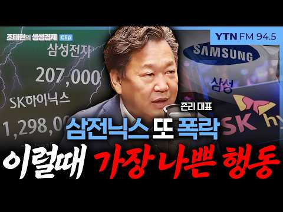
- 설명 앞부분: 美 민주당 압승, 반도체주 충격? "반도체주 팔아야 돼요?" 미 중간선거 결과, 이란전 종식..그런거 신경쓰면 그때부터 '카지노' "주식투자를 하셔야지, 카지노에 출근하시면 안됩니다" 가장 잘못된 투자 철학은? "마켓 타이밍을 맞춘다는 것" 가장 나쁜 투자습관은? "5천되면 산다! 타이밍을 맞추려고 하지 마라" 전문가를 믿지 마세요, 좋은 투자가는 주식 가격을 맞히는 게 아니라 '좋은 철학'을 갖고 있는 사람 "죄송하지만, 외국이 팔고 사고..그걸 왜 알아야 될까요?" "주식 투자 목적은 30년 후 노후준비..돈으로부터의 자유를 …
- 같은 채널 평소 대비 ×1,094.1 (채널 최근 롱폼 중앙값 815회) · 평소 영상: AI주 팔아 앤트로픽? 뉴욕증시 돈이 말랐다_261120 (1,894회) / [앤트로픽_삼전닉스] AMD -7.7% 급락 여파, 19만전자도 깨져_261120 (6,497회)
- 대본 없음 (설명) — 음성인식이 끝나면 도입부·흐름이 들어감
- 댓글 692/692: 좋은 점 — 영상 8 · 감사·응원 11 · 더 알고 싶은 것 2 · 아쉬운 점 — 영상 4 · 반박·불만 — 의견 다름 9 · 정치·사회 49 · 경험 공유 22 · 구독·다음 기대 0
  - 좋은 점 — 영상 👍58 “진짜 하나하나 모두 맞는 말씀....일단 단기에 돈 벌어야 한다는 욕심을 버려야 하는데.”
  - 좋은 점 — 영상 👍10 “투자철학관련되어 좋은말씀이신데... 동의하기 힘든 부분이 곳곳에..”
  - 감사·응원 👍10 “주식은 시간에 투자하는거다. 감사합니다.❤”
  - 감사·응원 👍5 “지금은 줍줍줍 해야 합니다. 가장 메리트 있는 나라이기 때문에 눌르고 있는 것이다 절대 단 1주도 던지지 말고 지금은 모든 재산 현금화 해서 초저 할인 바닥인 지금 매수,매집,물타기 해야 한다. 절대 던지지 마시오 던지는 순간 호구 되는거임..대한민국 화이팅~ 담관암…”
  - 더 알고 싶은 것 👍0 “저는 지금 ETF갖고 있는데 계속 갖고 있을까요?”
  - 아쉬운 점 — 영상 👍2 “댓글보니 바닥이 멀지 않음. 역사는 반복되지.... 생각과 심리는 과거나 지금이나 비슷하니”
  - 아쉬운 점 — 영상 👍1 “전부다 왜이래? 올 456월달에는 그냥 삼전 닉스로 돈복사하기 바빴으면서, 하락장 왔다고 다들 곡소리냐? 또 무슨 국장 탈출은 지능순 얘기냐? 십만전자에서 버티신분들은 다 자산 두배이상은 됐잖아? 그마이 국장이 떠 먹여줬으면 됐지 본인 계좌 박살난다고 또 국장 욕이나…”
  - 반박·불만 — 의견 다름 👍1 “존문가들 헛소리 멈출때 사면 됨. 버텨라 소리하면 냅따 팔아야 함.”
  - 반박·불만 — 의견 다름 👍1 “자기가 틀렸으면 왜 틀렸는지 도돌아 보지 앓고 그냥 버텨라? 참 한심한 발언이다”
  - 정치·사회 👍248 “한국 주식장은 국민 돈 버는곳이 아니라 외국인 돈 버는곳 이다”
  - 정치·사회 👍6 “설마 진짜 삼전 하이닉스가지고있는곳없지? 세상에 어느회사가 이익났다고 성과급을 6-7억씩 줘?ㅋㅋㅋㅋㅋ한국회사는 오너를위한회사 노조를위한회사지~한국회사는 투자하지마 진짜다”
  - 경험 공유 👍19 “이분 말들으믄 어리석은 내가 질책되~ 그리기냥 맨날산다🎉”
  - 경험 공유 👍9 “내가 전부터 이아저씨 나와서 사라고ㅠ할때가 꼭지라고 진짜 사짜다”

### 23. 80억 날리고 220억 만든 일본 슈퍼 개미가 물타기를 안 하는 이유 [후지모토 시게루 1:2:6 매매법]

- https://www.youtube.com/watch?v=zDdi61_JqUg · 차트 지니어스 · 구독자 6,800 · 조회수 986,326 (×145.1, 하루 13,502.0) · 좋아요 7,078 (0.7%) · 12.4분 · 2026-09-16 · 주제 묶음 8. 투자 심리·실패 · 형식 정보·해설 (그 밖) · 폴더 `W_zDdi61_JqUg` (웹 승인)
- 썸네일: 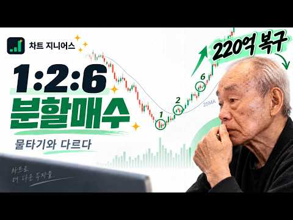
- 챕터: 0:00 80억을 잃고 220억을 만든 일본 트레이더 · 0:52 가격이 아니라 증거에 돈을 넣는 1:2:6 구조 · 1:44 버블 붕괴 후 후지모토가 바꾼 매매 방식 · 2:54 1단계 RSI 30 회복에서 1 매수 · 4:19 2단계 MACD 골든크로스에서 2 추가 · 5:21 3단계 구름대 돌파 확인 후 6 매수 · 6:46 1:2:6 원칙이 무너지는 두 가지 순간 · 8:06 매도할 때도 1:2:6으로 나눠 정리하기 · 9:08 계좌 2% 손실로 매수 금액 정하기 · 10:07 지표보다 중요한 매매 순서 · 11:04 세 조건이 겹치는 3분할 시그널 · 11:34 결론과 지표 신청 안내
- 설명 앞부분: 80억 날리고 220억 만든 일본 슈퍼 개미가 물타기를 안 하는 이유 [후지모토 시게루 1:2:6 매매법] 📊 '[3분할 시그널]' 지표 신청하기 📊 복잡한 차트, 차트 지니어스가 쉽게 풀어드립니다. 본 영상에서 제공된 정보는 전문가의 개인적인 소견이며,
- 대본 없음 (설명) — 음성인식이 끝나면 도입부·흐름이 들어감
- 댓글 629/629: 좋은 점 — 영상 9 · 감사·응원 56 · 더 알고 싶은 것 20 · 아쉬운 점 — 영상 1 · 반박·불만 — 의견 다름 6 · 정치·사회 0 · 경험 공유 11 · 구독·다음 기대 1
  - 좋은 점 — 영상 👍3 “오우..좋은 정보 감사합니다. 우선 80억부터 모아 보겠습니다.”
  - 좋은 점 — 영상 👍3 “제시리버모어의 피라미딩 매매전략이랑 맥을 같이 하네요 좋은 영상 감사합니다^^”
  - 감사·응원 👍3 “오우..좋은 정보 감사합니다. 우선 80억부터 모아 보겠습니다.”
  - 감사·응원 👍3 “제시리버모어의 피라미딩 매매전략이랑 맥을 같이 하네요 좋은 영상 감사합니다^^”
  - 더 알고 싶은 것 👍1 “오~ 영상 깔끔하게 잘 만드셨네요. 73번째로 구독 좋아요 눌렀습니다. 앞으로 좋은 정보 부탁드립니다. 감사합니다. ^^”
  - 더 알고 싶은 것 👍1 “3분할 부탁드립니다. 감사합니다!”
  - 아쉬운 점 — 영상 👍0 “광고가 너무 많아요 ㅡ ㅡ”
  - 반박·불만 — 의견 다름 👍1 “이거 아닌데, 126으로 물타는거라고 책에 나오는디...”
  - 반박·불만 — 의견 다름 👍0 “저 매매법은 그 때의 시장에 잘 먹힌것일뿐 지금 국장에 적용은.. 글쎄”
  - 경험 공유 👍135 “내가 하면 ㅈ되는거야. 각자만의 방법을 찾는게 제일 중요하죠.”
  - 경험 공유 👍60 “RSI, MACD 다 신호 들어오고 일목균형표의 구름떼도 뚫으면 내가 사고 싶은 가격이 아니야... ㅋㅋㅋ 조금 비싸지는게 아니라 많이 비싸진 가격임...”
  - 구독·다음 기대 👍7 “영상 너무 좋네요... 다음 영상이 기다려집니다.”

### 24. S&P500은 최고인데 내 ETF는 마이너스… 지금 환헤지로 갈아타면 늦는 진짜 이유

- https://www.youtube.com/watch?v=UcHK1WoTPtY · 뒤집는경제 · 구독자 1,450 · 조회수 116,345 (×80.2, 하루 2,727.8) · 좋아요 427 (0.4%) · 23.2분 · 2026-10-16 · 주제 묶음 2. 장기투자·ETF·지수 · 형식 정보·해설 (그 밖) · 폴더 `W_UcHK1WoTPtY` (웹 승인)
- 썸네일: 
- 챕터: 0:00 S&P500 최고인데 내 ETF는 마이너스 · 1:47 수익을 만드는 두 개의 숫자 · 5:00 1,550원에서 1,331원까지, 넉 달의 반전 · 7:38 7개월 만에 뒤집힌 증권가 전망 · 11:00 환헤지는 공짜가 아니다 · 13:22 환노출형에 달린 공짜 에어백 · 15:20 버틴 사람 vs 갈아탄 사람, 숫자 맞대결 · 18:00 적립식 투자자에게 원화 강세란 · 19:25 흔들리지 않는 세 가지 기준
- 설명 앞부분: S&P500은 사상 최고치를 찍었는데, 증권 앱 속 내 S&P500 ETF는 파란색입니다. 같은 지수를 따라가는 ETF인데 최근 3개월 수익률이 마이너스 7%와 플러스 3%로 10%포인트 넘게 갈렸습니다. 그래서 다들 "지금이라도 환헤지(H)로 갈아탈까?"를 고민하고 계실 겁니다. 범인은 지수가 아니라 환율입니다. 원·달러 환율은 석 달 만에 1,554원에서 1,340원까지 13% 넘게 빠졌습니다. 그런데 7개월 전 증권가는 "환노출이 유리하다"고 했고, 지금은 "환헤지가 대세"라고 말합니다. 뉴스를 따라 갈아타면 늘 한 박자 늦…
- 같은 채널 평소 대비 ×23.2 (채널 최근 롱폼 중앙값 5,006회) · 평소 영상: 돈이 일하기 시작해도 회사는 못 그만둡니다… 10년이면 된다는 말이 반만 맞는 진짜 이유… (5,079회) / S&P500 하루 4% 폭락…적립식 멈추면 290만 원 덜 버는 진짜 이유 (4,934회)
- 대본 (음성인식(앞 5분), 4.4 음절/초) — 앞부분만, 흐름은 그 안까지 첫 20초: “미국 S&P 500에 매달 돈을 넣고 계신 분이라면 요즘 증권 앱을 열 때마다 고개를 갸웃하셨을 겁니다. 뉴스에서는 S&P 500이 사상 최고치를 갈아치웠다고 하는데 내 계좌의 S&P 500 ETF는 파란색이니까요. 실제로 S&P 500은 지난 10월 9일 7,811포인트로 마감하며 사상 최고치를 찍었습니다.” — 도입부 유형: 숫자로 시작
- 첫 1분: “미국 S&P 500에 매달 돈을 넣고 계신 분이라면 요즘 증권 앱을 열 때마다 고개를 갸웃하셨을 겁니다. 뉴스에서는 S&P 500이 사상 최고치를 갈아치웠다고 하는데 내 계좌의 S&P 500 ETF는 파란색이니까요. 실제로 S&P 500은 지난 10월 9일 7,811포인트로 마감하며 사상 최고치를 찍었습니다. 올해만 14% 넘게 올랐습니다. 그런데 같은 S&P 500을 따라가는 국내 상장 ETF 두 개를 나란히 놓고 보면 이사간 일이 벌어집니다. 최근 3개월 동안 타이고 미국 S&P 500은 마이너스 7.04% 이름 뒤에 H가 붙은 화내 지형은 플러스 3.63%입니다. 같은 지수인데 무려 10% 포인트 넘게 갈린 겁니다. 그러니 다들 같은 생각을 하시죠. 환율이 떨어지는 중인이 지금이라도 화내 지형으로 갈아”
- 흐름 (90초마다 첫 문장): 0:00 미국 S&P 500에 매달 돈을 넣고 계신 분이라면 → 1:34 이 영상이 끝날 때쯤이면 → 3:02 차이가 무려 14%포인트가 넘습니다. → 4:33 동시에 벌어지고 있는 일입니다.
- 댓글 28/69: 좋은 점 — 영상 0 · 감사·응원 0 · 더 알고 싶은 것 0 · 아쉬운 점 — 영상 0 · 반박·불만 — 의견 다름 0 · 정치·사회 3 · 경험 공유 0 · 구독·다음 기대 0
  - 정치·사회 👍13 “환율 처올린 이재명의 똥. 이게 다 이재명 때문이다.”
  - 정치·사회 👍1 “미 중간선거 민주당이 압승할 경우 약달러 확정이고 달러가 강하면 미채권 팔려고 할테고 그럼 달러 복사할테고 삼전닉스 달러 내년에는 더 벌어온다고 하고.. 환햇지로 가야할듯한데 에휴”

### 25. 가장 쉽게 주도주, 대장주를 찾는 방법 ∣ 슈퍼개미 이정윤

- https://www.youtube.com/watch?v=_cYtH3ERfwo · 이정윤의 다정한주식 · 구독자 7,840 · 조회수 140,026 (×17.9, 하루 14,163.1) · 좋아요 1,906 (1.4%) · 20.1분 · 2026-11-18 · 주제 묶음 8. 투자 심리·실패 · 형식 정보·해설 (그 밖) · 폴더 `W__cYtH3ERfwo` (웹 승인)
- 썸네일: 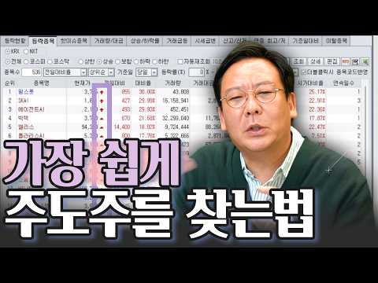
- 챕터: 0:00 오늘의 핵심 · 0:25 주도주 찾기 전 필수 체크! 글로벌 증시 흐름 · 1:24 주도주를 찾는 가장 쉬운 방법 1. 시가총액 상위 · 4:03 시장 지수보다 강해야 진짜 '주도주'다 · 8:36 18배 오른 대장주도 상승 초기에 여기서 잡힌다 · 9:58 각 업종별 1위 대장주 한눈에 확인하는 법 · 11:10 주도주를 찾는 가장 쉬운 방법 2. 거래대금 상위 · 12:51 돈이 몰리는 곳: '처음 상위권에 등장한 종목' 주목 · 15:04 주도주를 찾는 가장 쉬운 방법 3. 상승률 상위 · 16:35 대형주가 쉴 때 달리는 '중소형 테마 대장주' 찾기 · 17:49 매일 아침 주도주를 찾아내는 HTS 루틴 총정리
- 설명 앞부분: "오늘 뭘 살지 모르겠다면, 어디서부터 봐야 할까요?" 오르는 종목은 늘 다 오른 뒤에야 보여서, 한발 늦었던 적 있으신가요? 오늘은 제가 주도 산업과 대장주를 찾을 때 가장 먼저 보는 HTS 메뉴 3가지를 하나씩 보여드릴게요. 시가총액 상위부터 거래대금 상위, 상승률 상위까지, 오늘 시장의 돈이 어디로 몰렸는지 읽는 방법을 쉽게 알려드립니다. 좋은 종목을 고르기 전에, 지수보다 강한 종목을 찾는 연습부터 함께 시작해 보세요. 이정윤의 다정한 주식이 쉽고 친절하게 함께하겠습니다. 🌱 이번 영상에서 함께 볼 내용 지수 다음에 '산업…
- 대본 없음 (설명) — 음성인식이 끝나면 도입부·흐름이 들어감
- 댓글 115/115: 좋은 점 — 영상 18 · 감사·응원 48 · 더 알고 싶은 것 1 · 아쉬운 점 — 영상 1 · 반박·불만 — 의견 다름 0 · 정치·사회 2 · 경험 공유 2 · 구독·다음 기대 3
  - 좋은 점 — 영상 👍2 “항상 큰 주식가르침 주시는 이세무사님 감사드립니다~잘 배웠습니다 😂❤❤❤”
  - 좋은 점 — 영상 👍1 “따뜻하고 안정적인 이세무사님. 정갈하게 중요한것들 정리해주셔서 감사합니다.”
  - 감사·응원 👍7 “이세무사님 안녕하세요 팟캐스트 하실때부터 들었던 오랜 팬입니다 맨큐의 경제학도 세무사님 덕에 사서 같이 독파했습니다 .너무 열심히 사는 모습 보고 저도 주식 열심히 해서 지금은 은퇴해서 전업 투자하고 있네요 ㅎ. 감사 드립니다. 늘 건강하세요 . 아 그리고 반토막 고…”
  - 감사·응원 👍3 “감사합니다 이세무사님~~^^”
  - 더 알고 싶은 것 👍0 “모르는 내용 쉽게 알려주셔서 감사합니다. 앞으로도 쭈욱 부탁드립니다.”
  - 아쉬운 점 — 영상 👍1 “이세무사님 차분하시고 다정한 목소리가 너무 좋습니다, 많이 배울께요 감사합니다~~”
  - 정치·사회 👍1 “필라델피아 지수보다 마이크론 상승에 따라 왔다리 갔다리함. 이제 엔트로빅이 가장 큰 이슈가 되었으나 결국엔 마이크론이 기준이 됨. 언제쩍 애기 하시는지.. 필라델피아 ㅎㅎㅎ 그리고 우리나라가 먼저 하락이 깊다면 미 증시도 비슷한 큰폭의 하락이 나오면 이젠 오히러 반영…”
  - 정치·사회 👍0 “외국인.기관 매수상위 종목 봅니다”
  - 경험 공유 👍7 “이세무사님 안녕하세요 팟캐스트 하실때부터 들었던 오랜 팬입니다 맨큐의 경제학도 세무사님 덕에 사서 같이 독파했습니다 .너무 열심히 사는 모습 보고 저도 주식 열심히 해서 지금은 은퇴해서 전업 투자하고 있네요 ㅎ. 감사 드립니다. 늘 건강하세요 . 아 그리고 반토막 고…”
  - 구독·다음 기대 👍7 “이세무사님 안녕하세요 팟캐스트 하실때부터 들었던 오랜 팬입니다 맨큐의 경제학도 세무사님 덕에 사서 같이 독파했습니다 .너무 열심히 사는 모습 보고 저도 주식 열심히 해서 지금은 은퇴해서 전업 투자하고 있네요 ㅎ. 감사 드립니다. 늘 건강하세요 . 아 그리고 반토막 고…”

### 26. 2,800만원으로 930억 번 일본 천재의 가장 쉬운 단타 매매법 (테스타)

- https://www.youtube.com/watch?v=O5ua2wyE4hc · 손절봇 | 자동매매 · 구독자 4,430 · 조회수 67,263 (×15.2, 하루 7,827.2) · 좋아요 473 (0.7%) · 15.3분 · 2026-11-19 · 주제 묶음 7. 매매·전략 · 형식 정보·해설 (그 밖) · 폴더 `W_O5ua2wyE4hc` (웹 승인)
- 썸네일: 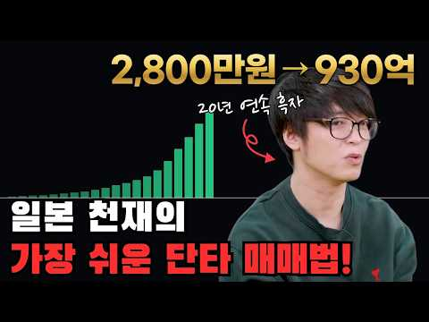
- 챕터: 0:00 2,800만 원으로 연 계좌 · 0:49 취업 한 번 안 해 본 프리터 · 1:27 첫 두 달, 마이너스 45만 엔 · 2:14 지지 않는 작은 거래 · 3:10 그가 고르는 종목 · 4:00 규칙 1, 절대 다음 날로 넘기지 않는다 · 5:01 규칙 2, 손절은 내가 정한다 · 6:26 규칙 3, 규칙을 깨면 다음 날은 쉰다 · 6:53 규칙 4, 자신 있는 만큼만 산다 · 7:28 1억, 그리고 5억 · 8:06 넘기지 않는다던 규칙을 버린 날 · 9:04 1주일에 마이너스 8억 엔 · 10:12 16연패, 그리고 5억 · 10:42 930억의 정체 · 11:35 지지 않으면 저절로 이긴다 · 12:28 930억 번 사람의 은퇴 규칙 · 13:17 네 가지 규칙, 한 장으로 · 13:49 내 앱에서 그대로 따라 하기 · 14:30 20년 뒤의 나에게
- 설명 앞부분: 2005년, 회사에 다녀 본 적도 주식을 배워 본 적도 없는 청년이 300만 엔(약 2,800만 원)으로 계좌를 엽니다. 첫 두 달은 −45만 엔, 1년 동안 매일 아침 토하면서 매매했죠. 그리고 2024년 2월, 20년 동안 번 돈을 모두 더한 누적 이익이 100억 엔(약 930억 원)을 넘습니다. 20년 동안 한 해도 손실로 끝나지 않았다는 일본 개인 투자자, 테스타입니다. 그가 지킨 단타 규칙 네 가지 — 절대 다음 날로 넘기지 않기, 손절은 내가 정하기, 규칙을 깨면 다음 날은 쉬기, 자신 있는 만큼만 사기 — 와, 그 규…
- 같은 채널 평소 대비 ×1.1 (채널 최근 롱폼 중앙값 60,153회) · 평소 영상: 700만원 → 1,400억 만든 스웨덴 트레이더의 매매법, 한 가지만 하세요 (돌파매매,… (70,466회) / 5달러로 1억 달러 번 월가 전설의 매매법, 그가 지킨 규칙 다섯 가지 (제시 리버모어,… (49,840회)
- 대본 없음 (설명) — 음성인식이 끝나면 도입부·흐름이 들어감
- 댓글 23/23: 좋은 점 — 영상 2 · 감사·응원 2 · 더 알고 싶은 것 0 · 아쉬운 점 — 영상 1 · 반박·불만 — 의견 다름 0 · 정치·사회 0 · 경험 공유 1 · 구독·다음 기대 0
  - 좋은 점 — 영상 👍0 “이 분 이평선매매로 유명한데 매매 철칙은 유명하지않은데 알짜베기를 알려줘서 고맙습니다”
  - 좋은 점 — 영상 👍0 “이거 따라하면 수수료 때매 골로 갑니다. 일본이라서 가능한듯. 그래도 좋은 내용이었습니다. 감사합니다”
  - 감사·응원 👍0 “이 분 이평선매매로 유명한데 매매 철칙은 유명하지않은데 알짜베기를 알려줘서 고맙습니다”
  - 감사·응원 👍0 “이거 따라하면 수수료 때매 골로 갑니다. 일본이라서 가능한듯. 그래도 좋은 내용이었습니다. 감사합니다”
  - 아쉬운 점 — 영상 👍6 “따라해볼라했는데 규칙을 깨면 하루 쉰다. 라고 해놓고 그규칙깨고 그냥 매매하고 하루 쉰다는 규칙을 어겼으니 다음날 하루 쉰다 라고 해놓고 또 그냥 규칙 깨고 매매하고 다음날 하루 쉰다 라고 해놓고 또매매 무한반복하는게 바로 나야.”
  - 경험 공유 👍0 “주식을 조금이라도 해봤으면 이런 영상에 현혹될리가 없을텐데....제발 ㅈ같은 영상 만들어서 엄한 사람들 뒷통수 좀 그만쳐라 사기꾼 새끼들아”

### 27. 하이닉스에 이어 삼성도 LTA 체결? 애플이 결국 삼성에 무릎 꿇다···

- https://www.youtube.com/watch?v=CcKFcr_M8uc · 잘되라대한민국 · 구독자 6,680 · 조회수 107,667 (×16.1, 하루 10,694.5) · 좋아요 424 (0.4%) · 15.1분 · 2026-11-18 · 주제 묶음 기타 · 형식 정보·해설 (그 밖) · 폴더 `W_CcKFcr_M8uc` (웹 승인)
- 썸네일: 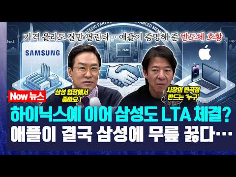
- 챕터: 0:00 오프닝: 애플이 삼성전자와 4~5년 장기 D램 공급 … · 2:00 [애플 LTA 분석] 가격 후려치던 애플이 공급 확보… · 6:10 B2C 시장의 반전: 아이폰 가격이 올라도 수요가 꺾… · 7:34 [엔트로픽 상장 카운트다운] 공모가 희망 밴드 상단 … · 11:00 엔트로픽 상장 후 수급 블랙홀과 리스크: 나스닥 10… · 13:34 클로징: 흔들리는 노이즈 속에서도 뚜렷해지는 메모리 …
- 설명 앞부분: [겸공_12시에만나요 261118] 단기 계약으로 단가 후려치기의 대명사였던 애플이 마침내 삼성전자와 4~5년 규모의 대규모 D램 장기 공급 계약(LTA)을 추진하고 나섰습니다! 가격 방어보다 공급 확보가 급급해진 애플의 다급한 행보는 현재 메모리 반도체 쇼티지가 얼마나 심각한지 보여주는 가장 강력한 방증입니다. 한편, 부품 가격이 올라도 끄떡없는 아이폰의 탄력성 덕분에 B2C 진영에서도 긍정적인 신호가 켜졌습니다. 여기에 스페이스X를 압도하는 흥행 가도를 달리고 있는 '엔트로픽 상장' 임박 소식과 조기 락업 해제 물량 리스크까지…
- 같은 채널 평소 대비 ×3.8 (채널 최근 롱폼 중앙값 28,240회) · 평소 영상: 삼전 67만 하닉 470만 ‘유지’ JP모건, 코스피 15000은 ‘삭제’ (28,240회) / 삼성전자 어닝콜, 소각은 우선주만? 증여세 깎으려 하나··· 역대급 실망 (27,284회)
- 대본 없음 (설명) — 음성인식이 끝나면 도입부·흐름이 들어감
- 댓글 29/29: 좋은 점 — 영상 0 · 감사·응원 0 · 더 알고 싶은 것 1 · 아쉬운 점 — 영상 0 · 반박·불만 — 의견 다름 1 · 정치·사회 0 · 경험 공유 1 · 구독·다음 기대 0
  - 더 알고 싶은 것 👍0 “왜 본채널있는걸 퍼와서 멘트만 붙여서 올리는지 궁금하네요”
  - 반박·불만 — 의견 다름 👍0 “시장 아무도 모른다 다만 추정만 할 뿐인데 억측해서 선동하지 말고 일기 예보만 해라 알았냐?”
  - 경험 공유 👍0 “바닥 내려올때까지 그냥 계속 희망회로 이 인간들 참고한 내가 너무 바보 같음”

### 28. 같은 TQQQ에 1억, 한 사람은 2만 원 한 사람은 388억 (실제 데이터)

- https://www.youtube.com/watch?v=d2_oRUcx5Uo · 머니언박싱 · 구독자 2,780 · 조회수 268,823 (×96.7, 하루 4,375.4) · 좋아요 1,180 (0.4%) · 8.1분 · 2026-09-27 · 주제 묶음 2. 장기투자·ETF·지수 · 형식 정보·해설 (그 밖) · 폴더 `W_d2_oRUcx5Uo` (웹 승인)
- 썸네일: 
- 챕터: 0:00 두 개의 계좌 · 0:24 3배 레버리지는 어떻게 움직이나 · 0:54 박 부장, 2000년 3월 꼭대기에서 1억 · 1:20 1년 만에 496만 원 · 1:42 2만 원까지 · 2:06 지수는 돌아왔는데 · 2:35 26년 뒤 박 부장 · 2:56 만약 2009년 바닥에서 샀다면 · 3:42 이 대리, TQQQ 상장일에 1억 · 4:00 16년 뒤, 그러나 · 4:25 만약 2021년 11월에 들어갔다면 · 5:05 최 사원, 매달 50만 원 · 5:32 94억에서 20억으로 · 5:56 만약 2022년에 팔았다면 · 6:29 결과 공개 · 6:56 이 결과를 믿기 전에 · 7:24 레버리지를 산다면
- 설명 앞부분: 같은 TQQQ, 같은 1억 원. 한 사람은 계좌가 한때 2만 원이 됐고, 다른 사람은 지금 388억 원입니다. 무엇이 두 사람을 갈랐을까요? 그리고 같은 상품을 매달 조금씩 산 사람은 어떻게 됐을까요? 박 부장: 2000년 3월 27일, 나스닥100 꼭대기에 1억 원을 3배 레버리지로 이 대리: 2010년 2월 11일, TQQQ 상장일에 1억 원 최 사원: 2000년 4월부터 매달 50만 원씩 3배 레버리지 (세 사람은 가상 인물이고, 숫자는 전부 실제 데이터로 계산했습니다) 계산 조건 2010년 2월 이전 3배·2배는 실제 상품…
- 같은 채널 평소 대비 ×165.0 (채널 최근 롱폼 중앙값 1,629회) · 평소 영상: 월 50만 원 vs 100만 원, etf로 5억까지 몇 년 차이 날까? (1,629회) / 폭락 때 멈춘 사람 vs 계속 산 사람, 누가 이겼을까? (S&P500) (1,573회)
- 대본 (음성인식(앞 5분), 4.9 음절/초) — 앞부분만, 흐름은 그 안까지 첫 20초: “여기 두 개의 계좌가 있습니다. 둘 다 1억원으로 시작했고 둘 다 같은 상품을 샀습니다. 나스딱백을 매일 세 배로 따라가는 레버리지 tqq입니다. 그런데 한 계좌는 한때 2만원이 됐고 다른 계좌는 지금 388억원입니다. 무엇이 이 둘을 갈랐을까요? 그리고 같은 상품을 매달 조금씩 산 사람은 어떻게 됐을까요? 오늘은 세 사람의 레버리지 계좌를 실제 데이터로 끝까지 따라가 보겠습니다.”
- 첫 1분: “여기 두 개의 계좌가 있습니다. 둘 다 1억원으로 시작했고 둘 다 같은 상품을 샀습니다. 나스딱백을 매일 세 배로 따라가는 레버리지 tqq입니다. 그런데 한 계좌는 한때 2만원이 됐고 다른 계좌는 지금 388억원입니다. 무엇이 이 둘을 갈랐을까요? 그리고 같은 상품을 매달 조금씩 산 사람은 어떻게 됐을까요? 오늘은 세 사람의 레버리지 계좌를 실제 데이터로 끝까지 따라가 보겠습니다. tqq는 나스딱백 지수가 하루에 1% 오르면 3% 1% 내리면 3% 움직이도록 만든 상품입니다. 중요한 건 매일이라는 말입니다. 1년에 3배가 아니라 매일 3배를 다시 맞춥니다. 그리고 3배를 만들기 위해 빌린 돈의 이자와 운영 보수가 매일 조금씩 빠져나갑니다. tqq는 2010년에 처음 나왔기 때문에 그 이전은 나스딱백의 실제”
- 흐름 (90초마다 첫 문장): 0:00 여기 두 개의 계좌가 있습니다. 둘 다 1억원으로 시작했고 둘 다 같은… → 1:34 2002년 10월 3배 계자에는 84000원이 남아 있었습니다. 1억 … → 3:04 새로 1억 원을 3배 레버리지에 넣었다고 해보겠습니다. 지금 이 계자는… → 4:35 이번에도 실제 기록입니다. 1년 뒤 2022년 12월 계자는 81.7%…
- 댓글 144/161: 좋은 점 — 영상 7 · 감사·응원 7 · 더 알고 싶은 것 8 · 아쉬운 점 — 영상 1 · 반박·불만 — 의견 다름 3 · 정치·사회 0 · 경험 공유 10 · 구독·다음 기대 1
  - 좋은 점 — 영상 👍8 “너무 좋은 영상 감사합니다 보고 먾이 배웠습니다. 사람들은 단순히 세배의 장점만 보는데 박부장의 케이스는 너무 무섭네요 관점을 바꾸는 좋은 계기가 되었습니다 감사합니다!”
  - 좋은 점 — 영상 👍8 “진짜 좋은 영상이네요 👍”
  - 감사·응원 👍8 “너무 좋은 영상 감사합니다 보고 먾이 배웠습니다. 사람들은 단순히 세배의 장점만 보는데 박부장의 케이스는 너무 무섭네요 관점을 바꾸는 좋은 계기가 되었습니다 감사합니다!”
  - 감사·응원 👍3 “궁금한 게 있습니다! 적립식이 중요하다는 건 알겠는데 Tqqq를 투자하면 결국 적립식으로 해도 초반은 방어가 되지만 장기투자하고 후반에 금액이 커진 상황에 대폭락이 오면 qqq보다 훨씬 낮아질 확률이 꽤 있지 않나요? TQQQ 관련 내용 책이나 좋은 자료 혹시 있다면…”
  - 더 알고 싶은 것 👍3 “Soxl도 궁금합니다😮”
  - 더 알고 싶은 것 👍3 “궁금한 게 있습니다! 적립식이 중요하다는 건 알겠는데 Tqqq를 투자하면 결국 적립식으로 해도 초반은 방어가 되지만 장기투자하고 후반에 금액이 커진 상황에 대폭락이 오면 qqq보다 훨씬 낮아질 확률이 꽤 있지 않나요? TQQQ 관련 내용 책이나 좋은 자료 혹시 있다면…”
  - 아쉬운 점 — 영상 👍0 “정말 무서운 건 지난 20년이 나스닥 역사상 가장 전성기였다는 사실. 닷컴버블도 아무리 길게 잡아도 3년. 10년 횡보장이었다면 QQQ 투자자는 우울한 정도지만, 폭락 후 버티는 QLD, TQQQ 투자자는 인생 망하는 케이스. 역사는 반복된다?? 아닙니다. 그 시대를…”
  - 반박·불만 — 의견 다름 👍6 “이미 흐름을 알고있는 과거시기를 극적으로 발취하여,,,,,감동적인효과는 알겠는데,,,, 솔직히 현실적투자환경속 투자자라면 실현가능한 일은 아니죠.의지력을 키우라는 교훈성”
  - 반박·불만 — 의견 다름 👍0 “정말 무서운 건 지난 20년이 나스닥 역사상 가장 전성기였다는 사실. 닷컴버블도 아무리 길게 잡아도 3년. 10년 횡보장이었다면 QQQ 투자자는 우울한 정도지만, 폭락 후 버티는 QLD, TQQQ 투자자는 인생 망하는 케이스. 역사는 반복된다?? 아닙니다. 그 시대를…”
  - 경험 공유 👍8 “매달 초마다 200만원 환전해서 TQQQ 매수합니다. 환율/주가 생각 안하고 삽니다 파는건 일년에 250만원만 하고 있습니다. 이제 1년차이고 앞으로 9년 남았네요 😊”
  - 경험 공유 👍6 “무서워서 그냥 연저펀 타이거 s&p500, isa 코덱스 나스닥100 두가지만 3년차 풀매수중입니다 😊”
  - 구독·다음 기대 👍4 “영상보고 바로 구독했습니다”

### 29. 12조 상속세 완납 직후 아들에게 4.5조 삼성전자 지분 넘긴 어머니! 아내와 어머니 그 이상이었던 삼성가의 안주인 홍라희 이야기

- https://www.youtube.com/watch?v=5tV7zEpTfCs · 모둠경제 · 구독자 14,000 · 조회수 265,648 (×19.0, 하루 21,442.2) · 좋아요 1,249 (0.5%) · 25.7분 · 2026-11-16 · 주제 묶음 기타 · 형식 정보·해설 (그 밖) · 폴더 `W_5tV7zEpTfCs` (웹 승인)
- 썸네일: 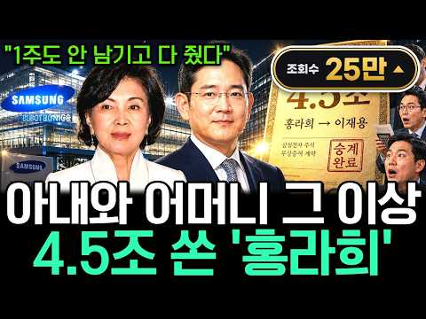
- 챕터: 0:00 이병철이 눈여겨본 미대생 · 3:02 유학을 꿈꾸던 홍라희의 맞선 · 6:30 삼성가 안주인으로 인정받다 · 8:01 반도체로 이어진 친정과 시댁 · 10:38 리움미술관과 미술계 영향력 · 13:00 이건희 별세와 12조 상속세 · 16:19 미술품 기증과 주식 매각 · 18:37 상속세 완납 뒤 지분 정리 · 23:58 미술관 복귀와 홍라희의 행보
- 설명 앞부분: 12조 원 상속세를 둘러싼 삼성가의 선택은 왜 시장의 이목을 끌었을까요? 오랜 시간 미술계의 중심에 섰던 홍라희와 삼성전자 지분을 둘러싼 결정들을 따라갑니다. 상속세를 마련하는 과정에서 가족들의 주식 보유에는 어떤 변화가 있었는지 살펴봅니다. 마지막 지분 정리의 배경과 그 의미는 영상에서 확인해 보세요. Noto Emoji © Google, CC BY 4.0 (creativecommons.org/licenses/by/4.0) Satellite imagery: NASA Earth Observatory Blue Marble Next …
- 같은 채널 평소 대비 ×4.2 (채널 최근 롱폼 중앙값 63,315회) · 평소 영상: "언니가 내 돈 천억 날렸어!" 어머니 장례식장에서도 눈 안 마주치던 동양그룹 자매, 1… (58,391회) / 덩치 1등 농심보다 영업이익을 3배나 더 쓸어 담으며 주가 100만 원 황제주에 등극한 … (43,567회)
- 대본 없음 (설명) — 음성인식이 끝나면 도입부·흐름이 들어감
- 댓글 88/88: 좋은 점 — 영상 0 · 감사·응원 5 · 더 알고 싶은 것 0 · 아쉬운 점 — 영상 0 · 반박·불만 — 의견 다름 3 · 정치·사회 8 · 경험 공유 2 · 구독·다음 기대 0
  - 감사·응원 👍35 “어머니의 GOOD표본. 홍 여사님 화이팅~~ 입니다. 건강하시게 오래오래 사세요.”
  - 감사·응원 👍25 “위대하다 옛날엔 미국 부호들의 기부를 보면서 많이 부러웠고 존경심이 있었는데 한국의 유한양행, 교보생명 등등..에 감사했고 세계 최고기업 삼성가의 인성과 철학이 잘 보입니다. 와우~ 대한민국과 삼성은 창대하리라~^^”
  - 반박·불만 — 의견 다름 👍5 “가지고갈것아닌데 다 주는게맞지않나요?”
  - 반박·불만 — 의견 다름 👍0 “세금 진짜 말이안된다,,, 이런데도 짐승 개딸들 대기업은 악이다 선동당하고 사료 배급 기다리겠지?”
  - 정치·사회 👍47 “상속세가 너무 높다. 세계 최고!!...기업 상속은 세금 66%를 내야한다. 미친거아니냐.. 개인도 아파트 한채에 50%를 내야한다. 미친 수준이다. 세율이 너무 높다. 정부가 모두 갈취하니 기업인들이 사모펀드에 기업을 팔아버리거나, 편법 상속을 위해 주가 누르기를 …”
  - 정치·사회 👍7 “홍라희... 동생 홍석현과 삼성을 집어삼키고 홍씨 가문의 일원으로 영원을 누리려던 감춰진 권력의지.... 뒤늦게 이재용은 결단했다. "엄마도 필요없다.. 홍씨 가문은 모두 삼성에 대한 야욕을 거두고 관련 자본과 지분에 손 떼라!!" 그리고 식음 전폐!!! 모자간 혈육…”
  - 경험 공유 👍4 “나도 이방송 첨보는데 흐믓이 아니라 자랑스럽고 존경스럽습니다”
  - 경험 공유 👍0 “하늘이 나에게 지구상에서 가장 위대한 분 10인을 만들라고 한다면 저는 홍라희 여사님도 꼭 포함시키고 싶은 분에 한 분 입니다 그만큼 삼성은 대한민국을 가장 크게 빛낸 회사이기에... 그래서 저도 같은 대한민국 국민으로써 삼성으로 인해 자부심을 크게 느끼기에 그리고 …”

### 30. 왜 내가 팔면 오르고 버티면 더 떨어질까? 폭락장에서 개미가 알아야 할 3가지

- https://www.youtube.com/watch?v=D4kEXI6IWYo · 오피디의 머니노트 · 구독자 2,260 · 조회수 73,373 (×32.5, 하루 3,337.7) · 좋아요 381 (0.5%) · 17.7분 · 2026-11-06 · 주제 묶음 8. 투자 심리·실패 · 형식 정보·해설 (그 밖) · 폴더 `W_D4kEXI6IWYo` (웹 승인)
- 썸네일: 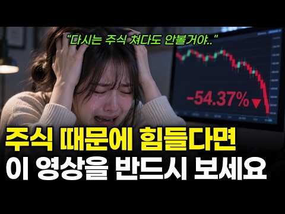
- 챕터: 0:00 주식투자하고 계신 분들, 많이 힘드신가요? · 1:47 이렇게 폭락했는데 코스피가 1년 전보다 위에 있는 이유 · 2:51 지금 나는 어디쯤일까, 부정·분노·타협·우울·수용 · 4:25 첫 번째, 단기 반등은 반드시 나온다 · 6:51 두 번째, 과도한 물타기는 절대 금물 · 9:54 세 번째, 내가 왜 투자했는지 확인해야 한다 · 12:10 자책하고 계신 분들께 · 14:31 기다릴까, 손절할까? 지금부터 어떻게 해야 할까
- 설명 앞부분: 폭락장에서 손절해야 할까요, 버텨야 할까요? 더 물탈 돈도 없는데 지금 어떻게 해야 할까요? 코스피 폭락 때마다 개미가 흔들리는 이유와 물타기 전에 꼭 알아야 할 3가지, 기다릴지 손절할지 나누는 기준까지 정리했습니다.
- 같은 채널 평소 대비 ×61.6 (채널 최근 롱폼 중앙값 1,192회) · 평소 영상: 주식 초보가 사면 떨어지고 팔면 오르는 이유 ∣ 하이닉스 물린 개미들의 공통점 (1,650회) / 나스닥 폭락, 지금 사도 될까? 주식 40년 데이터로 본 적립식의 결과 (541회)
- 대본 없음 (설명) — 음성인식이 끝나면 도입부·흐름이 들어감
- 댓글 21/21: 좋은 점 — 영상 1 · 감사·응원 0 · 더 알고 싶은 것 0 · 아쉬운 점 — 영상 0 · 반박·불만 — 의견 다름 0 · 정치·사회 0 · 경험 공유 3 · 구독·다음 기대 0
  - 좋은 점 — 영상 👍1 “내 돈은 내가 결정할수 있다란 말 와닿네요!전 버텨보려구요 결과가 어찌됐든 이렇게 나가면 안될거 같습니다 더힘들거 같아요”
  - 경험 공유 👍4 “귀신같이 내가 사면 떨어지고 팔면 올라가는 이유는 대체 뭔 조화일까요?..ㅜㅜ”
  - 경험 공유 👍1 “내가 주식을 시작하자. 채권과 주식 금 원자재가 동시에 빠진다. 미안하다..사랑한다”

### 31. 단타 5년차가 알려준 ＂잃지 않는 법＂ 딱 3가지 ｜ 코스피 9000시대 생존법

- https://www.youtube.com/watch?v=WnuVkKRjcuI · 돈의흐름도 · 구독자 1,380 · 조회수 153,227 (×111.0, 하루 1,918.8) · 좋아요 2,650 (1.7%) · 13.5분 · 2026-08-09 · 주제 묶음 5. 국내주식 · 형식 정보·해설 (그 밖) · 폴더 `W_WnuVkKRjcuI` (웹 승인)
- 썸네일: 
- 설명 앞부분: 단타 5년차가 알려준 ＂잃지 않는 법＂ 딱 3가지 ｜ 코스피 9000시대 생존법 경제를 제대로, 그리고 쉽게. 🏴‍☠ 이 채널에서 다루는 것들 주식·ETF·배당주 투자 분석 환율·금리·인플레이션 경제 해설 미국·한국 증시 및 글로벌 시장 동향 부동산·원자재·달러 등 자산 시장 분석 재테크 초보를 위한 경제 상식 어렵고 딱딱하게만 느껴지던 경제 뉴스, 경제해적단과 함께라면 달라집니다. 복잡한 시장의 흐름을 단순하고 명확하게 짚어드립니다. 월급쟁이도, 사회초년생도, 재테크를 막 시작한 분도 경제해적단과 함께라면 경제가 보이기 시작합니…
- 같은 채널 평소 대비 ×8,512.6 (채널 최근 롱폼 중앙값 18회) · 평소 영상: ＂천만원으로 3억, 매달 50만원이 20년 뒤 만드는 숫자＂ (18회) / ＂50대 노후 3억, 매달 100만원 만드는 법 (연금·복리·종잣돈)＂ (18회)
- 대본 (음성인식(앞 5분), 5.5 음절/초) — 앞부분만, 흐름은 그 안까지 첫 20초: “제가 아는 동생 중에 단타로 5년째 먹고 사는 친구가 있어요 전업으로요? 처음엔 저도 안 믿었어요 다들 망한다는 단타로 어떻게 5년을 버티냐고요 근데 옆에서 매매하는 걸 보고 깜짝 놀랐어요 종목을 신들린 듯 고를 줄 알았는데 의외로 사곱하는 건 되게 단순하더라고요 대신 딱 하나 남들이 절대 안 지키는 걸 기계처럼 지키고 있었어요” — 도입부 유형: 질문으로 시작, 숫자로 시작, 내 이야기·사연
- 첫 1분: “제가 아는 동생 중에 단타로 5년째 먹고 사는 친구가 있어요 전업으로요? 처음엔 저도 안 믿었어요 다들 망한다는 단타로 어떻게 5년을 버티냐고요 근데 옆에서 매매하는 걸 보고 깜짝 놀랐어요 종목을 신들린 듯 고를 줄 알았는데 의외로 사곱하는 건 되게 단순하더라고요 대신 딱 하나 남들이 절대 안 지키는 걸 기계처럼 지키고 있었어요 그게 뭐냐고 물어봤죠 그 친구가 한 말이 잊지 않아요 형 단타는 잘 사는 기술이 아니라 잘 버티는 기술이에요 차트 공부 100날 해봐야 소용 없다는 거예요 오늘 그 동생이 5년 동안 지켜온 그 한 가지를 여러분한테 그대로 풀어드릴게요 그리고 100만 원으로 그걸 어떻게 몸에 익히는지까지요 이거 하나만 가져가셔도 오늘 영상 값은 하실 거예요 끝까지 보세요 좋아요, 구독, 알림 설정 꼭”
- 흐름 (90초마다 첫 문장): 0:00 제가 아는 동생 중에 단타로 5년째 먹고 사는 친구가 있어요 → 1:31 이런 장을 보면 무슨 생각이 들까요? → 3:02 수익률은 오히려 더 낮았어요 → 4:31 근데 손실이 난 종목은 22%만 팔아요
- 댓글 96/96: 좋은 점 — 영상 3 · 감사·응원 2 · 더 알고 싶은 것 3 · 아쉬운 점 — 영상 4 · 반박·불만 — 의견 다름 3 · 정치·사회 0 · 경험 공유 7 · 구독·다음 기대 1
  - 좋은 점 — 영상 👍6 “너무 꼭 맞는 말씀입니다. 100원만 수익을 본다하더라도 100만원 1000만원 욕심을 버리기까지...다겪어봐야 조금 느끼게 되더라구요..”
  - 좋은 점 — 영상 👍2 “도움이 많이 됐습니다.참고하도록할께요.잠시 잊고 단타를 해서 손절 많이 했는데 이영상보고 뜨끔했네요.좋은영상 감사합니다”
  - 감사·응원 👍2 “도움이 많이 됐습니다.참고하도록할께요.잠시 잊고 단타를 해서 손절 많이 했는데 이영상보고 뜨끔했네요.좋은영상 감사합니다”
  - 더 알고 싶은 것 👍1 “구독, 좋아요,,,알림설정. 알려주세요.”
  - 아쉬운 점 — 영상 👍4 “단타 30년차로 잃지 않는 방법을 알려준다면 당장 주식을 접어라 그게 유일한 방법이다 그래도 주식을 하고 싶다면 종목을 보고 매매 하지말고 시장을 보고 매매해라 시장이 아니라고 하는데 시장을 이길라고 덤비면 백퍼 망한다 종목 차트 백날 선으로 찍찍 그어봐야 시장폭락하…”
  - 아쉬운 점 — 영상 👍2 “에이라.. 뻔한 이야기 가지고.. 뭐 특별한 비법이 있는 거 마냥...”
  - 반박·불만 — 의견 다름 👍5 “챠트 보는 법도 아니라 하고, 보조지표 보는 것도 아니라 하고, 종목 찍는 법도 아니라하는 건 제대로 공부를 안 했거나, 남들 말과 책에 쓰인 대로 맹신하며 투자하기 때문임. 제대로 알면 확률은 엄청난데 어설피 배우고 익힌 실력으로 하다가 매번 실패하는 경우가 많게 …”
  - 반박·불만 — 의견 다름 👍0 “영상 좋아요. 그런데 영상 후반부에 내가 이런 걸 지킬 자신이 있는가라고 자문해보라고 하시는데, 이런건 머리로 상상으로 자문한다고 알 수 있는 건 아니죠. 결국 몸으로 경험해봐야 내가 될놈인지 안될놈인지 체득할 수 있죠.”
  - 경험 공유 👍17 “많은 시련을 겪고 나서야만이 이 영상의 의미가 얾마나 중요한지를 깨닫게 되지요.”
  - 경험 공유 👍14 “단타는 잃지 않는게 중요.. 내가 정한 매도 포인트에서 기계적으로 매도해야함. 욕심내는 순간 지옥으로 떨어짐.”
  - 구독·다음 기대 👍1 “구독, 좋아요,,,알림설정. 알려주세요.”

### 32. 역사상 최악의 날에만 주식을 산 사람, 41년 뒤 계좌는? (S&P 500 실제 데이터)

- https://www.youtube.com/watch?v=DRvywv-HRmM · 머니언박싱 · 구독자 2,780 · 조회수 241,353 (×86.8, 하루 3,829.4) · 좋아요 681 (0.3%) · 8분 · 2026-09-26 · 주제 묶음 2. 장기투자·ETF·지수 · 형식 정보·해설 (그 밖) · 폴더 `W_DRvywv-HRmM` (웹 승인)
- 챕터: 0:00 다섯 번의 꼭대기 · 0:38 네 명의 투자자와 규칙 · 1:26 1987년, 블랙먼데이 · 1:56 13년을 기다려 산 곳이 닷컴버블 꼭대기 · 2:32 24년을 투자했는데 원금보다 적다 · 3:09 한 달 만에 2억 6천만 원이 사라지다 · 3:44 마지막 꼭대기, 그리고 지금 · 4:13 결과 공개 · 4:53 신의 손은 왜 졌을까 · 5:22 공포 씨는 왜 꼴찌가 됐을까 · 5:59 이 결과를 믿기 전에 · 6:33 보너스: 원화로 계산하면? · 7:20 우리는 네 명 중 누구일까
- 설명 앞부분: 역사상 최악의 날에만 주식을 산 사람이 있다면, 41년 뒤 계좌는 얼마일까요? 1985년부터 매달 50만 원씩, 똑같이 2억 5,050만 원을 넣은 네 사람. 최악 씨: 폭락 직전 꼭대기에서만 5번 산 사람 성실 씨: 아무 생각 없이 매달 산 사람 신의 손: 폭락 바닥에서만 산 사람 공포 씨: 20% 떨어지면 팔고, 회복하면 다시 산 사람 실제 S&P 500 데이터(배당 재투자)로 1985년 1월~2026년 9월을 계산했습니다. 계산 조건 매달 첫 거래일에 50만 원, 본편은 달러 기준 총수익률을 원화 금액에 그대로 적용(환율 효…
- 같은 채널 평소 대비 ×148.2 (채널 최근 롱폼 중앙값 1,629회) · 평소 영상: 월 50만 원 vs 100만 원, etf로 5억까지 몇 년 차이 날까? (1,629회) / 폭락 때 멈춘 사람 vs 계속 산 사람, 누가 이겼을까? (S&P500) (1,573회)
- 대본 없음 (설명) — 음성인식이 끝나면 도입부·흐름이 들어감
- 댓글 172/172: 좋은 점 — 영상 5 · 감사·응원 2 · 더 알고 싶은 것 5 · 아쉬운 점 — 영상 0 · 반박·불만 — 의견 다름 4 · 정치·사회 0 · 경험 공유 8 · 구독·다음 기대 1
  - 좋은 점 — 영상 👍18 “<결론정리> 1.일단 가장큰 변수 = 미국장이라는 조건.(제 3세계 주식장까지 분석하면 매우 달라질수 있음) 2.자주 넣다뻿다 하는건 도움이 안됨. 3.(빚내지 말고)있는돈으로 꾸준히 투자할것. 이렇게 했는데도 못따는 상황은 전지구적 재앙으로 인류 대부분이 손실을 보…”
  - 좋은 점 — 영상 👍8 “진짜 처음봤는데 영상 딱 눈에 잘들어오고 이해하기 쉽게 만들어서 도움 많이 됐습니다! 구독할게요 자주 영상 만들어주세요😊”
  - 감사·응원 👍2 “정말 궁금했는데 감사합니다!!!”
  - 감사·응원 👍1 “진짜 중요한 영상 너무 감사합니다”
  - 더 알고 싶은 것 👍8 “진짜 처음봤는데 영상 딱 눈에 잘들어오고 이해하기 쉽게 만들어서 도움 많이 됐습니다! 구독할게요 자주 영상 만들어주세요😊”
  - 더 알고 싶은 것 👍4 “적립만 가능한 설명이네요 거치와 적립도 비교해 주시면 많은 도움이 될 것 같습니다”
  - 반박·불만 — 의견 다름 👍1 “시사성이 있네요 재밌게 봣습니다 꼭 신의손이 불가능한건 아닙니다 월봉 기준으로 터치할때로 기준잡으면 이것도 기계적으로 가능하죠 또 뉴스기반으로 코로나 관세 이란 같이 뉴스 기반 공포는 누구나 감지 가능하죠 그때 현금이 없어서 놓치는거지”
  - 경험 공유 👍4 “가장 최악의 꼭대기에서 개인들이 주식을 산 다음 손해보지 않기 위해 장기간 보유했었다면 지수가 장 기간 우상향 할 수 없었겠죠.”
  - 경험 공유 👍3 “전 달러로 교체안하고 연저펀 s&p500, isa 나스닥100 두가지만 3년차 풀매수했습니다!! 그리고 올해 3월부터 irp 계좌만들어 s&p500 70%, tdf 2045 30% 하고있구요... 올해로 원금만 1억1400이 되었구요 수익률까지 중후반으로 가더라구요!…”
  - 구독·다음 기대 👍8 “진짜 처음봤는데 영상 딱 눈에 잘들어오고 이해하기 쉽게 만들어서 도움 많이 됐습니다! 구독할게요 자주 영상 만들어주세요😊”

### 33. 이거 딱 두 개면 충분하다? 존리 대표의 심플한 투자 공식

- https://www.youtube.com/watch?v=9bQncZDMMqE · 여의돈스트리트 · 구독자 1,430 · 조회수 158,558 (×110.9, 하루 1,954.0) · 좋아요 839 (0.5%) · 22.4분 · 2026-09-08 · 주제 묶음 11. 투자 일반 · 형식 정보·해설 (그 밖) · 폴더 `W_9bQncZDMMqE` (웹 승인)
- 썸네일: 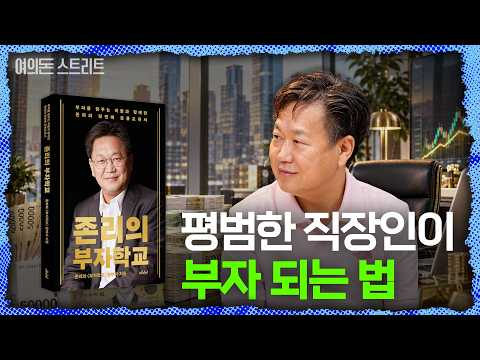
- 챕터: 0:00 인트로 · 0:48 ‘존리의 부자학교’, 어떤 곳인가요? · 1:07 우리나라 금융 수준, 정말 높아졌나요? · 2:38 빨리 부자가 되는 투자, 가능한가요? · 5:40 장기 투자, 어떤 ETF를 사야 할까요? · 7:40 평범한 사람은 어떻게 부자가 되나요? · 9:17 주식 투자에 전문가가 없다? · 11:11 레버리지 투자는 왜 위험한가요? · 12:18 한국주식, 지금도 투자할 만한가요? · 13:03 투자 뉴스는 어디까지 봐야 할까요? · 15:31 부동산 비중이 높으면 위험한가요? · 17:32 주식 투자의 진짜 목적은 무엇인가요? · 18:13 좋은 기업은 어떻게 고르나요? · 21:06 장기 투자 중 기업 상황이 나빠진다면?
- 설명 앞부분: 매일 오르내리는 주가, 금리 인상 뉴스... 언제 사고 언제 팔아야 할지 늘 스트레스받고 계시나요? 이번 영상에서는 '존리의 부자학교' 존리 대표님을 모시고 스트레스 없이 진짜 부자가 되는 투자의 본질에 대해 깊이 있는 이야기를 나누어 보았습니다. 단기간에 부자가 되려는 조급함을 버리고, 내 자본이 스스로 일하게 만드는 진짜 투자법을 지금 바로 영상에서 확인해 보세요! ※ 영상에 등장하는 전망과 의견은 출연자의 개인적인 견해입니다. (촬영일: 2026.08.27) 진행: 국민일보 이광수 기자 출연: 존리 존리의 부자학교 대표 ⏱️…
- 같은 채널 평소 대비 ×130.2 (채널 최근 롱폼 중앙값 1,218회) · 평소 영상: 아무짝에도 쓸모없는 경제 회의 [돈 안되는 소리 EP.01] (1,218회) / 주식시장 100명중 90명은 무조건 손실 봅니다. 상위 10%만 아는 '진짜' 수익 내는… (1,204회)
- 대본 없음 (설명) — 음성인식이 끝나면 도입부·흐름이 들어감
- 댓글 44/44: 좋은 점 — 영상 1 · 감사·응원 3 · 더 알고 싶은 것 0 · 아쉬운 점 — 영상 1 · 반박·불만 — 의견 다름 1 · 정치·사회 1 · 경험 공유 2 · 구독·다음 기대 0
  - 좋은 점 — 영상 👍6 “항상 쉽게 설명해주셔서 감사합니다 덕분에 노후준비가 두렵지 않습니다 늘 감사하게 생각하고 있습니다. 🙏”
  - 감사·응원 👍6 “항상 쉽게 설명해주셔서 감사합니다 덕분에 노후준비가 두렵지 않습니다 늘 감사하게 생각하고 있습니다. 🙏”
  - 감사·응원 👍4 “매달 용돈 + 투자금으로 수면동안 꾸준히 한국🇰🇷주식과 ETF를 사모아서 이제는 큰 돈이 되어서 노후가 두렵지 않습니다. 감사합니다 🙏”
  - 아쉬운 점 — 영상 👍0 “이런 컨텐츠는 어의 없는 어그로 방송이다... 온국민들이 자기집 한채가 전부이며 그한채를 가지고 살려고 노력하는데 ... 헛소리 어그로나 해 싸고 한심하다...여유 되는 사람이 여러채를 살수 도 있는것이다... 자유민주의의 국가이다.... 공산 국가냐?”
  - 반박·불만 — 의견 다름 👍0 “이런 컨텐츠는 어의 없는 어그로 방송이다... 온국민들이 자기집 한채가 전부이며 그한채를 가지고 살려고 노력하는데 ... 헛소리 어그로나 해 싸고 한심하다...여유 되는 사람이 여러채를 살수 도 있는것이다... 자유민주의의 국가이다.... 공산 국가냐?”
  - 정치·사회 👍1 “검은머리 외국인”
  - 경험 공유 👍11 “맞는 말이긴 한데 국장은 해당사항 없음. 국장은 도박장 개 후진국장임이 확실함. 주식 15년차 확신함.”
  - 경험 공유 👍8 “너무 좋아요. 존리선생님 덕분에 저도 투자 많이 하고 있어요. 오르든 떨어지든 별로 신경 안써요.”

### 34. 환율 떨어지면 달러 사라는 말, 이번엔 정반대인 이유! ∣ 환율전망 ∣ 달러 투자 ∣ 서학개미 ∣ 원달러환율

- https://www.youtube.com/watch?v=-Uf61BzgLkA · 이슈'S · 구독자 840 · 조회수 99,918 (×119.0, 하루 1,108.5) · 좋아요 1,010 (1.0%) · 18.2분 · 2026-08-30 · 주제 묶음 8. 투자 심리·실패 · 형식 정보·해설 (그 밖) · 폴더 `W_-Uf61BzgLkA` (웹 승인)
- 썸네일: 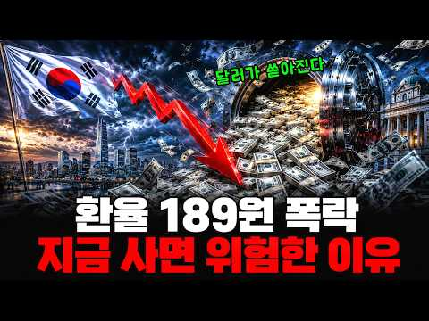
- 챕터: 0:00 환율 흔들리면 달러부터 사는 반사신경, 지금은 안 통… · 0:48 6월 8일, 원달러 환율 장중 1,561.5원 (20… · 1:10 8월 28일, 1,372.5원까지 하락 (13개월 만… · 1:21 8월 19일 이미 1,400원선 붕괴 · 1:33 81일 만에 189원 하락 (-12.1%) · 1:47 국내 투자자 미국주식 보관금액 300조 4,706억 … · 2:04 환율 하락과 미국주식 보유 급증, 같은 흐름의 두 얼굴 · 2:47 그런데 왜 원화가 아니라 '달러 약세'가 진짜 원인인가 · 3:15 전 세계 외환보유고 중 달러 비중, 2000년 70%… · 3:37 빈자리는 금이 채움 - 각국 중앙은행 금 매입, 중국… · 3:48 미국 국가부채 8월 19일 사상 첫 40조 달러 돌파… · 4:01 올해 재정적자 2조 1천억 달러 추가 전망 · 4:21 신용카드 20년 연체 없이 막아온 집, 그래도 한도 … · 4:54 레이 달리오 경고 - 3년 내 심각한 부채위기 가능성… · 5:16 핵심 - 지금 환율 하락은 원화가 아니라 달러 쪽 문제 · 5:38 과거 사례 ① 1985년 플라자 합의 - 이후 2년간… · 6:34 1987년 루브르 합의로도 하락세 못 멈춤 · 6:43 과거 사례 ② 2002~2008년, 6년간 달러 약 … · 7:16 공통점 - 세계 경제에서 미국 비중 2000년 31%… · 7:47 결론 - 지금 흐름은 새로운 사건이 아니라 이미 두 …
- 설명 앞부분: [타임라인]
- 같은 채널 평소 대비 ×227.1 (채널 최근 롱폼 중앙값 440회) · 평소 영상: 북한 돈이 무너지는데, 왜 내 세금이 걱정될까? 통일 비용을 가르는 경로 #북한경제 #통… (440회) / 샤넬은 2조, 펜디는 42% 감소… 한국 명품 시장은 왜 갈라졌나 #명품시장 (422회)
- 대본 없음 (설명) — 음성인식이 끝나면 도입부·흐름이 들어감
- 댓글 82/82: 좋은 점 — 영상 1 · 감사·응원 0 · 더 알고 싶은 것 0 · 아쉬운 점 — 영상 2 · 반박·불만 — 의견 다름 1 · 정치·사회 4 · 경험 공유 3 · 구독·다음 기대 0
  - 좋은 점 — 영상 👍2 “좋은 내용인데 왜 존댓말과 반말을 섞어 쓰는 거야?”
  - 아쉬운 점 — 영상 👍30 “AI 목소리 듣기 싫은데 무슨 말인가 해서 끝까지 들어봤는데 괜히 시간만 낭비했다. 이 정도 지식이면 그만 둬야.”
  - 아쉬운 점 — 영상 👍0 “뻔한 이야기를 뭘 이렇게 장황하게 설명을~!?”
  - 반박·불만 — 의견 다름 👍0 “환율을 예측해서 투기하면 골로 갑니다. 환율은 관리하는 것이지 예측하는 게 아닙니다.”
  - 정치·사회 👍14 “정부가 만든내용인줄 ㅋㅋㅋ 시간 낭비”
  - 정치·사회 👍8 “환율 1600원 넘고 이재명 정권 망할거라 기대하던 2찍들이 싫어할 영상이네요 ㅋㅋ”
  - 경험 공유 👍6 “어떤대학교수가 1700에서2200으로 올라간다고 했었는데 에~~고”
  - 경험 공유 👍1 “썸네일에 반말한다고 적어두면 안되나..? 왜 내가 내 시간들여서 반말을 듣고있어야 하나.”

### 35. 제 주식 노하우 다 풉니다.

- https://www.youtube.com/watch?v=PLYpdzY5U-U · 육감 김수용 · 구독자 7,730 · 조회수 349,127 (×45.2, 하루 9,422.9) · 좋아요 2,527 (0.7%) · 16분 · 2026-10-22 · 주제 묶음 기타 · 형식 정보·해설 (그 밖) · 폴더 `W_PLYpdzY5U-U` (웹 승인)
- 썸네일: 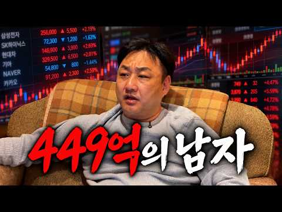
- 설명 앞부분: 제가 주식을 시작한 지도 벌써 27년이 됐네요. 최근에는 6년간 주식을 450억 원어치나 거래했다고 기사까지 났더라고요. 그동안 어떤 주식을 사고팔았는지 저만의 투자 원칙은 무엇인지 이야기해 봤습니다. 오래 했다고 다 잘하는 건 아니지만 그래도 그동안 쌓인 이야기는 꽤 많습니다. 오늘은 제 주식 이야기를 한번 들어보시죠.
- 대본 없음 (설명) — 음성인식이 끝나면 도입부·흐름이 들어감
- 댓글 194/194: 좋은 점 — 영상 9 · 감사·응원 7 · 더 알고 싶은 것 2 · 아쉬운 점 — 영상 0 · 반박·불만 — 의견 다름 0 · 정치·사회 2 · 경험 공유 13 · 구독·다음 기대 1
  - 좋은 점 — 영상 👍20 “여러분 투자 전문 관련 방송 영상 볼 거 하나도 없습니다! 수드래곤님께서 말씀하시는게 진짜 진실되게 맞는 말씀이니까 참고하세요! ^^ 수드래곤님 존경합니다~”
  - 좋은 점 — 영상 👍16 “넘평온해보이시고 듣기좋은 목소리에요~유튜브잘되셨음 좋겠네요^^”
  - 감사·응원 👍15 “햐.. 알고리즘에 떠서 잘 보고 갑니다 ㅋㅋㅋ 아무래도 힘내라는 뜻같은데 이제 저도 수익률 + 달성을 위해 달려가보겠습니다 모두 파이팅🎉”
  - 감사·응원 👍3 “다 맞는말이네요~제밌게 봤어요 감사합니다”
  - 더 알고 싶은 것 👍5 “아... 이미 얼마전에 왕창 샀는데 지금 올려주시면 어떡해요... 책임지세요”
  - 더 알고 싶은 것 👍3 “기사보고 궁금했는데 유익하게 잘봤습니다 가지고계신 etf 궁금해요😂🤣”
  - 정치·사회 👍0 “형 보증선거 사기당한거 돈 찾음?”
  - 경험 공유 👍15 “햐.. 알고리즘에 떠서 잘 보고 갑니다 ㅋㅋㅋ 아무래도 힘내라는 뜻같은데 이제 저도 수익률 + 달성을 위해 달려가보겠습니다 모두 파이팅🎉”
  - 경험 공유 👍13 “진짜 저도 6년차 주린이지만 맞는말씀입니다”
  - 구독·다음 기대 👍9 “알고리즘으로 왔어요~ 구독 좋아요 알림 설정 했어요 주식관련 컨텐츠 재밌게 잘 봤습니다”

### 36. SOXL 주가 전망, 300달러에서 46달러 ∣ 물타기 해도 될까? 2022년에 한 번 있었던 일

- https://www.youtube.com/watch?v=L3Y9BkSDNRM · 밸류노트 ValueNote · 구독자 1,990 · 조회수 50,943 (×25.6, 하루 2,411.4) · 좋아요 412 (0.8%) · 9.5분 · 2026-11-07 · 주제 묶음 8. 투자 심리·실패 · 형식 정보·해설 (그 밖) · 폴더 `W_L3Y9BkSDNRM` (웹 승인)
- 썸네일: 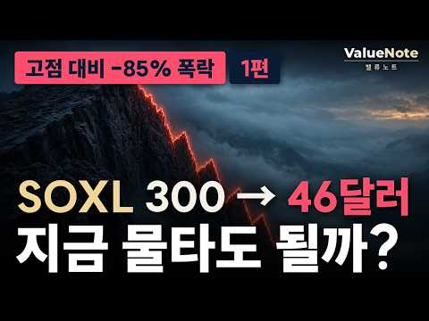
- 설명 앞부분: SOXL 주가 전망, SOXL 물타기가 고민이신 분들을 위해 정리했습니다. SOXL은 6월 22일 300달러에서 11월 6일 46달러가 됐습니다. 10월 30일 장 마감 직전, 반도체 3배 ETF들은 반도체 주식 192억 달러어치를 내다 판 것으로 추정됩니다. 문제는 반도체가 아니었습니다. 진짜 이유는 하루 기준 3배를 매일 다시 맞추는 구조였습니다. 한국 투자자가 주인 셋 중 하나가 된 SOXL, 10월 30일과 11월 5일, 장 마감 직전에 벌어지는 일, 2022년에 한 번 있었던 일, 이번은 2020년인지 2022년인지, 그…
- 같은 채널 평소 대비 ×99.7 (채널 최근 롱폼 중앙값 511회) · 평소 영상: 현대차 주가 전망, 이 3가지만 보면 된다 ∣ 75만 원에서 27만 원, 시총 97조 증발 (511회) / 아이온큐 CFO 8일 만에 사임… 매출은 4배인데 주가는 왜 1년 바닥일까 (451회)
- 대본 없음 (설명) — 음성인식이 끝나면 도입부·흐름이 들어감
- 댓글 128/128: 좋은 점 — 영상 1 · 감사·응원 6 · 더 알고 싶은 것 2 · 아쉬운 점 — 영상 0 · 반박·불만 — 의견 다름 3 · 정치·사회 4 · 경험 공유 8 · 구독·다음 기대 0
  - 좋은 점 — 영상 👍4 “많이 논리적이고, 합리적인 설명, 도움이 많이 됩니다. 고맙습니다..”
  - 감사·응원 👍4 “많이 논리적이고, 합리적인 설명, 도움이 많이 됩니다. 고맙습니다..”
  - 더 알고 싶은 것 👍3 “SOXL 평단가 8불대인데, 나중에 노후에 돈 필요할때 노후 자금으로 쓸라고 하는데, 팔아야될까요? 장기로 갖고가면 안될까요? 의견 부탁드립니다..”
  - 더 알고 싶은 것 👍0 “코루도 분석해주시면안되나여”
  - 경험 공유 👍8 “soxl 15불대 평단에 1억이상 있었는데 2배먹고 판 내자신을 얼마나 원망했는지 모른다...... 이번엔 그런실수 안한다. 10불대면 soxl 5달러 가도 버틸만 합니다.. 2~3배는 금방이니까요 근데 이번엔 최소5~10배는 가져갑니다 우린 이게임을 해봤어요~~~~…”
  - 경험 공유 👍2 “나도 막 끌어다가 쏫아 부었어요 여기서 만회 해야지요”

### 37. 80만원으로 260억 만든 미국 단타 천재의 가장 쉬운 매매법 (로스 카메론)

- https://www.youtube.com/watch?v=cW11yJS6Jik · 손절봇 | 자동매매 · 구독자 4,430 · 조회수 109,759 (×24.8, 하루 5,330.3) · 좋아요 863 (0.8%) · 16.8분 · 2026-11-07 · 주제 묶음 4. 미국·해외주식 · 형식 정보·해설 (그 밖) · 폴더 `W_cW11yJS6Jik` (웹 승인)
- 썸네일: 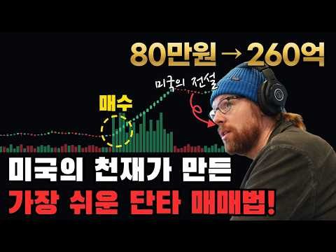
- 챕터: 0:00 583달러로 시작한 계좌 · 0:52 도예 선생님이 되고 싶던 소년 · 1:29 물려받은 10만 달러 · 2:11 1년 차에 벌고, 2년 차에 다 잃다 · 2:55 장작 헛간의 그루터기 · 3:29 엑셀 한 장이 바꾼 것 · 4:26 다시, 583달러 · 5:43 260억의 정체 · 6:38 RSI 매매법이 아니었다 · 7:54 규칙 1, 이미 오르고 있는 종목만 본다 · 9:10 규칙 2, 1을 걸면 2를 노린다 · 10:18 규칙 3, 하루에 잃을 돈을 먼저 정한다 · 11:08 규칙 4, 첫 매매는 작게 · 11:42 규칙 하나를 어긴 날 · 13:12 크게 잃은 다음 날 · 13:45 그리고 2022년, FTC · 14:48 네 가지 규칙, 한 장으로 · 15:30 내 앱에서 그대로 따라 하기 · 16:13 초록불이면 끄고 떠나라
- 설명 앞부분: 2017년 1월 1일, 583달러(약 80만 원)로 연 계좌. 9년 동안 번 돈을 모두 더하면 1,881만 달러, 우리 돈 260억 원 — 회계 법인이 브로커 기록을 확인한 미국 단타 트레이더 로스 카메론입니다. 도예 선생님을 꿈꾸던 소년, 카드 다섯 장이 한도까지 찼던 3년 차, 장작 헛간의 그루터기, 그리고 엑셀 한 장에서 찾은 공통점까지. 한국에선 「RSI 매매법」으로 알려졌지만 본인은 "RSI는 내 매매에 별로 도움이 안 된다"고 말합니다. 그가 진짜로 지킨 규칙 네 가지 — 이미 오르는 종목만(10%↑·거래량 5배·뉴스)…
- 같은 채널 평소 대비 ×1.9 (채널 최근 롱폼 중앙값 58,552회) · 평소 영상: 2,800만원으로 930억 번 일본 천재의 가장 쉬운 단타 매매법 (테스타) (67,263회) / 5달러로 1억 달러 번 월가 전설의 매매법, 그가 지킨 규칙 다섯 가지 (제시 리버모어,… (49,840회)
- 대본 없음 (설명) — 음성인식이 끝나면 도입부·흐름이 들어감
- 댓글 25/25: 좋은 점 — 영상 1 · 감사·응원 1 · 더 알고 싶은 것 0 · 아쉬운 점 — 영상 0 · 반박·불만 — 의견 다름 0 · 정치·사회 0 · 경험 공유 1 · 구독·다음 기대 0
  - 좋은 점 — 영상 👍0 “이런 영상들 특징은 도움이 안됨”
  - 감사·응원 👍7 “국장이였어봐 585 달러는 일주일이면 58달러가 되는 기적을 보게된다 ㅋㅋ 미국에 태어난걸 감사해라”
  - 경험 공유 👍5 “나도 몇일 수익 잘 내고 하루만에 수익낸 것 다 잃고... 그나마 지금은 무지 조심하면서 단타에 임함!”

### 38. S&P500, 나스닥100 이렇게 샀다간 세금+건보료 폭탄 맞습니다 ∣ 여운봉 교수 ∣ 연금받는형

- https://www.youtube.com/watch?v=60zQzH422bk · 연금 받는 형 · 구독자 25,700 · 조회수 543,059 (×21.1, 하루 30,254.6) · 좋아요 2,947 (0.5%) · 28.9분 · 2026-11-10 · 주제 묶음 2. 장기투자·ETF·지수 · 형식 인터뷰·강연·대담 · 폴더 `W_60zQzH422bk` (웹 승인)
- 썸네일: 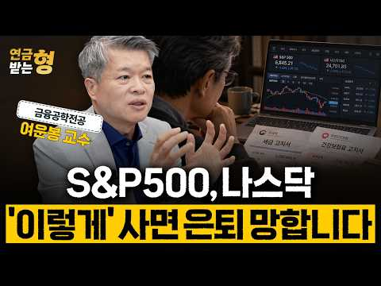
- 챕터: 0:00 하이라이트 · 0:50 ISA·연금저축·IRP, 순서를 잘못 잡으면 뭘 놓칠… · 1:44 세액공제를 못 받아도 연금저축을 할 이유가 있을까? · 5:51 은퇴자가 월 125만 원과 연 2,000만 원을 기억… · 11:35 은퇴 후 피해야 할 가장 위험한 투자법은? · 14:47 시장이 출렁여도 배당 중심 전략은 여전히 통할까? · 17:15 급락장에서 커버드콜 ETF는 얼마나 방어해 줄까? · 17:56 오늘 당장 실천할 수 있는 한 가지는? · 19:08 ISA에 돈만 넣어뒀다면, 그다음엔 뭘 해야 할까? · 22:42 ETF만 열 개 넘게 샀다면, 어디서부터 정리할까? · 24:05 50대에 노후 준비를 시작한다면, 뭐부터 해야 할까?
- 설명 앞부분: ISA부터 채워야 할까요, 연금저축·IRP부터 시작해야 할까요? 같은 돈을 넣더라도 소득이 있는지, 세액공제를 받을 수 있는지에 따라 먼저 살펴볼 계좌가 달라집니다. 여운봉 교수와 함께 절세 계좌를 활용하는 순서부터 은퇴 후 세금과 건강보험료를 챙기는 법까지 짚어봅니다. S&P500과 나스닥100 ETF를 예로 들어 투자 비중을 다시 맞추는 방법도 알아보고, 시장이 출렁일 때 배당 중심 전략과 커버드콜 ETF가 어디까지 버텨주는지도 이야기합니다. 은퇴 후 피해야 할 가장 위험한 투자법도 함께 짚어봅니다. 좋다는 ETF를 하나씩 담…
- 같은 채널 평소 대비 ×11.5 (채널 최근 롱폼 중앙값 47,157회) · 평소 영상: 건보료·기초연금 아끼려다 노후 망칩니다. 국민연금 줄이면 안 되는 이유 ∣ 김윤로 대표 … (47,157회) / “일찍 받으면 손해, 늦게 받으면 이득?” 국민연금 계산에서 빠진 한 가지 ∣ 김윤로 대… (47,796회)
- 대본 없음 (설명) — 음성인식이 끝나면 도입부·흐름이 들어감
- 댓글 173/173: 좋은 점 — 영상 10 · 감사·응원 15 · 더 알고 싶은 것 7 · 아쉬운 점 — 영상 2 · 반박·불만 — 의견 다름 1 · 정치·사회 3 · 경험 공유 9 · 구독·다음 기대 0
  - 좋은 점 — 영상 👍9 “리밸런싱 빼고는 좋은 영상 이라고 생각합니다.”
  - 좋은 점 — 영상 👍7 “리밸런싱 연금저축에 하라고 하잖아요.나스닥100 이나 s&p500 리밸런싱 할때는 수수료가 없고 55세이후 5년지나서 찾을때 세금 5.5%라 하시니 맞는 말씀 몰랐는데 도움되었읍니다.매매차익에 대해서는 세금이 없다고 .56세 올해시작했으니 61세때부터 찾는데 그동안 …”
  - 감사·응원 👍7 “교수님 영상 감사합니다 잘들었습니다”
  - 감사·응원 👍6 “여운봉선생님 감사합니다. 꾸준히 모아갈게요. 선생님 책도 사서 보고 저수지투자법으로 쭉이어가겠습니다.”
  - 더 알고 싶은 것 👍12 “교수님 ~~ 채널이 3개나 되시네요? 하도 국민들이 무지해서 가르칠 게 많나 보죠? 많이 가르쳐 주세요 ~~ ㅎㅎ”
  - 더 알고 싶은 것 👍1 “근데 irp는 돈못빼니까ㅡ isa먼저하면안되나요?”
  - 아쉬운 점 — 영상 👍5 “오른종목을 팔아서 내린종목을 더 산다? 그럼 오른종목은 마르지않는 샘물이 되는가요? 그게 반복되면 내린종목은 평단가가 내려올지몰라도 오른종목이 더 올랐을때 수익이 더 극대화할수있는걸 못한다.. 그러지말고 그냥 내린종목을 오른종목보다 더 사는방식으로 해야지.. 설득력이…”
  - 아쉬운 점 — 영상 👍0 “24:58 50에 투자하는 방법 전체 동영상 몇번 반복해서 들으면 노후준비가 잘 될수 있음”
  - 정치·사회 👍133 “종합소득세 2천만원, 건보료 1천만원... 월에 연금 125만원 가지고 요즘 물가에 어떻게 살라고 .. 정부가 x만 안 들었지 진짜 도둑 같아요 국민들이 부담하는 세금 부담을 줄여주면 되지, 현금이니 복지니 표만 보고 하는 선심성 제발 그만 뒀으면 좋겠어요”
  - 정치·사회 👍101 “금융소든2천만원 몇년전 세액을 아직까지 적용해 국민쌈지돈 털고있네 세금다낸돈 열심히 모아투자해 수익냈는데 그걸또 뺐어가고 정부가도둑이다”
  - 경험 공유 👍23 “ETF를 무슨 리벨런싱을 하나요. ISA에서 산 ETF는 연금저축계좌로 전부 이양해서 20년 장기투자 한다면 손을 안대는게 훨씬 복리가 큽니다. 사팔사팔하면 되려 세금만 나갈뿐. 그리고 배당 소득이 천만원 넘으면 무조건 위험한게 아니라 건강보험공단에 전화해보시면 내가…”
  - 경험 공유 👍5 “이교수님 조언좋으시네ᆢ 제가 투자하는방법하고 거의 동일하고ᆢ이건 국내외 주식장이나 거시경제나 경험을 해뵈야 알수있는ᆢ”

### 39. 친구가 하나둘 사라졌습니다… 결국 제가 인간관계를 정리한 이유

- https://www.youtube.com/watch?v=DTTARHT4swk · 어쩌다마흔 · 구독자 2,470 · 조회수 94,822 (×38.4, 하루 2,768.7) · 좋아요 389 (0.4%) · 10.4분 · 2026-10-25 · 주제 묶음 2. 장기투자·ETF·지수 · 형식 정보·해설 (그 밖) · 폴더 `W_DTTARHT4swk` (웹 승인)
- 썸네일: 
- 설명 앞부분: 서른 살 무렵부터 자연스럽게 멀어지는 사람들이 생겼고, 어느 순간부터는 제가 직접 관계를 정리하기 시작했습니다. 오래 알았다는 이유만으로 계속 만나야 하는 걸까요? 친구가 많다고 꼭 행복한 것도 아니고, 친구가 적다고 잘못 살고 있는 것도 아니겠죠. 나이가 들면서 달라진 인간관계, 여러분은 어떻게 생각하시나요? Created with Vrew
- 같은 채널 평소 대비 ×11.7 (채널 최근 롱폼 중앙값 8,113회) · 평소 영상: 환율 1,350원 깨지고 미국주식 올인 했습니다 (8,113회) / 부부 식비 40만원, 남은 돈 절반 미국주식 샀습니다 (8,465회)
- 대본 없음 (설명) — 음성인식이 끝나면 도입부·흐름이 들어감
- 댓글 223/223: 좋은 점 — 영상 3 · 감사·응원 4 · 더 알고 싶은 것 2 · 아쉬운 점 — 영상 0 · 반박·불만 — 의견 다름 1 · 정치·사회 0 · 경험 공유 16 · 구독·다음 기대 1
  - 좋은 점 — 영상 👍1 “유익한 시간이었어요”
  - 좋은 점 — 영상 👍1 “저도 53인데 정리된다는 말을 이해 못했습니다.그러나 살다보니 다 부질없단 생각이 들었습니다.”
  - 감사·응원 👍12 “인천 토박이인데. 정말 만나는 사람만 만나게 되네요. 마흔이 넘다보니 미리 약속이 잡히는 것초차 피곤해질때가 많아요. 정말 아무일 없는 일상이 가장 좋은 나이대가 되는거 같습니다. 오늘 영상도 고맙습니다. 힘찬 한주보내셔요.”
  - 감사·응원 👍5 “자연스런 현상입니다. 63세 인데 40대까지는 모임도 많고 총무도 맡고 친구가 재산 같았죠. 세월이 흐르면서 자연스럽게 하나 둘 멀어지고 이제는 네명(ㅂㄹ친구)만 가끔 만납니다. 혼자가 편하고 행복힙니다. 물론 집사람하고 국내외 여행 다니는게 행복하고 혼자 차벅도 다…”
  - 더 알고 싶은 것 👍3 “우왕 저 회세트 어디서 사나요?”
  - 더 알고 싶은 것 👍1 “저도 이런 영상 찍어보고싶은데요 영상 촬영하실때 어떤 카메라로 촬영하시고 편집 프로그램은 어떤 걸로 사용 하셨나요? 따로 녹음하시는거죠?”
  - 반박·불만 — 의견 다름 👍1 “언제부터인가 친구들 단톡방엔 끼리끼리 지들자랑 자식자랑 그래서 전 입닫았네요. 고딩때 자랑질 하던놈은 50이넘어도 자랑질이고 고딩때 편가르기하던놈은 지금도 여전하더라구요. 친구? 글쎄요... 나이를 먹어갈수록 의문이 생기는 관계더군요. 내가족 말고는 다 필요없더라구요…”
  - 경험 공유 👍6 “저희 할아버지께서 생전에 주말마다 어릴적 친구분들과 함께 점심 드시는게 인생의 큰 낙이었던걸 보면 사람마다 친구의 필요성이 다르겠죠”
  - 경험 공유 👍4 “저도 친구가 없어서 구독하고 갑니다”
  - 구독·다음 기대 👍4 “저도 친구가 없어서 구독하고 갑니다”

### 40. 50대 옥탑방 부부, "그 나이에 왜 주식을..."

- https://www.youtube.com/watch?v=FRzyTNO9mNI · 반백살, 옥탑방 이야기 · 구독자 786 · 조회수 43,940 (×55.9, 하루 785.8) · 좋아요 428 (1.0%) · 6.3분 · 2026-10-03 · 주제 묶음 1. 주식 기초·초보 · 형식 정보·해설 (그 밖) · 폴더 `W_FRzyTNO9mNI` (웹 승인)
- 썸네일: 
- 설명 앞부분: 지난 영상 이후, 50대 옥탑방 부부인 저희의 주식 도전에 많은 분들이 걱정과 조언을 남겨주셨습니다. 진심으로 감사드립니다. "그 나이에 왜 위험하게 주식을 하느냐"는 물음에 오늘 제 진솔한 속마음을 전합니다. 사기와 빚을 겪으며 깨달은 금융 무지의 서러움, 그리고 평생 일할 수 없다는 현실 앞에 저희에게 파이어족은 노후를 위한 '마지막 생존 전략"입니다. 지치지 않고 끝까지 걸어갈 수 있도록 많은 응원과 격려 부탁드립니다. 오늘도 시청해 주셔서 감사합니다.
- 같은 채널 평소 대비 ×11.8 (채널 최근 롱폼 중앙값 3,718회) · 평소 영상: 8월 폭염 속, 침침해진 눈으로 배달을 나섭니다. (3,718회) / "여보 제발 나가지 마!" 돈 없는데 비 온다고 일 안 못나가는 이유 (3,743회)
- 대본 (음성인식(앞 5분), 4.2 음절/초) — 앞부분만, 흐름은 그 안까지 첫 20초: “안녕하세요 구독자 여러분 50대 옥탑방 아내입니다. 어느 덧 바람 끝이 제법 선선해진 가을이 왔네요. 하늘도 높아지고 날씨가 참 좋습니다. 우리 구독자분들도 오늘 하루 기분 좋게 잘 보내고 계신가요? 옥탑방에서 바라보는 하늘은 계절이 바뀔 때마다 괜히 마음을 몽글몽글하게 만드는 것 같아요.” — 도입부 유형: 숫자로 시작, 시청자 부르기
- 첫 1분: “안녕하세요 구독자 여러분 50대 옥탑방 아내입니다. 어느 덧 바람 끝이 제법 선선해진 가을이 왔네요. 하늘도 높아지고 날씨가 참 좋습니다. 우리 구독자분들도 오늘 하루 기분 좋게 잘 보내고 계신가요? 옥탑방에서 바라보는 하늘은 계절이 바뀔 때마다 괜히 마음을 몽글몽글하게 만드는 것 같아요. 오늘 이렇게 영상을 제작하는 것은 지난 영상 이후에 정말 많은 분들이 남겨주신 댓글에 마음 깊이 감사하다는 말씀을 전하고 싶어서 입니다. 제가 주식공부에 보겠다고 말씀드린 이후로 걱정 어린 마음으로 따뜻한 조언과 충고를 남겨주신 분들이 정말 많았어요. 주식은 위험하다 잘못하면 큰일 난다 하며 자기 일처럼 걱정해주시는 마음 하나하나 읽으면서 얼마나 감사했는지 모릅니다.”
- 흐름 (90초마다 첫 문장): 0:00 안녕하세요 구독자 여러분 50대 옥탑방 아내입니다. → 1:36 나이가 한 살 한 살 들수록 느끼는 게 있어요. → 3:06 그 분야에 제대로 뛰어들려면 정말 피나는 공부와 노력이 필요하다는 것을… → 4:36 지금은 남편과 제가 노동소득으로 벌고 있지만 저라도 자본소득을 공부하고…
- 댓글 187/187: 좋은 점 — 영상 6 · 감사·응원 27 · 더 알고 싶은 것 3 · 아쉬운 점 — 영상 1 · 반박·불만 — 의견 다름 3 · 정치·사회 2 · 경험 공유 20 · 구독·다음 기대 0
  - 좋은 점 — 영상 👍10 “목소리가 좋으시네요 편안하고 듣기에 좋아요 비슷한 나이인데 주식을 해 보고 있어요 손절하여서 손해도 보았지만 그러면서 배우고 있어요 같은 생각으로 하며 접근하고 있어요 성투하시길 바래요🎉”
  - 좋은 점 — 영상 👍4 “목소리가 차분하고 편안해서 듣기 좋습니다~~ 힘내시고 파이팅 하세요~~”
  - 감사·응원 👍17 “목소리 좋으시네요 아무것도 안하면 아무것도 될 수 없을 껍니다 화이팅 하시길요”
  - 감사·응원 👍16 “저도 주식하면 패가 망신한다는 부모님 말씀을 금과옥조로 여기며 살다가, 50세가 넘은 나이에, 금기의 영역으로 생각했던 주식을 시작했어요. 개별주는 하나도 안하고, 미국지수, 국내지수만 투자하는데...진작 시작할걸 싶네요. 3년전부터 했는데 5년전, 10년전 시작할걸…”
  - 더 알고 싶은 것 👍2 “영상 자주 올려주세요❤ 주식공부도 열심히 하시고 화이팅입니다 ❤”
  - 더 알고 싶은 것 👍2 “뭐하나 물어볼게요..주식하셔서 얼마나 버셔서 만족 하실가요? 그냥 전 풍차돌리기 예금이나 적금 추천드리고...인생 한방 절대 없습니다. 소수의 행운이 나에게 올 확률이 정말 힘들다는거 다시 한번 이 나이에 잊지 마시길 부탁드립니다.”
  - 아쉬운 점 — 영상 👍1 “위 제목 아래에 AI라고 써있는데요 목소리는 ai같지않고 영상도 ai같지않은데..어느것이 Ai 인가요?”
  - 반박·불만 — 의견 다름 👍2 “하지마시고 한국 미국 반반 지수 장기투자하세요. 몇달한다고 되는게 아닙니다.”
  - 반박·불만 — 의견 다름 👍0 “안녕하세요 52인데요^^ 너무 공감합니다. ISA계좌 연금저축계좌 먼저만드세여 ISA계좌는 한해2천만원해서5년1억가능합니다.연금계좌는 1800까지가능합니다. 우리가족모두 만들어서 하고있네여. 종목추천은아닙니다 제가하는겁니다. ISA계좌에서 하시면 배당세금없이 재투자 …”
  - 정치·사회 👍1 “대통령이 하라해서 ㅡㅡㅡㅡ. 돈번것들은 재용 태원이ㅡㅡㅡㅡ”
  - 정치·사회 👍0 “제 경험을 말씀드려 볼게요. 현재 54살 노총각입니다. 24년 하반기부터 10년 이상 다니던 직장이 경기가 안좋아지면서 해고 위기가 느껴졌습니다. 당시까지 모아둔 돈이라곤 현금 3억 조금 넘게 가지고 있었고 집은 월세 45만원 오피스텔에 살고 있었죠. 당장 짤리면 4…”
  - 경험 공유 👍26 “목소리가 참 좋으시네요😊 저도 50대 중반이고 주식으로 노후자금 준비를 하고있어요 이제는 근로소득만 가지고 자산을 늘리는 시대는 끝났다고 봅니다 부동산은 목돈이 들어가니 서민들은 주식이 접근하기 쉽죠 저도 처음에 주식.금융공부 많이 하고 시작했는데요, 결국 공부보다 …”
  - 경험 공유 👍16 “저도 주식하면 패가 망신한다는 부모님 말씀을 금과옥조로 여기며 살다가, 50세가 넘은 나이에, 금기의 영역으로 생각했던 주식을 시작했어요. 개별주는 하나도 안하고, 미국지수, 국내지수만 투자하는데...진작 시작할걸 싶네요. 3년전부터 했는데 5년전, 10년전 시작할걸…”

