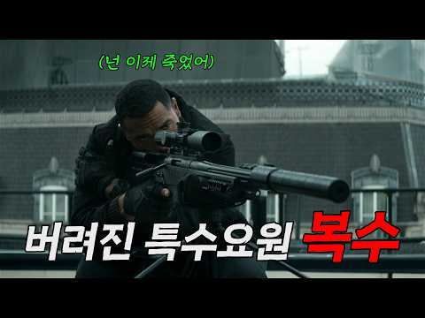
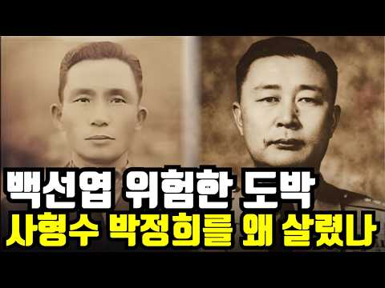
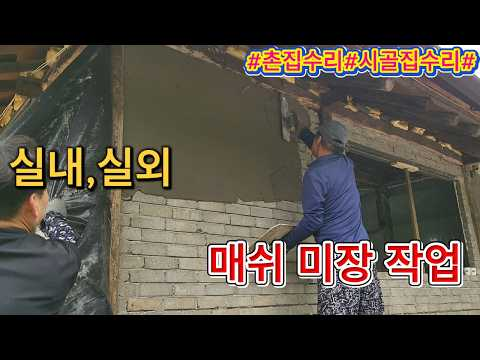
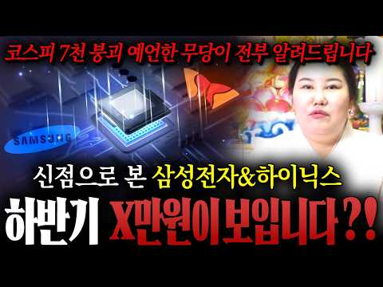
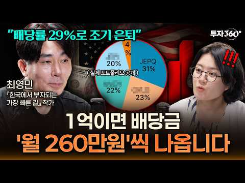

# 주식 — 성공 사례 분석: 사례별 자세히 #1–#40

`analysis.md` 의 9번 (같은 # 번호). 자동 생성 — `tools/success_analysis.py` v1.4.1 (2026-10-15 13:59 UTC). ※ 연구·교육용 — 투자 권유가 아님.

### 1. 아마존 영화 43개국 1위🔥 CIA 국장의 죽음으로 시작된 미친 첩보 액션 영화

- https://www.youtube.com/watch?v=HamGf6jGanE · 지리시네 · 구독자 270 · 조회수 121,208 (×448.9, 하루 2,623.1) · 좋아요 669 (0.5%) · 18.7분 · 2026-08-30 · 주제 묶음 1. 주식 기초·초보 · 형식 정보·해설 (그 밖) · 폴더 `W_HamGf6jGanE` (웹 승인)
- 썸네일: 
- 설명 앞부분: 🎬 영화 제목은 영상 상단 왼쪽에서 확인하실 수 있습니다. 해당 영화는 지금 바로 아마존 프라임 비디오에서 시청하실 수 있습니다. Please Subscribe! 📩 Business Contact
- 대본 (음성인식(앞 5분), 2.1 음절/초) — 앞부분만, 흐름은 그 안까지 첫 20초: “크라운이 거기있어. 모르겠어, 사장님.”
- 첫 1분: “크라운이 거기있어. 모르겠어, 사장님. 미안해, 나이조. 사라진 한 요원 숨 막히는 추격점 톰클렌시의 잭라이언 고스트워드 지리신에와 함께 지금 바로 시작합니다 3년 전 CIA를 떠나 회사원이 된 잭라이언 그에게 소상한 미행이 붙기 시작하는데 이 정도 미행은 잭라이언에게는 식은 죽먹기 인줄 알았는데 잡혀버렸죠 그를 찾아온 건 다름 아닌 CIA 부국장 그리어”
- 흐름 (90초마다 첫 문장): 0:04 크라운이 거기있어. → 1:33 그렇게 → 3:00 건명의 킬러 마저 크라운에게 살해당하고 사건은 그대로 미공속으로 빠져버… → 4:32 에마와 한 팀이 되어 영국으로 간책
- 댓글 9/9: 좋은 점 — 영상 2 · 감사·응원 0 · 더 알고 싶은 것 0 · 아쉬운 점 — 영상 1 · 반박·불만 — 의견 다름 0 · 정치·사회 0 · 경험 공유 0 · 구독·다음 기대 0
  - 좋은 점 — 영상 👍2 “귀에 잘들어오는 목소리. 굿..!! 굿독은 했음.”
  - 좋은 점 — 영상 👍2 “압축률이 꽤 과한 느낌이지만, 이보다 길었다면 좀 지루한 느낌도 들었겠네요. 이순시 장군 역을 맡았던 박해일 배우의 대사였죠. "의와 불의의 싸움". 의로움으로 불의함을 이겨내지 못한다면, 그 의로움 역시 불의의 길로 들어선 것이겠죠. 목적이 수단을 정당화 할 수 없…”
  - 아쉬운 점 — 영상 👍2 “압축률이 꽤 과한 느낌이지만, 이보다 길었다면 좀 지루한 느낌도 들었겠네요. 이순시 장군 역을 맡았던 박해일 배우의 대사였죠. "의와 불의의 싸움". 의로움으로 불의함을 이겨내지 못한다면, 그 의로움 역시 불의의 길로 들어선 것이겠죠. 목적이 수단을 정당화 할 수 없…”

### 2. 적자인데 300억? 가능한 이유 ∣ 회계사가 말아주는 리센느 소속사 더뮤즈엔터

- https://www.youtube.com/watch?v=kJx_AzV9w9c · 전지적회계사시점 · 구독자 864 · 조회수 316,778 (×366.6, 하루 7,616.8) · 좋아요 1,271 (0.4%) · 21.4분 · 2026-09-03 · 주제 묶음 6. 종목 고르기·분석 · 형식 브이로그·직접 해본 이야기 · 폴더 `W_kJx_AzV9w9c` (웹 승인)
- 썸네일: 
- 챕터: 0:00 오프닝 하이라이트 · 0:23 거제 야호로 시작된 리센느 이야기 · 1:13 숫자로 보는 더뮤즈: 8억에서 300억까지 · 2:20 리센느의 인기, 어느 정도일까 · 4:19 더뮤즈엔터테인먼트는 어떤 회사인가 · 6:06 중소 엔터사가 VC 투자를 받는 이유 · 8:11 모태펀드가 만든 중소돌의 기적 · 9:04 투자 히스토리: 5천만 원에서 시리즈A까지 · 11:44 멀티플로 계산해 본 비상장 기업가치 · 14:26 이익배수로 다시 본 300억의 조건 · 16:04 300억이 되려면 매출은 얼마나 필요할까 · 18:00 리센느 정산은 언제부터 가능할까 · 19:40 결론: 300억은 가능한 숫자인가
- 설명 앞부분: "거제야호로 시작된 리센느 열풍. 소속사 더뮤즈엔터의 가치는 얼마일까요?" 지금 대한민국에서 가장 핫한 걸그룹 리센느, 그리고 소속사 더뮤즈엔터테인먼트의 기업가치를 회계사의 시선으로 분석해봤습니다. 설립 밸류 8억에서 5년 만에 300억, 37.5배가 뛴 이 회사의 투자 히스토리를 따라가면서 비상장 기업의 가치평가가 실제로 어떻게 이루어지는지 알기 쉽게 풀어 드립니다. 그리고 25년말 56억 적자에 자본잠식이였던 리센느 소속사가 어떻게 300억의 가치를 인정 받을 수 있었는지, 중소 엔터사가 VC 투자를 받는 이유부터 아이돌 정산…
- 같은 채널 평소 대비 ×259.0 (채널 최근 롱폼 중앙값 1,223회) · 평소 영상: 결혼 못 해도 돈은 낸다 ∣ 매출 483억 찍은 ‘결혼해듀오’ (1,223회) / 위고비·마운자로 열풍, 헬스장 정말 안갈까?? ∣ 회계사가 분석한 비만치료제와 헬스 시장 (1,714회)
- 대본 (음성인식(앞 5분), 5.9 음절/초) — 앞부분만, 흐름은 그 안까지 첫 20초: “최근에 리셋는 더뮤즈웨어 엔터테인먼트가 몇백억을 같이 로투자를 받았다 이런 얘기가 많잖아요 그래서 이 회사의 가치가 지금 얼마일까 그리고 얼마까지 갈 수 있을까 작년 매출이 17억 8천만 원인데 영업 손실에 50.2천만 원이거든요 그리고 2025년 말에 자본을 보니까 마이너스 11억 5천만 원 데뷔 8년차에다가 포스닥 상장사가 880만 원이 있는데” — 도입부 유형: 질문으로 시작, 숫자로 시작
- 첫 1분: “최근에 리셋는 더뮤즈웨어 엔터테인먼트가 몇백억을 같이 로투자를 받았다 이런 얘기가 많잖아요 그래서 이 회사의 가치가 지금 얼마일까 그리고 얼마까지 갈 수 있을까 작년 매출이 17억 8천만 원인데 영업 손실에 50.2천만 원이거든요 그리고 2025년 말에 자본을 보니까 마이너스 11억 5천만 원 데뷔 8년차에다가 포스닥 상장사가 880만 원이 있는데 더뮤즈웨어 엔터가 300억 가치를 지냈다 회사님 거제 야구 아세요? 잘 알죠 요새 유튜브에 굉장히 핫하잖아요 저도 거제 야구가 뜨기 시작할 때 그때부터 리셋는 유튜브를 좀 많이 봤는데 굉장히 재밌더라고요 사실 제가 또 TMI긴 하지만 저희 어머니가 좀 외곽아 거제에 있거든요 유튜브에서 거제 영상을 보면서 약간 눈에 익은 그런 화면들이 많이 나오더라고요 유튜브도 알”
- 흐름 (90초마다 첫 문장): 0:00 최근에 리셋는 더뮤즈웨어 엔터테인먼트가 → 1:31 그러니까 이제 8억에서 300억 → 3:02 스탭에게 뭐 1분만 더 달라 → 4:31 그리고 이제 뭐 잘 아시는 것처럼
- 댓글 219/219: 좋은 점 — 영상 2 · 감사·응원 14 · 더 알고 싶은 것 0 · 아쉬운 점 — 영상 2 · 반박·불만 — 의견 다름 4 · 정치·사회 0 · 경험 공유 11 · 구독·다음 기대 2
  - 좋은 점 — 영상 👍10 “더뮤즈에 대해 궁금한 것을 많았는데... 좋은 정보 감사합니다.”
  - 좋은 점 — 영상 👍2 “겉으로 보여지는 아이돌 그룹의 그늘 혹은 화려함에 가리워진 이면에, 냉정한 생존법칙에서, 엔터테인먼트 기획사의 존폐 여부가 어떻게 가시적으로 수치화 돼서 추정되고 결정되는 지 일목요연하게 짚어주는 이런 컨셉 정말 유익합니다. 응원합니다!!!”
  - 감사·응원 👍344 “대중은 중소를 응원하지만 중소티가 나면 고개를 돌리는것 같습니다. 적자상황에서도 의상과 곡퀄리티를 유지한게 단순 응원하는 사람에서 팬덤으로 바뀌게 된 핵심이유같네요.”
  - 감사·응원 👍20 “리센느 팬이라 보고 갑니다 감사합니다”
  - 아쉬운 점 — 영상 👍1 “마이크가 있기는한데 뭔가 목소리 울리는 소리가 많이 들어가는게 조금 아쉽네요😂 재밌는 영상 잘 보고갑니다!”
  - 아쉬운 점 — 영상 👍1 “요약좀....”
  - 반박·불만 — 의견 다름 👍10 “아니 나 진짜 궁금했음; 왜 다들 정산이 힘들거라고 하는건지.. 어떤 분들은 매출이 180억이 나와도 정산이 힘들수있다는데 이해가 너무안감 누적적자 70억은 알겠는데 대형 기획사처럼 컴백할때 진짜 뭐 백몇십억씩 쏟아붓고 마케팅비용 포함해서 활동비로 수십억씩 쓰는 회사…”
  - 경험 공유 👍15 “내가 살다살다 아이돌덕질하다 회사 회계까지 보고있네”
  - 경험 공유 👍6 “올해 리센느가 3년차였네요. 진짜 다행입니다 ^^”
  - 구독·다음 기대 👍18 “리마인이면 리센느 소속사 더뮤즈 재무관리 영상도 챙겨 봐야한다는 사실😂”
  - 구독·다음 기대 👍0 “국내는 현제 말할것도 없고, 전세계적으로도 조금씩 알려지고 있으며 특히 일본에서 근래에 많은 유튜브 영상들이 퍼지고 있으며 팬층도 많이 늘어나고 있던데 조만간 일본 활동에 불씨가 붙으면 롱런 롱흑자 기대됩니다 무엇보다 리센느는 아이돌로서 다음 앨범이 아주 중요하기도 …”

### 3. 마이너스 주식 계좌 가장 쉽게 탈출하는 방법 물타기? 존버? 고민하지 않아도 되는 물린 종목 최대한 손실을 줄이며 정리하는 현명한 방법

- https://www.youtube.com/watch?v=v6rUCbULG2A · 머니스트랩 · 구독자 537 · 조회수 95,716 (×178.2, 하루 1,787.7) · 좋아요 1,115 (1.2%) · 30.5분 · 2026-08-23 · 주제 묶음 8. 투자 심리·실패 · 형식 정보·해설 (그 밖) · 폴더 `W_v6rUCbULG2A` (웹 승인)
- 썸네일: 
- 설명 앞부분: 지수는 사상 최고를 찍었는데 왜 내 계좌만 파란색일까요. 개인 투자자 240만 명의 계좌를 열어본 자료에서 출발해, 물린 종목을 손실을 줄이며 정리하고 제대로 된 자리로 옮기는 순서를 정리했습니다. 이 영상에서 다루는 내용
- 같은 채널 평소 대비 ×147.5 (채널 최근 롱폼 중앙값 649회) · 평소 영상: 28년째 핫도그세트가 2,000원, 코스트코가 진짜 돈 버는 방법 "핫도그로는 안 남깁니… (649회) / "1억 모으는데 12년 4개월" 실수령 200만원이 1억 모으는 시간을 5년 당기는 5가… (576회)
- 대본 (음성인식(앞 5분), 4.9 음절/초) — 앞부분만, 흐름은 그 안까지 첫 20초: “물려 있다는 사실을 잊고 계셨다면 그나마 나은 쪽입니다. 진짜 문제는 매일 확인하면서도 아무것도 못하는 경우입니다. 아마 셋 중 하나일 겁니다. 계좌에 있는 줄도 모르고 몇 년을 지나친 종목. 매일 열어보지만 몇 년째 빠져나오지 못한 종목. 그리고 지금 팔면 정말 끝이라 참아 손을 못 떼는 종목.”
- 첫 1분: “물려 있다는 사실을 잊고 계셨다면 그나마 나은 쪽입니다. 진짜 문제는 매일 확인하면서도 아무것도 못하는 경우입니다. 아마 셋 중 하나일 겁니다. 계좌에 있는 줄도 모르고 몇 년을 지나친 종목. 매일 열어보지만 몇 년째 빠져나오지 못한 종목. 그리고 지금 팔면 정말 끝이라 참아 손을 못 떼는 종목. 마지막에 해당하신다면 오늘은 끝까지 보셔야 합니다. 그 결정을 미루는 동안 여러분 계좌에서 무엇이 사라지고 있는지 숫자로 보여드리겠습니다. 2025년 10월 31이었습니다. 그날 아침 뉴스의 첫 곡지는 코스피가 사상 최고치를 갈아치웠다는 소식이었죠. 빨간 숫자로 가득 찬 전광판 화면이 하루 종일 흘러 나왔고 증권 방송에서는 축포 같은 표현들이 오갔습니다. 바로 그날 한 대형증권사가 자사 고객의 계좌를 통째로 들여다”
- 흐름 (90초마다 첫 문장): 0:00 물려 있다는 사실을 잊고 계셨다면 그나마 나은 쪽입니다. → 1:35 물론 모두가 같은 크기로 물려 있는 건 아닙니다. → 3:00 우리는 보통 이 둘을 하나로 놓고 생각합니다. → 4:31 16번 통째로 갈아옵는다는 뜻이죠.
- 댓글 38/38: 좋은 점 — 영상 2 · 감사·응원 4 · 더 알고 싶은 것 1 · 아쉬운 점 — 영상 0 · 반박·불만 — 의견 다름 0 · 정치·사회 2 · 경험 공유 1 · 구독·다음 기대 0
  - 좋은 점 — 영상 👍16 “많은 도움이 됬습니다 로봇주애 _47% 물려있는데 하락장애서 매도 찬스를 놓쳐서 ㅠㅠ 처음엔 물타기 하다가 그때마다 하락해서 더 나락.ㅠㅠ 지근은 포기하고 분할매도 하고 반 남았는데 나머지도 분할매도 할 예정입니다”
  - 좋은 점 — 영상 👍1 “좋은 강의입니다.👍👍👍”
  - 감사·응원 👍8 “감사합니다..........”
  - 감사·응원 👍6 “카카오 안산다 ㅋ 감사 합니다”
  - 더 알고 싶은 것 👍0 “그럼 오른건 언제파나요?”
  - 정치·사회 👍5 “이재명 대통령님 응원합니다.”
  - 정치·사회 👍0 “웃기지마라 개미들 구십프로가 아작이났는데 뭐가 오십 팔프로라고 개소리 그만해 이번주식시장은 정부가 외국펀드투자판을 깔아준것인데 무슨 개소리 개미가 아무리 잘한다해도 거대한 자본으로 죠지는데 무슨 뾰쪽한수가 있나 솔직히 말해서 지금은 개미들 돈이 없어서 주식시장에 가고…”
  - 경험 공유 👍3 “내가 ㅅㅂ 이걸 28분을 들었어 아 진짜 내시간 금같은 내시간 이 목소리 절대듣지말자 늘 그랬건만 ㅅㅂ 아ㅅㅂ 진짜 내시간”

### 4. [풀영상] 월급 10%로 당장 시작하는 존리의 자산 증식 치트키

- https://www.youtube.com/watch?v=q1fYjAwma3s · 여의돈스트리트 · 구독자 1,340 · 조회수 207,016 (×154.5, 하루 7,493.9) · 좋아요 1,274 (0.6%) · 36분 · 2026-09-17 · 주제 묶음 1. 주식 기초·초보 · 형식 인터뷰·강연·대담 · 폴더 `W_q1fYjAwma3s` (웹 승인)
- 썸네일: 
- 챕터: 0:00 인트로 · 0:50 ‘존리의 부자학교’, 어떤 곳인가요? · 1:09 우리나라 금융 수준, 정말 높아졌나요? · 2:39 빨리 부자가 되는 투자, 가능한가요? · 4:53 장기 투자, 어떤 ETF를 사야 할까요? · 6:53 평범한 사람은 어떻게 부자가 되나요? · 8:30 주식 투자에 전문가가 없다? · 10:24 레버리지 투자는 왜 위험한가요? · 11:31 한국주식, 지금도 투자할 만한가요? · 12:16 투자 뉴스는 어디까지 봐야 할까요? · 14:44 부동산 비중이 높으면 위험한가요? · 16:45 주식 투자의 진짜 목적은 무엇인가요? · 17:26 좋은 기업은 어떻게 고르나요? · 20:19 장기 투자 중 기업 상황이 나빠진다면? · 21:09 박스권에 갇힌 현재 증시 진단 · 22:23 AI 버블 우려 속 올바른 매수 시기 · 23:30 안전해 보이는 ‘원금 보장’ 상품의 함정 · 25:01 반도체·대형주 쏠림 계좌, 포트폴리오 개선 조언 · 27:15 시황 뉴스·차트·리포트의 올바른 활용법 · 29:35 직장인 월급 대비 적정 투자 비중 및 방법
- 설명 앞부분: 매일 오르내리는 주가, 금리 인상 뉴스... 언제 사고 언제 팔아야 할지 늘 스트레스받고 계시나요? 혹은 원금 손실이 두려워 아직도 투자를 망설이고 계신가요? 이번 풀영상에서는 '존리의 부자학교' 존리 대표님을 모시고 평범한 사람이 스트레스 없이 진짜 부자가 되는 투자의 본질부터 구체적인 실천 방법까지 모두 담았습니다. 단기간에 부자가 되려는 조급함과 마켓 타이밍을 재는 습관을 버리고, 내 자본이 스스로 일하게 만드는 진짜 투자법을 짚어봅니다. 또한, 인플레이션 시대에 돈을 예적금에만 두는 것이 왜 자산 가치를 갉아먹는 가장 위험…
- 같은 채널 평소 대비 ×228.0 (채널 최근 롱폼 중앙값 908회) · 평소 영상: 중간선거 앞둔 미 증시, 과거 100년 통계가 말해주는 반등 시그널? (908회) / 리딩방에서 추천받은 종목이 올랐다면? 이미 당신은 ‘먹잇감’입니다 [선생님 이건 건강한 … (1,121회)
- 대본 (음성인식(앞 5분), 6.0 음절/초) — 앞부분만, 흐름은 그 안까지 첫 20초: “좀 빠르게 내가 부자가 되고 싶다. 시간이 지날수록 나는 그 위스크로 줄어들고 시작한 지 지날수록 나는 부관들어나거든요. 또는 일을 안 하고 이불 속에서 안 나오는 거예요. 예금. 지금 만약에 1,000만 원이 20년 후에는 1,000만 원 아니라 한 300만 원으로 줄어들어있는 거예요. 90%의 정보는 필요 없는 정보예요. 정보가 하나도 중요하지 않죠.”
- 첫 1분: “좀 빠르게 내가 부자가 되고 싶다. 시간이 지날수록 나는 그 위스크로 줄어들고 시작한 지 지날수록 나는 부관들어나거든요. 또는 일을 안 하고 이불 속에서 안 나오는 거예요. 예금. 지금 만약에 1,000만 원이 20년 후에는 1,000만 원 아니라 한 300만 원으로 줄어들어있는 거예요. 90%의 정보는 필요 없는 정보예요. 정보가 하나도 중요하지 않죠. 충분해요. 두 개만 갖고도. 두 개만 갖고도 충분하다. 반응하는 많이 해라. 어떻게 젊으신 분들은. 안녕하세요. 여의돈스트리트 이광수입니다. 우리는 도대체 어떻게 투자해야 부자가 될 수 있을까요? 스트레스 받지 않고 투자하려면 또 어떻게 해야 될까요? 다녁컨대 이에 대한 해답을 알고 계시는 분. 어렵게 이 자리에 모셨습니다. 졸리의 부자학교의 졸리 대표님”
- 흐름 (90초마다 첫 문장): 0:00 좀 빠르게 내가 부자가 되고 싶다. → 1:31 실제로 대표님께서 현장에서 보시면 → 3:01 그렇게 해서 좀 빠르게 → 4:30 너무 힘듭니다 대표님.
- 댓글 113/113: 좋은 점 — 영상 3 · 감사·응원 14 · 더 알고 싶은 것 2 · 아쉬운 점 — 영상 0 · 반박·불만 — 의견 다름 4 · 정치·사회 1 · 경험 공유 13 · 구독·다음 기대 0
  - 좋은 점 — 영상 👍4 “이분하고 궁합이 잘맞음 참 좋은말씀”
  - 감사·응원 👍25 “존리 선생님 덕분에 3년전부터 노후준비를, 장기투자를 목표로 삼게 되었습니다. 좋은 투자철학을 가르쳐주셔서 감사합니다❤”
  - 감사·응원 👍19 “존리대표님 덕분에 투자를 시작했습니다 감사드립니다”
  - 더 알고 싶은 것 👍0 “에스엔피 500이 미장인지 국장인지 어떤걸해야하나요?”
  - 반박·불만 — 의견 다름 👍4 “이게 말이 쉽지 2002년 닷컴 버블 경험하고 이제 회복되나 싶었더니 2008년 금융위기 오고 투자 14년 차인데 투입원금보다도 계좌에 쌓인 돈이 없고 그러면 진짜 현타옵니다. 복리의 힘이라는게 말이 쉽지 일정금액 이상이 쌓이지 않으면 기별도 안 오고, 녹아내리는 계…”
  - 반박·불만 — 의견 다름 👍0 “개인적으로 무조건적이고 비판없는 의견을 따르실 필요는 없습니다. 모든 투자는 개인의 책임이니 신중하게 생각해보고 투자하시길 바랍니다. 그렇다고 존 리님이 무조건 좋다 나쁘다 이렇게 생각하는 게아니라 본인에게 맞는 투자를 하시라는 말씀 꼭 드리고 싶습니다. 장기투자라고…”
  - 정치·사회 👍0 “박정희 대통령이 나라의 문맹을 퇴지했는데 존리대표님은 금융문맹을 퇴치하러 열일 하신다”
  - 경험 공유 👍24 “연금저축+isa ETF 5년차 적립중인데 희망이 생겨서 든든합니다😊 더 빨리 깨우쳤어야 했는데 ㅠㅠ”
  - 경험 공유 👍4 “이게 말이 쉽지 2002년 닷컴 버블 경험하고 이제 회복되나 싶었더니 2008년 금융위기 오고 투자 14년 차인데 투입원금보다도 계좌에 쌓인 돈이 없고 그러면 진짜 현타옵니다. 복리의 힘이라는게 말이 쉽지 일정금액 이상이 쌓이지 않으면 기별도 안 오고, 녹아내리는 계…”

### 5. 단타 5년차가 알려준 ＂잃지 않는 법＂ 딱 3가지 ｜ 코스피 9000시대 생존법

- https://www.youtube.com/watch?v=WnuVkKRjcuI · 돈의흐름도 · 구독자 1,380 · 조회수 153,207 (×111.0, 하루 2,282.4) · 좋아요 2,650 (1.7%) · 13.5분 · 2026-08-09 · 주제 묶음 5. 국내주식 · 형식 정보·해설 (그 밖) · 폴더 `W_WnuVkKRjcuI` (웹 승인)
- 썸네일: 
- 설명 앞부분: 단타 5년차가 알려준 ＂잃지 않는 법＂ 딱 3가지 ｜ 코스피 9000시대 생존법 경제를 제대로, 그리고 쉽게. 🏴‍☠ 이 채널에서 다루는 것들 주식·ETF·배당주 투자 분석 환율·금리·인플레이션 경제 해설 미국·한국 증시 및 글로벌 시장 동향 부동산·원자재·달러 등 자산 시장 분석 재테크 초보를 위한 경제 상식 어렵고 딱딱하게만 느껴지던 경제 뉴스, 경제해적단과 함께라면 달라집니다. 복잡한 시장의 흐름을 단순하고 명확하게 짚어드립니다. 월급쟁이도, 사회초년생도, 재테크를 막 시작한 분도 경제해적단과 함께라면 경제가 보이기 시작합니…
- 같은 채널 평소 대비 ×9,285.3 (채널 최근 롱폼 중앙값 16회) · 평소 영상: 50세 매달 200만원, 2가지만 알면 70세에 10억 만들어집니다 (17회) / ＂50대 노후 3억, 매달 100만원 만드는 법 (연금·복리·종잣돈)＂ (17회)
- 대본 (음성인식(앞 5분), 5.5 음절/초) — 앞부분만, 흐름은 그 안까지 첫 20초: “제가 아는 동생 중에 단타로 5년째 먹고 사는 친구가 있어요 전업으로요? 처음엔 저도 안 믿었어요 다들 망한다는 단타로 어떻게 5년을 버티냐고요 근데 옆에서 매매하는 걸 보고 깜짝 놀랐어요 종목을 신들린 듯 고를 줄 알았는데 의외로 사곱하는 건 되게 단순하더라고요 대신 딱 하나 남들이 절대 안 지키는 걸 기계처럼 지키고 있었어요” — 도입부 유형: 질문으로 시작, 숫자로 시작, 내 이야기·사연
- 첫 1분: “제가 아는 동생 중에 단타로 5년째 먹고 사는 친구가 있어요 전업으로요? 처음엔 저도 안 믿었어요 다들 망한다는 단타로 어떻게 5년을 버티냐고요 근데 옆에서 매매하는 걸 보고 깜짝 놀랐어요 종목을 신들린 듯 고를 줄 알았는데 의외로 사곱하는 건 되게 단순하더라고요 대신 딱 하나 남들이 절대 안 지키는 걸 기계처럼 지키고 있었어요 그게 뭐냐고 물어봤죠 그 친구가 한 말이 잊지 않아요 형 단타는 잘 사는 기술이 아니라 잘 버티는 기술이에요 차트 공부 100날 해봐야 소용 없다는 거예요 오늘 그 동생이 5년 동안 지켜온 그 한 가지를 여러분한테 그대로 풀어드릴게요 그리고 100만 원으로 그걸 어떻게 몸에 익히는지까지요 이거 하나만 가져가셔도 오늘 영상 값은 하실 거예요 끝까지 보세요 좋아요, 구독, 알림 설정 꼭”
- 흐름 (90초마다 첫 문장): 0:00 제가 아는 동생 중에 단타로 5년째 먹고 사는 친구가 있어요 → 1:31 이런 장을 보면 무슨 생각이 들까요? → 3:02 수익률은 오히려 더 낮았어요 → 4:31 근데 손실이 난 종목은 22%만 팔아요
- 댓글 96/96: 좋은 점 — 영상 3 · 감사·응원 2 · 더 알고 싶은 것 3 · 아쉬운 점 — 영상 4 · 반박·불만 — 의견 다름 3 · 정치·사회 0 · 경험 공유 7 · 구독·다음 기대 1
  - 좋은 점 — 영상 👍6 “너무 꼭 맞는 말씀입니다. 100원만 수익을 본다하더라도 100만원 1000만원 욕심을 버리기까지...다겪어봐야 조금 느끼게 되더라구요..”
  - 좋은 점 — 영상 👍2 “도움이 많이 됐습니다.참고하도록할께요.잠시 잊고 단타를 해서 손절 많이 했는데 이영상보고 뜨끔했네요.좋은영상 감사합니다”
  - 감사·응원 👍2 “도움이 많이 됐습니다.참고하도록할께요.잠시 잊고 단타를 해서 손절 많이 했는데 이영상보고 뜨끔했네요.좋은영상 감사합니다”
  - 더 알고 싶은 것 👍1 “구독, 좋아요,,,알림설정. 알려주세요.”
  - 아쉬운 점 — 영상 👍4 “단타 30년차로 잃지 않는 방법을 알려준다면 당장 주식을 접어라 그게 유일한 방법이다 그래도 주식을 하고 싶다면 종목을 보고 매매 하지말고 시장을 보고 매매해라 시장이 아니라고 하는데 시장을 이길라고 덤비면 백퍼 망한다 종목 차트 백날 선으로 찍찍 그어봐야 시장폭락하…”
  - 아쉬운 점 — 영상 👍2 “에이라.. 뻔한 이야기 가지고.. 뭐 특별한 비법이 있는 거 마냥...”
  - 반박·불만 — 의견 다름 👍5 “챠트 보는 법도 아니라 하고, 보조지표 보는 것도 아니라 하고, 종목 찍는 법도 아니라하는 건 제대로 공부를 안 했거나, 남들 말과 책에 쓰인 대로 맹신하며 투자하기 때문임. 제대로 알면 확률은 엄청난데 어설피 배우고 익힌 실력으로 하다가 매번 실패하는 경우가 많게 …”
  - 반박·불만 — 의견 다름 👍0 “영상 좋아요. 그런데 영상 후반부에 내가 이런 걸 지킬 자신이 있는가라고 자문해보라고 하시는데, 이런건 머리로 상상으로 자문한다고 알 수 있는 건 아니죠. 결국 몸으로 경험해봐야 내가 될놈인지 안될놈인지 체득할 수 있죠.”
  - 경험 공유 👍17 “많은 시련을 겪고 나서야만이 이 영상의 의미가 얾마나 중요한지를 깨닫게 되지요.”
  - 경험 공유 👍14 “단타는 잃지 않는게 중요.. 내가 정한 매도 포인트에서 기계적으로 매도해야함. 욕심내는 순간 지옥으로 떨어짐.”
  - 구독·다음 기대 👍1 “구독, 좋아요,,,알림설정. 알려주세요.”

### 6. 같은 TQQQ에 1억, 한 사람은 2만 원 한 사람은 388억 (실제 데이터)

- https://www.youtube.com/watch?v=d2_oRUcx5Uo · 머니언박싱 · 구독자 2,190 · 조회수 188,786 (×86.2, 하루 10,717.4) · 좋아요 859 (0.5%) · 8.1분 · 2026-09-27 · 주제 묶음 2. 장기투자·ETF·지수 · 형식 정보·해설 (그 밖) · 폴더 `W_d2_oRUcx5Uo` (웹 승인)
- 썸네일: 
- 챕터: 0:00 두 개의 계좌 · 0:24 3배 레버리지는 어떻게 움직이나 · 0:54 박 부장, 2000년 3월 꼭대기에서 1억 · 1:20 1년 만에 496만 원 · 1:42 2만 원까지 · 2:06 지수는 돌아왔는데 · 2:35 26년 뒤 박 부장 · 2:56 만약 2009년 바닥에서 샀다면 · 3:42 이 대리, TQQQ 상장일에 1억 · 4:00 16년 뒤, 그러나 · 4:25 만약 2021년 11월에 들어갔다면 · 5:05 최 사원, 매달 50만 원 · 5:32 94억에서 20억으로 · 5:56 만약 2022년에 팔았다면 · 6:29 결과 공개 · 6:56 이 결과를 믿기 전에 · 7:24 레버리지를 산다면
- 설명 앞부분: 같은 TQQQ, 같은 1억 원. 한 사람은 계좌가 한때 2만 원이 됐고, 다른 사람은 지금 388억 원입니다. 무엇이 두 사람을 갈랐을까요? 그리고 같은 상품을 매달 조금씩 산 사람은 어떻게 됐을까요? 박 부장: 2000년 3월 27일, 나스닥100 꼭대기에 1억 원을 3배 레버리지로 이 대리: 2010년 2월 11일, TQQQ 상장일에 1억 원 최 사원: 2000년 4월부터 매달 50만 원씩 3배 레버리지 (세 사람은 가상 인물이고, 숫자는 전부 실제 데이터로 계산했습니다) 계산 조건 2010년 2월 이전 3배·2배는 실제 상품…
- 같은 채널 평소 대비 ×50.7 (채널 최근 롱폼 중앙값 3,726회) · 평소 영상: JEPI vs SCHD: 10년 뒤 누가 더 부자가 될까? (3,986회) / 1억 모으기: 지금 당장 시작해야 하는 이유 l 복리의 마법 (3,465회)
- 대본 (음성인식(앞 5분), 4.9 음절/초) — 앞부분만, 흐름은 그 안까지 첫 20초: “여기 두 개의 계좌가 있습니다. 둘 다 1억원으로 시작했고 둘 다 같은 상품을 샀습니다. 나스딱백을 매일 세 배로 따라가는 레버리지 tqq입니다. 그런데 한 계좌는 한때 2만원이 됐고 다른 계좌는 지금 388억원입니다. 무엇이 이 둘을 갈랐을까요? 그리고 같은 상품을 매달 조금씩 산 사람은 어떻게 됐을까요? 오늘은 세 사람의 레버리지 계좌를 실제 데이터로 끝까지 따라가 보겠습니다.”
- 첫 1분: “여기 두 개의 계좌가 있습니다. 둘 다 1억원으로 시작했고 둘 다 같은 상품을 샀습니다. 나스딱백을 매일 세 배로 따라가는 레버리지 tqq입니다. 그런데 한 계좌는 한때 2만원이 됐고 다른 계좌는 지금 388억원입니다. 무엇이 이 둘을 갈랐을까요? 그리고 같은 상품을 매달 조금씩 산 사람은 어떻게 됐을까요? 오늘은 세 사람의 레버리지 계좌를 실제 데이터로 끝까지 따라가 보겠습니다. tqq는 나스딱백 지수가 하루에 1% 오르면 3% 1% 내리면 3% 움직이도록 만든 상품입니다. 중요한 건 매일이라는 말입니다. 1년에 3배가 아니라 매일 3배를 다시 맞춥니다. 그리고 3배를 만들기 위해 빌린 돈의 이자와 운영 보수가 매일 조금씩 빠져나갑니다. tqq는 2010년에 처음 나왔기 때문에 그 이전은 나스딱백의 실제”
- 흐름 (90초마다 첫 문장): 0:00 여기 두 개의 계좌가 있습니다. 둘 다 1억원으로 시작했고 둘 다 같은… → 1:34 2002년 10월 3배 계자에는 84000원이 남아 있었습니다. 1억 … → 3:04 새로 1억 원을 3배 레버리지에 넣었다고 해보겠습니다. 지금 이 계자는… → 4:35 이번에도 실제 기록입니다. 1년 뒤 2022년 12월 계자는 81.7%…
- 댓글 144/144: 좋은 점 — 영상 7 · 감사·응원 7 · 더 알고 싶은 것 8 · 아쉬운 점 — 영상 1 · 반박·불만 — 의견 다름 3 · 정치·사회 0 · 경험 공유 10 · 구독·다음 기대 1
  - 좋은 점 — 영상 👍8 “너무 좋은 영상 감사합니다 보고 먾이 배웠습니다. 사람들은 단순히 세배의 장점만 보는데 박부장의 케이스는 너무 무섭네요 관점을 바꾸는 좋은 계기가 되었습니다 감사합니다!”
  - 좋은 점 — 영상 👍8 “진짜 좋은 영상이네요 👍”
  - 감사·응원 👍8 “너무 좋은 영상 감사합니다 보고 먾이 배웠습니다. 사람들은 단순히 세배의 장점만 보는데 박부장의 케이스는 너무 무섭네요 관점을 바꾸는 좋은 계기가 되었습니다 감사합니다!”
  - 감사·응원 👍3 “궁금한 게 있습니다! 적립식이 중요하다는 건 알겠는데 Tqqq를 투자하면 결국 적립식으로 해도 초반은 방어가 되지만 장기투자하고 후반에 금액이 커진 상황에 대폭락이 오면 qqq보다 훨씬 낮아질 확률이 꽤 있지 않나요? TQQQ 관련 내용 책이나 좋은 자료 혹시 있다면…”
  - 더 알고 싶은 것 👍3 “Soxl도 궁금합니다😮”
  - 더 알고 싶은 것 👍3 “궁금한 게 있습니다! 적립식이 중요하다는 건 알겠는데 Tqqq를 투자하면 결국 적립식으로 해도 초반은 방어가 되지만 장기투자하고 후반에 금액이 커진 상황에 대폭락이 오면 qqq보다 훨씬 낮아질 확률이 꽤 있지 않나요? TQQQ 관련 내용 책이나 좋은 자료 혹시 있다면…”
  - 아쉬운 점 — 영상 👍0 “정말 무서운 건 지난 20년이 나스닥 역사상 가장 전성기였다는 사실. 닷컴버블도 아무리 길게 잡아도 3년. 10년 횡보장이었다면 QQQ 투자자는 우울한 정도지만, 폭락 후 버티는 QLD, TQQQ 투자자는 인생 망하는 케이스. 역사는 반복된다?? 아닙니다. 그 시대를…”
  - 반박·불만 — 의견 다름 👍6 “이미 흐름을 알고있는 과거시기를 극적으로 발취하여,,,,,감동적인효과는 알겠는데,,,, 솔직히 현실적투자환경속 투자자라면 실현가능한 일은 아니죠.의지력을 키우라는 교훈성”
  - 반박·불만 — 의견 다름 👍0 “정말 무서운 건 지난 20년이 나스닥 역사상 가장 전성기였다는 사실. 닷컴버블도 아무리 길게 잡아도 3년. 10년 횡보장이었다면 QQQ 투자자는 우울한 정도지만, 폭락 후 버티는 QLD, TQQQ 투자자는 인생 망하는 케이스. 역사는 반복된다?? 아닙니다. 그 시대를…”
  - 경험 공유 👍8 “매달 초마다 200만원 환전해서 TQQQ 매수합니다. 환율/주가 생각 안하고 삽니다 파는건 일년에 250만원만 하고 있습니다. 이제 1년차이고 앞으로 9년 남았네요 😊”
  - 경험 공유 👍6 “무서워서 그냥 연저펀 타이거 s&p500, isa 코덱스 나스닥100 두가지만 3년차 풀매수중입니다 😊”
  - 구독·다음 기대 👍4 “영상보고 바로 구독했습니다”

### 7. 50대 옥탑방 부부, "그 나이에 왜 주식을..."

- https://www.youtube.com/watch?v=FRzyTNO9mNI · 반백살, 옥탑방 이야기 · 구독자 597 · 조회수 42,448 (×71.1, 하루 3,513.1) · 좋아요 416 (1.0%) · 6.3분 · 2026-10-03 · 주제 묶음 1. 주식 기초·초보 · 형식 정보·해설 (그 밖) · 폴더 `W_FRzyTNO9mNI` (웹 승인)
- 썸네일: 
- 설명 앞부분: 지난 영상 이후, 50대 옥탑방 부부인 저희의 주식 도전에 많은 분들이 걱정과 조언을 남겨주셨습니다. 진심으로 감사드립니다. "그 나이에 왜 위험하게 주식을 하느냐"는 물음에 오늘 제 진솔한 속마음을 전합니다. 사기와 빚을 겪으며 깨달은 금융 무지의 서러움, 그리고 평생 일할 수 없다는 현실 앞에 저희에게 파이어족은 노후를 위한 '마지막 생존 전략"입니다. 지치지 않고 끝까지 걸어갈 수 있도록 많은 응원과 격려 부탁드립니다. 오늘도 시청해 주셔서 감사합니다.
- 같은 채널 평소 대비 ×13.2 (채널 최근 롱폼 중앙값 3,211회) · 평소 영상: 8월 폭염 속, 침침해진 눈으로 배달을 나섭니다. (3,333회) / "여보 제발 나가지 마!" 돈 없는데 비 온다고 일 안 못나가는 이유 (3,089회)
- 대본 (음성인식(앞 5분), 4.2 음절/초) — 앞부분만, 흐름은 그 안까지 첫 20초: “안녕하세요 구독자 여러분 50대 옥탑방 아내입니다. 어느 덧 바람 끝이 제법 선선해진 가을이 왔네요. 하늘도 높아지고 날씨가 참 좋습니다. 우리 구독자분들도 오늘 하루 기분 좋게 잘 보내고 계신가요? 옥탑방에서 바라보는 하늘은 계절이 바뀔 때마다 괜히 마음을 몽글몽글하게 만드는 것 같아요.” — 도입부 유형: 숫자로 시작, 시청자 부르기
- 첫 1분: “안녕하세요 구독자 여러분 50대 옥탑방 아내입니다. 어느 덧 바람 끝이 제법 선선해진 가을이 왔네요. 하늘도 높아지고 날씨가 참 좋습니다. 우리 구독자분들도 오늘 하루 기분 좋게 잘 보내고 계신가요? 옥탑방에서 바라보는 하늘은 계절이 바뀔 때마다 괜히 마음을 몽글몽글하게 만드는 것 같아요. 오늘 이렇게 영상을 제작하는 것은 지난 영상 이후에 정말 많은 분들이 남겨주신 댓글에 마음 깊이 감사하다는 말씀을 전하고 싶어서 입니다. 제가 주식공부에 보겠다고 말씀드린 이후로 걱정 어린 마음으로 따뜻한 조언과 충고를 남겨주신 분들이 정말 많았어요. 주식은 위험하다 잘못하면 큰일 난다 하며 자기 일처럼 걱정해주시는 마음 하나하나 읽으면서 얼마나 감사했는지 모릅니다.”
- 흐름 (90초마다 첫 문장): 0:00 안녕하세요 구독자 여러분 50대 옥탑방 아내입니다. → 1:36 나이가 한 살 한 살 들수록 느끼는 게 있어요. → 3:06 그 분야에 제대로 뛰어들려면 정말 피나는 공부와 노력이 필요하다는 것을… → 4:36 지금은 남편과 제가 노동소득으로 벌고 있지만 저라도 자본소득을 공부하고…
- 댓글 187/187: 좋은 점 — 영상 6 · 감사·응원 27 · 더 알고 싶은 것 3 · 아쉬운 점 — 영상 1 · 반박·불만 — 의견 다름 3 · 정치·사회 2 · 경험 공유 20 · 구독·다음 기대 0
  - 좋은 점 — 영상 👍10 “목소리가 좋으시네요 편안하고 듣기에 좋아요 비슷한 나이인데 주식을 해 보고 있어요 손절하여서 손해도 보았지만 그러면서 배우고 있어요 같은 생각으로 하며 접근하고 있어요 성투하시길 바래요🎉”
  - 좋은 점 — 영상 👍4 “목소리가 차분하고 편안해서 듣기 좋습니다~~ 힘내시고 파이팅 하세요~~”
  - 감사·응원 👍17 “목소리 좋으시네요 아무것도 안하면 아무것도 될 수 없을 껍니다 화이팅 하시길요”
  - 감사·응원 👍16 “저도 주식하면 패가 망신한다는 부모님 말씀을 금과옥조로 여기며 살다가, 50세가 넘은 나이에, 금기의 영역으로 생각했던 주식을 시작했어요. 개별주는 하나도 안하고, 미국지수, 국내지수만 투자하는데...진작 시작할걸 싶네요. 3년전부터 했는데 5년전, 10년전 시작할걸…”
  - 더 알고 싶은 것 👍2 “영상 자주 올려주세요❤ 주식공부도 열심히 하시고 화이팅입니다 ❤”
  - 더 알고 싶은 것 👍2 “뭐하나 물어볼게요..주식하셔서 얼마나 버셔서 만족 하실가요? 그냥 전 풍차돌리기 예금이나 적금 추천드리고...인생 한방 절대 없습니다. 소수의 행운이 나에게 올 확률이 정말 힘들다는거 다시 한번 이 나이에 잊지 마시길 부탁드립니다.”
  - 아쉬운 점 — 영상 👍1 “위 제목 아래에 AI라고 써있는데요 목소리는 ai같지않고 영상도 ai같지않은데..어느것이 Ai 인가요?”
  - 반박·불만 — 의견 다름 👍2 “하지마시고 한국 미국 반반 지수 장기투자하세요. 몇달한다고 되는게 아닙니다.”
  - 반박·불만 — 의견 다름 👍0 “안녕하세요 52인데요^^ 너무 공감합니다. ISA계좌 연금저축계좌 먼저만드세여 ISA계좌는 한해2천만원해서5년1억가능합니다.연금계좌는 1800까지가능합니다. 우리가족모두 만들어서 하고있네여. 종목추천은아닙니다 제가하는겁니다. ISA계좌에서 하시면 배당세금없이 재투자 …”
  - 정치·사회 👍1 “대통령이 하라해서 ㅡㅡㅡㅡ. 돈번것들은 재용 태원이ㅡㅡㅡㅡ”
  - 정치·사회 👍0 “제 경험을 말씀드려 볼게요. 현재 54살 노총각입니다. 24년 하반기부터 10년 이상 다니던 직장이 경기가 안좋아지면서 해고 위기가 느껴졌습니다. 당시까지 모아둔 돈이라곤 현금 3억 조금 넘게 가지고 있었고 집은 월세 45만원 오피스텔에 살고 있었죠. 당장 짤리면 4…”
  - 경험 공유 👍26 “목소리가 참 좋으시네요😊 저도 50대 중반이고 주식으로 노후자금 준비를 하고있어요 이제는 근로소득만 가지고 자산을 늘리는 시대는 끝났다고 봅니다 부동산은 목돈이 들어가니 서민들은 주식이 접근하기 쉽죠 저도 처음에 주식.금융공부 많이 하고 시작했는데요, 결국 공부보다 …”
  - 경험 공유 👍16 “저도 주식하면 패가 망신한다는 부모님 말씀을 금과옥조로 여기며 살다가, 50세가 넘은 나이에, 금기의 영역으로 생각했던 주식을 시작했어요. 개별주는 하나도 안하고, 미국지수, 국내지수만 투자하는데...진작 시작할걸 싶네요. 3년전부터 했는데 5년전, 10년전 시작할걸…”

### 8. 레버리지 ETF 상장폐지 논란🔥도박판 코스피 알고도 레버리지 ETF 상폐 못하는 이유🔥위험 알고도 도장 찍은 사람🔥금리인상 악제🔥역대급 반도체 실적 국민돈증발🔥…

- https://www.youtube.com/watch?v=O4-jY0zyhDo · 리얼경제 · 구독자 1,340 · 조회수 93,654 (×69.9, 하루 1,038.6) · 좋아요 2,368 (2.5%) · 15분 · 2026-07-17 · 주제 묶음 9. 빚투·레버리지 · 형식 정보·해설 (그 밖) · 폴더 `W_O4-jY0zyhDo` (웹 승인)
- 썸네일: 
- 챕터: 0:00 인트로 — 89조 잔치인데 국민 돈은 증발 · 0:44 검은 월요일 — 올해만 서킷브레이커 7번 · 2:01 범인의 등장 — 5월 27일 상장된 그 '상품' · 3:35 세 개의 함정 — 왜 도박판이 됐나 · 7:07 대(大)아이러니 — 실적 최대인데 주가 최대 폭락, … · 9:44 앞으로 어떻게 되나 — 상폐 못 하는 이유와 정부의 … · 13:31 착지 — 호황의 나라에서 국민이 죽는다
- 설명 앞부분: 🔎 삼성전자가 2분기 영업이익 89조 4천억 원으로 3분기 연속 최대를 기록하고, 7월 반도체 수출은 193% 폭증해 사상 최대를 찍었습니다. 나라는 반도체로 호황입니다. 그런데 바로 그 삼성전자와 SK하이닉스를 '미끼'로 만든 단일종목 레버리지 ETF에 국민 돈 10조 원이 넘게 묶인 채 녹아내리고, 올해에만 서킷브레이커가 일곱 번 울렸습니다. 실적은 최대인데 주가는 최대 폭락하는 기막힌 아이러니. 세계 1등 실적을 낸 나라에서 어쩌다 국민이 도박판에 앉게 됐는지, 레버리지 ETF의 세 가지 함정(복리손실·지수 착시·리밸런싱 증…
- 같은 채널 평소 대비 ×495.5 (채널 최근 롱폼 중앙값 189회) · 평소 영상: 삼성노조가 800조 호남 반도체 메가프로젝트 막아선 진짜 이유...부메랑 노란봉투법 삼성… (189회) / 엔비디아 손잡은 네이버 집중분석🔎아시아 AI 인프라회사로?🔥14조 유치🔥GPU 6만장🔥1… (147회)
- 대본 (음성인식(앞 5분), 5.5 음절/초) — 앞부분만, 흐름은 그 안까지 첫 20초: “여러분 지금 우리나라는 반도체로 잔치집입니다. 삼성전자가 한분기에 89조를 벌었어요. 3분기 연속, 역대 최대입니다. 그야말로 세계가 우리 반도체 앞에 앞다터 줄을 선 거예요. 그런데 말입니다. 바로 그 삼성을 믿기로 만든 어떤 상품에 지금 국민 돈 10조가 도박판처럼 놓고 있습니다. 올해에만 주식거래를 통째로 멈춰세우는 비상벨이 7번 울렸어요.” — 도입부 유형: 시청자 부르기
- 첫 1분: “여러분 지금 우리나라는 반도체로 잔치집입니다. 삼성전자가 한분기에 89조를 벌었어요. 3분기 연속, 역대 최대입니다. 그야말로 세계가 우리 반도체 앞에 앞다터 줄을 선 거예요. 그런데 말입니다. 바로 그 삼성을 믿기로 만든 어떤 상품에 지금 국민 돈 10조가 도박판처럼 놓고 있습니다. 올해에만 주식거래를 통째로 멈춰세우는 비상벨이 7번 울렸어요. 모두가 외칩니다. 그 상품, 없애버리라고. 그런데 당국은 답합니다. 뾰족한 수가 없다, 두 손을 든 겁니다. 세계 1등 실적을 낸 나라에서 왜 국민만 도박판에 앉았을까요? 그리고 이 판, 앞으로 대체 어떻게 되는 걸까요? 오늘 그 이야기 처음부터 끝까지 아주 속시원이 다 풀어드리겠습니다. 지금 바로 시작합니다. 2026년 7월 13일 사람들이 검은 월요일이라 부르는”
- 흐름 (90초마다 첫 문장): 0:00 여러분 지금 우리나라는 반도체로 잔치집입니다. → 1:31 20분 동안 모든 거래를 강제로 멈춰 세우는 → 3:00 도박의 판 돈이 붙은 셈이죠. → 4:30 그 출렁임 자체가 비용이 돼서
- 댓글 648/648: 좋은 점 — 영상 2 · 감사·응원 10 · 더 알고 싶은 것 1 · 아쉬운 점 — 영상 1 · 반박·불만 — 의견 다름 5 · 정치·사회 150 · 경험 공유 17 · 구독·다음 기대 0
  - 좋은 점 — 영상 👍1 “유익한 정보 감사합니다 ㅎㅎ”
  - 좋은 점 — 영상 👍1 “좋은 설명이네.”
  - 감사·응원 👍4 “자세한 설명 감사합니다 아무리 실적 좋아도 레버리지 2배 때문에 주식시장을 쑥대밭을 만드네요 매일 서커브레이크 카지노 도박판 실적분석 필요없어요 코스닥 돈빼 레버리지 산다고합니다 아휴 답답 한숨 정부지도자들 자기들은 강건너 불구경 힘드네요”
  - 감사·응원 👍1 “감사합니다.”
  - 아쉬운 점 — 영상 👍1 “왜? 이렇게 Ai목소리가 듣기싫지 직접방송하라”
  - 반박·불만 — 의견 다름 👍1 “헛소리 그만하고 오늘 일단 3일 연속 써킷 갑니다.”
  - 반박·불만 — 의견 다름 👍1 “외국주식시장은 레버리지 2배이상짜리도 많은데 어떻게 돌아가냐 미국주식시장 같으면 벌써 망했어야 정상아니냐~ 선전선동질 그만해라 그놈의 남탓 ㅋㅋㅋㅋ”
  - 정치·사회 👍135 “이상품에 직접투자한 사람들만의 손실이 문제가 아니다ㆍ덕분에 수급쏠림으로 인한 코스닥의 붕괴다ㆍ챠트를보면 전쟁터진 나라보다 더 폭락해버렸다ㆍ그리고 정부는 모르쇠로 일관ㆍ배신감이 분노로 바뀌고 결국 정부의 정체성까지 의심하고있다ㆍ머슴이 주인을 물어뜯고 과연 무사할까?”
  - 정치·사회 👍82 “이정부는 결국 주식으로 국민의 신뢰를 얻다가 주식으로 신뢰를 잃어가고 망해가고있네 참 세상이 아이러니하네”
  - 경험 공유 👍19 “도박 좋아하는 놈들이 정책을 해서. 나라 전체를 강원랜드로 만들고 .저평가 가치주까지 다른 종목 다 반토막. 미장은 이렇게 안 망가졌다. 내가 하면 투자.니가 하면 투기”
  - 경험 공유 👍10 “이래서.. 내가 국내주식을 안하는 이유다 미국우량주식만 장기매수하는 거 그 게 그나마 맘편하다”

### 9. AI로 주식 자동 매매하면 어떻게 될까?

- https://www.youtube.com/watch?v=9E9OrcoMCjk · 이영배 · 구독자 18,900 · 조회수 976,300 (×51.7, 하루 8,335.7) · 좋아요 5,269 (0.5%) · 11.3분 · 2026-06-20 · 주제 묶음 7. 매매·전략 · 형식 정보·해설 (그 밖) · 폴더 `W_9E9OrcoMCjk` (웹 승인)
- 썸네일: 
- 같은 채널 평소 대비 ×6.0 (채널 최근 롱폼 중앙값 163,288회) · 평소 영상: AI에게 인스타그램 운영을 시키면 팔로워를 몇 명 모을까? (221,092회) / AI에게 100만 원 주고 쇼핑 시키면 뭘 살까? (596,819회)
- 대본 (음성인식(앞 5분), 6.8 음절/초) — 앞부분만, 흐름은 그 안까지 첫 20초: “지금부터 AI 두 개로 주식거래 대결 시켜볼 겁니다 누가 더 돈을 많이 벌어올까요? 제가 직접 한번 해보겠습니다 저는 제돈 천만 원을 AI 두 개에게 맡겨봤습니다 하나는 클로드의 오프스 4.8 다른 하나는 오픈 AI의 GPT 5.5인데요 둘 다 현재 최고의 성능을 자랑하는 각 회사의 최신 모델입니다 규칙은 간단합니다 실제 돈 500만 원을 받고 2주, 공일 제외 9 거래일 동안 최대 수익을 내면 됩니다” — 도입부 유형: 질문으로 시작
- 첫 1분: “지금부터 AI 두 개로 주식거래 대결 시켜볼 겁니다 누가 더 돈을 많이 벌어올까요? 제가 직접 한번 해보겠습니다 저는 제돈 천만 원을 AI 두 개에게 맡겨봤습니다 하나는 클로드의 오프스 4.8 다른 하나는 오픈 AI의 GPT 5.5인데요 둘 다 현재 최고의 성능을 자랑하는 각 회사의 최신 모델입니다 규칙은 간단합니다 실제 돈 500만 원을 받고 2주, 공일 제외 9 거래일 동안 최대 수익을 내면 됩니다 가장 먼저 클로드 코드로 거래를 할 수 있는 프로그램을 뚝딱 만들어냈고요 상태를 확인할 수 있는 데시보드도 구현해놨습니다 그래도 2주 동안 함께 하는 녀석들 아닙니까? 그래서 제가 이름도 한번 붙여봤는데 클로드가 짱이냐, 체치 PT가 짱이냐 이걸 정하는 거니까 휠짱이, 체짱이 이렇게 하겠습니다 그렇게 휠짱이와”
- 흐름 (90초마다 첫 문장): 0:00 지금부터 AI 두 개로 주식거래 대결 시켜볼 겁니다 → 1:30 일단 시장을 쭉 관망을 해요 → 3:01 삼성전자를 잇절해서 14만 원을 벌었다고 전 보고를 했단 말이죠 → 4:31 아니 왜 제가 시작하니까 갑자기 이런 일이 생기는 거죠?
- 댓글 578/578: 좋은 점 — 영상 6 · 감사·응원 17 · 더 알고 싶은 것 34 · 아쉬운 점 — 영상 3 · 반박·불만 — 의견 다름 8 · 정치·사회 7 · 경험 공유 34 · 구독·다음 기대 21
  - 좋은 점 — 영상 👍4 “딕션도 좋고 설명이 좋아요 컨텐츠만 좋으면 크게 되실분이다!!화이팅!!”
  - 좋은 점 — 영상 👍2 “영상 잘봤습니다. 앞으로 쭉쭉 좋은 영상 만들어주세요! 응원할게요”
  - 감사·응원 👍4 “딕션도 좋고 설명이 좋아요 컨텐츠만 좋으면 크게 되실분이다!!화이팅!!”
  - 감사·응원 👍3 “형들 마지막에 유튜버분 말들엇지? 현업코딩전문개발자들이 ai사용해서 장기적으로 수익이안나..이말은 전문지식으로 완벽하다 할만큼 만드는데도 지랄발광하면서 디버깅터지고 마이너스맞는거야.. 괜히 난 아이디어가 특별해 하면서 부여잡지마 현업개발자들이 아직 깡깡멀엇다함 미토스…”
  - 더 알고 싶은 것 👍3 “422번째 구독자입니다 올해안에 10만 가실 듯 앞으로도 재밌는 영상부탁드려요!”
  - 더 알고 싶은 것 👍2 “영상 잘봤습니다. 앞으로 쭉쭉 좋은 영상 만들어주세요! 응원할게요”
  - 아쉬운 점 — 영상 👍8 “영상 잘 봤습니다. 우연히 알고리즘 추천에 떠서 봤습니다. 편집이나 말씀 하시는 것도 되게 깔끔하고 보기 좋았습니다.”
  - 아쉬운 점 — 영상 👍4 “영상편집이나 진행. 딕션까지. 우연히 알고리즘에 떠서 봤는데 잼있네요. 구독하고가요”
  - 반박·불만 — 의견 다름 👍200 “재밌어요. 구독자 68명 퀄이아닌데요 머지”
  - 반박·불만 — 의견 다름 👍1 “영상 재밌게 봤습니다. 저도 개인 자동매매 시스템을 직접 개발해서 운영 중인데, 이 영상 보면서 왜 이런 결과가 나왔는지 조금 다른 각도에서 짚어보고 싶어요. **1. "가격을 임의로 예측해서 넣은" 그 버그가 핵심입니다** 영상에서 매도가를 못 불러와서 봇이 알아서…”
  - 정치·사회 👍0 “6월4일이면 선거 끝나고네 선가 전에 주가 올리고 선거끝나고 주가빠지고”
  - 정치·사회 👍0 “대한 외국인이네 딛,ㄹ 곱게 자란 인간들”
  - 경험 공유 👍147 “저도 직접 자동매매 시스템 만들어서 실제 운용 중인데, 느낀 점이 AI한테 판단을 맡기는 게 아니라 내 철학을 코드로 번역하는 게 핵심이더라고요. 언제 사고 언제 파느냐를 AI가 즉흥으로 결정하게 두면 결국 감정매매랑 다를 게 없어요. 시스템이 일관성을 갖추려면 철학…”
  - 경험 공유 👍13 “저도 ai로 코딩하여 자동매매 돌리는중인데 결국은 ai는 프로그램 만드는 툴로만 써야하고 전략은 내가짜야됨..”
  - 구독·다음 기대 👍16 “영상주기만 빨라지만 훨씬 대형채널이 될거같네요 저점매수 구독하고갑니다”
  - 구독·다음 기대 👍9 “이야 ㅋㅋㅋㅋ 주제 ㅅㅌㅊ 돈 잃었으니 바아로 구독합니다”

### 10. 물린 주식 10년, 결국 전부 팔았습니다 (feat. 복구 심리의 함정)

- https://www.youtube.com/watch?v=OKHm1gUNyPA · 어쩌다마흔 · 구독자 1,840 · 조회수 82,427 (×44.8, 하루 1,107.6) · 좋아요 1,805 (2.2%) · 9.9분 · 2026-08-02 · 주제 묶음 8. 투자 심리·실패 · 형식 인터뷰·강연·대담 · 폴더 `W_OKHm1gUNyPA` (웹 승인)
- 썸네일: 
- 설명 앞부분: 10년 넘게 국내 개별주식에 투자했습니다. 수익 난 종목도 있었지만, 물린 종목이 더 많았습니다. 전체로 보면 꽤 큰 손실. 결국 얼마 전, 며칠에 걸쳐 전부 팔았습니다. 이번 영상은 계산이나 시장 분석이 아니라 제 이야기입니다. 왜 손실을 확정하면서까지 전량 매도를 택했는지, 그 이유 세 가지와 매도 이후에도 흔들렸던 '복구 심리'까지 솔직하게 담았습니다. 계좌에 물린 종목을 몇 년째 들고 고민 중이시라면, 오늘 영상이 판단에 참고가 되시길 바랍니다.
- 같은 채널 평소 대비 ×10.6 (채널 최근 롱폼 중앙값 7,787회) · 평소 영상: 환율 1,350원 깨지고 미국주식 올인 했습니다 (7,787회) / 40대 유부남, 월 500만원 모으려고 이것부터 끊었습니다 (7,834회)
- 대본 (음성인식(앞 5분), 4.3 음절/초) — 앞부분만, 흐름은 그 안까지 첫 20초: “10년 넘게 하던 국내 주식을 며칠 전 전부 팔고 정리했습니다. 수익이 나서 판 건 아닙니다. 손실을 확정하면서 팔았습니다. 오늘은 쓰라리게 아팠던 제 최근 이야기입니다.” — 도입부 유형: 숫자로 시작
- 첫 1분: “10년 넘게 하던 국내 주식을 며칠 전 전부 팔고 정리했습니다. 수익이 나서 판 건 아닙니다. 손실을 확정하면서 팔았습니다. 오늘은 쓰라리게 아팠던 제 최근 이야기입니다. 안녕하세요 어쩌다 마흔입니다. 오늘은 계산도 시장 얘기도 아닙니다. 제 얘기를 해볼까 합니다. 이번 주도 금요일을 제외하고는 계속 카락장이 이어져서 멘탈이 힘든 한주였습니다. 그리고 저는 계좌에 일부 있던 국내 개별 주식을 며칠에 걸쳐 전부 정리했습니다. 10년 넘게 개별 주 투자를 해온 사람이 그것도 손실을 확정하면서 왜 마흔이 넘어 전부 팔았는지 그 이후 3가지를 오늘 말씀드려볼까 합니다. 이 결정이 결코 정답이라는 얘기가 아닙니다. 다만 저와 비슷한 시기에 계좌에 물린 종목을 들고 고민 중인 분이라면”
- 흐름 (90초마다 첫 문장): 0:00 10년 넘게 하던 국내 주식을 며칠 전 전부 팔고 정리했습니다. → 1:32 수익이 난 종목도 있었습니다. → 3:05 이러도 복구할 시간이 있었으니까요. → 4:31 시간을 쓰고 어느 정도 벌었어도 다시 생각해볼 문제인데
- 댓글 957/957: 좋은 점 — 영상 13 · 감사·응원 36 · 더 알고 싶은 것 5 · 아쉬운 점 — 영상 11 · 반박·불만 — 의견 다름 14 · 정치·사회 16 · 경험 공유 90 · 구독·다음 기대 4
  - 좋은 점 — 영상 👍3 “너무 아쉬워서 댓글올립니다. 현재재무상황과 현재밸류로 하면 당연히 수익이 어렵더라구요.ㅠ 확실한미래성장과 촉매(주가가 부각될 트리거)감안하여, 투자하시면 분명 성과가 있더라구요. 고전(그레이엄,피터린치,코스톨라니,레이달리오.등의 )책을 좀 읽으시면 ETF 선정하시는대…”
  - 좋은 점 — 영상 👍3 “좋은 이야기도 있는데 말하는 사고방식이 본인은 안다고 생각할수도 있겠지만 워렌 버팟의 본질을 전혀 이해 못하고 있다고 할까나 😅 말이나 설명을 하는 사고방식이 아직도 트레이더에요 . 트레이더의 탐욕에 절여진 전혀 벗어나있지를 않는. 좋게 봐줘도 하워드 막스의 통찰을 …”
  - 감사·응원 👍70 “많은 고민이 묻어 나옵니다. 고생하셨습니다. 저도 심각히 고민중입니다. 국장은 절대 개미가 도전할 시장은 아니라는 생각입니다. 말씀 새겨서 결정에 참고하겠습니다. 감사드립니다.”
  - 감사·응원 👍23 “속은 쓰리시겠지만, 길게 보면 잘하셨습니다^^ 저도 과거 오랫동안 개별주로만 투자를 했고, 괜찮은 수익을 얻었지만, 지금은 ETF 투자로 주로 하고, 개별주는 정말 소액만 투자하고 있습니다. 회계사 생활을 오랫동안 하면서, 기업분석과 투자에 나름 자신도 있었지만, 언…”
  - 더 알고 싶은 것 👍1 “얼마 손해 보셨나요?”
  - 더 알고 싶은 것 👍1 “리스크라쓰고 불확실성이라읽어야되여 그불확실에대해 어떤일을 했나요? 추세판단은했나요? 자금을잃지않으려는노력은 그무엇보다중요해요 .. 그러려면예비비확보 분할매매 9시 12시 오후3시 그리고온갖쏟아지는 착시만주는노이즈에대해선어떻게 대응했는지요? 자금 안 읽고오래 시장에 머…”
  - 아쉬운 점 — 영상 👍13 “주식은 자기가 좋아하는 기업 응원하는 마음으로 사서 고수익은 아니더라도 은행금리만큼정도는 이득 아니면 손해일거라 생각했는데, 결국은 큰손들의 도박장인게 너무 실망스럽니다.”
  - 아쉬운 점 — 영상 👍2 “아...한달만 빨리 정리했어도 어쩌면 수익이 났을지도 모르는데 아쉽네요.”
  - 반박·불만 — 의견 다름 👍63 “하루에 지수가 10프로 등락하는 국장은 정상이 아니죠”
  - 반박·불만 — 의견 다름 👍5 “공부해서 주식하려면 미장가세요.. 여기는 상식적인 시장이 아닙니다”
  - 정치·사회 👍24 “그냥주식은 도박이에요 정부에서 인정한 오르고 내리고 하는거 그냥 짜고치는 고스돕같은거 다연기 공부필요없어요 그냥 정부와 기업이 맘대로 올리고 내리고 전 이걸아는순간 이젠안해요 금은사지”
  - 정치·사회 👍6 “국장은 그냥 수급 사줄 놈이 없으면 안올라가지요. 삼닉이 1000조를 벌어도 사줄 놈이 없어요 이번 금요일 국내 탑5 전부 상한가 갔지요? 전부 환호하지만 실상은 외국인들이 10조만 있어도 모든 종목 상한가 보낼 수 있다는 경고 같았어요. 저도 8년 국장하고 이번에 …”
  - 경험 공유 👍113 “저도 다 팔고 미장으로 옮겼습니다. 돈이 문제가 아니라 널뛰기 국장에서는 일상생활이 안됩니다.”
  - 경험 공유 👍70 “많은 고민이 묻어 나옵니다. 고생하셨습니다. 저도 심각히 고민중입니다. 국장은 절대 개미가 도전할 시장은 아니라는 생각입니다. 말씀 새겨서 결정에 참고하겠습니다. 감사드립니다.”
  - 구독·다음 기대 👍6 “같은나이대라 그런지 공감이 많이 됩니다. 늘 영상 기다려요. 응원합니다.^^”
  - 구독·다음 기대 👍2 “감사합니다 구독하고 볼게요 sk하이닉스 들어갈려고했는데 도저히 자신이 없네요”

### 11. 사형수 박정희, 그를 살린 28세 정보국장 백선엽의 위험한 도박 ∣ 1948년 숙군의 비밀

- https://www.youtube.com/watch?v=0T0eTmqUDBo · 그날 이야기BH · 구독자 3,390 · 조회수 148,667 (×43.9, 하루 1,537.9) · 좋아요 5,112 (3.4%) · 20.4분 · 2026-07-10 · 주제 묶음 5. 국내주식 · 형식 정보·해설 (그 밖) · 폴더 `W_0T0eTmqUDBo` (웹 승인)
- 썸네일: 
- 설명 앞부분: 1948년 겨울, 남로당 프락치 혐의로 체포된 육군 소령 박정희는 사형을 눈앞에 두고 있었습니다. 함께 재판을 받은 12명 중 11명이 총살당한 가운데, 오직 박정희만 살아남았습니다. 만 28세의 정보국장 백선엽이 자신의 목숨과 군인 생명을 걸고 이 사형수를 구해낸 것입니다. 백선엽은 왜 모든 것을 잃을 수 있는 위험을 감수하면서까지 박정희를 살리려 했을까요? 관련 자료를 바탕으로 1948년 겨울밤 두 군인 사이에 벌어진 역사의 비밀을 추적합니다. 본 영상은 공개된 사료를 바탕으로 재구성한 역사 다큐멘터리입니다. 독대 장면 등 일…
- 같은 채널 평소 대비 ×207.1 (채널 최근 롱폼 중앙값 718회) · 평소 영상: 전두환의 역린을 건드린 박정희의 보안사령관, 강창성 장군의 45년 (718회) / 박정희는 아내 육영수를 어떻게 그리워했나 ∣ 편지·시·일기로 남은 기록 (738회)
- 대본 (음성인식(앞 5분), 4.5 음절/초) — 앞부분만, 흐름은 그 안까지 첫 20초: “1948년 겨울 남노당 프락치 혐의로 체포된 육군 소령 박정희는 총사령을 눈앞에 두고 있었습니다. 함께 재판을 받은 동료 장교들은 하나둘 형장의 이술로 사라져갔습니다. 그런데 단 한 사람 박정희만 살아남습니다. 만 28세의 젊은 정보국장 백선협이 자신의 군인 생명과 목숨을 통째로 걸고 이 사용수를 구해낸 것입니다.” — 도입부 유형: 숫자로 시작
- 첫 1분: “1948년 겨울 남노당 프락치 혐의로 체포된 육군 소령 박정희는 총사령을 눈앞에 두고 있었습니다. 함께 재판을 받은 동료 장교들은 하나둘 형장의 이술로 사라져갔습니다. 그런데 단 한 사람 박정희만 살아남습니다. 만 28세의 젊은 정보국장 백선협이 자신의 군인 생명과 목숨을 통째로 걸고 이 사용수를 구해낸 것입니다. 대체 백선협은 왜 모든 것을 잃을 수 있는 위험을 감수하면서까지 박정희를 살리려 했을까요? 오늘은 대한민국의 운명을 바꾼 1948년 겨울 밤의 비밀을 낱낱이 풀어드립니다. 대한민국의 제5대부터 굳의 대통령, 한강의 기적을 이끈 철인 혹은 논쟁적인 독재자 우리가 기억하는 박정희의 모습은 대개 이 장면 중 하나일 것입니다. 하지만 역사의 시계를 1948년 겨울 육군 본부 정보국 취조실로 되돌려보면 전”
- 흐름 (90초마다 첫 문장): 0:00 1948년 겨울 남노당 프락치 혐의로 체포된 육군 소령 박정희는 총사령… → 1:38 역사의 물줄기를 바꿔버린 숨겨진 비화, 대통령 박정희가 아닌 사형수 박… → 3:08 남노땅 군총책 이재복이 체포된 뒤 그의 비서겸 군사 연락책 김영식을 통… → 4:31 잠을 재우지 않는 고문과 가혹 행위 속에서 그의 몸은 만신창희가 되어갔…
- 댓글 1,351/1,351: 좋은 점 — 영상 4 · 감사·응원 59 · 더 알고 싶은 것 4 · 아쉬운 점 — 영상 17 · 반박·불만 — 의견 다름 25 · 정치·사회 421 · 경험 공유 57 · 구독·다음 기대 0
  - 감사·응원 👍84 “백선엽 장군님의 강한 의지가 박정희 대통령이 탄생하게 되었고 이 나라 한강의 기적으로 부강한 나리로 우리들이 안정과 행복을 누리며 살아 갑니다 두 분 영웅님 감사합니다🇰🇷🇰🇷🇰🇷”
  - 감사·응원 👍78 “박정희대통령님! 우리나라의 구세주! 그를 구할 수 있었던 백선엽장군님의 명석한 판단력과 혜안이 대한민국의 운명을 선구자적인 대통령으로 인도했었네요. 백선엽장군님 감사합니다. 사랑합니다. 박정희대통령님! 백선엽장군님!”
  - 더 알고 싶은 것 👍3 “후에 장도영, 김창룡의 끝이 둘다 좋지는 않았던걸로 어렴풋이 기억나는데, 그들은 어떻게 되었죠?”
  - 더 알고 싶은 것 👍0 “역사를 감명 깊게 잘 들었습니다 👏👏👏 또 역사의 스토리를 자주 올려주세요👍”
  - 아쉬운 점 — 영상 👍12 “저때 박정희가 사형 당했다면 자유대한민국의 민주주의는 빨리 이룩했을텐데 아쉽네요 공산주의자들은 모두 제거해야 됩니다 ㅉㅉ”
  - 아쉬운 점 — 영상 👍2 “12분 이후에는 틀린 내용이 다소 있습니다”
  - 반박·불만 — 의견 다름 👍10 “여기도 사기 유투버네 박정희 소령이 여순사건에 사형 웃기는소리하고 있네 1심에서 무기, 2심에서 15년 감형 형집행정지로 풀려났음”
  - 반박·불만 — 의견 다름 👍5 “대다수국민들께서 함께 사회주의 말씀에 깊이 이해하고 호응하고 지지한다고들 말씀들하십니다 이런 잘못된 역사가 없었다면 현재 세계4대강국에 우뚝서있으며 국가경제위기 안보위기가없고 서민이없는 행복한 국가로써 인정하는 무비자 국가로써 돼있습니다 대다수국민들께서 평가하는 역사…”
  - 정치·사회 👍114 “박정희 대통령님 그립습니다 ❤❤❤❤❤❤❤❤❤”
  - 정치·사회 👍107 “위대한 박정희대통령 능력을 알아본 백선엽 훌륭한판단을 존경합니다”
  - 경험 공유 👍78 “박정희대통령님! 우리나라의 구세주! 그를 구할 수 있었던 백선엽장군님의 명석한 판단력과 혜안이 대한민국의 운명을 선구자적인 대통령으로 인도했었네요. 백선엽장군님 감사합니다. 사랑합니다. 박정희대통령님! 백선엽장군님!”
  - 경험 공유 👍14 “그의 독재는 필요한 독재였다. 그의 독재가 아니었으면 어떻게 깡패들을 일거에 없앨 수 있었으며, 경부고속도로에 앞서 땅바닥에 드러누워 경부고속도로 건설을 방해했던 어리석은 정치인들을 막을 수 있었을까. 물론 그 독재라는 정의 아래 그 아래 사람들이 저지른 많은 폐단을…”

### 12. 오늘부터 오후 8시까지 애프터마켓 오픈!! 주식패턴 ‘이렇게’ 완전히 바뀐다

- https://www.youtube.com/watch?v=wwrCztntACs · 잘되라대한민국 · 구독자 5,910 · 조회수 243,747 (×41.2, 하루 7,792.6) · 좋아요 964 (0.4%) · 8.2분 · 2026-09-14 · 주제 묶음 기타 · 형식 정보·해설 (그 밖) · 폴더 `W_wwrCztntACs` (웹 승인)
- 썸네일: 
- 챕터: 0:00 오늘부터 열리는 주식 애프터마켓 전격 도입 배경 · 1:00 거래소 애프터마켓 이용 방법 및 주요 거래 규칙 · 2:21 정규장과 애프터마켓의 결정적 차이 (시장가 주문 불가… · 3:00 넥스트레이드와 KRX 애프터마켓의 관계 · 4:47 한국거래소가 애프터마켓을 도입한 진짜 이유와 우려스러… · 6:25 개인 투자자가 꼭 알아야 할 애프터마켓 투자 체크포인트
- 설명 앞부분: [겸공_12시에만나요 260914] 오늘부터 본격적으로 시작된 한국거래소(KRX) 애프터마켓 개시 소식과 투자자 체크포인트를 완벽하게 분석해 드립니다. 오후 4시부터 저녁 8시까지 연장된 거래 시간, 시장가 주문 불가와 자동 승계 미지원 등 기존 정규장과 달라지는 핵심 규칙들을 낱낱이 파헤쳐 봅니다. 새로운 제도 도입에 따른 숨겨진 변동성 위험과 투자 전략을 지금 바로 확인해 보세요! 타임라인
- 같은 채널 평소 대비 ×8.0 (채널 최근 롱폼 중앙값 30,442회) · 평소 영상: 엔비디아, 자사주 매입 200조 한도↑ 삼성전기 반도체 기판 증설 선수금 비중 大 (31,131회) / 역시 소프트웨어보다는 하드웨어. 그리고 이번주 반도체 지수 리밸런싱이 온다, 삼전닉스 E… (29,754회)
- 대본 없음 (설명) — 음성인식이 끝나면 도입부·흐름이 들어감
- 댓글 253/253: 좋은 점 — 영상 0 · 감사·응원 0 · 더 알고 싶은 것 4 · 아쉬운 점 — 영상 0 · 반박·불만 — 의견 다름 2 · 정치·사회 45 · 경험 공유 3 · 구독·다음 기대 0
  - 더 알고 싶은 것 👍32 “아니 예수금은 다음날 언제 받는건가요? 대체 거래소 에프터장은 이리쉽게 뚝딱 처리하연서~~~”
  - 더 알고 싶은 것 👍4 “정부에 항의부탁드립니다 정말 답답하고 화가납니다 왜 주식시장 을 개판으로 만드는 나쁜놈들”
  - 반박·불만 — 의견 다름 👍0 “잣됐다 대한민국. 선동질하지마라.”
  - 정치·사회 👍35 “이걸 정책으로 시행하라고 허가를 해준 정부가 문제죠? 국민들 의견은 들어보지 않고, 결국 국민들이 주식판 보는 시간만 늘어나서 일을 못하게 합니다. 진짜 이건 누구 생각인지 그리고 또 누가 허가를 했는지 조사해야 합니다.”
  - 정치·사회 👍24 “이재명은 지지율이 왜그렇게빠지는지 진정 모르나??? 개인자산을 건드려서인걸 모르네”
  - 경험 공유 👍1 “난 얘들보면 선대인하고 밧데리아저씨가 오버렙이 되더라고... 과거에 선대인이 원랜 부동산 전문가 코스프레를 하면서 지금 이광수가 했던 소리와 판박이같은 소릴하면서 폭락 기우제를 지냈는데 그때도 그 소리 믿고 쪽박찬 인간들 엄청나게 양산했어. 그러다니 어느날 갑자기 대…”
  - 경험 공유 👍0 “난 이잼 정부 지지자이고 문조털래유최 까지 계속 까던 사람이다 . 그리고 국장만 2009년 부터 해왔고 근데 이게 먼 개 ㅈㄹ 이냐 이걸 승인한 놈들이나 이잼도 이번에 생각좀 해줬으면 한다 . 1주라도 주식 매수 매도 한 사람들 투표 하던지 이건 뭐 주식투자자들과 아…”

### 13. 배당주 20년 vs S&P500 20년, 3억 원이 만든 충격적인 자산과 삶의 격차 [ 재테크/미국주식/ETF/배당주/노후준비 ]

- https://www.youtube.com/watch?v=cqgVNBbMYew · 박대리와 황과장의 경제이야기 · 구독자 1,930 · 조회수 78,763 (×40.8, 하루 1,019.6) · 좋아요 1,113 (1.4%) · 20.5분 · 2026-07-30 · 주제 묶음 4. 미국·해외주식 · 형식 정보·해설 (그 밖) · 폴더 `W_cqgVNBbMYew` (웹 승인)
- 썸네일: 
- 설명 앞부분: 같은 3억 원으로 시작해 20년 동안 완전히 다른 길을 걸어간 두 사람. 미국 배당 성장주에 투자해 매달 현금흐름을 굴린 박 대리와, S&P 500 지수 전체에 투자해 자본의 성장을 노린 황 과장. 20년이라는 긴 세월이 흐른 뒤, 두 사람의 계좌에 찍힌 숫자는 어떻게 달라졌을까요? 그리고 더 중요한 것, 은퇴 후 두 사람의 '진짜 삶의 모습'은 어떻게 갈렸을까요? 단순히 "어느 쪽이 더 많이 벌었나"를 넘어, 자산 형성기에서 은퇴기까지 우리가 투자를 바라보는 관점 자체를 바꿔줄 20년의 실측 데이터 서사를 확인해 보세요. [영상…
- 같은 채널 평소 대비 ×11.6 (채널 최근 롱폼 중앙값 6,804회) · 평소 영상: 배당이 월급을 이기는 날: 햇수로는 45살이 1등, 나이로는 27살이 1등 [ 재테크/미… (6,876회) / 1억 6년, 3억 12년, 6억 18년 — 월 100만원 적립의 구간별 시간표 [ 재테크… (6,732회)
- 대본 없음 (설명) — 음성인식이 끝나면 도입부·흐름이 들어감
- 댓글 162/162: 좋은 점 — 영상 3 · 감사·응원 4 · 더 알고 싶은 것 3 · 아쉬운 점 — 영상 1 · 반박·불만 — 의견 다름 3 · 정치·사회 5 · 경험 공유 9 · 구독·다음 기대 0
  - 좋은 점 — 영상 👍4 “좋은정보 감사드립니다”
  - 좋은 점 — 영상 👍1 “오 좋은내용감사합니다”
  - 감사·응원 👍4 “좋은정보 감사드립니다”
  - 감사·응원 👍1 “정말 궁금했는데 감사합니당”
  - 더 알고 싶은 것 👍3 “18:07 더이상 근로소득을 기대할수 없는 시점인데 어떻게 생활비로 한푼도 안쓰고 배당 재투자를 할수가 잇을까요?”
  - 더 알고 싶은 것 👍0 “3억 20년 넣고 기다릴 사람이 얼마나될까요? 시드 금액이 넘 큼..1억이면 몰라도.”
  - 아쉬운 점 — 영상 👍0 “지수 팔아서 배당 사면 되는데 결론이 많이 아쉽네요.”
  - 반박·불만 — 의견 다름 👍0 “주식투자에서 가장중요한게 투자기법 심리? 아닙니다 그냥 가만히 있는겁니다 대부분 폭락장에서 90%가 공포에 다던지죠.ㅋㅋ 인간이 가장 힘들어 하는게 가~만히 있는거죠”
  - 반박·불만 — 의견 다름 👍0 “말도 안되는 소리를 하네. 은퇴싯점에 S&P를 팔아서 배당주로 옮기면 되지. 물론, 22%의 양도소득세를 내야 하는데, 그걸 감안해도 황과장이 무조건 이겼구만.”
  - 정치·사회 👍47 “한국 정부는 개인의 노후도 보장 안해주면서, 세계에서 유일하게 세금을 안내는 사람이 세금을 내는 사람보다 혜택이 더욱 많고, 은퇴하면 세금이 더 늘어나고, 중국인을 위해 한국국민이 세금을 더 내게 만든 유일한 나라…”
  - 정치·사회 👍6 “빚내서 그냥 레버타라 정부에서 빚 탕감해준다”
  - 경험 공유 👍5 “운용하기 나름인듯 다만 지수는 손이좀 가고 배당은 손이 조금 덜간다는 차이가 있을뿐. 그리고 배당을 받는경우는 세금문제도 생각해야하고. 수입이 안끊어졌다는 전제로 하락장때 추매를 하면 안되는거였나? 아니면 3억을 한번에 몰아넣지 말고 적립식으로 했었다면?? 지수에 넣…”
  - 경험 공유 👍0 “저는 모든 수익의 절반을 투자 및 재투자하는 방식을 하고 있습니다. 배당주 위주로 하고 있고요. 월급의 절반도 투자, 배당금의 절반도 재투자. 내가 쓸 수 있는 현금도 매년 늘어나고, 배당금도 재투자가 계속 이루어져서 매년 늘어나는 구조죠. 배당금이 2천만원 넘어가면…”

### 14. "원금 안 깎여요" 진화형 커버드콜 ETF 황금 포트폴리오 공개

- https://www.youtube.com/watch?v=yGuybuoroRI · 투자360 · 구독자 15,900 · 조회수 636,075 (×40.0, 하루 6,045.9) · 좋아요 6,205 (1.0%) · 22.2분 · 2026-07-02 · 주제 묶음 2. 장기투자·ETF·지수 · 형식 브이로그·직접 해본 이야기 · 폴더 `W_yGuybuoroRI` (웹 승인)
- 썸네일: 
- 설명 앞부분: 커버드콜 ETF는 정말 원금을 깎아먹는 상품일까요? 한국투자신탁운용 염정인 부장과 함께 커버드콜 ETF의 오해와 진실, 활용법까지 알아봤습니다. 국내 주식형 커버드콜이 절세에 유리한 이유는 무엇인지, 미국 주식형 커버드콜은 왜 연금저축·IRP 계좌에서 활용하는 것이 좋은지도 함께 짚어봅니다. 또한 국내 커버드콜, 해외 커버드콜, 파킹형 ETF 또는 채권형 ETF으로 구성하는 포트폴리오 전략과 계좌별 인출 순서까지 정리했습니다. 노후자금을 지키면서 매달 현금흐름을 만들고 싶은 분들이라면 끝까지 시청해 주세요. 핵심만 골라보기
- 같은 채널 평소 대비 ×18.8 (채널 최근 롱폼 중앙값 33,784회) · 평소 영상: “지금까지 금투자 방법 다 틀렸습니다” 금 투자, 개미는 ‘이렇게’ 사야 돈 법니다 ∣ … (33,558회) / 환율 내린 지금이 기회! 삼전닉스 팔아서 현금 '여기로' 옮기세요 #부자탐사대 #효라클 … (38,393회)
- 대본 없음 (설명) — 음성인식이 끝나면 도입부·흐름이 들어감
- 댓글 577/577: 좋은 점 — 영상 4 · 감사·응원 19 · 더 알고 싶은 것 29 · 아쉬운 점 — 영상 8 · 반박·불만 — 의견 다름 7 · 정치·사회 1 · 경험 공유 24 · 구독·다음 기대 0
  - 좋은 점 — 영상 👍10 “그렇게 노다지 좋으면 혼자만 알고있지 왜 동네방네 소문 내고 다니는지 이해가 잘 안가네요..”
  - 감사·응원 👍41 “3:37 거위가 어느 정도 이상으로 홀쭉해지고 나면, 다시는 이전 상태만큼 살이 오르지 "않을지도 모른다는" 위험성을 알려주시는게 맞지 않을까요? 4:40 옛날 커버드콜 상품들은 그러했지만, 최근 출시된 상품들은 이제 그러한 문제점을 개선했다 라고 주장하기엔, 닷컴버…”
  - 감사·응원 👍35 “댓글로도 배웁니다 감사합니다 😊”
  - 더 알고 싶은 것 👍7 “상품을 예시로 설명해주셨으면 좋을거같은데요”
  - 더 알고 싶은 것 👍6 “커버드콜 상품은 기본적으로 주가가올라도 상승에 제한이 있는상품입니다. 지금은 주가 상승기이니 커버콜 상품이 판을치는듯 합니다. 하락시기에는 어떨까요? 판단은 개인몫 2022년 같은 장기 하락기에도 커버콜 상품 권하는분 있을까요? 약장사들 많습니다. 차라리 S&P500…”
  - 아쉬운 점 — 영상 👍1 “본주가 하락하먼 원금도 떨어지는데 제목 어그로가 좀 있네요. 정확히는 배당 준다고 원금 까먹지 않은 커버드콜이 있는거겠지요.”
  - 아쉬운 점 — 영상 👍0 “커버드콜은 누가 돈을 법니까? 옵션장사로 수익내서 분배하는것이기 때문에 옵션장사를 하는 증권사가 수수료를 가져갑니다. 주식이나 주식100% ETF는요? 수수료 경쟁때문에 증권사 수수료가 거의 없다시피 합니다. 누가 돈을버는지 핵심만 이해하면 뭘 해야하는지 뭘 안해야하…”
  - 반박·불만 — 의견 다름 👍28 “지금 시장이 상승하고 있으니까 원금 보장 된다고 떠드는데 하락장 들어가면 바로 원금 박살나고 원금에서 배당 나간다. 위험없이 연15% 배당 나오는 상품이 있는데 세계적인 투자자들이 멍청해서 투자 안하고 있을거라 생각하는지 정말 웃기는 인생들 많구나...ㅉㅉㅉ”
  - 반박·불만 — 의견 다름 👍12 “원금 깎이는게 나쁜게 아닙니다. 세금전략 짤때 배당과 양도, 종합소득 사이의 간격 맞출때 사용함 그리고 사회초년생이면 배당주는 사지마세요 가장 비싼 시간가치를 배당이란 헐값에 파는거임”
  - 경험 공유 👍30 “커버드콜 3년째 하고 있는데ᆢ 좋습니다 ^^ 하락장이오든ᆢ 상승장이 오든 신경끄고 있을수 있어서ᆢ 짱입니다^^”
  - 경험 공유 👍5 “커버드콜 2년째 하고 있는데 개별주보다 훨씬 좋습니다 당연히 분산투자가 되어야 하고 국내지수, 미국지수, 반도체, 미배당, 금 etf 등등 성장도 하고 하락장에는 어느정도 방어되는 섹터도 있어야 되는겁니다 커버드콜의 최고의 매력은 하락장에도 꾸준히 나오는 분배금으로 …”

### 15. 주식투자 5년간 수익이 없던 내가 드디어 깨달은 '이것'

- https://www.youtube.com/watch?v=uqsGXwRgP68 · 리채피 richappy · 구독자 4,400 · 조회수 166,003 (×37.7, 하루 9,441.2) · 좋아요 2,108 (1.3%) · 27.8분 · 2026-09-28 · 주제 묶음 11. 투자 일반 · 형식 정보·해설 (그 밖) · 폴더 `W_uqsGXwRgP68` (웹 승인)
- 썸네일: 
- 챕터: 0:00 인트로 · 1:10 5년 동안 제가 주식으로 번 돈은 0원이었습니다 · 3:01 제일 괴로웠던 건 손실이 아니었습니다 · 5:15 2019년, 제가 모으던 건 정답이었습니다 · 11:59 기준을 배운 직후에 무너졌습니다 · 17:59 코로나 폭락, 계좌가 70~80퍼센트 빠졌습니다 · 24:22 드라마 제작사 투자로 자산이 3배가 됐습니다 · 26:56 2022년 금리 인상기, 마이너스 30퍼센트
- 설명 앞부분: 매주 수요일 오후 9시에 라이브를 진행합니다. 많은 분들이 공부한 만큼 계좌가 따라오지 않는 이유를 아직 공부가 부족해서라고 생각하지만, 실제로는 배운 것을 실제 비중과 행동에 옮기지 못한 데서 오는 경우가 많습니다. 여기에 시장이 오를 때 확인 절차를 건너뛰게 만드는 수익의 착각이 겹치면 같은 자리를 다시 맴돌게 됩니다. 한지우는 2016년에 투자를 시작해 5년 동안 책과 강의, 새벽까지 이어진 기업 분석에 매달렸지만 그 기간 주식으로 번 돈은 없었습니다. 2019년 가치투자 스터디에서 만난 투자자들이 종목이 아니라 기준을 이야…
- 같은 채널 평소 대비 ×51.4 (채널 최근 롱폼 중앙값 3,229회) · 평소 영상: 주식투자 실패하는 사람들은 이걸 몰라서입니다 (3,229회) / 주식투자에 성공하고싶다면, 이 영상을 반복해서 들어보세요 (1,351회)
- 대본 없음 (설명) — 음성인식이 끝나면 도입부·흐름이 들어감
- 댓글 111/111: 좋은 점 — 영상 7 · 감사·응원 15 · 더 알고 싶은 것 3 · 아쉬운 점 — 영상 0 · 반박·불만 — 의견 다름 0 · 정치·사회 0 · 경험 공유 12 · 구독·다음 기대 2
  - 좋은 점 — 영상 👍17 “차분하고 솔직한 설명 공감이 가고 참 감동 입니다”
  - 좋은 점 — 영상 👍6 “목소리가 맑고 깨끗해서 듣기좋아요. 마이크가 너무 섬세해서 스피커에 울림이와서 많이거슬려요!”
  - 감사·응원 👍14 “잘봤습니다. 구독. 감사합니다. 뒤늦게 주식에 뛰어든 70초반 입니다. 우선은 오래 버티고 싶습니다.”
  - 감사·응원 👍6 “궁금해서 구독했어요 응원합니다”
  - 더 알고 싶은 것 👍6 “궁금해서 구독했어요 응원합니다”
  - 더 알고 싶은 것 👍0 “반갑습니다60세후반입니다.종가베팅을알고싶어요.참아어렵고힘들어요배움도짧고알고싶어요배움을주세요.감사합니다.”
  - 경험 공유 👍8 “매우 좋은 메시지입니다. 저도 주식에 전념하기로 한 저에게 많은 방향을 주셨습니다.”
  - 경험 공유 👍6 “철저한 절재!!! 다 내려놓고 그걸 행동으로 옮기자. 그 자그만한 행동이 나을 변화 시킨다 다 내꺼가 아니다~ 3년.5개월차에 느낌입니다 잘 하다 크게맞고 또 잘하다 크게맞고 두번 하고 나니까. 아~내가 이런 행동땜에 큰 던을 잊는구나 느끼고 내려놓고 행동으로 옮기니…”
  - 구독·다음 기대 👍6 “궁금해서 구독했어요 응원합니다”
  - 구독·다음 기대 👍4 “구독하고갑니다 감사합니다”

### 16. 단타 천재가 개발한 초간단 매매법(기본 차트 분석법)

- https://www.youtube.com/watch?v=knblsnwXsfg · 차트9단 · 구독자 469 · 조회수 16,253 (×34.6, 하루 146.2) · 좋아요 416 (2.6%) · 20분 · 2026-06-26 · 주제 묶음 6. 종목 고르기·분석 · 형식 인터뷰·강연·대담 · 폴더 `W_knblsnwXsfg` (웹 승인)
- 썸네일: 
- 챕터: 0:00 시작 · 0:28 이평선 하나면 된다 · 2:21 이평선 사용법 · 5:04 탑다운 매매법 · 8:50 이평선 단타매매법
- 설명 앞부분: 단타 천재가 개발한 초간단 매매법(기본 차트 분석법) 거래량 델타 지표 무료 신청하기 트레이딩 매매법 강의 무료 신청하기 100억 트레이더의 비법서 신청하기 편리한 자동 거래봇 이용 신청하기
- 같은 채널 평소 대비 ×24.7 (채널 최근 롱폼 중앙값 659회) · 평소 영상: 단타 매매법은 딱 두가지만 알면 끝입니다. (이동평균선 거래량 차트보는법) (659회) / 5년동안 단타로 200억 벌어들인 트레이더의 개쉬운 매매법 (248회)
- 대본 없음 (설명) — 음성인식이 끝나면 도입부·흐름이 들어감
- 댓글 7/7: 좋은 점 — 영상 1 · 감사·응원 5 · 더 알고 싶은 것 1 · 아쉬운 점 — 영상 0 · 반박·불만 — 의견 다름 0 · 정치·사회 0 · 경험 공유 0 · 구독·다음 기대 0
  - 좋은 점 — 영상 👍0 “좋은 정보 감사합니다”
  - 감사·응원 👍0 “좋은지표입니다 수고많아요 감사합니다”
  - 감사·응원 👍0 “많이 배웁니다.감사합니다.”
  - 더 알고 싶은 것 👍0 “안녕하십니까 차트9단님 델타거래량지표을 신청합니다 부탁드립니다 감사합니다”

### 17. 국민연금 빈칸 메우는 한국 ETF 3개 — 월 200만 원 평생 월급 만들기

- https://www.youtube.com/watch?v=7rtO_hfLvF8 · 술술 경제학 · 구독자 17,600 · 조회수 608,543 (×34.6, 하루 3,597.5) · 좋아요 9,030 (1.5%) · 16.8분 · 2026-04-29 · 주제 묶음 2. 장기투자·ETF·지수 · 형식 정보·해설 (그 밖) · 폴더 `W_7rtO_hfLvF8` (웹 승인)
- 썸네일: 
- 설명 앞부분: 국민연금만 믿고 노후를 준비하고 계신가요? 부부 합산 노령연금이 약 220만 원이라 해도, 적정 생활비 298만 원에 비하면 매달 80만 원이라는 '구조적 결손'이 발생합니다. 이 빈칸을 방치하면 노후 내내 통장에 구멍이 뚫린 채 살아가야 합니다. 하지만 2026년부터 완전히 답이 달라졌습니다. 한국 세법이 두 가지(고배당 분리과세, 자사주 소각 의무화)나 바뀌면서, 미국 주식이 아닌 한국 ETF만으로도 이 구멍을 완벽하게 메울 수 있는 길이 열렸기 때문입니다. 오늘 영상에서는 13년 동안 배당이 깎인 적 없는 기둥 같은 ETF부…
- 같은 채널 평소 대비 ×100.6 (채널 최근 롱폼 중앙값 6,050회) · 평소 영상: 10억 모아도 매달 세금 폭탄 맞습니다! 합법적으로 다 피해 가는 4가지 절세 전략 (배… (6,050회) / S&P500 ETF 절세 3대장 2026 ∣ 같은 종목인데 1600만원 차이? (연금·I… (6,319회)
- 대본 없음 (설명) — 음성인식이 끝나면 도입부·흐름이 들어감
- 댓글 284/284: 좋은 점 — 영상 19 · 감사·응원 47 · 더 알고 싶은 것 22 · 아쉬운 점 — 영상 1 · 반박·불만 — 의견 다름 3 · 정치·사회 3 · 경험 공유 9 · 구독·다음 기대 2
  - 좋은 점 — 영상 👍28 “좋은 정보 감사합니다. 구독, 좋아요 누르고 보고 있습니다.”
  - 좋은 점 — 영상 👍22 “ETF 3종 좋은 정보 감사합니다”
  - 감사·응원 👍227 “67세 입니다 지난달부터 isa계좌(3년)만들어 200넣어 매수매도로 공부하는 초보(빌딩 미화원)입니다 저에게는 꼭 필요 정보이기에 감사함 느끼면 주식교실로 입학합니다😂😂😂”
  - 감사·응원 👍28 “좋은 정보 감사합니다. 구독, 좋아요 누르고 보고 있습니다.”
  - 더 알고 싶은 것 👍14 “어디서 어텋게 가입하는지도 가르쳐주셔요”
  - 더 알고 싶은 것 👍14 “제발 대표님 저에게도 꼭 좀 알려 주세요 손주한명 대리고 살기가 넘 힘들어요 부탁드립니다 .”
  - 반박·불만 — 의견 다름 👍1 “10년뒤 20년뒤를 목표로 한다면 배당투자말고 성장주 투자하는게 맞고요. 당장 은퇴해서 현금흐름을 만들려면 3세대 커버드콜 하는게 맞습니다. 물론 커버드콜 투자하려면 현금비중 항상 채워두시고 리벨런싱 하셔야 하고요. 결론은 이러나 저러나 일반 배당주투자는 글쎄요..”
  - 반박·불만 — 의견 다름 👍1 “국민연금 직장생활4년포함 작년까지 총20년 꾸준히 넣었는데도 지금 조회해 봐도 겨우 56만원 받는다고 나옴.... 110만원 아닙니다! 기본가입금이 작년까지는 9만원이였는데 이게 9%인데, 올해 1월부터 갑자기 9만 5천원으로 올랐고 & 그게 끝이 아니라 매년 0.5…”
  - 정치·사회 👍22 “내란 정권 교체되면 생각해 볼 수 있겠으나,현 갈취 정권하엔 국장 투자할 생각 없음.”
  - 경험 공유 👍11 “45세 젊다면 젊은 나이. 많다면 많은 나이에 이런걸 알게 되어 조금씩 손대고 있습니다. 15년뒤 60세에는 우리 집사람 사모님 소리 듣게 해 주겠다고 했는데 결혼전엔 잠자는 숲속의 공주처럼 모시겠다는 약속도 못 지킨 지금 15년뒤 그 약속을 지킬수 있을까요? 아니 …”
  - 경험 공유 👍9 “주식은 변동성이 있어도 제자리로 반드시 돌아옵니다 단 우량주라야겠지요 부정적으로 하락할때만 생각한다면 은행 적금만해야겠지요 주린이 4년차인데 꾸준히 적립매수하고 이제는 연봉만큼 제 자본이 일을하고 있읍니다”
  - 구독·다음 기대 👍8 “오늘 처음 보는데 구독했습니다.”
  - 구독·다음 기대 👍1 “좋은정보 감사합니다.......!! 구독하고 갑니다........자주 방문할께요.....꾸벅...!!”

### 18. 복리가 부를 만드는 진짜 시작점｜언제부터 돈이 스스로 일하기 시작할까

- https://www.youtube.com/watch?v=JExUQaROk40 · 돈의 통찰 · 구독자 3,920 · 조회수 131,970 (×33.7, 하루 1,549.0) · 좋아요 1,543 (1.2%) · 17.8분 · 2026-07-22 · 주제 묶음 1. 주식 기초·초보 · 형식 정보·해설 (그 밖) · 폴더 `W_JExUQaROk40` (웹 승인)
- 썸네일: 
- 설명 앞부분: 복리는 단순히 이자를 더해주는 원리가 아닙니다. 대부분의 사람들은 복리의 힘이 나타나기 전에 포기합니다. 이 영상에서는 복리가 언제부터 눈에 보이는 자산 성장으로 이어지는지, 돈이 스스로 일하기 시작하는 진짜 전환점은 언제인지 실제 숫자와 사례를 통해 쉽게 설명합니다. 장기 투자, 경제적 자유, 자산 증식을 목표로 한다면 꼭 끝까지 시청해 보세요.
- 같은 채널 평소 대비 ×9.2 (채널 최근 롱폼 중앙값 14,307회) · 평소 영상: 부유한 은퇴자들이 돈이 있어도 절대 사지 않는 10가지 물건. (14,353회) / 나이에 비해 가진 게 없다면… 당신은 정말 뒤처진 걸까? (14,261회)
- 대본 없음 (설명) — 음성인식이 끝나면 도입부·흐름이 들어감
- 댓글 103/103: 좋은 점 — 영상 9 · 감사·응원 15 · 더 알고 싶은 것 1 · 아쉬운 점 — 영상 0 · 반박·불만 — 의견 다름 1 · 정치·사회 0 · 경험 공유 12 · 구독·다음 기대 1
  - 좋은 점 — 영상 👍15 “도움되는 영상!구독했어요.기억할께요.복리의 힘.주식시장 떠나지 말고 세월로 돈을 엉덩이로 깔고 않아서 건강만 챙기기.감사합니다.”
  - 좋은 점 — 영상 👍8 “좋은 영상 감사합니다”
  - 감사·응원 👍15 “도움되는 영상!구독했어요.기억할께요.복리의 힘.주식시장 떠나지 말고 세월로 돈을 엉덩이로 깔고 않아서 건강만 챙기기.감사합니다.”
  - 감사·응원 👍8 “좋은 영상 감사합니다”
  - 반박·불만 — 의견 다름 👍7 “늦으면 복리의 마법에 못올라타는게 아니다.. 예를들어 50만원씩 매월 납입을 했다고 가정하면 약 1년 8개월 정도면 1천만원을 달성한다.. 그럼 나는 딱 12개월뒤에 1천만원을 넣었다면? 복리가 답인것 같지만 실제는 원금의 규모다, 개별주로 자금을 불리는 사람도 있다…”
  - 경험 공유 👍96 “제가 4년전 2022년 1~2월달 무렵 그당시 요식업 식당 다니고 있을때 어렵게 모은 종잣돈 8천7백만원이 있었어요...그때 이 돈으로 장사해볼까 정말 고민의 고민을 했어요ㅠ실행 직전까지 갔는데 마지막에 내 자신도 컨트롤 못하는데 내가 요식업 차려서 직원을 잘 컨트롤…”
  - 경험 공유 👍32 “진짜 맞말입니다 이제 고작 3년차 연저펀 에쎈피500 하고있는데요 시간이...와ㅏㅏㅏㅏ 아주 맞는말 😊”
  - 구독·다음 기대 👍15 “도움되는 영상!구독했어요.기억할께요.복리의 힘.주식시장 떠나지 말고 세월로 돈을 엉덩이로 깔고 않아서 건강만 챙기기.감사합니다.”

### 19. #촌집수리#시골집수리#한옥수리#미장#매쉬미장#

- https://www.youtube.com/watch?v=Z5vSAOiHkss · 5도3촌 · 구독자 566 · 조회수 15,467 (×27.3, 하루 427.7) · 좋아요 95 (0.6%) · 17.9분 · 2026-09-09 · 주제 묶음 4. 미국·해외주식 · 형식 정보·해설 (그 밖) · 폴더 `W_Z5vSAOiHkss` (웹 승인)
- 썸네일: 
- 설명 앞부분: 미장을 하는날 입니다 내부는 일반미장 외부는 매쉬 미장을 하였습니다
- 같은 채널 평소 대비 ×9.0 (채널 최근 롱폼 중앙값 1,726회) · 평소 영상: #촌집수리#시골집수리#한옥수리#실내조적# (1,726회) / #촌집수리#시골집수리#한옥수리#조적작업#화장실확장# (1,769회)
- 대본 없음 (설명) — 음성인식이 끝나면 도입부·흐름이 들어감
- 댓글 13/13: 좋은 점 — 영상 0 · 감사·응원 1 · 더 알고 싶은 것 1 · 아쉬운 점 — 영상 0 · 반박·불만 — 의견 다름 0 · 정치·사회 0 · 경험 공유 0 · 구독·다음 기대 0
  - 더 알고 싶은 것 👍3 “외벽면에 붙이는 게 메시망 같은데, 정확히 이름이 뭔가요? 어디서 구매하는지도 알 수 있을까요? 영상 잘 보고 있습니다~~”

### 20. '5천피' 예언적중한 문남중 "코스피 저점? 5040 봅니다, 지금은 아무것도 하지 마세요" #문남중 _260730

- https://www.youtube.com/watch?v=SrwNTk6GT9U · 경제통마늘 · 구독자 11,300 · 조회수 295,080 (×26.1, 하루 3,810.1) · 좋아요 4,517 (1.5%) · 19.6분 · 2026-07-30 · 주제 묶음 5. 국내주식 · 형식 정보·해설 (그 밖) · 폴더 `W_SrwNTk6GT9U` (웹 승인)
- 썸네일: 
- 설명 앞부분: 여기서 더 떨어진다고? '5천피' 적중한 전문가 "지금 아무 것도 하지마라!" '5천피' 예언적중? 슬픈 예감은 틀린 적이 없어요 지금은 펀더멘털보다는 기술적 분석에 의존해야하는 시기 6월부터 부각된 물가, 금리불안, 이란전쟁 재확전, 美 관세부과로 인한 미 증시 하락 등 살펴야 낙폭 과대하지만, 코스피 '저점' 섣부른 예단 안돼..추가하락 염두해야 코스피 급락, 이번주가 '클라이막스' 증시 반등 시점? 4분기 예상..반도체 주가 급등할 것 펀더멘탈 훼손은 없어...문제는 '가치' 아닌 '이 것' (가격) 코스피 4일연속 음봉, …
- 같은 채널 평소 대비 ×94.5 (채널 최근 롱폼 중앙값 3,123회) · 평소 영상: [코스닥_반도체소부장] 내년 삼성전자 영업이익 600조 전망 "필요한 물량 제때 나올지.… (5,440회) / 삼전, '꿈의 100조' 달성, 주주는 "여전히 배고프다"?_261008 (806회)
- 대본 없음 (설명) — 음성인식이 끝나면 도입부·흐름이 들어감
- 댓글 989/989: 좋은 점 — 영상 9 · 감사·응원 33 · 더 알고 싶은 것 8 · 아쉬운 점 — 영상 1 · 반박·불만 — 의견 다름 22 · 정치·사회 122 · 경험 공유 58 · 구독·다음 기대 0
  - 좋은 점 — 영상 👍6 “좋은말씀 감사드려요🎉😂❤”
  - 좋은 점 — 영상 👍2 “저는 2년전 전세놓구 투자를한 1인 입니다. 그래서 문위원님 방송 2년 내도록 잘..경청했구 많은 도움이 됐습니다. 특히 미국주식 5월이 고점이라고.. 5,6월에 걸쳐 정리하고 지금은 맘편히 관망중 입니다. 너무 감사드리고 더위 조심하시고 오래도록 방송해 주세요^^”
  - 감사·응원 👍166 “V자 반등은 바라지도 않아요 야금야금 이라도 오르면 고맙겠습니다”
  - 감사·응원 👍123 “평생 노동판 돌며 노후자금으로 모아둔. 2억. 무슨 욕심이생겨. 8000. 털리고 이제 제정신이들어 몇천 손해감수하고 빠져나갈려니 너무후회스럽고. 내욕심을. 내자신을. 미워합니다. 이글 보신모든분 힘내 건투를바랍니다”
  - 더 알고 싶은 것 👍2 “저는 2년전 전세놓구 투자를한 1인 입니다. 그래서 문위원님 방송 2년 내도록 잘..경청했구 많은 도움이 됐습니다. 특히 미국주식 5월이 고점이라고.. 5,6월에 걸쳐 정리하고 지금은 맘편히 관망중 입니다. 너무 감사드리고 더위 조심하시고 오래도록 방송해 주세요^^”
  - 더 알고 싶은 것 👍2 “이분 롱도 맞추나요? 오르면 조정과 숏만 외치는 상황인가요? 이번에 처음 알게된 전문가라서 궁금하네요”
  - 반박·불만 — 의견 다름 👍756 “이분이 이번에 맞췄다고 해서 다음에 또 맞추는건 아닙니다. 남의 말 듣지말고 자기 주관대로 해야 후회가 남지 않습니다”
  - 반박·불만 — 의견 다름 👍114 “돌이켜보니 이 사람 예측이 제일 정확했다...5000대 초반까지 떨어질 수 있다고 한 유일한 사람임...그 때는 말도 안되는 소리라 생각했는데 정확했음”
  - 정치·사회 👍192 “외국인 주식 놀이터 만들고 개미들 핏눈물 책임질 사람 아무도 없네ㅠㅠㅠ”
  - 정치·사회 👍169 “국민연금 리밸런싱 방치, 외국인 수백조 먹튀기회 제공~~~~~ 특검수사대상이다!!!!!!!”
  - 경험 공유 👍32 “잼데믹 김용범 레버리지 사이드카 서킷 브레이크가 일상이 된 국장 진짜 한번도 경험해 보지 못한 나라 꼬라지”
  - 경험 공유 👍12 “나도 5천피 예상했는데 적중했음…하지만 4천피까지 갈거라 다시 한번 예상함..우리나라 경제 등을 비춰볼때 3~4천피가 적정 수준임..그동안 정부 주도 주가 조작을 잘 보았다..”

### 21. 매일 아침 7시, 내 포트폴리오를 관리해주는 AI 주식 비서를 만들어봤습니다

- https://www.youtube.com/watch?v=ITzgH6CeZns · 스티브의 파도타기 | AI 시대 일하는 법 · 구독자 26,700 · 조회수 683,001 (×25.6, 하루 4,879.4) · 좋아요 16,177 (2.4%) · 14.8분 · 2026-05-28 · 주제 묶음 2. 장기투자·ETF·지수 · 형식 정보·해설 (그 밖) · 폴더 `W_ITzgH6CeZns` (웹 승인)
- 썸네일: 
- 챕터: 0:00 Intro · 1:44 시작 전 꼭 알아야 할 것 · 2:37 1단계 - 주식 가격 정확하게 가져오기 · 3:40 2단계 - 관련 뉴스 가져오기 (날짜 문제 해결) · 6:20 3단계 - 브리핑으로 묶기 · 7:54 4단계 - 카카오톡으로 받기 (PlayMCP 연결) · 11:17 5단계 - 매일 아침 7시 자동 실행 (스케줄 등록) · 13:09 다음날 아침, 실제로 작동하는지 확인
- 설명 앞부분: Claude 하나로 매일 아침 7시, 코딩을 모르는 누구나 만들 수 있을만큼 쉽습니다. AI 자동화 콘텐츠가 넘쳐납니다. "주식 자동 매매", "포트폴리오 자동 운영" 같은 것들이요. 저는 개인적으로 추천드리지 않습니다. AI가 주식 판단을 대신할 수 있다면, AI 쓰는 사람들 모두 부자가 됐겠죠. AI는 미래를 알지 못합니다. 반복 노동은 AI에게 넘기고 진짜 중요한 판단은 내가 하는 것. 이게 제가 생각하는 AI 시대의 일하는 방식입니다. 타임라인 ○ 이렇게 AI를 활용하는 법을 직접 배우고 싶다면?
- 같은 채널 평소 대비 ×404.4 (채널 최근 롱폼 중앙값 1,689회) · 평소 영상: 아버지 회사에 AI를 만들어드렸습니다 ep.1 영업비서 (1,689회) / 신입사원이 아닌, AI에게 인수인계합니다 ∣ 업무를 회사에 남기는 법 (1,152회)
- 대본 없음 (설명) — 음성인식이 끝나면 도입부·흐름이 들어감
- 댓글 388/388: 좋은 점 — 영상 23 · 감사·응원 34 · 더 알고 싶은 것 38 · 아쉬운 점 — 영상 2 · 반박·불만 — 의견 다름 0 · 정치·사회 1 · 경험 공유 12 · 구독·다음 기대 5
  - 좋은 점 — 영상 👍11 “클로드 코웤.... 대단한 기능이네요. 꼭 주식이 아니더라도 회사 업무 관련 시장 분석에도 활용해봐야겠습니다. 좋은 정보 감사합니다”
  - 좋은 점 — 영상 👍4 “좋은 정보 입니다 정말 감사드립니다”
  - 감사·응원 👍55 “주식 투자를 하는 사람으로서 정말 감사합니다. 혹시 텔레그램에 팔로우하는 채널들에 수많은 주식 정보가 있는데 그걸 요약해서 브리핑하는 것도 가능할까요? 검토 부탁드립니다.”
  - 감사·응원 👍11 “클로드 코웤.... 대단한 기능이네요. 꼭 주식이 아니더라도 회사 업무 관련 시장 분석에도 활용해봐야겠습니다. 좋은 정보 감사합니다”
  - 더 알고 싶은 것 👍55 “주식 투자를 하는 사람으로서 정말 감사합니다. 혹시 텔레그램에 팔로우하는 채널들에 수많은 주식 정보가 있는데 그걸 요약해서 브리핑하는 것도 가능할까요? 검토 부탁드립니다.”
  - 더 알고 싶은 것 👍4 “내용이 너무 좋아서 저도 해보고 싶은데, 컴퓨터가 켜져 있어야 한다는 부분이 가장 아쉬운 지점이네요... 근데 궁금한게 클로드는 기본적으로 서버에서 작동하는 거 아닌가요? 근데 왜 마치 로컬 프로그램인 것처럼 내 컴퓨터가 켜져 있어야 한다고 하는지 모르겠네요... 대…”
  - 아쉬운 점 — 영상 👍0 “실제로 투자에 사용하기에는 과거데이터를 참고 해서 주거나 잘못된 정보를 주기도 하니 잘 걸러 내야 합니다..”
  - 아쉬운 점 — 영상 👍0 “감사합니다. 주어진 자료 바탕으로 제가 이틀정도 더 씨름하면서 제 스타일로 변동하였습니다. 문제가 되었던 부분들과 제가 수정한 방안 모두 감사한 마음으로 정리해봅니다. 1. 먼저 큰 틀에서 이 영상대로 잘 따라하시면 됩니다 . 전 하루에 3번은 받았으면 해서 8시 1…”
  - 경험 공유 👍4 “컴맹인 제가 해냈어요 . 친절한 설명 감사드립니다.”
  - 경험 공유 👍4 “내용이 너무 좋아서 저도 해보고 싶은데, 컴퓨터가 켜져 있어야 한다는 부분이 가장 아쉬운 지점이네요... 근데 궁금한게 클로드는 기본적으로 서버에서 작동하는 거 아닌가요? 근데 왜 마치 로컬 프로그램인 것처럼 내 컴퓨터가 켜져 있어야 한다고 하는지 모르겠네요... 대…”
  - 구독·다음 기대 👍0 “오~구독했습니다~바로 공유하고~좋아요^^ 이런 유요한 꿀팁이 클로드 써보면서 이런정보가 있는지😅”
  - 구독·다음 기대 👍0 “너무 좋은 정보 감사합니다. 구독하고 갑니다.~”

### 22. 삼성전자·하이닉스 왜 급락? 코스피 6000 붕괴, 중국 CXMT 공포가 과도한 이유 3가지

- https://www.youtube.com/watch?v=amgqXbScFMY · 경제야! 놀자~ · 구독자 2,450 · 조회수 61,799 (×25.2, 하루 25,908.9) · 좋아요 611 (1.0%) · 12.9분 · 2026-10-13 · 주제 묶음 5. 국내주식 · 형식 정보·해설 (그 밖) · 폴더 `W_amgqXbScFMY` (웹 승인)
- 썸네일: 
- 챕터: 0:00 하이라이트 — "미국은 4%, 우리는 10% … 과도… · 0:22 [경제야놀자 해설] 오늘 왜 이렇게 빠졌나 · 0:41 코스피 하락 이유는 분명 — 삼성전자 · SK하이닉스… · 1:25 창신메모리(CXMT) 서버용 DDR5 · 미국 메모리… · 2:08 박시동 — AI 하드웨어 섹터를 보는 눈 · 2:40 반도체 부정론 셋 · 중국 추격론에 불을 질렀다 · 4:52 이광수 — 공급은 중국, 수요는 돈 · 해소엔 시간이… · 6:46 [경제야놀자 해설] CXMT · 수요와 공급 · 7:06 "파괴적으로 보지 않는다" — 쇼잉 · 양산 · 수율… · 9:03 [경제야놀자 해설] 쇼잉? 수율? · 9:27 미국은 4%, 우리는 10% · 9:52 두 달 만의 무차별 하락 · 반대매매 악순환 우려 · 11:07 [경제야놀자 해설] 사이드카 · 무차별 하락 · 11:30 "과매도 구간" — 지지선은 지켜질 수 있다 · 12:21 [경제야놀자 해설] 오늘의 세 줄 정리
- 설명 앞부분: "미국에서 어제 하이닉스 ADR은 4%밖에 안 빠졌거든요. 근데 지금 우리가 10% 빼고 있어요." 10월 13일 12시에 만나요에서 박시동 평론가가 한 말이다. 이날 코스피는 장중 6% 넘게 빠지며 6000선 아래로 밀렸고, 매도 사이드카까지 발동됐다. 방아쇠는 중국 창신메모리(CXMT)가 서버용 DDR5를 올해 연말까지 내놓겠다는 소식. 박시동 평론가는 이 뉴스가 "중국 추격론에 불을 당기면서" 반도체 부정론 전체를 태웠다고 진단하면서도, 시제품을 보여 주는 쇼잉일 수 있고 양산 · 수율은 검증할 게 한 트럭이라 오늘 공포는 …
- 대본 없음 (설명) — 음성인식이 끝나면 도입부·흐름이 들어감
- 댓글 230/230: 좋은 점 — 영상 2 · 감사·응원 4 · 더 알고 싶은 것 3 · 아쉬운 점 — 영상 0 · 반박·불만 — 의견 다름 3 · 정치·사회 10 · 경험 공유 5 · 구독·다음 기대 0
  - 좋은 점 — 영상 👍3 “박시동 평론가님, 이광수 대표님. 제가 가장 신뢰하는 두 분을 한자리에서 뵈니 참 든든합니다. 복잡한 국내 증시와 경제를 개인투자자의 눈높이에서 쉽게 풀어주시고, 듣기 좋은 말보다 판단에 필요한 솔직한 이야기를 해주셔서 늘 고맙습니다. 개인투자자에게 오래 남는 것은 …”
  - 좋은 점 — 영상 👍1 “레전드 전문가가 나오셨네요. 광수는 언제나 맞춘다.”
  - 감사·응원 👍3 “박시동 평론가님, 이광수 대표님. 제가 가장 신뢰하는 두 분을 한자리에서 뵈니 참 든든합니다. 복잡한 국내 증시와 경제를 개인투자자의 눈높이에서 쉽게 풀어주시고, 듣기 좋은 말보다 판단에 필요한 솔직한 이야기를 해주셔서 늘 고맙습니다. 개인투자자에게 오래 남는 것은 …”
  - 감사·응원 👍2 “감사합니당.ㅡ😊”
  - 더 알고 싶은 것 👍1 “광수형의 전공이 뭔지 원래 직업이 뭐였는지 궁금하다. 전문가 포스가 약해 보여서.. 누구나 다 알고 다 하는 얘기만 하는데..”
  - 더 알고 싶은 것 👍1 “광수 형 또 무슨 헛소리하나 궁금해서와봄 ㅎ”
  - 반박·불만 — 의견 다름 👍1 “빼는건 10%씩 빼고 오르는건 1%~2%이니 이게 정상적인 주식시장 이냐고? 어이없는 국장”
  - 반박·불만 — 의견 다름 👍1 “근데 이분은 주식 전문가 아닌데요.”
  - 정치·사회 👍8 “외국인이 마음대로 할수있다. 5000지수 4천 3천 마음대로 할수도 있다. 국장 폐지하고 전부 미장 가라”
  - 정치·사회 👍3 “주주에게 줘야 될 배당금을 직원들한테 주니 외국인 주주들이 열받아 창신메모리 핑계로 매도한 것 같은데.”
  - 경험 공유 👍11 “얘네들 얘기 듣다 보면 나도 저기 나가서 얘기할수 있겠다”
  - 경험 공유 👍9 “어제 내가 예상했다 6000선 무너질것이라고...”

### 23. 월배당 ETF 10억 투자하면 정말 배당금 얼마? ∣ 종합소득세·건강보험료 계산법 (은퇴 현금흐름 설계)

- https://www.youtube.com/watch?v=yRDpbgaZahc · 은퇴머니 - 은퇴 현금흐름 설계 · 구독자 30,000 · 조회수 750,300 (×25.0, 하루 5,488.4) · 좋아요 10,256 (1.4%) · 11.4분 · 2026-05-31 · 주제 묶음 2. 장기투자·ETF·지수 · 형식 정보·해설 (그 밖) · 폴더 `W_yRDpbgaZahc` (웹 승인)
- 썸네일: 
- 챕터: 0:00 평생 모은 10억으로 생활비를 만들어야 한다면 · 1:10 10억을 배당 ETF에 넣고 3년, 직접 따라가 봤습… · 2:00 첫 분배금, 그리고 먼저 떼이는 원천세 · 3:11 예상 못 한 종합소득세 · 4:36 매달 빠져나가는 건강보험료 · 6:25 분배금은 36개월, 세금은 58개월 · 7:04 시뮬레이터 + 커버드콜 ETF 3종 비교 · 8:39 결국 종목이 아니라, 본인의 다섯 변수
- 설명 앞부분: 은퇴 후 10억을 월배당 ETF(JEPQ)에 넣으면 매달 얼마가 들어오고, 세금은 언제 얼마가 빠질까. 2023~2025년 3년 치 통장을 한 화면에 펼쳐 직접 확인해 봤습니다. 타임라인 📑 영상 PPT 자료 영상 내용을 정리한 슬라이드를 웹에서 바로 보고, PDF로도 내려받을 수 있습니다. 🧮 직접 계산해 보기 영상의 사례를 내 조건으로 바꿔 계산할 수 있습니다. 📄 전자책 「은퇴 현금흐름 설계법」 💬 여러분의 은퇴 설계에서 가장 고민되는 부분은? (자산 규모 / 세금 / 건강보험) 댓글로 알려 주세요.
- 같은 채널 평소 대비 ×52.6 (채널 최근 롱폼 중앙값 14,258회) · 평소 영상: ETF 포트폴리오, 은퇴 전에 확인해야 할 또 하나의 기준 (14,258회) / 은퇴 포트폴리오가 사람마다 다른 이유 (12,940회)
- 대본 없음 (설명) — 음성인식이 끝나면 도입부·흐름이 들어감
- 댓글 967/967: 좋은 점 — 영상 33 · 감사·응원 53 · 더 알고 싶은 것 33 · 아쉬운 점 — 영상 2 · 반박·불만 — 의견 다름 16 · 정치·사회 33 · 경험 공유 47 · 구독·다음 기대 4
  - 좋은 점 — 영상 👍32 “제가 지금 비슷한 처지에 종소세 건보료 때문에 수많은 고민을 하고있읍니다 좋은자료 감사합니다”
  - 좋은 점 — 영상 👍17 “제가 꼭 알고 싶어했던 부분을 영상을 담아주셨습니다. 많은 도움이 되었습니다!! 감사합니다!”
  - 감사·응원 👍32 “제가 지금 비슷한 처지에 종소세 건보료 때문에 수많은 고민을 하고있읍니다 좋은자료 감사합니다”
  - 감사·응원 👍20 “꼭 필요한 내용이네요. 궁금했는데 정말 감사드려요~ 구독, 좋아요 누르고 갑니다.”
  - 더 알고 싶은 것 👍8 “3년후 제피큐에넣은 10억은 얼마가남았나요?”
  - 더 알고 싶은 것 👍6 “좋은 정보 고맙습니다. 능력자 이시네요~ 저도 은퇴후 제일 고민이 건보료입니다. 인별로 나누고 있고 연금저축 IRP ISA 모두 활용중입니다. 국내지수 커버드콜 비중도 점점 커집니다. 은퇴후 투자법인도 고려중입니다. 앞으로도 좋은 컨텐츠 부탁드립니다. 목소리 좋으시네…”
  - 반박·불만 — 의견 다름 👍820 “개인연금 시대에 종합소득 과세 2000은 말도 안되는 시대에 뒤떨어진 정책입니다 최소 4000은 되어야 함”
  - 정치·사회 👍44 “이래서 우리나라가 순자산 100만달러이상 보유한 사람들 유출되는게 전세계 4위인거임ㅋㅋ 부자들이 떠나는 나라...”
  - 정치·사회 👍43 “한국에 사는 한국 국민으로서는 당연한 세금과 의료보험료이고, 외국인보다는 훨씬 낫습니다. 처음 15% 원천 징수는 미국 증시에서 이익을 본거니 미국금융소득에 대한 연방세입니다. 캘리포니아 거주자는 추가로 주 소득세도 꽤 더 냅니다. 미국인의 경우에는 소득의 처분 시점…”
  - 경험 공유 👍499 “저도 은퇴 후 자산정리하고, 분배금으로 살고 있습니다. 님과는 다르게 ETF반 커버드콜반으로 운영중이고, 현재 커버드콜은 전부 국내만 운영중입니다. 커버드콜 자산은 조금더 많은것 같고, 결론적으로 올해 총 수익은 1.2억정도인데 과세기준소득은 약 1천만원, 올해 말은…”
  - 경험 공유 👍74 “건보료 150만원 내도 좋으니 ㅅㅂ 나도 월 분배금 900들어오면 소원이 없겠다😂😂😂😂😂”
  - 구독·다음 기대 👍32 “이제까지 봤던 은퇴관련 배당 컨텐츠중에서 가장 실용적이고 퀄리티높은 !!!! 구독합니다.”
  - 구독·다음 기대 👍19 “제피큐 모으고 있어서 궁금했던 내용인데 영상 잘 봤습니다 ㅎ 구독하고 갑니다”

### 24. 생활비 한 달 5만원..10년 만에 배당금 월 300만원 받는 이유 (조윤진 1부) #세미파이어 #배당투자

- https://www.youtube.com/watch?v=Wc52vsC6q4U · 자람들 - 자립하는사람들 · 구독자 33,600 · 조회수 825,816 (×24.6, 하루 9,167.9) · 좋아요 6,932 (0.8%) · 29.3분 · 2026-07-17 · 주제 묶음 3. 배당 · 형식 브이로그·직접 해본 이야기 · 폴더 `W_Wc52vsC6q4U` (웹 승인)
- 썸네일: 
- 설명 앞부분: 👤 오늘의 게스트: 조윤진 작가 '6억으로 시작한 세미파이어' 저자 & 배당으로 부자되기 유튜브 채널 운영 평범한 중소기업 직장인이었던 그녀는 이혼 후 경제적으로 큰 타격을 입고, "목숨 걸고 노후를 준비해야겠다"는 마음으로 10년간 악착같이 아끼고 모았습니다. 5천만 원으로 시작한 시드는 10년 만에 6억 원으로 불어났고, 지금은 매달 통장에 꽂히는 배당금만으로도 마음 편한 노후 시스템을 만들었습니다. 매도 없이 배당만 쌓아가는 그녀만의 투자 철학과, 특별할 것 없는 월급으로도 가능했던 절약과 시드 마련의 여정을 담아 첫 책 '…
- 같은 채널 평소 대비 ×32.8 (채널 최근 롱폼 중앙값 25,208회) · 평소 영상: 연 2200 배당금받는, 전직 배달 기사.. 3억으로 은퇴했습니다. (또배당 3부) #배… (25,523회) / 월 500만원 배당 노하우, 시드 5천 '이렇게' 구성하세요. 평범한 직장인이 파이어한 … (24,892회)
- 대본 없음 (설명) — 음성인식이 끝나면 도입부·흐름이 들어감
- 댓글 613/613: 좋은 점 — 영상 30 · 감사·응원 43 · 더 알고 싶은 것 33 · 아쉬운 점 — 영상 3 · 반박·불만 — 의견 다름 7 · 정치·사회 8 · 경험 공유 43 · 구독·다음 기대 2
  - 좋은 점 — 영상 👍755 “돈 모으려면 거지소리 들어가면서 미친듯이 모아도 될까 말까입니다. 그렇게까지 해야하냐는 말하는 사람들하고는 인간관계를 끊는게 내 인생발전에 훨씬 도움이 됩니다.”
  - 좋은 점 — 영상 👍32 “이 영상 첨 보는 데 정말 가슴에 와닿는 이야기네요 보통 사람들이 공감하고 같이 느낄 수 있는 이야기네요 유익한 영상 잘 보았습니다”
  - 감사·응원 👍416 “안녕하세요 인터뷰했던 '6억으로 시작한 세미파이어' 저자 배당으로 부자되기입니다. 비 오는데 진행 잘 이끌어주셔서 즐겁게 촬영했습니다. 이런 다큐 인터뷰 기회 주셔서 감사합니다. 하필 요즘 코스피가 더 내려서 장이 롤러코스터이긴 한데 끝까지 살아남는 배당투자로 노후를…”
  - 감사·응원 👍30 “귀한 영상 감사합니다.♡ 솔직하신 투자 경험 이야기 유익했습니다.♡ 감사합니다.^^ 성투하세요.❤”
  - 더 알고 싶은 것 👍10 “배당주하다가 귀가앏아 삼성 sk 물렸네요 ㅠ내 자신이 한탄스럽네요 ㅠ50대인데 앞이 깜깜해요~~미국배당다우존스는 sol tiger ace중 어느게 나을까요?공부해도 ㅠ”
  - 더 알고 싶은 것 👍3 “세금. 건보료는 어떻게 하시나요?”
  - 아쉬운 점 — 영상 👍27 “내용은 상당히 좋은데요 촬영을 할 때, 카메라를 고정시켜놓고 찍으셔야겠어요. 화면이 흔들거려요. 이건 아주 기본적인 것인데 많이 아쉽네요.”
  - 반박·불만 — 의견 다름 👍0 “커버드콜 하락장 오면 개박살나는구조다.알고투자해야한다.지금까지 미국장이 폭락장이 없어서 커버드콜 할만하지 하락하면 손실 그대로 다때려맞고 수익은 콜옵션매도 권리행사가로 막혀있으니 이런 말도안되는 상품이없다”
  - 반박·불만 — 의견 다름 👍0 “배당률이 영원한게 아닌데...”
  - 정치·사회 👍2 “이런 영상좀 올리지 마라 정부에서 이러니까 배당투자자들 정조준에서 건보료 개편하자나 시바”
  - 정치·사회 👍2 “이젠 코스피마저 나락가네 요즘 전과4범 범죄자 지지율 계속 뚝뚝 떨어지고있는데 부동산 꼼수거래로 본격적으로 나락 가고있는중..무능하고 부패한 전과4범의 범죄자..경제,주식,부동산, 환율, 물가 어느하나 제대로 하고있는게 없다 환율은 Imf때보다 더 미친듯 치솟고 원화…”
  - 경험 공유 👍37 “저도 배당금 500 이상 받고있어요 노후에는 필요한것같아요 매도 안하니까 일상생활에 집중할 수 있고 마음이 편해요~ etf도 모아가고있어요^^”
  - 경험 공유 👍32 “내가 주식29년차인데 깡통4번차고..겨우 살아만있는데 커버드콜로 계속바꾸고있다.현재는80만정도받고있다.목표는달500..😅😅😅”
  - 구독·다음 기대 👍8 “매일 듣기만했는데 이번엔 정말 시도를 해보고 싶네요. 늦은 감이 있지만 시작해보고 싶네요. 말씀 감사합니다.”
  - 구독·다음 기대 👍0 “좋은 영상 감사합니다~ 작가님 구독했어요^^”

### 25. 4200억 단타 일본 천재가 초간단 매매법, 죽어라 이것만하세요

- https://www.youtube.com/watch?v=UH4UFmdXXo0 · 세력시그널 · 구독자 3,510 · 조회수 85,769 (×24.4, 하루 1,399.4) · 좋아요 2,060 (2.4%) · 20.6분 · 2026-08-15 · 주제 묶음 7. 매매·전략 · 형식 정보·해설 (그 밖) · 폴더 `W_UH4UFmdXXo0` (웹 승인)
- 썸네일: 
- 챕터: 0:00 BNF 코테카와 타카시 ∣ 1,600만 원으로 시작한… · 2:35 슈퍼 트레이더 자동매매 봇 안내 · 2:46 BNF의 은둔형 투자 생활 ∣ 주식에 인생을 건 전업… · 3:41 제이콤 주식 사건 ∣ BNF가 16분 만에 200억 … · 5:49 독학으로 성공한 BNF ∣ 제시 리버모어와 실전 차트… · 6:30 BNF 투자 원칙 ① 가격 움직임과 시장 심리 · 7:30 BNF 투자 원칙 ② 기계적 손절과 리스크 관리 · 8:12 BNF 투자 원칙 ③ 거래량·캔들로 판단하는 익절 타… · 8:44 BNF 투자 원칙 ④ 공포와 탐욕을 이용한 역발상 매매 · 9:32 BNF 투자 원칙 ⑤ 개장 후 첫 30분 관찰 전략 · 10:17 BNF 투자 원칙 ⑥ 감정을 배제한 확률 기반 매매 · 11:00 BNF 투자 원칙 ⑦ 거래량과 종목 선정 기준 · 12:12 BNF 역추세 매매법 ∣ 급락주 바닥을 찾는 3가지 … · 13:15 25일 이동평균선 이격도 ∣ BNF의 급락주 매수 기준 · 14:21 BNF 차트 세팅 ∣ 25일 지수이동평균선·RSI·M… · 15:25 이격도 측정법 ∣ 25일선 대비 -20~35% 과매도… · 16:12 대형주·중소형주·상승장·하락장 이격도 기준 · 17:31 BNF 매수 타이밍 4단계 ∣ 이격도·RSI·MACD… · 18:25 지지선·저항선 활용 ∣ BNF 역추세 매매법 실전 응용 · 19:35 상승장·하락장별 익절과 손절 전략
- 설명 앞부분: 4200억 단타 일본 천재가 초간단 매매법, 죽어라 이것만하세요 🌟슈퍼트레이더 자동 매매봇 신청하기🌟 🌟 BNF 트레이딩 비법 전자책 신청하기🌟
- 같은 채널 평소 대비 ×26.6 (채널 최근 롱폼 중앙값 3,225회) · 평소 영상: 거래량 보는법과 매매기법, 이 영상만 보면 크게 먹습니다 (3,387회) / 볼린저밴드 투자기법으로 완벽한 매매 타점 잡는법(차트 보는법 모르는 초보도 가능) (3,063회)
- 대본 없음 (설명) — 음성인식이 끝나면 도입부·흐름이 들어감
- 댓글 216/216: 좋은 점 — 영상 5 · 감사·응원 28 · 더 알고 싶은 것 0 · 아쉬운 점 — 영상 1 · 반박·불만 — 의견 다름 6 · 정치·사회 0 · 경험 공유 2 · 구독·다음 기대 0
  - 좋은 점 — 영상 👍1 “BNF 정말 유익한 영상이네요. 감사합니다.”
  - 좋은 점 — 영상 👍0 “BNF~ 이걸 이제 봤네요^^; 유익한 내용 공유에 감사드립니다”
  - 감사·응원 👍5 “ㅋㅋㅋㅋㅋㅋㅋㅋㅋㅋ 그냥 ㅈㄴ 웃기네요 BNF 기본 매매법 저대로 시장에 적용해보세요~ 저 진입 조건에 맞는 종목을 찾을 수 있을까요? 화이팅~!!”
  - 감사·응원 👍4 “BNF 정말 잘 봤습니다 감사합니다”
  - 아쉬운 점 — 영상 👍0 “얘들은 한결같네. 낚시질로 펌핑해놓고 걸려들면 전화해서 하루에 얼마씩 거래하는지 시드는 얼마냐는둥 이따구 소리만 해대면서 막상 지표는 안보내고 어떻게든 빨대꽂아서 학원비 받아쳐 먹으려는 공통적인 수법인데...또한가지는 지표신청서 작성을 하면 그이후로 어중이 떠중이로부…”
  - 경험 공유 👍1 “아 나도 할줄알면 이해라도 하는데 무슨말인지조차 모르는 불쌍한1인”

### 26. 주식 상위 2%만 아는 10가지 절대 생존 원칙 (돈의 원리)

- https://www.youtube.com/watch?v=fFURFeLTdAg · 준의 경제노트 (jun’s Note) · 구독자 12,600 · 조회수 305,793 (×24.3, 하루 2,414.6) · 좋아요 6,908 (2.3%) · 21.6분 · 2026-06-10 · 주제 묶음 11. 투자 일반 · 형식 오디오북·낭독 (명언·인생조언) · 폴더 `W_fFURFeLTdAg` (웹 승인)
- 썸네일: 
- 챕터: 0:00 주식 시장, 살아남는 자가 강하다 · 1:25 금융 천재 vs 평범한 경비원, 진짜 승자는? · 3:10 주식 투자는 지능이 아닌 '행동'의 영역 · 3:52 원칙 1. 예측하지 말고, 대응하라 · 5:22 원칙 2. 손실의 비대칭성을 이해하라 (바벨 전략) · 7:23 원칙 3. 승률이 아니라, 손익비로 계산하라 · 9:05 원칙 4. 좋은 회사가 아니라, 싼 주식을 사라 · 11:00 원칙 5. 현금은 쓰레기가 아니라, 무기다 · 12:56 원칙 6. 살 때는 신중하게, 팔 때는 과감하게 · 14:00 원칙 7. 공포에 사고, 환희에 팔아라 · 15:35 원칙 8. 좋은 종목만 사라 · 16:45 원칙 9. 본전 심리를 버려라 · 17:50 원칙 10. 감정과 싸우지 말고, 회피하라 · 19:25 실전 적용: 시장의 주인이 되는 법 · 20:20 마무리: 10년 생존을 위한 자가 진단
- 설명 앞부분: 주식 투자자 10명 중 9명은 왜 돈을 잃을까요?** 📉 예측에 의존하는 투자가 아닌, 진짜 부자들만 아는 '10가지 절대 생존 원칙'을 공개합니다. 평생 경비원으로 일하며 95억 원의 유산을 남긴 로널드 리드와, 화려한 경력에도 파산한 금융 천재의 결정적 차이는 무엇이었을까요? 이 영상에서 자산을 수십 배로 불리는 투자의 본질을 확실히 해부해 드립니다. 핵심 요약 주식 투자는 지능의 게임이 아니라 '행동'의 영역입니다. 10년, 20년 동안 시장에서 살아남아 끝까지 승리하는 상위 2%가 되고 싶다면, 영상에서 제시하는 생존 지도…
- 같은 채널 평소 대비 ×390.0 (채널 최근 롱폼 중앙값 784회) · 평소 영상: 1억을 20억, 30억으로 만드는 4가지 전략 ∣ 99%가 모르는 부자의 비밀 (784회) / 유통물량 5%로 나스닥100 편입까지? 스페이스X 일론 머스크가 그리는 우주 AI 제국의… (612회)
- 대본 없음 (설명) — 음성인식이 끝나면 도입부·흐름이 들어감
- 댓글 189/189: 좋은 점 — 영상 8 · 감사·응원 20 · 더 알고 싶은 것 2 · 아쉬운 점 — 영상 4 · 반박·불만 — 의견 다름 3 · 정치·사회 0 · 경험 공유 13 · 구독·다음 기대 0
  - 좋은 점 — 영상 👍20 “백배 공감합니다 꼭 간직하겠습니다. 감사합니다 ❤”
  - 좋은 점 — 영상 👍17 “정말 큰 도움이 되는 영상이였습니다 덕분에 주식으로 이백억을 벌것 같습니다”
  - 감사·응원 👍20 “백배 공감합니다 꼭 간직하겠습니다. 감사합니다 ❤”
  - 감사·응원 👍14 “항상 좋은정보 감사합니다. 투자를 하다보면은 지키기 어려운데 공감가네요.”
  - 더 알고 싶은 것 👍3 “평생마트주차장 관리인 , 경비원, 미련하게 악착같이 주식모아서 결국 어떻게 되었나요? .... 죽었습니다. 끝.”
  - 더 알고 싶은 것 👍1 “좋은 강의 감사합니다. 싼 주식의 기준은, 또는 평가는 무엇인지요? 저Per? 실적? 수주액? 부탁합니다.”
  - 아쉬운 점 — 영상 👍22 “나는 뻔한 예가 나오면 흐름이 끊겨서 거기까지만 듣고 나갑니다.”
  - 아쉬운 점 — 영상 👍4 “ai목소리 질려서 안보게되네요 다 똑같은 목소리라 채널구분도 안되구”
  - 반박·불만 — 의견 다름 👍6 “맞는말인듯😊전 샀다팔았다 하지 않으려고 연금저축펀드 에쎈피500!!!😊 감사합니다!! 그리고 딴분들이 웃기는겤ㅋㅋㅋㅋ아니 영상만들어 주신분한테 목소리가 어떻니 왜 그러심? 물림? ㅋㅋㅋㅋㅋㅋ 그런 댓글 작성할 시간에 영상 올려주신분께 감사하다고 좋아요 한번 눌러욬ㅋㅋ…”
  - 반박·불만 — 의견 다름 👍5 “모두 맞는 이야기 이지만 2번 손해안보는 안전한 자산에 85~90%를 넣어두고 나머지만 위험을 감수한 투자를 한다는 것은 틀렸네요. 현재 안전한 투자는 한국 단기채권은 3% 초반, 미국단기채권은 4% 초반으로 이자율이 나오는데 대한민국의 최근 10년간 연평균 화폐증가…”
  - 경험 공유 👍137 “120만원으로 시작해서 7년만에 1억 4천넘게 벌어보고 느낀점 버핏옹의 투자원칙 첫번째 원칙 돈을 지켜라 두번째 원칙 첫번째 원칙을 지켜라 이말은 진리고 내가 주식시장에서 돈을 벌 수 있던 말이다 저말을 뜻을 깨닫는다면 시장에서 돈을 벌수 있다 이걸 설명하기 어려운건…”
  - 경험 공유 👍4 “저는 초단타 14년차 1억으로 무한 3%”

### 27. 라오어 무한매수법, 정말 계속 해도 될까? TQQQ·QLD로 12년 돌려보고 알게 된 의외의 결과

- https://www.youtube.com/watch?v=nCBMBYmFjOU · 여의도 아빠  · 구독자 2,280 · 조회수 52,173 (×22.9, 하루 826.0) · 좋아요 664 (1.3%) · 7.5분 · 2026-08-13 · 주제 묶음 7. 매매·전략 · 형식 정보·해설 (그 밖) · 폴더 `W_nCBMBYmFjOU` (웹 승인)
- 썸네일: 
- 설명 앞부분: 라오어의 무한매수법, 12년을 그대로 돌려봤습니다. 그런데 가장 놀란 건 수익률이 아니었어요. 돈이 놀고 있는 시간과 현금이 바닥나는 순간이었습니다. QLD 무한매수 19배 vs 그냥 거치 30배 TQQQ 무한매수 19배 vs 그냥 거치 59배 12년 내내 현금의 3분의 1이 놀고 있었다 최악의 타이밍 2021년 꼭지 진입 QLD vs TQQQ 무한매수 평소엔 QLD, 찐 폭락엔 TQQQ 시작
- 같은 채널 평소 대비 ×8.3 (채널 최근 롱폼 중앙값 6,318회) · 평소 영상: JEPQ 배당금 어디에 넣어야 가장 많이 벌까? QQQ·QLD·JEPQ 전부 계산해봤습니… (6,318회) / QLD 투자자 대부분이 모르는 사실. 아무리 잘 모아도 '이 순서'를 모르면 무너집니다. (5,539회)
- 대본 없음 (설명) — 음성인식이 끝나면 도입부·흐름이 들어감
- 댓글 186/186: 좋은 점 — 영상 5 · 감사·응원 7 · 더 알고 싶은 것 12 · 아쉬운 점 — 영상 1 · 반박·불만 — 의견 다름 6 · 정치·사회 0 · 경험 공유 13 · 구독·다음 기대 0
  - 좋은 점 — 영상 👍4 “좋은 영상 감사합니다! 멘탈 유지에 도움이 많이 돼요!”
  - 좋은 점 — 영상 👍3 “평소엔 qld 폭락엔 TQQQ무한매수.. 공감합니다만 '진짜 폭락' 이라는걸 어찌 알 수 있는지가 관건이네요ㅎㅎ.. 대부분은 그걸 못맞추니 이런 규칙이 나오는건데”
  - 감사·응원 👍21 “부지런히 할필요없이 무한매수법 공개api로 프로그램만들어서 자동으로 돌리고 있습니다 .qld도 같이 하고 있고요 . 결과 흥미롭게 잘봤습니다 감사합니다 .”
  - 감사·응원 👍7 “다른의미로 감사합니다 😘”
  - 더 알고 싶은 것 👍13 “더 좋은 방법을 알려주세요”
  - 더 알고 싶은 것 👍5 “무한매수법 저자가 서울대 자퇴, 경력 10년차 소아개원의 치과의사 맞나요? 검색해도 저자의 실명도 없고 최소한 어느 치대를 졸업했는지 최소한의 정보조차 검색이 안되고 모두 비공개라, 늘 마스크 쓰고 다니니 😢 주식관련 멤버십 비용도 월 12만원 받는다는데 저자에 대한…”
  - 아쉬운 점 — 영상 👍3 “제목으로 어그로 끄는건 여전하네”
  - 반박·불만 — 의견 다름 👍30 “무한매수법의 가장 큰 장점은 수익률이 아닙니다. 정해진 규칙을 따라서 상승장, 횡보장, 하락장에도 맨탈이 흔들리지 않으면서 꾸준히 수익을 내는 방법이지. 다양한 시나리오를 가정한 12년치 백테스트는 이 투자방법이 실전에서 쓸수 있는지 확인하는 좋은 방법이긴 하지만 수…”
  - 반박·불만 — 의견 다름 👍28 “웃고 갑니다. 직접 몇년간 하는 입장에서 라오어님 입장도 모르고 그냥 방법만 겉핥기 식으로만 평가하는 느낌이네요. 무한매수법은 리스크를 줄이기 위한 "단투"지 장투에 적합한 방법은 아닙니다. 무슨 qld 장기보유랑 비교를 해요.. 라오어님도 그냥 이것저것 귀찮으면 q…”
  - 경험 공유 👍41 “무한매수의 단점은 1. 상방이 막혀있고 하방은 열려 있으며, 2. 복리를 스스로 끊고 리셋하며, 3. 계속해서 수익을 확정하면서 텍스를 내야하는 텍스 이펙트를 고려하지 않았고, 4. 항상 이용할 수 있는 자금의 일부분만 사용하기에 수익률은 좋을수 있으니 수익금 측면에…”
  - 경험 공유 👍40 “2022년에 라오어 카페에 가입해서 꾸준히 글씀. 그때 세상이 참 재미있었음. 하수들이 세상이 망한다고 고래고래 소리지르고 거기서 유일하게 비껴간게 라오어 카페였음. 거기도 순탄하진 않았지만 적어도 tq가 80프로 떨어진 그 순간에도 tq를 믿는 사람들이 모였단 말임…”

### 28. ' 코스피 폭락 ‘ 삼성전자 & 하이닉스 하반기 X만원 갑니다 ?! 용한 애동 무당이 신점으로 본 반도체 관련주!/ 삼성전자주가전망 , 하이닉스주가전망 , 코스…

- https://www.youtube.com/watch?v=r6YwLBtCXXQ · 대국신당 임장군 · 구독자 5,260 · 조회수 119,801 (×22.8, 하루 1,286.2) · 좋아요 2,443 (2.0%) · 16.6분 · 2026-07-14 · 주제 묶음 5. 국내주식 · 형식 정보·해설 (그 밖) · 폴더 `W_r6YwLBtCXXQ` (웹 승인)
- 썸네일: 
- 설명 앞부분: 안녕하세요 , 대국신당 입니다 . 진실된 말씀으로 한분 한분 성심껏 도와드리겠습니다 . 🚩신당위치 : 서울시 강서구 📞상담예약 : 010-7113-0200 (전화/방문상담가능)
- 같은 채널 평소 대비 ×10.3 (채널 최근 롱폼 중앙값 11,666회) · 평소 영상: 2차전지 대장주 주가 예언 ! 내년엔 이 주식 떡상합니다 ! 코스피 예언 적중 무당이 신… (13,786회) / ' 無합의 대법관 제청 ' 사법독재는 이제부터 시작이다 ?! 서울 용한 무당이 신점으로 … (9,545회)
- 대본 없음 (설명) — 음성인식이 끝나면 도입부·흐름이 들어감
- 댓글 99/99: 좋은 점 — 영상 2 · 감사·응원 12 · 더 알고 싶은 것 8 · 아쉬운 점 — 영상 0 · 반박·불만 — 의견 다름 0 · 정치·사회 7 · 경험 공유 6 · 구독·다음 기대 0
  - 좋은 점 — 영상 👍2 “감사하니다~좋은영상 많이 올려주세요~선생님”
  - 좋은 점 — 영상 👍0 “🎉🎉🎉🎉🎉 좋은정보 잘듣고 장기투자 갑니다^^ 구독 좋아요 하고가요~~”
  - 감사·응원 👍37 “선생님~ 주식 주제가 일상생활대화가 될정도로 인기인데... 먼저 주식점사주시어 그저~ 감사합니다”
  - 감사·응원 👍23 “영검하신듯..감사합니다.”
  - 더 알고 싶은 것 👍27 “두산에너빌리티 진~짜 궁금해요 너무 떨어져서 과연 반등할수 있을지..”
  - 더 알고 싶은 것 👍18 “현대차 장기로 언제까지, 최고가 가 정말 궁금합니다.”
  - 정치·사회 👍41 “이번정권은 반도체 ETF 만들어서 주식시장 개박살 났습니다 주식시장 끌어들어서 주식하는 사람들을 거지로 만들고 있습니다 무슨정부가 국민들을 못살게 유도할까요”
  - 정치·사회 👍7 “하닉280에 물려서 벌써 손익이 8천이 다되가네요 희망이 절망을 넘어서~~ 어쩜 좋을지 정부가 정책실패 인정하고 레버리지ETF상품 책임을 좀줘주기를 바라고 있습니다”
  - 경험 공유 👍28 “지금 주식에 저도 아들도 물렸어요 주식이 쉽게 돈버는거 같아도 장사보다 더 어렵네요”
  - 경험 공유 👍7 “내가궁금한거 다 긁어. 주시네요 ㅎ”

### 29. 삼성전자 100조 환원 발표 임박, 자사주 소각 못 하고 배당만 주는 '진짜 이유'

- https://www.youtube.com/watch?v=JtPJ9i91k5g · 잘되라대한민국 · 구독자 5,910 · 조회수 119,188 (×20.2, 하루 2,155.1) · 좋아요 1,489 (1.2%) · 11분 · 2026-08-21 · 주제 묶음 3. 배당 · 형식 정보·해설 (그 밖) · 폴더 `W_JtPJ9i91k5g` (웹 승인)
- 썸네일: 
- 챕터: 0:00 [하이라이트] 삼성전자 100조 주주환원과 숨겨진 비밀 · 0:30 외신 보도 폭발! 100조 환원설과 이사회 카더라의 … · 1:28 자사주 소각 vs 배당, 시장이 배당에 쏠리는 이유 · 1:47 자사주 소각의 덫! '금산분리(10% 규제)' 완벽 … · 4:26 [핵심 해법] 삼성물산이 열쇠? 지배구조 정면돌파 시… · 7:33 대한민국 지배구조의 본질: 대주주의 이익과 삼성물산 · 8:53 삼성전자 우선주(우)가 8% 폭등한 진짜 이유 (배당… · 10:07 뇌동매매는 그만! 배당주 투자로 은퇴·연금 설계하는 법
- 설명 앞부분: 삼성전자 100조 원 규모 주주환원 프로그램 임박설! 외신과 시장이 들썩이는 가운데, 왜 시장은 자사주 소각 대신 '배당'에 무게를 두고 있을까요? 그 뒤에 숨겨진 '금산분리 규제(10% 룰)'와 강제 매각 딜레마, 그리고 주주와 대주주(이재용 회장) 모두가 윈-윈할 수 있는 '삼성물산' 중심의 지배구조 빅픽처까지! 20년 경력 애널리스트 출신 전문가가 완벽하게 분석해 드립니다. 영상 타임라인
- 같은 채널 평소 대비 ×3.9 (채널 최근 롱폼 중앙값 30,442회) · 평소 영상: 엔비디아, 자사주 매입 200조 한도↑ 삼성전기 반도체 기판 증설 선수금 비중 大 (31,131회) / 역시 소프트웨어보다는 하드웨어. 그리고 이번주 반도체 지수 리밸런싱이 온다, 삼전닉스 E… (29,754회)
- 대본 없음 (설명) — 음성인식이 끝나면 도입부·흐름이 들어감
- 댓글 178/178: 좋은 점 — 영상 3 · 감사·응원 4 · 더 알고 싶은 것 1 · 아쉬운 점 — 영상 2 · 반박·불만 — 의견 다름 0 · 정치·사회 6 · 경험 공유 1 · 구독·다음 기대 0
  - 좋은 점 — 영상 👍2 “주주환원 주주가치제고 이모든말의 뜻은 주식회사를 세운 주주를위해 해야하는 행동이라 생각함 이틀전에 삼성이 아 우리 금산분리때문에 주식소각하면 법에 걸림 그래서 배당 ㄱㄱ 문제는 주주가치제고를위해 발표하는 그행위자체가 주주가치를 훼손함 왜? 이미 그발표로 주주환원한다는…”
  - 좋은 점 — 영상 👍2 “삼성은 주주들에게 관심도 없는기업이다. 자기들 잔치뿐이다 글러벌 경영체로 주주들에게 도움되는 전문 경영인으로 가야한다.”
  - 감사·응원 👍21 “이재용 회장님. 감사합니다 믿습니다 소각 바래요❤”
  - 감사·응원 👍8 “감사합니당.ㅡ😊”
  - 더 알고 싶은 것 👍1 “배당 1주당 얼마인가요?”
  - 아쉬운 점 — 영상 👍33 “아니 닉스는발표하고 14프로 폭등했다 닉스때문에 삼전도덕 보았는데 오늘이게뭐냐 돌것다 정말실망스럽다”
  - 아쉬운 점 — 영상 👍1 “나는 배당 60 / 자사주 소각 40은 할줄 알았다... 이건 너무 실망스럽잖아..”
  - 정치·사회 👍26 “오늘 발표한다는 카더라가 돌았는데도... 외국인 기관만 드립다 사고 개인은 다 팔고 있더라... 참 답답해서리...”
  - 정치·사회 👍4 “이광수.. 빼세요. 정권 딸랑이... 소신도 말도 바꾸는데.. 놀랐습니다.”
  - 경험 공유 👍4 “머리 좋은 사람들이 모인 삼성전자니까 30조 현금배당 하고 남은 돈으로 자사주 소각을 어떻게 할 것인지 가장 좋은 방법을 찾겠죠. 내가 현대로템 신입사원 때 ... 협력사 팀장 두분이 삼성출신들이었는데 ... 오늘 요청하면 다음날 결과물을 가지고 왔음. 기계가공품은 …”

### 30. 내 주변에 주식으로 돈 번 사람이 '진짜' 단 1명도 없는 소름 돋는 이유 ∣ 교수 정선용 (통합본)

- https://www.youtube.com/watch?v=SwW4n0ERlS8 · 너와 나의 경제학교 · 구독자 30,500 · 조회수 614,144 (×20.1, 하루 9,874.0) · 좋아요 11,581 (1.9%) · 52.7분 · 2026-08-14 · 주제 묶음 11. 투자 일반 · 형식 인터뷰·강연·대담 · 폴더 `W_SwW4n0ERlS8` (웹 승인)
- 썸네일: 
- 설명 앞부분: 정선용, 달리고 읽고 쓰는 사람의 하이
- 같은 채널 평소 대비 ×25.6 (채널 최근 롱폼 중앙값 23,983회) · 평소 영상: 30여년 직장생활하면서 수천명 만나보고 깨달은 평생 '월급 노예'로 끝나는 사람 vs 수… (24,894회) / 남들 다 돈 버는 상승장에 '내 계좌만' 반토막 나는 소름 돋는 이유 3가지 ∣ 교수 정… (23,072회)
- 대본 없음 (설명) — 음성인식이 끝나면 도입부·흐름이 들어감
- 댓글 1,622/1,622: 좋은 점 — 영상 54 · 감사·응원 77 · 더 알고 싶은 것 15 · 아쉬운 점 — 영상 15 · 반박·불만 — 의견 다름 53 · 정치·사회 45 · 경험 공유 131 · 구독·다음 기대 3
  - 좋은 점 — 영상 👍332 “이분이 최고의 주식 전문가 입니다 인정합니다 허황된 꿈을 부추기지 않고 현실적인 필요하고 도움되는 얘기만 하시네요”
  - 좋은 점 — 영상 👍196 “구구절절 맞는말입니다 사람 좋아 보이는거랑 그들의 속마음은 다르다는걸 알았습니다”
  - 감사·응원 👍242 “귀한말씀 너무 늦게 들어서 안타까울 따름입니다 삼전 65만 하닉 400간다고 하면서 정작 자신들은 팔고 있었다는것을 나중에 알게됐습니다. 그렇게 보고서를 낸 증권사나 그걸 유튜브에서 전파한 사람들은 앞으로 다신 보지않을것입니다 귀한말씀 다시한번 감사드립니다”
  - 감사·응원 👍221 “안그래도 느꼈어요 요즘은 증권방송 보기도 싷더라구요 소위 주식 전문가들 증권사 직원들 에널리스트들 전부 자기밥그릇 챙기느라 혈안ᆢ 한통속 이예요 ᆢ 그들의 만행을 속시원히 알려주니 감사하네요 ᆢ”
  - 더 알고 싶은 것 👍3 “어떻게 사셨길래 99%가 잃는 주변인만 뒀나요? 교수님 과장도 적당히 하셔요”
  - 더 알고 싶은 것 👍3 “때가어느때인데유투버보고피같은돈을투자할까요?”
  - 아쉬운 점 — 영상 👍6 “어머니 돈을 불려 주겠다고 600만원을 받아서 투자를 하는데 많이 버는것 보다 잃으면 절대 안되겠다 생각이 먼저 들었습니다. 종목을 결정하는데 얼마나 벌지 모르지만 안 잃을거 같은 종목만 매수 해서 시장의 관심을 받으면 매도하고 다시 반복해서 현재 연복리65% 수익에…”
  - 아쉬운 점 — 영상 👍3 “이 사람도 결국에는 공포 마케팅으로 구독자 어그로 끄는 거임”
  - 반박·불만 — 의견 다름 👍31 “누구 믿고 투자한다는 인간들은 절대 투자하지 말아야 될 사람이에요. 결국 그 의존성 때문에 손실납니다. 그냥 저축하는 편이 안 망하는 길입니다. 주식은 원금 지키며 쌓는 저축이 아닙니다. 손실 볼 수 있는 투자에요.”
  - 반박·불만 — 의견 다름 👍24 “대가들의 책만 몇권 읽어봐도 알게됩니다. 전문가,교수,애널리스트들은 당신들의 편이 아닙니다. 그들은 당신들을 이용해서 돈을 버는것이지, 당신들을 부자로 만들어즐 이유가 1도 없어요.”
  - 정치·사회 👍189 “개미들 돈 누가 다 먹었을까요? 다 외국인 기관들한테 갔습니다 증권사는 수수료로 돈 잔치 했겠죠. 그동안 주식해서 번돈 다시 재투자하면서 이제 원금입니다 ㅠ 그나마 다행이지요. ㅠㅠ 그동안 무료 봉사 했어요 주식에~~~~”
  - 정치·사회 👍88 “딱 맞아요... 애널리스트 증권회사 삐끼들입니다. 개미들은 털리게 돼 있어요. 주식은 전문가가 없어요. 나스닥 하세요. 코스피는 증권회사 외국인들 땜에 절대 돈 벌기 힘든 구조예요. 어느정도 이익오면 우선 반은 빼고 시작하세요”
  - 경험 공유 👍314 “진짜 맞습니다 이번에 처음으로 주식하는 분들 많이 당했을꺼에요 저도 그중 한명이네요 ~~~”
  - 경험 공유 👍302 “피같은 돈 주식으로 다 날리고 몇년째 투잡하고 있습니다... 주식으로 3억잃으니 인생이 골로 가는 듯 합니다 무주식이 상팔자입니다”
  - 구독·다음 기대 👍29 “매일매일 듣고 보고 있습니다교수님 감사해요”
  - 구독·다음 기대 👍12 “미국Etf투자 6년째 평균 70프로. 이익중. 노후자금으로 기대됩니다”

### 31. 불기둥 세운 코스피, 코스닥! 폭등한 이유와 향후 전략

- https://www.youtube.com/watch?v=Pel5gTXKRkQ · K파민 · 구독자 5,550 · 조회수 102,735 (×18.5, 하루 1,347.0) · 좋아요 1,605 (1.6%) · 24.8분 · 2026-07-31 · 주제 묶음 5. 국내주식 · 형식 정보·해설 (그 밖) · 폴더 `W_Pel5gTXKRkQ` (웹 승인)
- 썸네일: 
- 설명 앞부분: 7월 31일인 오늘 역사를 세웠습니다. 코스피가 하루 만에 1000포인트 넘게 상승하는 장세를 보이며 단숨에 6500선을 회복했습니다. 또한, 외국인의 일일 순매수액과 개인의 일일 순매도액 모두 역대 최대 규모를 세웠는데요, 주가 폭등의 이유와 향후 전략까지 영상으로 확인해 보세요.
- 같은 채널 평소 대비 ×6.5 (채널 최근 롱폼 중앙값 15,704회) · 평소 영상: 상승, 하락, 다시 상승 전환한 코스피! 그 이유와 미국 금리 이슈 정리 (박시동, 박근… (15,951회) / 쇼츠 스타 안쌤이 매불쇼에 떴다! 외국인들이 말하는 나라별 언어 표현 (한행운, 파비오,… (16,927회)
- 대본 없음 (설명) — 음성인식이 끝나면 도입부·흐름이 들어감
- 댓글 139/139: 좋은 점 — 영상 2 · 감사·응원 2 · 더 알고 싶은 것 1 · 아쉬운 점 — 영상 0 · 반박·불만 — 의견 다름 3 · 정치·사회 7 · 경험 공유 4 · 구독·다음 기대 0
  - 좋은 점 — 영상 👍21 “진짜 맞는 말씀 두 MC. 배워라”
  - 좋은 점 — 영상 👍0 “그래..우리 평범한 사람들은 확실할 대답을 원하지만, 전문가들이 예언자가 아니고 투자는 시장의 변동에 따라 수시로 바뀌니 정답도 예언도 할 수 없죠. 주식 투자는 화단을 가꾸는 것과 같다는 말 공감되네요.”
  - 감사·응원 👍9 “윤지호선생님 대단히 고맙습니다 ❤”
  - 감사·응원 👍3 “1) 부동산 폭등 대출규제로 국민죽이는 정부 2) 부동산 팔아서 주식사라더니 전문가 들도 위험하다고 반대한 ETF강행으로 2000만 투자자를 거지로 내몬 정부 3) 금감원,금융위,대검,감사원, 국민권익위에 접수된지가 도대체 언젠데 하루 1백만원씩 쓰도 1369년 10…”
  - 더 알고 싶은 것 👍0 “인버스 레버리지 없애면 안되나요?”
  - 반박·불만 — 의견 다름 👍6 “뭘 그리 양다리 걸치는 평론을.. 9월에 9천 년말까지 만천갑니다. 수익이 계속 증명되면 수 많은 가정 다 헛소리이예요”
  - 반박·불만 — 의견 다름 👍2 “과한거 아닙니다 실적 대로 가눈거죠”
  - 정치·사회 👍8 “저기여 정부에서 주식재난특별지원금을 언제 지급 하나요?😅”
  - 정치·사회 👍5 “이재명이 만든 도박장!!”
  - 경험 공유 👍2 “코스피 곧 만 넘게 간다고 했었는데😢 재해처럼 어느날 갑자기 뒤집어질 수 있다는 걸 겪으면서 배우네요. 근데 수업료가 너~무 비싸서 과다 출혈이 문제”
  - 경험 공유 👍2 “경제 주식에 대해 공부하지 않고 남들이 하니 나도 해봐야지,주식이 계속 오르네? 나도 들어가 봐야지 란 인식으로 주식을 접해 피해를 보시는 분들이 없었으면 좋겠습니다. 주식 투자는 본인의 의지고 본인의 책임이 따르기 때문에 어설프게 다가가서 힘들어 하지 마시고 그런분…”

### 32. "역대급 저평가라던 코스피" 하루 만에 620조 추락.. 그 뒤에 숨겨진 코스피의 잔혹한 진실

- https://www.youtube.com/watch?v=6VAsPNYeTRQ · 더 리치 - 돈의 흐름을 읽어라 · 구독자 8,090 · 조회수 116,587 (×14.4, 하루 1,237.5) · 좋아요 3,100 (2.7%) · 21.2분 · 2026-07-13 · 주제 묶음 5. 국내주식 · 형식 정보·해설 (그 밖) · 폴더 `W_6VAsPNYeTRQ` (웹 승인)
- 썸네일: 
- 챕터: 0:00 역대급 저평가와 폭락의 모순 · 2:11 사이드카와 서킷브레이커 발동 · 3:53 개인이 받아낸 3.9조 매물 폭탄 · 5:15 폭락의 방아쇠 SK하이닉스 · 6:50 시장을 무너뜨린 진짜 원인 빚 · 9:02 반대매매와 레버리지의 함정 · 10:51 코스피가 역사상 가장 싼 이유 · 14:17 반도체 펀더멘털과 빚의 청산 · 16:44 향후 증시 향방과 주요 변수 · 18:20 반드시 확인해야 할 두 가지 지표
- 설명 앞부분: "역대급 저평가라던 시장이 밀린, 38조 원의 빚의 모순" 외국인과 기관의 자금 3조 9천억 원이 시장 밖으로 빠져나가고 그 빈자리를 개인이 홀로 채우며 시장의 주인이 바뀌었습니다. 코스피 7,000선이 무너진 무대 위에서 삼성전자와 SK하이닉스를 지탱하던 거대한 자금 축이 시스템에 의해 강제로 해체되는 흐름이 나타났습니다. 이번 폭락은 반도체의 실적 훼손이 아닌 신용 잔고의 청산 과정에서 발생한 기계적 이동입니다. 저평가라는 본질보다 빚의 무게가 가격을 결정하는 국면에서 금리와 물가라는 매크로 환경이 이 자금의 퇴로를 어떻게 열…
- 같은 채널 평소 대비 ×41.7 (채널 최근 롱폼 중앙값 2,795회) · 평소 영상: “480조 호재에도 1% 상승" 삼성·SK도 예외가 아닌 ‘선반영’의 무서운 함정 (2,812회) / "내가 사서 떨어지는 건가?" 개미만 모르는 외국인들의 소름돋는 수법 (2,778회)
- 대본 없음 (설명) — 음성인식이 끝나면 도입부·흐름이 들어감
- 댓글 294/294: 좋은 점 — 영상 4 · 감사·응원 9 · 더 알고 싶은 것 1 · 아쉬운 점 — 영상 2 · 반박·불만 — 의견 다름 3 · 정치·사회 44 · 경험 공유 6 · 구독·다음 기대 0
  - 좋은 점 — 영상 👍7 “잘썼어요.도움이 됩니다”
  - 좋은 점 — 영상 👍1 “좋은 정보를 감사합니다”
  - 감사·응원 👍2 “탁월한분석 입니다..많은 도움 될것 같네요..감사합니다”
  - 감사·응원 👍1 “상세하고 정확한 설명 감사합니다.🎁 최고의 채널입니다.👍🌹”
  - 더 알고 싶은 것 👍0 “근데 언제 빚이청산 되는가요?”
  - 아쉬운 점 — 영상 👍0 “너무길고 속도가 느려요 고령층 ㆍ노인들에겐 좋은 속도일수도 있지만”
  - 아쉬운 점 — 영상 👍0 “정치 리스크가 이런겁니다 다들 이걸 생각 안하시네요 세계금융의 중심이 어딘지 그돈에 돈줄이 어딘지 기억하세요 불안한 지역엔 투자들 하게나요? 연기금 등 기관의 돈으로 끌어올려봐야 기관은 돈이없고 연기금은 더이상 매수여력이 없읍니다 그래서 도박판이 된겁니다 개인이 개인…”
  - 반박·불만 — 의견 다름 👍18 “무능한 정부의 도박판 국민선동”
  - 반박·불만 — 의견 다름 👍15 “*.헛소리 말고 공매도 없애고 *단일 레리지 페지 해야 합니다”
  - 정치·사회 👍142 “국민연금이 제 때 수익실현 안하고 유예한게 가장 큰원인이다. 결국 외국인만 좋은 일 시키고 개인들은 고점에 물린거다 국민연금 특검해야 한다”
  - 정치·사회 👍63 “이제 5000 으로 내려가야지 그런데 국민연금은 팔지도 못하고 갖고있는 주식만 떨어졌는데 국민들 노후비용은 어떻게 할려나 국민연금이 주가를 9000으로 올릴때 외국인들이 신나게 팔아치웠으니 국민연금 돈을 외국인들이 합법적으로 훔쳐간거다”
  - 경험 공유 👍15 “내가 말햇잖아 낙수효과로 관련 중소형주 사라고 코스닥에 주목해 코스피와 갭차이가 너무나서 이젠 차이가 줄어들게되어있다 삼전닉스로 단타치는 단타쟁이들 재미좀 보다가 작살나는 시기다”
  - 경험 공유 👍1 “근본적으로 경제를 정치논리로 밀어 부치는 이재명 정부 주관도 없고 전문성도 없는 김용범정책실장이 단일종목 레버리지ETF 출시로 주식시장을 투기판으로 만들어 개미투자들에게 깡통차게 한 놈! 이게 시장경제 정책이냐!!! 오죽하면 금융감독원장 이찬진이 레버리지ETF 출시를…”

### 33. "안정을 기대한다"더니 하루만에 코스피 -10.84%🔥올해 8번째 서킷브레이커🔥정부, 왜 손놓고 있나🔥증안펀드•리밸런싱•공매도🔥삼성전자 -14% SK하이닉스 -…

- https://www.youtube.com/watch?v=AOs5sAd3hKM · 리얼경제 · 구독자 1,340 · 조회수 19,133 (×14.3, 하루 242.4) · 좋아요 745 (3.9%) · 16.1분 · 2026-07-28 · 주제 묶음 2. 장기투자·ETF·지수 · 형식 정보·해설 (그 밖) · 폴더 `W_AOs5sAd3hKM` (웹 승인)
- 썸네일: 
- 챕터: 0:00 인트로 — 어제는 "안정을 기대한다", 오늘은 서킷브… · 0:52 오늘 벌어진 일 — 코스피 6,023.66 / -10… · 2:41 방아쇠는 밖에서 — 중국 창신메모리 상장과 DUV 노… · 4:21 왜 우리만 이렇게 무너지나 — 레버리지라는 확성기 · 6:03 그럼 누가 벌었나 — 외국인 지분율은 오히려 늘었다 · 8:15 스위치는 이미 있었다 — 국민연금 리밸런싱과 7월 1일 · 10:09 당국은 무엇을 했나 — 7/14부터 7/28까지 날짜… · 11:48 안 쓴 카드 — 증안펀드 10조·공매도 금지·리밸런싱… · 13:37 그래서 지금이라도 — 요구 세 가지
- 설명 앞부분: 🔎2026년 7월 28일 코스피가 10.84% 폭락하며 올해 여덟 번째 서킷브레이커가 발동했습니다. 삼성전자 -14.17%, SK하이닉스 -16.02%, 중국 창신메모리 상장과 DUV 노광장비 소식, 외국인 4조 5,009억 순매도, 국민연금 리밸런싱 7월 1일 재개, 증권시장안정펀드 10조원까지 — 하루에 벌어진 일을 처음부터 끝까지 정리했습니다. 왜 떨어졌는지는 다들 아십니다. 이 영상이 따지는 건 떨어질 때 정부가 무엇을 했고, 무엇을 하지 않았는가입니다. 레버리지 근처도 안 가고 빚 한 푼 안 낸 계좌까지 왜 같이 녹았는지…
- 같은 채널 평소 대비 ×101.2 (채널 최근 롱폼 중앙값 189회) · 평소 영상: 삼성노조가 800조 호남 반도체 메가프로젝트 막아선 진짜 이유...부메랑 노란봉투법 삼성… (189회) / 엔비디아 손잡은 네이버 집중분석🔎아시아 AI 인프라회사로?🔥14조 유치🔥GPU 6만장🔥1… (147회)
- 대본 없음 (설명) — 음성인식이 끝나면 도입부·흐름이 들어감
- 댓글 205/205: 좋은 점 — 영상 0 · 감사·응원 2 · 더 알고 싶은 것 1 · 아쉬운 점 — 영상 2 · 반박·불만 — 의견 다름 3 · 정치·사회 60 · 경험 공유 4 · 구독·다음 기대 0
  - 감사·응원 👍1 “하..한숨이 나네요. 국힘에서 대통령 나오면 꼭꼭숨기다 민주당에서 대통령나오면 터뜨리고 대통령 탓하는거.. 그런다고 개개인의 돈이 돌아오는것도 아니고.. 선거 종이쪼가리 하나로 부자되는것도 아닌데 참으로 멍청들 하네요. 개인들의 돈을 지킬수있는 정보 감사합니다. 지가…”
  - 감사·응원 👍1 “재명이 파이팅! 자알한다~~~”
  - 아쉬운 점 — 영상 👍3 “■미국도 시가총액이 시장의 60%를 차지하는 종목에 단일레버리지ETF상품이 상장되어 있는가? 결론부터 말씀드리면 아닙니다. 미국 증시에도 엔비디아, 테슬라, 애플 등을 기초자산으로 하는 단일 종목 레버리지 ETF가 대거 상장되어 있지만, 단일 종목(또는 2개 종목)이…”
  - 아쉬운 점 — 영상 👍2 “쓸 카드를 쥐고 있는 것 자체가 기술입니다ㆍ 이 카드 이럴때 쓸거야..천명하는 순간 그 카드는 쓰지도 않았지만 힘이빠짐ㆍ 손해보고있다면 욕심에 냅다 지른 사람 책임이고 진짜 고수들은 언제 나머지를 투입할까 ㆍㆍㆍ재고있음ㆍ 뇌동매매자에게서 소신 투자자에게 돈은 그렇게 …”
  - 반박·불만 — 의견 다름 👍16 “역대 권력자 중에 국민을 주식에 도박하라고 판짜고 선동하고 국가돈 처 넣은 자는 짜이밍이 유일함.”
  - 반박·불만 — 의견 다름 👍3 “■미국도 시가총액이 시장의 60%를 차지하는 종목에 단일레버리지ETF상품이 상장되어 있는가? 결론부터 말씀드리면 아닙니다. 미국 증시에도 엔비디아, 테슬라, 애플 등을 기초자산으로 하는 단일 종목 레버리지 ETF가 대거 상장되어 있지만, 단일 종목(또는 2개 종목)이…”
  - 정치·사회 👍72 “역시 이재명 보유국이라니까. 결과 다 체험하는구나.”
  - 정치·사회 👍52 “민주당 지금 선거중이라 이런거 신경쓰는 사람 없어. 브라질에서 휴가중인데 코스피 하락하는게 뭐 뭐. 웃겨.”
  - 경험 공유 👍25 “내가보기에 정말 잘못된건 민주당을 20년 지지했다는 고백 그것이 최악의 선택이었다~무능정권을 넘어 야바위정권! 선무당이 사람잡고 반풍수가 집안거들냈다~그래놓고 헌법개정해서 한번 더해 먹겠단다? 우라질~~”
  - 경험 공유 👍13 “저도 평생민주당 .. 이제 뒤도 안돌어 보고 싶네요 신속 실행해야지 이건 아닌거 같네요”

### 34. 40대 은퇴 후 월급 대신 배당 받으며 사는 법｜실제 포트폴리오 공개 ∣ 최영민 작가

- https://www.youtube.com/watch?v=9C7_sKVcPiQ · 투자360 · 구독자 15,900 · 조회수 225,932 (×14.2, 하루 4,998.0) · 좋아요 1,318 (0.6%) · 20.6분 · 2026-08-31 · 주제 묶음 2. 장기투자·ETF·지수 · 형식 브이로그·직접 해본 이야기 · 폴더 `W_9C7_sKVcPiQ` (웹 승인)
- 썸네일: 
- 챕터: 0:00 인트로 · 0:44 40대 은퇴하려면 월배당 얼마가 필요할까? · 1:48 (⭐️계좌 공개) 실제 최영민 작가의 월배당 포트폴리… · 4:38 원금은 깎이는데 수익은 난다? 초고배당의 비밀 · 6:03 잠깐은 가능해도 고배당 분배금, 유지 가능할까? · 7:15 커버드콜 ETF 딱 4개만 고른다면? · 10:34 실제로 투자하며 생각이 바뀐 상품이 있나요? · 12:23 (⭐️포트폴리오) 연 30%~7% 투자 포트폴리오 공개 · 15:22 월배당, 좋았던 점과 생각과는 달랐던 점 · 18:01 배당 투자 리밸런싱은 얼마나 자주할까? · 19:08 (⭐️사이트 추천) 월배당 투자자라면 이 사이트 하나…
- 설명 앞부분: "1억 800만원으로 월 260만원 배당받아요" 『한국에서 부자 되는 가장 빠른 길』의 저자 최영민 작가와 함께 배당 ETF를 활용해 은퇴 후 현금흐름을 만드는 방법과 실제 투자 경험을 핵심만 짚어봤습니다. 최영민 작가는 실제로 월배당 ETF와 커버드콜에 투자하며 매달 현금흐름을 만들고, 40대에 경제적 자유를 이뤘습니다. 실제 투자 포트폴리오부터 커버드콜의 장단점, 초고배당 ETF의 리스크, 나이에 따라 달라지는 배당 투자 전략과 리밸런싱 방법까지. 직접 투자하며 경험한 월배당 투자의 현실적인 장단점을 함께 알아봅니다. 월배당으…
- 같은 채널 평소 대비 ×6.7 (채널 최근 롱폼 중앙값 33,558회) · 평소 영상: “지금까지 금투자 방법 다 틀렸습니다” 금 투자, 개미는 ‘이렇게’ 사야 돈 법니다 ∣ … (33,558회) / 환율 내린 지금이 기회! 삼전닉스 팔아서 현금 '여기로' 옮기세요 #부자탐사대 #효라클 … (38,393회)
- 대본 없음 (설명) — 음성인식이 끝나면 도입부·흐름이 들어감
- 댓글 142/142: 좋은 점 — 영상 1 · 감사·응원 2 · 더 알고 싶은 것 5 · 아쉬운 점 — 영상 0 · 반박·불만 — 의견 다름 2 · 정치·사회 0 · 경험 공유 11 · 구독·다음 기대 0
  - 좋은 점 — 영상 👍14 “좋은정보 도움 받고 갑니다 전 JEPI JEPQ SCHD 정도하면 좋을거 같네요”
  - 감사·응원 👍2 “댓글들 정보 감사합니다”
  - 더 알고 싶은 것 👍0 “커버드콜 다량보우자로서, 반가운 맘인데요. 몇 종목은 리스크가 커보이는데, 주가 편안한지 궁금하네요.”
  - 더 알고 싶은 것 👍0 “일드맥스 꼭사세요 몰빵하세요. 5년후에 근황도 알려주세요.”
  - 반박·불만 — 의견 다름 👍0 “커버드콜 투자는 리스크가 당연 있습니다. 그러나 커버드콜 상품을 통한 양도세 헤지 기능 등도 있습니다. 본인의 자산에 맞게 투자하기길 바랍니다. 커버드콜이 무조건 안 좋다 라는 것은 아닙니다”
  - 경험 공유 👍5 “저도 일맥 투자중이지만 배당금 받아서 국내 라이즈 코리아밸류업위클리 커버드에 투자중 이거는 과세부분이 매우 적어서 세금부분에 자유롭습니다 물론 일반계좌로 해도 적용됩니다 저는 일맥같은 고배당주에서 배당금을 받아서 세전2000이넘더라도 한2년만 세금내고 버티자라는 생각…”
  - 경험 공유 👍4 “NVDY 언제 투자했는지 모르겠는데. 오래됐으면 원금은 뽑았을 거고. 아니면 녹고 있는 중이겠네요. 저도 보유 중입니다. 배당금 카톡 보면 설레는데. 주식 앱 들어가면 허탈하죠.”

### 35. '외국인 프로그램 매매' 원리 모르고 주식 투자하면 호갱되는 이유

- https://www.youtube.com/watch?v=EyCVdx8IFyg · 경제학비서 · 구독자 20,000 · 조회수 255,873 (×12.8, 하루 1,435.5) · 좋아요 6,829 (2.7%) · 18.3분 · 2026-04-20 · 주제 묶음 7. 매매·전략 · 형식 정보·해설 (그 밖) · 폴더 `W_EyCVdx8IFyg` (웹 승인)
- 썸네일: 
- 설명 앞부분: 주식 뉴스를 보다 보면 매일같이 등장하는 단골 멘트가 있습니다. "외국인 프로그램 매물 폭탄에 코스피 급락!", "외국인 프로그램 순매수로 지수 방어!" 도대체 '프로그램 매매'가 뭐길래 시장을 이렇게 쥐락펴락하는 걸까요? 진짜로 외국인들이 한국 주식이 안 좋아 보여서 다 내다 팔고 도망가는 걸까요? 결론부터 말씀드리면, 아닙니다. 이 프로그램 매매의 진짜 원리(차익/비차익 거래, 바스켓 매매)를 모르면 외국인의 기계적인 수급 장난에 내 소중한 주식을 바닥에서 털리게 됩니다. 반대로 이 흐름을 읽을 줄 알면 외국인의 글로벌 자금 …
- 같은 채널 평소 대비 ×173.6 (채널 최근 롱폼 중앙값 1,474회) · 평소 영상: "스페이스X가 장악한 그 하늘"... 한국도 뛰어든다! (1,474회) / “반도체만 잘하는 줄 알았다”... 20년째 세계 1위라는 한국 장비의 정체 (1,469회)
- 대본 없음 (설명) — 음성인식이 끝나면 도입부·흐름이 들어감
- 댓글 194/194: 좋은 점 — 영상 11 · 감사·응원 11 · 더 알고 싶은 것 3 · 아쉬운 점 — 영상 2 · 반박·불만 — 의견 다름 3 · 정치·사회 20 · 경험 공유 10 · 구독·다음 기대 1
  - 좋은 점 — 영상 👍37 “보통 개미들도 선물에 개념 정도는 꼭 알아야 하지요 일반 개미들이 알수없는 내용을 알려주셔서 많은 도움이됏네요”
  - 좋은 점 — 영상 👍32 “무슨말인지 모르겠다 기초늘 더 다져야겠다 좋은영상 감사합니다”
  - 감사·응원 👍32 “무슨말인지 모르겠다 기초늘 더 다져야겠다 좋은영상 감사합니다”
  - 감사·응원 👍24 “좋은 내용입니다. 감사합니다.”
  - 더 알고 싶은 것 👍5 “좋은 정보 감사드립니다❤ 앞으로도 좋은 영상 만들어 주세요 TV 에 나오는 연애 부 기자랑 목소리가 똑같네요”
  - 더 알고 싶은 것 👍1 “왜 경제 채널의 목소리가 다 똑같은지 나는 그게 더 궁금하다. 일부러 그러는 거냐? 헷갈리게 해서 잘 나가는 채널이라고 착각하게 만드려고?”
  - 아쉬운 점 — 영상 👍3 “내용은 좋은데 ai목소리가 점점 집중도 안되고 듣기 싫어지네요 어딘가 이질감이.......”
  - 반박·불만 — 의견 다름 👍0 “그러니까.... 기업 실적이 좋은데 외부요인도 별게 아닌데 속된말로 껀수도 없는데 갑자기 시장충격 콰쾅! 결국엔 개미들 털어먹는 짓거리다. 프로그램 매매 자체가 문제가 아니라 기관들 쩐의전쟁.....”
  - 정치·사회 👍29 “외국인과 기관의 사고 파는 횟스를 제한해야 한다. 올렸다내렸다 요동치니 개인이 남아나나!”
  - 정치·사회 👍11 “외국인이 유리할 수 밖에 없는 구조인건 IMF때 급한 상황이라 외국인들이 요구하는 조건 거의 들어주면서 선물 시장을 열어주게 되었는데 이걸 수정하지 않은 한, 연기금 리밸런싱할때 징징거리지말고 하게 냅둬야 함. 현물 선물 양방 방어가 안되서 이번에 더 힘들었던 거. …”
  - 경험 공유 👍13 “내가 멍청한가?? 무슨말인지 잘 모르겟어 ㅠㅠ”
  - 경험 공유 👍8 “뭔소린지 모르것네...그냥 내가 하던 방법대로 하는게 ㅋㅋㅋㅋ 저딴거 안봄 ㅋㅋㅋ 그래도 수익남 매일 매일”
  - 구독·다음 기대 👍1 “구독합니다.”

### 36. 32살 부부 동반 퇴사 후, 배당투자로 세계여행 시작합니다

- https://www.youtube.com/watch?v=WXgAtzIynMk · 밍키원 MINKIONE · 구독자 13,200 · 조회수 166,957 (×12.7, 하루 1,718.9) · 좋아요 1,683 (1.0%) · 4.6분 · 2026-07-10 · 주제 묶음 1. 주식 기초·초보 · 형식 정보·해설 (그 밖) · 폴더 `W_WXgAtzIynMk` (웹 승인)
- 썸네일: 
- 설명 앞부분: 안녕하세요 밍키원입니다🫶🏻 22살, 호주 워킹홀리데이를 시작으로 32살, 캐나다를 떠나기까지 저희는 오랫동안 '시간 결정권자'가 되고 싶다는 꿈을 갖고 살아왔습니다. 그리고 정말 많은 준비 끝에, 드디어 그 꿈을 직접 살아보려 합니다. 이번 영상은 그 여정의 첫 번째 이야기입니다 앞으로 세계 곳곳을 여행하며 저희의 일상과 경험, 그리고 배당투자로 여행을 이어가는 과정까지 솔직하게 기록해 보려고 합니다! 사실 새로운 도전이라 설레는 만큼 불안한 마음도 물론 있지만..!! 하지만 늘 그래왔듯 긍정적인 마음으로 모든 순간을 즐기며 기록…
- 같은 채널 평소 대비 ×9.1 (채널 최근 롱폼 중앙값 18,321회) · 평소 영상: 한국인은 전부 사라지고 중국인에게 점령당한 치앙마이 여행 최신근황 (치앙마이 한달살기 3… (18,154회) / 직장 없이 월 250만 원으로 파이어족 가능할까? (17,172회)
- 대본 없음 (설명) — 음성인식이 끝나면 도입부·흐름이 들어감
- 댓글 274/274: 좋은 점 — 영상 3 · 감사·응원 73 · 더 알고 싶은 것 3 · 아쉬운 점 — 영상 3 · 반박·불만 — 의견 다름 1 · 정치·사회 4 · 경험 공유 25 · 구독·다음 기대 17
  - 좋은 점 — 영상 👍4 “멋져요. 건강 챙기시면서 잘 다니시고 재미있고 유익한 영상 기대할께요. 희원씨 단발도 잘 어울리시네요.”
  - 좋은 점 — 영상 👍1 “케언즈병 ㅜㅜ 저랑거의바톤터치하고 들어가셧네요 워홀경험 매우 공감합니다ㅜㅜ 성실히 잘모으신게 정말 대단합니다 본성이 어디가는게 아니니 알고리즘 잘 타시길 응원합니다”
  - 감사·응원 👍65 “젊음이 너무 부럽습니다.. 서른하나, 그때 밴쿠버를 떠나지 않았다면 나는 지금 어떤 삶을 살고 있을까.. 이제와서 후회하는 부질없음을 경험하는 낼모레 50 인생선배인 저는 세상을 향해 떠난 두분을 응원합니다❤”
  - 감사·응원 👍21 “저희 부부 얘기인 줄 알았네요 대단하세요! 저희 부부도 2009년에 호주 워킹 케언즈를 다녀왔어요. 1년 동안 정말 좋은 추억과 경험으로 해외에서 살고 싶다는 꿈만 꾸고 현실은 일 다니면서 휴가로 여행만 다니다가 당시 여자친구이자 지금은 아내와 서울 생활을 접고 11…”
  - 더 알고 싶은 것 👍6 “응원합니다. 과거부터 현재까지 정주행 재생 목록 만들어 주세요. 하루 종일 틀어놓을게요 세계여행 한바퀴 도시고 토론토 말고 여기 벤쿠버로 오세요 요즘 렌트료 엄청싸지고 항공편도 많고 싸졌어요 다른 추운곳에 갈 필요가 없습니다”
  - 더 알고 싶은 것 👍5 “화이팅~~~ 젊음이 멋지다 !! 두분의 뜻이 함께 하니 두려울게 뭐가 있을까요? 응원합니다”
  - 아쉬운 점 — 영상 👍3 “구독하고 시청만 하다 댓글은 처음 남기는 것 같아요~ 토론토 일상 보며 재밌었어요. 한국으로 돌아가셔서 아쉬웠는데 세계여행이라니요! 역시 대단하세요~👍💕 배당투자는 뭔지 잘 모르지만 10년이나 준비하셨다니 존경스럽습니다. 앞으로의 여행도 응원하며 지켜볼게요. 건강 잘…”
  - 아쉬운 점 — 영상 👍2 “안녕하세요 밍키원님! 😊 현재 밴쿠버에 거주 중인 워홀러입니다. 몇 주 전에 우연히 영상을 보게 되었는데, 어느새 밥친구가 되어 거의 모든 영상을 정주행했을 정도로 너무 재밌게 보고 있어요! 반복되는 일상 속에서 '다른 사람들은 해외에서 어떻게 살아갈까?' 하는 궁금…”
  - 반박·불만 — 의견 다름 👍1 “흠 글쎄”
  - 정치·사회 👍1 “시간결정권자라는 말씀이 가슴에 팍 꽃히네요 낼모레 환갑인 제가 느끼고 배움니다 앞으로 응원합니당”
  - 정치·사회 👍0 “저랑 나이대가 비슷해보여서 적습니다. 사실 국가도 이미 이 여행의 정답을 알고 있습니다. 복지가 거의 없는 미국에서도 401k로 노동연령때에 열심히 투자하고 모으는걸 권장하고 도중에 빼면 위약금까지 걸어서 빼지 못하게 유도하고 은퇴 이후 이 영상처럼 자유롭게 여유롭게…”
  - 경험 공유 👍21 “저희 부부 얘기인 줄 알았네요 대단하세요! 저희 부부도 2009년에 호주 워킹 케언즈를 다녀왔어요. 1년 동안 정말 좋은 추억과 경험으로 해외에서 살고 싶다는 꿈만 꾸고 현실은 일 다니면서 휴가로 여행만 다니다가 당시 여자친구이자 지금은 아내와 서울 생활을 접고 11…”
  - 경험 공유 👍16 “이 사람들은 정말 대단하구나 내가 노력했다고 최선을다했다고 여겼던 영주권비자가 이사람들 청춘앞에서는 아무것도 아니구나. 미친듯이 부럽습니다 성공하실거에요”
  - 구독·다음 기대 👍10 “오 제가 바랐던데로 여행 유튜버가 되시는거군요! ㅎㅎ 요즘 부부 여행 유튜버 분들이 많이 없는데 잘 되실거라 생각합니다. 몇 년 동안 부부 세계여행 유튜버들 많이 봤는데 그 길이 생각보다 즐겁기만 하진 않더라구요. 그래도 두 분은 해외 경험도 있고 많이 긍정적이시니 …”
  - 구독·다음 기대 👍6 “응원합니다. 과거부터 현재까지 정주행 재생 목록 만들어 주세요. 하루 종일 틀어놓을게요 세계여행 한바퀴 도시고 토론토 말고 여기 벤쿠버로 오세요 요즘 렌트료 엄청싸지고 항공편도 많고 싸졌어요 다른 추운곳에 갈 필요가 없습니다”

### 37. 내 주변에 주식으로 돈 번 사람이 '진짜' 단 한 명도 없는 소름 돋는 이유 ∣ 교수 정선용 (3부)

- https://www.youtube.com/watch?v=k9be9TSs41s · 너와 나의 경제학교 · 구독자 30,500 · 조회수 370,924 (×12.2, 하루 4,804.8) · 좋아요 5,568 (1.5%) · 11.9분 · 2026-07-30 · 주제 묶음 11. 투자 일반 · 형식 인터뷰·강연·대담 · 폴더 `W_k9be9TSs41s` (웹 승인)
- 썸네일: 
- 설명 앞부분: 정선용, 달리고 읽고 쓰는 사람의 하이
- 같은 채널 평소 대비 ×14.9 (채널 최근 롱폼 중앙값 24,894회) · 평소 영상: 30여년 직장생활하면서 수천명 만나보고 깨달은 평생 '월급 노예'로 끝나는 사람 vs 수… (24,894회) / 남들 다 돈 버는 상승장에 '내 계좌만' 반토막 나는 소름 돋는 이유 3가지 ∣ 교수 정… (23,072회)
- 대본 없음 (설명) — 음성인식이 끝나면 도입부·흐름이 들어감
- 댓글 1,286/1,286: 좋은 점 — 영상 17 · 감사·응원 24 · 더 알고 싶은 것 9 · 아쉬운 점 — 영상 8 · 반박·불만 — 의견 다름 19 · 정치·사회 42 · 경험 공유 106 · 구독·다음 기대 0
  - 좋은 점 — 영상 👍10 “오늘 같은 폭락장에 멘탈 유지에 도움이 됐습니다 와이프랑 즐겨 봅니다! 항상 좋은 강의 너무 감사드립니다!”
  - 좋은 점 — 영상 👍8 “주식 처음 올해 1월부터 시작해서 닥 7개월 했는데 교수님 말씀하신 내용 100프로 공감합니다. 운이좋아서 7000~9000포인트에 12% 수익났지만 결국 하락장에 마음 쫄려서 마이너스 21%로 던지고 남은 현금 보존했네요. 지금 반등장에 아쉬움도 있지만 지금 주말 …”
  - 감사·응원 👍17 “여지것 이런 사실 실화같은 이야기를 한 사람이 있었던가 진정진심 돈의 무서움을 알수가 있다 사이버 머니의 무서움 지갑속에 백만원가 사이버머니의 천만원의 비율같은 이야기 감사 합니다”
  - 감사·응원 👍10 “오늘 같은 폭락장에 멘탈 유지에 도움이 됐습니다 와이프랑 즐겨 봅니다! 항상 좋은 강의 너무 감사드립니다!”
  - 더 알고 싶은 것 👍3 “주식으로 번 것은 떠벌리면 날아가요! 그리고 깡통찼다는 사람들 보면 그럴만하다싶어요 너무나 욕심만 따르고 귀동냥으로 매매하고 즉흥적이고 몰빵하고 빚투하고 등등등 그러니 깡통차고도 남죠 저는 주식 5년했지만 한번도 깡통찬적 없어요 그리고 은행이자보다 낫다싶어 하고 있어…”
  - 더 알고 싶은 것 👍1 “주식 안해보신 분 같아요 어떻게 20프로 연간 수익을 계속 안전적으로 내나요? 떼부자 되겠어요”
  - 아쉬운 점 — 영상 👍8 “주식 처음 올해 1월부터 시작해서 닥 7개월 했는데 교수님 말씀하신 내용 100프로 공감합니다. 운이좋아서 7000~9000포인트에 12% 수익났지만 결국 하락장에 마음 쫄려서 마이너스 21%로 던지고 남은 현금 보존했네요. 지금 반등장에 아쉬움도 있지만 지금 주말 …”
  - 아쉬운 점 — 영상 👍2 “나도 삼성 오르기전에 사놓은 것이 올랐지. 그뒤에 정리하고 지금은 많이 떨어진 국내주 위주로 사모았는데 이건 아니올리다. 지금 손해만 보고 있다. 그런데 그냥 낚시질 하듯 기다린다. 어짜피 어디로 가든 지금처럼 주식으로 쉽게 돈 못벌기 때문이다. 주식은 그냥 강태공이…”
  - 반박·불만 — 의견 다름 👍2 “왜 동영상 시청하면서 비교우위로 사람을 재단하는가? 그냥 즐겁게 보면 되는데 말이다 각자에게 원하는 답을 안해준다고 당신은 틀렸어 하네 그냥 즐겁게 보세요”
  - 반박·불만 — 의견 다름 👍1 “돈벌면잔짜부자는말도안합니다”
  - 정치·사회 👍32 “기관과 외국인 장난으로 절대로 못 번다. 정부야 조사해 줘라”
  - 정치·사회 👍5 “상승장의 마법은 외국인 세력들의 작전이죠”
  - 경험 공유 👍167 “AI한테 물어봤더니 요즘 대한민국 장은 그냥 세력들의 장난이 너무 심함으로 들어가지말라고 하데,, 내가 기어코 들어가겠다고 하니까 그럼 차라리 카지노에 가서 게임하는게 더 공평하대 ㅎㅎ똑같은 조건에서 오픈하니까 ,”
  - 경험 공유 👍42 “돈 번 사람도 있어요 단 가족에게도 말을 안할뿐이지 내가 그런경우 삼전 몇년전에 5만원에 사서 아직 들고 있음 지금 팔아도 꽤 큰돈임 근데 아무에게도 말 안함 여기는 나를 모르니까 말한거고 그러니 가만보면 다들 손해보고 잃은것만 떠벌리고 번 건 입 다물고 있음”

### 38. [주식차트보는법] 슈퍼개미들이 절대 말 안해주는 '실전 최고의 단타기법' 제가 욕먹을 각오로 상한가 차트패턴 시원하게 오픈하겠습니다! (차트분석,주식하는법)

- https://www.youtube.com/watch?v=JGzbftUZPXs · 주식차트연구소 · 구독자 1,270 · 조회수 14,257 (×11.2, 하루 295.9) · 좋아요 337 (2.4%) · 33.2분 · 2026-08-28 · 주제 묶음 6. 종목 고르기·분석 · 형식 정보·해설 (그 밖) · 폴더 `W_JGzbftUZPXs` (웹 승인)
- 썸네일: 
- 설명 앞부분: [주식차트보는법] 슈퍼개미들이 절대 말 안해주는 '실전 최고의 단타기법' 제가 욕먹을 각오로 상한가 차트패턴 시원하게 오픈하겠습니다! (차트분석,주식하는법)
- 같은 채널 평소 대비 ×27.1 (채널 최근 롱폼 중앙값 526회) · 평소 영상: [주식차트보는법] 유료강의고 나발이고 상한가 뜨고 급등했을 때 우리가 매수 할 수 있는 … (527회) / [주식차트보는법] 주식 깡통차고 "이 차트패턴"하나 얻었는데 지금은 10억준다해도 공개안… (525회)
- 대본 없음 (설명) — 음성인식이 끝나면 도입부·흐름이 들어감
- 댓글 8/8: 좋은 점 — 영상 2 · 감사·응원 1 · 더 알고 싶은 것 0 · 아쉬운 점 — 영상 0 · 반박·불만 — 의견 다름 0 · 정치·사회 0 · 경험 공유 0 · 구독·다음 기대 0
  - 좋은 점 — 영상 👍0 “좋은 정보네요 일봉으로하는건가요? 해당 종목 찾기가 매우 어려울것같네요요..”
  - 좋은 점 — 영상 👍0 “매번 감사합니다. 매매에 큰 도움이 될거 같아요.”
  - 감사·응원 👍0 “매번 감사합니다. 매매에 큰 도움이 될거 같아요.”

### 39. 주식 거래시간 밤 8시까지?☑️KRX 애프터마켓 꼭 알아야 할 변화

- https://www.youtube.com/watch?v=xXBHBu6hnCc · 주식캐스터 여니 · 구독자 42,800 · 조회수 472,277 (×11.0, 하루 14,661.1) · 좋아요 1,956 (0.4%) · 9분 · 2026-09-13 · 주제 묶음 기타 · 형식 정보·해설 (그 밖) · 폴더 `W_xXBHBu6hnCc` (웹 승인)
- 썸네일: 
- 같은 채널 평소 대비 ×154.2 (채널 최근 롱폼 중앙값 3,063회) · 평소 영상: 증권사 목표주가만 보고 투자하면 벌어지는 일 (3,229회) / 코스피 독주 시대, 코스닥 투자자가 버텨야 하는 이유! (2,897회)
- 대본 없음 (없음) — 음성인식이 끝나면 도입부·흐름이 들어감
- 댓글 361/361: 좋은 점 — 영상 6 · 감사·응원 20 · 더 알고 싶은 것 2 · 아쉬운 점 — 영상 0 · 반박·불만 — 의견 다름 4 · 정치·사회 30 · 경험 공유 3 · 구독·다음 기대 0
  - 좋은 점 — 영상 👍31 “정리해 주셔서 감사합니다. 그냥 더 피곤해지는 느낌이 드네요..ㅎ”
  - 좋은 점 — 영상 👍1 “좋은 영상 감사합니다. 100% 남이 돈 버는거 배아파서 따라 만든거.”
  - 감사·응원 👍31 “정리해 주셔서 감사합니다. 그냥 더 피곤해지는 느낌이 드네요..ㅎ”
  - 감사·응원 👍27 “개인투자자들에게 꼭 필요한 정보를 똑 부러지게 잘 설명해 주셨습니다. 감사합니다.”
  - 더 알고 싶은 것 👍1 “SOR이 뭔지 알려주세요. 그동안 NXT이용한다고, 설정해둔것 같은데, KRX거래가 안되네요???”
  - 더 알고 싶은 것 👍1 “오전장몇시부터시작해요?아신분댓글부탁해요”
  - 반박·불만 — 의견 다름 👍8 “국민들 소액주주가 원하는건 거래시간 늘리는게 아닌데.. 그저 재벌들이 자회사, 손자회사, 까지만들면서 0.1% 도 안되는 지주사 지분으로 99.9% 지분의 국민들의 회사를 지배하는 이런 구조를 개선해달라는거다... 자회사 IPO 하는거라면 자회사 주식 지분에 따라 무…”
  - 반박·불만 — 의견 다름 👍6 “금융카르텔들만 좋을일 낫구먼유 삼전닉스 거래대금 빼면 언발에 오줌눟킨데 말도 안되는 이유로 카르텔 배불리기만”
  - 정치·사회 👍21 “재명이정권 지지율 떡락하는소리 들린다”
  - 정치·사회 👍12 “개인 투자자에겐 지옥문이 열린것이다 이재명 아웃 정권 타도”
  - 경험 공유 👍0 “도박쟁이들 왜케 많냐?단타만 맨날 쳐하니까 핸드폰만 8시까지 보란소리냐 이딴 소리 하고있지 사팔사팔해봤자 결국엔 손해임 걍 넣어놓고 분기별로 한번씩만 보면 됨 한국사람 주식보유기간 길어봤자 3달이고 평균 10일이라더니 여기다 모여있네 하긴 S&P500 나스닥100 같…”

### 40. 주식 기초 강의 한번 배워서 평생 써먹는 주린이를 위한 주식 투자 방법

- https://www.youtube.com/watch?v=36sFYI8uboE · 마이크로스콥  · 구독자 1,390 · 조회수 14,966 (×10.8, 하루 2,183.7) · 좋아요 246 (1.6%) · 13.7분 · 2026-10-08 · 주제 묶음 1. 주식 기초·초보 · 형식 인터뷰·강연·대담 · 폴더 `W_36sFYI8uboE` (웹 승인)
- 썸네일: 
- 챕터: 0:00 주식 기초 강의를 접하게 된 계기 · 0:55 주식 기초 강의가 중요한 이유의 실제 연구와 그 결과 · 2:40 주식 기초 강의의 3요소 · 4:55 주식 기초 강의의 전설 소개 · 6:20 주식 기초 강의에서 가장 유명한 비유 · 8:45 주식 기초 강의 과열과 바닥 구분하는 방법 · 9:55 주식 기초 강의 추천도서 · 11:35 주식 기초 강의의 대가 앙드레 코스톨라니
- 설명 앞부분: 주식 기초 강의를 처음 접하는 분들도 이해할 수 있도록, 꼭 알아야 할 핵심 개념과 투자 원리를 쉽게 정리했습니다. 이번 주식 기초 강의에서는 복잡한 용어보다 실제 투자에 바로 써먹을 수 있는 기본 원칙과 판단 기준을 중심으로 설명합니다. 주식을 처음 시작했다면 이 주식 기초 강의부터 보세요. 한 번 익혀두면 앞으로 투자할 때 계속 활용할 수 있는 기초 내용을 담았습니다. 앙드레 코스톨라니의 돈 뜨겁게 사랑하고 차갑게 다루어라. 추천드립니다. 성공투자 하시길 바랍니다.
- 같은 채널 평소 대비 ×18.1 (채널 최근 롱폼 중앙값 829회) · 평소 영상: 돈이 스스로 일하게 하는 방법 알려드립니다. 복리 투자법 안내. (829회) / 복리의 마법으로 돈이 끊임없이 불어납니다. (680회)
- 대본 없음 (설명) — 음성인식이 끝나면 도입부·흐름이 들어감
- 댓글 21/21: 좋은 점 — 영상 0 · 감사·응원 4 · 더 알고 싶은 것 0 · 아쉬운 점 — 영상 0 · 반박·불만 — 의견 다름 1 · 정치·사회 0 · 경험 공유 0 · 구독·다음 기대 0
  - 감사·응원 👍5 “깨달음의 경험공유 감사합니다. ✨️Microscope King✨️ 👍👍👍👏👏👏💯🙏”
  - 감사·응원 👍4 “쓰라리지만 소중한 경험을 베풀어 주셔서 고맙습니다. 내년 초에 부동자산 정리되면 현금흐름을 위한 기업투자에 입문하려고 공부 중입니다. 차트보고 기업분석하는 그런 공부는 아닙니다. ETF를 주로 할 것이기 때문에 "계좌 종류, 세금, 종목과 분산, 미국직투 등" 개괄적…”
  - 반박·불만 — 의견 다름 👍4 “쓰라리지만 소중한 경험을 베풀어 주셔서 고맙습니다. 내년 초에 부동자산 정리되면 현금흐름을 위한 기업투자에 입문하려고 공부 중입니다. 차트보고 기업분석하는 그런 공부는 아닙니다. ETF를 주로 할 것이기 때문에 "계좌 종류, 세금, 종목과 분산, 미국직투 등" 개괄적…”

