# 주식 — 성공 사례 분석: 사례별 자세히 #1–#40

`analysis.md` 의 9번 (같은 # 번호). 자동 생성 — `tools/success_analysis.py` v1.6 (2026-10-28 07:43 UTC). ※ 연구·교육용 — 투자 권유가 아님.

### 1. 왜 내가 사면 떨어지고 팔면 오를까? 개미가 주식으로 돈 못 버는 4가지 이유

- https://www.youtube.com/watch?v=fdlfOCtDBqc · 오피디의 머니노트 · 구독자 1,170 · 조회수 395,338 (×337.9, 하루 66,281.5) · 좋아요 1,548 (0.4%) · 13.6분 · 2026-10-15 · 주제 묶음 8. 투자 심리·실패 · 형식 오디오북·낭독 (명언·인생조언) · 폴더 `W_fdlfOCtDBqc` (웹 승인)
- 썸네일: 
- 챕터: 0:00 하이닉스 꼭대기에서 산 사람들 · 0:43 노벨상 심리학자 대니얼 카너먼의 답 · 1:12 이유 1. 주식을 도박처럼 한다 – 최근 편향 · 2:45 이유 2. 욕심에 몰빵한다 – 레버리지, 신용융자, … · 4:34 이유 3. 잃는 걸 못 견딘다 – 손실 회피, 처분 … · 6:24 이유 4. 남들 따라 들어간다 – 포모(FOMO), … · 7:51 개인투자자가 주식으로 돈 버는 방법 · 8:08 공부 – PER, 사업보고서, 마음 공부 · 9:49 지수 ETF – 코스피200, S&P500 · 10:31 장기 투자 · 11:29 적립식 투자 · 12:37 정리
- 설명 앞부분: 하이닉스 290만 원, 삼성전자 37만 원 꼭대기에서 사신 분들 많으시죠? 왜 개인 투자자는 늘 꼭대기에서 사고 바닥에서 팔까요? 노벨 경제학상을 받은 심리학자 대니얼 카너먼의 연구로, 개미가 주식으로 돈을 못 버는 4가지 이유와 해결 방법을 정리했습니다. 💬 여러분은 이번 하락장에서 어떻게 대응하셨나요? 댓글로 남겨 주세요.
- 같은 채널 평소 대비 ×29.5 (채널 최근 롱폼 중앙값 13,385회) · 평소 영상: 1억 모으는 법, 이렇게 하면 금방 부자가 됩니다 (18,707회) / 코스피는 올해 35% 올랐는데 내 계좌는 왜 마이너스일까 ∣ 개인 투자자가 주식으로 돈을… (8,063회)
- 대본 없음 (설명) — 음성인식이 끝나면 도입부·흐름이 들어감
- 댓글 244/243: 좋은 점 — 영상 3 · 감사·응원 5 · 더 알고 싶은 것 1 · 아쉬운 점 — 영상 0 · 반박·불만 — 의견 다름 3 · 정치·사회 14 · 경험 공유 9 · 구독·다음 기대 0
  - 좋은 점 — 영상 👍2 “공감합니다😂주식투자는 10년 이상 적립식으로 꾸준이 모아가는 게 제일 무난한 투자방법이라고 믿어요~ ❤”
  - 좋은 점 — 영상 👍0 “좋은영상 감사합니다”
  - 감사·응원 👍1 “고맙습니다 ㅠㅠ”
  - 감사·응원 👍0 “좋은영상 감사합니다”
  - 더 알고 싶은 것 👍2 “월요일에 하이닉스 120만원대에 올인해도 되나요? 250만원 되면 미련 없이 팔 생각인데...”
  - 반박·불만 — 의견 다름 👍3 “웃기는 소리 그만하고 k국장에서 주식하는 넘만 바보지. 절대 회사 믿지 마라 절대 오래 투자 한다고 수익 나지 않는다. 안하는게 정답이다”
  - 반박·불만 — 의견 다름 👍2 “교과서적인 이야기이네요..주식은 교과서대로 되는것이 아닙니다..노력을 하세요...차트공부도 하시고..단타로 가세요..국장은 장기투자 하는것아닙니다”
  - 정치·사회 👍6 “이재명이가 조작하는거지머”
  - 정치·사회 👍1 “제일 중요한 것......... 대한민국 주식장은 도박판이기 때문이고, 그 이유는 회사 CEO가 주주들의 이익보다 자신의 이익만 생각하기 때문. 하이닉스, 삼전이 펀더멘틀이 좋음에도 망하는 이유는 정부가 레버리지 상품을 만들어놨기 때문....... 레버리지만 없었어도…”
  - 경험 공유 👍22 “지금 안사만 나만 바보된다 말나오면 이렇게 해석해야합니다. " 지금 사면 나도 바보된다 !! "”
  - 경험 공유 👍5 “국장은 도박이 맞아..장기간 1%라도 우상향해야지 하루에도 10% 오르다가 내리다가 이게 신뢰가 가서 장투가 가능하겠냐... QQQ에 SPY는 아무리 적어도 10%는 꾸준히 상향하고 매일매일 1%씩 오르락 내리락한다. 장투에 대한 신뢰감도 있고 수급도 크고 조금씩 상…”

### 2. S&P500은 최고인데 내 ETF는 마이너스… 지금 환헤지로 갈아타면 늦는 진짜 이유

- https://www.youtube.com/watch?v=UcHK1WoTPtY · 뒤집는경제 · 구독자 421 · 조회수 59,488 (×141.3, 하루 13,068.5) · 좋아요 274 (0.5%) · 23.2분 · 2026-10-16 · 주제 묶음 2. 장기투자·ETF·지수 · 형식 정보·해설 (그 밖) · 폴더 `W_UcHK1WoTPtY` (웹 승인)
- 썸네일: 
- 챕터: 0:00 S&P500 최고인데 내 ETF는 마이너스 · 1:47 수익을 만드는 두 개의 숫자 · 5:00 1,550원에서 1,331원까지, 넉 달의 반전 · 7:38 7개월 만에 뒤집힌 증권가 전망 · 11:00 환헤지는 공짜가 아니다 · 13:22 환노출형에 달린 공짜 에어백 · 15:20 버틴 사람 vs 갈아탄 사람, 숫자 맞대결 · 18:00 적립식 투자자에게 원화 강세란 · 19:25 흔들리지 않는 세 가지 기준
- 설명 앞부분: S&P500은 사상 최고치를 찍었는데, 증권 앱 속 내 S&P500 ETF는 파란색입니다. 같은 지수를 따라가는 ETF인데 최근 3개월 수익률이 마이너스 7%와 플러스 3%로 10%포인트 넘게 갈렸습니다. 그래서 다들 "지금이라도 환헤지(H)로 갈아탈까?"를 고민하고 계실 겁니다. 범인은 지수가 아니라 환율입니다. 원·달러 환율은 석 달 만에 1,554원에서 1,340원까지 13% 넘게 빠졌습니다. 그런데 7개월 전 증권가는 "환노출이 유리하다"고 했고, 지금은 "환헤지가 대세"라고 말합니다. 뉴스를 따라 갈아타면 늘 한 박자 늦…
- 같은 채널 평소 대비 ×5.3 (채널 최근 롱폼 중앙값 11,264회) · 평소 영상: S&P500 vs 나스닥100, 20년 뒤 결과가 뒤집히는 진짜 이유 (15,035회) / 코스피 일주일 -20%… 지금 적립식을 멈추면 손해 보는 진짜 이유 (7,493회)
- 대본 없음 (설명) — 음성인식이 끝나면 도입부·흐름이 들어감
- 댓글 28/28: 좋은 점 — 영상 0 · 감사·응원 0 · 더 알고 싶은 것 0 · 아쉬운 점 — 영상 0 · 반박·불만 — 의견 다름 0 · 정치·사회 3 · 경험 공유 0 · 구독·다음 기대 0
  - 정치·사회 👍13 “환율 처올린 이재명의 똥. 이게 다 이재명 때문이다.”
  - 정치·사회 👍1 “미 중간선거 민주당이 압승할 경우 약달러 확정이고 달러가 강하면 미채권 팔려고 할테고 그럼 달러 복사할테고 삼전닉스 달러 내년에는 더 벌어온다고 하고.. 환햇지로 가야할듯한데 에휴”

### 3. 이재명 "집 팔아 주식 사라더니…" 코스피 폭락에 국민연금 증발 실태 #이재명 #코스피 #국민연금

- https://www.youtube.com/watch?v=c3vq8lj05Yk · 정치시간 · 구독자 37 · 조회수 11,392 (×113.9, 하루 2,614.1) · 좋아요 175 (1.5%) · 18.9분 · 2026-10-16 · 주제 묶음 5. 국내주식 · 형식 정보·해설 (그 밖) · 폴더 `W_c3vq8lj05Yk` (웹 승인)
- 썸네일: 
- 설명 앞부분: 최근 코스피 지수가 연이은 하락세를 보이며 증시 변동성이 극대화되고 있습니다. 삼성전자와 SK하이닉스 등 주요 대형주의 실적 발표 및 자사주 소각 이슈에도 불구하고, 외국인 투자자들의 대규모 매도세와 국민연금의 주식 비중 조정 여파로 투자자들의 불안감이 커지고 있습니다.
- 대본 없음 (설명) — 음성인식이 끝나면 도입부·흐름이 들어감
- 댓글 28/28: 좋은 점 — 영상 0 · 감사·응원 0 · 더 알고 싶은 것 0 · 아쉬운 점 — 영상 0 · 반박·불만 — 의견 다름 0 · 정치·사회 14 · 경험 공유 1 · 구독·다음 기대 0
  - 정치·사회 👍16 “1년사이 개쓰레기나라가 되가고 있다.”
  - 정치·사회 👍8 “믿을인간들 한테 믿어야지 나라가 어느한군데 온전한데가 없내”
  - 경험 공유 👍5 “이대통령 자주하는말...내가 언제 그랬어요?”

### 4. S&P 500에 투자하면 노후 걱정 전혀 없습니다! 주식으로 부자 되는 가장 빠른 방법

- https://www.youtube.com/watch?v=_fnvM4hpX44 · 오피디의 머니노트 · 구독자 1,170 · 조회수 69,057 (×59.0, 하루 18,241.9) · 좋아요 300 (0.4%) · 16.4분 · 2026-10-17 · 주제 묶음 2. 장기투자·ETF·지수 · 형식 정보·해설 (그 밖) · 폴더 `W__fnvM4hpX44` (웹 승인)
- 썸네일: 
- 챕터: 0:00 인트로 · 0:59 버핏의 S&P 500 유언 · 2:13 S&P 500은 무엇인가 · 4:08 S&P 500의 과거 수익률 · 6:02 20년 전 S&P 500에 100만원 투자했다면 · 8:25 버핏은 왜 S&P 500을 골랐을까 · 9:45 지금 반도체에 물려 있다면 · 10:55 거치식 vs 적립식 · 13:41 S&P 500의 단점 · 15:23 마무리
- 설명 앞부분: 워런 버핏은 아내에게 남길 돈의 90%를 S&P 500 인덱스펀드에 넣으라고 했습니다. 20년 전 1,000만 원을 S&P 500에 넣었다면 지금 1억 1,600만 원, 코스피였다면 4,270만 원입니다. S&P 500이 무엇인지, 과거 수익률과 폭락 후 회복, 사상 최고치에서 사도 되는지, 거치식과 적립식 중 어떤 주식투자 방법이 나은지, VOO·SPY·IVV 차이와 환율·세금 같은 단점까지 실제 데이터로 정리했습니다.
- 같은 채널 평소 대비 ×5.2 (채널 최근 롱폼 중앙값 13,385회) · 평소 영상: 1억 모으는 법, 이렇게 하면 금방 부자가 됩니다 (18,707회) / 코스피는 올해 35% 올랐는데 내 계좌는 왜 마이너스일까 ∣ 개인 투자자가 주식으로 돈을… (8,063회)
- 대본 없음 (설명) — 음성인식이 끝나면 도입부·흐름이 들어감
- 댓글 63/63: 좋은 점 — 영상 0 · 감사·응원 2 · 더 알고 싶은 것 0 · 아쉬운 점 — 영상 0 · 반박·불만 — 의견 다름 1 · 정치·사회 0 · 경험 공유 9 · 구독·다음 기대 0
  - 감사·응원 👍7 “저는 한국주식도 좋지만 KODEX 미국S&P500에 매수할 예정입니다. ❤ 감사합니다.”
  - 경험 공유 👍13 “결론 = s&p500은 노후준비용으로 젊었을때부터 해라 은퇴시기에 들어갔다가 그게 고점이면 내가 죽을때쯤 복구될수도 있다”
  - 경험 공유 👍8 “올해까지 3년차 연금저축펀드 타이거 s&p500 풀매수 했습니다 😊진짜 너무 만족합니다 아닥 s&p500 ㅋㅋㅋㅋㅋㅋㅋ”

### 5. I Just Bought 1,600 Shares Of SCHD: Here's my Dividend payment

- https://www.youtube.com/watch?v=d23iMmo2w4o · Bald Man Finance  · 구독자 392 · 조회수 14,311 (×36.5, 하루 4,076.2) · 좋아요 36 (0.2%) · 19.3분 · 2026-10-17 · 주제 묶음 기타 · 형식 정보·해설 (그 밖) · 폴더 `W_d23iMmo2w4o` (웹 승인)
- 썸네일: 
- 설명 앞부분: I Just Bought 1,600 Shares Of SCHD: Here's my Dividend payment
- 같은 채널 평소 대비 ×48.2 (채널 최근 롱폼 중앙값 297회) · 평소 영상: The SpaceX Bubble Crash Is Worse Than You Think (297회) / This 'Boring' Portfolio Pays me $2,474 Every Mont… (279회)
- 대본 없음 (설명) — 음성인식이 끝나면 도입부·흐름이 들어감
- 댓글 15/15: 좋은 점 — 영상 0 · 감사·응원 0 · 더 알고 싶은 것 0 · 아쉬운 점 — 영상 0 · 반박·불만 — 의견 다름 0 · 정치·사회 0 · 경험 공유 0 · 구독·다음 기대 0

### 6. 나스닥은 버티는데 아이온큐가 일주일 새 20% 빠진 건 망해서가 아닙니다 — 가트너가 말한 퇴출 명단은 따로 있습니다 #미국주식 #아이온큐 #리게티 #경제노트

- https://www.youtube.com/watch?v=IbkLrISwBiU · 경제전략노트 · 구독자 747 · 조회수 36,207 (×48.5, 하루 5,411.5) · 좋아요 198 (0.5%) · 14.4분 · 2026-10-14 · 주제 묶음 4. 미국·해외주식 · 형식 정보·해설 (그 밖) · 폴더 `W_IbkLrISwBiU` (웹 승인)
- 썸네일: 
- 설명 앞부분: 10월 6일부터 13일까지 5거래일 동안 아이온큐(IONQ)는 19.8% 빠졌고, 나스닥 100은 2.1% 내리는 데 그쳤습니다. 가트너는 올해 전 세계 양자컴퓨팅 매출을 8억 6,990만 달러, 내년을 약 11억 달러로 전망했습니다. 보도에 따르면 가트너는 매출이 모자란 양자 스타트업 절반 이상이 2030년까지 문을 닫을 것으로 봤습니다. 아이온큐의 올해 매출 전망 2억 8천만~2억 9천만 달러는 그 시장의 약 3분의 1입니다(집계 기준 차이 가능). 리게티(RGTI)는 2분기 매출 510만 달러, 빚 없이 현금 5억 4,130…
- 같은 채널 평소 대비 ×50.1 (채널 최근 롱폼 중앙값 722회) · 평소 영상: 로슈·사노피가 AI신약개발 리커전에 5억 달러를 낸 이유 (722회) / 뉴스케일이 1년 만에 90% 빠진 건 회사가 무너져서가 아닙니다 — 통장에는 아직 19억… (720회)
- 대본 없음 (설명) — 음성인식이 끝나면 도입부·흐름이 들어감
- 댓글 10/10: 좋은 점 — 영상 0 · 감사·응원 1 · 더 알고 싶은 것 0 · 아쉬운 점 — 영상 0 · 반박·불만 — 의견 다름 0 · 정치·사회 0 · 경험 공유 0 · 구독·다음 기대 0
  - 감사·응원 👍0 “빠른정보 감사합니다”

### 7. Indonesia's Stock Market Crashes 11%: What Went Wrong? ∣ Century Financial

- https://www.youtube.com/watch?v=dFuTChJdF5M · Century Financial · 구독자 9,980 · 조회수 340,757 (×34.1, 하루 71,273.9) · 좋아요 1,110 (0.3%) · 5.2분 · 2026-10-16 · 주제 묶음 기타 · 형식 정보·해설 (그 밖) · 폴더 `W_dFuTChJdF5M` (웹 승인)
- 썸네일: 
- 설명 앞부분: Indonesia's stock market plunged as much as 11%, putting the Jakarta Composite on track for its worst day since the 1998 Asian financial crisis. But what triggered such a dramatic sell-off? And how could a single announcement from MSCI put billions in foreign investment and Indonesia's emerging-mar…
- 같은 채널 평소 대비 ×69.7 (채널 최근 롱폼 중앙값 4,888회) · 평소 영상: What Does the IMF Think About The World Economy R… (5,033회) / Gold, Dollar & Bitcoin: What's Driving the Market… (4,742회)
- 대본 없음 (설명) — 음성인식이 끝나면 도입부·흐름이 들어감
- 댓글 271/271: 좋은 점 — 영상 0 · 감사·응원 0 · 더 알고 싶은 것 0 · 아쉬운 점 — 영상 0 · 반박·불만 — 의견 다름 0 · 정치·사회 0 · 경험 공유 1 · 구독·다음 기대 0
  - 경험 공유 👍0 “내가보기에는 미국보다는 나은것같은데”

### 8. Eric Sprott Is Buying These 5 Junior Mining Stocks Right Now

- https://www.youtube.com/watch?v=lZZ0VA9ihF0 · Resource Room · 구독자 985 · 조회수 40,684 (×41.3, 하루 7,020.4) · 좋아요 659 (1.6%) · 9.9분 · 2026-10-15 · 주제 묶음 기타 · 형식 정보·해설 (그 밖) · 폴더 `W_lZZ0VA9ihF0` (웹 승인)
- 썸네일: 
- 설명 앞부분: Eric Sprott has roughly 97% of his assets deployed in gold and silver at all times. He personally leads private placements, files early warning reports, and keeps buying through price increases. When he moves on a junior mining stock, the entire sector pays attention. In this video I tracked down 5…
- 같은 채널 평소 대비 ×4.4 (채널 최근 롱폼 중앙값 9,261회) · 평소 영상: Top 5 Silver Stocks For 2026 You Don't Want To Mi… (9,261회) / Michael Gentile's Top 5 Gold Stocks Right Now (10,874회)
- 대본 없음 (설명) — 음성인식이 끝나면 도입부·흐름이 들어감
- 댓글 75/75: 좋은 점 — 영상 0 · 감사·응원 0 · 더 알고 싶은 것 0 · 아쉬운 점 — 영상 0 · 반박·불만 — 의견 다름 0 · 정치·사회 0 · 경험 공유 0 · 구독·다음 기대 0

### 9. S&P500, 나스닥100 수익률 차이는 갈 수록 더 벌어질겁니다 미국 장기투자 가이드

- https://www.youtube.com/watch?v=1L9sM63F6Ng · 돈사냥꾼-TV · 구독자 993 · 조회수 19,018 (×19.1, 하루 6,906.7) · 좋아요 182 (1.0%) · 22.4분 · 2026-10-18 · 주제 묶음 2. 장기투자·ETF·지수 · 형식 정보·해설 (그 밖) · 폴더 `W_1L9sM63F6Ng` (웹 승인)
- 썸네일: 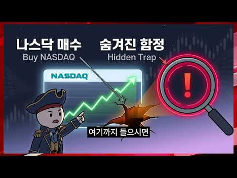
- 설명 앞부분: KBS 기자 KBS 디지털 뉴스 본부장 KBS 울산 방송국 본부장, KBS 해설위원, KBS 교통공무원노조 위원장 등을 역임하며 미디어와 저널리즘 분야에서 풍부한 경험을 쌓아 왔습니다. 이러한 실무 경험을 바탕으로, 현재 미디어 환경에 대한 정확한 정보, 심층 분석, 그리고 솔직한 시각을 제공하기 위해 최선을 다하고 있습니다. 여러분의 지지와 협력은 투명하고 신뢰받는 저널리즘을 향한 저희의 지속적인 노력에 원동력이 됩니다.
- 같은 채널 평소 대비 ×40.5 (채널 최근 롱폼 중앙값 470회) · 평소 영상: 엔화 900선 붕괴 다음은 원화입니다 (470회) / ＂쉽지만 효과는 강력한＂ 경제공부 시작하는 법 (527회)
- 대본 없음 (설명) — 음성인식이 끝나면 도입부·흐름이 들어감
- 댓글 5/5: 좋은 점 — 영상 0 · 감사·응원 0 · 더 알고 싶은 것 0 · 아쉬운 점 — 영상 0 · 반박·불만 — 의견 다름 0 · 정치·사회 0 · 경험 공유 0 · 구독·다음 기대 0

### 10. 적자인데 300억? 가능한 이유 ∣ 회계사가 말아주는 리센느 소속사 더뮤즈엔터

- https://www.youtube.com/watch?v=kJx_AzV9w9c · 전지적회계사시점 · 구독자 867 · 조회수 318,014 (×366.8, 하루 5,853.7) · 좋아요 1,271 (0.4%) · 21.4분 · 2026-09-03 · 주제 묶음 6. 종목 고르기·분석 · 형식 브이로그·직접 해본 이야기 · 폴더 `W_kJx_AzV9w9c` (웹 승인)
- 썸네일: 
- 챕터: 0:00 오프닝 하이라이트 · 0:23 거제 야호로 시작된 리센느 이야기 · 1:13 숫자로 보는 더뮤즈: 8억에서 300억까지 · 2:20 리센느의 인기, 어느 정도일까 · 4:19 더뮤즈엔터테인먼트는 어떤 회사인가 · 6:06 중소 엔터사가 VC 투자를 받는 이유 · 8:11 모태펀드가 만든 중소돌의 기적 · 9:04 투자 히스토리: 5천만 원에서 시리즈A까지 · 11:44 멀티플로 계산해 본 비상장 기업가치 · 14:26 이익배수로 다시 본 300억의 조건 · 16:04 300억이 되려면 매출은 얼마나 필요할까 · 18:00 리센느 정산은 언제부터 가능할까 · 19:40 결론: 300억은 가능한 숫자인가
- 설명 앞부분: "거제야호로 시작된 리센느 열풍. 소속사 더뮤즈엔터의 가치는 얼마일까요?" 지금 대한민국에서 가장 핫한 걸그룹 리센느, 그리고 소속사 더뮤즈엔터테인먼트의 기업가치를 회계사의 시선으로 분석해봤습니다. 설립 밸류 8억에서 5년 만에 300억, 37.5배가 뛴 이 회사의 투자 히스토리를 따라가면서 비상장 기업의 가치평가가 실제로 어떻게 이루어지는지 알기 쉽게 풀어 드립니다. 그리고 25년말 56억 적자에 자본잠식이였던 리센느 소속사가 어떻게 300억의 가치를 인정 받을 수 있었는지, 중소 엔터사가 VC 투자를 받는 이유부터 아이돌 정산…
- 같은 채널 평소 대비 ×212.7 (채널 최근 롱폼 중앙값 1,495회) · 평소 영상: 위고비·마운자로 열풍, 헬스장 정말 안갈까?? ∣ 회계사가 분석한 비만치료제와 헬스 시장 (1,761회) / 결혼 못 해도 돈은 낸다 ∣ 매출 483억 찍은 ‘결혼해듀오’ (1,229회)
- 대본 (음성인식(앞 5분), 5.9 음절/초) — 앞부분만, 흐름은 그 안까지 첫 20초: “최근에 리셋는 더뮤즈웨어 엔터테인먼트가 몇백억을 같이 로투자를 받았다 이런 얘기가 많잖아요 그래서 이 회사의 가치가 지금 얼마일까 그리고 얼마까지 갈 수 있을까 작년 매출이 17억 8천만 원인데 영업 손실에 50.2천만 원이거든요 그리고 2025년 말에 자본을 보니까 마이너스 11억 5천만 원 데뷔 8년차에다가 포스닥 상장사가 880만 원이 있는데” — 도입부 유형: 질문으로 시작, 숫자로 시작
- 첫 1분: “최근에 리셋는 더뮤즈웨어 엔터테인먼트가 몇백억을 같이 로투자를 받았다 이런 얘기가 많잖아요 그래서 이 회사의 가치가 지금 얼마일까 그리고 얼마까지 갈 수 있을까 작년 매출이 17억 8천만 원인데 영업 손실에 50.2천만 원이거든요 그리고 2025년 말에 자본을 보니까 마이너스 11억 5천만 원 데뷔 8년차에다가 포스닥 상장사가 880만 원이 있는데 더뮤즈웨어 엔터가 300억 가치를 지냈다 회사님 거제 야구 아세요? 잘 알죠 요새 유튜브에 굉장히 핫하잖아요 저도 거제 야구가 뜨기 시작할 때 그때부터 리셋는 유튜브를 좀 많이 봤는데 굉장히 재밌더라고요 사실 제가 또 TMI긴 하지만 저희 어머니가 좀 외곽아 거제에 있거든요 유튜브에서 거제 영상을 보면서 약간 눈에 익은 그런 화면들이 많이 나오더라고요 유튜브도 알”
- 흐름 (90초마다 첫 문장): 0:00 최근에 리셋는 더뮤즈웨어 엔터테인먼트가 → 1:31 그러니까 이제 8억에서 300억 → 3:02 스탭에게 뭐 1분만 더 달라 → 4:31 그리고 이제 뭐 잘 아시는 것처럼
- 댓글 219/219: 좋은 점 — 영상 2 · 감사·응원 14 · 더 알고 싶은 것 0 · 아쉬운 점 — 영상 2 · 반박·불만 — 의견 다름 4 · 정치·사회 0 · 경험 공유 11 · 구독·다음 기대 2
  - 좋은 점 — 영상 👍10 “더뮤즈에 대해 궁금한 것을 많았는데... 좋은 정보 감사합니다.”
  - 좋은 점 — 영상 👍2 “겉으로 보여지는 아이돌 그룹의 그늘 혹은 화려함에 가리워진 이면에, 냉정한 생존법칙에서, 엔터테인먼트 기획사의 존폐 여부가 어떻게 가시적으로 수치화 돼서 추정되고 결정되는 지 일목요연하게 짚어주는 이런 컨셉 정말 유익합니다. 응원합니다!!!”
  - 감사·응원 👍344 “대중은 중소를 응원하지만 중소티가 나면 고개를 돌리는것 같습니다. 적자상황에서도 의상과 곡퀄리티를 유지한게 단순 응원하는 사람에서 팬덤으로 바뀌게 된 핵심이유같네요.”
  - 감사·응원 👍20 “리센느 팬이라 보고 갑니다 감사합니다”
  - 아쉬운 점 — 영상 👍1 “마이크가 있기는한데 뭔가 목소리 울리는 소리가 많이 들어가는게 조금 아쉽네요😂 재밌는 영상 잘 보고갑니다!”
  - 아쉬운 점 — 영상 👍1 “요약좀....”
  - 반박·불만 — 의견 다름 👍10 “아니 나 진짜 궁금했음; 왜 다들 정산이 힘들거라고 하는건지.. 어떤 분들은 매출이 180억이 나와도 정산이 힘들수있다는데 이해가 너무안감 누적적자 70억은 알겠는데 대형 기획사처럼 컴백할때 진짜 뭐 백몇십억씩 쏟아붓고 마케팅비용 포함해서 활동비로 수십억씩 쓰는 회사…”
  - 경험 공유 👍15 “내가 살다살다 아이돌덕질하다 회사 회계까지 보고있네”
  - 경험 공유 👍6 “올해 리센느가 3년차였네요. 진짜 다행입니다 ^^”
  - 구독·다음 기대 👍18 “리마인이면 리센느 소속사 더뮤즈 재무관리 영상도 챙겨 봐야한다는 사실😂”
  - 구독·다음 기대 👍0 “국내는 현제 말할것도 없고, 전세계적으로도 조금씩 알려지고 있으며 특히 일본에서 근래에 많은 유튜브 영상들이 퍼지고 있으며 팬층도 많이 늘어나고 있던데 조만간 일본 활동에 불씨가 붙으면 롱런 롱흑자 기대됩니다 무엇보다 리센느는 아이돌로서 다음 앨범이 아주 중요하기도 …”

### 11. 코스피 7% 폭락, 외인 30분만에 1조 순매도, 무언가 수상합니다

- https://www.youtube.com/watch?v=hjIgX9ppDe4 · 경제한잔 · 구독자 7,200 · 조회수 178,695 (×24.8, 하루 36,788.0) · 좋아요 880 (0.5%) · 14분 · 2026-10-16 · 주제 묶음 5. 국내주식 · 형식 정보·해설 (그 밖) · 폴더 `W_hjIgX9ppDe4` (웹 승인)
- 썸네일: 
- 챕터: 0:00 코스피 폭락 7퍼센트, 외국인 순매도 30분 1조의 … · 0:49 외국인 순매도 하루치를 30분에 쏟아낸 비정상 신호 · 1:20 삼성전자 하이닉스 과매도가 코스피 지수를 꺾은 이유 · 2:11 이 물량 누가 왜 던졌나 진짜 질문의 시작 · 2:19 실적은 범인이 아니다 반도체주 사상 최고 실적 · 2:55 코스피 폭락 설명할 결정타 뉴스가 없다 · 3:21 글로벌 동반 하락만으로 설명 안 되는 괴리 · 3:56 쉬운 답 세 개가 전부 지워진 수상한 지점 · 4:11 프로그램 매매 선물 공매도 다섯 용의자 공개 · 4:48 전부 사람 손이 아니다 기계적 매도의 공통점 · 5:17 선물 현물 베이시스로 보는 30분 1조 메커니즘 · 6:03 반대매매 눈사태 하락이 하락을 부르는 구조 · 6:36 왜 기업 가치보다 더 깊게 과매도됐나 · 7:15 기계가 던졌는데 왜 하필 한국인가 · 7:26 위험자산 회피 달러 강세 매크로 흐름 · 7:56 외국인에게 한국 증시는 현금인출기 ATM · 8:34 반도체 사이클 선반영 외국인 순매도 습관 · 9:13 공포가 아니라 계산된 포지션 조정일 가능성 · 9:28 현물 팔고 선물 사는 움직임이 말해주는 것 · 10:10 가격이 가치에서 떨어져 나간 과매도의 본질
- 설명 앞부분: 📉 오늘 코스피가 7% 넘게 폭락했습니다. 삼성전자 7%, SK하이닉스 9% 급락, 그리고 외국인이 단 30분 만에 1조 원을 순매도했죠. 화면이 온통 파란색으로 물들면, 누구나 똑같은 생각을 합니다. "외국인이 다 던지고 도망간다, 한국 증시 끝난 거 아니야?" 🥵 혹시 오늘 계좌를 보면서 가슴이 철렁 내려앉았다면, 이 영상을 끝까지 꼭 봐주세요. 오늘의 폭락은 단순한 공포가 아니라, 그 안에 아주 수상한 구조가 숨어 있습니다. 🔍 이 영상에서 다루는 핵심 요약 외국인이 하루 종일 파는 금액은 보통 많아야 몇천억, 세게 던져도 …
- 같은 채널 평소 대비 ×17.7 (채널 최근 롱폼 중앙값 10,073회) · 평소 영상: 잘 생각해보면 남의 일이 아닌 프랑스 혼란(시위, 금리, 정치) (10,073회) / 삼성전자 9%, 하이닉스는 0.3%…주도주 상승폭 갈라진 이유는? (11,656회)
- 대본 없음 (설명) — 음성인식이 끝나면 도입부·흐름이 들어감
- 댓글 51/51: 좋은 점 — 영상 2 · 감사·응원 5 · 더 알고 싶은 것 0 · 아쉬운 점 — 영상 1 · 반박·불만 — 의견 다름 0 · 정치·사회 11 · 경험 공유 0 · 구독·다음 기대 5
  - 좋은 점 — 영상 👍2 “구독했어요!!!너무 유익해요!!감사합니다”
  - 좋은 점 — 영상 👍2 “이해하기쉽게 화면을 구성하셨네요 구독했습니다”
  - 감사·응원 👍5 “영상 감사합니다!”
  - 감사·응원 👍4 “감사합니다 버터야 됩니다”
  - 아쉬운 점 — 영상 👍0 “ㅋ 광고하는 주식과 정치와 관련된 주식은 사는게 아니다.. 그리고 실적을 보고 기대치가 높아져있어서 그런거고 실적치로만 주가가 올라가면 얼마나 좋겠냐..실적에 비해 기대치까지 주가가 오르지 못하니 하락하는거.. 반대로 반도체쪽 말고 기대도 안하는 2차전지는 실적치가 …”
  - 정치·사회 👍16 “최고의 명강의였습니다. 멍청한 이재명 정부의 관료들때문에 개인투자자들은 피눈물을 흘리네요.”
  - 정치·사회 👍12 “한국주식은. 투명유리. 외국인만 조은일 시키는 어리석은 정부”
  - 구독·다음 기대 👍12 “작금의 사태를 명확하게 분석해 주었습니다. 구독합니다.”
  - 구독·다음 기대 👍7 “난 주식설명 다욕하는데 이채널은 논리적이고 최근 선물가격 때매 현물이 안올라가는 현상을 본 것까지 맞음 그래서 우선 구독박고감”

### 12. 삼성전자 지금 팔아야 하나? 코스피 서킷브레이커 날, 버틸지 팔지 가를 기준 2가지

- https://www.youtube.com/watch?v=ICByZXkRrLg · 경제야! 놀자~ · 구독자 3,510 · 조회수 101,848 (×29.0, 하루 16,761.8) · 좋아요 583 (0.6%) · 13.5분 · 2026-10-15 · 주제 묶음 5. 국내주식 · 형식 정보·해설 (그 밖) · 폴더 `W_ICByZXkRrLg` (웹 승인)
- 썸네일: 
- 챕터: 0:00 하이라이트 — 팔면 안 될 때, 팔아야 할 때 · 0:16 [경제야놀자 해설] 서킷브레이커, 팔아야 하나? · 0:36 사자고 했던 근거 ① 이익 증가 ② 저평가 · 1:45 근거 ③ 배당 30~40% 증가 · 자사주 소각 · 2:19 [경제야놀자 해설] 사자고 했던 근거 3가지 · 2:40 빠지는 이유 ① 금리 · 2:59 ② AI 투자 버블론 ③ 중동 · 물가 · 3:39 "훼손된 게 있나요?" — 아직은 없다 · 4:15 양대 시장 서킷브레이커 · 메모리 사이클 불신 · 5:28 [경제야놀자 해설] 서킷브레이커 · 메모리 사이클 · 5:53 박시동 — "3~4일에 20%씩 빠질 일이냐" · 7:13 성장통이냐, 희망고문이냐 · 8:53 판단 기준 두 갈래 · 비중 줄이기 · 10:05 [경제야놀자 해설] 성장통이냐 희망고문이냐 · 10:26 박시동 — 시가배당률 5%, 은행이자보다 많다 · 11:55 정리 — 지금 새로 사는 건 아니다 · 12:40 [경제야놀자 해설] 오늘의 세 줄 정리
- 설명 앞부분: [10월 15일 · 12시에 만나요] 코스닥에 이어 코스피까지 8% 넘게 빠지며 두 시장 모두 서킷브레이커가 걸린 날, 방송은 "지금 어떻게 해야 하나"를 붙들고 길게 이야기했다. 이광수 대표는 그동안 한국 주식을 사자고 했던 근거 세 가지 — 기업 이익 증가, 이익 대비 저평가, 배당과 자사주 소각으로 바뀌는 시장 — 를 다시 짚고, 아직 훼손된 것은 없다고 봤다. 권다영 앵커는 메모리 반도체가 사이클이라는 오랜 경험 때문에 시장이 "이번엔 다르다"를 믿지 못한다고 해석했다. 이 대표는 지금 하락이 오르는 길의 성장통인지, 저점…
- 대본 없음 (설명) — 음성인식이 끝나면 도입부·흐름이 들어감
- 댓글 296/296: 좋은 점 — 영상 0 · 감사·응원 0 · 더 알고 싶은 것 2 · 아쉬운 점 — 영상 0 · 반박·불만 — 의견 다름 8 · 정치·사회 19 · 경험 공유 8 · 구독·다음 기대 0
  - 더 알고 싶은 것 👍14 “오늘은 뭐라 하는지 궁금해서 들어 와봣더니.. 역시나..ㅠㅠㅠ”
  - 더 알고 싶은 것 👍2 “이주완 아날리스트의 삼전닉스 비관론에 대해서 합리적인 반론 좀 부탁드려요.”
  - 반박·불만 — 의견 다름 👍13 “대 전제가 틀렸다. 주식시장은 애초에 합리적인 분석대로 움직이는 장이 아니다. 이게 내 결론임.”
  - 반박·불만 — 의견 다름 👍11 “영국은 겨우 방직기 하나 개발해놓고 100년을 거품을 몰고 다녔습니다. 왜 한국만 지금 바보짓을 합니까? 좀 이 업계 모르는 분들은 입닫고 조용히 기업들이 하는일 지켜보세요. 기업들 바보 아닙니다. 겨우 중국발 기사 2줄에 검증되지 않은 내용으로 아무나 떠드는것에 신…”
  - 정치·사회 👍27 “정부는 아무 대책 없네~~ 미국이 이정도면 난리 났다 ~~종지가 9퍼가 빠진다는게 현실이냐 삼전이 1주일 만에 -30퍼가 말이 되나교 국민 거지 만들기 프로젝트 가종중이냐? 주식 시장은 아침 8시부터 저녁 8시까지 하라는 이야기냐?”
  - 정치·사회 👍8 “증권당국이 기업죽든말든 개인죽든말든 나라가죽든말든 증권사의무능수치다”
  - 경험 공유 👍15 “저분들 때문에 여러명 죽네 어제가. 바닥이라고 햇던거 같은데 저런 말은 나도 하겠네요”
  - 경험 공유 👍10 “귀에걸면 귀걸이 코에걸면 코걸이 나도하겠다.”

### 13. QLD 직투 vs ISA, 잘못 선택했다가는 10년 뒤 수 천만 원 날립니다

- https://www.youtube.com/watch?v=PEOHCf2930w · 투자각성 · 구독자 382 · 조회수 10,953 (×28.7, 하루 1,648.7) · 좋아요 75 (0.7%) · 8.9분 · 2026-10-14 · 주제 묶음 10. 노후·연금 투자 · 형식 정보·해설 (그 밖) · 폴더 `W_PEOHCf2930w` (웹 승인)
- 썸네일: 
- 챕터: 0:00 ISA 가입자 1,000만 명, 나는 어디에 담을까 · 1:51 1억 넣으면 세금 1,400만 원 차이 · 6:01 ISA 나스닥 2배, 환율도 2배라고? · 8:01 그래서, 어디에 얼마를 넣을까 · 9:11 10년 전 천만 원, 지금 얼마일까 · 10:45 2배가 3배를 이긴 이유 · 12:48 2008년 같은 폭락이 오면? · 13:59 정리, 그리고 1만 달러 새 계좌
- 설명 앞부분: 나스닥 2배, ISA로 살까 미국 직투로 살까? 1년에 천만 원씩 10년이면 세금만 1,400만 원 가까이 갈립니다. 어느 통장에 얼마를 넣을지, 그리고 왜 장기로는 QLD인지 레버리지 7년 차의 시각으로 정리했습니다.
- 같은 채널 평소 대비 ×24.9 (채널 최근 롱폼 중앙값 440회) · 평소 영상: 반도체 폭락 뒤에 숨겨진 세력 다툼 비밀 (455회) / SOXL 15억 거래하고 내린 결론(ft.앙드레 코스톨라니 공식) (426회)
- 대본 없음 (설명) — 음성인식이 끝나면 도입부·흐름이 들어감
- 댓글 31/31: 좋은 점 — 영상 2 · 감사·응원 5 · 더 알고 싶은 것 2 · 아쉬운 점 — 영상 0 · 반박·불만 — 의견 다름 0 · 정치·사회 0 · 경험 공유 0 · 구독·다음 기대 1
  - 좋은 점 — 영상 👍2 “유익한 영상입니다 감사합니다🎉🎉”
  - 감사·응원 👍2 “유익한 영상입니다 감사합니다🎉🎉”
  - 감사·응원 👍1 “영상 감사합니다^^ 요즘 isa에서 한국폰 qld를 사려면 1000만원이 있어야 해서 고민입니다..1000만원을 일시로 넣고 적립식매수해도 가능한건가요?”
  - 더 알고 싶은 것 👍2 “영상 잘 보았습니다~!^^그럼 isa 계좌에서 3년 납입후 연장하고 부동산이나 큰돈 들어갈때 해지 하고 싶으면 4년후에는 해지해도 세금 해택 받을 수 있는걸까요?그리고 환헷지가 가능한 h가 붙은 상품으로이 나을지 고견 부탁드립니다~🙏이제 막 계좌 개설해서 시작 하려는…”

### 14. 집은 팔았고, 주식은 물렸고

- https://www.youtube.com/watch?v=SbEfHnF8DdY · 로텐션 LOWTENSIONS · 구독자 6,730 · 조회수 105,766 (×15.7, 하루 28,309.5) · 좋아요 754 (0.7%) · 16.3분 · 2026-10-17 · 주제 묶음 11. 투자 일반 · 형식 브이로그·직접 해본 이야기 · 폴더 `W_SbEfHnF8DdY` (웹 승인)
- 썸네일: 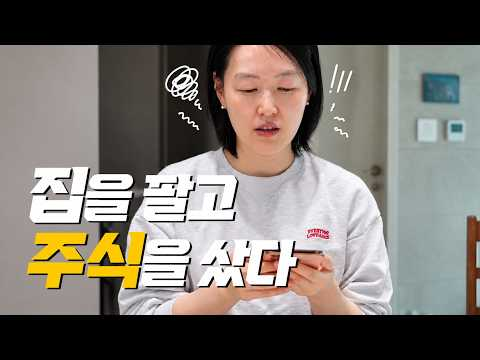
- 설명 앞부분: 집을 팔고 이사까지 마치니 이제 조금은 마음 편히 지낼 수 있을 줄 알았는데, 인생은 늘 예상과 다르게 흘러가네요. 집을 팔고 주식을 샀습니다. 집은 잘 팔았는데, 주식은 잘못 산 걸까요. 그래도 일상은 계속됩니다. 출근도 하고, 밥도 먹고, 이번 영상에는 그렇게 흘러가는 저희 부부의 평범한 일상을 담았습니다. 오늘도 함께해 주셔서 감사합니다. 제이 & 윤 [Video Source Support] Youtube channel "freeticon" : / freeticon
- 같은 채널 평소 대비 ×13.6 (채널 최근 롱폼 중앙값 7,802회) · 평소 영상: 집밥 해 먹는 이유 40대 부부 현실적인 한 달 식비 정산 외식 배달 이대로 괜찮은가? … (8,535회) / 요즘 환율 불안한데 대만은 아직 여행하기 괜찮은 이유 타이중 부부 여행 브이로그 (7,069회)
- 대본 없음 (설명) — 음성인식이 끝나면 도입부·흐름이 들어감
- 댓글 185/184: 좋은 점 — 영상 1 · 감사·응원 14 · 더 알고 싶은 것 2 · 아쉬운 점 — 영상 1 · 반박·불만 — 의견 다름 2 · 정치·사회 8 · 경험 공유 19 · 구독·다음 기대 3
  - 좋은 점 — 영상 👍11 “주식을 오래하고 꾸준한 수익을 원한다면 외부의 귀을 닫고 나만의 방법이 필요한데 화려하지도 않고 큰 기술이 필요하지도 않습니다. 단순합니다. 욕심부리지 않고 돈을 차갑고 신중히 한번 더 생각하고 다루어라!! 고점에서 떨어지는 종목은 쳐다 보지도 말아라 미련을 버려라 …”
  - 감사·응원 👍22 “저도 주식 너무 팔고 싶네요😂 상승장 언능타고 제이님 입맛 돌아오시길 바랄께요! 우리 모두 화이팅해요!”
  - 감사·응원 👍13 “어떤 인내심보다 주식을 하면서 진짜 인내심을 배우고 있습니다. ㅎㅎ 제 이야기 하시는줄 알았어요. 오늘도 소중한 영상 고맙습니다. ^^ 항상 건강 및 행복하세요!! 응원해요!!”
  - 더 알고 싶은 것 👍22 “악~~! 이렇게 금방 올라오다니 선물같고 너무 좋네요. 로텐션 영상 너무 제 취향입니다. 오늘도 여러편 또 보고.. 앞으로도 빠른 업데이트 많은 영상 부탁드립니다~😊”
  - 더 알고 싶은 것 👍0 “얼마정도를 하시나요?? 힘내세요”
  - 아쉬운 점 — 영상 👍8 “60대고 2천~3천 정도로 주식하는데 사팔사팔 하면서 하루를 보내니 지루하지 않네요. 마이너스도 있지만 기다리면 오겠죠. 이러고 세월 보냅니다.”
  - 반박·불만 — 의견 다름 👍3 “그렇게 사팔사팔하는건 투기지 투자가 아닙니다. 투자는 펀더멘탈 좋은 코스피 우량주 사서 가다리는거여ㅣ요. 부동산도 하루하루 보는게아니듯 주식도 그래요. 그리고 그때그때 뷰가 바뀌면 방향도 수정해야해요. 단기간 승부를 보려는건 위험해요. 되도록 코스닥으 하지말고 시총이…”
  - 정치·사회 👍11 “이재명이 해냈구나 집팔아 주식하라 니덜 인생 조진거 같다”
  - 정치·사회 👍8 “어머나, 이리 빨리 영상이 올라오면 구독자는 너무 좋잖아요❤ 하얀색 바탕에 때가 타면 정말 참을 수 없는데😂 어서 빨리 매직블럭 찾으셨으면 좋겠어요! 제이님이 타 주시는 커피엔 비할 수 없겠지만, 커피 내리기 귀찮으실 땐 루카스나인 카페라떼도 추천드려요☕️ 주식은 정…”
  - 경험 공유 👍22 “저도 주식 너무 팔고 싶네요😂 상승장 언능타고 제이님 입맛 돌아오시길 바랄께요! 우리 모두 화이팅해요!”
  - 경험 공유 👍12 “부러우면 지는 거라던데, 남이 해준 아침밥 언제 먹어봤는지 기억이 안나네요.😢 저도 백수 5개월차 전업투자 합니다. 종목거래는 수수료가 많아 ETF로 차트 봐가며 스캘핑. 저한테는 그게 딱 맞더라구요, 큰 하락도 피할수 있고. 처음 보는 채널인데 뭔가 공감도 되고 두…”
  - 구독·다음 기대 👍12 “부러우면 지는 거라던데, 남이 해준 아침밥 언제 먹어봤는지 기억이 안나네요.😢 저도 백수 5개월차 전업투자 합니다. 종목거래는 수수료가 많아 ETF로 차트 봐가며 스캘핑. 저한테는 그게 딱 맞더라구요, 큰 하락도 피할수 있고. 처음 보는 채널인데 뭔가 공감도 되고 두…”
  - 구독·다음 기대 👍6 “오늘 처음 알고리즘타서 잼나게 보고 구독합니다~^^ 50대 후반이데 1억 5천 정도를 한계좌에 물을 타지 않고 물리면 다른 계좌 터서 사기를 10여개가 넘는다는..ㅋ 계좌마다 시체들이 그득 그득하지만 삼성전자니까 하고 물린계좌 끌어안고 기다립니다ㅋ 일상적이지만 우리들…”

### 15. [풀영상] 월급 10%로 당장 시작하는 존리의 자산 증식 치트키

- https://www.youtube.com/watch?v=q1fYjAwma3s · 여의돈스트리트 · 구독자 1,360 · 조회수 224,924 (×165.4, 하루 5,572.7) · 좋아요 1,404 (0.6%) · 36분 · 2026-09-17 · 주제 묶음 1. 주식 기초·초보 · 형식 인터뷰·강연·대담 · 폴더 `W_q1fYjAwma3s` (웹 승인)
- 썸네일: 
- 챕터: 0:00 인트로 · 0:50 ‘존리의 부자학교’, 어떤 곳인가요? · 1:09 우리나라 금융 수준, 정말 높아졌나요? · 2:39 빨리 부자가 되는 투자, 가능한가요? · 4:53 장기 투자, 어떤 ETF를 사야 할까요? · 6:53 평범한 사람은 어떻게 부자가 되나요? · 8:30 주식 투자에 전문가가 없다? · 10:24 레버리지 투자는 왜 위험한가요? · 11:31 한국주식, 지금도 투자할 만한가요? · 12:16 투자 뉴스는 어디까지 봐야 할까요? · 14:44 부동산 비중이 높으면 위험한가요? · 16:45 주식 투자의 진짜 목적은 무엇인가요? · 17:26 좋은 기업은 어떻게 고르나요? · 20:19 장기 투자 중 기업 상황이 나빠진다면? · 21:09 박스권에 갇힌 현재 증시 진단 · 22:23 AI 버블 우려 속 올바른 매수 시기 · 23:30 안전해 보이는 ‘원금 보장’ 상품의 함정 · 25:01 반도체·대형주 쏠림 계좌, 포트폴리오 개선 조언 · 27:15 시황 뉴스·차트·리포트의 올바른 활용법 · 29:35 직장인 월급 대비 적정 투자 비중 및 방법
- 설명 앞부분: 매일 오르내리는 주가, 금리 인상 뉴스... 언제 사고 언제 팔아야 할지 늘 스트레스받고 계시나요? 혹은 원금 손실이 두려워 아직도 투자를 망설이고 계신가요? 이번 풀영상에서는 '존리의 부자학교' 존리 대표님을 모시고 평범한 사람이 스트레스 없이 진짜 부자가 되는 투자의 본질부터 구체적인 실천 방법까지 모두 담았습니다. 단기간에 부자가 되려는 조급함과 마켓 타이밍을 재는 습관을 버리고, 내 자본이 스스로 일하게 만드는 진짜 투자법을 짚어봅니다. 또한, 인플레이션 시대에 돈을 예적금에만 두는 것이 왜 자산 가치를 갉아먹는 가장 위험…
- 같은 채널 평소 대비 ×199.9 (채널 최근 롱폼 중앙값 1,125회) · 평소 영상: 리딩방에서 추천받은 종목이 올랐다면? 이미 당신은 ‘먹잇감’입니다 [선생님 이건 건강한 … (1,125회) / 주식시장 100명중 90명은 무조건 손실 봅니다. 상위 10%만 아는 '진짜' 수익 내는… (1,192회)
- 대본 (음성인식(앞 5분), 6.0 음절/초) — 앞부분만, 흐름은 그 안까지 첫 20초: “좀 빠르게 내가 부자가 되고 싶다. 시간이 지날수록 나는 그 위스크로 줄어들고 시작한 지 지날수록 나는 부관들어나거든요. 또는 일을 안 하고 이불 속에서 안 나오는 거예요. 예금. 지금 만약에 1,000만 원이 20년 후에는 1,000만 원 아니라 한 300만 원으로 줄어들어있는 거예요. 90%의 정보는 필요 없는 정보예요. 정보가 하나도 중요하지 않죠.”
- 첫 1분: “좀 빠르게 내가 부자가 되고 싶다. 시간이 지날수록 나는 그 위스크로 줄어들고 시작한 지 지날수록 나는 부관들어나거든요. 또는 일을 안 하고 이불 속에서 안 나오는 거예요. 예금. 지금 만약에 1,000만 원이 20년 후에는 1,000만 원 아니라 한 300만 원으로 줄어들어있는 거예요. 90%의 정보는 필요 없는 정보예요. 정보가 하나도 중요하지 않죠. 충분해요. 두 개만 갖고도. 두 개만 갖고도 충분하다. 반응하는 많이 해라. 어떻게 젊으신 분들은. 안녕하세요. 여의돈스트리트 이광수입니다. 우리는 도대체 어떻게 투자해야 부자가 될 수 있을까요? 스트레스 받지 않고 투자하려면 또 어떻게 해야 될까요? 다녁컨대 이에 대한 해답을 알고 계시는 분. 어렵게 이 자리에 모셨습니다. 졸리의 부자학교의 졸리 대표님”
- 흐름 (90초마다 첫 문장): 0:00 좀 빠르게 내가 부자가 되고 싶다. → 1:31 실제로 대표님께서 현장에서 보시면 → 3:01 그렇게 해서 좀 빠르게 → 4:30 너무 힘듭니다 대표님.
- 댓글 113/120: 좋은 점 — 영상 3 · 감사·응원 14 · 더 알고 싶은 것 2 · 아쉬운 점 — 영상 0 · 반박·불만 — 의견 다름 4 · 정치·사회 1 · 경험 공유 13 · 구독·다음 기대 0
  - 좋은 점 — 영상 👍4 “이분하고 궁합이 잘맞음 참 좋은말씀”
  - 감사·응원 👍25 “존리 선생님 덕분에 3년전부터 노후준비를, 장기투자를 목표로 삼게 되었습니다. 좋은 투자철학을 가르쳐주셔서 감사합니다❤”
  - 감사·응원 👍19 “존리대표님 덕분에 투자를 시작했습니다 감사드립니다”
  - 더 알고 싶은 것 👍0 “에스엔피 500이 미장인지 국장인지 어떤걸해야하나요?”
  - 반박·불만 — 의견 다름 👍4 “이게 말이 쉽지 2002년 닷컴 버블 경험하고 이제 회복되나 싶었더니 2008년 금융위기 오고 투자 14년 차인데 투입원금보다도 계좌에 쌓인 돈이 없고 그러면 진짜 현타옵니다. 복리의 힘이라는게 말이 쉽지 일정금액 이상이 쌓이지 않으면 기별도 안 오고, 녹아내리는 계…”
  - 반박·불만 — 의견 다름 👍0 “개인적으로 무조건적이고 비판없는 의견을 따르실 필요는 없습니다. 모든 투자는 개인의 책임이니 신중하게 생각해보고 투자하시길 바랍니다. 그렇다고 존 리님이 무조건 좋다 나쁘다 이렇게 생각하는 게아니라 본인에게 맞는 투자를 하시라는 말씀 꼭 드리고 싶습니다. 장기투자라고…”
  - 정치·사회 👍0 “박정희 대통령이 나라의 문맹을 퇴지했는데 존리대표님은 금융문맹을 퇴치하러 열일 하신다”
  - 경험 공유 👍24 “연금저축+isa ETF 5년차 적립중인데 희망이 생겨서 든든합니다😊 더 빨리 깨우쳤어야 했는데 ㅠㅠ”
  - 경험 공유 👍4 “이게 말이 쉽지 2002년 닷컴 버블 경험하고 이제 회복되나 싶었더니 2008년 금융위기 오고 투자 14년 차인데 투입원금보다도 계좌에 쌓인 돈이 없고 그러면 진짜 현타옵니다. 복리의 힘이라는게 말이 쉽지 일정금액 이상이 쌓이지 않으면 기별도 안 오고, 녹아내리는 계…”

### 16. [문남중 출연] "코스피 폭락, 자사주 매입 종료 때문..수급공백 끝! 외국인, 삼전닉스로 돌아옵니다" #문남중 _261019

- https://www.youtube.com/watch?v=vzGrlaAl0e4 · 경제통마늘 · 구독자 13,900 · 조회수 124,444 (×8.9, 하루 56,609.4) · 좋아요 1,146 (0.9%) · 14.2분 · 2026-10-19 · 주제 묶음 5. 국내주식 · 형식 오디오북·낭독 (명언·인생조언) · 폴더 `W_vzGrlaAl0e4` (웹 승인)
- 썸네일: 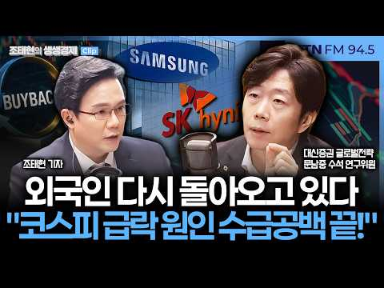
- 설명 앞부분: "코스피 '수급공백' 메울 외국인, 다시 돌아오기 시작했다" 유독 Non-US 증시만 어려운 상황..10월초 급락 이유 이해안돼 美증시 10월들어 역사적 사상최고치..코스피 진정될 여지 있어 美 증시는 쉬워갈 구간..지난 금요일 나스닥 -2% "과도한 확대 해석 경계" 이란 외무장관 발언, 이란전쟁 종전MOU 재개 가능성 대두 韓증시 유독 빠진 이유, '수급공백'..자사주 매입 종료 때문 2024-2025년 외국인, 삼전 자사주 매입 종료에도 매수세 경험 자사주 매입 종료 직후, '반도체 업황' 매우 중요 "수급 주체 바뀐다..자…
- 대본 없음 (설명) — 음성인식이 끝나면 도입부·흐름이 들어감
- 댓글 192/192: 좋은 점 — 영상 0 · 감사·응원 7 · 더 알고 싶은 것 0 · 아쉬운 점 — 영상 1 · 반박·불만 — 의견 다름 11 · 정치·사회 35 · 경험 공유 3 · 구독·다음 기대 0
  - 감사·응원 👍14 “위원님 나오셨군요. 기다렸습니다. 과도한 확대해석 자제하고 기다립니다. 감사합니다 ~~”
  - 감사·응원 👍7 “☆ 국민의 소리 소신있게 발언하신 이찬진 금융감독원장님께 찬사의 박수 보냅니다 국회 정무위원회 국정감사에서 금융감독원장이 SK하이닉스의 자회사 솔리다임(Solidigm) 미국 나스닥 상장 추진과 관련해 "중복상장에 저촉된다는 판단을 하고 있다"는 입장을 공식 명시 했…”
  - 아쉬운 점 — 영상 👍0 “ㅋㅋㅋㅋㅋㅋ 아직도 낚시하는 놈들 있네 진짜 대단하다 등골까지 빨아머글라고 낚이면 안됩니다 하닉출신 반도체 전문가분이 1년전 가격으로 간다고 못 박았음 ㅋ”
  - 반박·불만 — 의견 다름 👍5 “점쟁이도 아닌데....어찌 다맞추나요? 본인의계좌는 본인책임~”
  - 반박·불만 — 의견 다름 👍3 “저아저씨 7월달 폭락 딱한번 맞췄어요. 그이후엔 금리며 국채며 주가며 다 틀렸고 작년에도 주구장창. 근데 틀릴순 있는데 문제는 뭐라하면 잘삐져요. 그래서 아나운서가 힘들어해요”
  - 정치·사회 👍11 “외국인이 돌아오긴 뭘 돌아와 하락시 생긴 갭때문에 잠시 산것 뿐인데 그렇게도 공부 안하고 책임없는 말을 하나”
  - 정치·사회 👍8 “1400만 개미투자자를 기만하는 ‘무늬만’ 주주 보호법인 ‘의무공개매수제도’, ‘주가 누르기 방지법’의 전면 재검토 및 수정 입법 요청에 관한 청원 국회전자청원에서 참여 부탁드립니다”
  - 경험 공유 👍39 “기관 사람 말 믿지 말자! 개인은 개인이 선택해야 한다는걸 7월.10월 두번의 폭락을 보며 깨닫습니다. 펀더멘털이니 수급이니 필요없고..익절할 수 있을때 무조건 익절하기. 기관 사람들은 모두 사라사라 하면서 그들과 외인은 팜~ 누군가는 손실을 봐야 누군가는 손익인 곳…”
  - 경험 공유 👍2 “금리 동결될 거라고 했었지 이 양반 아니 외국인이 그렇게 돈을 많이 벌었는데 개미들한테 물리려고 다시 들어오겠냐”

### 17. Don't Stop Buying Dividends in a Crash Until You See This Math

- https://www.youtube.com/watch?v=qCO8HvpAGqc · Tom - Lazy Dividend Investor · 구독자 2,090 · 조회수 49,277 (×23.6, 하루 8,472.3) · 좋아요 399 (0.8%) · 31.6분 · 2026-10-15 · 주제 묶음 기타 · 형식 정보·해설 (그 밖) · 폴더 `W_qCO8HvpAGqc` (웹 승인)
- 썸네일: 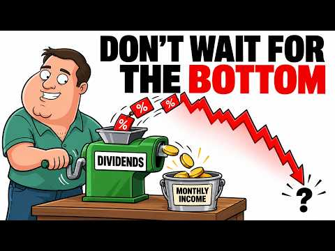
- 설명 앞부분: If dividend stocks fall 20% and the dividend holds, every dollar you invest buys 25% more monthly income than it did before the drop. That is the math behind "keep buying". The problem is that the advice never says where the money comes from, because a crash usually arrives with shorter hours, smal…
- 같은 채널 평소 대비 ×12.5 (채널 최근 롱폼 중앙값 3,947회) · 평소 영상: Warren Buffett: Why You Should Just Hold Your Sto… (3,947회) / What 5500 Shares of SCHD Actually Pay You Each Mo… (3,989회)
- 대본 없음 (설명) — 음성인식이 끝나면 도입부·흐름이 들어감
- 댓글 116/116: 좋은 점 — 영상 0 · 감사·응원 0 · 더 알고 싶은 것 0 · 아쉬운 점 — 영상 0 · 반박·불만 — 의견 다름 0 · 정치·사회 0 · 경험 공유 0 · 구독·다음 기대 0

### 18. 같은 TQQQ에 1억, 한 사람은 2만 원 한 사람은 388억 (실제 데이터)

- https://www.youtube.com/watch?v=d2_oRUcx5Uo · 머니언박싱 · 구독자 2,200 · 조회수 266,959 (×121.3, 하루 8,795.4) · 좋아요 1,175 (0.4%) · 8.1분 · 2026-09-27 · 주제 묶음 2. 장기투자·ETF·지수 · 형식 정보·해설 (그 밖) · 폴더 `W_d2_oRUcx5Uo` (웹 승인)
- 썸네일: 
- 챕터: 0:00 두 개의 계좌 · 0:24 3배 레버리지는 어떻게 움직이나 · 0:54 박 부장, 2000년 3월 꼭대기에서 1억 · 1:20 1년 만에 496만 원 · 1:42 2만 원까지 · 2:06 지수는 돌아왔는데 · 2:35 26년 뒤 박 부장 · 2:56 만약 2009년 바닥에서 샀다면 · 3:42 이 대리, TQQQ 상장일에 1억 · 4:00 16년 뒤, 그러나 · 4:25 만약 2021년 11월에 들어갔다면 · 5:05 최 사원, 매달 50만 원 · 5:32 94억에서 20억으로 · 5:56 만약 2022년에 팔았다면 · 6:29 결과 공개 · 6:56 이 결과를 믿기 전에 · 7:24 레버리지를 산다면
- 설명 앞부분: 같은 TQQQ, 같은 1억 원. 한 사람은 계좌가 한때 2만 원이 됐고, 다른 사람은 지금 388억 원입니다. 무엇이 두 사람을 갈랐을까요? 그리고 같은 상품을 매달 조금씩 산 사람은 어떻게 됐을까요? 박 부장: 2000년 3월 27일, 나스닥100 꼭대기에 1억 원을 3배 레버리지로 이 대리: 2010년 2월 11일, TQQQ 상장일에 1억 원 최 사원: 2000년 4월부터 매달 50만 원씩 3배 레버리지 (세 사람은 가상 인물이고, 숫자는 전부 실제 데이터로 계산했습니다) 계산 조건 2010년 2월 이전 3배·2배는 실제 상품…
- 같은 채널 평소 대비 ×78.1 (채널 최근 롱폼 중앙값 3,420회) · 평소 영상: 40세에 10억으로 은퇴하면, 월 300만 원씩 몇 년 버틸까? (3,460회) / VOO와 QQQ, 반반 섞으면 덜 떨어질까? 비율별 비교 (3,379회)
- 대본 (음성인식(앞 5분), 4.9 음절/초) — 앞부분만, 흐름은 그 안까지 첫 20초: “여기 두 개의 계좌가 있습니다. 둘 다 1억원으로 시작했고 둘 다 같은 상품을 샀습니다. 나스딱백을 매일 세 배로 따라가는 레버리지 tqq입니다. 그런데 한 계좌는 한때 2만원이 됐고 다른 계좌는 지금 388억원입니다. 무엇이 이 둘을 갈랐을까요? 그리고 같은 상품을 매달 조금씩 산 사람은 어떻게 됐을까요? 오늘은 세 사람의 레버리지 계좌를 실제 데이터로 끝까지 따라가 보겠습니다.”
- 첫 1분: “여기 두 개의 계좌가 있습니다. 둘 다 1억원으로 시작했고 둘 다 같은 상품을 샀습니다. 나스딱백을 매일 세 배로 따라가는 레버리지 tqq입니다. 그런데 한 계좌는 한때 2만원이 됐고 다른 계좌는 지금 388억원입니다. 무엇이 이 둘을 갈랐을까요? 그리고 같은 상품을 매달 조금씩 산 사람은 어떻게 됐을까요? 오늘은 세 사람의 레버리지 계좌를 실제 데이터로 끝까지 따라가 보겠습니다. tqq는 나스딱백 지수가 하루에 1% 오르면 3% 1% 내리면 3% 움직이도록 만든 상품입니다. 중요한 건 매일이라는 말입니다. 1년에 3배가 아니라 매일 3배를 다시 맞춥니다. 그리고 3배를 만들기 위해 빌린 돈의 이자와 운영 보수가 매일 조금씩 빠져나갑니다. tqq는 2010년에 처음 나왔기 때문에 그 이전은 나스딱백의 실제”
- 흐름 (90초마다 첫 문장): 0:00 여기 두 개의 계좌가 있습니다. 둘 다 1억원으로 시작했고 둘 다 같은… → 1:34 2002년 10월 3배 계자에는 84000원이 남아 있었습니다. 1억 … → 3:04 새로 1억 원을 3배 레버리지에 넣었다고 해보겠습니다. 지금 이 계자는… → 4:35 이번에도 실제 기록입니다. 1년 뒤 2022년 12월 계자는 81.7%…
- 댓글 144/162: 좋은 점 — 영상 7 · 감사·응원 7 · 더 알고 싶은 것 8 · 아쉬운 점 — 영상 1 · 반박·불만 — 의견 다름 3 · 정치·사회 0 · 경험 공유 10 · 구독·다음 기대 1
  - 좋은 점 — 영상 👍8 “너무 좋은 영상 감사합니다 보고 먾이 배웠습니다. 사람들은 단순히 세배의 장점만 보는데 박부장의 케이스는 너무 무섭네요 관점을 바꾸는 좋은 계기가 되었습니다 감사합니다!”
  - 좋은 점 — 영상 👍8 “진짜 좋은 영상이네요 👍”
  - 감사·응원 👍8 “너무 좋은 영상 감사합니다 보고 먾이 배웠습니다. 사람들은 단순히 세배의 장점만 보는데 박부장의 케이스는 너무 무섭네요 관점을 바꾸는 좋은 계기가 되었습니다 감사합니다!”
  - 감사·응원 👍3 “궁금한 게 있습니다! 적립식이 중요하다는 건 알겠는데 Tqqq를 투자하면 결국 적립식으로 해도 초반은 방어가 되지만 장기투자하고 후반에 금액이 커진 상황에 대폭락이 오면 qqq보다 훨씬 낮아질 확률이 꽤 있지 않나요? TQQQ 관련 내용 책이나 좋은 자료 혹시 있다면…”
  - 더 알고 싶은 것 👍3 “Soxl도 궁금합니다😮”
  - 더 알고 싶은 것 👍3 “궁금한 게 있습니다! 적립식이 중요하다는 건 알겠는데 Tqqq를 투자하면 결국 적립식으로 해도 초반은 방어가 되지만 장기투자하고 후반에 금액이 커진 상황에 대폭락이 오면 qqq보다 훨씬 낮아질 확률이 꽤 있지 않나요? TQQQ 관련 내용 책이나 좋은 자료 혹시 있다면…”
  - 아쉬운 점 — 영상 👍0 “정말 무서운 건 지난 20년이 나스닥 역사상 가장 전성기였다는 사실. 닷컴버블도 아무리 길게 잡아도 3년. 10년 횡보장이었다면 QQQ 투자자는 우울한 정도지만, 폭락 후 버티는 QLD, TQQQ 투자자는 인생 망하는 케이스. 역사는 반복된다?? 아닙니다. 그 시대를…”
  - 반박·불만 — 의견 다름 👍6 “이미 흐름을 알고있는 과거시기를 극적으로 발취하여,,,,,감동적인효과는 알겠는데,,,, 솔직히 현실적투자환경속 투자자라면 실현가능한 일은 아니죠.의지력을 키우라는 교훈성”
  - 반박·불만 — 의견 다름 👍0 “정말 무서운 건 지난 20년이 나스닥 역사상 가장 전성기였다는 사실. 닷컴버블도 아무리 길게 잡아도 3년. 10년 횡보장이었다면 QQQ 투자자는 우울한 정도지만, 폭락 후 버티는 QLD, TQQQ 투자자는 인생 망하는 케이스. 역사는 반복된다?? 아닙니다. 그 시대를…”
  - 경험 공유 👍8 “매달 초마다 200만원 환전해서 TQQQ 매수합니다. 환율/주가 생각 안하고 삽니다 파는건 일년에 250만원만 하고 있습니다. 이제 1년차이고 앞으로 9년 남았네요 😊”
  - 경험 공유 👍6 “무서워서 그냥 연저펀 타이거 s&p500, isa 코덱스 나스닥100 두가지만 3년차 풀매수중입니다 😊”
  - 구독·다음 기대 👍4 “영상보고 바로 구독했습니다”

### 19. SCHD's Dividend Growth Just Hit Its Lowest Point in Years (Time To Sell?)

- https://www.youtube.com/watch?v=V5gTH3N_kL0 · Tom - Lazy Dividend Investor · 구독자 2,090 · 조회수 10,448 (×5.0, 하루 7,939.7) · 좋아요 102 (1.0%) · 34분 · 2026-10-20 · 주제 묶음 기타 · 형식 정보·해설 (그 밖) · 폴더 `W_V5gTH3N_kL0` (웹 승인)
- 썸네일: 
- 챕터: 0:00 77.59 cents and a raise under… · 5:37 What the slowdown costs your … · 10:25 Inside SCHD: the March rebuild · 15:08 What job is your check doing? · 19:51 Time to sell? The two exits a… · 25:32 The real risk: a cut, and the… · 30:14 The December test and what I …
- 설명 앞부분: SCHD paid 77.59 cents per share in the first nine months of 2026, versus 76.94 cents in the same months of 2025: a raise of less than 1%, from a fund whose payout grew about 10.7% a year over the last decade. On $600,000 of SCHD, that is a check of about $1,534 a month that grew by $9 when inflatio…
- 같은 채널 평소 대비 ×2.6 (채널 최근 롱폼 중앙값 3,947회) · 평소 영상: Warren Buffett: Why You Should Just Hold Your Sto… (3,947회) / What 5500 Shares of SCHD Actually Pay You Each Mo… (3,989회)
- 대본 없음 (설명) — 음성인식이 끝나면 도입부·흐름이 들어감
- 댓글 24/24: 좋은 점 — 영상 0 · 감사·응원 0 · 더 알고 싶은 것 0 · 아쉬운 점 — 영상 0 · 반박·불만 — 의견 다름 0 · 정치·사회 0 · 경험 공유 0 · 구독·다음 기대 0

### 20. 주가 1.62달러까지 무너진 AMD, 바닥에서 내린 결정

- https://www.youtube.com/watch?v=l2XsNVbqkm0 · Six Sigma | 식스시그마 · 구독자 5,810 · 조회수 83,120 (×14.3, 하루 21,546.8) · 좋아요 258 (0.3%) · 11.3분 · 2026-10-17 · 주제 묶음 10. 노후·연금 투자 · 형식 인터뷰·강연·대담 · 폴더 `W_l2XsNVbqkm0` (웹 승인)
- 썸네일: 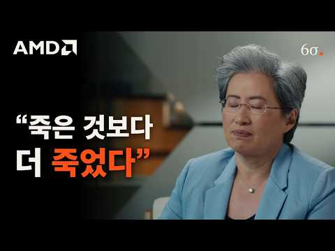
- 챕터: 0:00 "죽은 것보다 더 죽었다" · 0:30 원래 잘나가던 회사 · 0:49 무너진 이유 · 1:19 새 CEO · 2:57 바닥에서 내린 결정 · 6:47 살아난 AMD · 9:21 이제는 엔비디아에 도전
- 설명 앞부분: 한때 인텔을 앞서던 AMD는 2015년 주가 1.62달러까지 무너졌습니다. 2014년 CEO가 된 리사 수가 그 바닥에서 무엇을 버리고 무엇에 걸었는지, 그 베팅이 AMD를 어떻게 다시 엔비디아와 싸우는 회사로 만들었는지 짚었습니다. CNN·블룸버그·스탠퍼드·MIT 인터뷰와 AMD 공식 발표 원음으로 정리했습니다. [원본] (9) 주가 자료: Yahoo Finance 종가(분할 조정) [목차]
- 같은 채널 평소 대비 ×3.0 (채널 최근 롱폼 중앙값 27,962회) · 평소 영상: ASML 3분기 컨콜로 본 디램 공급이 쉽게 늘지 않는 이유 (27,962회) / 최선을 다해도 고객을 실망시킬 수밖에 없는 회사, 엔비디아 (34,606회)
- 대본 없음 (설명) — 음성인식이 끝나면 도입부·흐름이 들어감
- 댓글 51/51: 좋은 점 — 영상 0 · 감사·응원 0 · 더 알고 싶은 것 0 · 아쉬운 점 — 영상 1 · 반박·불만 — 의견 다름 0 · 정치·사회 0 · 경험 공유 1 · 구독·다음 기대 0
  - 아쉬운 점 — 영상 👍0 “주가 1.62달러까지..뭐?.... 제목으로 낚시질 해서 신고 박고 간다. 똑바로 살아라.”
  - 경험 공유 👍2 “모바일칩 시장이 스마트폰 이전 시절엔 큰 돈이 안되었었고 (프로세서 기술보다 모뎀 기술이 결정적인 경쟁력을 좌우하던 시절) 이후 스마트폰 시대로 접어들어서도 모뎀기술이 프로세서 기술보다 더 중요한 경쟁력으로 작용했음. 모바일칩에 뛰어들지 않은건 당시 AMD가 가진 역…”

### 21. 나스닥은 최고가, 반도체만 반 토막. 지금과 똑같았던 1995년으로 앞으로의 흐름을 찾아봤습니다.

- https://www.youtube.com/watch?v=7hjl_w2aWtA · 테스프레소 · 구독자 2,080 · 조회수 48,359 (×23.2, 하루 6,783.2) · 좋아요 383 (0.8%) · 9.9분 · 2026-10-14 · 주제 묶음 2. 장기투자·ETF·지수 · 형식 정보·해설 (그 밖) · 폴더 `W_7hjl_w2aWtA` (웹 승인)
- 썸네일: 
- 설명 앞부분: 나스닥100은 10월 6일 사상 최고치를 찍었는데 SOXL,삼성전자,하이닉스는 6월 고점에서 57% 내려와 있습니다. 30년 전인 1995년에도 나스닥은 최고가를 쓰는데 반도체만 반 토막이 났었고 지금과 똑같은 사건의 순서대로 주가가 반응했습니다. 그때 무슨 일이 있었고 반도체가 언제 반등했는지, 지금과 무엇이 같고 무엇이 다른지 정리했습니다.
- 같은 채널 평소 대비 ×20.1 (채널 최근 롱폼 중앙값 2,410회) · 평소 영상: 금리 인상하면 나스닥이 정말 빠질까? 미국 인상,인하역사 전수 조사. (2,619회) / 떨어져도 사야 할 때는 따로 있습니다. (SPY·QQQ·TQQQ) (2,201회)
- 대본 없음 (설명) — 음성인식이 끝나면 도입부·흐름이 들어감
- 댓글 26/26: 좋은 점 — 영상 0 · 감사·응원 0 · 더 알고 싶은 것 2 · 아쉬운 점 — 영상 0 · 반박·불만 — 의견 다름 0 · 정치·사회 0 · 경험 공유 0 · 구독·다음 기대 0
  - 더 알고 싶은 것 👍15 “중국산은 시제품 성능이 검증된 게 없잖아요. 그리고 장기 계약분과 향후 로봇에 대한 D램 수요는 아직 잡히지도 않았다고 하는데 과연 어떻게 돌아갈지 궁금하네요.”
  - 더 알고 싶은 것 👍0 “내용 좋은데? 그래서 과거 대로라면 지금 완전히 꺽인 반도체 주가가 언제 다시 살아나서 얼마 즘 뒤에 다시 꺽이나요???”

### 22. S&P500とNASDAQ100は崩れない。プロ投資家が あの日 まで買わない理由【米国株最新】

- https://www.youtube.com/watch?v=9zV78pvlDJ4 · まなみんの米国株の学校【投資初心者でも10分で学べる】 · 구독자 5,680 · 조회수 82,843 (×14.6, 하루 16,696.5) · 좋아요 489 (0.6%) · 10.3분 · 2026-10-16 · 주제 묶음 2. 장기투자·ETF·지수 · 형식 정보·해설 (그 밖) · 폴더 `W_9zV78pvlDJ4` (웹 승인)
- 썸네일: 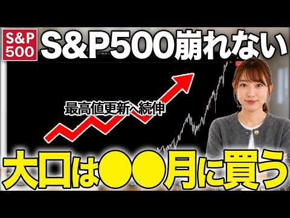
- 설명 앞부분: 私は10月28日のFRBの会議まで、売らず買わずに待ちます🍀 S&P500・NASDAQ100などの米国株と、 ※映像や資料の制作にはAIを活用していますが、相場の分析と「私はこう見る」の見解は、すべて実在する運営者自身のものです🤍
- 같은 채널 평소 대비 ×12.0 (채널 최근 롱폼 중앙값 6,896회) · 평소 영상: つみたて勢必見！今夜は雇用統計でも動かないで！この方法で運用すると複利でコレくらい増えます… (6,896회) / 大口・機関投資家はS&P500と今、〇〇に目をつけています！【米国株 NASDAQ100】 (6,815회)
- 대본 없음 (설명) — 음성인식이 끝나면 도입부·흐름이 들어감
- 댓글 36/36: 좋은 점 — 영상 0 · 감사·응원 0 · 더 알고 싶은 것 0 · 아쉬운 점 — 영상 0 · 반박·불만 — 의견 다름 0 · 정치·사회 0 · 경험 공유 0 · 구독·다음 기대 0

### 23. 세미파이어 부부가 국내주식 안하는 이유

- https://www.youtube.com/watch?v=DNDC7nT7Hmw · 시골사는 배당부부 · 구독자 1,490 · 조회수 12,743 (×8.6, 하루 4,156.0) · 좋아요 140 (1.1%) · 6.9분 · 2026-10-18 · 주제 묶음 5. 국내주식 · 형식 정보·해설 (그 밖) · 폴더 `W_DNDC7nT7Hmw` (웹 승인)
- 썸네일: 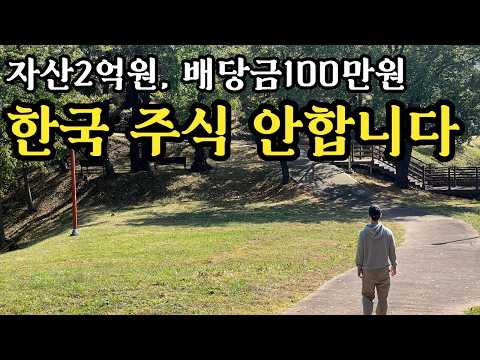
- 설명 앞부분: 안녕하세요 시골사는 배당부부입니다. 오늘은 저희부부가 국내주식을 하지 않는 이유에 대해 얘기 나눠봤습니다
- 같은 채널 평소 대비 ×0.9 (채널 최근 롱폼 중앙값 14,176회) · 평소 영상: 도시에서 떠나 시골로 귀촌한 이유 (15,439회) / 시골 세미파이어 현실 한달 생활비 (12,914회)
- 대본 없음 (설명) — 음성인식이 끝나면 도입부·흐름이 들어감
- 댓글 35/35: 좋은 점 — 영상 0 · 감사·응원 2 · 더 알고 싶은 것 0 · 아쉬운 점 — 영상 0 · 반박·불만 — 의견 다름 0 · 정치·사회 0 · 경험 공유 2 · 구독·다음 기대 2
  - 감사·응원 👍1 “모두가 다 다른상황이니 각자에 맞는 투자가 옳은투자지요. 응원합니다.”
  - 감사·응원 👍0 “응원과 구독합니다”
  - 경험 공유 👍9 “나도 예전에는 국내주식만하다 미국주식으로 옮겼지만 절세상으로나 분산차원에서 국내투자는 필요하다고 봄. 대신 코스피200같은 대표지수를 일정비중으로 투자하는건 필요하다 봄니다.”
  - 경험 공유 👍0 “똑소리나는 부부시네요 유튜브자주 업로딩해주세요❤ 구독누르고가요 저도 국장에서 크게실망한적있어서ㅜㅜ.. 고배당주에 한번투자해봐야겠습니다”
  - 구독·다음 기대 👍0 “응원과 구독합니다”
  - 구독·다음 기대 👍0 “똑소리나는 부부시네요 유튜브자주 업로딩해주세요❤ 구독누르고가요 저도 국장에서 크게실망한적있어서ㅜㅜ.. 고배당주에 한번투자해봐야겠습니다”

### 24. 【NISAおすすめ】オルカン・S＆P500・日本株・FANG＋・NASDAQ100の人気銘柄５つを元銀行員の目線で徹底検証しました！

- https://www.youtube.com/watch?v=EB_-ZGfqX5s · 初心者でも分かる40代50代のための資産形成塾 みく · 구독자 3,590 · 조회수 28,701 (×8.0, 하루 9,622.8) · 좋아요 100 (0.4%) · 37.6분 · 2026-10-18 · 주제 묶음 10. 노후·연금 투자 · 형식 정보·해설 (그 밖) · 폴더 `W_EB_-ZGfqX5s` (웹 승인)
- 썸네일: 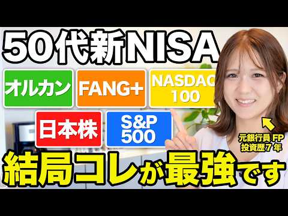
- 챕터: 0:00 オープニング · 2:06 日経平均とTOPIX、何が違う？ · 8:45 オルカンはなぜ人気なの？ · 12:54 S&P500はオルカンと何が違う？ · 15:58 NASDAQ100とFANG+の注意点は？ · 24:10 一番増えた銘柄を選べばいい？ · 27:51 今の組み合わせ、このままでいい？
- 설명 앞부분: ▼公式LINE 公式LINEにご登録後、動画内でお伝えしているキーワードを送っていただくと受け取れます🙆‍♀ 元銀行員でFPの資格を持つ私が 新NISAや老後資金など、お金のことを発信していきます🎙
- 같은 채널 평소 대비 ×1.2 (채널 최근 롱폼 중앙값 23,191회) · 평소 영상: 【損得は間違い？】知らないと120万円損します！老後に後悔しない正しい年金の受け取り方を元銀行員が… (23,191회) / 【要確認！】50代60代が気付かずに買いがちなNISAの落とし穴銘柄を、元銀行員目線で徹底的に解説… (21,248회)
- 대본 없음 (설명) — 음성인식이 끝나면 도입부·흐름이 들어감
- 댓글 9/9: 좋은 점 — 영상 0 · 감사·응원 0 · 더 알고 싶은 것 0 · 아쉬운 점 — 영상 0 · 반박·불만 — 의견 다름 0 · 정치·사회 0 · 경험 공유 0 · 구독·다음 기대 0

### 25. 마이너스 주식 계좌 가장 쉽게 탈출하는 방법 물타기? 존버? 고민하지 않아도 되는 물린 종목 최대한 손실을 줄이며 정리하는 현명한 방법

- https://www.youtube.com/watch?v=v6rUCbULG2A · 머니스트랩 · 구독자 550 · 조회수 97,027 (×176.4, 하루 1,464.1) · 좋아요 1,124 (1.2%) · 30.5분 · 2026-08-23 · 주제 묶음 8. 투자 심리·실패 · 형식 정보·해설 (그 밖) · 폴더 `W_v6rUCbULG2A` (웹 승인)
- 썸네일: 
- 설명 앞부분: 지수는 사상 최고를 찍었는데 왜 내 계좌만 파란색일까요. 개인 투자자 240만 명의 계좌를 열어본 자료에서 출발해, 물린 종목을 손실을 줄이며 정리하고 제대로 된 자리로 옮기는 순서를 정리했습니다. 이 영상에서 다루는 내용
- 같은 채널 평소 대비 ×156.5 (채널 최근 롱폼 중앙값 620회) · 평소 영상: 28년째 핫도그세트가 2,000원, 코스트코가 진짜 돈 버는 방법 "핫도그로는 안 남깁니… (663회) / "1억 모으는데 12년 4개월" 실수령 200만원이 1억 모으는 시간을 5년 당기는 5가… (577회)
- 대본 (음성인식(앞 5분), 4.9 음절/초) — 앞부분만, 흐름은 그 안까지 첫 20초: “물려 있다는 사실을 잊고 계셨다면 그나마 나은 쪽입니다. 진짜 문제는 매일 확인하면서도 아무것도 못하는 경우입니다. 아마 셋 중 하나일 겁니다. 계좌에 있는 줄도 모르고 몇 년을 지나친 종목. 매일 열어보지만 몇 년째 빠져나오지 못한 종목. 그리고 지금 팔면 정말 끝이라 참아 손을 못 떼는 종목.”
- 첫 1분: “물려 있다는 사실을 잊고 계셨다면 그나마 나은 쪽입니다. 진짜 문제는 매일 확인하면서도 아무것도 못하는 경우입니다. 아마 셋 중 하나일 겁니다. 계좌에 있는 줄도 모르고 몇 년을 지나친 종목. 매일 열어보지만 몇 년째 빠져나오지 못한 종목. 그리고 지금 팔면 정말 끝이라 참아 손을 못 떼는 종목. 마지막에 해당하신다면 오늘은 끝까지 보셔야 합니다. 그 결정을 미루는 동안 여러분 계좌에서 무엇이 사라지고 있는지 숫자로 보여드리겠습니다. 2025년 10월 31이었습니다. 그날 아침 뉴스의 첫 곡지는 코스피가 사상 최고치를 갈아치웠다는 소식이었죠. 빨간 숫자로 가득 찬 전광판 화면이 하루 종일 흘러 나왔고 증권 방송에서는 축포 같은 표현들이 오갔습니다. 바로 그날 한 대형증권사가 자사 고객의 계좌를 통째로 들여다”
- 흐름 (90초마다 첫 문장): 0:00 물려 있다는 사실을 잊고 계셨다면 그나마 나은 쪽입니다. → 1:35 물론 모두가 같은 크기로 물려 있는 건 아닙니다. → 3:00 우리는 보통 이 둘을 하나로 놓고 생각합니다. → 4:31 16번 통째로 갈아옵는다는 뜻이죠.
- 댓글 38/38: 좋은 점 — 영상 2 · 감사·응원 4 · 더 알고 싶은 것 1 · 아쉬운 점 — 영상 0 · 반박·불만 — 의견 다름 0 · 정치·사회 2 · 경험 공유 1 · 구독·다음 기대 0
  - 좋은 점 — 영상 👍16 “많은 도움이 됬습니다 로봇주애 _47% 물려있는데 하락장애서 매도 찬스를 놓쳐서 ㅠㅠ 처음엔 물타기 하다가 그때마다 하락해서 더 나락.ㅠㅠ 지근은 포기하고 분할매도 하고 반 남았는데 나머지도 분할매도 할 예정입니다”
  - 좋은 점 — 영상 👍1 “좋은 강의입니다.👍👍👍”
  - 감사·응원 👍8 “감사합니다..........”
  - 감사·응원 👍6 “카카오 안산다 ㅋ 감사 합니다”
  - 더 알고 싶은 것 👍0 “그럼 오른건 언제파나요?”
  - 정치·사회 👍5 “이재명 대통령님 응원합니다.”
  - 정치·사회 👍0 “웃기지마라 개미들 구십프로가 아작이났는데 뭐가 오십 팔프로라고 개소리 그만해 이번주식시장은 정부가 외국펀드투자판을 깔아준것인데 무슨 개소리 개미가 아무리 잘한다해도 거대한 자본으로 죠지는데 무슨 뾰쪽한수가 있나 솔직히 말해서 지금은 개미들 돈이 없어서 주식시장에 가고…”
  - 경험 공유 👍3 “내가 ㅅㅂ 이걸 28분을 들었어 아 진짜 내시간 금같은 내시간 이 목소리 절대듣지말자 늘 그랬건만 ㅅㅂ 아ㅅㅂ 진짜 내시간”

### 26. 유혈 낭자한 국장..폭락의 시작일까? / 이슈빡 / 뉴스헌터스

- https://www.youtube.com/watch?v=enkSdCIojAA · 뉴스헌터스 · 구독자 7,680 · 조회수 116,383 (×15.2, 하루 20,119.3) · 좋아요 283 (0.2%) · 17.9분 · 2026-10-15 · 주제 묶음 1. 주식 기초·초보 · 형식 인터뷰·강연·대담 · 폴더 `W_enkSdCIojAA` (웹 승인)
- 썸네일: 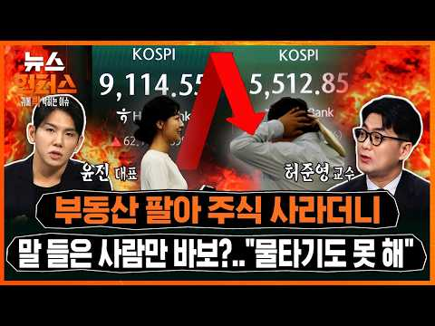
- 설명 앞부분: ■ 진행: 김종원, 윤태진 앵커 ■ 대담: 윤진 (블랙퀀트에쿼티 대표), 허준영 (서강대 경제학부 교수) 코스피와 코스닥 지수가 7%대 폭락한 '검은 목요일'이었습니다. 상장기업 시가총액은 오늘 하루에만 400조원 넘게 증발했고 코스피는 지난 6월 기록한 전고점보다 40% 이상 떨어졌습니다. 특히 코스피의 절반 정도를 차지하는 반도체 투톱 '삼전 · 닉스'는 AI 기업들의 자금 조달 비용 상승과 AI 투자 수익성 악화 우려가 커지고 중국 CXMT가 신기술 상용화를 예고하면서 주가가 미끄러지고 있습니다. 이런 상황에서, 손실이 커지…
- 같은 채널 평소 대비 ×2.5 (채널 최근 롱폼 중앙값 46,788회) · 평소 영상: 한국 7대 아동 성착취·실종 사건 유력 용의자 근황 '경악' / 사건Why / 뉴스헌터스 (56,140회) / "정말 역겨워요"..인근 사장님 싹 당한 00테러 경악 / 사건Why / 뉴스헌터스 (37,435회)
- 대본 없음 (설명) — 음성인식이 끝나면 도입부·흐름이 들어감
- 댓글 303/303: 좋은 점 — 영상 1 · 감사·응원 0 · 더 알고 싶은 것 0 · 아쉬운 점 — 영상 1 · 반박·불만 — 의견 다름 1 · 정치·사회 81 · 경험 공유 6 · 구독·다음 기대 0
  - 좋은 점 — 영상 👍0 “딱 이럴때 연기금이 뒤통수치면 레전드인데 ㅋㅋㅋㅋ”
  - 아쉬운 점 — 영상 👍0 “옛날부터 한국은 외인의 놀이터다. 반복되면 안되지만 계속 반복.”
  - 반박·불만 — 의견 다름 👍1 “아직도? "HBM 전환 때문에 한국 점유율이 줄어들었다?" 말도 안되는 헛소리 "HBM 전환 때문에 점유율이 줄어들었다"는 설명이 왜 완전한 오류인지에 대해 분명하게 재정리해 드립니다. 카운터포인트·노무라 리서치 차트(3Q24 ~ 2Q26)를 직관적으로 분석해보면, …”
  - 정치·사회 👍92 “재매이햄 망했스요 민주당 비상이라 이제 재매이자르기 할거같음”
  - 정치·사회 👍59 “좌파대통령이 하라는거 반대로만 하면 부자되는 대한민국...”
  - 경험 공유 👍0 “부동산팔아주식사라고 내가언제그랬서요. 난모르는 일이고 했다고해도 뭘 어쩌라고요 주식은 원래도박아녀 내말 진짜로 믿었써요 내가언제그랬서요 믿는너가 바보 모지란 죠다지”
  - 경험 공유 👍0 “버거형들이 삼전 하닉 실적좋을때 넘겨야지 그래야 제가격에 매물대 넘기지 뉴스에 팔라는 단순한것도 모르냐 전문가들말은 맨날 결과론적 명분찻기 볼필요도 없다”

### 27. [문남중 출연] "코스피 바닥, 7월29일에 이미 확인 끝! 전고점 회복 근거? '이것' 보시면 됩니다" #문남중 _261019

- https://www.youtube.com/watch?v=btSUFhvYPwk · 경제통마늘 · 구독자 13,900 · 조회수 328,405 (×23.6, 하루 35,746.1) · 좋아요 2,109 (0.6%) · 10.2분 · 2026-10-19 · 주제 묶음 5. 국내주식 · 형식 오디오북·낭독 (명언·인생조언) · 폴더 `W_btSUFhvYPwk` (웹 승인)
- 썸네일: 
- 설명 앞부분: 전문가 "10월 대폭락은 과도..7천선 회복 한달내로도 가능할 것" '7만전자·20만닉스' 전망? 마이크론, TSMC 실적으로 설명하고파 TSMC, 4분기 매출 전분기 대비 +14%, 전년 동기 대비 +58% 삼전닉스 역시 예상치 상회하는 실적 흐름 예상 글로벌증시 방향성 결정하는 美 증시 반등하면, 코스피도 반등 미 9월 소비자물가 예상치 상회, 매파적 통화정책, 코어위브 회사채 급락 등 모든 문제는 미국에서 시작됐지만, 그럼에도 미 증시 '평온' 美 중간선거 이후, 3년차까지 S&P500지수 계속 올랐던 과거 경험상, 내년 증…
- 대본 없음 (설명) — 음성인식이 끝나면 도입부·흐름이 들어감
- 댓글 225/226: 좋은 점 — 영상 3 · 감사·응원 14 · 더 알고 싶은 것 1 · 아쉬운 점 — 영상 0 · 반박·불만 — 의견 다름 7 · 정치·사회 13 · 경험 공유 10 · 구독·다음 기대 0
  - 좋은 점 — 영상 👍2 “시기가 조금씩 정확하게는 어렵지만 방향성을 항상 잘 맞았던거 같아요 그래서 너무 도움이 됩니다 삼성 sdi 말씀해 주셔서 작지만 수익 감사해요 오늘도 강하네요”
  - 좋은 점 — 영상 👍1 “열심히 보고 있습니당 ! 꾸준히 우상향 하다가 이번 하락은 중국반도체 때문인것 같은데, 막말로 이걸 어떻게 예측해요 자기네 회사에서도 기밀일텐데..,ㅋㅋ 일시적인거고 다시 꾸준히 우상향 한다고 계속 말씀하시니까 맘놓고 지켜볼께용 이번 하락에도 저만 아무렇지 않았던것 …”
  - 감사·응원 👍36 “시기를 맞추는건 신도 모를듯. 방향성만 잡아주시는 것만해도 감사합니다.~~”
  - 감사·응원 👍8 “문남중 위원님 오늘말씀도 감사합니다 위원님 말씀찾아들으러왔습니다 차분히대응하겠습니다 정말 감사합니다~^^”
  - 더 알고 싶은 것 👍0 “그냥 바닥 좀 알려주세요. 줏어 먹게요.”
  - 반박·불만 — 의견 다름 👍16 “7월폭락맞춘거말고 다틀렸다니까 자꾸 띄워주냐 7월폭락도 제대로된 이유로 맞춘게아니라 얻어걸린느낌임”
  - 반박·불만 — 의견 다름 👍6 “이 사람 말이 한번은 맞았죠... 그외는 완전 틀렸어요. 주식은 복잡한변수가 작용하는데... 물가와 금리만 보니.. 폭락 몇일전, 코스피 오천선갈일이 없고 오를일만 남았다고 했죠.. 그래서 현금넣었더니 오천으로 폭락!”
  - 정치·사회 👍38 “1400만 개미투자자를 기만하는 ‘무늬만’ 주주 보호법인 ‘의무공개매수제도’, ‘주가 누르기 방지법’의 전면 재검토 및 수정 입법 요청에 관한 청원 국회전자청원 참여 부탁드려요.”
  - 정치·사회 👍25 “외국인들 매수세 그리 강하지 않네요. ㅠㅠ”
  - 경험 공유 👍14 “이 사람 빨아주는 인간들 왜 이리 많냐. 내가 이 사람 5년 넘게 지켜 봤는데, 완전 반대방향으로 정말 턱도 없는 예측 한 경우도 여러번 봤다. 신도 모르는게 주식이다. 신의 영역에 도전을 하는 이런 류의 쓸데 없는 직업군 사람들 말 맹신하지 마라.”
  - 경험 공유 👍5 “주식은 신도 모른다...내가 볼텐 연말에 한번 더 빠질 것 같다...”

### 28. 삼성전자 하이닉스 왜 한국만 두 배 빠지나? 전 국민 계좌에서 700조 날아갔다

- https://www.youtube.com/watch?v=7di-34Ot12o · 경제야! 놀자~ · 구독자 3,510 · 조회수 45,853 (×13.1, 하루 8,797.9) · 좋아요 249 (0.5%) · 12.1분 · 2026-10-16 · 주제 묶음 2. 장기투자·ETF·지수 · 형식 정보·해설 (그 밖) · 폴더 `W_7di-34Ot12o` (웹 승인)
- 썸네일: 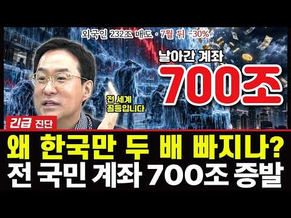
- 챕터: 0:00 하이라이트 — "700조, 800조가 날아갔어요" · 0:15 [경제야놀자 해설] 왜 한국만 두 배 빠지나 · 0:29 경제는 멀쩡, 문제는 수급 · 1:43 외국인 232조 매도 · 아직 차익 구간 · 2:56 [경제야놀자 해설] 외국인 232조 매도 · 3:17 반도체가 최선호에서 밀렸다 · 4:13 삼전닉스 60%의 함정 · 5:49 [경제야놀자 해설] 삼전닉스 60%의 함정 · 6:12 개인은 얼음 — 매물대 130조 · 거래대금 -70% · 7:20 수급의 대꼬임 · 8:39 [경제야놀자 해설] 외국인을 부를 두 가지 · 8:56 외국인은 언제 돌아오나 — 2차 웨이브 · 배당 5% · 10:21 시장의 신뢰를 회복할 비상 대책 · 10:35 전 국민 재산이 주식에 · 10:55 누구를 믿고 · 11:19 [경제야놀자 해설] 오늘의 세 줄 정리
- 설명 앞부분: 일본이 4% 빠진 날, 한국은 왜 두 배 넘게 빠졌을까. 매불쇼에서 박시동 평론가가 내놓은 답은 수급이다. 성장률 3.3%, 수출 최고치, 경제 기초는 멀쩡한데 사려는 사람이 없다는 것. 외국인은 올해 232조원을 팔았다. 작년 4월 2300선에서 산 돈은 아직 남는 장사고, 큰손은 반도체를 최선호에서 내렸다. 코스피의 60%가 삼성전자와 SK하이닉스라, 두 종목을 덜어 내는 동안엔 다른 한국 주식을 살 이유가 없다. 받아 줄 개인은 얼음이다. 매물대 130조원, 거래대금은 5월의 30%, 예탁금은 100조원 아래. 그럼 외국인은…
- 대본 없음 (설명) — 음성인식이 끝나면 도입부·흐름이 들어감
- 댓글 126/126: 좋은 점 — 영상 0 · 감사·응원 0 · 더 알고 싶은 것 1 · 아쉬운 점 — 영상 0 · 반박·불만 — 의견 다름 1 · 정치·사회 21 · 경험 공유 3 · 구독·다음 기대 0
  - 더 알고 싶은 것 👍1 “반도체전문애널리스트와삼전7만원외치는인간하고마창토론좀추진하면안될까요?어느정도야지 혹시인버스쳤으면수사받아야함.김거희와뭐가다른가?유가,금리로인해부침이있는거는인정근데전세계증권사애널들은바보인가?참어어가없네.부탁드립니다.”
  - 반박·불만 — 의견 다름 👍5 “우와 박시동이...헛소리에 내가 무슨말을 하리요 맛춘적이 없는데...”
  - 정치·사회 👍17 “정부가 나서서 광주에 공장 짓자고 하는 순간부터 모든게 끝난거야......정부에 휘들리는 기업... 누가 투자하냐”
  - 정치·사회 👍15 “왜 빠졌냐? 답은 간단하지요. 특히 삼성전자(우)는 펀더맨탈이 세계제일입니다. 이재명정귄의 정치,경제의 불획실성입니다. 삼전닉스를 정치에 이용하고 멱살잡고 패대기친것을 본 외국투자자들은 싹수없다고 보는것입니다. 투자국이 한국뿐입니까”
  - 경험 공유 👍5 “우와 박시동이...헛소리에 내가 무슨말을 하리요 맛춘적이 없는데...”
  - 경험 공유 👍2 “내가 그랬잖아. 외인 2월 중순부터 계속 매도 중이라고, 그런데 개미들은 지금 주식 안하면 바보된다고 주변인 끌어들였음. 가격이 엄청 올랐는데 외인 파는게 맞지. 좋은 뉴스? 이런 것 다 필요없다. 걍, 급경사로 올려 개미들 끌여들이고 이젠 계속 매도할 타이밍이니까 …”

### 29. 50대 옥탑방 부부, "그 나이에 왜 주식을..."

- https://www.youtube.com/watch?v=FRzyTNO9mNI · 반백살, 옥탑방 이야기 · 구독자 703 · 조회수 43,363 (×61.7, 하루 1,747.6) · 좋아요 424 (1.0%) · 6.3분 · 2026-10-03 · 주제 묶음 1. 주식 기초·초보 · 형식 정보·해설 (그 밖) · 폴더 `W_FRzyTNO9mNI` (웹 승인)
- 썸네일: 
- 설명 앞부분: 지난 영상 이후, 50대 옥탑방 부부인 저희의 주식 도전에 많은 분들이 걱정과 조언을 남겨주셨습니다. 진심으로 감사드립니다. "그 나이에 왜 위험하게 주식을 하느냐"는 물음에 오늘 제 진솔한 속마음을 전합니다. 사기와 빚을 겪으며 깨달은 금융 무지의 서러움, 그리고 평생 일할 수 없다는 현실 앞에 저희에게 파이어족은 노후를 위한 '마지막 생존 전략"입니다. 지치지 않고 끝까지 걸어갈 수 있도록 많은 응원과 격려 부탁드립니다. 오늘도 시청해 주셔서 감사합니다.
- 같은 채널 평소 대비 ×8.9 (채널 최근 롱폼 중앙값 4,870회) · 평소 영상: 50대 옥탑방 부부, 아프다는 말도 없던 남편이... (6,181회) / 8월 폭염 속, 침침해진 눈으로 배달을 나섭니다. (3,558회)
- 대본 (음성인식(앞 5분), 4.2 음절/초) — 앞부분만, 흐름은 그 안까지 첫 20초: “안녕하세요 구독자 여러분 50대 옥탑방 아내입니다. 어느 덧 바람 끝이 제법 선선해진 가을이 왔네요. 하늘도 높아지고 날씨가 참 좋습니다. 우리 구독자분들도 오늘 하루 기분 좋게 잘 보내고 계신가요? 옥탑방에서 바라보는 하늘은 계절이 바뀔 때마다 괜히 마음을 몽글몽글하게 만드는 것 같아요.” — 도입부 유형: 숫자로 시작, 시청자 부르기
- 첫 1분: “안녕하세요 구독자 여러분 50대 옥탑방 아내입니다. 어느 덧 바람 끝이 제법 선선해진 가을이 왔네요. 하늘도 높아지고 날씨가 참 좋습니다. 우리 구독자분들도 오늘 하루 기분 좋게 잘 보내고 계신가요? 옥탑방에서 바라보는 하늘은 계절이 바뀔 때마다 괜히 마음을 몽글몽글하게 만드는 것 같아요. 오늘 이렇게 영상을 제작하는 것은 지난 영상 이후에 정말 많은 분들이 남겨주신 댓글에 마음 깊이 감사하다는 말씀을 전하고 싶어서 입니다. 제가 주식공부에 보겠다고 말씀드린 이후로 걱정 어린 마음으로 따뜻한 조언과 충고를 남겨주신 분들이 정말 많았어요. 주식은 위험하다 잘못하면 큰일 난다 하며 자기 일처럼 걱정해주시는 마음 하나하나 읽으면서 얼마나 감사했는지 모릅니다.”
- 흐름 (90초마다 첫 문장): 0:00 안녕하세요 구독자 여러분 50대 옥탑방 아내입니다. → 1:36 나이가 한 살 한 살 들수록 느끼는 게 있어요. → 3:06 그 분야에 제대로 뛰어들려면 정말 피나는 공부와 노력이 필요하다는 것을… → 4:36 지금은 남편과 제가 노동소득으로 벌고 있지만 저라도 자본소득을 공부하고…
- 댓글 187/187: 좋은 점 — 영상 6 · 감사·응원 27 · 더 알고 싶은 것 3 · 아쉬운 점 — 영상 1 · 반박·불만 — 의견 다름 3 · 정치·사회 2 · 경험 공유 20 · 구독·다음 기대 0
  - 좋은 점 — 영상 👍10 “목소리가 좋으시네요 편안하고 듣기에 좋아요 비슷한 나이인데 주식을 해 보고 있어요 손절하여서 손해도 보았지만 그러면서 배우고 있어요 같은 생각으로 하며 접근하고 있어요 성투하시길 바래요🎉”
  - 좋은 점 — 영상 👍4 “목소리가 차분하고 편안해서 듣기 좋습니다~~ 힘내시고 파이팅 하세요~~”
  - 감사·응원 👍17 “목소리 좋으시네요 아무것도 안하면 아무것도 될 수 없을 껍니다 화이팅 하시길요”
  - 감사·응원 👍16 “저도 주식하면 패가 망신한다는 부모님 말씀을 금과옥조로 여기며 살다가, 50세가 넘은 나이에, 금기의 영역으로 생각했던 주식을 시작했어요. 개별주는 하나도 안하고, 미국지수, 국내지수만 투자하는데...진작 시작할걸 싶네요. 3년전부터 했는데 5년전, 10년전 시작할걸…”
  - 더 알고 싶은 것 👍2 “영상 자주 올려주세요❤ 주식공부도 열심히 하시고 화이팅입니다 ❤”
  - 더 알고 싶은 것 👍2 “뭐하나 물어볼게요..주식하셔서 얼마나 버셔서 만족 하실가요? 그냥 전 풍차돌리기 예금이나 적금 추천드리고...인생 한방 절대 없습니다. 소수의 행운이 나에게 올 확률이 정말 힘들다는거 다시 한번 이 나이에 잊지 마시길 부탁드립니다.”
  - 아쉬운 점 — 영상 👍1 “위 제목 아래에 AI라고 써있는데요 목소리는 ai같지않고 영상도 ai같지않은데..어느것이 Ai 인가요?”
  - 반박·불만 — 의견 다름 👍2 “하지마시고 한국 미국 반반 지수 장기투자하세요. 몇달한다고 되는게 아닙니다.”
  - 반박·불만 — 의견 다름 👍0 “안녕하세요 52인데요^^ 너무 공감합니다. ISA계좌 연금저축계좌 먼저만드세여 ISA계좌는 한해2천만원해서5년1억가능합니다.연금계좌는 1800까지가능합니다. 우리가족모두 만들어서 하고있네여. 종목추천은아닙니다 제가하는겁니다. ISA계좌에서 하시면 배당세금없이 재투자 …”
  - 정치·사회 👍1 “대통령이 하라해서 ㅡㅡㅡㅡ. 돈번것들은 재용 태원이ㅡㅡㅡㅡ”
  - 정치·사회 👍0 “제 경험을 말씀드려 볼게요. 현재 54살 노총각입니다. 24년 하반기부터 10년 이상 다니던 직장이 경기가 안좋아지면서 해고 위기가 느껴졌습니다. 당시까지 모아둔 돈이라곤 현금 3억 조금 넘게 가지고 있었고 집은 월세 45만원 오피스텔에 살고 있었죠. 당장 짤리면 4…”
  - 경험 공유 👍26 “목소리가 참 좋으시네요😊 저도 50대 중반이고 주식으로 노후자금 준비를 하고있어요 이제는 근로소득만 가지고 자산을 늘리는 시대는 끝났다고 봅니다 부동산은 목돈이 들어가니 서민들은 주식이 접근하기 쉽죠 저도 처음에 주식.금융공부 많이 하고 시작했는데요, 결국 공부보다 …”
  - 경험 공유 👍16 “저도 주식하면 패가 망신한다는 부모님 말씀을 금과옥조로 여기며 살다가, 50세가 넘은 나이에, 금기의 영역으로 생각했던 주식을 시작했어요. 개별주는 하나도 안하고, 미국지수, 국내지수만 투자하는데...진작 시작할걸 싶네요. 3년전부터 했는데 5년전, 10년전 시작할걸…”

### 30. 50대에 은퇴하려면 QLD 몇 개 모아야 할까?

- https://www.youtube.com/watch?v=91-r5_pdQUw · 미국회계사 샘돌이 투자연구소 · 구독자 1,660 · 조회수 12,678 (×7.6, 하루 3,921.9) · 좋아요 84 (0.7%) · 8.2분 · 2026-10-18 · 주제 묶음 10. 노후·연금 투자 · 형식 브이로그·직접 해본 이야기 · 폴더 `W_91-r5_pdQUw` (웹 승인)
- 썸네일: 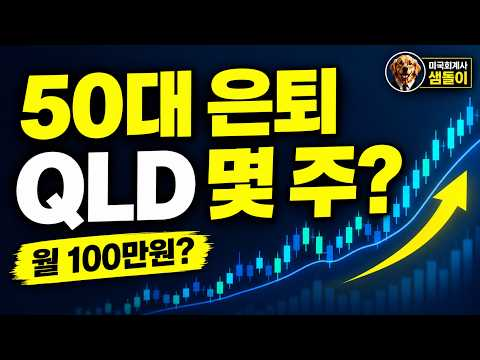
- 설명 앞부분: 50대에 은퇴하려면 도대체 얼마가 필요할까요? 그리고 그 돈을 만들기 위해 매달 얼마를 투자해야 할까요? 이번 영상에서는 은퇴 후 월 300만 원의 현금흐름을 목표로 잡고, S&P500 1배수 투자와 QLD 60% + 단기채 40% 포트폴리오를 비교해봤습니다. 단순히 "20년 뒤 10억입니다"라고 이야기하는 것이 아니라, 50대 은퇴를 위한 목표자산은 얼마인지 S&P500에 투자한다면 매월 얼마가 필요한지 QLD + 단기채 조합이라면 월 적립액이 얼마나 줄어드는지 10억 원을 만들었을 때 QLD는 몇 주가 필요한지 은퇴가 가까워졌…
- 같은 채널 평소 대비 ×3.6 (채널 최근 롱폼 중앙값 3,512회) · 평소 영상: QQQ vs QLD+현금40%, 회계사가 끝까지 고민한 이유 (3,512회) / QLD 올인 vs SCHD 적립.. 둘 다 틀렸습니다 (회계사 결산) (3,993회)
- 대본 없음 (설명) — 음성인식이 끝나면 도입부·흐름이 들어감
- 댓글 16/16: 좋은 점 — 영상 0 · 감사·응원 0 · 더 알고 싶은 것 1 · 아쉬운 점 — 영상 0 · 반박·불만 — 의견 다름 0 · 정치·사회 0 · 경험 공유 1 · 구독·다음 기대 0
  - 더 알고 싶은 것 👍0 “안녕하세요 AI들은 QLD 완전 극혐하던데.. 60대이후 QLD를 안전하게 관리하는 방법들도 좀 다뤄주시면 좋겠습니다.. 그냥 60대들은 QLD 손 안대는게 좋다고들 하는데.. 방법이 없을까요?”
  - 경험 공유 👍0 “요즘 드는 생각이 제가 대학생에서 사회 초년생 때, 2000년에서 2011 미국 시장 인데요. 이번엔 2000년대 같은 폭락은 피한다 해도…인터넷 붐 및 신기술발전은 망한게 아니라 이 기간 동안 계속 됐잖아요. 근데 미국 주식은 폭락후 약 10년동안 횡보 였거든요. …”

### 31. Mutual Fund Manager's Guide To Investing For The Next 10 Years

- https://www.youtube.com/watch?v=_gnrJW4h_lE · Angel One Podcasts · 구독자 4,880 · 조회수 66,958 (×13.7, 하루 8,659.0) · 좋아요 650 (1.0%) · 53.9분 · 2026-10-13 · 주제 묶음 기타 · 형식 정보·해설 (그 밖) · 폴더 `W__gnrJW4h_lE` (웹 승인)
- 썸네일: 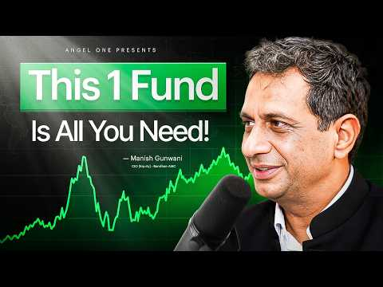
- 챕터: 0:00 Intro · 2:00 Why Are Foreign Investors Sel… · 7:45 Is The Worst Behind Us In The… · 9:04 Is This The Right Time To Inv… · 13:05 How Much Should You Allocate … · 14:49 What Returns Should You Expec… · 15:59 How To Identify A Good Small-… · 18:42 What Makes A Small-Cap Fund O… · 21:06 How Do Fund Managers Pick Win… · 25:14 How To Find Stocks That Can D… · 27:57 When Should You Sell A Stock? · 31:15 When Should You Book Profits … · 32:54 3 Sectors That Could Drive In… · 37:01 Can Indian Manufacturing Beco… · 38:56 Where Is India's Premium Cons… · 40:18 How Should Indian Investors A… · 42:59 Should You Invest In India Or… · 45:16 How To Build Your First ₹1 Cr… · 47:13 Small Caps Vs Large Caps: Whe… · 48:50 The One Investing Question Pe…
- 설명 앞부분: Is the Indian stock market sending mixed signals? Global investors have been cautious, domestic investors are putting in record SIP money, and company earnings are strong. In this podcast, Manish Gunwani, CIO of Bandhan AMC, decodes this contradiction, shares how he thinks about market cycles and r…
- 같은 채널 평소 대비 ×0.6 (채널 최근 롱폼 중앙값 119,608회) · 평소 영상: Boring Stocks Make the Most Money - Here's Why.. (130,804회) / How To Make ₹0 to ₹1 Crore Through Mutual Fund SI… (108,413회)
- 대본 없음 (설명) — 음성인식이 끝나면 도입부·흐름이 들어감
- 댓글 34/34: 좋은 점 — 영상 0 · 감사·응원 0 · 더 알고 싶은 것 0 · 아쉬운 점 — 영상 0 · 반박·불만 — 의견 다름 0 · 정치·사회 0 · 경험 공유 0 · 구독·다음 기대 0

### 32. Gold and Silver Investors Are Getting Caught Out by the ATO

- https://www.youtube.com/watch?v=sY77wNqqiLA · Navexa · 구독자 7,610 · 조회수 84,671 (×11.1, 하루 13,318.2) · 좋아요 870 (1.0%) · 10.2분 · 2026-10-14 · 주제 묶음 기타 · 형식 정보·해설 (그 밖) · 폴더 `W_sY77wNqqiLA` (웹 승인)
- 썸네일: 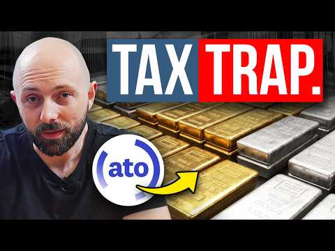
- 설명 앞부분: Gold and silver get taxed the moment you dispose of them, whether you sell, swap, gift or move them into a trust or SMSF, and that's true whether or not the ATO is watching. The bigger risk is substantiation. Without records you can't prove your cost base, your holding period, the premium you paid …
- 같은 채널 평소 대비 ×12.9 (채널 최근 롱폼 중앙값 6,542회) · 평소 영상: The Dollar-Cost Averaging Mistake Costing Austral… (6,800회) / One Hack That Dramatically Lowers Tax on Your ETFs (6,283회)
- 대본 없음 (설명) — 음성인식이 끝나면 도입부·흐름이 들어감
- 댓글 486/486: 좋은 점 — 영상 0 · 감사·응원 0 · 더 알고 싶은 것 0 · 아쉬운 점 — 영상 0 · 반박·불만 — 의견 다름 0 · 정치·사회 0 · 경험 공유 0 · 구독·다음 기대 0

### 33. Is This the Time to Buy Indian Equities? Pankaj Tibrewal on FII Outflow & Investment Oppo…

- https://www.youtube.com/watch?v=jUrGWhhASXU · Wealth By Motilal Oswal · 구독자 14,700 · 조회수 97,281 (×6.6, 하루 24,675.2) · 좋아요 632 (0.7%) · 64.4분 · 2026-10-17 · 주제 묶음 기타 · 형식 정보·해설 (그 밖) · 폴더 `W_jUrGWhhASXU` (웹 승인)
- 썸네일: 
- 챕터: 0:00 Teaser & Highlights · 1:45 Decoding the Current Market P… · 8:25 Cost of Capital, Global Bond … · 12:30 FII Selling vs Domestic Inflo… · 20:30 The "Two Indias" in the Stock… · 23:50 Promoter's Edge: How to Evalu… · 29:40 Gorilla to King Kong Framewor… · 37:45 Valuing New-Age Tech Companie… · 39:25 Big Mega Trends: Manufacturin… · 44:50 Active vs. Passive Investing … · 47:05 Managing Growth vs. Valuation… · 49:15 Asset Allocation Strategy for… · 52:30 Biggest Mistakes Retail Inves… · 55:30 Developing the Right Temperam… · 58:30 Rapid Fire Round
- 설명 앞부분: In this episode of Wealth by Motilal Oswal, we are joined by Pankaj Tibrewal, Founder of Ikigai Asset Manager and one of India’s most respected fund managers with over two decades of market experience. In a volatile market environment where investors' patience is being tested, Pankaj breaks down hi…
- 같은 채널 평소 대비 ×1.3 (채널 최근 롱폼 중앙값 73,098회) · 평소 영상: Forget Blue Chips, Here's Where the REAL Money Is… (73,098회) / Deepak Shenoy on Building Wealth Without Predicti… (57,110회)
- 대본 없음 (설명) — 음성인식이 끝나면 도입부·흐름이 들어감
- 댓글 64/64: 좋은 점 — 영상 0 · 감사·응원 0 · 더 알고 싶은 것 0 · 아쉬운 점 — 영상 0 · 반박·불만 — 의견 다름 0 · 정치·사회 0 · 경험 공유 0 · 구독·다음 기대 0

### 34. Corporate Slave to Financially Free: The Passive Income 🐐

- https://www.youtube.com/watch?v=knkqhQrQS60 · The Retail Rundown · 구독자 1,580 · 조회수 86,225 (×54.6, 하루 2,421.2) · 좋아요 823 (0.9%) · 80분 · 2026-09-22 · 주제 묶음 2. 장기투자·ETF·지수 · 형식 정보·해설 (그 밖) · 폴더 `W_knkqhQrQS60` (웹 승인)
- 썸네일: 
- 챕터: 0:00 Intro · 2:05 Adriano's start in trading · 4:53 Discovering dividends & cover… · 9:00 Selling the condo & hitting f… · 14:26 Quitting their jobs · 16:04 Moving to Panama tax-free · 19:37 Becoming a Canadian non-resid… · 26:51 Cost of living & healthcare i… · 44:05 Income investing & the 25% le… · 58:35 Why covered call ETFs get so … · 70:49 Portfolio reveal: $50K/month …
- 설명 앞부분: That journey led them to quit their jobs in their mid-30s, sell everything, and move to Panama full-time, where a territorial tax system means they pay almost nothing on their income. Adriano breaks down how he built his portfolio from a messy 120-holding starter fund into a focused covered call st…
- 같은 채널 평소 대비 ×12.3 (채널 최근 롱폼 중앙값 7,029회) · 평소 영상: Veteran Portfolio Manager on AI Bubble, Market Cr… (7,038회) / Turning $15 into $4000: The Most UNHINGED Side Hu… (7,020회)
- 대본 (자막, 0.0 음절/초) 첫 20초: “My wife and I were focusing on paying down the mortgage as a priority. So, we paid off our 20-year mortgage in seven years. Now, I would call my banker and say, "Increase the mortgage, increase the mortgage, increase the mortgage." >> Cuz I know Panama is very great for taxes. >> A couple of our fri”
- 첫 1분: “My wife and I were focusing on paying down the mortgage as a priority. So, we paid off our 20-year mortgage in seven years. Now, I would call my banker and say, "Increase the mortgage, increase the mortgage, increase the mortgage." >> Cuz I know Panama is very great for taxes. >> A couple of our friends are moved there, including you. I think you kind of started the whole trend. >> Yeah. I mean, w”
- 흐름 (90초마다 첫 문장): 0:00 My wife and I were focusing on paying → 1:31 call ETFs retirement is never the word → 3:00 um I started well I didn't really know → 4:30 long time ago. We were basically focused → 6:01 worry, I got you. Um, I really like the → 7:31 you were you still paying off your → 9:01 you're not going to get rich off → 10:31 month in Montreal like very comfortably → 12:00 >> Wait, so I want to backtrack a little → 13:30 every single second there's revenue → 15:01 >> She quit first. I continued on still → 16:32 >> So, we started looking into places a… → 18:01 within → 19:31 >> I I still have a Canadian bank accou… → 21:00 >> the day what we left or the day we → 22:31 secondary, a business. Secondary ties → 24:00 cash account. So how it works, you know, → 25:30 don't refund is Canadian eligible → 27:00 become a non-resident. You lose all the → 28:30 would say is
- 댓글 134/155: 좋은 점 — 영상 0 · 감사·응원 0 · 더 알고 싶은 것 0 · 아쉬운 점 — 영상 0 · 반박·불만 — 의견 다름 0 · 정치·사회 0 · 경험 공유 0 · 구독·다음 기대 0

### 35. 70배당할머니 배당금으로 자동차 샀어요

- https://www.youtube.com/watch?v=yUIcS9aKUzg · 이수남 · 구독자 1,300 · 조회수 13,155 (×10.1, 하루 1,901.4) · 좋아요 111 (0.8%) · 17.6분 · 2026-10-14 · 주제 묶음 3. 배당 · 형식 정보·해설 (그 밖) · 폴더 `W_yUIcS9aKUzg` (웹 승인)
- 썸네일: 
- 같은 채널 평소 대비 ×44.7 (채널 최근 롱폼 중앙값 294회) · 평소 영상: #70배당할머니#대만여행#단수이옛거리#스타벅스 (331회) / (시낭송)고요에서 깨어나 다시 삶으로 (낭송/김광숙) (257회)
- 대본 없음 (없음) — 음성인식이 끝나면 도입부·흐름이 들어감
- 댓글 27/27: 좋은 점 — 영상 0 · 감사·응원 1 · 더 알고 싶은 것 1 · 아쉬운 점 — 영상 0 · 반박·불만 — 의견 다름 0 · 정치·사회 0 · 경험 공유 3 · 구독·다음 기대 0
  - 감사·응원 👍2 “진솔한 목소리로 삶의 여정을 들려주셔서 감사합니다. 왠지 살아갈 날들이 무섭지 않네요~~”
  - 더 알고 싶은 것 👍2 “리이즈코리아벨리어커버드코드번호알려주세요”
  - 경험 공유 👍3 “저도 57세에 운전을 시작했어요~^^ 더 나이 먹음 못할거 같고, 정년 이후 여행 하려면 운전은 필수 인거 같아요 ㅎ 요즘 동생이랑 각자 자차로 운전해서 여행 다니는데 너무 좋아요😅😊”
  - 경험 공유 👍2 “자동차 일대기 너무 재미 있어요^^ 노동수입은 한계가 있어요. 몸둥이는 한개인데.. 금융수입이 답이라는 결론을 내리고 저도 배당주올인 입니다^^”

### 36. 【Eng Sub】AI泡沫會爆嗎？美股一直升？基金經理教你選ETF與科技股｜US Stocks 101

- https://www.youtube.com/watch?v=fMHfTr51OfM · City Spotlight 傾城計話 · 구독자 30,600 · 조회수 99,008 (×3.2, 하루 42,790.4) · 좋아요 1,657 (1.7%) · 50.3분 · 2026-10-19 · 주제 묶음 2. 장기투자·ETF·지수 · 형식 정보·해설 (그 밖) · 폴더 `W_fMHfTr51OfM` (웹 승인)
- 썸네일: 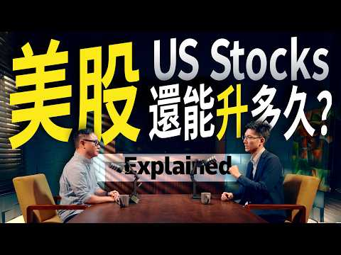
- 챕터: 0:00 精彩內容 ｜ Highlights · 0:52 美股投資入門介紹 ｜ US Stocks 101 · 2:14 買股票如何賺錢？股息與股東權益 ｜ Stock Owner… · 4:09 GOOG與GOOGL有甚麼分別？ ｜ Share Clas… · 5:28 股票成交量與買賣差價怎樣看？ ｜ Volume & Spr… · 6:53 股票價格由誰決定？為甚麼會升跌？ ｜ Stock Pric… · 8:09 公司有好消息，股價為甚麼不升？ ｜ News & Fund… · 9:38 ETF是甚麼？與買個股有甚麼分別？ ｜ ETFs vs. … · 12:04 標普500與納斯達克100怎樣選？ ｜ S&P 500 v… · 13:27 新手買ETF還是個股？先看風險承受能力 ｜ Risk & … · 14:59 退休後怎樣投資？資金用途比年齡更重要？ ｜ Retirem… · 16:56 基金經理為甚麼跑輸大市？ ｜ Active Fund Pe… · 18:16 美股為甚麼長期跑贏港股？ ｜ US vs. Hong Ko… · 22:20 歐洲與亞洲股市表現為何不同？ ｜ Global Marke… · 24:12 美股大跌後會回升，個股也一樣嗎？ ｜ Market Rec… · 25:51 韓國股市為甚麼大升大跌？ ｜ Leverage & Vol… · 27:58 為甚麼美國有這麼多科技公司？ ｜ Tech & Start… · 29:37 投資未上市公司，上市後一定賺錢嗎？ ｜ Private E… · 30:59 為甚麼海外投資者轉買美股？ ｜ Global Capita… · 31:57 AI股票升了很多，現在買是否太遲？ ｜ AI Stock …
- 설명 앞부분: 📈 美股為甚麼長期向上？AI股票已經升了這麼多，現在入市是否太遲？NVIDIA之後，下一個投資機會在哪裏？ 本集《傾城計話 City Spotlight》邀請擁有基金管理經驗的投資專家Wil，深入拆解美股投資、ETF與個股的分別，以及標普500和納斯達克100的投資策略。連專業基金經理都可能跑輸大市，普通人應該如何選擇？ 從退休投資的「錢的年齡」，到AI會否重演科網泡沫、機械人與自動駕駛的未來機會，帶你看懂美股趨勢、投資風險，以及如何更明智地運用自己的資金！ 📈 Why does the US stock market keep rising? Is it too late to inves…
- 같은 채널 평소 대비 ×1.9 (채널 최근 롱폼 중앙값 52,209회) · 평소 영상: 【Eng Sub】父母出院需要照顧？Medicare到底包甚麼？Home Health、康復院一次… (52,209회) / 【Eng Sub】人在美國還有海外資產？銀行戶口、股票、房產最容易忽略甚麼？ Overseas a… (48,582회)
- 대본 없음 (설명) — 음성인식이 끝나면 도입부·흐름이 들어감
- 댓글 120/120: 좋은 점 — 영상 0 · 감사·응원 0 · 더 알고 싶은 것 0 · 아쉬운 점 — 영상 0 · 반박·불만 — 의견 다름 0 · 정치·사회 0 · 경험 공유 0 · 구독·다음 기대 0

### 37. 단타 5년차가 알려준 ＂잃지 않는 법＂ 딱 3가지 ｜ 코스피 9000시대 생존법

- https://www.youtube.com/watch?v=WnuVkKRjcuI · 돈의흐름도 · 구독자 1,380 · 조회수 153,227 (×111.0, 하루 1,918.8) · 좋아요 2,650 (1.7%) · 13.5분 · 2026-08-09 · 주제 묶음 5. 국내주식 · 형식 정보·해설 (그 밖) · 폴더 `W_WnuVkKRjcuI` (웹 승인)
- 썸네일: 
- 설명 앞부분: 단타 5년차가 알려준 ＂잃지 않는 법＂ 딱 3가지 ｜ 코스피 9000시대 생존법 경제를 제대로, 그리고 쉽게. 🏴‍☠ 이 채널에서 다루는 것들 주식·ETF·배당주 투자 분석 환율·금리·인플레이션 경제 해설 미국·한국 증시 및 글로벌 시장 동향 부동산·원자재·달러 등 자산 시장 분석 재테크 초보를 위한 경제 상식 어렵고 딱딱하게만 느껴지던 경제 뉴스, 경제해적단과 함께라면 달라집니다. 복잡한 시장의 흐름을 단순하고 명확하게 짚어드립니다. 월급쟁이도, 사회초년생도, 재테크를 막 시작한 분도 경제해적단과 함께라면 경제가 보이기 시작합니…
- 같은 채널 평소 대비 ×8,512.6 (채널 최근 롱폼 중앙값 18회) · 평소 영상: ＂천만원으로 3억, 매달 50만원이 20년 뒤 만드는 숫자＂ (18회) / ＂50대 노후 3억, 매달 100만원 만드는 법 (연금·복리·종잣돈)＂ (18회)
- 대본 (음성인식(앞 5분), 5.5 음절/초) — 앞부분만, 흐름은 그 안까지 첫 20초: “제가 아는 동생 중에 단타로 5년째 먹고 사는 친구가 있어요 전업으로요? 처음엔 저도 안 믿었어요 다들 망한다는 단타로 어떻게 5년을 버티냐고요 근데 옆에서 매매하는 걸 보고 깜짝 놀랐어요 종목을 신들린 듯 고를 줄 알았는데 의외로 사곱하는 건 되게 단순하더라고요 대신 딱 하나 남들이 절대 안 지키는 걸 기계처럼 지키고 있었어요” — 도입부 유형: 질문으로 시작, 숫자로 시작, 내 이야기·사연
- 첫 1분: “제가 아는 동생 중에 단타로 5년째 먹고 사는 친구가 있어요 전업으로요? 처음엔 저도 안 믿었어요 다들 망한다는 단타로 어떻게 5년을 버티냐고요 근데 옆에서 매매하는 걸 보고 깜짝 놀랐어요 종목을 신들린 듯 고를 줄 알았는데 의외로 사곱하는 건 되게 단순하더라고요 대신 딱 하나 남들이 절대 안 지키는 걸 기계처럼 지키고 있었어요 그게 뭐냐고 물어봤죠 그 친구가 한 말이 잊지 않아요 형 단타는 잘 사는 기술이 아니라 잘 버티는 기술이에요 차트 공부 100날 해봐야 소용 없다는 거예요 오늘 그 동생이 5년 동안 지켜온 그 한 가지를 여러분한테 그대로 풀어드릴게요 그리고 100만 원으로 그걸 어떻게 몸에 익히는지까지요 이거 하나만 가져가셔도 오늘 영상 값은 하실 거예요 끝까지 보세요 좋아요, 구독, 알림 설정 꼭”
- 흐름 (90초마다 첫 문장): 0:00 제가 아는 동생 중에 단타로 5년째 먹고 사는 친구가 있어요 → 1:31 이런 장을 보면 무슨 생각이 들까요? → 3:02 수익률은 오히려 더 낮았어요 → 4:31 근데 손실이 난 종목은 22%만 팔아요
- 댓글 96/96: 좋은 점 — 영상 3 · 감사·응원 2 · 더 알고 싶은 것 3 · 아쉬운 점 — 영상 4 · 반박·불만 — 의견 다름 3 · 정치·사회 0 · 경험 공유 7 · 구독·다음 기대 1
  - 좋은 점 — 영상 👍6 “너무 꼭 맞는 말씀입니다. 100원만 수익을 본다하더라도 100만원 1000만원 욕심을 버리기까지...다겪어봐야 조금 느끼게 되더라구요..”
  - 좋은 점 — 영상 👍2 “도움이 많이 됐습니다.참고하도록할께요.잠시 잊고 단타를 해서 손절 많이 했는데 이영상보고 뜨끔했네요.좋은영상 감사합니다”
  - 감사·응원 👍2 “도움이 많이 됐습니다.참고하도록할께요.잠시 잊고 단타를 해서 손절 많이 했는데 이영상보고 뜨끔했네요.좋은영상 감사합니다”
  - 더 알고 싶은 것 👍1 “구독, 좋아요,,,알림설정. 알려주세요.”
  - 아쉬운 점 — 영상 👍4 “단타 30년차로 잃지 않는 방법을 알려준다면 당장 주식을 접어라 그게 유일한 방법이다 그래도 주식을 하고 싶다면 종목을 보고 매매 하지말고 시장을 보고 매매해라 시장이 아니라고 하는데 시장을 이길라고 덤비면 백퍼 망한다 종목 차트 백날 선으로 찍찍 그어봐야 시장폭락하…”
  - 아쉬운 점 — 영상 👍2 “에이라.. 뻔한 이야기 가지고.. 뭐 특별한 비법이 있는 거 마냥...”
  - 반박·불만 — 의견 다름 👍5 “챠트 보는 법도 아니라 하고, 보조지표 보는 것도 아니라 하고, 종목 찍는 법도 아니라하는 건 제대로 공부를 안 했거나, 남들 말과 책에 쓰인 대로 맹신하며 투자하기 때문임. 제대로 알면 확률은 엄청난데 어설피 배우고 익힌 실력으로 하다가 매번 실패하는 경우가 많게 …”
  - 반박·불만 — 의견 다름 👍0 “영상 좋아요. 그런데 영상 후반부에 내가 이런 걸 지킬 자신이 있는가라고 자문해보라고 하시는데, 이런건 머리로 상상으로 자문한다고 알 수 있는 건 아니죠. 결국 몸으로 경험해봐야 내가 될놈인지 안될놈인지 체득할 수 있죠.”
  - 경험 공유 👍17 “많은 시련을 겪고 나서야만이 이 영상의 의미가 얾마나 중요한지를 깨닫게 되지요.”
  - 경험 공유 👍14 “단타는 잃지 않는게 중요.. 내가 정한 매도 포인트에서 기계적으로 매도해야함. 욕심내는 순간 지옥으로 떨어짐.”
  - 구독·다음 기대 👍1 “구독, 좋아요,,,알림설정. 알려주세요.”

### 38. POV: Gaji Sama dengan Temanmu, Tapi Kamu Keluar dari Pabrik Lebih Awal Berkat Dividen

- https://www.youtube.com/watch?v=_-rdF2o1v0c · ncek invest · 구독자 7,150 · 조회수 66,053 (×9.2, 하루 9,622.0) · 좋아요 441 (0.7%) · 8.3분 · 2026-10-14 · 주제 묶음 기타 · 형식 정보·해설 (그 밖) · 폴더 `W__-rdF2o1v0c` (웹 승인)
- 썸네일: 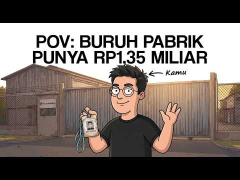
- 챕터: 0:00 Hari terakhir di pabrik · 1:00 Level 1: Gaji dan Dividen · 2:00 Level 2: Dividen Pertama · 3:35 Level 3: Dividen Bisa Turun · 5:05 Level 4: Angka yang Terlalu L… · 6:45 Level 5: Harga Sebuah Bel · 7:45 Penutup
- 설명 앞부분: Teman satu lini bilang, "Pensiun dini dari dividen? Ngimpi lo." Dua puluh satu tahun kemudian, kamu melepas ID card pabrikmu untuk terakhir kali. Di video POV ini, kamu akan menjalani 21 tahun hidup seorang buruh pabrik yang gajinya biasa saja, tapi belajar dari seorang mandor tua bahwa gaji adalah…
- 같은 채널 평소 대비 ×8.1 (채널 최근 롱폼 중앙값 8,118회) · 평소 영상: POV: Temanmu Daftar CPNS untuk Keempat Kalinya, K… (8,271회) / POV: Petani Kopi Menyisihkan 20 Persen Tiap Panen… (7,965회)
- 대본 없음 (설명) — 음성인식이 끝나면 도입부·흐름이 들어감
- 댓글 36/36: 좋은 점 — 영상 0 · 감사·응원 0 · 더 알고 싶은 것 0 · 아쉬운 점 — 영상 0 · 반박·불만 — 의견 다름 0 · 정치·사회 0 · 경험 공유 0 · 구독·다음 기대 0

### 39. 주식투자 5년간 수익이 없던 내가 드디어 깨달은 '이것'

- https://www.youtube.com/watch?v=uqsGXwRgP68 · 리채피 richappy · 구독자 4,490 · 조회수 173,650 (×38.7, 하루 5,727.2) · 좋아요 2,279 (1.3%) · 27.8분 · 2026-09-28 · 주제 묶음 11. 투자 일반 · 형식 정보·해설 (그 밖) · 폴더 `W_uqsGXwRgP68` (웹 승인)
- 썸네일: 
- 챕터: 0:00 인트로 · 1:10 5년 동안 제가 주식으로 번 돈은 0원이었습니다 · 3:01 제일 괴로웠던 건 손실이 아니었습니다 · 5:15 2019년, 제가 모으던 건 정답이었습니다 · 11:59 기준을 배운 직후에 무너졌습니다 · 17:59 코로나 폭락, 계좌가 70~80퍼센트 빠졌습니다 · 24:22 드라마 제작사 투자로 자산이 3배가 됐습니다 · 26:56 2022년 금리 인상기, 마이너스 30퍼센트
- 설명 앞부분: 매주 수요일 오후 9시에 라이브를 진행합니다. 많은 분들이 공부한 만큼 계좌가 따라오지 않는 이유를 아직 공부가 부족해서라고 생각하지만, 실제로는 배운 것을 실제 비중과 행동에 옮기지 못한 데서 오는 경우가 많습니다. 여기에 시장이 오를 때 확인 절차를 건너뛰게 만드는 수익의 착각이 겹치면 같은 자리를 다시 맴돌게 됩니다. 한지우는 2016년에 투자를 시작해 5년 동안 책과 강의, 새벽까지 이어진 기업 분석에 매달렸지만 그 기간 주식으로 번 돈은 없었습니다. 2019년 가치투자 스터디에서 만난 투자자들이 종목이 아니라 기준을 이야…
- 같은 채널 평소 대비 ×10.2 (채널 최근 롱폼 중앙값 16,956회) · 평소 영상: 상위 0.1% 자산가가 되고 나서야 알게 된 '이것' (18,338회) / 주식투자 5년을 헤매던 내가 전문가 전망보다 먼저 알게 된 '이것' (15,574회)
- 대본 (음성인식(앞 5분), 5.2 음절/초) — 앞부분만, 흐름은 그 안까지 첫 20초: “요즘은 투자 공부를 할 수 있는 곳이 정말 많습니다. 책도 많고 강의도 많고 예전과는 비교하기 어려울 정도죠. 그런데 공부한 만큼 계좌가 따라오느냐는 또 다른 이야기일 수 있습니다. 저도 그랬습니다. 무려 5년 동안 주식 공부를 했는데도 계좌는 제 자리였습니다. 주변에서는 그 정도 공부했으면 이제 충분하지 않냐는 말까지 들었죠.”
- 첫 1분: “요즘은 투자 공부를 할 수 있는 곳이 정말 많습니다. 책도 많고 강의도 많고 예전과는 비교하기 어려울 정도죠. 그런데 공부한 만큼 계좌가 따라오느냐는 또 다른 이야기일 수 있습니다. 저도 그랬습니다. 무려 5년 동안 주식 공부를 했는데도 계좌는 제 자리였습니다. 주변에서는 그 정도 공부했으면 이제 충분하지 않냐는 말까지 들었죠. 그런데 정작 저는 5년 동안 뭔가를 놓치고 있었습니다. 열심히 공부했지만 제가 놓치고 있었던 건 따로 있었던 겁니다. 그리고 그걸 이해하고 나서부터는 본격적으로 수익이 나기 시작했습니다. 그리고 지금은 경제적 자유를 이루게 됐습니다. 오늘은 제가 그 5년 동안 무엇을 놓치고 있었는지 그리고 수많은 시행차고 끝에 무엇을 깨달았는지 말씀드리겠습니다. 이 영상을 끝까지 보시면 저처럼 오랜”
- 흐름 (90초마다 첫 문장): 0:00 요즘은 투자 공부를 할 수 있는 곳이 정말 많습니다. → 1:30 벌었다가 잃었다가 또 벌었다가 다시 잃었습니다. → 3:01 그런데 무엇보다 돈을 크게 잃었을 때보다 → 4:31 그걸 몰랐던 거죠 3년 차까지는.
- 댓글 111/118: 좋은 점 — 영상 7 · 감사·응원 15 · 더 알고 싶은 것 3 · 아쉬운 점 — 영상 0 · 반박·불만 — 의견 다름 0 · 정치·사회 0 · 경험 공유 12 · 구독·다음 기대 2
  - 좋은 점 — 영상 👍17 “차분하고 솔직한 설명 공감이 가고 참 감동 입니다”
  - 좋은 점 — 영상 👍6 “목소리가 맑고 깨끗해서 듣기좋아요. 마이크가 너무 섬세해서 스피커에 울림이와서 많이거슬려요!”
  - 감사·응원 👍14 “잘봤습니다. 구독. 감사합니다. 뒤늦게 주식에 뛰어든 70초반 입니다. 우선은 오래 버티고 싶습니다.”
  - 감사·응원 👍6 “궁금해서 구독했어요 응원합니다”
  - 더 알고 싶은 것 👍6 “궁금해서 구독했어요 응원합니다”
  - 더 알고 싶은 것 👍0 “반갑습니다60세후반입니다.종가베팅을알고싶어요.참아어렵고힘들어요배움도짧고알고싶어요배움을주세요.감사합니다.”
  - 경험 공유 👍8 “매우 좋은 메시지입니다. 저도 주식에 전념하기로 한 저에게 많은 방향을 주셨습니다.”
  - 경험 공유 👍6 “철저한 절재!!! 다 내려놓고 그걸 행동으로 옮기자. 그 자그만한 행동이 나을 변화 시킨다 다 내꺼가 아니다~ 3년.5개월차에 느낌입니다 잘 하다 크게맞고 또 잘하다 크게맞고 두번 하고 나니까. 아~내가 이런 행동땜에 큰 던을 잊는구나 느끼고 내려놓고 행동으로 옮기니…”
  - 구독·다음 기대 👍6 “궁금해서 구독했어요 응원합니다”
  - 구독·다음 기대 👍4 “구독하고갑니다 감사합니다”

### 40. 삼성·하이닉스 이대로 끝인가?… 지금 시장이 숨기고 있는 진짜 진실

- https://www.youtube.com/watch?v=peJD7gf8MVw · 잘되라대한민국 · 구독자 6,100 · 조회수 106,516 (×17.5, 하루 6,687.8) · 좋아요 692 (0.7%) · 15.1분 · 2026-10-12 · 주제 묶음 기타 · 형식 정보·해설 (그 밖) · 폴더 `W_peJD7gf8MVw` (웹 승인)
- 썸네일: 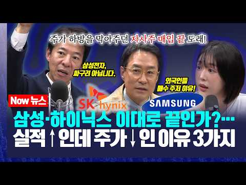
- 챕터: 0:00 오프닝 및 반도체 수출 펀더멘탈과 수급 점검 · 4:36 최태원 SK회장 용인·호남 클러스터 동시 구축 언급 … · 6:14 주요 증권사 반도체 리포트 분석 (삼성전자 '세계 최… · 8:20 펀더멘탈은 좋은데 주가가 역주행하는 답답한 시장 상황 · 10:14 '진실은 언젠가 나타난다' : 불확실성에 가려진 본질… · 11:49 한국 증시가 유독 두들겨 맞는 4가지 이유 (자사주 … · 14:30 매물대와 저평가 구간에 대한 부연 및 마무리
- 설명 앞부분: [겸공_12시에만나요 261012] 실적은 사상 최대라는데, 내 계좌는 왜 이 모양일까요? 펀더멘탈에는 이상이 없다고 외치지만, 유독 한국 증시만 두들겨 맞는 진짜 이유를 파헤칩니다. 자사주 매입 종료와 100조 원대 매물대 장벽, 그리고 외국인이 집을 떠나지 못하는 이유까지! 꼬일 대로 꼬인 수급의 비밀과, 안개가 걷힌 뒤 마주할 반도체 본질의 진실을 확인해 보세요.
- 같은 채널 평소 대비 ×3.3 (채널 최근 롱폼 중앙값 32,582회) · 평소 영상: 외인들이 삼전·하닉 팔은 진짜 이유 & 대통령 지지율과의 관계성 (33,101회) / 삼성전자, 어디까지 빠질까? ‘이 가격’이면 무조건 매수시그널 (32,063회)
- 대본 없음 (설명) — 음성인식이 끝나면 도입부·흐름이 들어감
- 댓글 165/165: 좋은 점 — 영상 2 · 감사·응원 1 · 더 알고 싶은 것 0 · 아쉬운 점 — 영상 0 · 반박·불만 — 의견 다름 3 · 정치·사회 30 · 경험 공유 3 · 구독·다음 기대 0
  - 반박·불만 — 의견 다름 👍0 “그냥 데이터로 분석해서 알려줘야는데 마치 모든걸 다 꿰뚫어 보고 있는 사람처럼 msg를 쳐서 말하니 투자자들이 기업에 대해서 분석 따윈 필요없는 것처럼 순간 솔깃하게 말하는 재주가 있음. 싼데 왜 하락함? 싼데 떨어지면 또 정부탓 기업탓 하고 있을꺼임.. 신랑이랑 내…”
  - 반박·불만 — 의견 다름 👍0 “여러분들 여지껏 박시동 이광수의 주장이 맞은 게 있는지 돌아보세요. 제가 가장 경계하는 것이 특정인의 말을 너무 지나치게 매몰되어서 믿는 것입니다. 주식전문가라는 사람들 절대 너무 믿어서는 안됩니다. 자꾸 실적이 사상 최대 역사적으로 최초 이런 수식어들 붙이고 있지만…”
  - 정치·사회 👍13 “명확한 이유가 있는데. 세계 1위 영업이익 삼성전자는 임직원 준다고 자사주 매입만하고 소각은 안하고 주주환원은 배당으로 한다니 굳이 지금 살필요도 없고 배당하기 한달전쯤부터 사다가 배당기준일까지 갖고 있다가 팔면 되는거 아닌가? 빅테크중에 누가 주주환원을 배당으로 하…”
  - 정치·사회 👍11 “여기 3명 보면 무슨 종교 집단 같음. 신념으로 똘똘 뭉쳐있음. 문제는 그 신념이 전문가라는 명목으로 타인한테 강요함. 국장은 실적 따윈 의미 없음.. 수급이 문제 인데 외국인이 던지는 물량을 개인이 받아줘야하는데, 지난 7월에 레버리지에 다 털려서 돈이 없음. 진짜…”
  - 경험 공유 👍2 “이런방송을 할때는 말의 책임과 무게를 알고 해야한다고 생각합니다 주가방송은 맞으면 제가 말했죠 떨어지면 온갖 이유와 앞으로는 괜찮을거다 기다려봅시다 얘기를 반복할뿐입니다 아무도 책임을 안집니다 대통령조차 웃으면서 주식은 귀신도 모른다 강요한적없다고 말하고 ETF하라던…”
  - 경험 공유 👍0 “그냥 데이터로 분석해서 알려줘야는데 마치 모든걸 다 꿰뚫어 보고 있는 사람처럼 msg를 쳐서 말하니 투자자들이 기업에 대해서 분석 따윈 필요없는 것처럼 순간 솔깃하게 말하는 재주가 있음. 싼데 왜 하락함? 싼데 떨어지면 또 정부탓 기업탓 하고 있을꺼임.. 신랑이랑 내…”

