# 주식 — 성공 사례 분석: 사례별 자세히 #1–#40

`analysis.md` 의 9번 (같은 # 번호). 자동 생성 — `tools/success_analysis.py` v1.6 (2026-11-06 08:46 UTC). ※ 연구·교육용 — 투자 권유가 아님.

### 1. 株価が急騰フェーズに入る？新NISAでS&P500・オルカン・日本株を買っている人は必見！

- https://www.youtube.com/watch?v=IpRO5CG4e-c · さくらのお金教室 · 구독자 1,150 · 조회수 271,764 (×236.3, 하루 24,904.0) · 좋아요 1,104 (0.4%) · 14.3분 · 2026-10-26 · 주제 묶음 2. 장기투자·ETF·지수 · 형식 정보·해설 (그 밖) · 폴더 `W_IpRO5CG4e-c` (웹 승인)
- 설명 앞부분: 実は1950年〜2022年の過去70年以上のデータを見ると、この日を境に1年後の米国株（S&P500）にはある驚異的な法則が存在します。 新NISAやiDeCoで米国株だけでなく、オルカン（全世界株式）や日本株を積み立てている人が今どう動くべきか、歴史的データをもとに徹底解説します！
- 대본 없음 (설명) — 음성인식이 끝나면 도입부·흐름이 들어감
- 댓글 61/61: 좋은 점 — 영상 0 · 감사·응원 0 · 더 알고 싶은 것 0 · 아쉬운 점 — 영상 0 · 반박·불만 — 의견 다름 0 · 정치·사회 0 · 경험 공유 0 · 구독·다음 기대 0

### 2. 왜 내가 사면 떨어지고 팔면 오를까? 개미가 주식으로 돈 못 버는 4가지 이유

- https://www.youtube.com/watch?v=fdlfOCtDBqc · 오피디의 머니노트 · 구독자 1,760 · 조회수 683,645 (×388.4, 하루 31,076.3) · 좋아요 2,176 (0.3%) · 13.6분 · 2026-10-15 · 주제 묶음 8. 투자 심리·실패 · 형식 오디오북·낭독 (명언·인생조언) · 폴더 `W_fdlfOCtDBqc` (웹 승인)
- 썸네일: 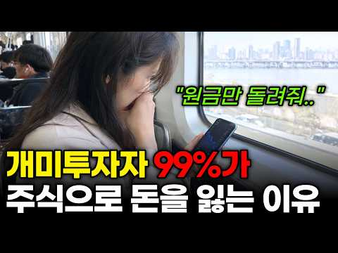
- 챕터: 0:00 하이닉스 꼭대기에서 산 사람들 · 0:43 노벨상 심리학자 대니얼 카너먼의 답 · 1:12 이유 1. 주식을 도박처럼 한다 – 최근 편향 · 2:45 이유 2. 욕심에 몰빵한다 – 레버리지, 신용융자, … · 4:34 이유 3. 잃는 걸 못 견딘다 – 손실 회피, 처분 … · 6:24 이유 4. 남들 따라 들어간다 – 포모(FOMO), … · 7:51 개인투자자가 주식으로 돈 버는 방법 · 8:08 공부 – PER, 사업보고서, 마음 공부 · 9:49 지수 ETF – 코스피200, S&P500 · 10:31 장기 투자 · 11:29 적립식 투자 · 12:37 정리
- 설명 앞부분: 하이닉스 290만 원, 삼성전자 37만 원 꼭대기에서 사신 분들 많으시죠? 왜 개인 투자자는 늘 꼭대기에서 사고 바닥에서 팔까요? 노벨 경제학상을 받은 심리학자 대니얼 카너먼의 연구로, 개미가 주식으로 돈을 못 버는 4가지 이유와 해결 방법을 정리했습니다. 💬 여러분은 이번 하락장에서 어떻게 대응하셨나요? 댓글로 남겨 주세요.
- 같은 채널 평소 대비 ×480.4 (채널 최근 롱폼 중앙값 1,423회) · 평소 영상: S&P500 말고 나스닥을 사야 하는 이유, 같은 돈 넣고 2배 차이 났습니다 (1,423회) / 주식 초보가 사면 떨어지고 팔면 오르는 이유 ∣ 하이닉스 물린 개미들의 공통점 (778회)
- 대본 없음 (설명) — 음성인식이 끝나면 도입부·흐름이 들어감
- 댓글 244/307: 좋은 점 — 영상 3 · 감사·응원 5 · 더 알고 싶은 것 1 · 아쉬운 점 — 영상 0 · 반박·불만 — 의견 다름 3 · 정치·사회 14 · 경험 공유 9 · 구독·다음 기대 0
  - 좋은 점 — 영상 👍2 “공감합니다😂주식투자는 10년 이상 적립식으로 꾸준이 모아가는 게 제일 무난한 투자방법이라고 믿어요~ ❤”
  - 좋은 점 — 영상 👍0 “좋은영상 감사합니다”
  - 감사·응원 👍1 “고맙습니다 ㅠㅠ”
  - 감사·응원 👍0 “좋은영상 감사합니다”
  - 더 알고 싶은 것 👍2 “월요일에 하이닉스 120만원대에 올인해도 되나요? 250만원 되면 미련 없이 팔 생각인데...”
  - 반박·불만 — 의견 다름 👍3 “웃기는 소리 그만하고 k국장에서 주식하는 넘만 바보지. 절대 회사 믿지 마라 절대 오래 투자 한다고 수익 나지 않는다. 안하는게 정답이다”
  - 반박·불만 — 의견 다름 👍2 “교과서적인 이야기이네요..주식은 교과서대로 되는것이 아닙니다..노력을 하세요...차트공부도 하시고..단타로 가세요..국장은 장기투자 하는것아닙니다”
  - 정치·사회 👍6 “이재명이가 조작하는거지머”
  - 정치·사회 👍1 “제일 중요한 것......... 대한민국 주식장은 도박판이기 때문이고, 그 이유는 회사 CEO가 주주들의 이익보다 자신의 이익만 생각하기 때문. 하이닉스, 삼전이 펀더멘틀이 좋음에도 망하는 이유는 정부가 레버리지 상품을 만들어놨기 때문....... 레버리지만 없었어도…”
  - 경험 공유 👍22 “지금 안사만 나만 바보된다 말나오면 이렇게 해석해야합니다. " 지금 사면 나도 바보된다 !! "”
  - 경험 공유 👍5 “국장은 도박이 맞아..장기간 1%라도 우상향해야지 하루에도 10% 오르다가 내리다가 이게 신뢰가 가서 장투가 가능하겠냐... QQQ에 SPY는 아무리 적어도 10%는 꾸준히 상향하고 매일매일 1%씩 오르락 내리락한다. 장투에 대한 신뢰감도 있고 수급도 크고 조금씩 상…”

### 3. 환율 1300원, 코스피 5000 폭락..!! 한국경제 대위기 터진다..??

- https://www.youtube.com/watch?v=uY8bXDJHswg · 경제읽어주는남자 · 구독자 1,040 · 조회수 143,238 (×137.7, 하루 10,348.5) · 좋아요 823 (0.6%) · 13.8분 · 2026-10-23 · 주제 묶음 5. 국내주식 · 형식 정보·해설 (그 밖) · 폴더 `W_uY8bXDJHswg` (웹 승인)
- 챕터: 0:00 환율 1,324원, 5일째 연저점 · 0:10 한은 총재 "초여름 고환율은 비정상" · 1:08 1만 달러에 217만 원 증발 · 1:31 10월 수출 616억 달러, 반도체 3배 · 2:20 기업 달러예금 보름 새 53억 달러 환전 · 3:05 외국인 203조 매도에도 환율 하락 · 3:24 깜짝 퀴즈 · 3:48 종목 진단기 무료 이용 방법 · 4:55 외국인이 판 돈은 한국에 남았다 · 5:59 서학개미 미국 주식 매수 5분의 1로 · 7:19 한미 금리 차 1%포인트로 축소 · 8:14 2022년 1,440원 때와 정반대 · 8:48 CD 금리 3.26%, 변동금리 대출 점검 · 9:26 과자값은 올랐는데 원가는 내려간다 · 10:36 1,300원대 원재료가 들어오는 연말 · 11:32 그래서 지금 봐야 되는 업종 · 12:08 정리 · 여러분 잘못이 아닙니다 · 12:47 종목 진단기, 계좌 전체 진단까지
- 설명 앞부분: 원달러 환율이 1,324원까지 내려가며 닷새 연속 올해 최저치를 갈아치웠습니다. 6월 1,541원에 1만 달러를 바꿔 둔 사람은 가만히 앉아 217만 원을 잃었습니다. 그런데 이상하게도 외국인은 올해 코스피에서 203조 원을 팔았는데, 환율은 오르지 않고 오히려 내려갔습니다. 환율이 왜 지금 이렇게 빠지는지, 외국인이 판 돈은 어디로 갔는지, 그리고 원화가 강해질 때 조용히 이익이 남는 업종이 어디인지 정리했습니다.
- 같은 채널 평소 대비 ×18.8 (채널 최근 롱폼 중앙값 7,637회) · 평소 영상: 미국 중간선거, 트럼프의 패배 확정..?? 앞으로 주식시장 "이렇게" 됩니다 (9,219회) / 나라는 부자인데 국민은 가난하다..? 일본 경제가 무너진 이유 (6,055회)
- 대본 없음 (설명) — 음성인식이 끝나면 도입부·흐름이 들어감
- 댓글 173/173: 좋은 점 — 영상 0 · 감사·응원 1 · 더 알고 싶은 것 0 · 아쉬운 점 — 영상 0 · 반박·불만 — 의견 다름 1 · 정치·사회 20 · 경험 공유 1 · 구독·다음 기대 2
  - 반박·불만 — 의견 다름 👍0 “더불어 공산당 간첩들이 환율 고점일때 뉴노멀이라고 선전선동하더만...요즘 환율하락해서 경제가 안정됐다더라...사람 새끼들 맞냐”
  - 정치·사회 👍25 “대통령 잘못 뽑은 거다”
  - 정치·사회 👍12 “외국인 투자 자금 뺄기회준다고 환율 낮춘다는 소문도 있음”
  - 경험 공유 👍0 “ㅋ.. 환율오를때는 나라가 망할것같이 나튜브들 나도나도ㅇ지랄을 떨더만 환율이 떨어진다고 또망한다고??? 에혀....”
  - 구독·다음 기대 👍4 “다른분보다 내생각과 가장비슷한분이시네 구독박고갑니디”
  - 구독·다음 기대 👍3 “내용은 너무 좋은데 말 속도가 빨라서 이해하는데 힘들어요.. 조금만 속도를 느리게 해주세요..ㅋ 구독하고 갑니다”

### 4. 【NISAおすすめ】S&P500、オルカン、日本株、NASDAQ100、FANG+、初心者におすすめの銘柄は？

- https://www.youtube.com/watch?v=fZtnKMn5YCo · ふみかのゆるマネーch · 구독자 291 · 조회수 30,200 (×103.8, 하루 2,775.0) · 좋아요 175 (0.6%) · 16.7분 · 2026-10-26 · 주제 묶음 2. 장기투자·ETF·지수 · 형식 정보·해설 (그 밖) · 폴더 `W_fZtnKMn5YCo` (웹 승인)
- 설명 앞부분: FP相談へのお申し込みをご希望の方はこちら♡ ▼無料で相談してみる（公式LINE） FPの伊藤ふみかです。 「NISAとか投資とか話題だけど、難しそう…」 🎁【公式LINE期間限定特典】 FP相談へのお申し込みが可能です！ ▼相談してみる（公式LINE） 「私の場合はどうしたらいい？」をサクッと解決できるLINE限定コンテンツをお届けしています。その他イベントや、セミナーのご案内もこちらからどうぞ！ 女性専門FPとして、頑張っている女性のお金のパートナーとして
- 대본 없음 (설명) — 음성인식이 끝나면 도입부·흐름이 들어감
- 댓글 11/11: 좋은 점 — 영상 0 · 감사·응원 0 · 더 알고 싶은 것 0 · 아쉬운 점 — 영상 0 · 반박·불만 — 의견 다름 0 · 정치·사회 0 · 경험 공유 0 · 구독·다음 기대 0

### 5. 이재명 "집 팔아 주식 사라더니…" 코스피 폭락에 국민연금 증발 실태 #이재명 #코스피 #국민연금

- https://www.youtube.com/watch?v=c3vq8lj05Yk · 정치시간 · 구독자 37 · 조회수 14,663 (×146.6, 하루 719.0) · 좋아요 287 (2.0%) · 18.9분 · 2026-10-16 · 주제 묶음 5. 국내주식 · 형식 정보·해설 (그 밖) · 폴더 `W_c3vq8lj05Yk` (웹 승인)
- 썸네일: 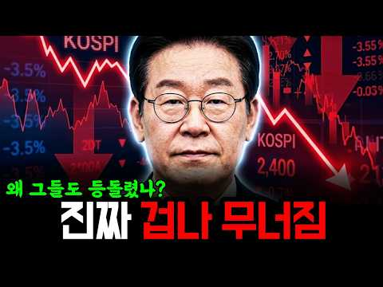
- 설명 앞부분: 최근 코스피 지수가 연이은 하락세를 보이며 증시 변동성이 극대화되고 있습니다. 삼성전자와 SK하이닉스 등 주요 대형주의 실적 발표 및 자사주 소각 이슈에도 불구하고, 외국인 투자자들의 대규모 매도세와 국민연금의 주식 비중 조정 여파로 투자자들의 불안감이 커지고 있습니다.
- 같은 채널 평소 대비 ×5.1 (채널 최근 롱폼 중앙값 2,884회) · 평소 영상: 개미들은 피눈물 터지는데 국정감사에서 밝혀진 국민연금 운용 논란과 숨겨진 진실 #이재명 … (9,935회) / 미국에서 비웃은 한국 주식폭락과 이재명 정권의 책임 회피 #이재명 #코스피 (565회)
- 대본 없음 (설명) — 음성인식이 끝나면 도입부·흐름이 들어감
- 댓글 28/43: 좋은 점 — 영상 0 · 감사·응원 0 · 더 알고 싶은 것 0 · 아쉬운 점 — 영상 0 · 반박·불만 — 의견 다름 0 · 정치·사회 14 · 경험 공유 1 · 구독·다음 기대 0
  - 정치·사회 👍16 “1년사이 개쓰레기나라가 되가고 있다.”
  - 정치·사회 👍8 “믿을인간들 한테 믿어야지 나라가 어느한군데 온전한데가 없내”
  - 경험 공유 👍5 “이대통령 자주하는말...내가 언제 그랬어요?”

### 6. Indonesia's Stock Market Crashes 11%: What Went Wrong? ∣ Century Financial

- https://www.youtube.com/watch?v=dFuTChJdF5M · Century Financial · 구독자 9,980 · 조회수 340,757 (×34.1, 하루 71,273.9) · 좋아요 1,110 (0.3%) · 5.2분 · 2026-10-16 · 주제 묶음 기타 · 형식 정보·해설 (그 밖) · 폴더 `W_dFuTChJdF5M` (웹 승인)
- 썸네일: 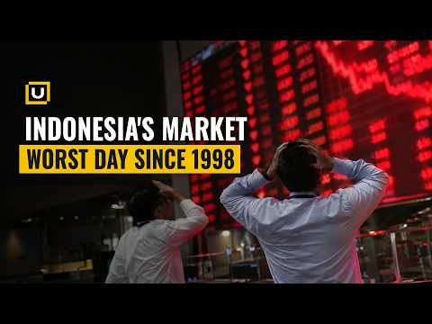
- 설명 앞부분: Indonesia's stock market plunged as much as 11%, putting the Jakarta Composite on track for its worst day since the 1998 Asian financial crisis. But what triggered such a dramatic sell-off? And how could a single announcement from MSCI put billions in foreign investment and Indonesia's emerging-mar…
- 같은 채널 평소 대비 ×187.7 (채널 최근 롱폼 중앙값 1,816회) · 평소 영상: Is the Data Centre Dead? Apple and Meta’s Bet Aga… (1,891회) / Crude Oil Rises on Geopolitical Tensions ∣ Centur… (1,740회)
- 대본 없음 (설명) — 음성인식이 끝나면 도입부·흐름이 들어감
- 댓글 271/271: 좋은 점 — 영상 0 · 감사·응원 0 · 더 알고 싶은 것 0 · 아쉬운 점 — 영상 0 · 반박·불만 — 의견 다름 0 · 정치·사회 0 · 경험 공유 1 · 구독·다음 기대 0
  - 경험 공유 👍0 “내가보기에는 미국보다는 나은것같은데”

### 7. WTF Just Happened to Indonesia? (Worst Crash Since 1998)

- https://www.youtube.com/watch?v=21-G0C_bXYI · TSCS · 구독자 14,000 · 조회수 1,378,175 (×98.4, 하루 99,328.5) · 좋아요 8,964 (0.7%) · 18.2분 · 2026-10-23 · 주제 묶음 기타 · 형식 정보·해설 (그 밖) · 폴더 `W_21-G0C_bXYI` (웹 승인)
- 챕터: 0:00 Indonesia's worst day since 1… · 1:28 Suspect 1: MSCI, the index co… · 5:01 Suspect 2: the rupiah. Is thi… · 7:55 Suspect 3: the state · 9:59 The banks are the state's ATM · 12:27 Why Jakarta doesn't need MSCI · 14:38 What we're buying · 16:35 How we could be wrong · 17:43 Who crashed Indonesia?
- 설명 앞부분: FREE: the full Indonesia write-up, our 962-stock screen and the shopping list So who crashed Indonesia? We screened 962 stocks and read 30 years of IMF files. Three suspects: MSCI, the rupiah and the state. CHAPTERS DISCLOSURES Produced by the TSCS research team, TSCS Research Education Limited (Ir…
- 대본 없음 (설명) — 음성인식이 끝나면 도입부·흐름이 들어감
- 댓글 1,877/1,877: 좋은 점 — 영상 0 · 감사·응원 0 · 더 알고 싶은 것 0 · 아쉬운 점 — 영상 0 · 반박·불만 — 의견 다름 0 · 정치·사회 0 · 경험 공유 0 · 구독·다음 기대 0

### 8. Dividends vs. Capital Gains (Which One Actually Builds More Wealth?)

- https://www.youtube.com/watch?v=Aj5taVPo9cE · Dinero Theory · 구독자 375 · 조회수 22,701 (×60.5, 하루 2,547.6) · 좋아요 279 (1.2%) · 14.8분 · 2026-10-28 · 주제 묶음 기타 · 형식 정보·해설 (그 밖) · 폴더 `W_Aj5taVPo9cE` (웹 승인)
- 설명 앞부분: There are exactly two ways to make money from a stock, and most beginners confuse them. In this video, I break down dividends vs. capital gains with real examples and the 2026 US federal tax rules. You'll learn how dividends work (including the ex-dividend date and why dividends aren't free money),…
- 같은 채널 평소 대비 ×65.5 (채널 최근 롱폼 중앙값 346회) · 평소 영상: Every Stock Market Term Explained ∣ Stock Market … (480회) / Why a Notebook Beats a Budgeting App (The Kakeibo… (213회)
- 대본 없음 (설명) — 음성인식이 끝나면 도입부·흐름이 들어감
- 댓글 36/36: 좋은 점 — 영상 0 · 감사·응원 0 · 더 알고 싶은 것 0 · 아쉬운 점 — 영상 0 · 반박·불만 — 의견 다름 0 · 정치·사회 0 · 경험 공유 0 · 구독·다음 기대 0

### 9. 분배금 3배인데 수익은 더 적다? 천만원 넣으면 매달 얼마일까? (배당 ETF 2편)

- https://www.youtube.com/watch?v=DcBr6zmUWgs · 나다나단Nathan · 구독자 224 · 조회수 14,595 (×65.2, 하루 1,470.6) · 좋아요 59 (0.4%) · 4.8분 · 2026-10-27 · 주제 묶음 2. 장기투자·ETF·지수 · 형식 정보·해설 (그 밖) · 폴더 `W_DcBr6zmUWgs` (웹 승인)
- 챕터: 0:00 천만원 넣었다면 1년 분배금은? · 0:27 커버드콜이 뭔가요 · 0:53 실제로 담긴 것 — ETF 두 개 + 우량주 · 1:15 운용사별 수수료 비교 · 1:40 지난 2년 분배 기록 · 2:05 천만원이면 한 달 얼마? · 2:19 분배금을 매달 다시 샀다면? · 2:56 1편 미국배당다우존스와 맞대결 · 3:22 11월 분배금, 언제까지 사야 받을까 · 3:43 세금 15.4%와 종합과세 · 4:04 기억할 네 가지 · 4:28 정리
- 설명 앞부분: KODEX 미국배당커버드콜액티브(441640)에 1년 전 천만원을 넣었다면, 분배금은 실제로 얼마 들어왔을까요? 삼성자산운용 공식 분배 기록으로 직접 계산해 봤습니다. 세금 떼고 1년 864,168원 — 1편 미국배당다우존스의 약 3배였어요. 그런데 주가 상승은 +3.5%에 그쳤습니다. 커버드콜이 무엇인지, 실제로 담긴 종목, 운용사별 수수료, 분배금을 매달 다시 샀다면 얼마였을지, 이번 달 매수 마감일, 세금까지 한 번에 정리했어요. ■ 핵심 숫자 (2026.10.27 기준) 천만원(2025.10.27 종가 11,589원 · 8…
- 같은 채널 평소 대비 ×72.1 (채널 최근 롱폼 중앙값 202회) · 평소 영상: 자동매매 봇 10/13일 매매일지 (feat. claude code) (222회) / 매도 사이드카에 서킷브레이커까지 이게 무슨일? 10월 15일 매매일지 (183회)
- 대본 없음 (설명) — 음성인식이 끝나면 도입부·흐름이 들어감
- 댓글 5/5: 좋은 점 — 영상 0 · 감사·응원 0 · 더 알고 싶은 것 0 · 아쉬운 점 — 영상 0 · 반박·불만 — 의견 다름 0 · 정치·사회 0 · 경험 공유 0 · 구독·다음 기대 0

### 10. S&P500은 최고인데 내 ETF는 마이너스… 지금 환헤지로 갈아타면 늦는 진짜 이유

- https://www.youtube.com/watch?v=UcHK1WoTPtY · 뒤집는경제 · 구독자 916 · 조회수 114,898 (×125.4, 하루 5,581.2) · 좋아요 425 (0.4%) · 23.2분 · 2026-10-16 · 주제 묶음 2. 장기투자·ETF·지수 · 형식 정보·해설 (그 밖) · 폴더 `W_UcHK1WoTPtY` (웹 승인)
- 썸네일: 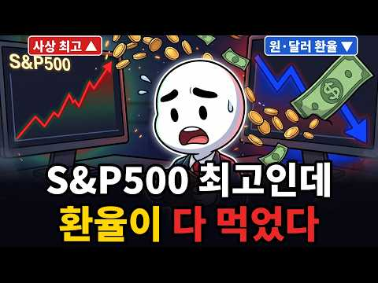
- 챕터: 0:00 S&P500 최고인데 내 ETF는 마이너스 · 1:47 수익을 만드는 두 개의 숫자 · 5:00 1,550원에서 1,331원까지, 넉 달의 반전 · 7:38 7개월 만에 뒤집힌 증권가 전망 · 11:00 환헤지는 공짜가 아니다 · 13:22 환노출형에 달린 공짜 에어백 · 15:20 버틴 사람 vs 갈아탄 사람, 숫자 맞대결 · 18:00 적립식 투자자에게 원화 강세란 · 19:25 흔들리지 않는 세 가지 기준
- 설명 앞부분: S&P500은 사상 최고치를 찍었는데, 증권 앱 속 내 S&P500 ETF는 파란색입니다. 같은 지수를 따라가는 ETF인데 최근 3개월 수익률이 마이너스 7%와 플러스 3%로 10%포인트 넘게 갈렸습니다. 그래서 다들 "지금이라도 환헤지(H)로 갈아탈까?"를 고민하고 계실 겁니다. 범인은 지수가 아니라 환율입니다. 원·달러 환율은 석 달 만에 1,554원에서 1,340원까지 13% 넘게 빠졌습니다. 그런데 7개월 전 증권가는 "환노출이 유리하다"고 했고, 지금은 "환헤지가 대세"라고 말합니다. 뉴스를 따라 갈아타면 늘 한 박자 늦…
- 같은 채널 평소 대비 ×9.5 (채널 최근 롱폼 중앙값 12,129회) · 평소 영상: 코스피 일주일 -20%… 지금 적립식을 멈추면 손해 보는 진짜 이유 (14,211회) / AI 거품 경고에 나스닥 -6%… 그런데 S&P500은 왜 -2%만 빠졌을까, 하락장에서… (10,047회)
- 대본 없음 (설명) — 음성인식이 끝나면 도입부·흐름이 들어감
- 댓글 28/65: 좋은 점 — 영상 0 · 감사·응원 0 · 더 알고 싶은 것 0 · 아쉬운 점 — 영상 0 · 반박·불만 — 의견 다름 0 · 정치·사회 3 · 경험 공유 0 · 구독·다음 기대 0
  - 정치·사회 👍13 “환율 처올린 이재명의 똥. 이게 다 이재명 때문이다.”
  - 정치·사회 👍1 “미 중간선거 민주당이 압승할 경우 약달러 확정이고 달러가 강하면 미채권 팔려고 할테고 그럼 달러 복사할테고 삼전닉스 달러 내년에는 더 벌어온다고 하고.. 환햇지로 가야할듯한데 에휴”

### 11. 적자인데 300억? 가능한 이유 ∣ 회계사가 말아주는 리센느 소속사 더뮤즈엔터

- https://www.youtube.com/watch?v=kJx_AzV9w9c · 전지적회계사시점 · 구독자 867 · 조회수 318,288 (×367.1, 하루 5,023.7) · 좋아요 1,272 (0.4%) · 21.4분 · 2026-09-03 · 주제 묶음 6. 종목 고르기·분석 · 형식 브이로그·직접 해본 이야기 · 폴더 `W_kJx_AzV9w9c` (웹 승인)
- 썸네일: 
- 챕터: 0:00 오프닝 하이라이트 · 0:23 거제 야호로 시작된 리센느 이야기 · 1:13 숫자로 보는 더뮤즈: 8억에서 300억까지 · 2:20 리센느의 인기, 어느 정도일까 · 4:19 더뮤즈엔터테인먼트는 어떤 회사인가 · 6:06 중소 엔터사가 VC 투자를 받는 이유 · 8:11 모태펀드가 만든 중소돌의 기적 · 9:04 투자 히스토리: 5천만 원에서 시리즈A까지 · 11:44 멀티플로 계산해 본 비상장 기업가치 · 14:26 이익배수로 다시 본 300억의 조건 · 16:04 300억이 되려면 매출은 얼마나 필요할까 · 18:00 리센느 정산은 언제부터 가능할까 · 19:40 결론: 300억은 가능한 숫자인가
- 설명 앞부분: "거제야호로 시작된 리센느 열풍. 소속사 더뮤즈엔터의 가치는 얼마일까요?" 지금 대한민국에서 가장 핫한 걸그룹 리센느, 그리고 소속사 더뮤즈엔터테인먼트의 기업가치를 회계사의 시선으로 분석해봤습니다. 설립 밸류 8억에서 5년 만에 300억, 37.5배가 뛴 이 회사의 투자 히스토리를 따라가면서 비상장 기업의 가치평가가 실제로 어떻게 이루어지는지 알기 쉽게 풀어 드립니다. 그리고 25년말 56억 적자에 자본잠식이였던 리센느 소속사가 어떻게 300억의 가치를 인정 받을 수 있었는지, 중소 엔터사가 VC 투자를 받는 이유부터 아이돌 정산…
- 같은 채널 평소 대비 ×177.0 (채널 최근 롱폼 중앙값 1,798회) · 평소 영상: 위고비·마운자로 열풍, 헬스장 정말 안갈까?? ∣ 회계사가 분석한 비만치료제와 헬스 시장 (1,798회) / 결혼 못 해도 돈은 낸다 ∣ 매출 483억 찍은 ‘결혼해듀오’ (1,234회)
- 대본 (음성인식(앞 5분), 5.9 음절/초) — 앞부분만, 흐름은 그 안까지 첫 20초: “최근에 리셋는 더뮤즈웨어 엔터테인먼트가 몇백억을 같이 로투자를 받았다 이런 얘기가 많잖아요 그래서 이 회사의 가치가 지금 얼마일까 그리고 얼마까지 갈 수 있을까 작년 매출이 17억 8천만 원인데 영업 손실에 50.2천만 원이거든요 그리고 2025년 말에 자본을 보니까 마이너스 11억 5천만 원 데뷔 8년차에다가 포스닥 상장사가 880만 원이 있는데” — 도입부 유형: 질문으로 시작, 숫자로 시작
- 첫 1분: “최근에 리셋는 더뮤즈웨어 엔터테인먼트가 몇백억을 같이 로투자를 받았다 이런 얘기가 많잖아요 그래서 이 회사의 가치가 지금 얼마일까 그리고 얼마까지 갈 수 있을까 작년 매출이 17억 8천만 원인데 영업 손실에 50.2천만 원이거든요 그리고 2025년 말에 자본을 보니까 마이너스 11억 5천만 원 데뷔 8년차에다가 포스닥 상장사가 880만 원이 있는데 더뮤즈웨어 엔터가 300억 가치를 지냈다 회사님 거제 야구 아세요? 잘 알죠 요새 유튜브에 굉장히 핫하잖아요 저도 거제 야구가 뜨기 시작할 때 그때부터 리셋는 유튜브를 좀 많이 봤는데 굉장히 재밌더라고요 사실 제가 또 TMI긴 하지만 저희 어머니가 좀 외곽아 거제에 있거든요 유튜브에서 거제 영상을 보면서 약간 눈에 익은 그런 화면들이 많이 나오더라고요 유튜브도 알”
- 흐름 (90초마다 첫 문장): 0:00 최근에 리셋는 더뮤즈웨어 엔터테인먼트가 → 1:31 그러니까 이제 8억에서 300억 → 3:02 스탭에게 뭐 1분만 더 달라 → 4:31 그리고 이제 뭐 잘 아시는 것처럼
- 댓글 219/219: 좋은 점 — 영상 2 · 감사·응원 14 · 더 알고 싶은 것 0 · 아쉬운 점 — 영상 2 · 반박·불만 — 의견 다름 4 · 정치·사회 0 · 경험 공유 11 · 구독·다음 기대 2
  - 좋은 점 — 영상 👍10 “더뮤즈에 대해 궁금한 것을 많았는데... 좋은 정보 감사합니다.”
  - 좋은 점 — 영상 👍2 “겉으로 보여지는 아이돌 그룹의 그늘 혹은 화려함에 가리워진 이면에, 냉정한 생존법칙에서, 엔터테인먼트 기획사의 존폐 여부가 어떻게 가시적으로 수치화 돼서 추정되고 결정되는 지 일목요연하게 짚어주는 이런 컨셉 정말 유익합니다. 응원합니다!!!”
  - 감사·응원 👍344 “대중은 중소를 응원하지만 중소티가 나면 고개를 돌리는것 같습니다. 적자상황에서도 의상과 곡퀄리티를 유지한게 단순 응원하는 사람에서 팬덤으로 바뀌게 된 핵심이유같네요.”
  - 감사·응원 👍20 “리센느 팬이라 보고 갑니다 감사합니다”
  - 아쉬운 점 — 영상 👍1 “마이크가 있기는한데 뭔가 목소리 울리는 소리가 많이 들어가는게 조금 아쉽네요😂 재밌는 영상 잘 보고갑니다!”
  - 아쉬운 점 — 영상 👍1 “요약좀....”
  - 반박·불만 — 의견 다름 👍10 “아니 나 진짜 궁금했음; 왜 다들 정산이 힘들거라고 하는건지.. 어떤 분들은 매출이 180억이 나와도 정산이 힘들수있다는데 이해가 너무안감 누적적자 70억은 알겠는데 대형 기획사처럼 컴백할때 진짜 뭐 백몇십억씩 쏟아붓고 마케팅비용 포함해서 활동비로 수십억씩 쓰는 회사…”
  - 경험 공유 👍15 “내가 살다살다 아이돌덕질하다 회사 회계까지 보고있네”
  - 경험 공유 👍6 “올해 리센느가 3년차였네요. 진짜 다행입니다 ^^”
  - 구독·다음 기대 👍18 “리마인이면 리센느 소속사 더뮤즈 재무관리 영상도 챙겨 봐야한다는 사실😂”
  - 구독·다음 기대 👍0 “국내는 현제 말할것도 없고, 전세계적으로도 조금씩 알려지고 있으며 특히 일본에서 근래에 많은 유튜브 영상들이 퍼지고 있으며 팬층도 많이 늘어나고 있던데 조만간 일본 활동에 불씨가 붙으면 롱런 롱흑자 기대됩니다 무엇보다 리센느는 아이돌로서 다음 앨범이 아주 중요하기도 …”

### 12. What Happens to Your Money if Fidelity or Vanguard Collapse?

- https://www.youtube.com/watch?v=wlDrJrV5H-8 · Brutally Honest Finance · 구독자 6,220 · 조회수 342,274 (×55.0, 하루 35,840.3) · 좋아요 3,118 (0.9%) · 6분 · 2026-10-27 · 주제 묶음 2. 장기투자·ETF·지수 · 형식 정보·해설 (그 밖) · 폴더 `W_wlDrJrV5H-8` (웹 승인)
- 챕터: 0:00 What if Fidelity goes bankrup… · 0:36 Lehman Brothers: what happene… · 1:17 Difference between a bank and… · 1:31 Who wholds your shares? · 2:28 Bernie Madoff fraud and SIPC'… · 3:19 What if Vanguard fails? · 3:35 Who actually owns and holds y… · 4:57 How the asset ownership and c… · 5:29 Why keep your own Fidelity tr…
- 설명 앞부분: What happens to your stocks and ETFs if Fidelity goes bankrupt? And who actually owns and holds the assets behind your ETFs? Most investors think Fidelity or Schwab actually "holds" their money. They don't. In this video I break down who really owns your shares, what happened to 110,000 Lehman Brot…
- 같은 채널 평소 대비 ×117.4 (채널 최근 롱폼 중앙값 2,915회) · 평소 영상: Don't Make My $1M Mistake — How I'd Actually Star… (3,096회) / Why I Left My Bank for the Fidelity Cash Manageme… (2,734회)
- 대본 없음 (설명) — 음성인식이 끝나면 도입부·흐름이 들어감
- 댓글 333/333: 좋은 점 — 영상 0 · 감사·응원 0 · 더 알고 싶은 것 0 · 아쉬운 점 — 영상 0 · 반박·불만 — 의견 다름 0 · 정치·사회 0 · 경험 공유 0 · 구독·다음 기대 0

### 13. Here’s What Happens When You Own $100,000 of SCHD

- https://www.youtube.com/watch?v=CuNq1HvKhyE · Thomas Money Theory · 구독자 485 · 조회수 31,336 (×64.6, 하루 2,478.4) · 좋아요 0 (0.0%) · 18분 · 2026-10-24 · 주제 묶음 2. 장기투자·ETF·지수 · 형식 정보·해설 (그 밖) · 폴더 `W_CuNq1HvKhyE` (웹 승인)
- 설명 앞부분: Here’s What Happens When You Own $100,000 of SCHD What happens when you put one hundred thousand dollars into SCHD and simply let it run? In this video we break down the exact day-one dividend income, what the position grows into at five, ten, twenty, and thirty years with reinvestment turned on, a…
- 같은 채널 평소 대비 ×43.8 (채널 최근 롱폼 중앙값 715회) · 평소 영상: The HIDDEN POWER of Dividend Investing ∣ The Snow… (715회) / How to Reach $1500/Month in Passive Income (Compl… (758회)
- 대본 없음 (설명) — 음성인식이 끝나면 도입부·흐름이 들어감
- 댓글 20/20: 좋은 점 — 영상 0 · 감사·응원 0 · 더 알고 싶은 것 0 · 아쉬운 점 — 영상 0 · 반박·불만 — 의견 다름 0 · 정치·사회 0 · 경험 공유 0 · 구독·다음 기대 0

### 14. 한국판 SCHD 어디까지 알고계신가요? 천만원이면 분배금 얼마? (배당 ETF 1편)

- https://www.youtube.com/watch?v=ytP_iFiu7ZI · 나다나단Nathan · 구독자 224 · 조회수 12,332 (×55.0, 하루 872.6) · 좋아요 52 (0.4%) · 4.2분 · 2026-10-23 · 주제 묶음 2. 장기투자·ETF·지수 · 형식 정보·해설 (그 밖) · 폴더 `W_ytP_iFiu7ZI` (웹 승인)
- 챕터: 0:00 천만원 넣었다면 1년 분배금은? · 0:30 어떤 ETF인가 — SCHD와 같은 지수 · 0:56 실제로 담긴 종목 TOP 10 · 1:18 지난 2년 분배 기록 · 1:42 천만원이면 한 달 얼마? · 2:12 1년 결과 — 주가 vs 분배금 · 2:33 10월 분배금, 언제까지 사야 받을까 · 3:04 세금 15.4% · 3:29 기억할 네 가지 · 3:54 정리
- 설명 앞부분: TIGER 미국배당다우존스(458730)에 1년 전 천만원을 넣었다면, 분배금은 실제로 얼마 들어왔을까요? 미래에셋 공식 분배 기록으로 직접 계산해 봤습니다. 세금 떼고 1년 306,943원, 한 달 평균 약 2만 5천원이었어요. SCHD와 같은 지수(다우존스 미국 배당 100)를 따라가는 '한국판 SCHD'의 구성 종목, 분배 기록, 이번 달 매수 마감일, 세금까지 한 번에 정리했어요. ■ 핵심 숫자 (2026.10.22 기준) 천만원(2025.10.22 종가 11,950원 · 836주) → 1년 분배금 세전 362,824원 ·…
- 같은 채널 평소 대비 ×60.9 (채널 최근 롱폼 중앙값 202회) · 평소 영상: 자동매매 봇 10/13일 매매일지 (feat. claude code) (222회) / 매도 사이드카에 서킷브레이커까지 이게 무슨일? 10월 15일 매매일지 (183회)
- 대본 없음 (설명) — 음성인식이 끝나면 도입부·흐름이 들어감
- 댓글 1/1: 좋은 점 — 영상 0 · 감사·응원 0 · 더 알고 싶은 것 0 · 아쉬운 점 — 영상 0 · 반박·불만 — 의견 다름 0 · 정치·사회 0 · 경험 공유 0 · 구독·다음 기대 0

### 15. 【2026年最新】オルカン・S＆P500・FANG・日本株・Google株！これが一番増えます！

- https://www.youtube.com/watch?v=ERA3jwIT_sg · 【FPあや】元銀行員が教えるマネーラウンジ · 구독자 3,500 · 조회수 107,330 (×30.7, 하루 13,546.2) · 좋아요 473 (0.4%) · 28.2분 · 2026-10-29 · 주제 묶음 10. 노후·연금 투자 · 형식 정보·해설 (그 밖) · 폴더 `W_ERA3jwIT_sg` (웹 승인)
- 설명 앞부분: 🏆⬇︎LINE登録で限定特典10個無料プレゼント⬇︎🏆 FPあやからのメッセージ動画 ⬇︎ あや先生の資産運用攻略 公式LINE ⬇︎ 今なら公式LINE登録で 🏆豪華特典①【あや先生登壇】FPあやが教える今後の投資戦略セミナー🏆 🏆豪華特典②FPあやからのメッセージ動画🏆 🏆豪華特典④【最短億り人】新 NISA 満額 1,800 万円 完全攻略🏆 【⬇️公式LINE登録はこちらから⬇️】
- 같은 채널 평소 대비 ×8.9 (채널 최근 롱폼 중앙값 12,002회) · 평소 영상: 【徹底検証】一括投資と積立投資/50代以降は,このやり方が一番増えるベストな方法！ (13,627회) / 【ここから複利がバグる】1000万円を上手く運用すれば人生安泰。50代以降の新NISA投資を徹底解説 (10,377회)
- 대본 없음 (설명) — 음성인식이 끝나면 도입부·흐름이 들어감
- 댓글 30/30: 좋은 점 — 영상 0 · 감사·응원 0 · 더 알고 싶은 것 0 · 아쉬운 점 — 영상 0 · 반박·불만 — 의견 다름 0 · 정치·사회 0 · 경험 공유 0 · 구독·다음 기대 0

### 16. Once you master this strategy, trading becomes EASY ∣ Real P&L

- https://www.youtube.com/watch?v=YqD4R8sCHzc · Trading Titans by InCred Money · 구독자 9,160 · 조회수 487,081 (×53.2, 하루 34,999.8) · 좋아요 5,056 (1.0%) · 66.5분 · 2026-10-23 · 주제 묶음 기타 · 형식 정보·해설 (그 밖) · 폴더 `W_YqD4R8sCHzc` (웹 승인)
- 설명 앞부분: What does it take to become a professional trader in the stock market? In this episode of Trading Titans, we sit down with Ravindra Rokde, an experienced trader who shares his approach to price action trading, volume analysis, risk management, and trading psychology. Ravindra breaks down his three-…
- 같은 채널 평소 대비 ×7.4 (채널 최근 롱폼 중앙값 65,788회) · 평소 영상: What Millionaire Traders will not Tell you about … (76,304회) / The Boring Trading Strategy That Actually Works (… (55,273회)
- 대본 없음 (설명) — 음성인식이 끝나면 도입부·흐름이 들어감
- 댓글 459/459: 좋은 점 — 영상 0 · 감사·응원 0 · 더 알고 싶은 것 0 · 아쉬운 점 — 영상 0 · 반박·불만 — 의견 다름 0 · 정치·사회 0 · 경험 공유 0 · 구독·다음 기대 0

### 17. [문남중 출연] "코스피 폭락, 자사주 매입 종료 때문..수급공백 끝! 외국인, 삼전닉스로 돌아옵니다" #문남중 _261019

- https://www.youtube.com/watch?v=vzGrlaAl0e4 · 경제통마늘 · 구독자 15,000 · 조회수 124,444 (×8.3, 하루 56,609.4) · 좋아요 1,146 (0.9%) · 14.2분 · 2026-10-19 · 주제 묶음 5. 국내주식 · 형식 오디오북·낭독 (명언·인생조언) · 폴더 `W_vzGrlaAl0e4` (웹 승인)
- 썸네일: 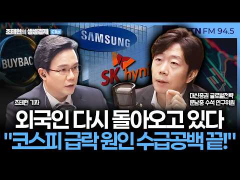
- 설명 앞부분: "코스피 '수급공백' 메울 외국인, 다시 돌아오기 시작했다" 유독 Non-US 증시만 어려운 상황..10월초 급락 이유 이해안돼 美증시 10월들어 역사적 사상최고치..코스피 진정될 여지 있어 美 증시는 쉬워갈 구간..지난 금요일 나스닥 -2% "과도한 확대 해석 경계" 이란 외무장관 발언, 이란전쟁 종전MOU 재개 가능성 대두 韓증시 유독 빠진 이유, '수급공백'..자사주 매입 종료 때문 2024-2025년 외국인, 삼전 자사주 매입 종료에도 매수세 경험 자사주 매입 종료 직후, '반도체 업황' 매우 중요 "수급 주체 바뀐다..자…
- 대본 없음 (설명) — 음성인식이 끝나면 도입부·흐름이 들어감
- 댓글 192/192: 좋은 점 — 영상 0 · 감사·응원 7 · 더 알고 싶은 것 0 · 아쉬운 점 — 영상 1 · 반박·불만 — 의견 다름 11 · 정치·사회 35 · 경험 공유 3 · 구독·다음 기대 0
  - 감사·응원 👍14 “위원님 나오셨군요. 기다렸습니다. 과도한 확대해석 자제하고 기다립니다. 감사합니다 ~~”
  - 감사·응원 👍7 “☆ 국민의 소리 소신있게 발언하신 이찬진 금융감독원장님께 찬사의 박수 보냅니다 국회 정무위원회 국정감사에서 금융감독원장이 SK하이닉스의 자회사 솔리다임(Solidigm) 미국 나스닥 상장 추진과 관련해 "중복상장에 저촉된다는 판단을 하고 있다"는 입장을 공식 명시 했…”
  - 아쉬운 점 — 영상 👍0 “ㅋㅋㅋㅋㅋㅋ 아직도 낚시하는 놈들 있네 진짜 대단하다 등골까지 빨아머글라고 낚이면 안됩니다 하닉출신 반도체 전문가분이 1년전 가격으로 간다고 못 박았음 ㅋ”
  - 반박·불만 — 의견 다름 👍5 “점쟁이도 아닌데....어찌 다맞추나요? 본인의계좌는 본인책임~”
  - 반박·불만 — 의견 다름 👍3 “저아저씨 7월달 폭락 딱한번 맞췄어요. 그이후엔 금리며 국채며 주가며 다 틀렸고 작년에도 주구장창. 근데 틀릴순 있는데 문제는 뭐라하면 잘삐져요. 그래서 아나운서가 힘들어해요”
  - 정치·사회 👍11 “외국인이 돌아오긴 뭘 돌아와 하락시 생긴 갭때문에 잠시 산것 뿐인데 그렇게도 공부 안하고 책임없는 말을 하나”
  - 정치·사회 👍8 “1400만 개미투자자를 기만하는 ‘무늬만’ 주주 보호법인 ‘의무공개매수제도’, ‘주가 누르기 방지법’의 전면 재검토 및 수정 입법 요청에 관한 청원 국회전자청원에서 참여 부탁드립니다”
  - 경험 공유 👍39 “기관 사람 말 믿지 말자! 개인은 개인이 선택해야 한다는걸 7월.10월 두번의 폭락을 보며 깨닫습니다. 펀더멘털이니 수급이니 필요없고..익절할 수 있을때 무조건 익절하기. 기관 사람들은 모두 사라사라 하면서 그들과 외인은 팜~ 누군가는 손실을 봐야 누군가는 손익인 곳…”
  - 경험 공유 👍2 “금리 동결될 거라고 했었지 이 양반 아니 외국인이 그렇게 돈을 많이 벌었는데 개미들한테 물리려고 다시 들어오겠냐”

### 18. [풀영상] 월급 10%로 당장 시작하는 존리의 자산 증식 치트키

- https://www.youtube.com/watch?v=q1fYjAwma3s · 여의돈스트리트 · 구독자 1,360 · 조회수 229,995 (×169.1, 하루 4,656.5) · 좋아요 1,430 (0.6%) · 36분 · 2026-09-17 · 주제 묶음 1. 주식 기초·초보 · 형식 인터뷰·강연·대담 · 폴더 `W_q1fYjAwma3s` (웹 승인)
- 썸네일: 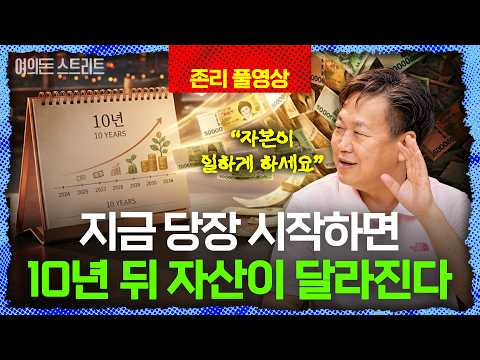
- 챕터: 0:00 인트로 · 0:50 ‘존리의 부자학교’, 어떤 곳인가요? · 1:09 우리나라 금융 수준, 정말 높아졌나요? · 2:39 빨리 부자가 되는 투자, 가능한가요? · 4:53 장기 투자, 어떤 ETF를 사야 할까요? · 6:53 평범한 사람은 어떻게 부자가 되나요? · 8:30 주식 투자에 전문가가 없다? · 10:24 레버리지 투자는 왜 위험한가요? · 11:31 한국주식, 지금도 투자할 만한가요? · 12:16 투자 뉴스는 어디까지 봐야 할까요? · 14:44 부동산 비중이 높으면 위험한가요? · 16:45 주식 투자의 진짜 목적은 무엇인가요? · 17:26 좋은 기업은 어떻게 고르나요? · 20:19 장기 투자 중 기업 상황이 나빠진다면? · 21:09 박스권에 갇힌 현재 증시 진단 · 22:23 AI 버블 우려 속 올바른 매수 시기 · 23:30 안전해 보이는 ‘원금 보장’ 상품의 함정 · 25:01 반도체·대형주 쏠림 계좌, 포트폴리오 개선 조언 · 27:15 시황 뉴스·차트·리포트의 올바른 활용법 · 29:35 직장인 월급 대비 적정 투자 비중 및 방법
- 설명 앞부분: 매일 오르내리는 주가, 금리 인상 뉴스... 언제 사고 언제 팔아야 할지 늘 스트레스받고 계시나요? 혹은 원금 손실이 두려워 아직도 투자를 망설이고 계신가요? 이번 풀영상에서는 '존리의 부자학교' 존리 대표님을 모시고 평범한 사람이 스트레스 없이 진짜 부자가 되는 투자의 본질부터 구체적인 실천 방법까지 모두 담았습니다. 단기간에 부자가 되려는 조급함과 마켓 타이밍을 재는 습관을 버리고, 내 자본이 스스로 일하게 만드는 진짜 투자법을 짚어봅니다. 또한, 인플레이션 시대에 돈을 예적금에만 두는 것이 왜 자산 가치를 갉아먹는 가장 위험…
- 같은 채널 평소 대비 ×202.8 (채널 최근 롱폼 중앙값 1,134회) · 평소 영상: 리딩방에서 추천받은 종목이 올랐다면? 이미 당신은 ‘먹잇감’입니다 [선생님 이건 건강한 … (1,134회) / 주식시장 100명중 90명은 무조건 손실 봅니다. 상위 10%만 아는 '진짜' 수익 내는… (1,197회)
- 대본 (음성인식(앞 5분), 6.0 음절/초) — 앞부분만, 흐름은 그 안까지 첫 20초: “좀 빠르게 내가 부자가 되고 싶다. 시간이 지날수록 나는 그 위스크로 줄어들고 시작한 지 지날수록 나는 부관들어나거든요. 또는 일을 안 하고 이불 속에서 안 나오는 거예요. 예금. 지금 만약에 1,000만 원이 20년 후에는 1,000만 원 아니라 한 300만 원으로 줄어들어있는 거예요. 90%의 정보는 필요 없는 정보예요. 정보가 하나도 중요하지 않죠.”
- 첫 1분: “좀 빠르게 내가 부자가 되고 싶다. 시간이 지날수록 나는 그 위스크로 줄어들고 시작한 지 지날수록 나는 부관들어나거든요. 또는 일을 안 하고 이불 속에서 안 나오는 거예요. 예금. 지금 만약에 1,000만 원이 20년 후에는 1,000만 원 아니라 한 300만 원으로 줄어들어있는 거예요. 90%의 정보는 필요 없는 정보예요. 정보가 하나도 중요하지 않죠. 충분해요. 두 개만 갖고도. 두 개만 갖고도 충분하다. 반응하는 많이 해라. 어떻게 젊으신 분들은. 안녕하세요. 여의돈스트리트 이광수입니다. 우리는 도대체 어떻게 투자해야 부자가 될 수 있을까요? 스트레스 받지 않고 투자하려면 또 어떻게 해야 될까요? 다녁컨대 이에 대한 해답을 알고 계시는 분. 어렵게 이 자리에 모셨습니다. 졸리의 부자학교의 졸리 대표님”
- 흐름 (90초마다 첫 문장): 0:00 좀 빠르게 내가 부자가 되고 싶다. → 1:31 실제로 대표님께서 현장에서 보시면 → 3:01 그렇게 해서 좀 빠르게 → 4:30 너무 힘듭니다 대표님.
- 댓글 113/119: 좋은 점 — 영상 3 · 감사·응원 14 · 더 알고 싶은 것 2 · 아쉬운 점 — 영상 0 · 반박·불만 — 의견 다름 4 · 정치·사회 1 · 경험 공유 13 · 구독·다음 기대 0
  - 좋은 점 — 영상 👍4 “이분하고 궁합이 잘맞음 참 좋은말씀”
  - 감사·응원 👍25 “존리 선생님 덕분에 3년전부터 노후준비를, 장기투자를 목표로 삼게 되었습니다. 좋은 투자철학을 가르쳐주셔서 감사합니다❤”
  - 감사·응원 👍19 “존리대표님 덕분에 투자를 시작했습니다 감사드립니다”
  - 더 알고 싶은 것 👍0 “에스엔피 500이 미장인지 국장인지 어떤걸해야하나요?”
  - 반박·불만 — 의견 다름 👍4 “이게 말이 쉽지 2002년 닷컴 버블 경험하고 이제 회복되나 싶었더니 2008년 금융위기 오고 투자 14년 차인데 투입원금보다도 계좌에 쌓인 돈이 없고 그러면 진짜 현타옵니다. 복리의 힘이라는게 말이 쉽지 일정금액 이상이 쌓이지 않으면 기별도 안 오고, 녹아내리는 계…”
  - 반박·불만 — 의견 다름 👍0 “개인적으로 무조건적이고 비판없는 의견을 따르실 필요는 없습니다. 모든 투자는 개인의 책임이니 신중하게 생각해보고 투자하시길 바랍니다. 그렇다고 존 리님이 무조건 좋다 나쁘다 이렇게 생각하는 게아니라 본인에게 맞는 투자를 하시라는 말씀 꼭 드리고 싶습니다. 장기투자라고…”
  - 정치·사회 👍0 “박정희 대통령이 나라의 문맹을 퇴지했는데 존리대표님은 금융문맹을 퇴치하러 열일 하신다”
  - 경험 공유 👍24 “연금저축+isa ETF 5년차 적립중인데 희망이 생겨서 든든합니다😊 더 빨리 깨우쳤어야 했는데 ㅠㅠ”
  - 경험 공유 👍4 “이게 말이 쉽지 2002년 닷컴 버블 경험하고 이제 회복되나 싶었더니 2008년 금융위기 오고 투자 14년 차인데 투입원금보다도 계좌에 쌓인 돈이 없고 그러면 진짜 현타옵니다. 복리의 힘이라는게 말이 쉽지 일정금액 이상이 쌓이지 않으면 기별도 안 오고, 녹아내리는 계…”

### 19. S&P500, 나스닥100 수익률 차이는 갈 수록 더 벌어질겁니다 미국 장기투자 가이드

- https://www.youtube.com/watch?v=1L9sM63F6Ng · 돈사냥꾼-TV · 구독자 2,060 · 조회수 19,018 (×9.2, 하루 6,906.7) · 좋아요 182 (1.0%) · 22.4분 · 2026-10-18 · 주제 묶음 2. 장기투자·ETF·지수 · 형식 정보·해설 (그 밖) · 폴더 `W_1L9sM63F6Ng` (웹 승인)
- 썸네일: 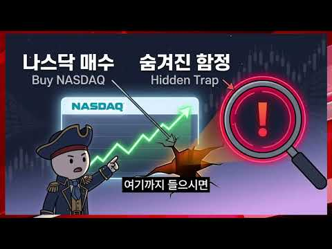
- 설명 앞부분: KBS 기자 KBS 디지털 뉴스 본부장 KBS 울산 방송국 본부장, KBS 해설위원, KBS 교통공무원노조 위원장 등을 역임하며 미디어와 저널리즘 분야에서 풍부한 경험을 쌓아 왔습니다. 이러한 실무 경험을 바탕으로, 현재 미디어 환경에 대한 정확한 정보, 심층 분석, 그리고 솔직한 시각을 제공하기 위해 최선을 다하고 있습니다. 여러분의 지지와 협력은 투명하고 신뢰받는 저널리즘을 향한 저희의 지속적인 노력에 원동력이 됩니다.
- 같은 채널 평소 대비 ×7.3 (채널 최근 롱폼 중앙값 2,607회) · 평소 영상: ＂지금 예적금 하지 마세요＂ 현금 안전하게 굴리는 방법 (2,607회) / 100년 데이터가 증명한 부자 공식ㅣ코스피 신고가에 지금 사도 되는 이유 (2,571회)
- 대본 없음 (설명) — 음성인식이 끝나면 도입부·흐름이 들어감
- 댓글 5/5: 좋은 점 — 영상 0 · 감사·응원 0 · 더 알고 싶은 것 0 · 아쉬운 점 — 영상 0 · 반박·불만 — 의견 다름 0 · 정치·사회 0 · 경험 공유 0 · 구독·다음 기대 0

### 20. 같은 TQQQ에 1억, 한 사람은 2만 원 한 사람은 388억 (실제 데이터)

- https://www.youtube.com/watch?v=d2_oRUcx5Uo · 머니언박싱 · 구독자 2,200 · 조회수 267,725 (×121.7, 하루 6,798.1) · 좋아요 1,176 (0.4%) · 8.1분 · 2026-09-27 · 주제 묶음 2. 장기투자·ETF·지수 · 형식 정보·해설 (그 밖) · 폴더 `W_d2_oRUcx5Uo` (웹 승인)
- 썸네일: 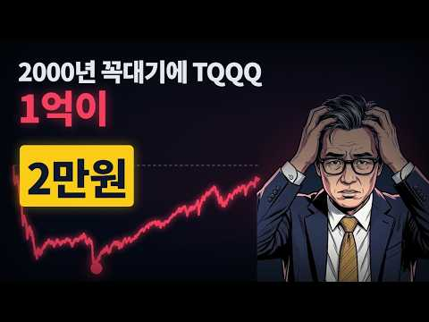
- 챕터: 0:00 두 개의 계좌 · 0:24 3배 레버리지는 어떻게 움직이나 · 0:54 박 부장, 2000년 3월 꼭대기에서 1억 · 1:20 1년 만에 496만 원 · 1:42 2만 원까지 · 2:06 지수는 돌아왔는데 · 2:35 26년 뒤 박 부장 · 2:56 만약 2009년 바닥에서 샀다면 · 3:42 이 대리, TQQQ 상장일에 1억 · 4:00 16년 뒤, 그러나 · 4:25 만약 2021년 11월에 들어갔다면 · 5:05 최 사원, 매달 50만 원 · 5:32 94억에서 20억으로 · 5:56 만약 2022년에 팔았다면 · 6:29 결과 공개 · 6:56 이 결과를 믿기 전에 · 7:24 레버리지를 산다면
- 설명 앞부분: 같은 TQQQ, 같은 1억 원. 한 사람은 계좌가 한때 2만 원이 됐고, 다른 사람은 지금 388억 원입니다. 무엇이 두 사람을 갈랐을까요? 그리고 같은 상품을 매달 조금씩 산 사람은 어떻게 됐을까요? 박 부장: 2000년 3월 27일, 나스닥100 꼭대기에 1억 원을 3배 레버리지로 이 대리: 2010년 2월 11일, TQQQ 상장일에 1억 원 최 사원: 2000년 4월부터 매달 50만 원씩 3배 레버리지 (세 사람은 가상 인물이고, 숫자는 전부 실제 데이터로 계산했습니다) 계산 조건 2010년 2월 이전 3배·2배는 실제 상품…
- 같은 채널 평소 대비 ×94.1 (채널 최근 롱폼 중앙값 2,844회) · 평소 영상: 같은 QLD 27년, 1억 한 번에는 15억 · 매달 50만은 85억 — 레버리지는 정말… (2,844회) / TQQQ 1억이 2억 됐을 때, 원금만 뺀 사람의 5년 뒤 (2,875회)
- 대본 (음성인식(앞 5분), 4.9 음절/초) — 앞부분만, 흐름은 그 안까지 첫 20초: “여기 두 개의 계좌가 있습니다. 둘 다 1억원으로 시작했고 둘 다 같은 상품을 샀습니다. 나스딱백을 매일 세 배로 따라가는 레버리지 tqq입니다. 그런데 한 계좌는 한때 2만원이 됐고 다른 계좌는 지금 388억원입니다. 무엇이 이 둘을 갈랐을까요? 그리고 같은 상품을 매달 조금씩 산 사람은 어떻게 됐을까요? 오늘은 세 사람의 레버리지 계좌를 실제 데이터로 끝까지 따라가 보겠습니다.”
- 첫 1분: “여기 두 개의 계좌가 있습니다. 둘 다 1억원으로 시작했고 둘 다 같은 상품을 샀습니다. 나스딱백을 매일 세 배로 따라가는 레버리지 tqq입니다. 그런데 한 계좌는 한때 2만원이 됐고 다른 계좌는 지금 388억원입니다. 무엇이 이 둘을 갈랐을까요? 그리고 같은 상품을 매달 조금씩 산 사람은 어떻게 됐을까요? 오늘은 세 사람의 레버리지 계좌를 실제 데이터로 끝까지 따라가 보겠습니다. tqq는 나스딱백 지수가 하루에 1% 오르면 3% 1% 내리면 3% 움직이도록 만든 상품입니다. 중요한 건 매일이라는 말입니다. 1년에 3배가 아니라 매일 3배를 다시 맞춥니다. 그리고 3배를 만들기 위해 빌린 돈의 이자와 운영 보수가 매일 조금씩 빠져나갑니다. tqq는 2010년에 처음 나왔기 때문에 그 이전은 나스딱백의 실제”
- 흐름 (90초마다 첫 문장): 0:00 여기 두 개의 계좌가 있습니다. 둘 다 1억원으로 시작했고 둘 다 같은… → 1:34 2002년 10월 3배 계자에는 84000원이 남아 있었습니다. 1억 … → 3:04 새로 1억 원을 3배 레버리지에 넣었다고 해보겠습니다. 지금 이 계자는… → 4:35 이번에도 실제 기록입니다. 1년 뒤 2022년 12월 계자는 81.7%…
- 댓글 144/161: 좋은 점 — 영상 7 · 감사·응원 7 · 더 알고 싶은 것 8 · 아쉬운 점 — 영상 1 · 반박·불만 — 의견 다름 3 · 정치·사회 0 · 경험 공유 10 · 구독·다음 기대 1
  - 좋은 점 — 영상 👍8 “너무 좋은 영상 감사합니다 보고 먾이 배웠습니다. 사람들은 단순히 세배의 장점만 보는데 박부장의 케이스는 너무 무섭네요 관점을 바꾸는 좋은 계기가 되었습니다 감사합니다!”
  - 좋은 점 — 영상 👍8 “진짜 좋은 영상이네요 👍”
  - 감사·응원 👍8 “너무 좋은 영상 감사합니다 보고 먾이 배웠습니다. 사람들은 단순히 세배의 장점만 보는데 박부장의 케이스는 너무 무섭네요 관점을 바꾸는 좋은 계기가 되었습니다 감사합니다!”
  - 감사·응원 👍3 “궁금한 게 있습니다! 적립식이 중요하다는 건 알겠는데 Tqqq를 투자하면 결국 적립식으로 해도 초반은 방어가 되지만 장기투자하고 후반에 금액이 커진 상황에 대폭락이 오면 qqq보다 훨씬 낮아질 확률이 꽤 있지 않나요? TQQQ 관련 내용 책이나 좋은 자료 혹시 있다면…”
  - 더 알고 싶은 것 👍3 “Soxl도 궁금합니다😮”
  - 더 알고 싶은 것 👍3 “궁금한 게 있습니다! 적립식이 중요하다는 건 알겠는데 Tqqq를 투자하면 결국 적립식으로 해도 초반은 방어가 되지만 장기투자하고 후반에 금액이 커진 상황에 대폭락이 오면 qqq보다 훨씬 낮아질 확률이 꽤 있지 않나요? TQQQ 관련 내용 책이나 좋은 자료 혹시 있다면…”
  - 아쉬운 점 — 영상 👍0 “정말 무서운 건 지난 20년이 나스닥 역사상 가장 전성기였다는 사실. 닷컴버블도 아무리 길게 잡아도 3년. 10년 횡보장이었다면 QQQ 투자자는 우울한 정도지만, 폭락 후 버티는 QLD, TQQQ 투자자는 인생 망하는 케이스. 역사는 반복된다?? 아닙니다. 그 시대를…”
  - 반박·불만 — 의견 다름 👍6 “이미 흐름을 알고있는 과거시기를 극적으로 발취하여,,,,,감동적인효과는 알겠는데,,,, 솔직히 현실적투자환경속 투자자라면 실현가능한 일은 아니죠.의지력을 키우라는 교훈성”
  - 반박·불만 — 의견 다름 👍0 “정말 무서운 건 지난 20년이 나스닥 역사상 가장 전성기였다는 사실. 닷컴버블도 아무리 길게 잡아도 3년. 10년 횡보장이었다면 QQQ 투자자는 우울한 정도지만, 폭락 후 버티는 QLD, TQQQ 투자자는 인생 망하는 케이스. 역사는 반복된다?? 아닙니다. 그 시대를…”
  - 경험 공유 👍8 “매달 초마다 200만원 환전해서 TQQQ 매수합니다. 환율/주가 생각 안하고 삽니다 파는건 일년에 250만원만 하고 있습니다. 이제 1년차이고 앞으로 9년 남았네요 😊”
  - 경험 공유 👍6 “무서워서 그냥 연저펀 타이거 s&p500, isa 코덱스 나스닥100 두가지만 3년차 풀매수중입니다 😊”
  - 구독·다음 기대 👍4 “영상보고 바로 구독했습니다”

### 21. S&P 500에 투자하면 노후 걱정 전혀 없습니다! 주식으로 부자 되는 가장 빠른 방법

- https://www.youtube.com/watch?v=_fnvM4hpX44 · 오피디의 머니노트 · 구독자 1,760 · 조회수 106,714 (×60.6, 하루 5,384.1) · 좋아요 396 (0.4%) · 16.4분 · 2026-10-17 · 주제 묶음 2. 장기투자·ETF·지수 · 형식 정보·해설 (그 밖) · 폴더 `W__fnvM4hpX44` (웹 승인)
- 썸네일: 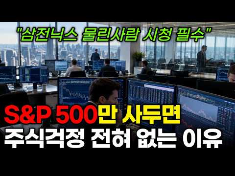
- 챕터: 0:00 인트로 · 0:59 버핏의 S&P 500 유언 · 2:13 S&P 500은 무엇인가 · 4:08 S&P 500의 과거 수익률 · 6:02 20년 전 S&P 500에 100만원 투자했다면 · 8:25 버핏은 왜 S&P 500을 골랐을까 · 9:45 지금 반도체에 물려 있다면 · 10:55 거치식 vs 적립식 · 13:41 S&P 500의 단점 · 15:23 마무리
- 설명 앞부분: 워런 버핏은 아내에게 남길 돈의 90%를 S&P 500 인덱스펀드에 넣으라고 했습니다. 20년 전 1,000만 원을 S&P 500에 넣었다면 지금 1억 1,600만 원, 코스피였다면 4,270만 원입니다. S&P 500이 무엇인지, 과거 수익률과 폭락 후 회복, 사상 최고치에서 사도 되는지, 거치식과 적립식 중 어떤 주식투자 방법이 나은지, VOO·SPY·IVV 차이와 환율·세금 같은 단점까지 실제 데이터로 정리했습니다.
- 같은 채널 평소 대비 ×75.0 (채널 최근 롱폼 중앙값 1,423회) · 평소 영상: S&P500 말고 나스닥을 사야 하는 이유, 같은 돈 넣고 2배 차이 났습니다 (1,423회) / 주식 초보가 사면 떨어지고 팔면 오르는 이유 ∣ 하이닉스 물린 개미들의 공통점 (778회)
- 대본 없음 (설명) — 음성인식이 끝나면 도입부·흐름이 들어감
- 댓글 63/88: 좋은 점 — 영상 0 · 감사·응원 2 · 더 알고 싶은 것 0 · 아쉬운 점 — 영상 0 · 반박·불만 — 의견 다름 1 · 정치·사회 0 · 경험 공유 9 · 구독·다음 기대 0
  - 감사·응원 👍7 “저는 한국주식도 좋지만 KODEX 미국S&P500에 매수할 예정입니다. ❤ 감사합니다.”
  - 경험 공유 👍13 “결론 = s&p500은 노후준비용으로 젊었을때부터 해라 은퇴시기에 들어갔다가 그게 고점이면 내가 죽을때쯤 복구될수도 있다”
  - 경험 공유 👍8 “올해까지 3년차 연금저축펀드 타이거 s&p500 풀매수 했습니다 😊진짜 너무 만족합니다 아닥 s&p500 ㅋㅋㅋㅋㅋㅋㅋ”

### 22. "배당금으로 먹고 살려면, 얼마를 투자해야 할까?"

- https://www.youtube.com/watch?v=bxrD627VsHA · Muhammad Hafiz · 구독자 383 · 조회수 12,260 (×32.0, 하루 1,139.6) · 좋아요 139 (1.1%) · 39.9분 · 2026-10-26 · 주제 묶음 3. 배당 · 형식 정보·해설 (그 밖) · 폴더 `W_bxrD627VsHA` (웹 승인)
- 설명 앞부분: 경제해적단 — 경제를 제대로, 그리고 쉽게. 🏴‍☠ 이 채널에서 다루는 것들 주식·ETF·배당주 투자 분석 환율·금리·인플레이션 경제 해설 미국·한국 증시 및 글로벌 시장 동향 부동산·원자재·달러 등 자산 시장 분석 재테크 초보를 위한 경제 상식 어렵고 딱딱하게만 느껴지던 경제 뉴스, 경제해적단과 함께라면 달라집니다. 복잡한 시장의 흐름을 단순하고 명확하게 짚어드립니다. 월급쟁이도, 사회초년생도, 재테크를 막 시작한 분도 경제해적단과 함께라면 경제가 보이기 시작합니다.
- 같은 채널 평소 대비 ×11.8 (채널 최근 롱폼 중앙값 1,043회) · 평소 영상: 당신이 채권을 모르면 절대 부자가 될 수 없는 이유 (1,043회) / 코스피 9천, 더 오른다 — 그런데 지금 당장은 사지 마세요 (1,079회)
- 대본 없음 (설명) — 음성인식이 끝나면 도입부·흐름이 들어감
- 댓글 4/4: 좋은 점 — 영상 0 · 감사·응원 0 · 더 알고 싶은 것 1 · 아쉬운 점 — 영상 0 · 반박·불만 — 의견 다름 0 · 정치·사회 0 · 경험 공유 0 · 구독·다음 기대 0
  - 더 알고 싶은 것 👍0 “적정 기본생활비로 하면 3000정도일 것이고 .... 우리나라 배당은 짜기로 유명하니 연평균 2%로 잡으면 50배를 곱하면 15억원이네요. 기본적으로 15억원의 평가액을 배당기일에 주식으로 보유하고 있어야 합니다. 불안의 대가로 받는 죄꼬리 배당 받느니, 예적금 하고…”

### 23. 유혈 낭자한 국장..폭락의 시작일까? / 이슈빡 / 뉴스헌터스

- https://www.youtube.com/watch?v=enkSdCIojAA · 뉴스헌터스 · 구독자 7,680 · 조회수 116,383 (×15.2, 하루 20,119.3) · 좋아요 283 (0.2%) · 17.9분 · 2026-10-15 · 주제 묶음 1. 주식 기초·초보 · 형식 인터뷰·강연·대담 · 폴더 `W_enkSdCIojAA` (웹 승인)
- 썸네일: 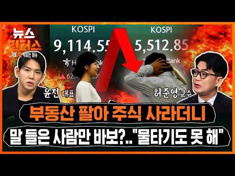
- 설명 앞부분: ■ 진행: 김종원, 윤태진 앵커 ■ 대담: 윤진 (블랙퀀트에쿼티 대표), 허준영 (서강대 경제학부 교수) 코스피와 코스닥 지수가 7%대 폭락한 '검은 목요일'이었습니다. 상장기업 시가총액은 오늘 하루에만 400조원 넘게 증발했고 코스피는 지난 6월 기록한 전고점보다 40% 이상 떨어졌습니다. 특히 코스피의 절반 정도를 차지하는 반도체 투톱 '삼전 · 닉스'는 AI 기업들의 자금 조달 비용 상승과 AI 투자 수익성 악화 우려가 커지고 중국 CXMT가 신기술 상용화를 예고하면서 주가가 미끄러지고 있습니다. 이런 상황에서, 손실이 커지…
- 대본 없음 (설명) — 음성인식이 끝나면 도입부·흐름이 들어감
- 댓글 303/303: 좋은 점 — 영상 1 · 감사·응원 0 · 더 알고 싶은 것 0 · 아쉬운 점 — 영상 1 · 반박·불만 — 의견 다름 1 · 정치·사회 81 · 경험 공유 6 · 구독·다음 기대 0
  - 좋은 점 — 영상 👍0 “딱 이럴때 연기금이 뒤통수치면 레전드인데 ㅋㅋㅋㅋ”
  - 아쉬운 점 — 영상 👍0 “옛날부터 한국은 외인의 놀이터다. 반복되면 안되지만 계속 반복.”
  - 반박·불만 — 의견 다름 👍1 “아직도? "HBM 전환 때문에 한국 점유율이 줄어들었다?" 말도 안되는 헛소리 "HBM 전환 때문에 점유율이 줄어들었다"는 설명이 왜 완전한 오류인지에 대해 분명하게 재정리해 드립니다. 카운터포인트·노무라 리서치 차트(3Q24 ~ 2Q26)를 직관적으로 분석해보면, …”
  - 정치·사회 👍92 “재매이햄 망했스요 민주당 비상이라 이제 재매이자르기 할거같음”
  - 정치·사회 👍59 “좌파대통령이 하라는거 반대로만 하면 부자되는 대한민국...”
  - 경험 공유 👍0 “부동산팔아주식사라고 내가언제그랬서요. 난모르는 일이고 했다고해도 뭘 어쩌라고요 주식은 원래도박아녀 내말 진짜로 믿었써요 내가언제그랬서요 믿는너가 바보 모지란 죠다지”
  - 경험 공유 👍0 “버거형들이 삼전 하닉 실적좋을때 넘겨야지 그래야 제가격에 매물대 넘기지 뉴스에 팔라는 단순한것도 모르냐 전문가들말은 맨날 결과론적 명분찻기 볼필요도 없다”

### 24. Why Most SIP Investors Panic in a Market Crash ∣ Gajendra Kothari

- https://www.youtube.com/watch?v=hIHu0_pet_g · Mutual Funds by PhonePe · 구독자 2,260 · 조회수 73,965 (×32.7, 하루 5,840.4) · 좋아요 832 (1.1%) · 50.3분 · 2026-10-24 · 주제 묶음 기타 · 형식 정보·해설 (그 밖) · 폴더 `W_hIHu0_pet_g` (웹 승인)
- 챕터: 0:00 Highlights · 0:50 Meet Gajendra Kothari · 2:20 Why Investors Book Losses in … · 3:10 Psychology of Money: Newton's… · 5:40 Noise vs Signal · 7:00 Why More Activity Hurts Your … · 9:30 Temporary Volatility vs Perma… · 11:10 The 12% Average Return Myth · 14:28 Why He Waits for the Next Cra… · 17:55 SIP Strategy for 10%, 20% & 3… · 20:25 The 15-20-25 Lump Sum Strategy · 24:55 Handling a Time Correction · 27:10 Why SIP Wins in Sideways Mark… · 29:30 How Often Should You Check Yo… · 31:35 Stock Prices Follow Earnings … · 33:45 How He Picks Contrarian Bets · 36:25 Why the Crowd Is Never Right · 40:45 Beating FOMO · 43:15 His F&O Trading Losses · 47:15 5 Rules for Long-Term Investo…
- 설명 앞부분: Should you stop your SIP when the stock market crashes? Gajendra Kothari shares his exact 15-20-25 strategy for market falls. In this episode of Mutual Funds by PhonePe, CFA and market veteran Gajendra Kothari explains why investor behaviour — not fund selection — decides whether you build wealth. …
- 같은 채널 평소 대비 ×3.0 (채널 최근 롱폼 중앙값 24,835회) · 평소 영상: Mutual Fund is Better Than Stocks? Here's Why ∣ K… (24,835회) / Can ₹500 Monthly SIP Turn Into ₹10 Crore? ∣ Kirta… (34,379회)
- 대본 없음 (설명) — 음성인식이 끝나면 도입부·흐름이 들어감
- 댓글 61/61: 좋은 점 — 영상 0 · 감사·응원 0 · 더 알고 싶은 것 0 · 아쉬운 점 — 영상 0 · 반박·불만 — 의견 다름 0 · 정치·사회 0 · 경험 공유 0 · 구독·다음 기대 0

### 25. 마이너스 주식 계좌 가장 쉽게 탈출하는 방법 물타기? 존버? 고민하지 않아도 되는 물린 종목 최대한 손실을 줄이며 정리하는 현명한 방법

- https://www.youtube.com/watch?v=v6rUCbULG2A · 머니스트랩 · 구독자 550 · 조회수 97,181 (×176.7, 하루 1,290.4) · 좋아요 1,120 (1.1%) · 30.5분 · 2026-08-23 · 주제 묶음 8. 투자 심리·실패 · 형식 정보·해설 (그 밖) · 폴더 `W_v6rUCbULG2A` (웹 승인)
- 썸네일: 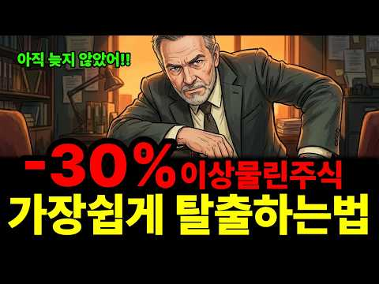
- 설명 앞부분: 지수는 사상 최고를 찍었는데 왜 내 계좌만 파란색일까요. 개인 투자자 240만 명의 계좌를 열어본 자료에서 출발해, 물린 종목을 손실을 줄이며 정리하고 제대로 된 자리로 옮기는 순서를 정리했습니다. 이 영상에서 다루는 내용
- 같은 채널 평소 대비 ×184.9 (채널 최근 롱폼 중앙값 526회) · 평소 영상: "1억 모으는데 12년 4개월" 실수령 200만원이 1억 모으는 시간을 5년 당기는 5가… (578회) / 편의점 사장님은 최저임금도 못 받는다? 계약서 속 숨겨진 진실 (468회)
- 대본 (음성인식(앞 5분), 4.9 음절/초) — 앞부분만, 흐름은 그 안까지 첫 20초: “물려 있다는 사실을 잊고 계셨다면 그나마 나은 쪽입니다. 진짜 문제는 매일 확인하면서도 아무것도 못하는 경우입니다. 아마 셋 중 하나일 겁니다. 계좌에 있는 줄도 모르고 몇 년을 지나친 종목. 매일 열어보지만 몇 년째 빠져나오지 못한 종목. 그리고 지금 팔면 정말 끝이라 참아 손을 못 떼는 종목.”
- 첫 1분: “물려 있다는 사실을 잊고 계셨다면 그나마 나은 쪽입니다. 진짜 문제는 매일 확인하면서도 아무것도 못하는 경우입니다. 아마 셋 중 하나일 겁니다. 계좌에 있는 줄도 모르고 몇 년을 지나친 종목. 매일 열어보지만 몇 년째 빠져나오지 못한 종목. 그리고 지금 팔면 정말 끝이라 참아 손을 못 떼는 종목. 마지막에 해당하신다면 오늘은 끝까지 보셔야 합니다. 그 결정을 미루는 동안 여러분 계좌에서 무엇이 사라지고 있는지 숫자로 보여드리겠습니다. 2025년 10월 31이었습니다. 그날 아침 뉴스의 첫 곡지는 코스피가 사상 최고치를 갈아치웠다는 소식이었죠. 빨간 숫자로 가득 찬 전광판 화면이 하루 종일 흘러 나왔고 증권 방송에서는 축포 같은 표현들이 오갔습니다. 바로 그날 한 대형증권사가 자사 고객의 계좌를 통째로 들여다”
- 흐름 (90초마다 첫 문장): 0:00 물려 있다는 사실을 잊고 계셨다면 그나마 나은 쪽입니다. → 1:35 물론 모두가 같은 크기로 물려 있는 건 아닙니다. → 3:00 우리는 보통 이 둘을 하나로 놓고 생각합니다. → 4:31 16번 통째로 갈아옵는다는 뜻이죠.
- 댓글 38/38: 좋은 점 — 영상 2 · 감사·응원 4 · 더 알고 싶은 것 1 · 아쉬운 점 — 영상 0 · 반박·불만 — 의견 다름 0 · 정치·사회 2 · 경험 공유 1 · 구독·다음 기대 0
  - 좋은 점 — 영상 👍16 “많은 도움이 됬습니다 로봇주애 _47% 물려있는데 하락장애서 매도 찬스를 놓쳐서 ㅠㅠ 처음엔 물타기 하다가 그때마다 하락해서 더 나락.ㅠㅠ 지근은 포기하고 분할매도 하고 반 남았는데 나머지도 분할매도 할 예정입니다”
  - 좋은 점 — 영상 👍1 “좋은 강의입니다.👍👍👍”
  - 감사·응원 👍8 “감사합니다..........”
  - 감사·응원 👍6 “카카오 안산다 ㅋ 감사 합니다”
  - 더 알고 싶은 것 👍0 “그럼 오른건 언제파나요?”
  - 정치·사회 👍5 “이재명 대통령님 응원합니다.”
  - 정치·사회 👍0 “웃기지마라 개미들 구십프로가 아작이났는데 뭐가 오십 팔프로라고 개소리 그만해 이번주식시장은 정부가 외국펀드투자판을 깔아준것인데 무슨 개소리 개미가 아무리 잘한다해도 거대한 자본으로 죠지는데 무슨 뾰쪽한수가 있나 솔직히 말해서 지금은 개미들 돈이 없어서 주식시장에 가고…”
  - 경험 공유 👍3 “내가 ㅅㅂ 이걸 28분을 들었어 아 진짜 내시간 금같은 내시간 이 목소리 절대듣지말자 늘 그랬건만 ㅅㅂ 아ㅅㅂ 진짜 내시간”

### 26. Eric Sprott Is Buying These 5 Junior Mining Stocks Right Now

- https://www.youtube.com/watch?v=lZZ0VA9ihF0 · Resource Room · 구독자 985 · 조회수 49,539 (×50.3, 하루 2,269.4) · 좋아요 782 (1.6%) · 9.9분 · 2026-10-15 · 주제 묶음 기타 · 형식 정보·해설 (그 밖) · 폴더 `W_lZZ0VA9ihF0` (웹 승인)
- 썸네일: 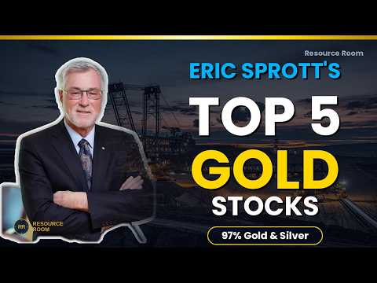
- 설명 앞부분: Eric Sprott has roughly 97% of his assets deployed in gold and silver at all times. He personally leads private placements, files early warning reports, and keeps buying through price increases. When he moves on a junior mining stock, the entire sector pays attention. In this video I tracked down 5…
- 같은 채널 평소 대비 ×4.1 (채널 최근 롱폼 중앙값 12,079회) · 평소 영상: Top 5 Copper Stocks For 2026 You Don't Want To Mi… (12,079회) / Michael Gentile's Top 5 Gold Stocks Right Now (12,311회)
- 대본 없음 (설명) — 음성인식이 끝나면 도입부·흐름이 들어감
- 댓글 75/82: 좋은 점 — 영상 0 · 감사·응원 0 · 더 알고 싶은 것 0 · 아쉬운 점 — 영상 0 · 반박·불만 — 의견 다름 0 · 정치·사회 0 · 경험 공유 0 · 구독·다음 기대 0

### 27. 나스닥은 버티는데 아이온큐가 일주일 새 20% 빠진 건 망해서가 아닙니다 — 가트너가 말한 퇴출 명단은 따로 있습니다 #미국주식 #아이온큐 #리게티 #경제노트

- https://www.youtube.com/watch?v=IbkLrISwBiU · 경제전략노트 · 구독자 747 · 조회수 38,203 (×51.1, 하루 1,681.1) · 좋아요 205 (0.5%) · 14.4분 · 2026-10-14 · 주제 묶음 4. 미국·해외주식 · 형식 정보·해설 (그 밖) · 폴더 `W_IbkLrISwBiU` (웹 승인)
- 썸네일: 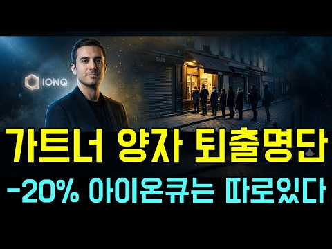
- 설명 앞부분: 10월 6일부터 13일까지 5거래일 동안 아이온큐(IONQ)는 19.8% 빠졌고, 나스닥 100은 2.1% 내리는 데 그쳤습니다. 가트너는 올해 전 세계 양자컴퓨팅 매출을 8억 6,990만 달러, 내년을 약 11억 달러로 전망했습니다. 보도에 따르면 가트너는 매출이 모자란 양자 스타트업 절반 이상이 2030년까지 문을 닫을 것으로 봤습니다. 아이온큐의 올해 매출 전망 2억 8천만~2억 9천만 달러는 그 시장의 약 3분의 1입니다(집계 기준 차이 가능). 리게티(RGTI)는 2분기 매출 510만 달러, 빚 없이 현금 5억 4,130…
- 같은 채널 평소 대비 ×25.6 (채널 최근 롱폼 중앙값 1,493회) · 평소 영상: 나테라와 템퍼스AI 두 거물의 승부는? 드러켄밀러 1위 종목은 암 재발을 피로 찾는 나테… (1,493회) / AI 반등 명단에 아이온큐가 없던 건 버림받아서가 아닙니다 — 첫날 돈은 이익률 55%인… (1,566회)
- 대본 없음 (설명) — 음성인식이 끝나면 도입부·흐름이 들어감
- 댓글 10/11: 좋은 점 — 영상 0 · 감사·응원 1 · 더 알고 싶은 것 0 · 아쉬운 점 — 영상 0 · 반박·불만 — 의견 다름 0 · 정치·사회 0 · 경험 공유 0 · 구독·다음 기대 0
  - 감사·응원 👍0 “빠른정보 감사합니다”

### 28. 삼성전자 지금 팔아야 하나? 코스피 서킷브레이커 날, 버틸지 팔지 가를 기준 2가지

- https://www.youtube.com/watch?v=ICByZXkRrLg · 경제야! 놀자~ · 구독자 8,620 · 조회수 101,848 (×11.8, 하루 16,761.8) · 좋아요 583 (0.6%) · 13.5분 · 2026-10-15 · 주제 묶음 5. 국내주식 · 형식 정보·해설 (그 밖) · 폴더 `W_ICByZXkRrLg` (웹 승인)
- 썸네일: 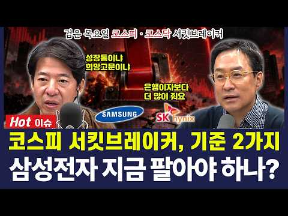
- 챕터: 0:00 하이라이트 — 팔면 안 될 때, 팔아야 할 때 · 0:16 [경제야놀자 해설] 서킷브레이커, 팔아야 하나? · 0:36 사자고 했던 근거 ① 이익 증가 ② 저평가 · 1:45 근거 ③ 배당 30~40% 증가 · 자사주 소각 · 2:19 [경제야놀자 해설] 사자고 했던 근거 3가지 · 2:40 빠지는 이유 ① 금리 · 2:59 ② AI 투자 버블론 ③ 중동 · 물가 · 3:39 "훼손된 게 있나요?" — 아직은 없다 · 4:15 양대 시장 서킷브레이커 · 메모리 사이클 불신 · 5:28 [경제야놀자 해설] 서킷브레이커 · 메모리 사이클 · 5:53 박시동 — "3~4일에 20%씩 빠질 일이냐" · 7:13 성장통이냐, 희망고문이냐 · 8:53 판단 기준 두 갈래 · 비중 줄이기 · 10:05 [경제야놀자 해설] 성장통이냐 희망고문이냐 · 10:26 박시동 — 시가배당률 5%, 은행이자보다 많다 · 11:55 정리 — 지금 새로 사는 건 아니다 · 12:40 [경제야놀자 해설] 오늘의 세 줄 정리
- 설명 앞부분: [10월 15일 · 12시에 만나요] 코스닥에 이어 코스피까지 8% 넘게 빠지며 두 시장 모두 서킷브레이커가 걸린 날, 방송은 "지금 어떻게 해야 하나"를 붙들고 길게 이야기했다. 이광수 대표는 그동안 한국 주식을 사자고 했던 근거 세 가지 — 기업 이익 증가, 이익 대비 저평가, 배당과 자사주 소각으로 바뀌는 시장 — 를 다시 짚고, 아직 훼손된 것은 없다고 봤다. 권다영 앵커는 메모리 반도체가 사이클이라는 오랜 경험 때문에 시장이 "이번엔 다르다"를 믿지 못한다고 해석했다. 이 대표는 지금 하락이 오르는 길의 성장통인지, 저점…
- 대본 없음 (설명) — 음성인식이 끝나면 도입부·흐름이 들어감
- 댓글 296/296: 좋은 점 — 영상 0 · 감사·응원 0 · 더 알고 싶은 것 2 · 아쉬운 점 — 영상 0 · 반박·불만 — 의견 다름 8 · 정치·사회 19 · 경험 공유 8 · 구독·다음 기대 0
  - 더 알고 싶은 것 👍14 “오늘은 뭐라 하는지 궁금해서 들어 와봣더니.. 역시나..ㅠㅠㅠ”
  - 더 알고 싶은 것 👍2 “이주완 아날리스트의 삼전닉스 비관론에 대해서 합리적인 반론 좀 부탁드려요.”
  - 반박·불만 — 의견 다름 👍13 “대 전제가 틀렸다. 주식시장은 애초에 합리적인 분석대로 움직이는 장이 아니다. 이게 내 결론임.”
  - 반박·불만 — 의견 다름 👍11 “영국은 겨우 방직기 하나 개발해놓고 100년을 거품을 몰고 다녔습니다. 왜 한국만 지금 바보짓을 합니까? 좀 이 업계 모르는 분들은 입닫고 조용히 기업들이 하는일 지켜보세요. 기업들 바보 아닙니다. 겨우 중국발 기사 2줄에 검증되지 않은 내용으로 아무나 떠드는것에 신…”
  - 정치·사회 👍27 “정부는 아무 대책 없네~~ 미국이 이정도면 난리 났다 ~~종지가 9퍼가 빠진다는게 현실이냐 삼전이 1주일 만에 -30퍼가 말이 되나교 국민 거지 만들기 프로젝트 가종중이냐? 주식 시장은 아침 8시부터 저녁 8시까지 하라는 이야기냐?”
  - 정치·사회 👍8 “증권당국이 기업죽든말든 개인죽든말든 나라가죽든말든 증권사의무능수치다”
  - 경험 공유 👍15 “저분들 때문에 여러명 죽네 어제가. 바닥이라고 햇던거 같은데 저런 말은 나도 하겠네요”
  - 경험 공유 👍10 “귀에걸면 귀걸이 코에걸면 코걸이 나도하겠다.”

### 29. I Just Bought 1,600 Shares Of SCHD: Here's my Dividend payment

- https://www.youtube.com/watch?v=d23iMmo2w4o · Bald Man Finance  · 구독자 392 · 조회수 14,618 (×37.3, 하루 747.9) · 좋아요 37 (0.2%) · 19.3분 · 2026-10-17 · 주제 묶음 기타 · 형식 정보·해설 (그 밖) · 폴더 `W_d23iMmo2w4o` (웹 승인)
- 썸네일: 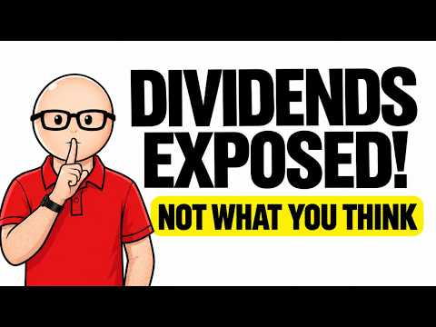
- 설명 앞부분: I Just Bought 1,600 Shares Of SCHD: Here's my Dividend payment
- 같은 채널 평소 대비 ×43.6 (채널 최근 롱폼 중앙값 336회) · 평소 영상: The 7 Levels of Wealth Where Compounding Suddenly… (374회) / The SpaceX Bubble Crash Is Worse Than You Think (297회)
- 대본 없음 (설명) — 음성인식이 끝나면 도입부·흐름이 들어감
- 댓글 15/15: 좋은 점 — 영상 0 · 감사·응원 0 · 더 알고 싶은 것 0 · 아쉬운 점 — 영상 0 · 반박·불만 — 의견 다름 0 · 정치·사회 0 · 경험 공유 0 · 구독·다음 기대 0

### 30. GPIQ 대신 결국 QQQI에 1억 몰빵한 현실적인 이유 (나스닥 월배당 ETF 끝판왕 비교)

- https://www.youtube.com/watch?v=-0dKG0x3TM4 · 카츠라기 | 주식 월배당 · 구독자 439 · 조회수 10,513 (×23.9, 하루 821.4) · 좋아요 0 (0.0%) · 6.9분 · 2026-10-24 · 주제 묶음 2. 장기투자·ETF·지수 · 형식 정보·해설 (그 밖) · 폴더 `W_-0dKG0x3TM4` (웹 승인)
- 챕터: 0:00 QQQI 1,460주(1억 원) 실계좌 & 월배당 1… · 0:12 요즘 미국 주식 커뮤니티에서 가장 핫한 골드만삭스 '… · 0:48 기본 스펙 비교: 운용보수 수수료가 2배 넘게 차이 … · 1:35 1억 투자 시 실제 배당금 격차 (월 83만 원 vs… · 2:04 똑같은 나스닥100인데 왜 다를까? (옵션 전략 아주… · 3:29 최근 1~2년 총수익률 성적표 비교 (주가 상승 + … · 3:53 [핵심 반전] 총수익률이 높은데도 GPIQ 대신 QQ… · 4:29 20대 투자자의 진짜 무기: QQQI 배당금으로 QQ… · 6:06 최종 정리: 나에게 딱 맞는 ETF 고르는 기준 (G…
- 설명 앞부분: 단순히 엑셀로 계산기만 두드리는 비교 영상이 아닙니다. 현재 QQQI에 1억 원 이상(1,460주)을 실제로 태워 매달 세후 100만 원이 넘는 배당금을 받고 있는 실전 투자자 입장에서, 요즘 가장 핫한 골드만삭스의 나스닥 커버드콜 'GPIQ'와 네오스의 'QQQI'를 완벽하게 비교 분석해 드립니다. 운용보수(수수료)도 절반 이상 저렴하고 폭등장에서 주가도 더 잘 따라가는 GPIQ 대신, 왜 저는 결국 QQQI에 남아 나스닥 레버리지(QLD) 재투자 파이프라인을 굴리고 있을까요? 두 ETF의 결정적인 차이점과 저만의 '역할 분담 …
- 같은 채널 평소 대비 ×7.9 (채널 최근 롱폼 중앙값 1,324회) · 평소 영상: 1억 넣으면 월 116만 원 vs 월 173만 원? QQQI 대신 XQQI 사기 전에 꼭… (1,324회) / 개별주 싹 접었습니다 (QQQI에 1억 몰빵) (885회)
- 대본 없음 (설명) — 음성인식이 끝나면 도입부·흐름이 들어감
- 댓글 46/46: 좋은 점 — 영상 1 · 감사·응원 5 · 더 알고 싶은 것 3 · 아쉬운 점 — 영상 0 · 반박·불만 — 의견 다름 0 · 정치·사회 0 · 경험 공유 4 · 구독·다음 기대 0
  - 좋은 점 — 영상 👍0 “좋은 영상 감사합니다. 저도 GPIQ 다시 모아봐야겠네요.😊”
  - 감사·응원 👍3 “오 안그래도 다들 gpiq 추천하길래 관심 있었는데 분석 감사합니다 ㅋㅋ 모르겠으면 반반 ㅋㅋ 저는 나중에 다시 미쿡 커버드콜 담을때 반반 담아봐야겠네요 ㅋㅋㅋ”
  - 감사·응원 👍0 “좋은 영상 감사합니다. 저도 GPIQ 다시 모아봐야겠네요.😊”
  - 더 알고 싶은 것 👍2 “qqqi 배당금으로 qqqi를 재투자하고 있는데 qld를 사는게 좋을까요?”
  - 더 알고 싶은 것 👍0 “Xqqi가 배당이 더 높던데 비교분석 영상 만들어 주시면 감사할거 같습니다!”
  - 경험 공유 👍0 “좋은 영상 감사합니다. 저도 GPIQ 다시 모아봐야겠네요.😊”
  - 경험 공유 👍0 “저도qqqi랑젭큐에서 받은 분배금으로 iqq 재투자중”

### 31. 50대 옥탑방 부부, "그 나이에 왜 주식을..."

- https://www.youtube.com/watch?v=FRzyTNO9mNI · 반백살, 옥탑방 이야기 · 구독자 703 · 조회수 43,619 (×62.0, 하루 1,288.6) · 좋아요 427 (1.0%) · 6.3분 · 2026-10-03 · 주제 묶음 1. 주식 기초·초보 · 형식 정보·해설 (그 밖) · 폴더 `W_FRzyTNO9mNI` (웹 승인)
- 썸네일: 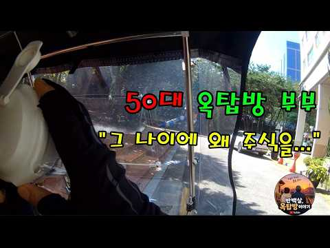
- 설명 앞부분: 지난 영상 이후, 50대 옥탑방 부부인 저희의 주식 도전에 많은 분들이 걱정과 조언을 남겨주셨습니다. 진심으로 감사드립니다. "그 나이에 왜 위험하게 주식을 하느냐"는 물음에 오늘 제 진솔한 속마음을 전합니다. 사기와 빚을 겪으며 깨달은 금융 무지의 서러움, 그리고 평생 일할 수 없다는 현실 앞에 저희에게 파이어족은 노후를 위한 '마지막 생존 전략"입니다. 지치지 않고 끝까지 걸어갈 수 있도록 많은 응원과 격려 부탁드립니다. 오늘도 시청해 주셔서 감사합니다.
- 같은 채널 평소 대비 ×12.1 (채널 최근 롱폼 중앙값 3,603회) · 평소 영상: 8월 폭염 속, 침침해진 눈으로 배달을 나섭니다. (3,616회) / "여보 제발 나가지 마!" 돈 없는데 비 온다고 일 안 못나가는 이유 (3,590회)
- 대본 (음성인식(앞 5분), 4.2 음절/초) — 앞부분만, 흐름은 그 안까지 첫 20초: “안녕하세요 구독자 여러분 50대 옥탑방 아내입니다. 어느 덧 바람 끝이 제법 선선해진 가을이 왔네요. 하늘도 높아지고 날씨가 참 좋습니다. 우리 구독자분들도 오늘 하루 기분 좋게 잘 보내고 계신가요? 옥탑방에서 바라보는 하늘은 계절이 바뀔 때마다 괜히 마음을 몽글몽글하게 만드는 것 같아요.” — 도입부 유형: 숫자로 시작, 시청자 부르기
- 첫 1분: “안녕하세요 구독자 여러분 50대 옥탑방 아내입니다. 어느 덧 바람 끝이 제법 선선해진 가을이 왔네요. 하늘도 높아지고 날씨가 참 좋습니다. 우리 구독자분들도 오늘 하루 기분 좋게 잘 보내고 계신가요? 옥탑방에서 바라보는 하늘은 계절이 바뀔 때마다 괜히 마음을 몽글몽글하게 만드는 것 같아요. 오늘 이렇게 영상을 제작하는 것은 지난 영상 이후에 정말 많은 분들이 남겨주신 댓글에 마음 깊이 감사하다는 말씀을 전하고 싶어서 입니다. 제가 주식공부에 보겠다고 말씀드린 이후로 걱정 어린 마음으로 따뜻한 조언과 충고를 남겨주신 분들이 정말 많았어요. 주식은 위험하다 잘못하면 큰일 난다 하며 자기 일처럼 걱정해주시는 마음 하나하나 읽으면서 얼마나 감사했는지 모릅니다.”
- 흐름 (90초마다 첫 문장): 0:00 안녕하세요 구독자 여러분 50대 옥탑방 아내입니다. → 1:36 나이가 한 살 한 살 들수록 느끼는 게 있어요. → 3:06 그 분야에 제대로 뛰어들려면 정말 피나는 공부와 노력이 필요하다는 것을… → 4:36 지금은 남편과 제가 노동소득으로 벌고 있지만 저라도 자본소득을 공부하고…
- 댓글 187/187: 좋은 점 — 영상 6 · 감사·응원 27 · 더 알고 싶은 것 3 · 아쉬운 점 — 영상 1 · 반박·불만 — 의견 다름 3 · 정치·사회 2 · 경험 공유 20 · 구독·다음 기대 0
  - 좋은 점 — 영상 👍10 “목소리가 좋으시네요 편안하고 듣기에 좋아요 비슷한 나이인데 주식을 해 보고 있어요 손절하여서 손해도 보았지만 그러면서 배우고 있어요 같은 생각으로 하며 접근하고 있어요 성투하시길 바래요🎉”
  - 좋은 점 — 영상 👍4 “목소리가 차분하고 편안해서 듣기 좋습니다~~ 힘내시고 파이팅 하세요~~”
  - 감사·응원 👍17 “목소리 좋으시네요 아무것도 안하면 아무것도 될 수 없을 껍니다 화이팅 하시길요”
  - 감사·응원 👍16 “저도 주식하면 패가 망신한다는 부모님 말씀을 금과옥조로 여기며 살다가, 50세가 넘은 나이에, 금기의 영역으로 생각했던 주식을 시작했어요. 개별주는 하나도 안하고, 미국지수, 국내지수만 투자하는데...진작 시작할걸 싶네요. 3년전부터 했는데 5년전, 10년전 시작할걸…”
  - 더 알고 싶은 것 👍2 “영상 자주 올려주세요❤ 주식공부도 열심히 하시고 화이팅입니다 ❤”
  - 더 알고 싶은 것 👍2 “뭐하나 물어볼게요..주식하셔서 얼마나 버셔서 만족 하실가요? 그냥 전 풍차돌리기 예금이나 적금 추천드리고...인생 한방 절대 없습니다. 소수의 행운이 나에게 올 확률이 정말 힘들다는거 다시 한번 이 나이에 잊지 마시길 부탁드립니다.”
  - 아쉬운 점 — 영상 👍1 “위 제목 아래에 AI라고 써있는데요 목소리는 ai같지않고 영상도 ai같지않은데..어느것이 Ai 인가요?”
  - 반박·불만 — 의견 다름 👍2 “하지마시고 한국 미국 반반 지수 장기투자하세요. 몇달한다고 되는게 아닙니다.”
  - 반박·불만 — 의견 다름 👍0 “안녕하세요 52인데요^^ 너무 공감합니다. ISA계좌 연금저축계좌 먼저만드세여 ISA계좌는 한해2천만원해서5년1억가능합니다.연금계좌는 1800까지가능합니다. 우리가족모두 만들어서 하고있네여. 종목추천은아닙니다 제가하는겁니다. ISA계좌에서 하시면 배당세금없이 재투자 …”
  - 정치·사회 👍1 “대통령이 하라해서 ㅡㅡㅡㅡ. 돈번것들은 재용 태원이ㅡㅡㅡㅡ”
  - 정치·사회 👍0 “제 경험을 말씀드려 볼게요. 현재 54살 노총각입니다. 24년 하반기부터 10년 이상 다니던 직장이 경기가 안좋아지면서 해고 위기가 느껴졌습니다. 당시까지 모아둔 돈이라곤 현금 3억 조금 넘게 가지고 있었고 집은 월세 45만원 오피스텔에 살고 있었죠. 당장 짤리면 4…”
  - 경험 공유 👍26 “목소리가 참 좋으시네요😊 저도 50대 중반이고 주식으로 노후자금 준비를 하고있어요 이제는 근로소득만 가지고 자산을 늘리는 시대는 끝났다고 봅니다 부동산은 목돈이 들어가니 서민들은 주식이 접근하기 쉽죠 저도 처음에 주식.금융공부 많이 하고 시작했는데요, 결국 공부보다 …”
  - 경험 공유 👍16 “저도 주식하면 패가 망신한다는 부모님 말씀을 금과옥조로 여기며 살다가, 50세가 넘은 나이에, 금기의 영역으로 생각했던 주식을 시작했어요. 개별주는 하나도 안하고, 미국지수, 국내지수만 투자하는데...진작 시작할걸 싶네요. 3년전부터 했는데 5년전, 10년전 시작할걸…”

### 32. QLD 직투 vs ISA, 잘못 선택했다가는 10년 뒤 수 천만 원 날립니다

- https://www.youtube.com/watch?v=PEOHCf2930w · 투자각성 · 구독자 382 · 조회수 15,386 (×40.3, 하루 678.5) · 좋아요 127 (0.8%) · 8.9분 · 2026-10-14 · 주제 묶음 10. 노후·연금 투자 · 형식 정보·해설 (그 밖) · 폴더 `W_PEOHCf2930w` (웹 승인)
- 썸네일: 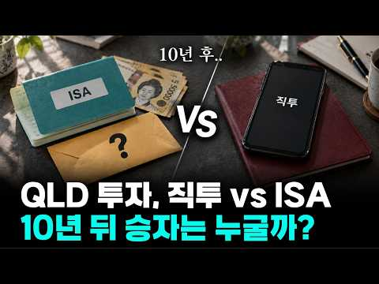
- 챕터: 0:00 ISA 가입자 1,000만 명, 나는 어디에 담을까 · 1:51 1억 넣으면 세금 1,400만 원 차이 · 6:01 ISA 나스닥 2배, 환율도 2배라고? · 8:01 그래서, 어디에 얼마를 넣을까 · 9:11 10년 전 천만 원, 지금 얼마일까 · 10:45 2배가 3배를 이긴 이유 · 12:48 2008년 같은 폭락이 오면? · 13:59 정리, 그리고 1만 달러 새 계좌
- 설명 앞부분: 나스닥 2배, ISA로 살까 미국 직투로 살까? 1년에 천만 원씩 10년이면 세금만 1,400만 원 가까이 갈립니다. 어느 통장에 얼마를 넣을지, 그리고 왜 장기로는 QLD인지 레버리지 7년 차의 시각으로 정리했습니다.
- 같은 채널 평소 대비 ×21.0 (채널 최근 롱폼 중앙값 733회) · 평소 영상: 모두가 버렸던 이 주식, 나는 왜 아직도 들고 있나 (733회) / SOXL 15억 거래하고 내린 결론(ft.앙드레 코스톨라니 공식) (680회)
- 대본 없음 (설명) — 음성인식이 끝나면 도입부·흐름이 들어감
- 댓글 31/48: 좋은 점 — 영상 2 · 감사·응원 5 · 더 알고 싶은 것 2 · 아쉬운 점 — 영상 0 · 반박·불만 — 의견 다름 0 · 정치·사회 0 · 경험 공유 0 · 구독·다음 기대 1
  - 좋은 점 — 영상 👍2 “유익한 영상입니다 감사합니다🎉🎉”
  - 감사·응원 👍2 “유익한 영상입니다 감사합니다🎉🎉”
  - 감사·응원 👍1 “영상 감사합니다^^ 요즘 isa에서 한국폰 qld를 사려면 1000만원이 있어야 해서 고민입니다..1000만원을 일시로 넣고 적립식매수해도 가능한건가요?”
  - 더 알고 싶은 것 👍2 “영상 잘 보았습니다~!^^그럼 isa 계좌에서 3년 납입후 연장하고 부동산이나 큰돈 들어갈때 해지 하고 싶으면 4년후에는 해지해도 세금 해택 받을 수 있는걸까요?그리고 환헷지가 가능한 h가 붙은 상품으로이 나을지 고견 부탁드립니다~🙏이제 막 계좌 개설해서 시작 하려는…”

### 33. 코스피 하루 7.8% 폭락! 내 주식 팔기 전에 확인할 성장통과 하락의 기준 #12시에 만나요 #매도사이드카 #삼성전자

- https://www.youtube.com/watch?v=FvUBkpAyJeY · 잘되는경제 · 구독자 1,080 · 조회수 12,462 (×11.5, 하루 1,752.2) · 좋아요 51 (0.4%) · 12.9분 · 2026-10-30 · 주제 묶음 5. 국내주식 · 형식 정보·해설 (그 밖) · 폴더 `W_FvUBkpAyJeY` (웹 승인)
- 챕터: 0:00 성장통이냐 하락이냐 · 0:15 이 영상 핵심은 이것 · 0:30 25년 베테랑도 힘든 하락장 · 2:25 한국 주식을 사자던 세 가지 근거 · 5:19 지금 팔지 말지 가르는 기준 · 9:40 경제는 좋고 주가는 너무 싸다 · 12:07 바쁜 분들을 위한 3줄
- 설명 앞부분: 코스피가 하루에 7% 넘게 빠지고, 코스피·코스닥 양 시장에 매도 사이드카와 서킷브레이커까지 걸린 날이 있었습니다. 25년 넘게 시장에 있었던 이광수 소장도 서브프라임이나 코로나 때보다 유난히 힘들다고 털어놓은 이유는 무엇일까요? 지금의 하락이 올라가며 겪는 성장통인지, 내려가는 흐름의 시작인지 가르는 기준을 짚어 봅니다. "3, 4일에 20%씩 빠질 일이냐?" 코스피 7.8% 하락, 양 시장 매도 사이드카·서킷브레이커 한국 주식을 사자고 했던 근거: 실적·저평가·시장 변화 상장사 배당 30~40% 증가, 자사주 매입도 확대 성장…
- 대본 없음 (설명) — 음성인식이 끝나면 도입부·흐름이 들어감
- 댓글 9/9: 좋은 점 — 영상 0 · 감사·응원 0 · 더 알고 싶은 것 0 · 아쉬운 점 — 영상 0 · 반박·불만 — 의견 다름 0 · 정치·사회 0 · 경험 공유 0 · 구독·다음 기대 0

### 34. 10번 중 3번만 맞혀도 수익이 나는 매매의 원리 ∣ 깡토의 추세추종 깡토

- https://www.youtube.com/watch?v=9Eh6R2AYFp8 · 오르는주식을사는사람들입니다 · 구독자 4,600 · 조회수 68,251 (×14.8, 하루 6,947.7) · 좋아요 775 (1.1%) · 17.9분 · 2026-10-27 · 주제 묶음 7. 매매·전략 · 형식 정보·해설 (그 밖) · 폴더 `W_9Eh6R2AYFp8` (웹 승인)
- 설명 앞부분: 안녕하세요, [오르는주식을사는사람들입니다] 채널에서 인사드립니다. 주식 투자를 하다 보면 이런 고민이 꼭 생깁니다. 많이 맞히는 매매가 좋은 매매 아닐까? 조금 올랐을 때 팔아야 하나, 더 들고 가야 하나? 저희도 그랬습니다. 올라서 팔았더니 더 오르고, 떨어져서 물을 탔더니 지하실이 있더라고요. 이번 수업은 깡토쌤의 매매기술편 1강입니다. 승률보다 손익비가 왜 중요한지, 승률 30%로도 돈을 벌 수 있는 이유를 함께 배워보았습니다. 궁금한 점은 댓글로 남겨주시면 저희가 같이 고민해 보겠습니다 :) 감사합니다.
- 대본 없음 (설명) — 음성인식이 끝나면 도입부·흐름이 들어감
- 댓글 40/40: 좋은 점 — 영상 1 · 감사·응원 8 · 더 알고 싶은 것 1 · 아쉬운 점 — 영상 0 · 반박·불만 — 의견 다름 0 · 정치·사회 0 · 경험 공유 3 · 구독·다음 기대 0
  - 좋은 점 — 영상 👍1 “손익비에 대한 명확한 개념을 설명해주셔서 감사합니다. 역시 주식은 타이밍과 대응이기는한데, 실제로 수익을 꾸준히 내는 개미는 극히 일부분이죠. 좋은 강의 감사합니다.”
  - 감사·응원 👍5 “깡토님 좋아요 감사합니다 ^^”
  - 감사·응원 👍1 “손익비에 대한 명확한 개념을 설명해주셔서 감사합니다. 역시 주식은 타이밍과 대응이기는한데, 실제로 수익을 꾸준히 내는 개미는 극히 일부분이죠. 좋은 강의 감사합니다.”
  - 더 알고 싶은 것 👍1 “안녕하세요. 강의에 나오는 강의책은 어디서 구할 수 있나요?”
  - 경험 공유 👍12 “안녕하세요 ♥ ♥ 깡토 피디도 오주사 채널에서 새롭게 인사드립니다! 다시 초심을 갖고 열심히 배워보겠습니다 👩‍🏫 깡토쌤 제가 여기선 반장인가요!”
  - 경험 공유 👍0 “나는 숭률 90프로 매매 기법을 발명했다..주식으로 크게 돈 잃어서 힘든 사람 1명에게만 내가 아는 것을 다 알려 주겠다..선착순 1명만..”

### 35. 하락장에서 계좌를 지키는 세 가지

- https://www.youtube.com/watch?v=AUeEkRnKeM8 · 리채피 richappy · 구독자 9,060 · 조회수 144,363 (×15.9, 하루 12,775.6) · 좋아요 2,215 (1.5%) · 16.7분 · 2026-10-26 · 주제 묶음 11. 투자 일반 · 형식 정보·해설 (그 밖) · 폴더 `W_AUeEkRnKeM8` (웹 승인)
- 챕터: 0:00 하락장이 고통스러운 진짜 이유 · 1:06 하락장의 두 얼굴: 급락과 긴 횡보 · 2:33 지금 시장은 어디쯤인가: 민스키의 빚의 세 단계 · 3:43 급락이 끝난 다음, 사람들이 시장을 떠나는 구간 · 5:12 감정이 흔들린 투자자의 성적표 · 6:40 같은 사람도 상태에 따라 다르게 고른다: 투자 게임 … · 8:03 다들 떠날 때 사는 사람들: 워런 버핏의 2008년 · 9:54 그냥 버티라는 말 아닌가요? · 11:19 제가 지나온 하락장: 2020년과 2022년 · 13:21 달라진 것은 순서였습니다 · 14:02 오늘부터 해볼 세 가지 · 15:19 오늘 내용 정리
- 설명 앞부분: 주식 하락장, 급락보다 그 뒤의 긴 횡보가 더 고통스럽다면 바닥을 맞히기보다 그 구간을 지나갈 준비부터 하세요. 하락장을 네 번 지나며 알게 된 개인 투자자의 마음 관리법과 실제 대응을 공개합니다. 하락장에서 좋은 자산을 싼 가격에 팔고 시장을 떠나는 분이 많습니다. 이는 급락이 만드는 공포와, 그 뒤 긴 횡보가 쌓는 지루함과 답답함이 판단을 흔들기 때문입니다. 하락장은 단순히 주가가 떨어지는 시기가 아니라, 마음이 먼저 무너지기 쉬운 시기입니다. 그래서 지금 시장이 어느 구간인지 아는 것부터 시작해, 그다음 구간이 왜 더 어려운…
- 같은 채널 평소 대비 ×9.1 (채널 최근 롱폼 중앙값 15,900회) · 평소 영상: 5년간 죽어라 했던 주식투자, '이렇게' 바꾸고 행복한 부자가 됐습니다 (16,152회) / 주식투자 5년을 헤매던 내가 전문가 전망보다 먼저 알게 된 '이것' (15,647회)
- 대본 없음 (설명) — 음성인식이 끝나면 도입부·흐름이 들어감
- 댓글 128/128: 좋은 점 — 영상 10 · 감사·응원 18 · 더 알고 싶은 것 0 · 아쉬운 점 — 영상 0 · 반박·불만 — 의견 다름 0 · 정치·사회 0 · 경험 공유 6 · 구독·다음 기대 2
  - 좋은 점 — 영상 👍14 “지금 제 마음이 공포와 두려움으로 무너져 가는데 큰 힘과 도움이 됩니다 감사합니다!!”
  - 좋은 점 — 영상 👍6 “요즘 많이 힘든데 좋은 말씀 감사합니다 잘버티고 살아남고 싶습니다😊”
  - 감사·응원 👍19 “유투브 내용이 좋고 참 알찹니다. 소중하고 귀한 나눔 감사합니다. 리채피님도 더 건강하시고 행복하시기 바랍니다~~”
  - 감사·응원 👍14 “지금 제 마음이 공포와 두려움으로 무너져 가는데 큰 힘과 도움이 됩니다 감사합니다!!”
  - 경험 공유 👍19 “제가 그랬어요. 횡보장에서 결국 손실보고 팔구 새로 산 주식이 또 다시 하락하는 ㅠ”
  - 경험 공유 👍13 “하락장 자체가 문제가 아니에요 그걸로 인해 심리가 불안해지고 심하면 잠도 안오고 온종일 그 이유를 고민하고 일상생활에 지장을 줍니다 대부분 이런 상태를 버티지 못하고 던지게 댑니다. 하락장을 여러번 경험했어도 적응이 힘들죠 이 고통스러움에서 벗어나고 싶어서 던지는겁니…”
  - 구독·다음 기대 👍15 “바닥이다싶을때부터 분할매수해야 달리는 말에 올라탑니다. 크리스마스까지 기다려요!”
  - 구독·다음 기대 👍0 “차분한 분석에 마음이 편해져서 구독합니다, 저도 하락장에 계속 추매해서 마이너스 15%지만 금액은 많지 않습니다, 전부 제 여윳돈이고요, 조금 상승하면 일부 매도해서 현금을 마련, 하락할때 추매하여 단가를 낮추었어요”

### 36. 단타 5년차가 알려준 ＂잃지 않는 법＂ 딱 3가지 ｜ 코스피 9000시대 생존법

- https://www.youtube.com/watch?v=WnuVkKRjcuI · 돈의흐름도 · 구독자 1,380 · 조회수 153,227 (×111.0, 하루 1,918.8) · 좋아요 2,650 (1.7%) · 13.5분 · 2026-08-09 · 주제 묶음 5. 국내주식 · 형식 정보·해설 (그 밖) · 폴더 `W_WnuVkKRjcuI` (웹 승인)
- 썸네일: 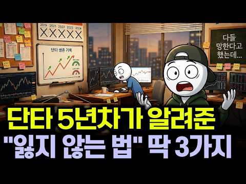
- 설명 앞부분: 단타 5년차가 알려준 ＂잃지 않는 법＂ 딱 3가지 ｜ 코스피 9000시대 생존법 경제를 제대로, 그리고 쉽게. 🏴‍☠ 이 채널에서 다루는 것들 주식·ETF·배당주 투자 분석 환율·금리·인플레이션 경제 해설 미국·한국 증시 및 글로벌 시장 동향 부동산·원자재·달러 등 자산 시장 분석 재테크 초보를 위한 경제 상식 어렵고 딱딱하게만 느껴지던 경제 뉴스, 경제해적단과 함께라면 달라집니다. 복잡한 시장의 흐름을 단순하고 명확하게 짚어드립니다. 월급쟁이도, 사회초년생도, 재테크를 막 시작한 분도 경제해적단과 함께라면 경제가 보이기 시작합니…
- 같은 채널 평소 대비 ×8,512.6 (채널 최근 롱폼 중앙값 18회) · 평소 영상: ＂천만원으로 3억, 매달 50만원이 20년 뒤 만드는 숫자＂ (18회) / ＂50대 노후 3억, 매달 100만원 만드는 법 (연금·복리·종잣돈)＂ (18회)
- 대본 (음성인식(앞 5분), 5.5 음절/초) — 앞부분만, 흐름은 그 안까지 첫 20초: “제가 아는 동생 중에 단타로 5년째 먹고 사는 친구가 있어요 전업으로요? 처음엔 저도 안 믿었어요 다들 망한다는 단타로 어떻게 5년을 버티냐고요 근데 옆에서 매매하는 걸 보고 깜짝 놀랐어요 종목을 신들린 듯 고를 줄 알았는데 의외로 사곱하는 건 되게 단순하더라고요 대신 딱 하나 남들이 절대 안 지키는 걸 기계처럼 지키고 있었어요” — 도입부 유형: 질문으로 시작, 숫자로 시작, 내 이야기·사연
- 첫 1분: “제가 아는 동생 중에 단타로 5년째 먹고 사는 친구가 있어요 전업으로요? 처음엔 저도 안 믿었어요 다들 망한다는 단타로 어떻게 5년을 버티냐고요 근데 옆에서 매매하는 걸 보고 깜짝 놀랐어요 종목을 신들린 듯 고를 줄 알았는데 의외로 사곱하는 건 되게 단순하더라고요 대신 딱 하나 남들이 절대 안 지키는 걸 기계처럼 지키고 있었어요 그게 뭐냐고 물어봤죠 그 친구가 한 말이 잊지 않아요 형 단타는 잘 사는 기술이 아니라 잘 버티는 기술이에요 차트 공부 100날 해봐야 소용 없다는 거예요 오늘 그 동생이 5년 동안 지켜온 그 한 가지를 여러분한테 그대로 풀어드릴게요 그리고 100만 원으로 그걸 어떻게 몸에 익히는지까지요 이거 하나만 가져가셔도 오늘 영상 값은 하실 거예요 끝까지 보세요 좋아요, 구독, 알림 설정 꼭”
- 흐름 (90초마다 첫 문장): 0:00 제가 아는 동생 중에 단타로 5년째 먹고 사는 친구가 있어요 → 1:31 이런 장을 보면 무슨 생각이 들까요? → 3:02 수익률은 오히려 더 낮았어요 → 4:31 근데 손실이 난 종목은 22%만 팔아요
- 댓글 96/96: 좋은 점 — 영상 3 · 감사·응원 2 · 더 알고 싶은 것 3 · 아쉬운 점 — 영상 4 · 반박·불만 — 의견 다름 3 · 정치·사회 0 · 경험 공유 7 · 구독·다음 기대 1
  - 좋은 점 — 영상 👍6 “너무 꼭 맞는 말씀입니다. 100원만 수익을 본다하더라도 100만원 1000만원 욕심을 버리기까지...다겪어봐야 조금 느끼게 되더라구요..”
  - 좋은 점 — 영상 👍2 “도움이 많이 됐습니다.참고하도록할께요.잠시 잊고 단타를 해서 손절 많이 했는데 이영상보고 뜨끔했네요.좋은영상 감사합니다”
  - 감사·응원 👍2 “도움이 많이 됐습니다.참고하도록할께요.잠시 잊고 단타를 해서 손절 많이 했는데 이영상보고 뜨끔했네요.좋은영상 감사합니다”
  - 더 알고 싶은 것 👍1 “구독, 좋아요,,,알림설정. 알려주세요.”
  - 아쉬운 점 — 영상 👍4 “단타 30년차로 잃지 않는 방법을 알려준다면 당장 주식을 접어라 그게 유일한 방법이다 그래도 주식을 하고 싶다면 종목을 보고 매매 하지말고 시장을 보고 매매해라 시장이 아니라고 하는데 시장을 이길라고 덤비면 백퍼 망한다 종목 차트 백날 선으로 찍찍 그어봐야 시장폭락하…”
  - 아쉬운 점 — 영상 👍2 “에이라.. 뻔한 이야기 가지고.. 뭐 특별한 비법이 있는 거 마냥...”
  - 반박·불만 — 의견 다름 👍5 “챠트 보는 법도 아니라 하고, 보조지표 보는 것도 아니라 하고, 종목 찍는 법도 아니라하는 건 제대로 공부를 안 했거나, 남들 말과 책에 쓰인 대로 맹신하며 투자하기 때문임. 제대로 알면 확률은 엄청난데 어설피 배우고 익힌 실력으로 하다가 매번 실패하는 경우가 많게 …”
  - 반박·불만 — 의견 다름 👍0 “영상 좋아요. 그런데 영상 후반부에 내가 이런 걸 지킬 자신이 있는가라고 자문해보라고 하시는데, 이런건 머리로 상상으로 자문한다고 알 수 있는 건 아니죠. 결국 몸으로 경험해봐야 내가 될놈인지 안될놈인지 체득할 수 있죠.”
  - 경험 공유 👍17 “많은 시련을 겪고 나서야만이 이 영상의 의미가 얾마나 중요한지를 깨닫게 되지요.”
  - 경험 공유 👍14 “단타는 잃지 않는게 중요.. 내가 정한 매도 포인트에서 기계적으로 매도해야함. 욕심내는 순간 지옥으로 떨어짐.”
  - 구독·다음 기대 👍1 “구독, 좋아요,,,알림설정. 알려주세요.”

### 37. [美중간선거_증시] "살아남는 기업, 폭발적 상승세 나옵니다..이미 시장은 공화당 참패를 모두 선반영" #유신익 _261027

- https://www.youtube.com/watch?v=qHEy7Fxl3b0 · 경제통마늘 · 구독자 15,000 · 조회수 204,142 (×13.6, 하루 20,030.6) · 좋아요 733 (0.4%) · 19.5분 · 2026-10-27 · 주제 묶음 2. 장기투자·ETF·지수 · 형식 오디오북·낭독 (명언·인생조언) · 폴더 `W_qHEy7Fxl3b0` (웹 승인)
- 설명 앞부분: "트럼프의 패배를 선반영해버린 시장, 중간선거 이후? 또다시 우상향으로 갈 것" 공화당 참패의 가정을 선반영한 증시..그렇더라도 민주당이 예산권까지 장악하기는 힘들어 "지금부터는 역설적으로 반대로 생각하셔야 합니다" 이스라엘 총선 D데이, 선거결과와 이란전 영향은? 네타냐후 패배시 중동상황 악재들 약화..유가·운송망·인플레 압박 등 누그러질 것 "美중간선거 이후? 반대로 보셔야 합니다" 좋아질 수 있는 방향성, 하지만 취사선택의 시기 액티브 마켓으로 돌아선다 네타냐후와 이스라엘 총선, 이미 시장에선 '프라이싱' 앤트로픽 IPO, …
- 대본 없음 (설명) — 음성인식이 끝나면 도입부·흐름이 들어감
- 댓글 62/62: 좋은 점 — 영상 0 · 감사·응원 0 · 더 알고 싶은 것 0 · 아쉬운 점 — 영상 1 · 반박·불만 — 의견 다름 0 · 정치·사회 7 · 경험 공유 3 · 구독·다음 기대 0
  - 아쉬운 점 — 영상 👍18 “자칭 애널들 하루만 반등하면 득달같이 뛰쳐나와 "봤지^^ 내가 예측했듯 이젠 반등시장이야" ...하락하면 ...잠수탐.... 무한반복.”
  - 정치·사회 👍3 “민주당은 데이터센터에 매우 부정적이고, 규제 들어갈거기 때문에, 반도체주에 안좋습니다. 그렇다고 ai를 버릴순 없으니 잘해야 현상유지 수준, 병목이 늘어날거고 빅테크들 인프라증설 투자는 더이상 예전같지 않을겁니다. 트럼프 나가면 뭐 주식이 잘될거같나요? 돈은 선의로 …”
  - 정치·사회 👍2 “개소리. ㅋㅋㅋ. 분위기가 상하원 민주당 압승 미국 전역을 다녀봐 거기가 사람사는곳인지??”
  - 경험 공유 👍18 “자칭 애널들 하루만 반등하면 득달같이 뛰쳐나와 "봤지^^ 내가 예측했듯 이젠 반등시장이야" ...하락하면 ...잠수탐.... 무한반복.”

### 38. How to Read Candlestick Charts for Trading ∣ Trading strategies for beginners (Step by St…

- https://www.youtube.com/watch?v=NNp3Zu8wwm0 · Trade with Smoke FX · 구독자 1,890 · 조회수 17,624 (×9.3, 하루 2,510.3) · 좋아요 2,001 (11.3%) · 15.6분 · 2026-10-30 · 주제 묶음 기타 · 형식 정보·해설 (그 밖) · 폴더 `W_NNp3Zu8wwm0` (웹 승인)
- 챕터: 0:00 Intro · 1:13 EUR/USD signal · 1:43 Support and resistance · 3:55 Reading the wicks · 4:24 Did it work? · 4:56 Forecast breakdown · 6:56 EUR/CAD breakout · 10:30 AI chart scanner · 12:56 GBP/USD quick trade · 14:01 Result
- 설명 앞부분: TRADING FOR BEGINNERS ∣ SMOKE FX Trading EUR/USD with support and resistance: how candle wicks and vertical volume told me sellers were in control. I break down a live PUT trade from A to Z, then review community forecasts on EUR/USD and EUR/CAD to see how they actually played out. Plus a live test…
- 대본 없음 (설명) — 음성인식이 끝나면 도입부·흐름이 들어감
- 댓글 122/122: 좋은 점 — 영상 0 · 감사·응원 0 · 더 알고 싶은 것 0 · 아쉬운 점 — 영상 0 · 반박·불만 — 의견 다름 0 · 정치·사회 0 · 경험 공유 0 · 구독·다음 기대 0

### 39. SK하이닉스 주당 2만 원 특별배당 준다? 사실로 확인되는 순간 주가의 향방은... #12기에만나요 #특별배당 #하이닉스

- https://www.youtube.com/watch?v=O4W0t-3rGN8 · 잘되는경제 · 구독자 1,080 · 조회수 15,656 (×14.5, 하루 1,427.7) · 좋아요 96 (0.6%) · 12.7분 · 2026-10-26 · 주제 묶음 3. 배당 · 형식 정보·해설 (그 밖) · 폴더 `W_O4W0t-3rGN8` (웹 승인)
- 챕터: 0:00 반도체 PER 2.8배, 핵심 미리 보기 · 0:25 삼전·하닉·빅테크 실적 슈퍼위크 일정 · 2:23 골드만삭스가 목표치를 낮춘 진짜 이유 · 4:22 원래 싼 걸까, 바겐세일일까 · 7:09 SK하이닉스 특별배당 2만 원 설 · 9:43 싸도 외국인이 망설이는 이유 · 12:02 오늘의 핵심 3줄
- 설명 앞부분: 코스피 반도체 선행 PER이 2.8배, 역대 최저까지 내려왔습니다. 이광수 대표는 이게 원래 싼 건지, 잠깐 바겐세일인지는 이번 주 실적 발표의 주주환원에 달렸다고 짚었습니다. "이 결정은 대한민국의 반도체 기업들이 해 줄 수 있다" 삼성전자·SK하이닉스·빅테크 실적 슈퍼위크 일정 골드만삭스가 코스피 목표치를 낮춘 이유 반도체 PER 2.8배, 만년 저평가와 바겐세일 사이 SK하이닉스 특별배당 설과 주주환원 의무론 싸도 외국인이 망설이는 2가지 불확실성 이번 주 실적 발표 전에 꼭 확인하세요. [타임라인] [잘되는경제가 더한 해설…
- 같은 채널 평소 대비 ×1.6 (채널 최근 롱폼 중앙값 9,514회) · 평소 영상: 삼성 주주환원 90~110조 범위만! 내 보통주가 손해 볼 수 있는 한 줄 (9,514회) / 외국인이 삼성전자를 판 이유! 내 계좌가 1월 이사회까지 버텨야 할까 #매불쇼 #박시동 … (8,166회)
- 대본 없음 (설명) — 음성인식이 끝나면 도입부·흐름이 들어감
- 댓글 11/11: 좋은 점 — 영상 0 · 감사·응원 0 · 더 알고 싶은 것 0 · 아쉬운 점 — 영상 0 · 반박·불만 — 의견 다름 2 · 정치·사회 1 · 경험 공유 0 · 구독·다음 기대 0
  - 반박·불만 — 의견 다름 👍0 “20만원배당해도손해보는분들이 많을걸? 웃기네 ~~ 헛소리마라”
  - 반박·불만 — 의견 다름 👍0 “멘날 모여서 헛소리 한다”
  - 정치·사회 👍1 “얘들은 참 답없다 이재명 까지좀마 그럼 다시 오른다”

### 40. 주가 1.62달러까지 무너진 AMD, 바닥에서 내린 결정

- https://www.youtube.com/watch?v=l2XsNVbqkm0 · Six Sigma | 식스시그마 · 구독자 16,300 · 조회수 83,120 (×5.1, 하루 21,546.8) · 좋아요 258 (0.3%) · 11.3분 · 2026-10-17 · 주제 묶음 10. 노후·연금 투자 · 형식 인터뷰·강연·대담 · 폴더 `W_l2XsNVbqkm0` (웹 승인)
- 썸네일: 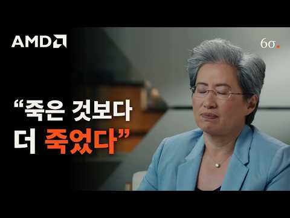
- 챕터: 0:00 "죽은 것보다 더 죽었다" · 0:30 원래 잘나가던 회사 · 0:49 무너진 이유 · 1:19 새 CEO · 2:57 바닥에서 내린 결정 · 6:47 살아난 AMD · 9:21 이제는 엔비디아에 도전
- 설명 앞부분: 한때 인텔을 앞서던 AMD는 2015년 주가 1.62달러까지 무너졌습니다. 2014년 CEO가 된 리사 수가 그 바닥에서 무엇을 버리고 무엇에 걸었는지, 그 베팅이 AMD를 어떻게 다시 엔비디아와 싸우는 회사로 만들었는지 짚었습니다. CNN·블룸버그·스탠퍼드·MIT 인터뷰와 AMD 공식 발표 원음으로 정리했습니다. [원본] (9) 주가 자료: Yahoo Finance 종가(분할 조정) [목차]
- 같은 채널 평소 대비 ×7.6 (채널 최근 롱폼 중앙값 10,970회) · 평소 영상: 주주환원 뒤에 숨은 한마디 '2029년까지 사실상 완판' ∣ SK하이닉스 3분기 실적 (11,137회) / AI 수혜는 M7뿐? S&P 493의 매출과 이익률은 제자리 ∣ 아폴로 슬록 (10,804회)
- 대본 없음 (설명) — 음성인식이 끝나면 도입부·흐름이 들어감
- 댓글 51/51: 좋은 점 — 영상 0 · 감사·응원 0 · 더 알고 싶은 것 0 · 아쉬운 점 — 영상 1 · 반박·불만 — 의견 다름 0 · 정치·사회 0 · 경험 공유 1 · 구독·다음 기대 0
  - 아쉬운 점 — 영상 👍0 “주가 1.62달러까지..뭐?.... 제목으로 낚시질 해서 신고 박고 간다. 똑바로 살아라.”
  - 경험 공유 👍2 “모바일칩 시장이 스마트폰 이전 시절엔 큰 돈이 안되었었고 (프로세서 기술보다 모뎀 기술이 결정적인 경쟁력을 좌우하던 시절) 이후 스마트폰 시대로 접어들어서도 모뎀기술이 프로세서 기술보다 더 중요한 경쟁력으로 작용했음. 모바일칩에 뛰어들지 않은건 당시 AMD가 가진 역…”

