# 주식 — 성공 사례 분석: 사례별 자세히 #41–#80

`analysis.md` 의 9번 (같은 # 번호). 자동 생성 — `tools/success_analysis.py` v1.5 (2026-10-21 08:30 UTC). ※ 연구·교육용 — 투자 권유가 아님.

### 41. 월배당 ETF 10억 투자하면 정말 배당금 얼마? ∣ 종합소득세·건강보험료 계산법 (은퇴 현금흐름 설계)

- https://www.youtube.com/watch?v=yRDpbgaZahc · 은퇴머니 - 은퇴 현금흐름 설계 · 구독자 30,000 · 조회수 755,091 (×25.2, 하루 5,299.7) · 좋아요 10,281 (1.4%) · 11.4분 · 2026-05-31 · 주제 묶음 2. 장기투자·ETF·지수 · 형식 정보·해설 (그 밖) · 폴더 `W_yRDpbgaZahc` (웹 승인)
- 썸네일: 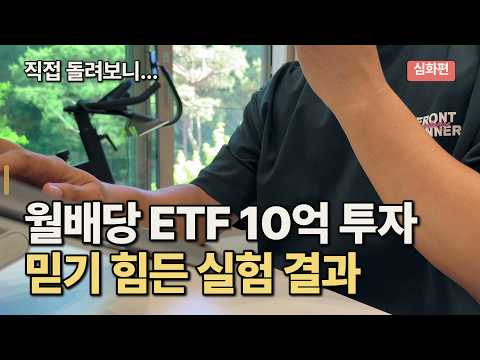
- 챕터: 0:00 평생 모은 10억으로 생활비를 만들어야 한다면 · 1:10 10억을 배당 ETF에 넣고 3년, 직접 따라가 봤습… · 2:00 첫 분배금, 그리고 먼저 떼이는 원천세 · 3:11 예상 못 한 종합소득세 · 4:36 매달 빠져나가는 건강보험료 · 6:25 분배금은 36개월, 세금은 58개월 · 7:04 시뮬레이터 + 커버드콜 ETF 3종 비교 · 8:39 결국 종목이 아니라, 본인의 다섯 변수
- 설명 앞부분: 은퇴 후 10억을 월배당 ETF(JEPQ)에 넣으면 매달 얼마가 들어오고, 세금은 언제 얼마가 빠질까. 2023~2025년 3년 치 통장을 한 화면에 펼쳐 직접 확인해 봤습니다. 타임라인 📑 영상 PPT 자료 영상 내용을 정리한 슬라이드를 웹에서 바로 보고, PDF로도 내려받을 수 있습니다. 🧮 직접 계산해 보기 영상의 사례를 내 조건으로 바꿔 계산할 수 있습니다. 📄 전자책 「은퇴 현금흐름 설계법」 💬 여러분의 은퇴 설계에서 가장 고민되는 부분은? (자산 규모 / 세금 / 건강보험) 댓글로 알려 주세요.
- 같은 채널 평소 대비 ×52.9 (채널 최근 롱폼 중앙값 14,261회) · 평소 영상: ETF 포트폴리오, 은퇴 전에 확인해야 할 또 하나의 기준 (14,261회) / 은퇴 포트폴리오가 사람마다 다른 이유 (12,966회)
- 대본 없음 (설명) — 음성인식이 끝나면 도입부·흐름이 들어감
- 댓글 967/969: 좋은 점 — 영상 33 · 감사·응원 53 · 더 알고 싶은 것 33 · 아쉬운 점 — 영상 2 · 반박·불만 — 의견 다름 16 · 정치·사회 33 · 경험 공유 47 · 구독·다음 기대 4
  - 좋은 점 — 영상 👍32 “제가 지금 비슷한 처지에 종소세 건보료 때문에 수많은 고민을 하고있읍니다 좋은자료 감사합니다”
  - 좋은 점 — 영상 👍17 “제가 꼭 알고 싶어했던 부분을 영상을 담아주셨습니다. 많은 도움이 되었습니다!! 감사합니다!”
  - 감사·응원 👍32 “제가 지금 비슷한 처지에 종소세 건보료 때문에 수많은 고민을 하고있읍니다 좋은자료 감사합니다”
  - 감사·응원 👍20 “꼭 필요한 내용이네요. 궁금했는데 정말 감사드려요~ 구독, 좋아요 누르고 갑니다.”
  - 더 알고 싶은 것 👍8 “3년후 제피큐에넣은 10억은 얼마가남았나요?”
  - 더 알고 싶은 것 👍6 “좋은 정보 고맙습니다. 능력자 이시네요~ 저도 은퇴후 제일 고민이 건보료입니다. 인별로 나누고 있고 연금저축 IRP ISA 모두 활용중입니다. 국내지수 커버드콜 비중도 점점 커집니다. 은퇴후 투자법인도 고려중입니다. 앞으로도 좋은 컨텐츠 부탁드립니다. 목소리 좋으시네…”
  - 반박·불만 — 의견 다름 👍820 “개인연금 시대에 종합소득 과세 2000은 말도 안되는 시대에 뒤떨어진 정책입니다 최소 4000은 되어야 함”
  - 정치·사회 👍44 “이래서 우리나라가 순자산 100만달러이상 보유한 사람들 유출되는게 전세계 4위인거임ㅋㅋ 부자들이 떠나는 나라...”
  - 정치·사회 👍43 “한국에 사는 한국 국민으로서는 당연한 세금과 의료보험료이고, 외국인보다는 훨씬 낫습니다. 처음 15% 원천 징수는 미국 증시에서 이익을 본거니 미국금융소득에 대한 연방세입니다. 캘리포니아 거주자는 추가로 주 소득세도 꽤 더 냅니다. 미국인의 경우에는 소득의 처분 시점…”
  - 경험 공유 👍499 “저도 은퇴 후 자산정리하고, 분배금으로 살고 있습니다. 님과는 다르게 ETF반 커버드콜반으로 운영중이고, 현재 커버드콜은 전부 국내만 운영중입니다. 커버드콜 자산은 조금더 많은것 같고, 결론적으로 올해 총 수익은 1.2억정도인데 과세기준소득은 약 1천만원, 올해 말은…”
  - 경험 공유 👍74 “건보료 150만원 내도 좋으니 ㅅㅂ 나도 월 분배금 900들어오면 소원이 없겠다😂😂😂😂😂”
  - 구독·다음 기대 👍32 “이제까지 봤던 은퇴관련 배당 컨텐츠중에서 가장 실용적이고 퀄리티높은 !!!! 구독합니다.”
  - 구독·다음 기대 👍19 “제피큐 모으고 있어서 궁금했던 내용인데 영상 잘 봤습니다 ㅎ 구독하고 갑니다”

### 42. 코스피 7% 폭락, 외인 30분만에 1조 순매도, 무언가 수상합니다

- https://www.youtube.com/watch?v=hjIgX9ppDe4 · 경제한잔 · 구독자 7,200 · 조회수 178,695 (×24.8, 하루 36,501.5) · 좋아요 880 (0.5%) · 14분 · 2026-10-16 · 주제 묶음 5. 국내주식 · 형식 정보·해설 (그 밖) · 폴더 `W_hjIgX9ppDe4` (웹 승인)
- 썸네일: 
- 챕터: 0:00 코스피 폭락 7퍼센트, 외국인 순매도 30분 1조의 … · 0:49 외국인 순매도 하루치를 30분에 쏟아낸 비정상 신호 · 1:20 삼성전자 하이닉스 과매도가 코스피 지수를 꺾은 이유 · 2:11 이 물량 누가 왜 던졌나 진짜 질문의 시작 · 2:19 실적은 범인이 아니다 반도체주 사상 최고 실적 · 2:55 코스피 폭락 설명할 결정타 뉴스가 없다 · 3:21 글로벌 동반 하락만으로 설명 안 되는 괴리 · 3:56 쉬운 답 세 개가 전부 지워진 수상한 지점 · 4:11 프로그램 매매 선물 공매도 다섯 용의자 공개 · 4:48 전부 사람 손이 아니다 기계적 매도의 공통점 · 5:17 선물 현물 베이시스로 보는 30분 1조 메커니즘 · 6:03 반대매매 눈사태 하락이 하락을 부르는 구조 · 6:36 왜 기업 가치보다 더 깊게 과매도됐나 · 7:15 기계가 던졌는데 왜 하필 한국인가 · 7:26 위험자산 회피 달러 강세 매크로 흐름 · 7:56 외국인에게 한국 증시는 현금인출기 ATM · 8:34 반도체 사이클 선반영 외국인 순매도 습관 · 9:13 공포가 아니라 계산된 포지션 조정일 가능성 · 9:28 현물 팔고 선물 사는 움직임이 말해주는 것 · 10:10 가격이 가치에서 떨어져 나간 과매도의 본질
- 설명 앞부분: 📉 오늘 코스피가 7% 넘게 폭락했습니다. 삼성전자 7%, SK하이닉스 9% 급락, 그리고 외국인이 단 30분 만에 1조 원을 순매도했죠. 화면이 온통 파란색으로 물들면, 누구나 똑같은 생각을 합니다. "외국인이 다 던지고 도망간다, 한국 증시 끝난 거 아니야?" 🥵 혹시 오늘 계좌를 보면서 가슴이 철렁 내려앉았다면, 이 영상을 끝까지 꼭 봐주세요. 오늘의 폭락은 단순한 공포가 아니라, 그 안에 아주 수상한 구조가 숨어 있습니다. 🔍 이 영상에서 다루는 핵심 요약 외국인이 하루 종일 파는 금액은 보통 많아야 몇천억, 세게 던져도 …
- 같은 채널 평소 대비 ×17.7 (채널 최근 롱폼 중앙값 10,073회) · 평소 영상: 잘 생각해보면 남의 일이 아닌 프랑스 혼란(시위, 금리, 정치) (10,073회) / 삼성전자 9%, 하이닉스는 0.3%…주도주 상승폭 갈라진 이유는? (11,656회)
- 대본 없음 (설명) — 음성인식이 끝나면 도입부·흐름이 들어감
- 댓글 51/51: 좋은 점 — 영상 2 · 감사·응원 5 · 더 알고 싶은 것 0 · 아쉬운 점 — 영상 1 · 반박·불만 — 의견 다름 0 · 정치·사회 11 · 경험 공유 0 · 구독·다음 기대 5
  - 좋은 점 — 영상 👍2 “구독했어요!!!너무 유익해요!!감사합니다”
  - 좋은 점 — 영상 👍2 “이해하기쉽게 화면을 구성하셨네요 구독했습니다”
  - 감사·응원 👍5 “영상 감사합니다!”
  - 감사·응원 👍4 “감사합니다 버터야 됩니다”
  - 아쉬운 점 — 영상 👍0 “ㅋ 광고하는 주식과 정치와 관련된 주식은 사는게 아니다.. 그리고 실적을 보고 기대치가 높아져있어서 그런거고 실적치로만 주가가 올라가면 얼마나 좋겠냐..실적에 비해 기대치까지 주가가 오르지 못하니 하락하는거.. 반대로 반도체쪽 말고 기대도 안하는 2차전지는 실적치가 …”
  - 정치·사회 👍16 “최고의 명강의였습니다. 멍청한 이재명 정부의 관료들때문에 개인투자자들은 피눈물을 흘리네요.”
  - 정치·사회 👍12 “한국주식은. 투명유리. 외국인만 조은일 시키는 어리석은 정부”
  - 구독·다음 기대 👍12 “작금의 사태를 명확하게 분석해 주었습니다. 구독합니다.”
  - 구독·다음 기대 👍7 “난 주식설명 다욕하는데 이채널은 논리적이고 최근 선물가격 때매 현물이 안올라가는 현상을 본 것까지 맞음 그래서 우선 구독박고감”

### 43. 4200억 단타 일본 천재가 초간단 매매법, 죽어라 이것만하세요

- https://www.youtube.com/watch?v=UH4UFmdXXo0 · 세력시그널 · 구독자 3,510 · 조회수 86,167 (×24.6, 하루 1,284.9) · 좋아요 2,064 (2.4%) · 20.6분 · 2026-08-15 · 주제 묶음 7. 매매·전략 · 형식 정보·해설 (그 밖) · 폴더 `W_UH4UFmdXXo0` (웹 승인)
- 썸네일: 
- 챕터: 0:00 BNF 코테카와 타카시 ∣ 1,600만 원으로 시작한… · 2:35 슈퍼 트레이더 자동매매 봇 안내 · 2:46 BNF의 은둔형 투자 생활 ∣ 주식에 인생을 건 전업… · 3:41 제이콤 주식 사건 ∣ BNF가 16분 만에 200억 … · 5:49 독학으로 성공한 BNF ∣ 제시 리버모어와 실전 차트… · 6:30 BNF 투자 원칙 ① 가격 움직임과 시장 심리 · 7:30 BNF 투자 원칙 ② 기계적 손절과 리스크 관리 · 8:12 BNF 투자 원칙 ③ 거래량·캔들로 판단하는 익절 타… · 8:44 BNF 투자 원칙 ④ 공포와 탐욕을 이용한 역발상 매매 · 9:32 BNF 투자 원칙 ⑤ 개장 후 첫 30분 관찰 전략 · 10:17 BNF 투자 원칙 ⑥ 감정을 배제한 확률 기반 매매 · 11:00 BNF 투자 원칙 ⑦ 거래량과 종목 선정 기준 · 12:12 BNF 역추세 매매법 ∣ 급락주 바닥을 찾는 3가지 … · 13:15 25일 이동평균선 이격도 ∣ BNF의 급락주 매수 기준 · 14:21 BNF 차트 세팅 ∣ 25일 지수이동평균선·RSI·M… · 15:25 이격도 측정법 ∣ 25일선 대비 -20~35% 과매도… · 16:12 대형주·중소형주·상승장·하락장 이격도 기준 · 17:31 BNF 매수 타이밍 4단계 ∣ 이격도·RSI·MACD… · 18:25 지지선·저항선 활용 ∣ BNF 역추세 매매법 실전 응용 · 19:35 상승장·하락장별 익절과 손절 전략
- 설명 앞부분: 4200억 단타 일본 천재가 초간단 매매법, 죽어라 이것만하세요 🌟슈퍼트레이더 자동 매매봇 신청하기🌟 🌟 BNF 트레이딩 비법 전자책 신청하기🌟
- 같은 채널 평소 대비 ×28.1 (채널 최근 롱폼 중앙값 3,063회) · 평소 영상: 볼린저밴드 투자기법으로 완벽한 매매 타점 잡는법(차트 보는법 모르는 초보도 가능) (3,063회) / 거래량 보는법과 매매기법, 이 영상만 보면 크게 먹습니다 (3,395회)
- 대본 없음 (설명) — 음성인식이 끝나면 도입부·흐름이 들어감
- 댓글 216/216: 좋은 점 — 영상 5 · 감사·응원 28 · 더 알고 싶은 것 0 · 아쉬운 점 — 영상 1 · 반박·불만 — 의견 다름 6 · 정치·사회 0 · 경험 공유 2 · 구독·다음 기대 0
  - 좋은 점 — 영상 👍1 “BNF 정말 유익한 영상이네요. 감사합니다.”
  - 좋은 점 — 영상 👍0 “BNF~ 이걸 이제 봤네요^^; 유익한 내용 공유에 감사드립니다”
  - 감사·응원 👍5 “ㅋㅋㅋㅋㅋㅋㅋㅋㅋㅋ 그냥 ㅈㄴ 웃기네요 BNF 기본 매매법 저대로 시장에 적용해보세요~ 저 진입 조건에 맞는 종목을 찾을 수 있을까요? 화이팅~!!”
  - 감사·응원 👍4 “BNF 정말 잘 봤습니다 감사합니다”
  - 아쉬운 점 — 영상 👍0 “얘들은 한결같네. 낚시질로 펌핑해놓고 걸려들면 전화해서 하루에 얼마씩 거래하는지 시드는 얼마냐는둥 이따구 소리만 해대면서 막상 지표는 안보내고 어떻게든 빨대꽂아서 학원비 받아쳐 먹으려는 공통적인 수법인데...또한가지는 지표신청서 작성을 하면 그이후로 어중이 떠중이로부…”
  - 경험 공유 👍1 “아 나도 할줄알면 이해라도 하는데 무슨말인지조차 모르는 불쌍한1인”

### 44. 생활비 한 달 5만원..10년 만에 배당금 월 300만원 받는 이유 (조윤진 1부) #세미파이어 #배당투자

- https://www.youtube.com/watch?v=Wc52vsC6q4U · 자람들 - 자립하는사람들 · 구독자 33,700 · 조회수 826,411 (×24.5, 하루 8,622.1) · 좋아요 6,933 (0.8%) · 29.3분 · 2026-07-17 · 주제 묶음 3. 배당 · 형식 브이로그·직접 해본 이야기 · 폴더 `W_Wc52vsC6q4U` (웹 승인)
- 썸네일: 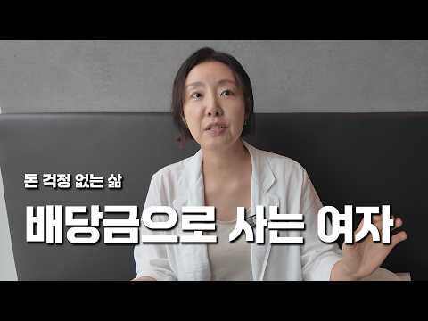
- 설명 앞부분: 👤 오늘의 게스트: 조윤진 작가 '6억으로 시작한 세미파이어' 저자 & 배당으로 부자되기 유튜브 채널 운영 평범한 중소기업 직장인이었던 그녀는 이혼 후 경제적으로 큰 타격을 입고, "목숨 걸고 노후를 준비해야겠다"는 마음으로 10년간 악착같이 아끼고 모았습니다. 5천만 원으로 시작한 시드는 10년 만에 6억 원으로 불어났고, 지금은 매달 통장에 꽂히는 배당금만으로도 마음 편한 노후 시스템을 만들었습니다. 매도 없이 배당만 쌓아가는 그녀만의 투자 철학과, 특별할 것 없는 월급으로도 가능했던 절약과 시드 마련의 여정을 담아 첫 책 '…
- 같은 채널 평소 대비 ×32.3 (채널 최근 롱폼 중앙값 25,556회) · 평소 영상: 연 2200 배당금받는, 전직 배달 기사.. 3억으로 은퇴했습니다. (또배당 3부) #배… (25,556회) / 월 500만원 배당 노하우, 시드 5천 '이렇게' 구성하세요. 평범한 직장인이 파이어한 … (24,928회)
- 대본 없음 (설명) — 음성인식이 끝나면 도입부·흐름이 들어감
- 댓글 613/613: 좋은 점 — 영상 30 · 감사·응원 43 · 더 알고 싶은 것 33 · 아쉬운 점 — 영상 3 · 반박·불만 — 의견 다름 7 · 정치·사회 8 · 경험 공유 43 · 구독·다음 기대 2
  - 좋은 점 — 영상 👍755 “돈 모으려면 거지소리 들어가면서 미친듯이 모아도 될까 말까입니다. 그렇게까지 해야하냐는 말하는 사람들하고는 인간관계를 끊는게 내 인생발전에 훨씬 도움이 됩니다.”
  - 좋은 점 — 영상 👍32 “이 영상 첨 보는 데 정말 가슴에 와닿는 이야기네요 보통 사람들이 공감하고 같이 느낄 수 있는 이야기네요 유익한 영상 잘 보았습니다”
  - 감사·응원 👍416 “안녕하세요 인터뷰했던 '6억으로 시작한 세미파이어' 저자 배당으로 부자되기입니다. 비 오는데 진행 잘 이끌어주셔서 즐겁게 촬영했습니다. 이런 다큐 인터뷰 기회 주셔서 감사합니다. 하필 요즘 코스피가 더 내려서 장이 롤러코스터이긴 한데 끝까지 살아남는 배당투자로 노후를…”
  - 감사·응원 👍30 “귀한 영상 감사합니다.♡ 솔직하신 투자 경험 이야기 유익했습니다.♡ 감사합니다.^^ 성투하세요.❤”
  - 더 알고 싶은 것 👍10 “배당주하다가 귀가앏아 삼성 sk 물렸네요 ㅠ내 자신이 한탄스럽네요 ㅠ50대인데 앞이 깜깜해요~~미국배당다우존스는 sol tiger ace중 어느게 나을까요?공부해도 ㅠ”
  - 더 알고 싶은 것 👍3 “세금. 건보료는 어떻게 하시나요?”
  - 아쉬운 점 — 영상 👍27 “내용은 상당히 좋은데요 촬영을 할 때, 카메라를 고정시켜놓고 찍으셔야겠어요. 화면이 흔들거려요. 이건 아주 기본적인 것인데 많이 아쉽네요.”
  - 반박·불만 — 의견 다름 👍0 “커버드콜 하락장 오면 개박살나는구조다.알고투자해야한다.지금까지 미국장이 폭락장이 없어서 커버드콜 할만하지 하락하면 손실 그대로 다때려맞고 수익은 콜옵션매도 권리행사가로 막혀있으니 이런 말도안되는 상품이없다”
  - 반박·불만 — 의견 다름 👍0 “배당률이 영원한게 아닌데...”
  - 정치·사회 👍2 “이런 영상좀 올리지 마라 정부에서 이러니까 배당투자자들 정조준에서 건보료 개편하자나 시바”
  - 정치·사회 👍2 “이젠 코스피마저 나락가네 요즘 전과4범 범죄자 지지율 계속 뚝뚝 떨어지고있는데 부동산 꼼수거래로 본격적으로 나락 가고있는중..무능하고 부패한 전과4범의 범죄자..경제,주식,부동산, 환율, 물가 어느하나 제대로 하고있는게 없다 환율은 Imf때보다 더 미친듯 치솟고 원화…”
  - 경험 공유 👍37 “저도 배당금 500 이상 받고있어요 노후에는 필요한것같아요 매도 안하니까 일상생활에 집중할 수 있고 마음이 편해요~ etf도 모아가고있어요^^”
  - 경험 공유 👍32 “내가 주식29년차인데 깡통4번차고..겨우 살아만있는데 커버드콜로 계속바꾸고있다.현재는80만정도받고있다.목표는달500..😅😅😅”
  - 구독·다음 기대 👍8 “매일 듣기만했는데 이번엔 정말 시도를 해보고 싶네요. 늦은 감이 있지만 시작해보고 싶네요. 말씀 감사합니다.”
  - 구독·다음 기대 👍0 “좋은 영상 감사합니다~ 작가님 구독했어요^^”

### 45. 주식 상위 2%만 아는 10가지 절대 생존 원칙 (돈의 원리)

- https://www.youtube.com/watch?v=fFURFeLTdAg · 준의 경제노트 (jun’s Note) · 구독자 12,600 · 조회수 306,207 (×24.3, 하루 2,312.5) · 좋아요 6,911 (2.3%) · 21.6분 · 2026-06-10 · 주제 묶음 11. 투자 일반 · 형식 오디오북·낭독 (명언·인생조언) · 폴더 `W_fFURFeLTdAg` (웹 승인)
- 썸네일: 
- 챕터: 0:00 주식 시장, 살아남는 자가 강하다 · 1:25 금융 천재 vs 평범한 경비원, 진짜 승자는? · 3:10 주식 투자는 지능이 아닌 '행동'의 영역 · 3:52 원칙 1. 예측하지 말고, 대응하라 · 5:22 원칙 2. 손실의 비대칭성을 이해하라 (바벨 전략) · 7:23 원칙 3. 승률이 아니라, 손익비로 계산하라 · 9:05 원칙 4. 좋은 회사가 아니라, 싼 주식을 사라 · 11:00 원칙 5. 현금은 쓰레기가 아니라, 무기다 · 12:56 원칙 6. 살 때는 신중하게, 팔 때는 과감하게 · 14:00 원칙 7. 공포에 사고, 환희에 팔아라 · 15:35 원칙 8. 좋은 종목만 사라 · 16:45 원칙 9. 본전 심리를 버려라 · 17:50 원칙 10. 감정과 싸우지 말고, 회피하라 · 19:25 실전 적용: 시장의 주인이 되는 법 · 20:20 마무리: 10년 생존을 위한 자가 진단
- 설명 앞부분: 주식 투자자 10명 중 9명은 왜 돈을 잃을까요?** 📉 예측에 의존하는 투자가 아닌, 진짜 부자들만 아는 '10가지 절대 생존 원칙'을 공개합니다. 평생 경비원으로 일하며 95억 원의 유산을 남긴 로널드 리드와, 화려한 경력에도 파산한 금융 천재의 결정적 차이는 무엇이었을까요? 이 영상에서 자산을 수십 배로 불리는 투자의 본질을 확실히 해부해 드립니다. 핵심 요약 주식 투자는 지능의 게임이 아니라 '행동'의 영역입니다. 10년, 20년 동안 시장에서 살아남아 끝까지 승리하는 상위 2%가 되고 싶다면, 영상에서 제시하는 생존 지도…
- 같은 채널 평소 대비 ×390.6 (채널 최근 롱폼 중앙값 784회) · 평소 영상: 1억을 20억, 30억으로 만드는 4가지 전략 ∣ 99%가 모르는 부자의 비밀 (784회) / 유통물량 5%로 나스닥100 편입까지? 스페이스X 일론 머스크가 그리는 우주 AI 제국의… (612회)
- 대본 없음 (설명) — 음성인식이 끝나면 도입부·흐름이 들어감
- 댓글 189/190: 좋은 점 — 영상 8 · 감사·응원 20 · 더 알고 싶은 것 2 · 아쉬운 점 — 영상 4 · 반박·불만 — 의견 다름 3 · 정치·사회 0 · 경험 공유 13 · 구독·다음 기대 0
  - 좋은 점 — 영상 👍20 “백배 공감합니다 꼭 간직하겠습니다. 감사합니다 ❤”
  - 좋은 점 — 영상 👍17 “정말 큰 도움이 되는 영상이였습니다 덕분에 주식으로 이백억을 벌것 같습니다”
  - 감사·응원 👍20 “백배 공감합니다 꼭 간직하겠습니다. 감사합니다 ❤”
  - 감사·응원 👍14 “항상 좋은정보 감사합니다. 투자를 하다보면은 지키기 어려운데 공감가네요.”
  - 더 알고 싶은 것 👍3 “평생마트주차장 관리인 , 경비원, 미련하게 악착같이 주식모아서 결국 어떻게 되었나요? .... 죽었습니다. 끝.”
  - 더 알고 싶은 것 👍1 “좋은 강의 감사합니다. 싼 주식의 기준은, 또는 평가는 무엇인지요? 저Per? 실적? 수주액? 부탁합니다.”
  - 아쉬운 점 — 영상 👍22 “나는 뻔한 예가 나오면 흐름이 끊겨서 거기까지만 듣고 나갑니다.”
  - 아쉬운 점 — 영상 👍4 “ai목소리 질려서 안보게되네요 다 똑같은 목소리라 채널구분도 안되구”
  - 반박·불만 — 의견 다름 👍6 “맞는말인듯😊전 샀다팔았다 하지 않으려고 연금저축펀드 에쎈피500!!!😊 감사합니다!! 그리고 딴분들이 웃기는겤ㅋㅋㅋㅋ아니 영상만들어 주신분한테 목소리가 어떻니 왜 그러심? 물림? ㅋㅋㅋㅋㅋㅋ 그런 댓글 작성할 시간에 영상 올려주신분께 감사하다고 좋아요 한번 눌러욬ㅋㅋ…”
  - 반박·불만 — 의견 다름 👍5 “모두 맞는 이야기 이지만 2번 손해안보는 안전한 자산에 85~90%를 넣어두고 나머지만 위험을 감수한 투자를 한다는 것은 틀렸네요. 현재 안전한 투자는 한국 단기채권은 3% 초반, 미국단기채권은 4% 초반으로 이자율이 나오는데 대한민국의 최근 10년간 연평균 화폐증가…”
  - 경험 공유 👍137 “120만원으로 시작해서 7년만에 1억 4천넘게 벌어보고 느낀점 버핏옹의 투자원칙 첫번째 원칙 돈을 지켜라 두번째 원칙 첫번째 원칙을 지켜라 이말은 진리고 내가 주식시장에서 돈을 벌 수 있던 말이다 저말을 뜻을 깨닫는다면 시장에서 돈을 벌수 있다 이걸 설명하기 어려운건…”
  - 경험 공유 👍4 “저는 초단타 14년차 1억으로 무한 3%”

### 46. 주식 AI 비서 4명 만들었더니 공부가 쉬워졌어요 (제미나이 활용법)

- https://www.youtube.com/watch?v=02hqxRMURPs · 공부하는 주린이 · 구독자 1,310 · 조회수 31,240 (×23.9, 하루 191.7) · 좋아요 1,002 (3.2%) · 7.1분 · 2026-05-11 · 주제 묶음 1. 주식 기초·초보 · 형식 인터뷰·강연·대담 · 폴더 `W_02hqxRMURPs` (웹 승인)
- 썸네일: 
- 챕터: 0:00 예고 · 0:11 영끌 실패한 썰 · 0:25 AI 비서 4인방 공개 · 1:02 AI에게 역할 부여하기 · 1:30 AI 비서1. 단어 의미 설명가 / AI 비서 만드는… · 3:26 AI 비서2. 20년 경력의 수석 애널리스트 · 5:05 AI 비서 3,4 및 고정하기 · 5:58 마무리 · 6:24 주린이 투자 한 주 브리핑
- 설명 앞부분: 타임라인 템플릿 공유해 드립니다 :) 비서1은 "세컨드브레인연구소", 나머지 2,3,4는 "제미나이 주식투자"의 템플릿을 참고하여, 주린이의 필요에 맞게 변형해 사용했습니다. ㅡAI 비서1ㅡ 이름 : 단어 의미 설명가 설명 : 너는 복잡한 개념을 가장 쉽고 명쾌하게 설명하는 '지식 큐레이터'이자 '비유의 대가'이다. 생소한 용어나 최신 기술 단어를 해부하고, 뇌에 박히는 비유를 통해 완벽한 이해를 돕는 역할을 수행한다. 요청 사항 내가 단어를 제시하면 [사전적 정의/등장 배경/직관적 비유/주식 시장과의 연관성]을 포함한 '개념 요…
- 같은 채널 평소 대비 ×32.3 (채널 최근 롱폼 중앙값 968회) · 평소 영상: 다들 ETF부터 사라길래... 2천 넣으려다 쫄보라 결국 1천만 샀어요 (986회) / 시드 1억으로 늘렸는데... 이제 주식이 무서워졌어요 (951회)
- 대본 (자막, 6.4 음절/초) 첫 20초: “저 집 결국 못 썼어요. 이제 주식 진짜 더 열심히 할 거예요. 오늘은 저희 투자 전담 AI네 명 세팅했거든요. 그 꿀팁을 아낌없이 공개할게요. 저는 부동산 때문에 폭풍 같은 한 주를 보냈는데요. 저희 집 한 여섯 일곱 번 보여줬나? 그러고 팔려고 하는데 제가 사려던 금매가 갑자기 먼저 팔려 버려서 다 무선됐어요. 갈아타기 실패해서 좀 속상한데 주식”
- 첫 1분: “저 집 결국 못 썼어요. 이제 주식 진짜 더 열심히 할 거예요. 오늘은 저희 투자 전담 AI네 명 세팅했거든요. 그 꿀팁을 아낌없이 공개할게요. 저는 부동산 때문에 폭풍 같은 한 주를 보냈는데요. 저희 집 한 여섯 일곱 번 보여줬나? 그러고 팔려고 하는데 제가 사려던 금매가 갑자기 먼저 팔려 버려서 다 무선됐어요. 갈아타기 실패해서 좀 속상한데 주식 공부 더 열심히 하라는 신호 같기도 하더라고요. 그래서 앞으로 진짜 열심히 공부하는 모습 보여 드릴게요. 오늘은 본격적으로 저희 투자를 위해서 AI 비서네 명을 만들었거든요. 그럼 제가 엄한 비서 사인을 공개할게요. [음악] 짜잔. 단어 임의 설명과 20년 경력의 소석 주식 애널리스트, 리스크 관리 [음악] 전문가 그리고 뉴스 분석가입니다. 뭔지 모르시겠죠? 저”
- 흐름 (90초마다 첫 문장): 0:00 저 집 결국 못 썼어요. 이제 주식 → 1:30 템플릿까지 말씀드릴게요. 먼저 단어 → 3:02 맞게 정리를 해줬어요. 한줄 정의 → 4:30 투자에 좀 적합한 방식인데 이거 둘 → 6:01 같아요. 이제 공부만 하면 되는데
- 댓글 36/36: 좋은 점 — 영상 3 · 감사·응원 8 · 더 알고 싶은 것 1 · 아쉬운 점 — 영상 0 · 반박·불만 — 의견 다름 0 · 정치·사회 0 · 경험 공유 5 · 구독·다음 기대 0
  - 좋은 점 — 영상 👍3 “저도 재작년부터 AI를 활용해서 주식을 하는데 1번 단어 설명해주는 AI를 저도 만들어서 사용했어요 정확히는 주식에서 쓰는 용어를 하루에 3단어씩 골라서 설명 해 달라는 식으로 자동 메크로를 달았었는데 이게 도움이 많이 되었네용 지금은 안쓰기는 합니다 그래도 지금 경…”
  - 좋은 점 — 영상 👍2 “좋은정보 감사합니다 올해 주식을 시작했는데 공부를 해야할것 같은데 이런 좋은정보가 있다니... 빨리 집에가서 따라해봐야겠네요”
  - 감사·응원 👍2 “좋은정보 감사합니다 올해 주식을 시작했는데 공부를 해야할것 같은데 이런 좋은정보가 있다니... 빨리 집에가서 따라해봐야겠네요”
  - 감사·응원 👍2 “정말 필요한 정보 였는데.. 더 보기란에 템플릿까지.. 너무 감사합니다^^”
  - 더 알고 싶은 것 👍0 “Ai오프라인 강의는 어디서 어떻게 듣나요?”
  - 경험 공유 👍3 “저도 재작년부터 AI를 활용해서 주식을 하는데 1번 단어 설명해주는 AI를 저도 만들어서 사용했어요 정확히는 주식에서 쓰는 용어를 하루에 3단어씩 골라서 설명 해 달라는 식으로 자동 메크로를 달았었는데 이게 도움이 많이 되었네용 지금은 안쓰기는 합니다 그래도 지금 경…”
  - 경험 공유 👍2 “나도 따라해볼께요~”

### 47. Don't Stop Buying Dividends in a Crash Until You See This Math

- https://www.youtube.com/watch?v=qCO8HvpAGqc · Tom - Lazy Dividend Investor · 구독자 2,090 · 조회수 49,277 (×23.6, 하루 8,417.3) · 좋아요 399 (0.8%) · 31.6분 · 2026-10-15 · 주제 묶음 기타 · 형식 정보·해설 (그 밖) · 폴더 `W_qCO8HvpAGqc` (웹 승인)
- 썸네일: 
- 설명 앞부분: If dividend stocks fall 20% and the dividend holds, every dollar you invest buys 25% more monthly income than it did before the drop. That is the math behind "keep buying". The problem is that the advice never says where the money comes from, because a crash usually arrives with shorter hours, smal…
- 같은 채널 평소 대비 ×14.5 (채널 최근 롱폼 중앙값 3,388회) · 평소 영상: Can You Retire With Just SCHD? ∣ SCHD Expert Expl… (3,799회) / No Pension? No Problem! Create Your Own with SCHD (3,825회)
- 대본 없음 (설명) — 음성인식이 끝나면 도입부·흐름이 들어감
- 댓글 116/116: 좋은 점 — 영상 0 · 감사·응원 0 · 더 알고 싶은 것 0 · 아쉬운 점 — 영상 0 · 반박·불만 — 의견 다름 0 · 정치·사회 0 · 경험 공유 0 · 구독·다음 기대 0

### 48. I Let AI Invest for Me on Trading 212, Here's What Happened

- https://www.youtube.com/watch?v=8zUa4JnCrRw · Financial Interest · 구독자 19,400 · 조회수 454,201 (×23.4, 하루 7,467.8) · 좋아요 3,710 (0.8%) · 11.8분 · 2026-08-21 · 주제 묶음 기타 · 형식 정보·해설 (그 밖) · 폴더 `W_8zUa4JnCrRw` (웹 승인)
- 썸네일: 
- 챕터: 0:00 The setup · 0:44 Introducing the contestants · 1:23 The initial prompt · 2:45 Building the AI portfolios · 3:30 Making the first investments · 4:03 The results · 5:36 Each AI's portfolio breakdown · 8:48 Who did AI think would win? · 10:56 Who wins long term?
- 설명 앞부분: Honestly we made this to try to show that this is probably a terrible idea long-term. Hope we can prove that long-term! Enjoy. Get free fractional shares worth up to £100 with Trading 212 via this link: This is an affiliate link, we will earn a small commission. If you do not get your free share af…
- 같은 채널 평소 대비 ×77.3 (채널 최근 롱폼 중앙값 5,878회) · 평소 영상: The Best Stocks & Shares ISA in 2026 (Lowest Fees… (5,914회) / Should You Use InvestEngine in 2026? (5,842회)
- 대본 없음 (설명) — 음성인식이 끝나면 도입부·흐름이 들어감
- 댓글 193/194: 좋은 점 — 영상 0 · 감사·응원 0 · 더 알고 싶은 것 0 · 아쉬운 점 — 영상 0 · 반박·불만 — 의견 다름 0 · 정치·사회 0 · 경험 공유 0 · 구독·다음 기대 0

### 49. 나스닥은 최고가, 반도체만 반 토막. 지금과 똑같았던 1995년으로 앞으로의 흐름을 찾아봤습니다.

- https://www.youtube.com/watch?v=7hjl_w2aWtA · 테스프레소 · 구독자 2,080 · 조회수 48,359 (×23.2, 하루 6,747.1) · 좋아요 383 (0.8%) · 9.9분 · 2026-10-14 · 주제 묶음 2. 장기투자·ETF·지수 · 형식 정보·해설 (그 밖) · 폴더 `W_7hjl_w2aWtA` (웹 승인)
- 썸네일: 
- 설명 앞부분: 나스닥100은 10월 6일 사상 최고치를 찍었는데 SOXL,삼성전자,하이닉스는 6월 고점에서 57% 내려와 있습니다. 30년 전인 1995년에도 나스닥은 최고가를 쓰는데 반도체만 반 토막이 났었고 지금과 똑같은 사건의 순서대로 주가가 반응했습니다. 그때 무슨 일이 있었고 반도체가 언제 반등했는지, 지금과 무엇이 같고 무엇이 다른지 정리했습니다.
- 같은 채널 평소 대비 ×22.4 (채널 최근 롱폼 중앙값 2,162회) · 평소 영상: 떨어져도 사야 할 때는 따로 있습니다. (SPY·QQQ·TQQQ) (2,201회) / 9월 FOMC 금리 인상, 나스닥은 어디로? 워시 기자회견과 과거 금리 인상시기 주식의 … (2,122회)
- 대본 없음 (설명) — 음성인식이 끝나면 도입부·흐름이 들어감
- 댓글 26/26: 좋은 점 — 영상 0 · 감사·응원 0 · 더 알고 싶은 것 2 · 아쉬운 점 — 영상 0 · 반박·불만 — 의견 다름 0 · 정치·사회 0 · 경험 공유 0 · 구독·다음 기대 0
  - 더 알고 싶은 것 👍15 “중국산은 시제품 성능이 검증된 게 없잖아요. 그리고 장기 계약분과 향후 로봇에 대한 D램 수요는 아직 잡히지도 않았다고 하는데 과연 어떻게 돌아갈지 궁금하네요.”
  - 더 알고 싶은 것 👍0 “내용 좋은데? 그래서 과거 대로라면 지금 완전히 꺽인 반도체 주가가 언제 다시 살아나서 얼마 즘 뒤에 다시 꺽이나요???”

### 50. 라오어 무한매수법, 정말 계속 해도 될까? TQQQ·QLD로 12년 돌려보고 알게 된 의외의 결과

- https://www.youtube.com/watch?v=nCBMBYmFjOU · 여의도 아빠  · 구독자 2,290 · 조회수 52,566 (×22.9, 하루 762.5) · 좋아요 666 (1.3%) · 7.5분 · 2026-08-13 · 주제 묶음 7. 매매·전략 · 형식 정보·해설 (그 밖) · 폴더 `W_nCBMBYmFjOU` (웹 승인)
- 썸네일: 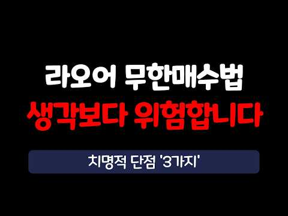
- 설명 앞부분: 라오어의 무한매수법, 12년을 그대로 돌려봤습니다. 그런데 가장 놀란 건 수익률이 아니었어요. 돈이 놀고 있는 시간과 현금이 바닥나는 순간이었습니다. QLD 무한매수 19배 vs 그냥 거치 30배 TQQQ 무한매수 19배 vs 그냥 거치 59배 12년 내내 현금의 3분의 1이 놀고 있었다 최악의 타이밍 2021년 꼭지 진입 QLD vs TQQQ 무한매수 평소엔 QLD, 찐 폭락엔 TQQQ 시작
- 같은 채널 평소 대비 ×8.3 (채널 최근 롱폼 중앙값 6,370회) · 평소 영상: JEPQ 배당금 어디에 넣어야 가장 많이 벌까? QQQ·QLD·JEPQ 전부 계산해봤습니… (6,370회) / QLD 투자자 대부분이 모르는 사실. 아무리 잘 모아도 '이 순서'를 모르면 무너집니다. (5,541회)
- 대본 없음 (설명) — 음성인식이 끝나면 도입부·흐름이 들어감
- 댓글 186/187: 좋은 점 — 영상 5 · 감사·응원 7 · 더 알고 싶은 것 12 · 아쉬운 점 — 영상 1 · 반박·불만 — 의견 다름 6 · 정치·사회 0 · 경험 공유 13 · 구독·다음 기대 0
  - 좋은 점 — 영상 👍4 “좋은 영상 감사합니다! 멘탈 유지에 도움이 많이 돼요!”
  - 좋은 점 — 영상 👍3 “평소엔 qld 폭락엔 TQQQ무한매수.. 공감합니다만 '진짜 폭락' 이라는걸 어찌 알 수 있는지가 관건이네요ㅎㅎ.. 대부분은 그걸 못맞추니 이런 규칙이 나오는건데”
  - 감사·응원 👍21 “부지런히 할필요없이 무한매수법 공개api로 프로그램만들어서 자동으로 돌리고 있습니다 .qld도 같이 하고 있고요 . 결과 흥미롭게 잘봤습니다 감사합니다 .”
  - 감사·응원 👍7 “다른의미로 감사합니다 😘”
  - 더 알고 싶은 것 👍13 “더 좋은 방법을 알려주세요”
  - 더 알고 싶은 것 👍5 “무한매수법 저자가 서울대 자퇴, 경력 10년차 소아개원의 치과의사 맞나요? 검색해도 저자의 실명도 없고 최소한 어느 치대를 졸업했는지 최소한의 정보조차 검색이 안되고 모두 비공개라, 늘 마스크 쓰고 다니니 😢 주식관련 멤버십 비용도 월 12만원 받는다는데 저자에 대한…”
  - 아쉬운 점 — 영상 👍3 “제목으로 어그로 끄는건 여전하네”
  - 반박·불만 — 의견 다름 👍30 “무한매수법의 가장 큰 장점은 수익률이 아닙니다. 정해진 규칙을 따라서 상승장, 횡보장, 하락장에도 맨탈이 흔들리지 않으면서 꾸준히 수익을 내는 방법이지. 다양한 시나리오를 가정한 12년치 백테스트는 이 투자방법이 실전에서 쓸수 있는지 확인하는 좋은 방법이긴 하지만 수…”
  - 반박·불만 — 의견 다름 👍28 “웃고 갑니다. 직접 몇년간 하는 입장에서 라오어님 입장도 모르고 그냥 방법만 겉핥기 식으로만 평가하는 느낌이네요. 무한매수법은 리스크를 줄이기 위한 "단투"지 장투에 적합한 방법은 아닙니다. 무슨 qld 장기보유랑 비교를 해요.. 라오어님도 그냥 이것저것 귀찮으면 q…”
  - 경험 공유 👍41 “무한매수의 단점은 1. 상방이 막혀있고 하방은 열려 있으며, 2. 복리를 스스로 끊고 리셋하며, 3. 계속해서 수익을 확정하면서 텍스를 내야하는 텍스 이펙트를 고려하지 않았고, 4. 항상 이용할 수 있는 자금의 일부분만 사용하기에 수익률은 좋을수 있으니 수익금 측면에…”
  - 경험 공유 👍40 “2022년에 라오어 카페에 가입해서 꾸준히 글씀. 그때 세상이 참 재미있었음. 하수들이 세상이 망한다고 고래고래 소리지르고 거기서 유일하게 비껴간게 라오어 카페였음. 거기도 순탄하진 않았지만 적어도 tq가 80프로 떨어진 그 순간에도 tq를 믿는 사람들이 모였단 말임…”

### 51. 노후 걱정 끝, 커버드콜로 평생 월급받는 법 ∣ 커버드콜 ETF ∣ 조재영 웰스에듀 부사장

- https://www.youtube.com/watch?v=IePgz3kEuNk · 투자360 · 구독자 15,900 · 조회수 352,542 (×22.2, 하루 2,027.1) · 좋아요 6,222 (1.8%) · 22.8분 · 2026-04-30 · 주제 묶음 2. 장기투자·ETF·지수 · 형식 인터뷰·강연·대담 · 폴더 `W_IePgz3kEuNk` (웹 승인)
- 썸네일: 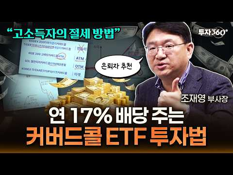
- 챕터: 0:00 🔥하이라이트 · 0:25 커버드콜 etf 한 번에 이해하기 · 2:08 언제 돈 버는 전략인가요 · 4:52 커버드콜의 세부 종류 · 8:04 금융소득세와 건보료 · 14:42 커버드콜ETF가 은퇴 후 유리한 진짜 이유 · 17:50 일반계좌? ISA계좌? · 20:13 원하는 ETF 찾는 사이트
- 설명 앞부분: 배당을 많이 준다는 커버드콜 ETF 그런데 왜 이렇게 많이 줄 수 있을까요? 이 영상에서는 그 구조를 먼저 짚어봅니다. 은퇴자와 고소득자가 몰리는 이유 단순히 ‘고배당’ 때문만은 아닙니다. 사실 커버드콜의 핵심 수익인 옵션 프리미엄은 과세 구조가 달라 건강보험료나 금융소득종합과세 부담을 줄일 수 있다는 점도 중요한 포인트입니다. 커버드콜의 구조부터 옵션 프리미엄 그리고 세금까지 핵심만 짧고 명확하게 정리해드립니다. [ 타임라인 ]
- 같은 채널 평소 대비 ×9.7 (채널 최근 롱폼 중앙값 36,213회) · 평소 영상: 환율 내린 지금이 기회! 삼전닉스 팔아서 현금 '여기로' 옮기세요 #부자탐사대 #효라클 … (38,407회) / “지금까지 금투자 방법 다 틀렸습니다” 금 투자, 개미는 ‘이렇게’ 사야 돈 법니다 ∣ … (33,649회)
- 대본 없음 (설명) — 음성인식이 끝나면 도입부·흐름이 들어감
- 댓글 237/237: 좋은 점 — 영상 33 · 감사·응원 49 · 더 알고 싶은 것 14 · 아쉬운 점 — 영상 0 · 반박·불만 — 의견 다름 6 · 정치·사회 2 · 경험 공유 7 · 구독·다음 기대 5
  - 좋은 점 — 영상 👍43 “이렇게 잘 정리해 주시는 분은 처음입니다. 구독을 누르게 하시는 분이네요. 좋은 정보 고맙습니다.”
  - 좋은 점 — 영상 👍8 “진짜 강의 잘하시네요 최고입니다!!! 알아듣기 쉽고 유익한 너무너무 훌륭한 명강의였습니다”
  - 감사·응원 👍75 “지금까지 월배당 커버드콜 강의중에 최고였습니다 감사합니다~^^”
  - 감사·응원 👍52 “제가 본 etf, 커버드콜 강의중에 최고였습니다 감사합니다~^^🎉”
  - 더 알고 싶은 것 👍6 “와우 정말 훌륭하신 교수님이시네요 어려운걸 아주쉽게 풀어서 귀에 쏙쏙들어오게 설명을 너무 잘 해주시는게 교수님 중에 최고이십니다 구독 좋아요 누르고 다른영상도 찾아서보겠습니다 감사합니다 좋은 영상 많이많이 올려주세요 끝까지 응원하겠습니다”
  - 더 알고 싶은 것 👍6 “저는 56세 자영업자입니다. 36년을 음식업을 했습니다. 3년뒤 지방 은퇴를 준비중입니다. 4~5억정도를 생활비 투자를 생각중 인데 로드맵 부탁드려도 될까요? 고맙습니다”
  - 반박·불만 — 의견 다름 👍1 “AI에게 사실일까 라고 질문해 보니 짧게 말하면 👉 “노후 걱정 끝, 평생 월급”은 사실이 아닙니다. 과장된 표현이에요. 📌 커버드콜 ETF가 뭐냐면 대표적으로 QYLD, JEPI 같은 상품이 있습니다. 이 ETF들은 👉 주식 + 옵션(콜옵션 매도)을 섞어서 👉 배당…”
  - 반박·불만 — 의견 다름 👍0 “상방 막히고 하방 열린 상품을 포장하면 안되여 운영이 100%오픈 된 상품 자체가 아닌데 ㅋㅋㅋ칠판 필요 없으실듯”
  - 정치·사회 👍0 “주식 관런 서적 1권 유투브 유투버 무식 1타 강사하시고 그 능력으로 다음 대통령 하세요. 금 모으기 대장동 위례 성남 지 원 금? 부동산 능력 없고 공인 중개사가 몆만? 대장동식으로. 중개인들을 인해 전술 노조 파업하듯 .ㅈㅈ”
  - 경험 공유 👍52 “제가 본 etf, 커버드콜 강의중에 최고였습니다 감사합니다~^^🎉”
  - 경험 공유 👍6 “현재 어머니는 피부양자 자격, 국민연금 월 87만원 수령 중이며 spyi, qqqi 투자하여 분배금을 세전 1천만원 미만 받게끔 조정 중 올해말 기초연금 신청 예정입니다. 여기서 궁금한 점이 있는데 1.피부양자 자격 유지하려면 현재처럼 국민연금 + 커버드콜 분배금을 …”
  - 구독·다음 기대 👍7 “은퇴자인데 정말 유익한 정보에 진심으로 감사드립니다 구독합니다 😊😊😊”
  - 구독·다음 기대 👍4 “구독하고 좋아요 ❤ 방송잘들었습니다”

### 52. I've Invested in Dividends for 30 Years. Here's What Most People Get Wrong

- https://www.youtube.com/watch?v=M7l-A6Mk9zQ · BudgetMoney · 구독자 2,550 · 조회수 52,759 (×20.7, 하루 571.4) · 좋아요 1,044 (2.0%) · 27.4분 · 2026-07-21 · 주제 묶음 기타 · 형식 정보·해설 (그 밖) · 폴더 `W_M7l-A6Mk9zQ` (웹 승인)
- 썸네일: 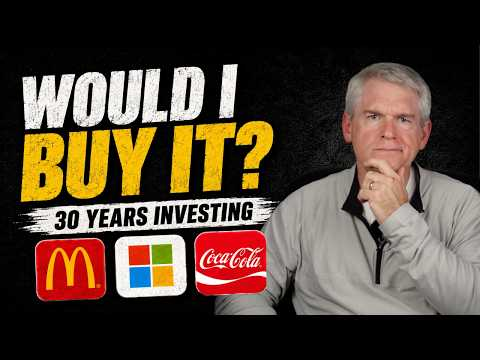
- 챕터: 0:00 Why yield alone can fool you · 1:45 The investor-first approach: … · 1:43 Free tools I use (Value Line … · 3:00 Case study: sorting six Dow s… · 3:59 Dividend growth rates: what t… · 9:32 case study · 11:35 McDonald's case study · 13:06 Home Depot case study · 16:35 Chevron case study · 18:46 Microsoft case study · 20:43 Nvidia case study · 23:01 Earnings predictability
- 설명 앞부분: Not financial advice. For educational purposes only. Most people sort dividend stocks by yield and call it research. That's not analysis — that's sorting a list.After 30 years of dividend investing, I've learned that the question isn't "what's the yield?" It's "does this dividend actually fit my li…
- 같은 채널 평소 대비 ×189.8 (채널 최근 롱폼 중앙값 278회) · 평소 영상: 30 Years of Investing Taught Me That Less Activit… (278회) / The Real Reason You Can't Find a Starter Home (276회)
- 대본 (자막, 0.0 음절/초) 첫 20초: “Chevron pays 3.9% dividend. Microsoft pays under 1%. Most people would call Chevron the better dividend play. Its own earnings history though says otherwise. I've been investing in dividend stocks for over 30 years and yield alone still doesn't tell you if the company can keep paying it or if that d” — 도입부 유형: 숫자로 시작
- 첫 1분: “Chevron pays 3.9% dividend. Microsoft pays under 1%. Most people would call Chevron the better dividend play. Its own earnings history though says otherwise. I've been investing in dividend stocks for over 30 years and yield alone still doesn't tell you if the company can keep paying it or if that dividend even fits your life. And here's what I mean by fits. My son is 28 and I'm 57. When he mentio”
- 흐름 (90초마다 첫 문장): 0:00 Chevron pays 3.9% dividend. Microsoft → 1:30 30-year-old and a 60-year-old can both → 3:00 On these Value Line sheets, Chevron → 4:30 McDonald's is 7 and 1/2%. Coca-Cola, 4 → 6:00 out um from these growth rates. → 7:30 out as dividends. If a company earns $2 → 9:00 Home Depot is different again. It has → 10:31 But because the business is so → 12:00 period shown here on the sheet. → 13:31 interest rates are high and people → 15:00 another. → 16:30 large-ticket spending. → 18:00 The page shows A++ financial strength → 19:30 all dividends to net profit around the → 21:01 The dividend grew dramatically after the → 22:32 The questions here are different. Can → 24:01 different industries, but they may all → 25:31 Now, in this video, I'm focused on → 27:01 dividend stock?" Ask, "What am I trying
- 댓글 233/233: 좋은 점 — 영상 0 · 감사·응원 0 · 더 알고 싶은 것 0 · 아쉬운 점 — 영상 0 · 반박·불만 — 의견 다름 0 · 정치·사회 0 · 경험 공유 0 · 구독·다음 기대 0

### 53. 내 주변에 주식으로 돈 번 사람이 '진짜' 단 1명도 없는 소름 돋는 이유 ∣ 교수 정선용 (통합본)

- https://www.youtube.com/watch?v=SwW4n0ERlS8 · 너와 나의 경제학교 · 구독자 30,700 · 조회수 615,762 (×20.1, 하루 9,059.5) · 좋아요 11,581 (1.9%) · 52.7분 · 2026-08-14 · 주제 묶음 11. 투자 일반 · 형식 인터뷰·강연·대담 · 폴더 `W_SwW4n0ERlS8` (웹 승인)
- 썸네일: 
- 설명 앞부분: 정선용, 달리고 읽고 쓰는 사람의 하이
- 같은 채널 평소 대비 ×27.6 (채널 최근 롱폼 중앙값 22,277회) · 평소 영상: 은행 이자보다 낫다고? 4050 노후자금 통째로 날리는 '고배당의 덫' ∣ 교수 정선용 … (22,277회) / "우량주 사서 수면제 먹고 푹 자라고요?" 개미들 퇴직금 다 녹아내리는 소름 돋는 이유 … (23,026회)
- 대본 없음 (설명) — 음성인식이 끝나면 도입부·흐름이 들어감
- 댓글 1,622/1,622: 좋은 점 — 영상 54 · 감사·응원 77 · 더 알고 싶은 것 15 · 아쉬운 점 — 영상 15 · 반박·불만 — 의견 다름 53 · 정치·사회 45 · 경험 공유 131 · 구독·다음 기대 3
  - 좋은 점 — 영상 👍332 “이분이 최고의 주식 전문가 입니다 인정합니다 허황된 꿈을 부추기지 않고 현실적인 필요하고 도움되는 얘기만 하시네요”
  - 좋은 점 — 영상 👍196 “구구절절 맞는말입니다 사람 좋아 보이는거랑 그들의 속마음은 다르다는걸 알았습니다”
  - 감사·응원 👍242 “귀한말씀 너무 늦게 들어서 안타까울 따름입니다 삼전 65만 하닉 400간다고 하면서 정작 자신들은 팔고 있었다는것을 나중에 알게됐습니다. 그렇게 보고서를 낸 증권사나 그걸 유튜브에서 전파한 사람들은 앞으로 다신 보지않을것입니다 귀한말씀 다시한번 감사드립니다”
  - 감사·응원 👍221 “안그래도 느꼈어요 요즘은 증권방송 보기도 싷더라구요 소위 주식 전문가들 증권사 직원들 에널리스트들 전부 자기밥그릇 챙기느라 혈안ᆢ 한통속 이예요 ᆢ 그들의 만행을 속시원히 알려주니 감사하네요 ᆢ”
  - 더 알고 싶은 것 👍3 “어떻게 사셨길래 99%가 잃는 주변인만 뒀나요? 교수님 과장도 적당히 하셔요”
  - 더 알고 싶은 것 👍3 “때가어느때인데유투버보고피같은돈을투자할까요?”
  - 아쉬운 점 — 영상 👍6 “어머니 돈을 불려 주겠다고 600만원을 받아서 투자를 하는데 많이 버는것 보다 잃으면 절대 안되겠다 생각이 먼저 들었습니다. 종목을 결정하는데 얼마나 벌지 모르지만 안 잃을거 같은 종목만 매수 해서 시장의 관심을 받으면 매도하고 다시 반복해서 현재 연복리65% 수익에…”
  - 아쉬운 점 — 영상 👍3 “이 사람도 결국에는 공포 마케팅으로 구독자 어그로 끄는 거임”
  - 반박·불만 — 의견 다름 👍31 “누구 믿고 투자한다는 인간들은 절대 투자하지 말아야 될 사람이에요. 결국 그 의존성 때문에 손실납니다. 그냥 저축하는 편이 안 망하는 길입니다. 주식은 원금 지키며 쌓는 저축이 아닙니다. 손실 볼 수 있는 투자에요.”
  - 반박·불만 — 의견 다름 👍24 “대가들의 책만 몇권 읽어봐도 알게됩니다. 전문가,교수,애널리스트들은 당신들의 편이 아닙니다. 그들은 당신들을 이용해서 돈을 버는것이지, 당신들을 부자로 만들어즐 이유가 1도 없어요.”
  - 정치·사회 👍189 “개미들 돈 누가 다 먹었을까요? 다 외국인 기관들한테 갔습니다 증권사는 수수료로 돈 잔치 했겠죠. 그동안 주식해서 번돈 다시 재투자하면서 이제 원금입니다 ㅠ 그나마 다행이지요. ㅠㅠ 그동안 무료 봉사 했어요 주식에~~~~”
  - 정치·사회 👍88 “딱 맞아요... 애널리스트 증권회사 삐끼들입니다. 개미들은 털리게 돼 있어요. 주식은 전문가가 없어요. 나스닥 하세요. 코스피는 증권회사 외국인들 땜에 절대 돈 벌기 힘든 구조예요. 어느정도 이익오면 우선 반은 빼고 시작하세요”
  - 경험 공유 👍314 “진짜 맞습니다 이번에 처음으로 주식하는 분들 많이 당했을꺼에요 저도 그중 한명이네요 ~~~”
  - 경험 공유 👍302 “피같은 돈 주식으로 다 날리고 몇년째 투잡하고 있습니다... 주식으로 3억잃으니 인생이 골로 가는 듯 합니다 무주식이 상팔자입니다”
  - 구독·다음 기대 👍29 “매일매일 듣고 보고 있습니다교수님 감사해요”
  - 구독·다음 기대 👍12 “미국Etf투자 6년째 평균 70프로. 이익중. 노후자금으로 기대됩니다”

### 54. 삼성전자 100조 환원 발표 임박, 자사주 소각 못 하고 배당만 주는 '진짜 이유'

- https://www.youtube.com/watch?v=JtPJ9i91k5g · 잘되라대한민국 · 구독자 5,960 · 조회수 119,196 (×20.0, 하루 1,951.6) · 좋아요 1,489 (1.2%) · 11분 · 2026-08-21 · 주제 묶음 3. 배당 · 형식 정보·해설 (그 밖) · 폴더 `W_JtPJ9i91k5g` (웹 승인)
- 썸네일: 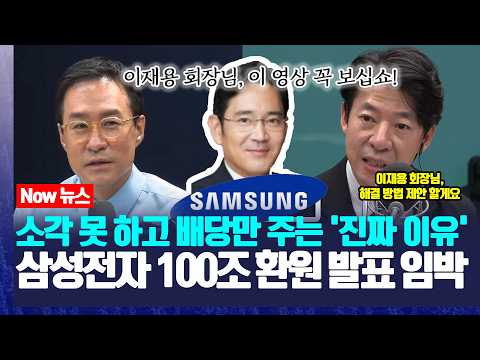
- 챕터: 0:00 [하이라이트] 삼성전자 100조 주주환원과 숨겨진 비밀 · 0:30 외신 보도 폭발! 100조 환원설과 이사회 카더라의 … · 1:28 자사주 소각 vs 배당, 시장이 배당에 쏠리는 이유 · 1:47 자사주 소각의 덫! '금산분리(10% 규제)' 완벽 … · 4:26 [핵심 해법] 삼성물산이 열쇠? 지배구조 정면돌파 시… · 7:33 대한민국 지배구조의 본질: 대주주의 이익과 삼성물산 · 8:53 삼성전자 우선주(우)가 8% 폭등한 진짜 이유 (배당… · 10:07 뇌동매매는 그만! 배당주 투자로 은퇴·연금 설계하는 법
- 설명 앞부분: 삼성전자 100조 원 규모 주주환원 프로그램 임박설! 외신과 시장이 들썩이는 가운데, 왜 시장은 자사주 소각 대신 '배당'에 무게를 두고 있을까요? 그 뒤에 숨겨진 '금산분리 규제(10% 룰)'와 강제 매각 딜레마, 그리고 주주와 대주주(이재용 회장) 모두가 윈-윈할 수 있는 '삼성물산' 중심의 지배구조 빅픽처까지! 20년 경력 애널리스트 출신 전문가가 완벽하게 분석해 드립니다. 영상 타임라인
- 같은 채널 평소 대비 ×3.5 (채널 최근 롱폼 중앙값 34,375회) · 평소 영상: 엔비디아, 베라루빈이 우리 구원자될까? 삼성전자,하이닉스 대규모 반도체 팔 수 있는 기회 (34,375회) / 엔비디아, 자사주 매입 200조 한도↑ 삼성전기 반도체 기판 증설 선수금 비중 大 (31,157회)
- 대본 없음 (설명) — 음성인식이 끝나면 도입부·흐름이 들어감
- 댓글 178/178: 좋은 점 — 영상 3 · 감사·응원 4 · 더 알고 싶은 것 1 · 아쉬운 점 — 영상 2 · 반박·불만 — 의견 다름 0 · 정치·사회 6 · 경험 공유 1 · 구독·다음 기대 0
  - 좋은 점 — 영상 👍2 “주주환원 주주가치제고 이모든말의 뜻은 주식회사를 세운 주주를위해 해야하는 행동이라 생각함 이틀전에 삼성이 아 우리 금산분리때문에 주식소각하면 법에 걸림 그래서 배당 ㄱㄱ 문제는 주주가치제고를위해 발표하는 그행위자체가 주주가치를 훼손함 왜? 이미 그발표로 주주환원한다는…”
  - 좋은 점 — 영상 👍2 “삼성은 주주들에게 관심도 없는기업이다. 자기들 잔치뿐이다 글러벌 경영체로 주주들에게 도움되는 전문 경영인으로 가야한다.”
  - 감사·응원 👍21 “이재용 회장님. 감사합니다 믿습니다 소각 바래요❤”
  - 감사·응원 👍8 “감사합니당.ㅡ😊”
  - 더 알고 싶은 것 👍1 “배당 1주당 얼마인가요?”
  - 아쉬운 점 — 영상 👍33 “아니 닉스는발표하고 14프로 폭등했다 닉스때문에 삼전도덕 보았는데 오늘이게뭐냐 돌것다 정말실망스럽다”
  - 아쉬운 점 — 영상 👍1 “나는 배당 60 / 자사주 소각 40은 할줄 알았다... 이건 너무 실망스럽잖아..”
  - 정치·사회 👍26 “오늘 발표한다는 카더라가 돌았는데도... 외국인 기관만 드립다 사고 개인은 다 팔고 있더라... 참 답답해서리...”
  - 정치·사회 👍4 “이광수.. 빼세요. 정권 딸랑이... 소신도 말도 바꾸는데.. 놀랐습니다.”
  - 경험 공유 👍4 “머리 좋은 사람들이 모인 삼성전자니까 30조 현금배당 하고 남은 돈으로 자사주 소각을 어떻게 할 것인지 가장 좋은 방법을 찾겠죠. 내가 현대로템 신입사원 때 ... 협력사 팀장 두분이 삼성출신들이었는데 ... 오늘 요청하면 다음날 결과물을 가지고 왔음. 기계가공품은 …”

### 55. 단타 천재가 개발한 하이킨아시 스캘핑 매매법, 죽어라 이것만 하세요.

- https://www.youtube.com/watch?v=55hFmXD0lh0 · 알파개미 · 구독자 2,800 · 조회수 54,034 (×19.3, 하루 383.4) · 좋아요 1,765 (3.3%) · 19.6분 · 2026-06-02 · 주제 묶음 7. 매매·전략 · 형식 인터뷰·강연·대담 · 폴더 `W_55hFmXD0lh0` (웹 승인)
- 썸네일: 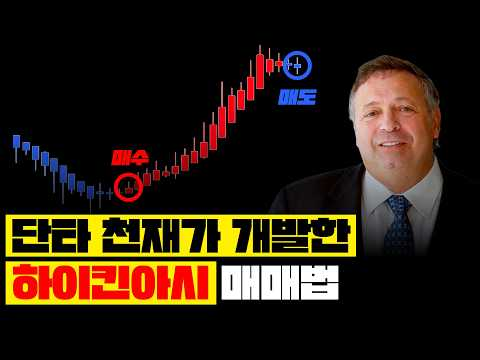
- 챕터: 0:00 인트로 · 1:26 하이킨아시 개요 · 3:09 하이킨아시 캔들 3가지 · 3:47 일반 캔들 vs 하이킨아시 · 4:39 추세 전환 기준 3가지 · 6:17 추세 반전 신호 · 7:21 실전 하이킨아시 패턴 5가지 · 8:42 전략 1.지지/저항 및 돌파 매매법 · 9:42 전략 2.돌파 매매법 · 10:15 전략 3.이동평균선(EMA) 결합 매매법 · 11:51 전략 4.추세반전 매매법 · 12:30 전략 5.RSI 지표 결합 매매법 · 13:43 전략 6.알파 하이킨아시 매매법 · 18:45 마무리 정리[지표 신청방법] / 아웃트로
- 설명 앞부분: 단타 천재가 개발한 하이킨아시 스캘핑 매매법, 죽어라 이것만 하세요. 📈 알파 하이킨아시 지표 무료 신청하기 📈 신청 코드: "알파 하이킨아시" 입력 📈 자동 매매 프로그램 무료 사용 신청하기 📈 📼차트 매매법 무료 강의 신청하기📼 📢 중요 안내: 본 방송에서 제공되는 모든 정보는 전문가의 개인적인 의견입니다.
- 같은 채널 평소 대비 ×85.4 (채널 최근 롱폼 중앙값 633회) · 평소 영상: -5억을 잃고 알았습니다. "이 차트 보는 방법" 하나면 충분하다는 걸 (633회) / 이동평균선 3개로 1,400억을 번 천재의 매매법 (단타, 스윙 매매) (678회)
- 대본 없음 (설명) — 음성인식이 끝나면 도입부·흐름이 들어감
- 댓글 1,049/1,051: 좋은 점 — 영상 19 · 감사·응원 81 · 더 알고 싶은 것 26 · 아쉬운 점 — 영상 0 · 반박·불만 — 의견 다름 0 · 정치·사회 0 · 경험 공유 3 · 구독·다음 기대 50
  - 좋은 점 — 영상 👍0 “너무 좋은 영상이네요~ 알파 하이킨아시 신청드립니다!^^”
  - 좋은 점 — 영상 👍0 “좋은정보 감사합니다 하이킨아시 신청합니다”
  - 감사·응원 👍1 “구독 좋아요 완료했어요 알파 하이컨아시 신청합니다 미리 감사합니다”
  - 감사·응원 👍1 “주린인데 차트보기가 너무 좋아요.. 신청합니다.감사합니다.. 스마트폰에도 가능한지도 궁금합니다”
  - 더 알고 싶은 것 👍1 “주린인데 차트보기가 너무 좋아요.. 신청합니다.감사합니다.. 스마트폰에도 가능한지도 궁금합니다”
  - 더 알고 싶은 것 👍0 “훌륭한 정보 대단히 감사합니다. 앞으로도 이런 정보 부탁드립니다 구독과 조아요는 기본 체크입니다❤❤❤”
  - 경험 공유 👍0 “우와. 저도 알파하이킨아시 신청합니다”
  - 경험 공유 👍0 “저도 알파 하이킨아시 신청합니다”
  - 구독·다음 기대 👍1 “알파 하이킨아시 신청했습니다. 영상 내용도 좋고 하이킨아시 차트 지표도 좋아보이네요. 영상 잘 챙겨볼께요~”
  - 구독·다음 기대 👍0 “구독했씁니당 알파하이킨아시”

### 56. S&P500, 나스닥100 수익률 차이는 갈 수록 더 벌어질겁니다 미국 장기투자 가이드

- https://www.youtube.com/watch?v=1L9sM63F6Ng · 돈사냥꾼-TV · 구독자 993 · 조회수 19,018 (×19.1, 하루 6,812.3) · 좋아요 182 (1.0%) · 22.4분 · 2026-10-18 · 주제 묶음 2. 장기투자·ETF·지수 · 형식 정보·해설 (그 밖) · 폴더 `W_1L9sM63F6Ng` (웹 승인)
- 썸네일: 
- 설명 앞부분: KBS 기자 KBS 디지털 뉴스 본부장 KBS 울산 방송국 본부장, KBS 해설위원, KBS 교통공무원노조 위원장 등을 역임하며 미디어와 저널리즘 분야에서 풍부한 경험을 쌓아 왔습니다. 이러한 실무 경험을 바탕으로, 현재 미디어 환경에 대한 정확한 정보, 심층 분석, 그리고 솔직한 시각을 제공하기 위해 최선을 다하고 있습니다. 여러분의 지지와 협력은 투명하고 신뢰받는 저널리즘을 향한 저희의 지속적인 노력에 원동력이 됩니다.
- 같은 채널 평소 대비 ×1,056.6 (채널 최근 롱폼 중앙값 18회) · 평소 영상: 폭락장에서도 통합니다 가장 편하게 부자되는 방법 (18회) / ETF 추천! 올해 ISA에 꼭 담아야할 포트폴리오 구성법 (13회)
- 대본 없음 (설명) — 음성인식이 끝나면 도입부·흐름이 들어감
- 댓글 5/5: 좋은 점 — 영상 0 · 감사·응원 0 · 더 알고 싶은 것 0 · 아쉬운 점 — 영상 0 · 반박·불만 — 의견 다름 0 · 정치·사회 0 · 경험 공유 0 · 구독·다음 기대 0

### 57. "삼성전자 SK하이닉스 2배 레버리지 ETF" 5월 22일 상장 확정인데 증권사 CEO 열 명 중 아홉 명이 올해 최대 폭탄이라고 경고했다

- https://www.youtube.com/watch?v=aTh--_DtGNU · 이코노메이션 · 구독자 14,400 · 조회수 274,428 (×19.1, 하루 1,653.1) · 좋아요 5,237 (1.9%) · 25.6분 · 2026-05-08 · 주제 묶음 9. 빚투·레버리지 · 형식 브이로그·직접 해본 이야기 · 폴더 `W_aTh--_DtGNU` (웹 승인)
- 썸네일: 
- 설명 앞부분: 5월 22일 삼성전자와 SK하이닉스 주가를 두 배로 추종하는 단일종목 레버리지 ETF가 국내 최초로 상장됩니다. 사전교육에만 만 이천 명이 몰렸고 최대 오조 삼천억원이 유입될 것으로 추정되지만, 증권사 CEO 열 명 중 아홉 명은 이 상품을 올해 국내 증시 최대 리스크로 꼽았습니다. 음의 복리 효과와 강제청산 구조, 장 마감 전 리밸런싱 폭탄까지. 알고 들어가는 것과 모르고 들어가는 것은 완전히 다릅니다. 🎨 본 영상의 시각 자료는 Stable Diffusion 등 생성형 AI 기술을 활용하여 제작되었으며, 경제 지식 전달을 위한…
- 같은 채널 평소 대비 ×167.5 (채널 최근 롱폼 중앙값 1,638회) · 평소 영상: SK하이닉스가 돈을 안 쓰자 월가가 움직였다, 100조 환원설까지 나온 이유 (1,734회) / 삼성 D램 기술 유출 뒤 CXMT 700조…10년을 건너뛴 방법 (1,543회)
- 대본 없음 (설명) — 음성인식이 끝나면 도입부·흐름이 들어감
- 댓글 808/808: 좋은 점 — 영상 14 · 감사·응원 29 · 더 알고 싶은 것 6 · 아쉬운 점 — 영상 2 · 반박·불만 — 의견 다름 6 · 정치·사회 22 · 경험 공유 11 · 구독·다음 기대 1
  - 좋은 점 — 영상 👍23 “많이배웠네요”
  - 좋은 점 — 영상 👍19 “아주 좋은 정보 도박판을 만들고있습니다.”
  - 감사·응원 👍23 “어젯밤에 상장 소식을 접하고는 크게 동요되었었는데.. 마음을 추스르게 해주셔서 감사요.”
  - 감사·응원 👍10 “이해하기좋게 설명해줘서. 감사합니다 Etf 나오면 나도 해봐야지 했는데 큰일 날 뻔했네요 빨리 일반 들이 많이 알았으면 하네요.”
  - 더 알고 싶은 것 👍3 “최고.최고. 잘 보고 있습니다. 댁의 이력이 궁금합니다. ❤❤❤”
  - 더 알고 싶은 것 👍2 “하한가 비유하면서 하루 60프로 손실은 좀 억지스럽네요 삼성 닉스가 상하한가 칠일이 있을까요?”
  - 아쉬운 점 — 영상 👍3 “얘는 맨날 삼전 까더라 삼전 못들어가서 열 받나?? ai목소리 듣기 싫어 나갈란다”
  - 반박·불만 — 의견 다름 👍1 “그런데..영상 잘보고 있지만 왜? 숫자얘기? 나올때 발음이 영 아닌데.틀리고? 당신 ai???”
  - 반박·불만 — 의견 다름 👍0 “부족힐 영상 아닙니다 쉽게 풀어서 귀에 쏙쏙 들어오게 하니까요~~^^ ~~ㅇㆍㄴ”
  - 정치·사회 👍71 “투자를 가장한 도박이지! 나라가 적절히 제재를 해야지. 이건 마음에 안든다”
  - 정치·사회 👍13 “정부에서 이런걸 왜 허가해주나요?국민은 도박판에 밀어 넣는거 아닌가요?잘못되면 정권이 흔들리겠네요”
  - 경험 공유 👍88 “내가 작년 11월 부터 미장 개별주 2배 래버러지 1주로 시작해서 떨어질때마다 물타고 또타고 또타고...타다타다 -60프로까지 떨어져 마지막 최저점에서 마지막 현금 올인해서 -30프로까지 만들고나서부터 반등 시작 70프로익절로 마감 했지만 스트레스 장난아님..초보자는…”
  - 경험 공유 👍10 “이해하기좋게 설명해줘서. 감사합니다 Etf 나오면 나도 해봐야지 했는데 큰일 날 뻔했네요 빨리 일반 들이 많이 알았으면 하네요.”
  - 구독·다음 기대 👍1 “5월22일이 기대됩니다!!!!!! 장 시작과 동시에 몰빵 하고 털고 나오면 됩니다!!”

### 58. 불기둥 세운 코스피, 코스닥! 폭등한 이유와 향후 전략

- https://www.youtube.com/watch?v=Pel5gTXKRkQ · K파민 · 구독자 5,560 · 조회수 102,736 (×18.5, 하루 1,252.3) · 좋아요 1,605 (1.6%) · 24.8분 · 2026-07-31 · 주제 묶음 5. 국내주식 · 형식 정보·해설 (그 밖) · 폴더 `W_Pel5gTXKRkQ` (웹 승인)
- 썸네일: 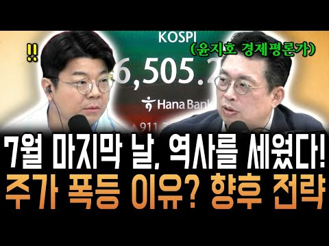
- 설명 앞부분: 7월 31일인 오늘 역사를 세웠습니다. 코스피가 하루 만에 1000포인트 넘게 상승하는 장세를 보이며 단숨에 6500선을 회복했습니다. 또한, 외국인의 일일 순매수액과 개인의 일일 순매도액 모두 역대 최대 규모를 세웠는데요, 주가 폭등의 이유와 향후 전략까지 영상으로 확인해 보세요.
- 같은 채널 평소 대비 ×6.5 (채널 최근 롱폼 중앙값 15,712회) · 평소 영상: 상승, 하락, 다시 상승 전환한 코스피! 그 이유와 미국 금리 이슈 정리 (박시동, 박근… (15,951회) / 쇼츠 스타 안쌤이 매불쇼에 떴다! 외국인들이 말하는 나라별 언어 표현 (한행운, 파비오,… (16,952회)
- 대본 없음 (설명) — 음성인식이 끝나면 도입부·흐름이 들어감
- 댓글 139/139: 좋은 점 — 영상 2 · 감사·응원 2 · 더 알고 싶은 것 1 · 아쉬운 점 — 영상 0 · 반박·불만 — 의견 다름 3 · 정치·사회 7 · 경험 공유 4 · 구독·다음 기대 0
  - 좋은 점 — 영상 👍21 “진짜 맞는 말씀 두 MC. 배워라”
  - 좋은 점 — 영상 👍0 “그래..우리 평범한 사람들은 확실할 대답을 원하지만, 전문가들이 예언자가 아니고 투자는 시장의 변동에 따라 수시로 바뀌니 정답도 예언도 할 수 없죠. 주식 투자는 화단을 가꾸는 것과 같다는 말 공감되네요.”
  - 감사·응원 👍9 “윤지호선생님 대단히 고맙습니다 ❤”
  - 감사·응원 👍3 “1) 부동산 폭등 대출규제로 국민죽이는 정부 2) 부동산 팔아서 주식사라더니 전문가 들도 위험하다고 반대한 ETF강행으로 2000만 투자자를 거지로 내몬 정부 3) 금감원,금융위,대검,감사원, 국민권익위에 접수된지가 도대체 언젠데 하루 1백만원씩 쓰도 1369년 10…”
  - 더 알고 싶은 것 👍0 “인버스 레버리지 없애면 안되나요?”
  - 반박·불만 — 의견 다름 👍6 “뭘 그리 양다리 걸치는 평론을.. 9월에 9천 년말까지 만천갑니다. 수익이 계속 증명되면 수 많은 가정 다 헛소리이예요”
  - 반박·불만 — 의견 다름 👍2 “과한거 아닙니다 실적 대로 가눈거죠”
  - 정치·사회 👍8 “저기여 정부에서 주식재난특별지원금을 언제 지급 하나요?😅”
  - 정치·사회 👍5 “이재명이 만든 도박장!!”
  - 경험 공유 👍2 “코스피 곧 만 넘게 간다고 했었는데😢 재해처럼 어느날 갑자기 뒤집어질 수 있다는 걸 겪으면서 배우네요. 근데 수업료가 너~무 비싸서 과다 출혈이 문제”
  - 경험 공유 👍2 “경제 주식에 대해 공부하지 않고 남들이 하니 나도 해봐야지,주식이 계속 오르네? 나도 들어가 봐야지 란 인식으로 주식을 접해 피해를 보시는 분들이 없었으면 좋겠습니다. 주식 투자는 본인의 의지고 본인의 책임이 따르기 때문에 어설프게 다가가서 힘들어 하지 마시고 그런분…”

### 59. [슬기로운 금융생활] 국장 복귀하면 양도세 감면?! – RIA계좌 혜택도, 유의점도 슬기롭게

- https://www.youtube.com/watch?v=O4jq0bK4MbI · 예금보험공사 예보TV · 구독자 7,810 · 조회수 142,713 (×18.3, 하루 984.1) · 좋아요 32 (0.0%) · 5.6분 · 2026-05-29 · 주제 묶음 5. 국내주식 · 형식 정보·해설 (그 밖) · 폴더 `W_O4jq0bK4MbI` (웹 승인)
- 썸네일: 
- 설명 앞부분: 세제 혜택은 물론, 꼭 알아야 할 유의사항과 예금자보호 여부까지! 국내시장 복귀계좌(RIA)의 주요 내용과 함께 투자 시 꼭 확인해야 할 사항들을 알기 쉽게 설명해드립니다.
- 같은 채널 평소 대비 ×6.4 (채널 최근 롱폼 중앙값 22,283회) · 평소 영상: [예보 보이는 라디오] 예보 온에어 11화(SIFI정리부편) (22,283회) / [예보광장]🧶 처음인데 이렇게 잘 만든다고?😲 터프팅 클래스 도전기! (22,295회)
- 대본 없음 (설명) — 음성인식이 끝나면 도입부·흐름이 들어감
- 댓글 7/8: 좋은 점 — 영상 3 · 감사·응원 2 · 더 알고 싶은 것 0 · 아쉬운 점 — 영상 0 · 반박·불만 — 의견 다름 0 · 정치·사회 0 · 경험 공유 0 · 구독·다음 기대 0
  - 좋은 점 — 영상 👍1 “유익한 정보 감사합니다”
  - 좋은 점 — 영상 👍1 “정말 좋은 정보네요..”
  - 감사·응원 👍1 “유익한 정보 감사합니다”
  - 감사·응원 👍0 “옥상형수 잘 보았읍니다. 좋은 정보 감사합니다.”

### 60. 삼성전자·하이닉스 왜 급락? 코스피 6000 붕괴, 중국 CXMT 공포가 과도한 이유 3가지

- https://www.youtube.com/watch?v=amgqXbScFMY · 경제야! 놀자~ · 구독자 3,510 · 조회수 63,507 (×18.1, 하루 7,786.3) · 좋아요 614 (1.0%) · 12.9분 · 2026-10-13 · 주제 묶음 5. 국내주식 · 형식 정보·해설 (그 밖) · 폴더 `W_amgqXbScFMY` (웹 승인)
- 썸네일: 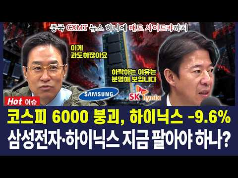
- 챕터: 0:00 하이라이트 — "미국은 4%, 우리는 10% … 과도… · 0:22 [경제야놀자 해설] 오늘 왜 이렇게 빠졌나 · 0:41 코스피 하락 이유는 분명 — 삼성전자 · SK하이닉스… · 1:25 창신메모리(CXMT) 서버용 DDR5 · 미국 메모리… · 2:08 박시동 — AI 하드웨어 섹터를 보는 눈 · 2:40 반도체 부정론 셋 · 중국 추격론에 불을 질렀다 · 4:52 이광수 — 공급은 중국, 수요는 돈 · 해소엔 시간이… · 6:46 [경제야놀자 해설] CXMT · 수요와 공급 · 7:06 "파괴적으로 보지 않는다" — 쇼잉 · 양산 · 수율… · 9:03 [경제야놀자 해설] 쇼잉? 수율? · 9:27 미국은 4%, 우리는 10% · 9:52 두 달 만의 무차별 하락 · 반대매매 악순환 우려 · 11:07 [경제야놀자 해설] 사이드카 · 무차별 하락 · 11:30 "과매도 구간" — 지지선은 지켜질 수 있다 · 12:21 [경제야놀자 해설] 오늘의 세 줄 정리
- 설명 앞부분: "미국에서 어제 하이닉스 ADR은 4%밖에 안 빠졌거든요. 근데 지금 우리가 10% 빼고 있어요." 10월 13일 12시에 만나요에서 박시동 평론가가 한 말이다. 이날 코스피는 장중 6% 넘게 빠지며 6000선 아래로 밀렸고, 매도 사이드카까지 발동됐다. 방아쇠는 중국 창신메모리(CXMT)가 서버용 DDR5를 올해 연말까지 내놓겠다는 소식. 박시동 평론가는 이 뉴스가 "중국 추격론에 불을 당기면서" 반도체 부정론 전체를 태웠다고 진단하면서도, 시제품을 보여 주는 쇼잉일 수 있고 양산 · 수율은 검증할 게 한 트럭이라 오늘 공포는 …
- 같은 채널 평소 대비 ×6.2 (채널 최근 롱폼 중앙값 10,320회) · 평소 영상: 코스피 6000 붕괴, 하이닉스만 제자리, 솔리다임 상장의 파장 (10,736회) / 금리 인상, 올해가 마지막? 코스피 6000 깨졌다 반등한 이유 3가지 (9,904회)
- 대본 없음 (설명) — 음성인식이 끝나면 도입부·흐름이 들어감
- 댓글 230/230: 좋은 점 — 영상 2 · 감사·응원 4 · 더 알고 싶은 것 3 · 아쉬운 점 — 영상 0 · 반박·불만 — 의견 다름 3 · 정치·사회 10 · 경험 공유 5 · 구독·다음 기대 0
  - 좋은 점 — 영상 👍3 “박시동 평론가님, 이광수 대표님. 제가 가장 신뢰하는 두 분을 한자리에서 뵈니 참 든든합니다. 복잡한 국내 증시와 경제를 개인투자자의 눈높이에서 쉽게 풀어주시고, 듣기 좋은 말보다 판단에 필요한 솔직한 이야기를 해주셔서 늘 고맙습니다. 개인투자자에게 오래 남는 것은 …”
  - 좋은 점 — 영상 👍1 “레전드 전문가가 나오셨네요. 광수는 언제나 맞춘다.”
  - 감사·응원 👍3 “박시동 평론가님, 이광수 대표님. 제가 가장 신뢰하는 두 분을 한자리에서 뵈니 참 든든합니다. 복잡한 국내 증시와 경제를 개인투자자의 눈높이에서 쉽게 풀어주시고, 듣기 좋은 말보다 판단에 필요한 솔직한 이야기를 해주셔서 늘 고맙습니다. 개인투자자에게 오래 남는 것은 …”
  - 감사·응원 👍2 “감사합니당.ㅡ😊”
  - 더 알고 싶은 것 👍1 “광수형의 전공이 뭔지 원래 직업이 뭐였는지 궁금하다. 전문가 포스가 약해 보여서.. 누구나 다 알고 다 하는 얘기만 하는데..”
  - 더 알고 싶은 것 👍1 “광수 형 또 무슨 헛소리하나 궁금해서와봄 ㅎ”
  - 반박·불만 — 의견 다름 👍1 “빼는건 10%씩 빼고 오르는건 1%~2%이니 이게 정상적인 주식시장 이냐고? 어이없는 국장”
  - 반박·불만 — 의견 다름 👍1 “근데 이분은 주식 전문가 아닌데요.”
  - 정치·사회 👍8 “외국인이 마음대로 할수있다. 5000지수 4천 3천 마음대로 할수도 있다. 국장 폐지하고 전부 미장 가라”
  - 정치·사회 👍3 “주주에게 줘야 될 배당금을 직원들한테 주니 외국인 주주들이 열받아 창신메모리 핑계로 매도한 것 같은데.”
  - 경험 공유 👍11 “얘네들 얘기 듣다 보면 나도 저기 나가서 얘기할수 있겠다”
  - 경험 공유 👍9 “어제 내가 예상했다 6000선 무너질것이라고...”

### 61. I Own 2,444 Shares of SCHD. Here's What It Actually Pays Me.

- https://www.youtube.com/watch?v=YPkL0BibgL8 · Mikey Moran · 구독자 11,900 · 조회수 204,484 (×17.2, 하루 3,328.3) · 좋아요 1,599 (0.8%) · 9.5분 · 2026-08-20 · 주제 묶음 기타 · 형식 정보·해설 (그 밖) · 폴더 `W_YPkL0BibgL8` (웹 승인)
- 썸네일: 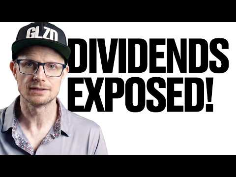
- 챕터: 0:00 The Reality of My SCHD Portfo… · 1:04 My Total Shares and Cost Basis · 1:30 Understanding the SCHD Stock … · 2:12 Real Dividend Payments (State… · 3:30 Why $207 a Month Is Only 2% o… · 4:08 Businesses are the Real Wealt… · 4:50 Why I Autopilot My SCHD Reinv… · 6:25 The Taxable Account Mistake I… · 7:48 Why I’m Behind My 3,000 Share… · 8:58 My Strategy: Boring Stocks, B…
- 설명 앞부분: How much do you actually make from owning 2,444 shares of SCHD? 📬 My weekly investing email — what I actually bought, most Sundays: In this video, I’m pulling back the curtain on my own portfolio to show you the real numbers, straight from my brokerage statements—no calculators or "what-if" scenari…
- 같은 채널 평소 대비 ×24.9 (채널 최근 롱폼 중앙값 8,196회) · 평소 영상: SCHD Is at an All-Time High. Here’s Why I’m Still… (8,196회) / 10 Dividend ETFs Ranked — I Only Own 5 of Them (8,480회)
- 대본 (자막, 5.2 음절/초) 첫 20초: “저는 매주 금요일 마다 천 달러 어치의 주식을 삽니다. 그 주에 시장이 어떻게 움직 였는지는 중요 하지 않습니다 . 뉴스 헤드 라인이 뭐라고 하든 상관 없습니다. 금요일 이 되면 돈이 투자 됩니다. 그 금액 중 상당 부분을 3 년 반 동안 한 종목에 투자 해 왔습니다. 현재 저는 SCHD 2,444” — 도입부 유형: 내 이야기·사연
- 첫 1분: “저는 매주 금요일 마다 천 달러 어치의 주식을 삽니다. 그 주에 시장이 어떻게 움직 였는지는 중요 하지 않습니다 . 뉴스 헤드 라인이 뭐라고 하든 상관 없습니다. 금요일 이 되면 돈이 투자 됩니다. 그 금액 중 상당 부분을 3 년 반 동안 한 종목에 투자 해 왔습니다. 현재 저는 SCHD 2,444 주를 보유 하고 있고, 그로 인해 얼마를 받는지 정확히 보여 드리겠습니다. 웹 사이트의 계산기가 아닌 실제 계좌 명세서에 찍힌 진짜 숫자 입니다. 미리 말씀 드리지만, 생각 보다 적을 겁니다. 보시면 첫 반응은 ' 겨우 이거 야?' 일 겁니다. 그 반응을 잘 곱 씹어 보시기 바랍니다. 왜 그 숫자가 작은 지, 그런데도 제가 왜 계속 사는지 이해 하는 것이 숫자 자체 보다 여러분”
- 흐름 (90초마다 첫 문장): 0:00 저는 매주 금요일 마다 천 → 1:30 드리 자면, SCHD는 2024 년 10 월 → 3:00 이유가 있습니다. 첫째, 펀드 → 4:30 회사 성장' 에 걸고 있습니다. → 6:00 하고 싶거든요. 매주 금요일 → 7:30 효과가 엄청 났을 거라는 → 9:01 그게 제 전략의 전부 입니다.
- 댓글 193/206: 좋은 점 — 영상 0 · 감사·응원 0 · 더 알고 싶은 것 0 · 아쉬운 점 — 영상 0 · 반박·불만 — 의견 다름 0 · 정치·사회 0 · 경험 공유 0 · 구독·다음 기대 0

### 62. I Just Bought 1,000 Shares Of SCHD: Here's The Dividends It Pays Me

- https://www.youtube.com/watch?v=fPU6Gefdad8 · Grounded Life Investments · 구독자 5,350 · 조회수 91,337 (×17.1, 하루 5,514.7) · 좋아요 830 (0.9%) · 10분 · 2026-10-04 · 주제 묶음 기타 · 형식 정보·해설 (그 밖) · 폴더 `W_fPU6Gefdad8` (웹 승인)
- 썸네일: 
- 설명 앞부분: I just bought 1,000 shares of SCHD for our retirement portfolio. In this video I break down why I bought it and what the resulting dividend payouts will be. Want to go deeper? The GLI Dashboard gives you dividend screeners, portfolio analysis, and deep dives of the companies and ETF's you need to k…
- 같은 채널 평소 대비 ×8.1 (채널 최근 롱폼 중앙값 11,317회) · 평소 영상: SCHD New All-Time High: I've Paused My DCA & What… (11,317회) / I Invested $30 Per Day In SCHD - Here What Happen… (12,195회)
- 대본 없음 (설명) — 음성인식이 끝나면 도입부·흐름이 들어감
- 댓글 141/147: 좋은 점 — 영상 0 · 감사·응원 0 · 더 알고 싶은 것 0 · 아쉬운 점 — 영상 0 · 반박·불만 — 의견 다름 0 · 정치·사회 0 · 경험 공유 0 · 구독·다음 기대 0

### 63. 집은 팔았고, 주식은 물렸고

- https://www.youtube.com/watch?v=SbEfHnF8DdY · 로텐션 LOWTENSIONS · 구독자 6,730 · 조회수 105,766 (×15.7, 하루 28,023.9) · 좋아요 754 (0.7%) · 16.3분 · 2026-10-17 · 주제 묶음 11. 투자 일반 · 형식 브이로그·직접 해본 이야기 · 폴더 `W_SbEfHnF8DdY` (웹 승인)
- 썸네일: 
- 설명 앞부분: 집을 팔고 이사까지 마치니 이제 조금은 마음 편히 지낼 수 있을 줄 알았는데, 인생은 늘 예상과 다르게 흘러가네요. 집을 팔고 주식을 샀습니다. 집은 잘 팔았는데, 주식은 잘못 산 걸까요. 그래도 일상은 계속됩니다. 출근도 하고, 밥도 먹고, 이번 영상에는 그렇게 흘러가는 저희 부부의 평범한 일상을 담았습니다. 오늘도 함께해 주셔서 감사합니다. 제이 & 윤 [Video Source Support] Youtube channel "freeticon" : / freeticon
- 같은 채널 평소 대비 ×15.0 (채널 최근 롱폼 중앙값 7,069회) · 평소 영상: 요즘 환율 불안한데 대만은 아직 여행하기 괜찮은 이유 타이중 부부 여행 브이로그 (7,069회) / 도쿄 근교 가마쿠라 에노시마 ∣ 별것 없는데 자꾸 생각나는 일본소도시 (6,469회)
- 대본 없음 (설명) — 음성인식이 끝나면 도입부·흐름이 들어감
- 댓글 185/184: 좋은 점 — 영상 1 · 감사·응원 14 · 더 알고 싶은 것 2 · 아쉬운 점 — 영상 1 · 반박·불만 — 의견 다름 2 · 정치·사회 8 · 경험 공유 19 · 구독·다음 기대 3
  - 좋은 점 — 영상 👍11 “주식을 오래하고 꾸준한 수익을 원한다면 외부의 귀을 닫고 나만의 방법이 필요한데 화려하지도 않고 큰 기술이 필요하지도 않습니다. 단순합니다. 욕심부리지 않고 돈을 차갑고 신중히 한번 더 생각하고 다루어라!! 고점에서 떨어지는 종목은 쳐다 보지도 말아라 미련을 버려라 …”
  - 감사·응원 👍22 “저도 주식 너무 팔고 싶네요😂 상승장 언능타고 제이님 입맛 돌아오시길 바랄께요! 우리 모두 화이팅해요!”
  - 감사·응원 👍13 “어떤 인내심보다 주식을 하면서 진짜 인내심을 배우고 있습니다. ㅎㅎ 제 이야기 하시는줄 알았어요. 오늘도 소중한 영상 고맙습니다. ^^ 항상 건강 및 행복하세요!! 응원해요!!”
  - 더 알고 싶은 것 👍22 “악~~! 이렇게 금방 올라오다니 선물같고 너무 좋네요. 로텐션 영상 너무 제 취향입니다. 오늘도 여러편 또 보고.. 앞으로도 빠른 업데이트 많은 영상 부탁드립니다~😊”
  - 더 알고 싶은 것 👍0 “얼마정도를 하시나요?? 힘내세요”
  - 아쉬운 점 — 영상 👍8 “60대고 2천~3천 정도로 주식하는데 사팔사팔 하면서 하루를 보내니 지루하지 않네요. 마이너스도 있지만 기다리면 오겠죠. 이러고 세월 보냅니다.”
  - 반박·불만 — 의견 다름 👍3 “그렇게 사팔사팔하는건 투기지 투자가 아닙니다. 투자는 펀더멘탈 좋은 코스피 우량주 사서 가다리는거여ㅣ요. 부동산도 하루하루 보는게아니듯 주식도 그래요. 그리고 그때그때 뷰가 바뀌면 방향도 수정해야해요. 단기간 승부를 보려는건 위험해요. 되도록 코스닥으 하지말고 시총이…”
  - 정치·사회 👍11 “이재명이 해냈구나 집팔아 주식하라 니덜 인생 조진거 같다”
  - 정치·사회 👍8 “어머나, 이리 빨리 영상이 올라오면 구독자는 너무 좋잖아요❤ 하얀색 바탕에 때가 타면 정말 참을 수 없는데😂 어서 빨리 매직블럭 찾으셨으면 좋겠어요! 제이님이 타 주시는 커피엔 비할 수 없겠지만, 커피 내리기 귀찮으실 땐 루카스나인 카페라떼도 추천드려요☕️ 주식은 정…”
  - 경험 공유 👍22 “저도 주식 너무 팔고 싶네요😂 상승장 언능타고 제이님 입맛 돌아오시길 바랄께요! 우리 모두 화이팅해요!”
  - 경험 공유 👍12 “부러우면 지는 거라던데, 남이 해준 아침밥 언제 먹어봤는지 기억이 안나네요.😢 저도 백수 5개월차 전업투자 합니다. 종목거래는 수수료가 많아 ETF로 차트 봐가며 스캘핑. 저한테는 그게 딱 맞더라구요, 큰 하락도 피할수 있고. 처음 보는 채널인데 뭔가 공감도 되고 두…”
  - 구독·다음 기대 👍12 “부러우면 지는 거라던데, 남이 해준 아침밥 언제 먹어봤는지 기억이 안나네요.😢 저도 백수 5개월차 전업투자 합니다. 종목거래는 수수료가 많아 ETF로 차트 봐가며 스캘핑. 저한테는 그게 딱 맞더라구요, 큰 하락도 피할수 있고. 처음 보는 채널인데 뭔가 공감도 되고 두…”
  - 구독·다음 기대 👍6 “오늘 처음 알고리즘타서 잼나게 보고 구독합니다~^^ 50대 후반이데 1억 5천 정도를 한계좌에 물을 타지 않고 물리면 다른 계좌 터서 사기를 10여개가 넘는다는..ㅋ 계좌마다 시체들이 그득 그득하지만 삼성전자니까 하고 물린계좌 끌어안고 기다립니다ㅋ 일상적이지만 우리들…”

### 64. 나이키 옷 추천하고 Nike 주식도 줍줍

- https://www.youtube.com/watch?v=2T_niqja8Vc · 조탄 · 구독자 6,380 · 조회수 99,043 (×15.5, 하루 593.0) · 좋아요 1,837 (1.8%) · 5분 · 2026-05-07 · 주제 묶음 기타 · 형식 정보·해설 (그 밖) · 폴더 `W_2T_niqja8Vc` (웹 승인)
- 썸네일: 
- 설명 앞부분: 오늘은 직접 입어보고 고른 나이키 운동복 추천과 함께 최근 변동성이 큰 나이키 주가에 대한 제 개인적인 생각을 담아봤습니다. 📈 영상 속 제품 정보는 아래 리스트를 확인해 주세요. 👇 [제품 정보 (Product Info)] 나이키 스트라이드 드라이핏 1/4 집 러닝 탑 사이즈: 아시아 M (HV2181-010) 나이키 드라이핏 파크 3 쇼츠 사이즈: M (BV6855-010) 나이키 코리아 스트라이크 엘리트 드라이핏 니트 드릴 탑 사이즈: 아시아 XXXL (DH5269-010) 나이키 코리아 스트라이크 엘리트 드라이핏 ADV 니…
- 같은 채널 평소 대비 ×5.6 (채널 최근 롱폼 중앙값 17,762회) · 평소 영상: 하트시그널5 패션 리뷰 유경 우열 "우유경" 현커 기념 옷 정보 총정리 (17,762회) / 솔로지옥5 5~7화 여자 출연자 옷 정보 총정리 3편 (20,187회)
- 대본 (자막, 6.7 음절/초) 첫 20초: “오늘은 나이키 주주로서 [음악] 체육복 소개해 드리겠습니다. 먼저 나이키 스트라이드 드라이피칩 러닝탑 제품입니다. 소재는 재생 폴리의 스톤방이며 딴배출이 잘되는 소재이고 얇고 부드러서 착용감이 [음악] 정말 좋습니다. 디테일은 섬매 부분의 서물과 파란쪽 부분도 매쉬로 되어 있으며 리플렉티브가 가슴팔 뒤쪽에 들어가 있습니다. 위쪽 부분은 하프”
- 첫 1분: “오늘은 나이키 주주로서 [음악] 체육복 소개해 드리겠습니다. 먼저 나이키 스트라이드 드라이피칩 러닝탑 제품입니다. 소재는 재생 폴리의 스톤방이며 딴배출이 잘되는 소재이고 얇고 부드러서 착용감이 [음악] 정말 좋습니다. 디테일은 섬매 부분의 서물과 파란쪽 부분도 매쉬로 되어 있으며 리플렉티브가 가슴팔 뒤쪽에 들어가 있습니다. 위쪽 부분은 하프 커터집으로 되어 있으며 [음악] 단풍으로 입거나 내려서 안에 인어를 입고 입으셔도 됩니다. 저는 키 172의 몸무이 70kg M 사이즈를 참여했으며 [음악] 가격은 7만 원대에 구매 가능합니다. 운동은 수용이랑 러닝 맨모 운동만 [노래] 하는 채형이고 [음악] 저랑 비슷한 채형인 분들 중에서 살짝 여유입고 정 사이즈로 입으실 분들은 동일하게 가시면 [음악] 될 거 같습니”
- 흐름 (90초마다 첫 문장): 0:00 오늘은 나이키 주주로서 [음악] → 1:30 참여했으며이 제품도 [음악] 정 → 3:00 바람마귀처럼 바스락거리는 소재보다는 → 4:30 [음악] 기록했다고 합니다. 곧
- 댓글 56/56: 좋은 점 — 영상 0 · 감사·응원 3 · 더 알고 싶은 것 15 · 아쉬운 점 — 영상 0 · 반박·불만 — 의견 다름 0 · 정치·사회 0 · 경험 공유 1 · 구독·다음 기대 0
  - 더 알고 싶은 것 👍2 “첫번째 크림에서 구매할건데요 176에 50 정도면 사이즈 어떤거 입어야하죠?”
  - 더 알고 싶은 것 👍2 “구매는 보통 어디서 많이 하시나요??”

### 65. Better Than VOO? 9 ETFs That Beat the Market (34% Returns)

- https://www.youtube.com/watch?v=id4HWsy036I · Fin Wealth Hacks · 구독자 7,670 · 조회수 118,890 (×15.5, 하루 666.1) · 좋아요 2,443 (2.1%) · 17.9분 · 2026-04-25 · 주제 묶음 2. 장기투자·ETF·지수 · 형식 정보·해설 (그 밖) · 폴더 `W_id4HWsy036I` (웹 승인)
- 썸네일: 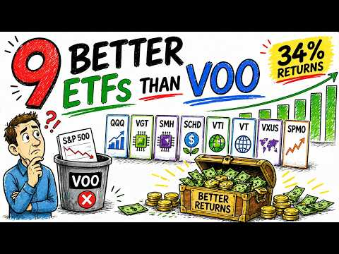
- 설명 앞부분: Best ETFs 2026 ∣ ETFs better than VOO ∣ Top performing ETFs ∣ ETF investing strategy Are there ETFs better than VOO? In this video, we break down the best ETFs of the decade, including high growth ETFs, dividend ETFs, and index funds that outperformed the S&P 500. Most investors are told to just bu…
- 같은 채널 평소 대비 ×35.2 (채널 최근 롱폼 중앙값 3,374회) · 평소 영상: The Fed Just Hiked Rates — Here’s How to Earn 5% … (3,374회) / The ONLY Growth ETF I'd Buy in 2026 (SCHD vs VUG … (3,441회)
- 대본 (자막, 0.0 음절/초) 첫 20초: “You've probably heard it a hundred times. Just buy VOO and hold. And honestly, that's not bad advice. But here's the problem nobody talks about. While you were sitting in VOO earning a solid 15% per year, someone else was quietly compounding at 34% per year in a single ETF over a full decade. We're”
- 첫 1분: “You've probably heard it a hundred times. Just buy VOO and hold. And honestly, that's not bad advice. But here's the problem nobody talks about. While you were sitting in VOO earning a solid 15% per year, someone else was quietly compounding at 34% per year in a single ETF over a full decade. We're not talking about a lucky crypto bet. We're not talking about picking individual stocks. We're talki”
- 흐름 (90초마다 첫 문장): 0:00 You've probably heard it a hundred → 1:30 return. You end up with roughly $86,000. → 3:01 emerging markets like India and Brazil. → 4:31 one decision. The philosophy behind VT → 6:01 you while you hold it. It targets 100 US → 7:30 Stock Market ETF. VTI doesn't pick → 9:03 ETF. The fan favorite. The benchmark → 10:30 companies, and then filtered it down → 12:02 The trade-off you need to understand, → 13:32 billion → 15:00 cuts through all of that. It holds over → 16:32 US-listed semiconductor companies.
- 댓글 112/112: 좋은 점 — 영상 0 · 감사·응원 0 · 더 알고 싶은 것 0 · 아쉬운 점 — 영상 0 · 반박·불만 — 의견 다름 0 · 정치·사회 0 · 경험 공유 0 · 구독·다음 기대 0

### 66. 유혈 낭자한 국장..폭락의 시작일까? / 이슈빡 / 뉴스헌터스

- https://www.youtube.com/watch?v=enkSdCIojAA · 뉴스헌터스 · 구독자 7,680 · 조회수 116,383 (×15.2, 하루 19,987.6) · 좋아요 283 (0.2%) · 17.9분 · 2026-10-15 · 주제 묶음 1. 주식 기초·초보 · 형식 인터뷰·강연·대담 · 폴더 `W_enkSdCIojAA` (웹 승인)
- 썸네일: 
- 설명 앞부분: ■ 진행: 김종원, 윤태진 앵커 ■ 대담: 윤진 (블랙퀀트에쿼티 대표), 허준영 (서강대 경제학부 교수) 코스피와 코스닥 지수가 7%대 폭락한 '검은 목요일'이었습니다. 상장기업 시가총액은 오늘 하루에만 400조원 넘게 증발했고 코스피는 지난 6월 기록한 전고점보다 40% 이상 떨어졌습니다. 특히 코스피의 절반 정도를 차지하는 반도체 투톱 '삼전 · 닉스'는 AI 기업들의 자금 조달 비용 상승과 AI 투자 수익성 악화 우려가 커지고 중국 CXMT가 신기술 상용화를 예고하면서 주가가 미끄러지고 있습니다. 이런 상황에서, 손실이 커지…
- 대본 없음 (설명) — 음성인식이 끝나면 도입부·흐름이 들어감
- 댓글 303/303: 좋은 점 — 영상 1 · 감사·응원 0 · 더 알고 싶은 것 0 · 아쉬운 점 — 영상 1 · 반박·불만 — 의견 다름 1 · 정치·사회 81 · 경험 공유 6 · 구독·다음 기대 0
  - 좋은 점 — 영상 👍0 “딱 이럴때 연기금이 뒤통수치면 레전드인데 ㅋㅋㅋㅋ”
  - 아쉬운 점 — 영상 👍0 “옛날부터 한국은 외인의 놀이터다. 반복되면 안되지만 계속 반복.”
  - 반박·불만 — 의견 다름 👍1 “아직도? "HBM 전환 때문에 한국 점유율이 줄어들었다?" 말도 안되는 헛소리 "HBM 전환 때문에 점유율이 줄어들었다"는 설명이 왜 완전한 오류인지에 대해 분명하게 재정리해 드립니다. 카운터포인트·노무라 리서치 차트(3Q24 ~ 2Q26)를 직관적으로 분석해보면, …”
  - 정치·사회 👍92 “재매이햄 망했스요 민주당 비상이라 이제 재매이자르기 할거같음”
  - 정치·사회 👍59 “좌파대통령이 하라는거 반대로만 하면 부자되는 대한민국...”
  - 경험 공유 👍0 “부동산팔아주식사라고 내가언제그랬서요. 난모르는 일이고 했다고해도 뭘 어쩌라고요 주식은 원래도박아녀 내말 진짜로 믿었써요 내가언제그랬서요 믿는너가 바보 모지란 죠다지”
  - 경험 공유 👍0 “버거형들이 삼전 하닉 실적좋을때 넘겨야지 그래야 제가격에 매물대 넘기지 뉴스에 팔라는 단순한것도 모르냐 전문가들말은 맨날 결과론적 명분찻기 볼필요도 없다”

### 67. The ONLY 5 ETFs You Need for F.I.R.E (Retire Early)

- https://www.youtube.com/watch?v=BRFRMfkGfpM · Jacob Wade (Roadmap Money) · 구독자 25,100 · 조회수 376,911 (×15.0, 하루 2,158.1) · 좋아요 6,947 (1.8%) · 17.6분 · 2026-04-29 · 주제 묶음 2. 장기투자·ETF·지수 · 형식 정보·해설 (그 밖) · 폴더 `W_BRFRMfkGfpM` (웹 승인)
- 썸네일: 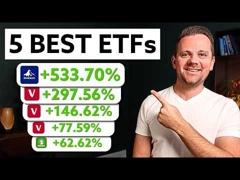
- 챕터: 0:00 Intro · 0:20 Vanguard Total Stock Market I… · 2:26 Vanguard Total International … · 4:08 Invesco QQQ Trust (QQQ) · 7:15 Fidelity Wise Origin Bitcoin … · 10:55 Vanguard Total Bond Market In… · 12:47 Example Portfolio # 1 · 13:26 Example Portfolio # 1 · 14:04 Example Portfolio # 3 · 14:51 How to Use These ETFs for F.I…
- 설명 앞부분: You only need 5 ETFs to reach financial independence. In this video, I break down the exact 5-ETF portfolio I would use to build wealth, reach Coast FIRE, and eventually achieve full financial freedom in 2026 and beyond. It's a simple, powerful portfolio built for long-term compounding. We’ll cover…
- 같은 채널 평소 대비 ×33.9 (채널 최근 롱폼 중앙값 11,129회) · 평소 영상: 3 ETF Portfolio CHANGES at Every Age (Exact Perce… (11,129회) / $10 Daily Bitcoin Investing Strategy (Bitcoin DCA) (11,242회)
- 대본 없음 (설명) — 음성인식이 끝나면 도입부·흐름이 들어감
- 댓글 434/435: 좋은 점 — 영상 0 · 감사·응원 0 · 더 알고 싶은 것 0 · 아쉬운 점 — 영상 0 · 반박·불만 — 의견 다름 0 · 정치·사회 0 · 경험 공유 0 · 구독·다음 기대 0

### 68. How to Borrow Against Your Stock Portfolio: Buy, Borrow, Die

- https://www.youtube.com/watch?v=NPcgV0dq03Q · Sacco Financial  · 구독자 21,300 · 조회수 314,203 (×14.8, 하루 2,559.7) · 좋아요 5,162 (1.6%) · 9.4분 · 2026-06-20 · 주제 묶음 기타 · 형식 정보·해설 (그 밖) · 폴더 `W_NPcgV0dq03Q` (웹 승인)
- 썸네일: 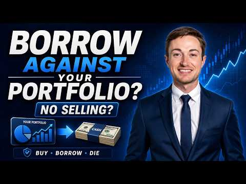
- 설명 앞부분: How do you borrow against your stocks without selling them? I recently moved a significant portion of my investment portfolio to Interactive Brokers so I could access cash through a margin loan instead of selling shares and immediately realizing capital gains. This strategy is often called Buy, Bor…
- 같은 채널 평소 대비 ×52.8 (채널 최근 롱폼 중앙값 5,949회) · 평소 영상: Institutions Are LOADED Up on SpaceX — The 13F Re… (5,949회) / The Best Stocks to Buy Right Now (6,697회)
- 대본 (자막, 0.0 음절/초) 첫 20초: “What if I told you there's a way to access cash from your portfolio without selling a single share and without paying a dollar in capital gains tax? This is not a loophole. This is how the ultra-wealthy have been doing it for decades. And recently, I started doing this myself. So, today I'm going to”
- 첫 1분: “What if I told you there's a way to access cash from your portfolio without selling a single share and without paying a dollar in capital gains tax? This is not a loophole. This is how the ultra-wealthy have been doing it for decades. And recently, I started doing this myself. So, today I'm going to break down the full strategy, what it is, how I personally set it up, and the stuff that nobody tel”
- 흐름 (90초마다 첫 문장): 0:00 What if I told you there's a way to → 1:31 And here's the answer. Yes, you do. But → 3:01 some blue-chip positions you plan to → 4:31 dedicated structured credit facility → 6:01 That's why sizing matters enormously. → 7:30 it can go sideways fast if you are not → 9:00 The rates, the loan structure, how I'm
- 댓글 603/610: 좋은 점 — 영상 0 · 감사·응원 0 · 더 알고 싶은 것 0 · 아쉬운 점 — 영상 0 · 반박·불만 — 의견 다름 0 · 정치·사회 0 · 경험 공유 0 · 구독·다음 기대 0

### 69. S&P500とNASDAQ100は崩れない。プロ投資家が あの日 まで買わない理由【米国株最新】

- https://www.youtube.com/watch?v=9zV78pvlDJ4 · まなみんの米国株の学校【投資初心者でも10分で学べる】 · 구독자 5,680 · 조회수 82,843 (×14.6, 하루 16,569.0) · 좋아요 489 (0.6%) · 10.3분 · 2026-10-16 · 주제 묶음 2. 장기투자·ETF·지수 · 형식 정보·해설 (그 밖) · 폴더 `W_9zV78pvlDJ4` (웹 승인)
- 썸네일: 
- 설명 앞부분: 私は10月28日のFRBの会議まで、売らず買わずに待ちます🍀 S&P500・NASDAQ100などの米国株と、 ※映像や資料の制作にはAIを活用していますが、相場の分析と「私はこう見る」の見解は、すべて実在する運営者自身のものです🤍
- 같은 채널 평소 대비 ×12.1 (채널 최근 롱폼 중앙값 6,856회) · 평소 영상: つみたて勢必見！今夜は雇用統計でも動かないで！この方法で運用すると複利でコレくらい増えます… (6,896회) / 大口・機関投資家はS&P500と今、〇〇に目をつけています！【米国株 NASDAQ100】 (6,815회)
- 대본 없음 (설명) — 음성인식이 끝나면 도입부·흐름이 들어감
- 댓글 36/36: 좋은 점 — 영상 0 · 감사·응원 0 · 더 알고 싶은 것 0 · 아쉬운 점 — 영상 0 · 반박·불만 — 의견 다름 0 · 정치·사회 0 · 경험 공유 0 · 구독·다음 기대 0

### 70. "역대급 저평가라던 코스피" 하루 만에 620조 추락.. 그 뒤에 숨겨진 코스피의 잔혹한 진실

- https://www.youtube.com/watch?v=6VAsPNYeTRQ · 더 리치 - 돈의 흐름을 읽어라 · 구독자 8,080 · 조회수 116,587 (×14.4, 하루 1,166.1) · 좋아요 3,100 (2.7%) · 21.2분 · 2026-07-13 · 주제 묶음 5. 국내주식 · 형식 정보·해설 (그 밖) · 폴더 `W_6VAsPNYeTRQ` (웹 승인)
- 썸네일: 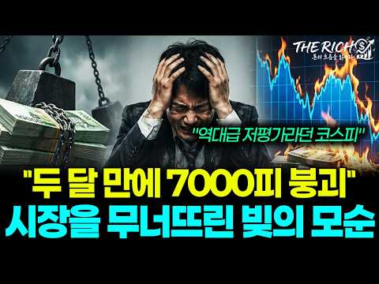
- 챕터: 0:00 역대급 저평가와 폭락의 모순 · 2:11 사이드카와 서킷브레이커 발동 · 3:53 개인이 받아낸 3.9조 매물 폭탄 · 5:15 폭락의 방아쇠 SK하이닉스 · 6:50 시장을 무너뜨린 진짜 원인 빚 · 9:02 반대매매와 레버리지의 함정 · 10:51 코스피가 역사상 가장 싼 이유 · 14:17 반도체 펀더멘털과 빚의 청산 · 16:44 향후 증시 향방과 주요 변수 · 18:20 반드시 확인해야 할 두 가지 지표
- 설명 앞부분: "역대급 저평가라던 시장이 밀린, 38조 원의 빚의 모순" 외국인과 기관의 자금 3조 9천억 원이 시장 밖으로 빠져나가고 그 빈자리를 개인이 홀로 채우며 시장의 주인이 바뀌었습니다. 코스피 7,000선이 무너진 무대 위에서 삼성전자와 SK하이닉스를 지탱하던 거대한 자금 축이 시스템에 의해 강제로 해체되는 흐름이 나타났습니다. 이번 폭락은 반도체의 실적 훼손이 아닌 신용 잔고의 청산 과정에서 발생한 기계적 이동입니다. 저평가라는 본질보다 빚의 무게가 가격을 결정하는 국면에서 금리와 물가라는 매크로 환경이 이 자금의 퇴로를 어떻게 열…
- 같은 채널 평소 대비 ×41.7 (채널 최근 롱폼 중앙값 2,795회) · 평소 영상: “480조 호재에도 1% 상승" 삼성·SK도 예외가 아닌 ‘선반영’의 무서운 함정 (2,812회) / "내가 사서 떨어지는 건가?" 개미만 모르는 외국인들의 소름돋는 수법 (2,778회)
- 대본 없음 (설명) — 음성인식이 끝나면 도입부·흐름이 들어감
- 댓글 294/294: 좋은 점 — 영상 4 · 감사·응원 9 · 더 알고 싶은 것 1 · 아쉬운 점 — 영상 2 · 반박·불만 — 의견 다름 3 · 정치·사회 44 · 경험 공유 6 · 구독·다음 기대 0
  - 좋은 점 — 영상 👍7 “잘썼어요.도움이 됩니다”
  - 좋은 점 — 영상 👍1 “좋은 정보를 감사합니다”
  - 감사·응원 👍2 “탁월한분석 입니다..많은 도움 될것 같네요..감사합니다”
  - 감사·응원 👍1 “상세하고 정확한 설명 감사합니다.🎁 최고의 채널입니다.👍🌹”
  - 더 알고 싶은 것 👍0 “근데 언제 빚이청산 되는가요?”
  - 아쉬운 점 — 영상 👍0 “너무길고 속도가 느려요 고령층 ㆍ노인들에겐 좋은 속도일수도 있지만”
  - 아쉬운 점 — 영상 👍0 “정치 리스크가 이런겁니다 다들 이걸 생각 안하시네요 세계금융의 중심이 어딘지 그돈에 돈줄이 어딘지 기억하세요 불안한 지역엔 투자들 하게나요? 연기금 등 기관의 돈으로 끌어올려봐야 기관은 돈이없고 연기금은 더이상 매수여력이 없읍니다 그래서 도박판이 된겁니다 개인이 개인…”
  - 반박·불만 — 의견 다름 👍18 “무능한 정부의 도박판 국민선동”
  - 반박·불만 — 의견 다름 👍15 “*.헛소리 말고 공매도 없애고 *단일 레리지 페지 해야 합니다”
  - 정치·사회 👍142 “국민연금이 제 때 수익실현 안하고 유예한게 가장 큰원인이다. 결국 외국인만 좋은 일 시키고 개인들은 고점에 물린거다 국민연금 특검해야 한다”
  - 정치·사회 👍63 “이제 5000 으로 내려가야지 그런데 국민연금은 팔지도 못하고 갖고있는 주식만 떨어졌는데 국민들 노후비용은 어떻게 할려나 국민연금이 주가를 9000으로 올릴때 외국인들이 신나게 팔아치웠으니 국민연금 돈을 외국인들이 합법적으로 훔쳐간거다”
  - 경험 공유 👍15 “내가 말햇잖아 낙수효과로 관련 중소형주 사라고 코스닥에 주목해 코스피와 갭차이가 너무나서 이젠 차이가 줄어들게되어있다 삼전닉스로 단타치는 단타쟁이들 재미좀 보다가 작살나는 시기다”
  - 경험 공유 👍1 “근본적으로 경제를 정치논리로 밀어 부치는 이재명 정부 주관도 없고 전문성도 없는 김용범정책실장이 단일종목 레버리지ETF 출시로 주식시장을 투기판으로 만들어 개미투자들에게 깡통차게 한 놈! 이게 시장경제 정책이냐!!! 오죽하면 금융감독원장 이찬진이 레버리지ETF 출시를…”

### 71. 주가 1.62달러까지 무너진 AMD, 바닥에서 내린 결정

- https://www.youtube.com/watch?v=l2XsNVbqkm0 · Six Sigma | 식스시그마 · 구독자 5,810 · 조회수 83,120 (×14.3, 하루 21,336.3) · 좋아요 258 (0.3%) · 11.3분 · 2026-10-17 · 주제 묶음 10. 노후·연금 투자 · 형식 인터뷰·강연·대담 · 폴더 `W_l2XsNVbqkm0` (웹 승인)
- 썸네일: 
- 챕터: 0:00 "죽은 것보다 더 죽었다" · 0:30 원래 잘나가던 회사 · 0:49 무너진 이유 · 1:19 새 CEO · 2:57 바닥에서 내린 결정 · 6:47 살아난 AMD · 9:21 이제는 엔비디아에 도전
- 설명 앞부분: 한때 인텔을 앞서던 AMD는 2015년 주가 1.62달러까지 무너졌습니다. 2014년 CEO가 된 리사 수가 그 바닥에서 무엇을 버리고 무엇에 걸었는지, 그 베팅이 AMD를 어떻게 다시 엔비디아와 싸우는 회사로 만들었는지 짚었습니다. CNN·블룸버그·스탠퍼드·MIT 인터뷰와 AMD 공식 발표 원음으로 정리했습니다. [원본] (9) 주가 자료: Yahoo Finance 종가(분할 조정) [목차]
- 같은 채널 평소 대비 ×23.1 (채널 최근 롱폼 중앙값 3,604회) · 평소 영상: 현대차 로보틱스 전략의 비밀 (3,604회) / 뇌를 켜고 끄는 스위치로 노벨상을 받았다 (2,029회)
- 대본 없음 (설명) — 음성인식이 끝나면 도입부·흐름이 들어감
- 댓글 51/51: 좋은 점 — 영상 0 · 감사·응원 0 · 더 알고 싶은 것 0 · 아쉬운 점 — 영상 1 · 반박·불만 — 의견 다름 0 · 정치·사회 0 · 경험 공유 1 · 구독·다음 기대 0
  - 아쉬운 점 — 영상 👍0 “주가 1.62달러까지..뭐?.... 제목으로 낚시질 해서 신고 박고 간다. 똑바로 살아라.”
  - 경험 공유 👍2 “모바일칩 시장이 스마트폰 이전 시절엔 큰 돈이 안되었었고 (프로세서 기술보다 모뎀 기술이 결정적인 경쟁력을 좌우하던 시절) 이후 스마트폰 시대로 접어들어서도 모뎀기술이 프로세서 기술보다 더 중요한 경쟁력으로 작용했음. 모바일칩에 뛰어들지 않은건 당시 AMD가 가진 역…”

### 72. "안정을 기대한다"더니 하루만에 코스피 -10.84%🔥올해 8번째 서킷브레이커🔥정부, 왜 손놓고 있나🔥증안펀드•리밸런싱•공매도🔥삼성전자 -14% SK하이닉스 -…

- https://www.youtube.com/watch?v=AOs5sAd3hKM · 리얼경제 · 구독자 1,340 · 조회수 19,133 (×14.3, 하루 225.9) · 좋아요 745 (3.9%) · 16.1분 · 2026-07-28 · 주제 묶음 2. 장기투자·ETF·지수 · 형식 정보·해설 (그 밖) · 폴더 `W_AOs5sAd3hKM` (웹 승인)
- 썸네일: 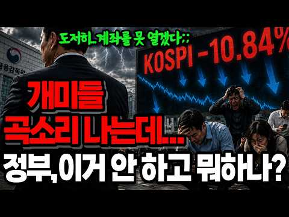
- 챕터: 0:00 인트로 — 어제는 "안정을 기대한다", 오늘은 서킷브… · 0:52 오늘 벌어진 일 — 코스피 6,023.66 / -10… · 2:41 방아쇠는 밖에서 — 중국 창신메모리 상장과 DUV 노… · 4:21 왜 우리만 이렇게 무너지나 — 레버리지라는 확성기 · 6:03 그럼 누가 벌었나 — 외국인 지분율은 오히려 늘었다 · 8:15 스위치는 이미 있었다 — 국민연금 리밸런싱과 7월 1일 · 10:09 당국은 무엇을 했나 — 7/14부터 7/28까지 날짜… · 11:48 안 쓴 카드 — 증안펀드 10조·공매도 금지·리밸런싱… · 13:37 그래서 지금이라도 — 요구 세 가지
- 설명 앞부분: 🔎2026년 7월 28일 코스피가 10.84% 폭락하며 올해 여덟 번째 서킷브레이커가 발동했습니다. 삼성전자 -14.17%, SK하이닉스 -16.02%, 중국 창신메모리 상장과 DUV 노광장비 소식, 외국인 4조 5,009억 순매도, 국민연금 리밸런싱 7월 1일 재개, 증권시장안정펀드 10조원까지 — 하루에 벌어진 일을 처음부터 끝까지 정리했습니다. 왜 떨어졌는지는 다들 아십니다. 이 영상이 따지는 건 떨어질 때 정부가 무엇을 했고, 무엇을 하지 않았는가입니다. 레버리지 근처도 안 가고 빚 한 푼 안 낸 계좌까지 왜 같이 녹았는지…
- 같은 채널 평소 대비 ×101.2 (채널 최근 롱폼 중앙값 189회) · 평소 영상: 삼성노조가 800조 호남 반도체 메가프로젝트 막아선 진짜 이유...부메랑 노란봉투법 삼성… (189회) / 엔비디아 손잡은 네이버 집중분석🔎아시아 AI 인프라회사로?🔥14조 유치🔥GPU 6만장🔥1… (147회)
- 대본 없음 (설명) — 음성인식이 끝나면 도입부·흐름이 들어감
- 댓글 205/205: 좋은 점 — 영상 0 · 감사·응원 2 · 더 알고 싶은 것 1 · 아쉬운 점 — 영상 2 · 반박·불만 — 의견 다름 3 · 정치·사회 60 · 경험 공유 4 · 구독·다음 기대 0
  - 감사·응원 👍1 “하..한숨이 나네요. 국힘에서 대통령 나오면 꼭꼭숨기다 민주당에서 대통령나오면 터뜨리고 대통령 탓하는거.. 그런다고 개개인의 돈이 돌아오는것도 아니고.. 선거 종이쪼가리 하나로 부자되는것도 아닌데 참으로 멍청들 하네요. 개인들의 돈을 지킬수있는 정보 감사합니다. 지가…”
  - 감사·응원 👍1 “재명이 파이팅! 자알한다~~~”
  - 아쉬운 점 — 영상 👍3 “■미국도 시가총액이 시장의 60%를 차지하는 종목에 단일레버리지ETF상품이 상장되어 있는가? 결론부터 말씀드리면 아닙니다. 미국 증시에도 엔비디아, 테슬라, 애플 등을 기초자산으로 하는 단일 종목 레버리지 ETF가 대거 상장되어 있지만, 단일 종목(또는 2개 종목)이…”
  - 아쉬운 점 — 영상 👍2 “쓸 카드를 쥐고 있는 것 자체가 기술입니다ㆍ 이 카드 이럴때 쓸거야..천명하는 순간 그 카드는 쓰지도 않았지만 힘이빠짐ㆍ 손해보고있다면 욕심에 냅다 지른 사람 책임이고 진짜 고수들은 언제 나머지를 투입할까 ㆍㆍㆍ재고있음ㆍ 뇌동매매자에게서 소신 투자자에게 돈은 그렇게 …”
  - 반박·불만 — 의견 다름 👍16 “역대 권력자 중에 국민을 주식에 도박하라고 판짜고 선동하고 국가돈 처 넣은 자는 짜이밍이 유일함.”
  - 반박·불만 — 의견 다름 👍3 “■미국도 시가총액이 시장의 60%를 차지하는 종목에 단일레버리지ETF상품이 상장되어 있는가? 결론부터 말씀드리면 아닙니다. 미국 증시에도 엔비디아, 테슬라, 애플 등을 기초자산으로 하는 단일 종목 레버리지 ETF가 대거 상장되어 있지만, 단일 종목(또는 2개 종목)이…”
  - 정치·사회 👍72 “역시 이재명 보유국이라니까. 결과 다 체험하는구나.”
  - 정치·사회 👍52 “민주당 지금 선거중이라 이런거 신경쓰는 사람 없어. 브라질에서 휴가중인데 코스피 하락하는게 뭐 뭐. 웃겨.”
  - 경험 공유 👍25 “내가보기에 정말 잘못된건 민주당을 20년 지지했다는 고백 그것이 최악의 선택이었다~무능정권을 넘어 야바위정권! 선무당이 사람잡고 반풍수가 집안거들냈다~그래놓고 헌법개정해서 한번 더해 먹겠단다? 우라질~~”
  - 경험 공유 👍13 “저도 평생민주당 .. 이제 뒤도 안돌어 보고 싶네요 신속 실행해야지 이건 아닌거 같네요”

### 73. "단타" 개미 60%가 모르는 단타의 진짜 함정 (자본시장연구원 충격 보고서)

- https://www.youtube.com/watch?v=ynzKagjNqnc · 경제가머니 · 구독자 22,500 · 조회수 321,107 (×14.3, 하루 1,982.9) · 좋아요 3,761 (1.2%) · 21.4분 · 2026-05-12 · 주제 묶음 7. 매매·전략 · 형식 정보·해설 (그 밖) · 폴더 `W_ynzKagjNqnc` (웹 승인)
- 썸네일: 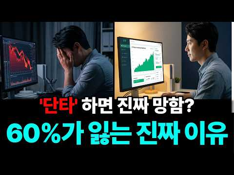
- 설명 앞부분: 주식 자주 사고팔수록 빨리 번다고 생각하셨죠? 자본시장연구원이 20만 명을 추적한 결과는 정반대였습니다. 거래를 자주 한 사람일수록 더 많이 잃었어요. 신규 개인투자자 60%가 손실, 자주 살수록 더 빨리 잃는 진짜 이유를 카지노 한 판에 비유해서 풀어드립니다. 그리고 마지막엔 한 달 4만 원으로 시작하는, 단타 안 하고도 살아남는 매수법까지. 코스피 200 ETF 5종(KODEX·TIGER·KBSTAR·HANARO·ARIRANG) 비교와 자동적립 5단계 가이드를 손에 쥐여드립니다. 📖 이 영상에서 다루는 내용 단타로 자꾸 깡통 …
- 같은 채널 평소 대비 ×571.4 (채널 최근 롱폼 중앙값 562회) · 평소 영상: 한국 직장인 절반이 AI를 쓰고도 시간을 못 아끼는 진짜 이유 (562회) / "종목은 맞았는데 계좌는 왜 이래?" 개인이 고른 주식은 102% 올랐는데 12조가 떠난… (570회)
- 대본 없음 (설명) — 음성인식이 끝나면 도입부·흐름이 들어감
- 댓글 592/592: 좋은 점 — 영상 7 · 감사·응원 10 · 더 알고 싶은 것 3 · 아쉬운 점 — 영상 3 · 반박·불만 — 의견 다름 1 · 정치·사회 1 · 경험 공유 37 · 구독·다음 기대 0
  - 좋은 점 — 영상 👍9 “경험상 맞는 말이네요 좋은정보 유익하게 잘 활용할께요😂❤”
  - 좋은 점 — 영상 👍1 “좋은 영상 감사합니다. 그런데 말입니다.....삼성전자나 하이닉스처럼 자기가 매수할 때 마다 올라 있는 겁니다. 그럼 반대의 현상이 나오겠죠. 위의 제가 예시 한것은 어떻게 보면 극단적이라 볼수도 있습니다. 주식투자에 정답은 없습니다.”
  - 감사·응원 👍7 “감사합니다”
  - 감사·응원 👍3 “감사 드려요^-^”
  - 더 알고 싶은 것 👍0 “매월 4만원만 자동설정해도 되나요?예를들자면 앨지전자가 29만원인데 어떻게 4만원으로 사지나요?”
  - 더 알고 싶은 것 👍0 “평생 만원만 있는 사람은 어떻게 해야 할까요? 결혼한 사람입니다.(용돈X) 답은 단타 입니다. 이 핵심은 상승 종목을 눈에 무조건 익혀야 손실이 적습니다. 하루 3% 익절 이면 손실보다 익절이 많게 하면 됩니다. 그게 어려워서 그렇죠.”
  - 아쉬운 점 — 영상 👍2 “마음으로는 저점에 사서 고점에팔고 이걸 한종목으로 계속 반복해서 주식수 따따블 만들겠다고 하는데 이게 하다보면 반대로 하고 있다는거야 오르면 사고 내리면 손절치고 이거 1~2회 반복하면 멘붕와서 완전 도박처럼 돼”
  - 아쉬운 점 — 영상 👍1 “뻔한소리 20분영상 만드는거 대단하다 ..”
  - 반박·불만 — 의견 다름 👍0 “글쎄 단타가 문제가 아니라~ 본인의 종목을 단타로 할껀지 장투로 갈껀지를 선택하고 본인의 현재 가용할수 있는 시간 돈이 더 중요함!! 😂”
  - 정치·사회 👍0 “어제오늘 만해도 많이 털렸을껄?ㅋ 정책실장색히 발언에 외인이 많이 매도했지? 다짜고치는거겠지. 검은머리외국인ㅋ”
  - 경험 공유 👍10 “단타 쉽지 않던데 내가 단타 해서 시드에 70%넘게 날려먹음 미래를 읽고 꾸준히 모았던사람이 크게벌었죠 이번에 삼전 하닉 등등 처럼”
  - 경험 공유 👍9 “경험상 맞는 말이네요 좋은정보 유익하게 잘 활용할께요😂❤”

### 74. Buy 1 Share of SCHD Every Week—Here’s the Retirement Math

- https://www.youtube.com/watch?v=qFFwr4zsDKQ · Mikey Moran · 구독자 11,900 · 조회수 165,377 (×13.9, 하루 8,508.2) · 좋아요 1,404 (0.9%) · 9.6분 · 2026-10-01 · 주제 묶음 기타 · 형식 정보·해설 (그 밖) · 폴더 `W_qFFwr4zsDKQ` (웹 승인)
- 썸네일: 
- 설명 앞부분: Starting SCHD at 50? What could buying just 1 share a week mean for your retirement income at 65? I ran the numbers—and the difference between the optimistic and conservative scenarios surprised me. In this video, I explore a hypothetical 15-year investing plan using SCHD, the Schwab U.S. Dividend …
- 같은 채널 평소 대비 ×20.2 (채널 최근 롱폼 중앙값 8,196회) · 평소 영상: SCHD Is at an All-Time High. Here’s Why I’m Still… (8,196회) / 10 Dividend ETFs Ranked — I Only Own 5 of Them (8,480회)
- 대본 없음 (설명) — 음성인식이 끝나면 도입부·흐름이 들어감
- 댓글 162/177: 좋은 점 — 영상 0 · 감사·응원 0 · 더 알고 싶은 것 0 · 아쉬운 점 — 영상 0 · 반박·불만 — 의견 다름 0 · 정치·사회 0 · 경험 공유 0 · 구독·다음 기대 0

### 75. Mutual Fund Manager's Guide To Investing For The Next 10 Years

- https://www.youtube.com/watch?v=_gnrJW4h_lE · Angel One Podcasts · 구독자 4,880 · 조회수 66,958 (×13.7, 하루 8,616.6) · 좋아요 650 (1.0%) · 53.9분 · 2026-10-13 · 주제 묶음 기타 · 형식 정보·해설 (그 밖) · 폴더 `W__gnrJW4h_lE` (웹 승인)
- 썸네일: 
- 챕터: 0:00 Intro · 2:00 Why Are Foreign Investors Sel… · 7:45 Is The Worst Behind Us In The… · 9:04 Is This The Right Time To Inv… · 13:05 How Much Should You Allocate … · 14:49 What Returns Should You Expec… · 15:59 How To Identify A Good Small-… · 18:42 What Makes A Small-Cap Fund O… · 21:06 How Do Fund Managers Pick Win… · 25:14 How To Find Stocks That Can D… · 27:57 When Should You Sell A Stock? · 31:15 When Should You Book Profits … · 32:54 3 Sectors That Could Drive In… · 37:01 Can Indian Manufacturing Beco… · 38:56 Where Is India's Premium Cons… · 40:18 How Should Indian Investors A… · 42:59 Should You Invest In India Or… · 45:16 How To Build Your First ₹1 Cr… · 47:13 Small Caps Vs Large Caps: Whe… · 48:50 The One Investing Question Pe…
- 설명 앞부분: Is the Indian stock market sending mixed signals? Global investors have been cautious, domestic investors are putting in record SIP money, and company earnings are strong. In this podcast, Manish Gunwani, CIO of Bandhan AMC, decodes this contradiction, shares how he thinks about market cycles and r…
- 같은 채널 평소 대비 ×0.6 (채널 최근 롱폼 중앙값 119,608회) · 평소 영상: Boring Stocks Make the Most Money - Here's Why.. (130,804회) / How To Make ₹0 to ₹1 Crore Through Mutual Fund SI… (108,413회)
- 대본 없음 (설명) — 음성인식이 끝나면 도입부·흐름이 들어감
- 댓글 34/34: 좋은 점 — 영상 0 · 감사·응원 0 · 더 알고 싶은 것 0 · 아쉬운 점 — 영상 0 · 반박·불만 — 의견 다름 0 · 정치·사회 0 · 경험 공유 0 · 구독·다음 기대 0

### 76. ETF 2개 + 절세 계좌 3개, 이 순서대로 채우면 매달 100만 원이 들어옵니다!

- https://www.youtube.com/watch?v=PzWL53BrkcQ · 술술 경제학 · 구독자 17,600 · 조회수 230,614 (×13.1, 하루 1,517.9) · 좋아요 3,903 (1.7%) · 18분 · 2026-05-22 · 주제 묶음 2. 장기투자·ETF·지수 · 형식 정보·해설 (그 밖) · 폴더 `W_PzWL53BrkcQ` (웹 승인)
- 썸네일: 
- 설명 앞부분: 국민연금만 믿고 노후를 준비하고 계신가요? 전체 수급자 평균 월 70만 원, 20년 이상 성실하게 납부한 분들도 평균 116만 원입니다. 부부 최소 생활비 248만 원에 비하면 매달 130만 원이라는 '구조적 결손'이 발생합니다. 이 빈칸을 방치하면 노후 내내 통장에 구멍이 뚫린 채 살아가야 합니다. 하지만 답은 생각보다 단순합니다. ETF 수백 개를 비교할 필요 없이 딱 2개만 사면 되고, 진짜 중요한 건 어떤 ETF를 사느냐가 아니라 어느 계좌에 담느냐입니다. 같은 ETF, 같은 수익인데 계좌 하나 차이로 세금이 매년 120만…
- 같은 채널 평소 대비 ×38.1 (채널 최근 롱폼 중앙값 6,050회) · 평소 영상: 10억 모아도 매달 세금 폭탄 맞습니다! 합법적으로 다 피해 가는 4가지 절세 전략 (배… (6,050회) / S&P500 ETF 절세 3대장 2026 ∣ 같은 종목인데 1600만원 차이? (연금·I… (6,319회)
- 대본 없음 (설명) — 음성인식이 끝나면 도입부·흐름이 들어감
- 댓글 262/262: 좋은 점 — 영상 5 · 감사·응원 27 · 더 알고 싶은 것 29 · 아쉬운 점 — 영상 4 · 반박·불만 — 의견 다름 2 · 정치·사회 3 · 경험 공유 19 · 구독·다음 기대 1
  - 좋은 점 — 영상 👍5 “연금저축에서 snp500,나스닥100 이렇게 2 개 isa에서 미국초단기국채3개월 1개 넣고 있어요 단기국채를 그대로 해도 괜찮은지? SCHD미국배당다우존슨 ㅡ 이것도 괜찮을듯한데, 연금저축과 isa 둘 중 어디에 넣는게 좋을까요? 좋은 정보 감사합니다 답변도 기다리…”
  - 좋은 점 — 영상 👍3 “좋은정보 알려주셔서 고맙습니다”
  - 감사·응원 👍12 “선생님~저의 취침asmr입니다. 잠도잘오고 잠들기전까지 공부도 되고 넘 좋아요 늘.감사합니다🙂‍↕️🫶🏻❤️”
  - 감사·응원 👍5 “연금저축에서 snp500,나스닥100 이렇게 2 개 isa에서 미국초단기국채3개월 1개 넣고 있어요 단기국채를 그대로 해도 괜찮은지? SCHD미국배당다우존슨 ㅡ 이것도 괜찮을듯한데, 연금저축과 isa 둘 중 어디에 넣는게 좋을까요? 좋은 정보 감사합니다 답변도 기다리…”
  - 더 알고 싶은 것 👍8 “60~70대에 할수있는거 올려주세요 30~40대위주라서”
  - 더 알고 싶은 것 👍7 “연금저축계좌는 어디가서 만드나요?? Isa계좌는 키움에서 만들었어요 연금저축계좌도 키움에서 만들어야하나요? 아니면 미래에셋에서 만들어도되나요?? IRP계좌도 어디서만드나요?”
  - 아쉬운 점 — 영상 👍3 “마지막이나 중간에 요약 좀 해주세요 넘 어려워!”
  - 아쉬운 점 — 영상 👍1 “광고가 너무길어서 짜증”
  - 반박·불만 — 의견 다름 👍0 “ISA는 비과세가 아닌데요? 9.9% 이연과세 아닌가요?”
  - 경험 공유 👍5 “20년간 넣을 돈이라도 있으면 좋겠네요. 경험상 연금저축, IRP, ISA 변화가 오지않을까 싶어요. 가난한 노후를 원하는게 정부에요. 세금노예를 양성하려면 튼튼하다고 생각되는 구조를 무너뜨리기 위한 움직임을 보이기 시작할거에요.”
  - 경험 공유 👍1 “배당 ETF 는 성장률이 낮지 않나요? 목돈넣고 결국은 배당으로 조금씩 쪼개서 받는원리가 아닌지, 제가 잘못이해하면 교정해주세요”

### 77. 32살 부부 동반 퇴사 후, 배당투자로 세계여행 시작합니다

- https://www.youtube.com/watch?v=WXgAtzIynMk · 밍키원 MINKIONE · 구독자 13,200 · 조회수 168,006 (×12.7, 하루 1,632.7) · 좋아요 1,689 (1.0%) · 4.6분 · 2026-07-10 · 주제 묶음 1. 주식 기초·초보 · 형식 정보·해설 (그 밖) · 폴더 `W_WXgAtzIynMk` (웹 승인)
- 썸네일: 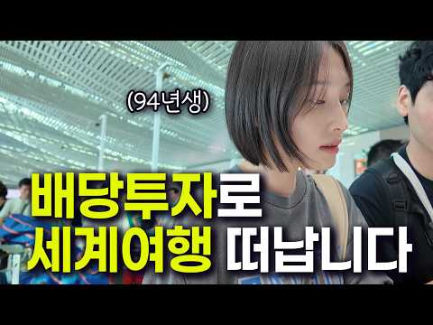
- 설명 앞부분: 안녕하세요 밍키원입니다🫶🏻 22살, 호주 워킹홀리데이를 시작으로 32살, 캐나다를 떠나기까지 저희는 오랫동안 '시간 결정권자'가 되고 싶다는 꿈을 갖고 살아왔습니다. 그리고 정말 많은 준비 끝에, 드디어 그 꿈을 직접 살아보려 합니다. 이번 영상은 그 여정의 첫 번째 이야기입니다 앞으로 세계 곳곳을 여행하며 저희의 일상과 경험, 그리고 배당투자로 여행을 이어가는 과정까지 솔직하게 기록해 보려고 합니다! 사실 새로운 도전이라 설레는 만큼 불안한 마음도 물론 있지만..!! 하지만 늘 그래왔듯 긍정적인 마음으로 모든 순간을 즐기며 기록…
- 같은 채널 평소 대비 ×8.3 (채널 최근 롱폼 중앙값 20,236회) · 평소 영상: 다 커서 캐나다 이민오게 되면 겪게되는 취업현실 .. 실수령 공개! (22,137회) / 한국인은 전부 사라지고 중국인에게 점령당한 치앙마이 여행 최신근황 (치앙마이 한달살기 3… (18,169회)
- 대본 없음 (설명) — 음성인식이 끝나면 도입부·흐름이 들어감
- 댓글 274/274: 좋은 점 — 영상 3 · 감사·응원 73 · 더 알고 싶은 것 3 · 아쉬운 점 — 영상 3 · 반박·불만 — 의견 다름 1 · 정치·사회 4 · 경험 공유 25 · 구독·다음 기대 17
  - 좋은 점 — 영상 👍4 “멋져요. 건강 챙기시면서 잘 다니시고 재미있고 유익한 영상 기대할께요. 희원씨 단발도 잘 어울리시네요.”
  - 좋은 점 — 영상 👍1 “케언즈병 ㅜㅜ 저랑거의바톤터치하고 들어가셧네요 워홀경험 매우 공감합니다ㅜㅜ 성실히 잘모으신게 정말 대단합니다 본성이 어디가는게 아니니 알고리즘 잘 타시길 응원합니다”
  - 감사·응원 👍65 “젊음이 너무 부럽습니다.. 서른하나, 그때 밴쿠버를 떠나지 않았다면 나는 지금 어떤 삶을 살고 있을까.. 이제와서 후회하는 부질없음을 경험하는 낼모레 50 인생선배인 저는 세상을 향해 떠난 두분을 응원합니다❤”
  - 감사·응원 👍21 “저희 부부 얘기인 줄 알았네요 대단하세요! 저희 부부도 2009년에 호주 워킹 케언즈를 다녀왔어요. 1년 동안 정말 좋은 추억과 경험으로 해외에서 살고 싶다는 꿈만 꾸고 현실은 일 다니면서 휴가로 여행만 다니다가 당시 여자친구이자 지금은 아내와 서울 생활을 접고 11…”
  - 더 알고 싶은 것 👍6 “응원합니다. 과거부터 현재까지 정주행 재생 목록 만들어 주세요. 하루 종일 틀어놓을게요 세계여행 한바퀴 도시고 토론토 말고 여기 벤쿠버로 오세요 요즘 렌트료 엄청싸지고 항공편도 많고 싸졌어요 다른 추운곳에 갈 필요가 없습니다”
  - 더 알고 싶은 것 👍5 “화이팅~~~ 젊음이 멋지다 !! 두분의 뜻이 함께 하니 두려울게 뭐가 있을까요? 응원합니다”
  - 아쉬운 점 — 영상 👍3 “구독하고 시청만 하다 댓글은 처음 남기는 것 같아요~ 토론토 일상 보며 재밌었어요. 한국으로 돌아가셔서 아쉬웠는데 세계여행이라니요! 역시 대단하세요~👍💕 배당투자는 뭔지 잘 모르지만 10년이나 준비하셨다니 존경스럽습니다. 앞으로의 여행도 응원하며 지켜볼게요. 건강 잘…”
  - 아쉬운 점 — 영상 👍2 “안녕하세요 밍키원님! 😊 현재 밴쿠버에 거주 중인 워홀러입니다. 몇 주 전에 우연히 영상을 보게 되었는데, 어느새 밥친구가 되어 거의 모든 영상을 정주행했을 정도로 너무 재밌게 보고 있어요! 반복되는 일상 속에서 '다른 사람들은 해외에서 어떻게 살아갈까?' 하는 궁금…”
  - 반박·불만 — 의견 다름 👍1 “흠 글쎄”
  - 정치·사회 👍1 “시간결정권자라는 말씀이 가슴에 팍 꽃히네요 낼모레 환갑인 제가 느끼고 배움니다 앞으로 응원합니당”
  - 정치·사회 👍0 “저랑 나이대가 비슷해보여서 적습니다. 사실 국가도 이미 이 여행의 정답을 알고 있습니다. 복지가 거의 없는 미국에서도 401k로 노동연령때에 열심히 투자하고 모으는걸 권장하고 도중에 빼면 위약금까지 걸어서 빼지 못하게 유도하고 은퇴 이후 이 영상처럼 자유롭게 여유롭게…”
  - 경험 공유 👍21 “저희 부부 얘기인 줄 알았네요 대단하세요! 저희 부부도 2009년에 호주 워킹 케언즈를 다녀왔어요. 1년 동안 정말 좋은 추억과 경험으로 해외에서 살고 싶다는 꿈만 꾸고 현실은 일 다니면서 휴가로 여행만 다니다가 당시 여자친구이자 지금은 아내와 서울 생활을 접고 11…”
  - 경험 공유 👍16 “이 사람들은 정말 대단하구나 내가 노력했다고 최선을다했다고 여겼던 영주권비자가 이사람들 청춘앞에서는 아무것도 아니구나. 미친듯이 부럽습니다 성공하실거에요”
  - 구독·다음 기대 👍10 “오 제가 바랐던데로 여행 유튜버가 되시는거군요! ㅎㅎ 요즘 부부 여행 유튜버 분들이 많이 없는데 잘 되실거라 생각합니다. 몇 년 동안 부부 세계여행 유튜버들 많이 봤는데 그 길이 생각보다 즐겁기만 하진 않더라구요. 그래도 두 분은 해외 경험도 있고 많이 긍정적이시니 …”
  - 구독·다음 기대 👍6 “응원합니다. 과거부터 현재까지 정주행 재생 목록 만들어 주세요. 하루 종일 틀어놓을게요 세계여행 한바퀴 도시고 토론토 말고 여기 벤쿠버로 오세요 요즘 렌트료 엄청싸지고 항공편도 많고 싸졌어요 다른 추운곳에 갈 필요가 없습니다”

### 78. 주식 기초 강의 한번 배워서 평생 써먹는 주린이를 위한 주식 투자 방법

- https://www.youtube.com/watch?v=36sFYI8uboE · 마이크로스콥  · 구독자 1,420 · 조회수 17,921 (×12.6, 하루 1,419.5) · 좋아요 323 (1.8%) · 13.7분 · 2026-10-08 · 주제 묶음 1. 주식 기초·초보 · 형식 인터뷰·강연·대담 · 폴더 `W_36sFYI8uboE` (웹 승인)
- 썸네일: 
- 챕터: 0:00 주식 기초 강의를 접하게 된 계기 · 0:55 주식 기초 강의가 중요한 이유의 실제 연구와 그 결과 · 2:40 주식 기초 강의의 3요소 · 4:55 주식 기초 강의의 전설 소개 · 6:20 주식 기초 강의에서 가장 유명한 비유 · 8:45 주식 기초 강의 과열과 바닥 구분하는 방법 · 9:55 주식 기초 강의 추천도서 · 11:35 주식 기초 강의의 대가 앙드레 코스톨라니
- 설명 앞부분: 주식 기초 강의를 처음 접하는 분들도 이해할 수 있도록, 꼭 알아야 할 핵심 개념과 투자 원리를 쉽게 정리했습니다. 이번 주식 기초 강의에서는 복잡한 용어보다 실제 투자에 바로 써먹을 수 있는 기본 원칙과 판단 기준을 중심으로 설명합니다. 주식을 처음 시작했다면 이 주식 기초 강의부터 보세요. 한 번 익혀두면 앞으로 투자할 때 계속 활용할 수 있는 기초 내용을 담았습니다. 앙드레 코스톨라니의 돈 뜨겁게 사랑하고 차갑게 다루어라. 추천드립니다. 성공투자 하시길 바랍니다.
- 같은 채널 평소 대비 ×12.9 (채널 최근 롱폼 중앙값 1,389회) · 평소 영상: 고금리 시대 돈은 이렇게 흘러 갑니다. 금리의 기초 (1,617회) / 주식 기초_주식이 처음이라면 무조건 이 영상부터 보세요 주식·시가총액·배당·ETF의 의미 (1,161회)
- 대본 없음 (설명) — 음성인식이 끝나면 도입부·흐름이 들어감
- 댓글 21/29: 좋은 점 — 영상 0 · 감사·응원 4 · 더 알고 싶은 것 0 · 아쉬운 점 — 영상 0 · 반박·불만 — 의견 다름 1 · 정치·사회 0 · 경험 공유 0 · 구독·다음 기대 0
  - 감사·응원 👍5 “깨달음의 경험공유 감사합니다. ✨️Microscope King✨️ 👍👍👍👏👏👏💯🙏”
  - 감사·응원 👍4 “쓰라리지만 소중한 경험을 베풀어 주셔서 고맙습니다. 내년 초에 부동자산 정리되면 현금흐름을 위한 기업투자에 입문하려고 공부 중입니다. 차트보고 기업분석하는 그런 공부는 아닙니다. ETF를 주로 할 것이기 때문에 "계좌 종류, 세금, 종목과 분산, 미국직투 등" 개괄적…”
  - 반박·불만 — 의견 다름 👍4 “쓰라리지만 소중한 경험을 베풀어 주셔서 고맙습니다. 내년 초에 부동자산 정리되면 현금흐름을 위한 기업투자에 입문하려고 공부 중입니다. 차트보고 기업분석하는 그런 공부는 아닙니다. ETF를 주로 할 것이기 때문에 "계좌 종류, 세금, 종목과 분산, 미국직투 등" 개괄적…”

### 79. Best Evergreen SIP Mutual Funds 2026 ∣ Multi Asset vs Aggressive Hybrid Fund ∣ Gajendra K…

- https://www.youtube.com/watch?v=jC4eTjpod6E · StocksVerse Studio · 구독자 13,500 · 조회수 166,648 (×12.3, 하루 1,076.3) · 좋아요 2,251 (1.4%) · 9분 · 2026-05-19 · 주제 묶음 기타 · 형식 정보·해설 (그 밖) · 폴더 `W_jC4eTjpod6E` (웹 승인)
- 썸네일: 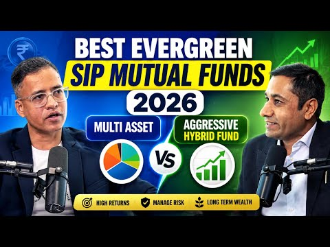
- 설명 앞부분: Best Evergreen SIP Mutual Funds 2026 ∣ Multi Asset vs Aggressive Hybrid Fund ∣ Gajendra Kothari 🔥 🔥 Confused between Multi Asset Funds and Aggressive Hybrid Funds for 2026? In this video, market expert Gajendra Kothari explains the best Evergreen SIP Mutual Funds for long-term wealth creation, pass…
- 같은 채널 평소 대비 ×7.2 (채널 최근 롱폼 중앙값 23,280회) · 평소 영상: SIP on DIP Strategy 2026 Explained ∣ Best Mutual … (23,837회) / Best Mutual Fund Picks for 2026 ∣ SIP vs Direct S… (22,722회)
- 대본 없음 (설명) — 음성인식이 끝나면 도입부·흐름이 들어감
- 댓글 76/76: 좋은 점 — 영상 0 · 감사·응원 0 · 더 알고 싶은 것 0 · 아쉬운 점 — 영상 0 · 반박·불만 — 의견 다름 0 · 정치·사회 0 · 경험 공유 0 · 구독·다음 기대 0

### 80. 내 주변에 주식으로 돈 번 사람이 '진짜' 단 한 명도 없는 소름 돋는 이유 ∣ 교수 정선용 (3부)

- https://www.youtube.com/watch?v=k9be9TSs41s · 너와 나의 경제학교 · 구독자 30,700 · 조회수 371,216 (×12.1, 하루 4,474.2) · 좋아요 5,570 (1.5%) · 11.9분 · 2026-07-30 · 주제 묶음 11. 투자 일반 · 형식 인터뷰·강연·대담 · 폴더 `W_k9be9TSs41s` (웹 승인)
- 썸네일: 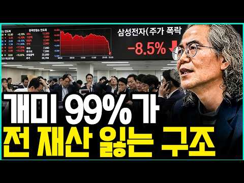
- 설명 앞부분: 정선용, 달리고 읽고 쓰는 사람의 하이
- 같은 채널 평소 대비 ×16.4 (채널 최근 롱폼 중앙값 22,652회) · 평소 영상: "우량주 사서 수면제 먹고 푹 자라고요?" 개미들 퇴직금 다 녹아내리는 소름 돋는 이유 … (23,026회) / 은행 이자보다 낫다고? 4050 노후자금 통째로 날리는 '고배당의 덫' ∣ 교수 정선용 … (22,277회)
- 대본 없음 (설명) — 음성인식이 끝나면 도입부·흐름이 들어감
- 댓글 1,286/1,286: 좋은 점 — 영상 17 · 감사·응원 24 · 더 알고 싶은 것 9 · 아쉬운 점 — 영상 8 · 반박·불만 — 의견 다름 19 · 정치·사회 42 · 경험 공유 106 · 구독·다음 기대 0
  - 좋은 점 — 영상 👍10 “오늘 같은 폭락장에 멘탈 유지에 도움이 됐습니다 와이프랑 즐겨 봅니다! 항상 좋은 강의 너무 감사드립니다!”
  - 좋은 점 — 영상 👍8 “주식 처음 올해 1월부터 시작해서 닥 7개월 했는데 교수님 말씀하신 내용 100프로 공감합니다. 운이좋아서 7000~9000포인트에 12% 수익났지만 결국 하락장에 마음 쫄려서 마이너스 21%로 던지고 남은 현금 보존했네요. 지금 반등장에 아쉬움도 있지만 지금 주말 …”
  - 감사·응원 👍17 “여지것 이런 사실 실화같은 이야기를 한 사람이 있었던가 진정진심 돈의 무서움을 알수가 있다 사이버 머니의 무서움 지갑속에 백만원가 사이버머니의 천만원의 비율같은 이야기 감사 합니다”
  - 감사·응원 👍10 “오늘 같은 폭락장에 멘탈 유지에 도움이 됐습니다 와이프랑 즐겨 봅니다! 항상 좋은 강의 너무 감사드립니다!”
  - 더 알고 싶은 것 👍3 “주식으로 번 것은 떠벌리면 날아가요! 그리고 깡통찼다는 사람들 보면 그럴만하다싶어요 너무나 욕심만 따르고 귀동냥으로 매매하고 즉흥적이고 몰빵하고 빚투하고 등등등 그러니 깡통차고도 남죠 저는 주식 5년했지만 한번도 깡통찬적 없어요 그리고 은행이자보다 낫다싶어 하고 있어…”
  - 더 알고 싶은 것 👍1 “주식 안해보신 분 같아요 어떻게 20프로 연간 수익을 계속 안전적으로 내나요? 떼부자 되겠어요”
  - 아쉬운 점 — 영상 👍8 “주식 처음 올해 1월부터 시작해서 닥 7개월 했는데 교수님 말씀하신 내용 100프로 공감합니다. 운이좋아서 7000~9000포인트에 12% 수익났지만 결국 하락장에 마음 쫄려서 마이너스 21%로 던지고 남은 현금 보존했네요. 지금 반등장에 아쉬움도 있지만 지금 주말 …”
  - 아쉬운 점 — 영상 👍2 “나도 삼성 오르기전에 사놓은 것이 올랐지. 그뒤에 정리하고 지금은 많이 떨어진 국내주 위주로 사모았는데 이건 아니올리다. 지금 손해만 보고 있다. 그런데 그냥 낚시질 하듯 기다린다. 어짜피 어디로 가든 지금처럼 주식으로 쉽게 돈 못벌기 때문이다. 주식은 그냥 강태공이…”
  - 반박·불만 — 의견 다름 👍2 “왜 동영상 시청하면서 비교우위로 사람을 재단하는가? 그냥 즐겁게 보면 되는데 말이다 각자에게 원하는 답을 안해준다고 당신은 틀렸어 하네 그냥 즐겁게 보세요”
  - 반박·불만 — 의견 다름 👍1 “돈벌면잔짜부자는말도안합니다”
  - 정치·사회 👍32 “기관과 외국인 장난으로 절대로 못 번다. 정부야 조사해 줘라”
  - 정치·사회 👍5 “상승장의 마법은 외국인 세력들의 작전이죠”
  - 경험 공유 👍167 “AI한테 물어봤더니 요즘 대한민국 장은 그냥 세력들의 장난이 너무 심함으로 들어가지말라고 하데,, 내가 기어코 들어가겠다고 하니까 그럼 차라리 카지노에 가서 게임하는게 더 공평하대 ㅎㅎ똑같은 조건에서 오픈하니까 ,”
  - 경험 공유 👍42 “돈 번 사람도 있어요 단 가족에게도 말을 안할뿐이지 내가 그런경우 삼전 몇년전에 5만원에 사서 아직 들고 있음 지금 팔아도 꽤 큰돈임 근데 아무에게도 말 안함 여기는 나를 모르니까 말한거고 그러니 가만보면 다들 손해보고 잃은것만 떠벌리고 번 건 입 다물고 있음”

