# 주식 — 성공 사례 분석: 사례별 자세히 #41–#80

`analysis.md` 의 9번 (같은 # 번호). 자동 생성 — `tools/success_analysis.py` v1.6 (2026-10-28 07:56 UTC). ※ 연구·교육용 — 투자 권유가 아님.

### 41. SCHD ETF Analysis: The Most Complete Schwab US Dividend Equity ETF Breakdown

- https://www.youtube.com/watch?v=ys_pR1yxEgo · Goldman Starch · 구독자 1,390 · 조회수 10,907 (×7.8, 하루 1,490.8) · 좋아요 239 (2.2%) · 32.2분 · 2026-10-14 · 주제 묶음 2. 장기투자·ETF·지수 · 형식 정보·해설 (그 밖) · 폴더 `W_ys_pR1yxEgo` (웹 승인)
- 썸네일: 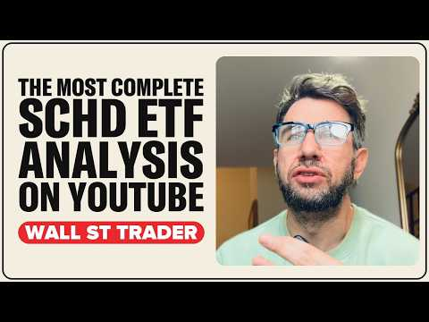
- 챕터: 0:00 SCHD ETF analysis: the record… · 1:13 What SCHD owns: the 4 screens · 2:04 The 4% cap and why Texas Inst… · 2:49 March reconstitution: who got… · 3:18 The 2 biggest holdings are ch… · 4:07 Why SCHD beat the S&P in 2026… · 4:53 The last time SCHD out-yielde… · 5:34 The 5% break: down 6.9% while… · 6:30 2022: why SCHD held up · 7:03 2023 to 2025: trailing the S&P · 7:49 Every calendar year since lau… · 8:29 SCHD's yield vs T-bills, the … · 9:04 SCHD vs TIPS and SGOV · 9:38 The record negative yield gap · 10:19 2023: the last time the gap l… · 10:49 Fewer than 4% of S&P stocks o… · 11:18 The seesaw: yields up, income… · 12:08 SPHD, DVY, VYM, DGRW: every d… · 12:34 Does SCHD trade like a bond? · 13:18 The dividend stalled: up 0.6%
- 설명 앞부분: SCHD ETF analysis: the most complete breakdown of the Schwab US Dividend Equity ETF (NYSE Arca: SCHD), with the 10-year Treasury yield above 5%. On October 5 the 10-year Treasury paid 2.09 percentage points more than SCHD's dividend yield, the biggest gap in the fund's 15-year history. A 3-month T-…
- 같은 채널 평소 대비 ×15.3 (채널 최근 롱폼 중앙값 711회) · 평소 영상: UWM Stock Crash: 2026 Mortgage Crisis Explained (711회) / UWMC Stock Analysis: The Most Complete United Who… (690회)
- 대본 없음 (설명) — 음성인식이 끝나면 도입부·흐름이 들어감
- 댓글 76/76: 좋은 점 — 영상 0 · 감사·응원 0 · 더 알고 싶은 것 0 · 아쉬운 점 — 영상 0 · 반박·불만 — 의견 다름 0 · 정치·사회 0 · 경험 공유 0 · 구독·다음 기대 0

### 42. Egyptian Guidelines المستثمر المصري يعمل إيه ؟ عقار ولا ذهب ولا دولار ولا بورصة؟ د. حسن ا…

- https://www.youtube.com/watch?v=F_RSQy0sRtM ·   GroWise |  الاستثمار مع مصطفى خليل  · 구독자 23,700 · 조회수 86,372 (×3.6, 하루 24,497.3) · 좋아요 1,038 (1.2%) · 90.3분 · 2026-10-17 · 주제 묶음 기타 · 형식 정보·해설 (그 밖) · 폴더 `W_F_RSQy0sRtM` (웹 승인)
- 썸네일: 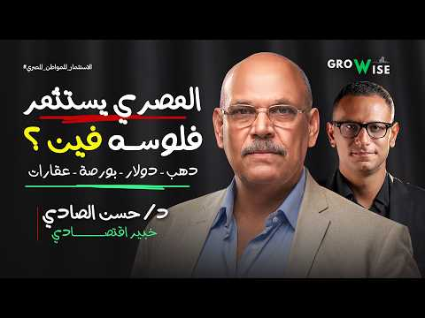
- 챕터: 0:00 ليه المصري بيفضل العقار والذه… · 1:15 رحلة د. حسن الصادي الأكاديمية… · 2:15 إزاي المخاطر الاقتصادية ومخاط… · 4:15 الفرق بين المستثمر والمضارب و… · 5:20 التحليل الأساسي مقابل التحليل… · 6:30 إزاي تقيّم الشركة بدل ما تركز… · 7:30 الأرباح التشغيلية مقابل الأرب… · 8:40 مشاكل هيكل السوق والرقابة وتض… · 10:15 ليه الأرباح التشغيلية مهمة في… · 11:25 دور القواعد التنظيمية في ضبط … · 13:50 الطروحات العامة والطرح الخاص … · 16:40 هل صناديق ضمان خسائر الاكتتاب… · 18:00 تسعير الطروحات: مين بيستفيد م… · 20:40 الاستثمار بالهامش والرافعة ال… · 22:30 التخصيص في الاكتتابات وتأثيره… · 23:30 الحدود السعرية وإيقاف التداول… · 25:00 ليه المستثمر الصغير ممكن يبيع… · 26:15 الاستثمار في الذهب: السبائك و… · 27:30 هل شراء الذهب بيحافظ على الثر… · 29:45 الدولار والذهب والاستثمار الم…
- 설명 앞부분: كيف تختار السهم الصح وتكسب من البورصة؟ Cash Flow, P/E, PEG, Options & Risk Management
- 같은 채널 평소 대비 ×8.0 (채널 최근 롱폼 중앙값 10,760회) · 평소 영상: Money , investment and Interest إزاي الفلوس بتشتغ… (10,760회) / ٣٠عامًا في الاستثمار ∣ خالد عقل يكشف أسرار المال … (11,507회)
- 대본 없음 (설명) — 음성인식이 끝나면 도입부·흐름이 들어감
- 댓글 251/251: 좋은 점 — 영상 0 · 감사·응원 0 · 더 알고 싶은 것 0 · 아쉬운 점 — 영상 0 · 반박·불만 — 의견 다름 0 · 정치·사회 0 · 경험 공유 0 · 구독·다음 기대 0

### 43. The Honest Downside of SCHD Nobody Talks About

- https://www.youtube.com/watch?v=BCG0vPE1Ox0 · Drawn Investor · 구독자 2,930 · 조회수 12,999 (×4.4, 하루 2,990.1) · 좋아요 130 (1.0%) · 12.8분 · 2026-10-16 · 주제 묶음 2. 장기투자·ETF·지수 · 형식 정보·해설 (그 밖) · 폴더 `W_BCG0vPE1Ox0` (웹 승인)
- 썸네일: 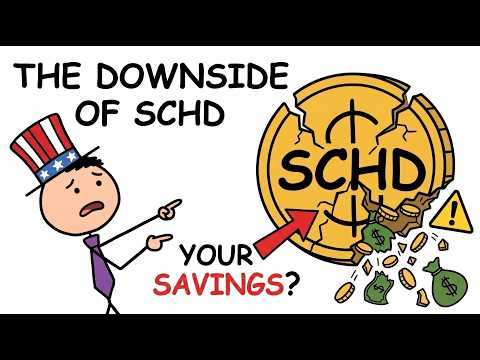
- 챕터: 0:00 The Risk Nobody Puts in a SCH… · 1:05 Why SCHD Owns Just 103 Stocks · 2:30 The Hidden Cost of SCHD's Con… · 3:08 Why SCHD Holds So Little Tech · 4:04 When SCHD Can't Keep Up With … · 5:00 Two Investors, $10,000, One B… · 6:13 The Interest Rate Risk Divide… · 7:30 The 3.22% Yield That Isn't Gu… · 8:47 What Happens If Energy and Ba… · 9:41 The Screen Tax: SCHD's Hidden… · 10:15 Does SCHD's Long-Term Math St… · 11:18 Stress-Test Your Dividend Inc… · 11:44 Three Questions Every SCHD In… · 12:27 The Other Side of SCHD's Story
- 설명 앞부분: SCHD is one of this channel's favorite funds, but liking a fund and being honest about it are two different jobs. This video breaks down the real structural downsides in SCHD's own fact sheet: a tight roster of just 103 holdings, an 8.54% tech weighting that can make it lag during tech-led rallies,…
- 같은 채널 평소 대비 ×10.6 (채널 최근 롱폼 중앙값 1,230회) · 평소 영상: Dividend Investing vs Index Funds (which Is bette… (1,230회) / What $1,000 in SCHD Actually Buys You Right Now (… (1,411회)
- 대본 없음 (설명) — 음성인식이 끝나면 도입부·흐름이 들어감
- 댓글 16/16: 좋은 점 — 영상 0 · 감사·응원 0 · 더 알고 싶은 것 0 · 아쉬운 점 — 영상 0 · 반박·불만 — 의견 다름 0 · 정치·사회 0 · 경험 공유 0 · 구독·다음 기대 0

### 44. Dividend Stocks vs. Growth Stocks: The Math Most Investors Ignore

- https://www.youtube.com/watch?v=4bg3bjvjCjE · Finance Simplified · 구독자 3,600 · 조회수 204,588 (×56.8, 하루 3,545.1) · 좋아요 1,199 (0.6%) · 20.2분 · 2026-08-31 · 주제 묶음 기타 · 형식 정보·해설 (그 밖) · 폴더 `W_4bg3bjvjCjE` (웹 승인)
- 썸네일: 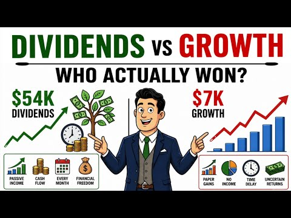
- 챕터: 0:00 The $54,000 Question · 0:13 Yield vs. Appreciation vs. To… · 2:30 Where Every $1 of Profit Actu… · 5:00 The $32,000 Head-to-Head Test · 8:00 The Dividend Reinvestment Eff… · 10:30 The Tax Drag Most Comparisons… · 13:00 The High-Yield Trap · 15:00 The Growth-Stock Trap · 17:00 The Fair Test: Total Return v… · 18:30 Who Each Approach Actually Su… · 19:30 Final Verdict
- 설명 앞부분: Dividend Stocks vs. Growth Stocks: The Math Most Investors Ignore Dividend stocks vs. growth stocks — but compared correctly this time. Most investors argue "4% yield" against "12% growth," and those aren't even the same kind of number. In this breakdown we run both strategies through identical mat…
- 같은 채널 평소 대비 ×41.4 (채널 최근 롱폼 중앙값 4,942회) · 평소 영상: $250,000 in Dividend Stocks vs. Bonds: Which Pays… (4,942회) / SCHD vs VOO: What Happens to $10,000 After 20 Yea… (5,023회)
- 대본 없음 (설명) — 음성인식이 끝나면 도입부·흐름이 들어감
- 댓글 321/321: 좋은 점 — 영상 0 · 감사·응원 0 · 더 알고 싶은 것 0 · 아쉬운 점 — 영상 0 · 반박·불만 — 의견 다름 0 · 정치·사회 0 · 경험 공유 0 · 구독·다음 기대 0

### 45. I Own 300 Shares of SCHD - Here's My Dividend Payout

- https://www.youtube.com/watch?v=Z_-PJGzUdD4 · Cade Invests · 구독자 1,820 · 조회수 158,464 (×87.1, 하루 1,768.1) · 좋아요 2,023 (1.3%) · 10.5분 · 2026-07-30 · 주제 묶음 2. 장기투자·ETF·지수 · 형식 정보·해설 (그 밖) · 폴더 `W_Z_-PJGzUdD4` (웹 승인)
- 썸네일: 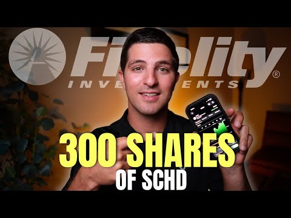
- 챕터: 0:00 Intro · 0:37 SCHD ETF Overview · 2:05 SCHD Holdings · 3:00 My SCHD Position · 4:15 SCHD Dividend Income · 6:38 SCHD vs VOO vs QQQ · 9:10 My SCHD Plan
- 설명 앞부분: I have over $10,000 invested in the dividend ETF SCHD. In today's video I'm breaking down my SCHD dividend payouts from every year and if I plan to continue investing in SCHD in the future. FREE PDF Download: SCHD is one of the most popular dividend ETFs out there today. That is for good reason as …
- 같은 채널 평소 대비 ×320.8 (채널 최근 롱폼 중앙값 494회) · 평소 영상: 10 Things To Know About ETFs Before Investing (fo… (494회) / The BEST Purchases To Make In Your 20s (Tier List) (510회)
- 대본 없음 (설명) — 음성인식이 끝나면 도입부·흐름이 들어감
- 댓글 338/339: 좋은 점 — 영상 0 · 감사·응원 0 · 더 알고 싶은 것 0 · 아쉬운 점 — 영상 0 · 반박·불만 — 의견 다름 0 · 정치·사회 0 · 경험 공유 0 · 구독·다음 기대 0

### 46. 남들이 걱정하는 삶을 선택했습니다 #배당투자 #배당은퇴 #경제적자유 #파이어족 #월배당 #고배당주 #주식투자 #재테크#노후준비#배당금생활 #SCHD #JEPI …

- https://www.youtube.com/watch?v=SiE0NjI7Fu0 · ttobaedang또배당 · 구독자 6,870 · 조회수 45,680 (×6.7, 하루 6,542.1) · 좋아요 434 (0.9%) · 9.1분 · 2026-10-14 · 주제 묶음 11. 투자 일반 · 형식 정보·해설 (그 밖) · 폴더 `W_SiE0NjI7Fu0` (웹 승인)
- 썸네일: 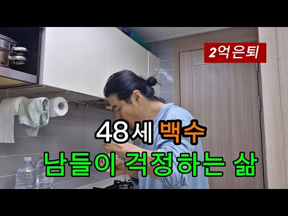
- 같은 채널 평소 대비 ×5.5 (채널 최근 롱폼 중앙값 8,233회) · 평소 영상: 5000만원 증발 월급없이도 행복한이유 #배당투자 #배당은퇴 #경제적자유 #파이어족 #월… (8,747회) / 3억 배당은퇴 6000만원 증발 그래도 행복한이유 #배당투자 #배당은퇴 #경제적자유 #파… (7,719회)
- 대본 없음 (없음) — 음성인식이 끝나면 도입부·흐름이 들어감
- 댓글 174/174: 좋은 점 — 영상 3 · 감사·응원 20 · 더 알고 싶은 것 6 · 아쉬운 점 — 영상 0 · 반박·불만 — 의견 다름 0 · 정치·사회 0 · 경험 공유 11 · 구독·다음 기대 2
  - 좋은 점 — 영상 👍4 “진정성이 느껴지고 서민형이라 와닿는 영상이라 보면서 위로를 받게 되네요. 좋은 영상 자주 올려주세요. 😊❤”
  - 좋은 점 — 영상 👍1 “울림이 있는 story, 공감이 되고 배우고 갑니다~”
  - 감사·응원 👍22 “당신의 직업은 투자자, 유튜버^^ 늘 응원하겠습니다”
  - 감사·응원 👍8 “현대는 직업이 필요가 없어졌습니다. 단지 생활비를 충당할 수 있는 근원지 배당금, 이자, 월세소득 등 원천을 만드는 것이 중요하죠. 또배당금님은 현재 잘 하고 계신거예요. 직장이 없어도 배당금으로 자유롭게 생활하실 수 있는것이 얼마나 대단한것인지 높이 평가해요. 질투…”
  - 더 알고 싶은 것 👍4 “진정성이 느껴지고 서민형이라 와닿는 영상이라 보면서 위로를 받게 되네요. 좋은 영상 자주 올려주세요. 😊❤”
  - 더 알고 싶은 것 👍3 “안녕하십니까 또배당님! 금일 영상은 원고가 매우 훌륭하고 좋습니다 감동적입니다 자신의선택과 책임을 말씀하는 철학은 울림이 있습니다, 다음에 기회가되면 제가 운영하고 있는 다음카페에 칼럼기고를 부탁드려도 될까요”
  - 경험 공유 👍8 “나도 도배당아저씨처럼 할수있다는 희망으로 삽니다”
  - 경험 공유 👍7 “세상을 보는 안목과 생각이 깊고 넓으시군요. 저도 공감되는 말씀입니다.”
  - 구독·다음 기대 👍1 “호동대표님 유튜브보고 구독하러왔어요 자주영상 올려주세요😊 세미파이어족 화이팅!!”

### 47. 코스피, 5,030P까지 큰 거 한방(삼전닉스 타점)

- https://www.youtube.com/watch?v=qSnNyX7IfqY · 차트도령 · 구독자 3,890 · 조회수 25,071 (×6.4, 하루 3,592.0) · 좋아요 126 (0.5%) · 13.6분 · 2026-10-14 · 주제 묶음 5. 국내주식 · 형식 정보·해설 (그 밖) · 폴더 `W_qSnNyX7IfqY` (웹 승인)
- 썸네일: 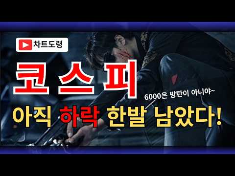
- 챕터: 0:00 코스피 · 6:52 코스닥 · 8:49 삼성전자 · 10:01 SK하이닉스
- 설명 앞부분: 안녕하세요 차트도령입니다. 10월14일 코스피, 코스닥, 삼성전자, sk하이닉스 차트분석 및 시황공유입니다. 오늘도 강한 반등에는 실패한 모습입니다. 현재 아슬아슬하게 6,000포인트를 지키고 있기 때문에 추가적인 급락이 발생할 수 있습니다. 본 채널에서 영상을 통해 소개해드리는 종목은 '정보 공유' 차원일 뿐 '종목 추천'이 아닙니다.
- 같은 채널 평소 대비 ×3.1 (채널 최근 롱폼 중앙값 8,214회) · 평소 영상: 코스피, 장난같나요? 8,000P간다니깐요?(삼전닉스 타점) (8,224회) / 코스피 비상, 반도체 상승 이제 끝일까?(삼전닉스 타점) (8,204회)
- 대본 없음 (설명) — 음성인식이 끝나면 도입부·흐름이 들어감
- 댓글 55/55: 좋은 점 — 영상 1 · 감사·응원 7 · 더 알고 싶은 것 2 · 아쉬운 점 — 영상 0 · 반박·불만 — 의견 다름 0 · 정치·사회 0 · 경험 공유 1 · 구독·다음 기대 0
  - 좋은 점 — 영상 👍1 “차도님 감사합니당 회식하고 왔더니 내 미장 나락 가있네욤.. 미장 잠깐 보고😢 다른분들 댓글도 쭈욱 읽고 하루 마무리합니다 낼도 성투성투~!! 방향을 정하는데 많은 도움이 됩니다.감사합니다.”
  - 감사·응원 👍32 “매일 올려줘서 고맙긴한데. 7천일때 박스권이다가 정답이엇다면 그땐 너무 높은자리까지 열어둿엇고.. 이번에는 하락뷰로 바꾼건 좋은데 또 5천까지 열어놓으니.. 태세전환이 너무 과하다는 생각은 들어요. 저처럼 몸사린 사람은 괜찮겟지만.. 높은뷰 보고 많이 들어간사람이 갑…”
  - 감사·응원 👍2 “깊이 깊이 공감 가는 분석.. 매우 매우 감사드립니다. 우려하던일이 현실로...”
  - 더 알고 싶은 것 👍1 “멤버쉽 문의 일주일 넘게 지났는데 아직 연락이 안오네요..ㅜㅜ 그리고 제주반도체 차트도 부탁드려도 될까요??”
  - 더 알고 싶은 것 👍0 “솔직히 5000초반은 오바라고 생각해서 그동안 답글 안달았는데 cpi보고 생각에 잠겨 글 드립니다 주식 창이 차트대로 되지 않을거라 생각하고 5200을 저점으로 황보 추세로 돌아갈 것 같은데 어떻게 보시나요? 마냥 차트만 따라가는게 사실 주식장에 맞지 않지만 현재 국…”

### 48. 오늘부터 오후 8시까지 애프터마켓 오픈!! 주식패턴 ‘이렇게’ 완전히 바뀐다

- https://www.youtube.com/watch?v=wwrCztntACs · 잘되라대한민국 · 구독자 6,100 · 조회수 244,000 (×40.0, 하루 5,543.4) · 좋아요 964 (0.4%) · 8.2분 · 2026-09-14 · 주제 묶음 기타 · 형식 정보·해설 (그 밖) · 폴더 `W_wwrCztntACs` (웹 승인)
- 썸네일: 
- 챕터: 0:00 오늘부터 열리는 주식 애프터마켓 전격 도입 배경 · 1:00 거래소 애프터마켓 이용 방법 및 주요 거래 규칙 · 2:21 정규장과 애프터마켓의 결정적 차이 (시장가 주문 불가… · 3:00 넥스트레이드와 KRX 애프터마켓의 관계 · 4:47 한국거래소가 애프터마켓을 도입한 진짜 이유와 우려스러… · 6:25 개인 투자자가 꼭 알아야 할 애프터마켓 투자 체크포인트
- 설명 앞부분: [겸공_12시에만나요 260914] 오늘부터 본격적으로 시작된 한국거래소(KRX) 애프터마켓 개시 소식과 투자자 체크포인트를 완벽하게 분석해 드립니다. 오후 4시부터 저녁 8시까지 연장된 거래 시간, 시장가 주문 불가와 자동 승계 미지원 등 기존 정규장과 달라지는 핵심 규칙들을 낱낱이 파헤쳐 봅니다. 새로운 제도 도입에 따른 숨겨진 변동성 위험과 투자 전략을 지금 바로 확인해 보세요! 타임라인
- 같은 채널 평소 대비 ×7.5 (채널 최근 롱폼 중앙값 32,582회) · 평소 영상: 외인들이 삼전·하닉 팔은 진짜 이유 & 대통령 지지율과의 관계성 (33,101회) / 삼성전자, 어디까지 빠질까? ‘이 가격’이면 무조건 매수시그널 (32,063회)
- 대본 (음성인식(앞 5분), 5.4 음절/초) — 앞부분만, 흐름은 그 안까지 첫 20초: “그러면 이제 전혀 새로운 패턴이 또 나올 수 있다는 걸 좀 염두에 두셔야 될 것 같아요. 왜냐하면 4시 넘어서 그동안 거래 안 되는 종목이 거래되는 600개고 이제 새로 열리면 한 1500개 이상 이제 새로 될 텐데 그러면 이제 8시까지 거의 본장 이어지는 셈이나 마찬가지거든요. 그럼 우리 본장에서 미국 선물을 그대로 보면서 할 수 있는 상황이 되는 거니까”
- 첫 1분: “그러면 이제 전혀 새로운 패턴이 또 나올 수 있다는 걸 좀 염두에 두셔야 될 것 같아요. 왜냐하면 4시 넘어서 그동안 거래 안 되는 종목이 거래되는 600개고 이제 새로 열리면 한 1500개 이상 이제 새로 될 텐데 그러면 이제 8시까지 거의 본장 이어지는 셈이나 마찬가지거든요. 그럼 우리 본장에서 미국 선물을 그대로 보면서 할 수 있는 상황이 되는 거니까 오늘부터 저녁 8시까지 주식 거래가 가능해진다는 사실 알고 계셨나요? 본장에서 미국 선물을 보면서 투자할 수 있게 되는데요. 이렇게 되면 앞으로는 주식시장의 전혀 새로운 패턴이 시작될 예정입니다. 과연 우리에게 독이 될지 아니면 새로운 기회가 될지 그 숨겨진 이야기가 지금 바로 공개됩니다. 그래서 왜 오늘부터 애프터마켓이 오픈되는 겁니다? 저녁 8시까지”
- 흐름 (90초마다 첫 문장): 0:00 그러면 이제 전혀 새로운 패턴이 또 나올 수 있다는 걸 좀 염두에 두셔… → 1:33 그래서 별도입니다. → 3:00 그래서 얘네들이 아침에 8시에 프리로 한 번 열고 또 저녁에 3시 40분 → 4:33 박시동 대표님 말씀처럼 한국 거래소가 단순히 돈 벌려고 자기네들이
- 댓글 253/253: 좋은 점 — 영상 0 · 감사·응원 0 · 더 알고 싶은 것 4 · 아쉬운 점 — 영상 0 · 반박·불만 — 의견 다름 2 · 정치·사회 45 · 경험 공유 3 · 구독·다음 기대 0
  - 더 알고 싶은 것 👍32 “아니 예수금은 다음날 언제 받는건가요? 대체 거래소 에프터장은 이리쉽게 뚝딱 처리하연서~~~”
  - 더 알고 싶은 것 👍4 “정부에 항의부탁드립니다 정말 답답하고 화가납니다 왜 주식시장 을 개판으로 만드는 나쁜놈들”
  - 반박·불만 — 의견 다름 👍0 “잣됐다 대한민국. 선동질하지마라.”
  - 정치·사회 👍35 “이걸 정책으로 시행하라고 허가를 해준 정부가 문제죠? 국민들 의견은 들어보지 않고, 결국 국민들이 주식판 보는 시간만 늘어나서 일을 못하게 합니다. 진짜 이건 누구 생각인지 그리고 또 누가 허가를 했는지 조사해야 합니다.”
  - 정치·사회 👍24 “이재명은 지지율이 왜그렇게빠지는지 진정 모르나??? 개인자산을 건드려서인걸 모르네”
  - 경험 공유 👍1 “난 얘들보면 선대인하고 밧데리아저씨가 오버렙이 되더라고... 과거에 선대인이 원랜 부동산 전문가 코스프레를 하면서 지금 이광수가 했던 소리와 판박이같은 소릴하면서 폭락 기우제를 지냈는데 그때도 그 소리 믿고 쪽박찬 인간들 엄청나게 양산했어. 그러다니 어느날 갑자기 대…”
  - 경험 공유 👍0 “난 이잼 정부 지지자이고 문조털래유최 까지 계속 까던 사람이다 . 그리고 국장만 2009년 부터 해왔고 근데 이게 먼 개 ㅈㄹ 이냐 이걸 승인한 놈들이나 이잼도 이번에 생각좀 해줬으면 한다 . 1주라도 주식 매수 매도 한 사람들 투표 하던지 이건 뭐 주식투자자들과 아…”

### 49. The Story Behind India's Biggest Stock Market Scam ∣ Scam 1992 Explain ∣ 2D Animation

- https://www.youtube.com/watch?v=zay8CuiBUQ8 · DOKio · 구독자 8,360 · 조회수 818,369 (×97.9, 하루 7,135.5) · 좋아요 7,365 (0.9%) · 27분 · 2026-07-05 · 주제 묶음 기타 · 형식 정보·해설 (그 밖) · 폴더 `W_zay8CuiBUQ8` (웹 승인)
- 썸네일: 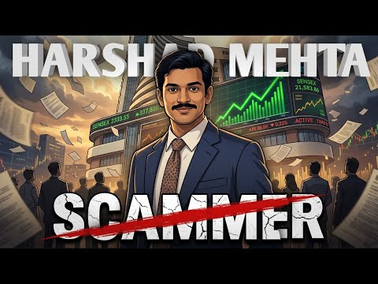
- 설명 앞부분: ₹4,000 Crore ka Scam... Stock Market me record tod tezi... aur phir ek aisa khulasa jisne poore India ki Financial System ko hila diya! 😱 Kya sirf shares ki prices badhakar koi insaan hazaron crore rupaye ka game khel sakta hai? Kaise ek aam Stock Broker "The Big Bull" bana aur phir India ke sabse …
- 같은 채널 평소 대비 ×47.1 (채널 최근 롱폼 중앙값 17,390회) · 평소 영상: How DMart Became One of India’s Biggest Retailers… (18,831회) / How Nirav Modi Stole PNB ₹14,000 Crore ∣ Nirav Mo… (15,949회)
- 대본 없음 (설명) — 음성인식이 끝나면 도입부·흐름이 들어감
- 댓글 194/201: 좋은 점 — 영상 0 · 감사·응원 0 · 더 알고 싶은 것 0 · 아쉬운 점 — 영상 0 · 반박·불만 — 의견 다름 0 · 정치·사회 0 · 경험 공유 0 · 구독·다음 기대 0

### 50. 지난 폭락과는 완전히 다릅니다…코스피가 진짜 위험한 이유 (Feat. 박병창 MP파트너스 대표) [딥플 Deep-ple]

- https://www.youtube.com/watch?v=y_mvodyrXhQ · 핀플 - Finple · 구독자 47,100 · 조회수 193,740 (×4.1, 하루 39,883.8) · 좋아요 2,910 (1.5%) · 60분 · 2026-10-16 · 주제 묶음 5. 국내주식 · 형식 인터뷰·강연·대담 · 폴더 `W_y_mvodyrXhQ` (웹 승인)
- 썸네일: 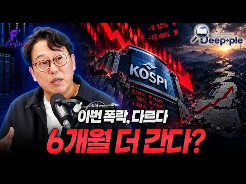
- 설명 앞부분: 딥플 클릭 보기 순서 1Q 코스닥150채권혼합50액티브 ETF (0186S0) 1️⃣ “코스닥 활성화 정책 기대감” 2025.12.19, 금융위원회 ‘코스닥 신뢰+혁신 제고 방안’ 발표 2️⃣ “주식 비중을 높인 2세대 채권혼합형” ‘코스닥150 지수’ 약 50% + ‘단기국공채 지수’ 약 50% 2023.11.16, 퇴직연금감독규정에 따라 주식 편입한도 40% 이내 → 50% 미만으로 상향 성장성과 안정성 둘 다 잡은 ETF 투자도 하나(Hana)면 됩니다. 1Q K반도체TOP2 시리즈 ETF 1Q K반도체TOP2+ ETF (0…
- 같은 채널 평소 대비 ×33.3 (채널 최근 롱폼 중앙값 5,814회) · 평소 영상: SK하이닉스 유독 더 빠지는 이유? 솔리다임 상장 논란이 진짜 악재일까 [더 파이널 콜 … (7,425회) / 외국인이 던지면 속수무책? 전문가가 짚은 국장 폭락의 원인 [더 파이널 콜 핵심 정리] (4,203회)
- 대본 없음 (설명) — 음성인식이 끝나면 도입부·흐름이 들어감
- 댓글 360/360: 좋은 점 — 영상 16 · 감사·응원 26 · 더 알고 싶은 것 1 · 아쉬운 점 — 영상 2 · 반박·불만 — 의견 다름 7 · 정치·사회 28 · 경험 공유 21 · 구독·다음 기대 1
  - 좋은 점 — 영상 👍27 “박병창님의 강의 넘 유익했습니다. 3프로에서 믿을맨중 하나죠”
  - 좋은 점 — 영상 👍20 “와~박병찬 대표님! 제가 가려웠던 부분을 잘 알려주셔서 감사해요~~ 민준님도 핵심을 잘 짚어 질문해주시네요😊”
  - 감사·응원 👍20 “와~박병찬 대표님! 제가 가려웠던 부분을 잘 알려주셔서 감사해요~~ 민준님도 핵심을 잘 짚어 질문해주시네요😊”
  - 감사·응원 👍19 “작년방송에서 올해전망 예측하신대로 흘러감에 경외감을 느낍니다. 상반기 좋고, 하반기 위험, 금리5 돌파시 도망. 경험자의 안목에 큰 도움받았고 감사를 전하고싶습니다.”
  - 더 알고 싶은 것 👍0 “직전에 잘나간주식 장비 두산테스나나 이차전지원통형 신흥 이런거 사면 되나요?”
  - 아쉬운 점 — 영상 👍3 “다시 반복해서 들어봐야겠어요 좋네요”
  - 아쉬운 점 — 영상 👍0 “그러니까 요약좀 해줘요 ㅋ”
  - 반박·불만 — 의견 다름 👍377 “반도체 업계 종사자입니다 중국 반도체 신기술(특히 창신메모리 CXMT의 차세대 D램 '4F²' 연내 출시 발표 등) 정치적·시장적 과장(선동에 가까운 쇼맨십)이 99%, 무시 못 할 기술적 우회 시도가 0.1%' 정도로 보시는 것이 가장 냉정한 팩트입니다. 단순히 '…”
  - 반박·불만 — 의견 다름 👍4 “헛소리를 겁나게 길게하네 말 맨날 바뀌면서ㅋㅋㅋㅋㅋ”
  - 정치·사회 👍16 “내년의 실적을 의심하는 것이 아니라 질적에 관계없이 난 팔겠다는 외국인이 무서운거지 수급”
  - 정치·사회 👍13 “확실히 이번 하락은 좀 다른듯 월요일 쌍바닥도 깨질거같은데 전쟁끝나거나 선거끝날떄까지 관망해야하는 장세인듯”
  - 경험 공유 👍20 “와~박병찬 대표님! 제가 가려웠던 부분을 잘 알려주셔서 감사해요~~ 민준님도 핵심을 잘 짚어 질문해주시네요😊”
  - 경험 공유 👍14 “아저씨 갑자기 이러니까. 세상에 해안이 있는 것처럼 떠들지 마 당신도 언젠가 평탄한 길이 있었을 때 이럴 땐 매수해야 된다고 말했던 사람이잖아. 정답은 없지. 그러나 지금 정답이 있는 것처럼 내가 마치 예언가인 것처럼. 이야기하는 건 너무 창피하지 않아?”
  - 구독·다음 기대 👍0 “이런 채널이 있는줄 물랐는데 박대표님 들으러 들어왔습니다. 일단 구독했습니다.”

### 51. 【2chお金スレ】定年後も収入が途切れない人は何をしてる？今からできる備えを挙げてけ

- https://www.youtube.com/watch?v=2tSGWp3yGek · 2chお金シニアチャンネル · 구독자 2,150 · 조회수 14,237 (×6.6, 하루 1,792.8) · 좋아요 38 (0.3%) · 21분 · 2026-10-13 · 주제 묶음 10. 노후·연금 투자 · 형식 정보·해설 (그 밖) · 폴더 `W_2tSGWp3yGek` (웹 승인)
- 썸네일: 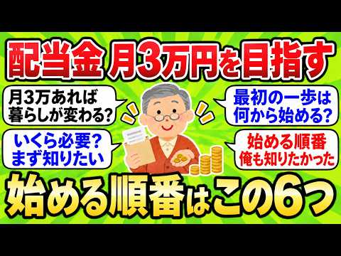
- 챕터: 0:00 はじめに · 0:24 64歳、配当が月3万 · 2:27 きっかけは元上司の一言 · 4:54 順番その1 足りない額を知る · 6:46 順番その2 現金を先に置く · 8:16 順番その3 口座とNISA · 10:38 順番その4 利回りで選ばない · 12:42 順番その5 一度に買わない · 14:38 順番その6 使い始める日 · 17:01 月3万で暮らしは変わるか · 18:45 今からでも間に合うか
- 같은 채널 평소 대비 ×3.0 (채널 최근 롱폼 중앙값 4,736회) · 평소 영상: 【2chお金スレ】資産カーストは●●で決まる。老後2000万を溶かす人の共通点が衝撃すぎる (4,736회) / 【2chお金スレ】45歳でFIREした勝ち組の末路…想像した人生と違う「●●してから狂い始めた」エ… (4,769회)
- 대본 없음 (없음) — 음성인식이 끝나면 도입부·흐름이 들어감
- 댓글 0/0: 좋은 점 — 영상 0 · 감사·응원 0 · 더 알고 싶은 것 0 · 아쉬운 점 — 영상 0 · 반박·불만 — 의견 다름 0 · 정치·사회 0 · 경험 공유 0 · 구독·다음 기대 0

### 52. Chip Stocks Selling Off: When I Switch From Buying Dips to Shorting (NVDA, AMD, AVGO, TSL…

- https://www.youtube.com/watch?v=JVzvv_YZD7Y · Danielle Shay · 구독자 6,830 · 조회수 24,739 (×3.6, 하루 5,531.8) · 좋아요 135 (0.5%) · 8.3분 · 2026-10-16 · 주제 묶음 기타 · 형식 정보·해설 (그 밖) · 폴더 `W_JVzvv_YZD7Y` (웹 승인)
- 썸네일: 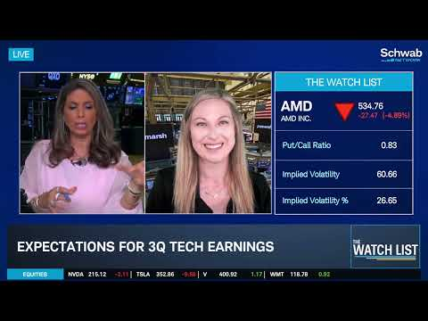
- 설명 앞부분: Why are semiconductor stocks selling off so hard, and when does a dip buy turn into a short? On Schwab Network's The Watch List, I explain the exact chart levels I watch, plus my plan for NVIDIA, AMD, and Broadcom heading into earnings. What we covered: Why this year's moves have been so exaggerate…
- 같은 채널 평소 대비 ×9.4 (채널 최근 롱폼 중앙값 2,632회) · 평소 영상: Spotlight on Semiconductors: AVGO, MU, STX, AMD &… (2,990회) / Danielle Shay on Fox Business: Space Stocks, Phot… (2,273회)
- 대본 없음 (설명) — 음성인식이 끝나면 도입부·흐름이 들어감
- 댓글 61/61: 좋은 점 — 영상 0 · 감사·응원 0 · 더 알고 싶은 것 0 · 아쉬운 점 — 영상 0 · 반박·불만 — 의견 다름 0 · 정치·사회 0 · 경험 공유 0 · 구독·다음 기대 0

### 53. 【資産公開】S&P500に1000万入れて5年間放置した結果（めちゃ増えた）｜31歳会社員・新NISA

- https://www.youtube.com/watch?v=Lb9ht5PE0vU · ぼんじり【平凡会社員のずぼら投資術】 · 구독자 4,470 · 조회수 361,473 (×80.9, 하루 3,546.9) · 좋아요 2,166 (0.6%) · 13.9분 · 2026-07-18 · 주제 묶음 2. 장기투자·ETF·지수 · 형식 정보·해설 (그 밖) · 폴더 `W_Lb9ht5PE0vU` (웹 승인)
- 썸네일: 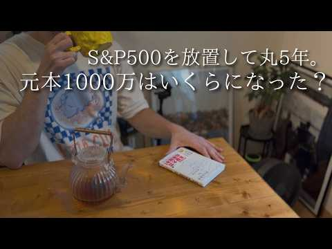
- 챕터: 0:00 今日のテーマ · 1:04 結論:5年でこれだけ増えました · 1:47 5年間の全記録（2021~2026） · 7:23 そもそも最初の元手をどうやって作った？ · 8:33 5年の運用で理解したインデックス投資の3つの本質 · 11:00 S&P500への積立を辞めた理由 · 12:56 まとめ
- 설명 앞부분: ③【新NISA】米国株信者だった僕がS＆P500から日経平均に乗り換えた8つの理由
- 같은 채널 평소 대비 ×38.8 (채널 최근 롱폼 중앙값 9,316회) · 평소 영상: 【実録】資産3000万円まで最短で達成させるためにやって良かった7つのこと・後悔している3つのこと… (9,394회) / 【実録】資産2000万で人生が激変する5つの理由と最速で到達する方法｜28歳会社員の実体験 (9,239회)
- 대본 없음 (설명) — 음성인식이 끝나면 도입부·흐름이 들어감
- 댓글 141/141: 좋은 점 — 영상 0 · 감사·응원 0 · 더 알고 싶은 것 0 · 아쉬운 점 — 영상 0 · 반박·불만 — 의견 다름 0 · 정치·사회 0 · 경험 공유 0 · 구독·다음 기대 0

### 54. I'm Not Selling — I'm Buying These 4 Stocks After the Selloff

- https://www.youtube.com/watch?v=tgeA8bHVywM · Navellier Market Buzz · 구독자 33,100 · 조회수 164,995 (×5.0, 하루 25,289.6) · 좋아요 2,654 (1.6%) · 13.7분 · 2026-10-14 · 주제 묶음 기타 · 형식 정보·해설 (그 밖) · 폴더 `W_tgeA8bHVywM` (웹 승인)
- 썸네일: 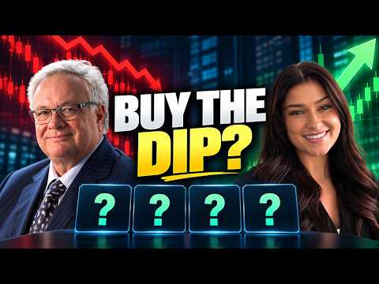
- 챕터: 0:00 Wall Street Is Panicking Over… · 0:17 Why Big Tech Is Borrowing Bil… · 1:33 Why Memory Stocks Are So Vola… · 2:42 Stock #1: Back Up the Truck · 4:22 Stock #2: Still Growing or Ov… · 5:15 CPI & PPI Preview: What Louie… · 5:56 Europe's Contagion Risk · 7:13 Why Foreign Money Is Pouring … · 8:08 Will the Fed Hike Before the … · 9:04 Stock #3: Louie's Longest-Hel… · 9:33 Stock #4: Head-to-Head Matchup · 10:05 Earnings Season Is About to S… · 11:17 Bonus: 3 Stocks Making Windfa… · 12:49 Final Thoughts
- 설명 앞부분: Memory stocks just took a hit, but Louis Navellier says this could be the buying opportunity investors have been waiting for. With Big Tech borrowing billions to fund AI data centers, is Wall Street overreacting to the selloff? In this week's Navellier Market Buzz, Crystal and Louis Navellier break…
- 같은 채널 평소 대비 ×5.4 (채널 최근 롱폼 중앙값 30,457회) · 평소 영상: 2 Stocks That Could Be the Biggest AI Winners Aft… (30,457회) / These 2 AI Stocks Could Be the Next Big Winners (31,988회)
- 대본 없음 (설명) — 음성인식이 끝나면 도입부·흐름이 들어감
- 댓글 201/201: 좋은 점 — 영상 0 · 감사·응원 0 · 더 알고 싶은 것 0 · 아쉬운 점 — 영상 0 · 반박·불만 — 의견 다름 0 · 정치·사회 0 · 경험 공유 0 · 구독·다음 기대 0

### 55. I Just Bought 1,000 Shares Of SCHD: Here's The Dividends It Pays Me

- https://www.youtube.com/watch?v=fPU6Gefdad8 · Grounded Life Investments · 구독자 5,940 · 조회수 103,322 (×17.4, 하루 4,392.5) · 좋아요 903 (0.9%) · 10분 · 2026-10-04 · 주제 묶음 기타 · 형식 정보·해설 (그 밖) · 폴더 `W_fPU6Gefdad8` (웹 승인)
- 썸네일: 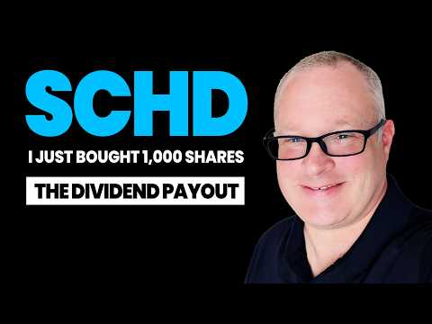
- 설명 앞부분: I just bought 1,000 shares of SCHD for our retirement portfolio. In this video I break down why I bought it and what the resulting dividend payouts will be. Want to go deeper? The GLI Dashboard gives you dividend screeners, portfolio analysis, and deep dives of the companies and ETF's you need to k…
- 같은 채널 평소 대비 ×8.8 (채널 최근 롱폼 중앙값 11,802회) · 평소 영상: I Invested $30 Per Day In SCHD - Here What Happen… (12,241회) / SCHD New All-Time High: I've Paused My DCA & What… (11,363회)
- 대본 없음 (설명) — 음성인식이 끝나면 도입부·흐름이 들어감
- 댓글 141/141: 좋은 점 — 영상 0 · 감사·응원 0 · 더 알고 싶은 것 0 · 아쉬운 점 — 영상 0 · 반박·불만 — 의견 다름 0 · 정치·사회 0 · 경험 공유 0 · 구독·다음 기대 0

### 56. 주식 기초 강의 한번 배워서 평생 써먹는 주린이를 위한 주식 투자 방법

- https://www.youtube.com/watch?v=36sFYI8uboE · 마이크로스콥  · 구독자 2,040 · 조회수 27,175 (×13.3, 하루 1,387.6) · 좋아요 463 (1.7%) · 13.7분 · 2026-10-08 · 주제 묶음 1. 주식 기초·초보 · 형식 인터뷰·강연·대담 · 폴더 `W_36sFYI8uboE` (웹 승인)
- 썸네일: 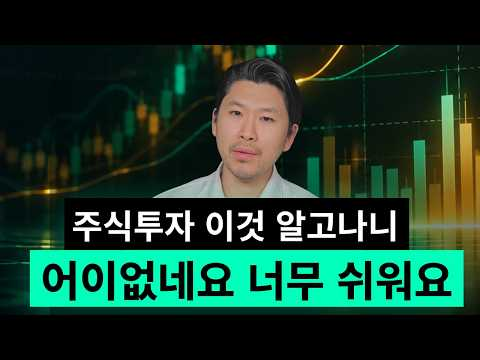
- 챕터: 0:00 주식 기초 강의를 접하게 된 계기 · 0:55 주식 기초 강의가 중요한 이유의 실제 연구와 그 결과 · 2:40 주식 기초 강의의 3요소 · 4:55 주식 기초 강의의 전설 소개 · 6:20 주식 기초 강의에서 가장 유명한 비유 · 8:45 주식 기초 강의 과열과 바닥 구분하는 방법 · 9:55 주식 기초 강의 추천도서 · 11:35 주식 기초 강의의 대가 앙드레 코스톨라니
- 설명 앞부분: 주식 기초 강의를 처음 접하는 분들도 이해할 수 있도록, 꼭 알아야 할 핵심 개념과 투자 원리를 쉽게 정리했습니다. 이번 주식 기초 강의에서는 복잡한 용어보다 실제 투자에 바로 써먹을 수 있는 기본 원칙과 판단 기준을 중심으로 설명합니다. 주식을 처음 시작했다면 이 주식 기초 강의부터 보세요. 한 번 익혀두면 앞으로 투자할 때 계속 활용할 수 있는 기초 내용을 담았습니다. 앙드레 코스톨라니의 돈 뜨겁게 사랑하고 차갑게 다루어라. 추천드립니다. 성공투자 하시길 바랍니다.
- 같은 채널 평소 대비 ×11.7 (채널 최근 롱폼 중앙값 2,330회) · 평소 영상: 열심히 공부해도 망하는 개미 특징 부의 갈림길을 확인하라 (2,565회) / 대한민국 메가 프로젝트 1,600조 뉴스 보고 이 주식 사면 물립니다 국책기관이 경고한 … (2,094회)
- 대본 없음 (설명) — 음성인식이 끝나면 도입부·흐름이 들어감
- 댓글 21/40: 좋은 점 — 영상 0 · 감사·응원 4 · 더 알고 싶은 것 0 · 아쉬운 점 — 영상 0 · 반박·불만 — 의견 다름 1 · 정치·사회 0 · 경험 공유 0 · 구독·다음 기대 0
  - 감사·응원 👍5 “깨달음의 경험공유 감사합니다. ✨️Microscope King✨️ 👍👍👍👏👏👏💯🙏”
  - 감사·응원 👍4 “쓰라리지만 소중한 경험을 베풀어 주셔서 고맙습니다. 내년 초에 부동자산 정리되면 현금흐름을 위한 기업투자에 입문하려고 공부 중입니다. 차트보고 기업분석하는 그런 공부는 아닙니다. ETF를 주로 할 것이기 때문에 "계좌 종류, 세금, 종목과 분산, 미국직투 등" 개괄적…”
  - 반박·불만 — 의견 다름 👍4 “쓰라리지만 소중한 경험을 베풀어 주셔서 고맙습니다. 내년 초에 부동자산 정리되면 현금흐름을 위한 기업투자에 입문하려고 공부 중입니다. 차트보고 기업분석하는 그런 공부는 아닙니다. ETF를 주로 할 것이기 때문에 "계좌 종류, 세금, 종목과 분산, 미국직투 등" 개괄적…”

### 57. 레버리지 ETF 상장폐지 논란🔥도박판 코스피 알고도 레버리지 ETF 상폐 못하는 이유🔥위험 알고도 도장 찍은 사람🔥금리인상 악제🔥역대급 반도체 실적 국민돈증발🔥…

- https://www.youtube.com/watch?v=O4-jY0zyhDo · 리얼경제 · 구독자 1,340 · 조회수 93,664 (×69.9, 하루 910.2) · 좋아요 2,368 (2.5%) · 15분 · 2026-07-17 · 주제 묶음 9. 빚투·레버리지 · 형식 정보·해설 (그 밖) · 폴더 `W_O4-jY0zyhDo` (웹 승인)
- 썸네일: 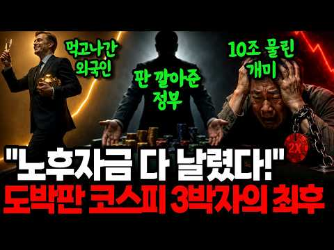
- 챕터: 0:00 인트로 — 89조 잔치인데 국민 돈은 증발 · 0:44 검은 월요일 — 올해만 서킷브레이커 7번 · 2:01 범인의 등장 — 5월 27일 상장된 그 '상품' · 3:35 세 개의 함정 — 왜 도박판이 됐나 · 7:07 대(大)아이러니 — 실적 최대인데 주가 최대 폭락, … · 9:44 앞으로 어떻게 되나 — 상폐 못 하는 이유와 정부의 … · 13:31 착지 — 호황의 나라에서 국민이 죽는다
- 설명 앞부분: 🔎 삼성전자가 2분기 영업이익 89조 4천억 원으로 3분기 연속 최대를 기록하고, 7월 반도체 수출은 193% 폭증해 사상 최대를 찍었습니다. 나라는 반도체로 호황입니다. 그런데 바로 그 삼성전자와 SK하이닉스를 '미끼'로 만든 단일종목 레버리지 ETF에 국민 돈 10조 원이 넘게 묶인 채 녹아내리고, 올해에만 서킷브레이커가 일곱 번 울렸습니다. 실적은 최대인데 주가는 최대 폭락하는 기막힌 아이러니. 세계 1등 실적을 낸 나라에서 어쩌다 국민이 도박판에 앉게 됐는지, 레버리지 ETF의 세 가지 함정(복리손실·지수 착시·리밸런싱 증…
- 같은 채널 평소 대비 ×495.6 (채널 최근 롱폼 중앙값 189회) · 평소 영상: 삼성노조가 800조 호남 반도체 메가프로젝트 막아선 진짜 이유...부메랑 노란봉투법 삼성… (189회) / 엔비디아 손잡은 네이버 집중분석🔎아시아 AI 인프라회사로?🔥14조 유치🔥GPU 6만장🔥1… (147회)
- 대본 (음성인식(앞 5분), 5.5 음절/초) — 앞부분만, 흐름은 그 안까지 첫 20초: “여러분 지금 우리나라는 반도체로 잔치집입니다. 삼성전자가 한분기에 89조를 벌었어요. 3분기 연속, 역대 최대입니다. 그야말로 세계가 우리 반도체 앞에 앞다터 줄을 선 거예요. 그런데 말입니다. 바로 그 삼성을 믿기로 만든 어떤 상품에 지금 국민 돈 10조가 도박판처럼 놓고 있습니다. 올해에만 주식거래를 통째로 멈춰세우는 비상벨이 7번 울렸어요.” — 도입부 유형: 시청자 부르기
- 첫 1분: “여러분 지금 우리나라는 반도체로 잔치집입니다. 삼성전자가 한분기에 89조를 벌었어요. 3분기 연속, 역대 최대입니다. 그야말로 세계가 우리 반도체 앞에 앞다터 줄을 선 거예요. 그런데 말입니다. 바로 그 삼성을 믿기로 만든 어떤 상품에 지금 국민 돈 10조가 도박판처럼 놓고 있습니다. 올해에만 주식거래를 통째로 멈춰세우는 비상벨이 7번 울렸어요. 모두가 외칩니다. 그 상품, 없애버리라고. 그런데 당국은 답합니다. 뾰족한 수가 없다, 두 손을 든 겁니다. 세계 1등 실적을 낸 나라에서 왜 국민만 도박판에 앉았을까요? 그리고 이 판, 앞으로 대체 어떻게 되는 걸까요? 오늘 그 이야기 처음부터 끝까지 아주 속시원이 다 풀어드리겠습니다. 지금 바로 시작합니다. 2026년 7월 13일 사람들이 검은 월요일이라 부르는”
- 흐름 (90초마다 첫 문장): 0:00 여러분 지금 우리나라는 반도체로 잔치집입니다. → 1:31 20분 동안 모든 거래를 강제로 멈춰 세우는 → 3:00 도박의 판 돈이 붙은 셈이죠. → 4:30 그 출렁임 자체가 비용이 돼서
- 댓글 648/648: 좋은 점 — 영상 2 · 감사·응원 10 · 더 알고 싶은 것 1 · 아쉬운 점 — 영상 1 · 반박·불만 — 의견 다름 5 · 정치·사회 150 · 경험 공유 17 · 구독·다음 기대 0
  - 좋은 점 — 영상 👍1 “유익한 정보 감사합니다 ㅎㅎ”
  - 좋은 점 — 영상 👍1 “좋은 설명이네.”
  - 감사·응원 👍4 “자세한 설명 감사합니다 아무리 실적 좋아도 레버리지 2배 때문에 주식시장을 쑥대밭을 만드네요 매일 서커브레이크 카지노 도박판 실적분석 필요없어요 코스닥 돈빼 레버리지 산다고합니다 아휴 답답 한숨 정부지도자들 자기들은 강건너 불구경 힘드네요”
  - 감사·응원 👍1 “감사합니다.”
  - 아쉬운 점 — 영상 👍1 “왜? 이렇게 Ai목소리가 듣기싫지 직접방송하라”
  - 반박·불만 — 의견 다름 👍1 “헛소리 그만하고 오늘 일단 3일 연속 써킷 갑니다.”
  - 반박·불만 — 의견 다름 👍1 “외국주식시장은 레버리지 2배이상짜리도 많은데 어떻게 돌아가냐 미국주식시장 같으면 벌써 망했어야 정상아니냐~ 선전선동질 그만해라 그놈의 남탓 ㅋㅋㅋㅋ”
  - 정치·사회 👍135 “이상품에 직접투자한 사람들만의 손실이 문제가 아니다ㆍ덕분에 수급쏠림으로 인한 코스닥의 붕괴다ㆍ챠트를보면 전쟁터진 나라보다 더 폭락해버렸다ㆍ그리고 정부는 모르쇠로 일관ㆍ배신감이 분노로 바뀌고 결국 정부의 정체성까지 의심하고있다ㆍ머슴이 주인을 물어뜯고 과연 무사할까?”
  - 정치·사회 👍82 “이정부는 결국 주식으로 국민의 신뢰를 얻다가 주식으로 신뢰를 잃어가고 망해가고있네 참 세상이 아이러니하네”
  - 경험 공유 👍19 “도박 좋아하는 놈들이 정책을 해서. 나라 전체를 강원랜드로 만들고 .저평가 가치주까지 다른 종목 다 반토막. 미장은 이렇게 안 망가졌다. 내가 하면 투자.니가 하면 투기”
  - 경험 공유 👍10 “이래서.. 내가 국내주식을 안하는 이유다 미국우량주식만 장기매수하는 거 그 게 그나마 맘편하다”

### 58. 연금저축 IRP 계좌에서 사모을 ETF 3대장 추천! 결국 국내상장 나스닥 S&P500 다우존스 ETF 적립식으로 사모으는 방법이 추천 됩니다

- https://www.youtube.com/watch?v=yITsxwpiFOw · 소금달 - 소액 금 달러 투자 · 구독자 2,770 · 조회수 10,208 (×3.7, 하루 1,694.5) · 좋아요 34 (0.3%) · 20분 · 2026-10-15 · 주제 묶음 2. 장기투자·ETF·지수 · 형식 정보·해설 (그 밖) · 폴더 `W_yITsxwpiFOw` (웹 승인)
- 썸네일: 
- 챕터: 0:00 국내상장 미국 ETF 3대장 · 0:29 나스닥 100 ETF 추천 · 5:12 S&P 500 ETF 추천 · 11:08 미국배당 다우존스 ETF 비교 · 19:24 연금저축 IRP ISA 절세계좌 장기투자
- 설명 앞부분: 국내상장 미국주식은 3대장 모두 적립식 투자 하시는걸 추천 드립니다. IRP, ISA, 연금저축 계좌에서 절세 비교하고, 국내상장 상품별로 수수료 비교하면 그 다음은 꾸준히 사모으면서 장기투자하는게 정답인것 같습니다.
- 같은 채널 평소 대비 ×21.8 (채널 최근 롱폼 중앙값 468회) · 평소 영상: 미국주식 대표 S&P 500 ETF 비교 방법! 하나만 골라서 연금저축에서 적립식 투자로… (468회) / 은퇴없이 죽을 때까지 일만 해야할까? (474회)
- 대본 없음 (설명) — 음성인식이 끝나면 도입부·흐름이 들어감
- 댓글 2/2: 좋은 점 — 영상 0 · 감사·응원 0 · 더 알고 싶은 것 0 · 아쉬운 점 — 영상 0 · 반박·불만 — 의견 다름 0 · 정치·사회 0 · 경험 공유 0 · 구독·다음 기대 0

### 59. Jeden Monat Miete ohne eigene Immobilie - warum ich jetzt Realty Income kaufe

- https://www.youtube.com/watch?v=jeVV2buqJ_k · Aktienhai · 구독자 2,910 · 조회수 10,082 (×3.5, 하루 1,771.6) · 좋아요 124 (1.2%) · 11분 · 2026-10-15 · 주제 묶음 2. 장기투자·ETF·지수 · 형식 정보·해설 (그 밖) · 폴더 `W_jeVV2buqJ_k` (웹 승인)
- 썸네일: 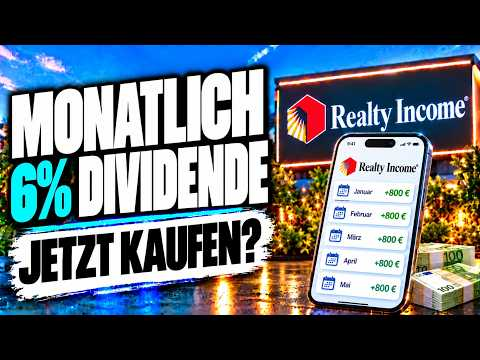
- 챕터: 0:00 Jeden Monat Miete, trotzdem b… · 0:52 Realty Income (ISIN: US756109… · 1:53 Warum die Aktie seit Jahren f… · 3:22 Umsatz, FFO und AFFO · 5:06 Bewertung, Dividende, Schulden · 7:10 Was bei Realty Income wirklic… · 8:35 NNN REIT und Agree Realty im … · 8:58 Der Haken · 9:57 Score und Fazit · 10:25 Würde ich kaufen?
- 설명 앞부분: Realty Income zahlt über 670 Monatsdividenden in Folge und hat ein Geschäft, das jedes Jahr wächst: Trotzdem steht die Aktie von Realty Income rund ein Viertel unter Ende 2021. Für alle, die sich eine monatliche Miete ins Depot holen wollen, ist das die spannende Frage: Schnäppchen oder Falle? 🎁 Si…
- 같은 채널 평소 대비 ×5.7 (채널 최근 롱폼 중앙값 1,778회) · 평소 영상: Ich investiere 1.000 € in Rheinmetall (1,793회) / ServiceNow Aktie vor den Zahlen! Jetzt entscheide… (1,763회)
- 대본 없음 (설명) — 음성인식이 끝나면 도입부·흐름이 들어감
- 댓글 38/38: 좋은 점 — 영상 0 · 감사·응원 0 · 더 알고 싶은 것 0 · 아쉬운 점 — 영상 0 · 반박·불만 — 의견 다름 0 · 정치·사회 0 · 경험 공유 0 · 구독·다음 기대 0

### 60. 60 Years of Data Say NOW Is the Time to Buy Stocks (3 Picks)

- https://www.youtube.com/watch?v=Sc1XIJGftj8 · Navellier Market Buzz · 구독자 33,100 · 조회수 54,961 (×1.7, 하루 20,111.5) · 좋아요 1,321 (2.4%) · 17.3분 · 2026-10-18 · 주제 묶음 기타 · 형식 정보·해설 (그 밖) · 폴더 `W_Sc1XIJGftj8` (웹 승인)
- 썸네일: 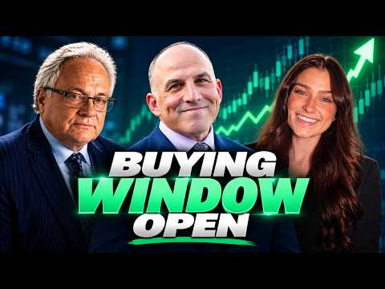
- 챕터: 0:00 Is NOW the Best Time to Buy S… · 0:47 Why Jeff Hirsch Says BUY in O… · 1:18 Is a Year-End Stock Market Ra… · 2:34 Small Caps: The Next Big Oppo… · 3:38 The January Effect & 2027 Mar… · 4:53 Inflation, Bond Yields & the … · 7:20 Why Are Treasury Yields Falli… · 10:11 The Midterm Election Market S… · 11:09 How Much Longer Can the AI Bo… · 13:30 Jeff Hirsch's 3 Stock Picks · 15:02 The Best Sectors to Buy This … · 15:24 The MACD Buy Signal Explained
- 설명 앞부분: Wall Street is worried about a tech wreck. Jeff Hirsch says the market is flashing a BUY signal. With 60 years of stock market history behind him, the Stock Trader's Almanac expert joins Crystal and Louie Navellier to explain why October could be one of the best buying opportunities of the year. An…
- 같은 채널 평소 대비 ×1.8 (채널 최근 롱폼 중앙값 30,457회) · 평소 영상: 2 Stocks That Could Be the Biggest AI Winners Aft… (30,457회) / These 2 AI Stocks Could Be the Next Big Winners (31,988회)
- 대본 없음 (설명) — 음성인식이 끝나면 도입부·흐름이 들어감
- 댓글 85/85: 좋은 점 — 영상 0 · 감사·응원 0 · 더 알고 싶은 것 0 · 아쉬운 점 — 영상 0 · 반박·불만 — 의견 다름 0 · 정치·사회 0 · 경험 공유 0 · 구독·다음 기대 0

### 61. “아이렌 긴급 ,30달러 깨질듯한 상황.. 손절각인가??(ft.코어위브/CPI)아이렌맨.

- https://www.youtube.com/watch?v=cTlVY95Qzlk · 아이렌맨 : IREN을 사랑하는 남자 · 구독자 7,940 · 조회수 28,672 (×3.6, 하루 4,698.1) · 좋아요 342 (1.2%) · 8.8분 · 2026-10-15 · 주제 묶음 8. 투자 심리·실패 · 형식 인터뷰·강연·대담 · 폴더 `W_cTlVY95Qzlk` (웹 승인)
- 썸네일: 
- 설명 앞부분: 오늘은 급하게 차에서 영상올립니다. 준비해둔 자료가있는데.. 그냥 그게 중요치않기에 아이렌의 운명은 ..?
- 같은 채널 평소 대비 ×2.1 (채널 최근 롱폼 중앙값 13,419회) · 평소 영상: "아이렌, AI 속도조절론에 대니얼 로버츠(ceo)가 답했다… JP모건도 IREN 매수 … (13,419회) / "IREN 그 '비밀 고객' 결국 Anthropic이었다?이래도 안 믿어? IREN=An… (13,541회)
- 대본 없음 (설명) — 음성인식이 끝나면 도입부·흐름이 들어감
- 댓글 395/395: 좋은 점 — 영상 1 · 감사·응원 40 · 더 알고 싶은 것 7 · 아쉬운 점 — 영상 1 · 반박·불만 — 의견 다름 7 · 정치·사회 1 · 경험 공유 23 · 구독·다음 기대 1
  - 감사·응원 👍231 “이 형 인정해 주자, 매일같이 떨어져도 멘탈 지키면서 주식 가격올리고, 가오가 있는 사람이다. 응원합니다.”
  - 감사·응원 👍56 “아이렌이 의외로 이번장이후로 코어. 네비보다 더많이 올라갈수있어요~ 항상응원하니다 힘내고 힘내세요! 장투의길은 원래 힘든법이죠!! 화이팅!”
  - 더 알고 싶은 것 👍16 “주가가 얼마나 떨어지던 물타고 버티고 하는 종목은 대형주에나 해당되는 말이고요.. 아이렌같은 부도날 가능성도 있는 중소형주는 그렇게 하다가 골로간 사람들 한둘이 아닙니다. 아이렌은 절대 부도 안난다구요?? 지금 cds 폭등하는게 안보이시나요? 코로나때 저금리로 유동성…”
  - 더 알고 싶은 것 👍4 “손절좀부탁드려요형님ㅜㅜ 그래야오를듯합니다”
  - 아쉬운 점 — 영상 👍5 “29불에 1억정도 시드 박았네요 장기계좌에 8불 3000만원 있는데 늘 아쉬웠는데 자리 좋은거 같아요”
  - 반박·불만 — 의견 다름 👍16 “주가가 얼마나 떨어지던 물타고 버티고 하는 종목은 대형주에나 해당되는 말이고요.. 아이렌같은 부도날 가능성도 있는 중소형주는 그렇게 하다가 골로간 사람들 한둘이 아닙니다. 아이렌은 절대 부도 안난다구요?? 지금 cds 폭등하는게 안보이시나요? 코로나때 저금리로 유동성…”
  - 반박·불만 — 의견 다름 👍10 “오를수도 있고 떨어질수도 있다. 응원하지도 말고 조롱하지도 말자고 말했더니 선동하지말라고 한다. 지켜보자고 했더니 응원할것도 아니면서 왜 지켜보냐고 시비를 건다. 도대체 어떤것이 선동인것인가?? 이 채널은 아이렌을 응원하는 사람들만 댓글을 달수 밖에 없는 것인가? 합…”
  - 정치·사회 👍2 “데이터 센터 반대의 목소리가 높아지고 있지만 중간선거 끝나면 불확실성이 제거돼서 이유 없이 오를겁니다”
  - 경험 공유 👍18 “이런분이 찐이지 떨어지던 오르던 자기 신념 자기주관 아이렌 저도 이번에 떨어져서 조금식 담아봅니다 올라가길 응원합니다 화이팅!”
  - 경험 공유 👍16 “주가가 얼마나 떨어지던 물타고 버티고 하는 종목은 대형주에나 해당되는 말이고요.. 아이렌같은 부도날 가능성도 있는 중소형주는 그렇게 하다가 골로간 사람들 한둘이 아닙니다. 아이렌은 절대 부도 안난다구요?? 지금 cds 폭등하는게 안보이시나요? 코로나때 저금리로 유동성…”
  - 구독·다음 기대 👍2 “항상 볼때마다 잘생겼어ㅎㅎ아이렌 떨어져도 아이렌남 보면서 버티는 중 하루에 1영상이면 좋겠네요. 기다려집니다”

### 62. Buy 1 Share of SCHD Every Week—Here’s the Retirement Math

- https://www.youtube.com/watch?v=qFFwr4zsDKQ · Mikey Moran · 구독자 12,300 · 조회수 189,868 (×15.4, 하루 7,192.8) · 좋아요 1,594 (0.8%) · 9.6분 · 2026-10-01 · 주제 묶음 기타 · 형식 정보·해설 (그 밖) · 폴더 `W_qFFwr4zsDKQ` (웹 승인)
- 썸네일: 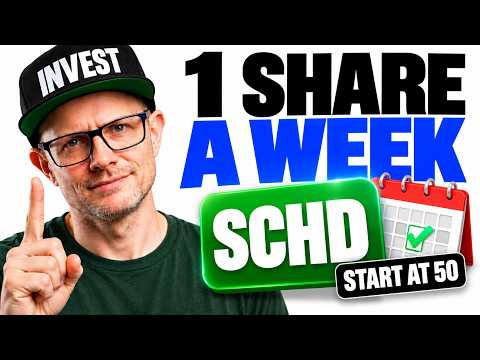
- 설명 앞부분: Starting SCHD at 50? What could buying just 1 share a week mean for your retirement income at 65? I ran the numbers—and the difference between the optimistic and conservative scenarios surprised me. In this video, I explore a hypothetical 15-year investing plan using SCHD, the Schwab U.S. Dividend …
- 같은 채널 평소 대비 ×24.4 (채널 최근 롱폼 중앙값 7,784회) · 평소 영상: SCHD Is at an All-Time High. Here’s Why I’m Still… (8,214회) / I Had QQQI and SCHD in the Wrong Accounts — Here’… (7,355회)
- 대본 없음 (설명) — 음성인식이 끝나면 도입부·흐름이 들어감
- 댓글 162/196: 좋은 점 — 영상 0 · 감사·응원 0 · 더 알고 싶은 것 0 · 아쉬운 점 — 영상 0 · 반박·불만 — 의견 다름 0 · 정치·사회 0 · 경험 공유 0 · 구독·다음 기대 0

### 63. 코스닥 다시 반등할까?📈ㅣ원큐로 끝내는 ETF🎯

- https://www.youtube.com/watch?v=jJu0VhNOH-I · 하나TV [하나자산운용] · 구독자 13,200 · 조회수 105,159 (×8.0, 하루 7,521.7) · 좋아요 43 (0.0%) · 7.5분 · 2026-10-14 · 주제 묶음 2. 장기투자·ETF·지수 · 형식 정보·해설 (그 밖) · 폴더 `W_jJu0VhNOH-I` (웹 승인)
- 썸네일: 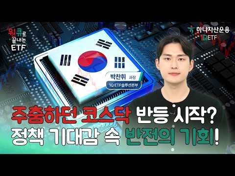
- 설명 앞부분: 코스닥의 향방이 궁금하다면, 지수를 움직일 주요 변수들을 체크해요🔍 과거 사례를 통해 반등에 필요한 조건을 확인하고, 정부의 지원 정책도 함께 살펴봐요📈 코스닥의 높은 변동성이 고민이라면 주식과 채권을 함께 담은 '1Q 코스닥150채권혼합50액티브 ETF' 어때요?💚 하나자산운용 준법감시인 심사필 2026-179(2026.10.14. ~ 2027.10.13.) 1Q ETF 더 알아보기 👀
- 같은 채널 평소 대비 ×13.8 (채널 최근 롱폼 중앙값 7,622회) · 평소 영상: 미국 AI 반도체, 알짜배기만 쏙쏙!🤖ㅣ1Q 엔비디아고정미국AI반도체 ETF [원박싱🎁 … (8,583회) / 연린이들 주목! 연금계좌 주식 비중 최대로 높이는 방법📈ㅣ원큐로 끝내는 ETF🎯 (6,661회)
- 대본 없음 (설명) — 음성인식이 끝나면 도입부·흐름이 들어감
- 댓글 3/6: 좋은 점 — 영상 0 · 감사·응원 0 · 더 알고 싶은 것 0 · 아쉬운 점 — 영상 0 · 반박·불만 — 의견 다름 0 · 정치·사회 0 · 경험 공유 0 · 구독·다음 기대 0

### 64. 배당주 20년 vs S&P500 20년, 3억 원이 만든 충격적인 자산과 삶의 격차 [ 재테크/미국주식/ETF/배당주/노후준비 ]

- https://www.youtube.com/watch?v=cqgVNBbMYew · 박대리와 황과장의 경제이야기 · 구독자 1,930 · 조회수 78,763 (×40.8, 하루 1,015.9) · 좋아요 1,113 (1.4%) · 20.5분 · 2026-07-30 · 주제 묶음 4. 미국·해외주식 · 형식 정보·해설 (그 밖) · 폴더 `W_cqgVNBbMYew` (웹 승인)
- 썸네일: 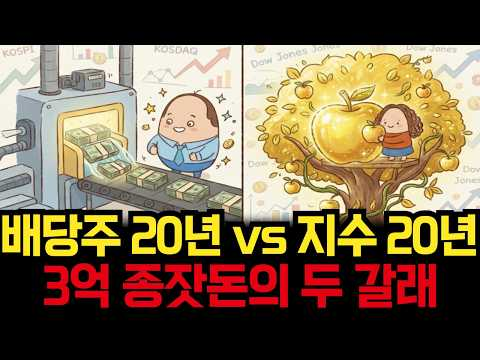
- 설명 앞부분: 같은 3억 원으로 시작해 20년 동안 완전히 다른 길을 걸어간 두 사람. 미국 배당 성장주에 투자해 매달 현금흐름을 굴린 박 대리와, S&P 500 지수 전체에 투자해 자본의 성장을 노린 황 과장. 20년이라는 긴 세월이 흐른 뒤, 두 사람의 계좌에 찍힌 숫자는 어떻게 달라졌을까요? 그리고 더 중요한 것, 은퇴 후 두 사람의 '진짜 삶의 모습'은 어떻게 갈렸을까요? 단순히 "어느 쪽이 더 많이 벌었나"를 넘어, 자산 형성기에서 은퇴기까지 우리가 투자를 바라보는 관점 자체를 바꿔줄 20년의 실측 데이터 서사를 확인해 보세요. [영상…
- 같은 채널 평소 대비 ×32.4 (채널 최근 롱폼 중앙값 2,432회) · 평소 영상: 같은 날 1억을 넘긴 박대리와 황과장, 그날 내린 결정 하나가 30년 뒤 3억7천을 갈랐… (2,477회) / 같은 S&P500을 10년 샀는데 한 명만 1억을 만들었다, 차이는 단 한 가지 [ 재테… (2,386회)
- 대본 (음성인식(앞 5분), 4.9 음절/초) — 앞부분만, 흐름은 그 안까지 첫 20초: “배당주와 지수 주식, 이 두 가지 자산은 같은 주식시장 안에서 가장 오랜 기간 라이벌 관계로 불려왔습니다. 시장이 폭발적인 성장을 온 몸으로 받아내며 지수의 팽창을 누릴 것인가, 새 된 챈 챈 누릴 것인가. 아니면 기업이 만들어내는 당장의 현금 흐름을 매달 꼬박꼬박 재투자하여 복리의 눈덩이를 굴릴 것인가.”
- 첫 1분: “배당주와 지수 주식, 이 두 가지 자산은 같은 주식시장 안에서 가장 오랜 기간 라이벌 관계로 불려왔습니다. 시장이 폭발적인 성장을 온 몸으로 받아내며 지수의 팽창을 누릴 것인가, 새 된 챈 챈 누릴 것인가. 아니면 기업이 만들어내는 당장의 현금 흐름을 매달 꼬박꼬박 재투자하여 복리의 눈덩이를 굴릴 것인가. 오늘 다룰 이야기는 바로 이 질문에서 출발합니다. 출발서는 똑같았습니다. 두 사람에게는 20년 전 각자 핏땀 흘려 모은 종자똥 3억 원이 손에 쥐어져 있었습니다. 대기업 직장인으로 오랜 기간 함께 근무하며 같은 월급을 받고, 같은 점심을 먹고, 같은 퇴근길을 걸었던 박 대리와 황 과장, 두 사람은 어느 날 점심을 먹고 회사 근처 공원 벤치에 앉아 서로의 통장을 열어보았습니다. 각자의 계좌에는 약속이라도 한”
- 흐름 (90초마다 첫 문장): 0:00 배당주와 지수 주식, 이 두 가지 자산은 같은 주식시장 안에서 가장 오… → 1:32 박 대리가 선택한 것은 미국 시장을 대표하는 배당 성장 자산이었습니다. → 3:07 황 과장은 배당에 목매지 않았습니다. → 4:35 S&P 500 역시 연 1.5% 안팎에 소소한 배당을 지급했지만 황과장…
- 댓글 162/162: 좋은 점 — 영상 3 · 감사·응원 4 · 더 알고 싶은 것 3 · 아쉬운 점 — 영상 1 · 반박·불만 — 의견 다름 3 · 정치·사회 5 · 경험 공유 9 · 구독·다음 기대 0
  - 좋은 점 — 영상 👍4 “좋은정보 감사드립니다”
  - 좋은 점 — 영상 👍1 “오 좋은내용감사합니다”
  - 감사·응원 👍4 “좋은정보 감사드립니다”
  - 감사·응원 👍1 “정말 궁금했는데 감사합니당”
  - 더 알고 싶은 것 👍3 “18:07 더이상 근로소득을 기대할수 없는 시점인데 어떻게 생활비로 한푼도 안쓰고 배당 재투자를 할수가 잇을까요?”
  - 더 알고 싶은 것 👍0 “3억 20년 넣고 기다릴 사람이 얼마나될까요? 시드 금액이 넘 큼..1억이면 몰라도.”
  - 아쉬운 점 — 영상 👍0 “지수 팔아서 배당 사면 되는데 결론이 많이 아쉽네요.”
  - 반박·불만 — 의견 다름 👍0 “주식투자에서 가장중요한게 투자기법 심리? 아닙니다 그냥 가만히 있는겁니다 대부분 폭락장에서 90%가 공포에 다던지죠.ㅋㅋ 인간이 가장 힘들어 하는게 가~만히 있는거죠”
  - 반박·불만 — 의견 다름 👍0 “말도 안되는 소리를 하네. 은퇴싯점에 S&P를 팔아서 배당주로 옮기면 되지. 물론, 22%의 양도소득세를 내야 하는데, 그걸 감안해도 황과장이 무조건 이겼구만.”
  - 정치·사회 👍47 “한국 정부는 개인의 노후도 보장 안해주면서, 세계에서 유일하게 세금을 안내는 사람이 세금을 내는 사람보다 혜택이 더욱 많고, 은퇴하면 세금이 더 늘어나고, 중국인을 위해 한국국민이 세금을 더 내게 만든 유일한 나라…”
  - 정치·사회 👍6 “빚내서 그냥 레버타라 정부에서 빚 탕감해준다”
  - 경험 공유 👍5 “운용하기 나름인듯 다만 지수는 손이좀 가고 배당은 손이 조금 덜간다는 차이가 있을뿐. 그리고 배당을 받는경우는 세금문제도 생각해야하고. 수입이 안끊어졌다는 전제로 하락장때 추매를 하면 안되는거였나? 아니면 3억을 한번에 몰아넣지 말고 적립식으로 했었다면?? 지수에 넣…”
  - 경험 공유 👍0 “저는 모든 수익의 절반을 투자 및 재투자하는 방식을 하고 있습니다. 배당주 위주로 하고 있고요. 월급의 절반도 투자, 배당금의 절반도 재투자. 내가 쓸 수 있는 현금도 매년 늘어나고, 배당금도 재투자가 계속 이루어져서 매년 늘어나는 구조죠. 배당금이 2천만원 넘어가면…”

### 65. 물린 주식 10년, 결국 전부 팔았습니다 (feat. 복구 심리의 함정)

- https://www.youtube.com/watch?v=OKHm1gUNyPA · 어쩌다마흔 · 구독자 1,840 · 조회수 83,994 (×45.6, 하루 963.7) · 좋아요 1,805 (2.1%) · 9.9분 · 2026-08-02 · 주제 묶음 8. 투자 심리·실패 · 형식 인터뷰·강연·대담 · 폴더 `W_OKHm1gUNyPA` (웹 승인)
- 썸네일: 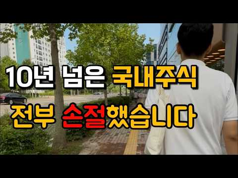
- 설명 앞부분: 10년 넘게 국내 개별주식에 투자했습니다. 수익 난 종목도 있었지만, 물린 종목이 더 많았습니다. 전체로 보면 꽤 큰 손실. 결국 얼마 전, 며칠에 걸쳐 전부 팔았습니다. 이번 영상은 계산이나 시장 분석이 아니라 제 이야기입니다. 왜 손실을 확정하면서까지 전량 매도를 택했는지, 그 이유 세 가지와 매도 이후에도 흔들렸던 '복구 심리'까지 솔직하게 담았습니다. 계좌에 물린 종목을 몇 년째 들고 고민 중이시라면, 오늘 영상이 판단에 참고가 되시길 바랍니다.
- 같은 채널 평소 대비 ×10.6 (채널 최근 롱폼 중앙값 7,910회) · 평소 영상: 환율 1,350원 깨지고 미국주식 올인 했습니다 (7,910회) / 40대 유부남, 월 500만원 모으려고 이것부터 끊었습니다 (8,264회)
- 대본 (음성인식(앞 5분), 4.3 음절/초) — 앞부분만, 흐름은 그 안까지 첫 20초: “10년 넘게 하던 국내 주식을 며칠 전 전부 팔고 정리했습니다. 수익이 나서 판 건 아닙니다. 손실을 확정하면서 팔았습니다. 오늘은 쓰라리게 아팠던 제 최근 이야기입니다.” — 도입부 유형: 숫자로 시작
- 첫 1분: “10년 넘게 하던 국내 주식을 며칠 전 전부 팔고 정리했습니다. 수익이 나서 판 건 아닙니다. 손실을 확정하면서 팔았습니다. 오늘은 쓰라리게 아팠던 제 최근 이야기입니다. 안녕하세요 어쩌다 마흔입니다. 오늘은 계산도 시장 얘기도 아닙니다. 제 얘기를 해볼까 합니다. 이번 주도 금요일을 제외하고는 계속 카락장이 이어져서 멘탈이 힘든 한주였습니다. 그리고 저는 계좌에 일부 있던 국내 개별 주식을 며칠에 걸쳐 전부 정리했습니다. 10년 넘게 개별 주 투자를 해온 사람이 그것도 손실을 확정하면서 왜 마흔이 넘어 전부 팔았는지 그 이후 3가지를 오늘 말씀드려볼까 합니다. 이 결정이 결코 정답이라는 얘기가 아닙니다. 다만 저와 비슷한 시기에 계좌에 물린 종목을 들고 고민 중인 분이라면”
- 흐름 (90초마다 첫 문장): 0:00 10년 넘게 하던 국내 주식을 며칠 전 전부 팔고 정리했습니다. → 1:32 수익이 난 종목도 있었습니다. → 3:05 이러도 복구할 시간이 있었으니까요. → 4:31 시간을 쓰고 어느 정도 벌었어도 다시 생각해볼 문제인데
- 댓글 957/957: 좋은 점 — 영상 13 · 감사·응원 36 · 더 알고 싶은 것 5 · 아쉬운 점 — 영상 11 · 반박·불만 — 의견 다름 14 · 정치·사회 16 · 경험 공유 90 · 구독·다음 기대 4
  - 좋은 점 — 영상 👍3 “너무 아쉬워서 댓글올립니다. 현재재무상황과 현재밸류로 하면 당연히 수익이 어렵더라구요.ㅠ 확실한미래성장과 촉매(주가가 부각될 트리거)감안하여, 투자하시면 분명 성과가 있더라구요. 고전(그레이엄,피터린치,코스톨라니,레이달리오.등의 )책을 좀 읽으시면 ETF 선정하시는대…”
  - 좋은 점 — 영상 👍3 “좋은 이야기도 있는데 말하는 사고방식이 본인은 안다고 생각할수도 있겠지만 워렌 버팟의 본질을 전혀 이해 못하고 있다고 할까나 😅 말이나 설명을 하는 사고방식이 아직도 트레이더에요 . 트레이더의 탐욕에 절여진 전혀 벗어나있지를 않는. 좋게 봐줘도 하워드 막스의 통찰을 …”
  - 감사·응원 👍70 “많은 고민이 묻어 나옵니다. 고생하셨습니다. 저도 심각히 고민중입니다. 국장은 절대 개미가 도전할 시장은 아니라는 생각입니다. 말씀 새겨서 결정에 참고하겠습니다. 감사드립니다.”
  - 감사·응원 👍23 “속은 쓰리시겠지만, 길게 보면 잘하셨습니다^^ 저도 과거 오랫동안 개별주로만 투자를 했고, 괜찮은 수익을 얻었지만, 지금은 ETF 투자로 주로 하고, 개별주는 정말 소액만 투자하고 있습니다. 회계사 생활을 오랫동안 하면서, 기업분석과 투자에 나름 자신도 있었지만, 언…”
  - 더 알고 싶은 것 👍1 “얼마 손해 보셨나요?”
  - 더 알고 싶은 것 👍1 “리스크라쓰고 불확실성이라읽어야되여 그불확실에대해 어떤일을 했나요? 추세판단은했나요? 자금을잃지않으려는노력은 그무엇보다중요해요 .. 그러려면예비비확보 분할매매 9시 12시 오후3시 그리고온갖쏟아지는 착시만주는노이즈에대해선어떻게 대응했는지요? 자금 안 읽고오래 시장에 머…”
  - 아쉬운 점 — 영상 👍13 “주식은 자기가 좋아하는 기업 응원하는 마음으로 사서 고수익은 아니더라도 은행금리만큼정도는 이득 아니면 손해일거라 생각했는데, 결국은 큰손들의 도박장인게 너무 실망스럽니다.”
  - 아쉬운 점 — 영상 👍2 “아...한달만 빨리 정리했어도 어쩌면 수익이 났을지도 모르는데 아쉽네요.”
  - 반박·불만 — 의견 다름 👍63 “하루에 지수가 10프로 등락하는 국장은 정상이 아니죠”
  - 반박·불만 — 의견 다름 👍5 “공부해서 주식하려면 미장가세요.. 여기는 상식적인 시장이 아닙니다”
  - 정치·사회 👍24 “그냥주식은 도박이에요 정부에서 인정한 오르고 내리고 하는거 그냥 짜고치는 고스돕같은거 다연기 공부필요없어요 그냥 정부와 기업이 맘대로 올리고 내리고 전 이걸아는순간 이젠안해요 금은사지”
  - 정치·사회 👍6 “국장은 그냥 수급 사줄 놈이 없으면 안올라가지요. 삼닉이 1000조를 벌어도 사줄 놈이 없어요 이번 금요일 국내 탑5 전부 상한가 갔지요? 전부 환호하지만 실상은 외국인들이 10조만 있어도 모든 종목 상한가 보낼 수 있다는 경고 같았어요. 저도 8년 국장하고 이번에 …”
  - 경험 공유 👍113 “저도 다 팔고 미장으로 옮겼습니다. 돈이 문제가 아니라 널뛰기 국장에서는 일상생활이 안됩니다.”
  - 경험 공유 👍70 “많은 고민이 묻어 나옵니다. 고생하셨습니다. 저도 심각히 고민중입니다. 국장은 절대 개미가 도전할 시장은 아니라는 생각입니다. 말씀 새겨서 결정에 참고하겠습니다. 감사드립니다.”
  - 구독·다음 기대 👍6 “같은나이대라 그런지 공감이 많이 됩니다. 늘 영상 기다려요. 응원합니다.^^”
  - 구독·다음 기대 👍2 “감사합니다 구독하고 볼게요 sk하이닉스 들어갈려고했는데 도저히 자신이 없네요”

### 66. "중장기 투자? 삼전닉스 말고 스페이스X 모으세요” (정의훈 선임연구원)

- https://www.youtube.com/watch?v=bMR3jvlYDgo · 투자360 · 구독자 16,300 · 조회수 125,021 (×7.7, 하루 8,330.3) · 좋아요 640 (0.5%) · 16분 · 2026-10-13 · 주제 묶음 11. 투자 일반 · 형식 정보·해설 (그 밖) · 폴더 `W_bMR3jvlYDgo` (웹 승인)
- 썸네일: 
- 챕터: 0:00 🔥 하이라이트 · 0:58 🚀 스페이스X 70% 급등, 무슨 일이 있었나 · 3:52 ⚠️ 삼성전자·하이닉스 중장기 투자를 반대하는 이유! · 4:29 💰 70% 오른 스페이스X 개별주 살까? ETF 살까? · 5:59 💰 🌌 우주 데이터센터, 드디어 돈이 되나? · 8:29 📊 스페이스X, 꼭 봐야 할 4가지 지표 · 11:17 🚨 어떤 신호가 나오면 투자를 멈춰야 하나 · 12:55 🔥 스타십·스타링크·AI, 다음 성장동력은? · 14:15 🎯 지금 주가는 고점? “아직 다 반영 안 됐다”
- 설명 앞부분: "삼전닉스 장투 추천 안 합니다. 잘 모르겠으면 스페이스X 사세요” 저점 대비 약 70% 반등한 스페이스X. 지금 들어가기엔 이미 늦은 걸까요? 정의훈 유진투자증권 연구원과 최근 주가 급등 이유부터 특히 현재 주가에 향후 성장 기대가 얼마나 반영됐는지, 어떤 신호가 나오면 투자를 다시 점검해야 하는지도 확인합니다. 🎥촬영일: 2026년 10월 6일 ⏱️ 골라 보는 핵심 투자 포인트
- 같은 채널 평소 대비 ×3.4 (채널 최근 롱폼 중앙값 36,558회) · 평소 영상: 환율 내린 지금이 기회! 삼전닉스 팔아서 현금 '여기로' 옮기세요 #부자탐사대 #효라클 … (38,497회) / “지금까지 금투자 방법 다 틀렸습니다” 금 투자, 개미는 ‘이렇게’ 사야 돈 법니다 ∣ … (34,619회)
- 대본 없음 (설명) — 음성인식이 끝나면 도입부·흐름이 들어감
- 댓글 62/70: 좋은 점 — 영상 0 · 감사·응원 1 · 더 알고 싶은 것 0 · 아쉬운 점 — 영상 0 · 반박·불만 — 의견 다름 1 · 정치·사회 4 · 경험 공유 0 · 구독·다음 기대 0
  - 감사·응원 👍0 “연구원님 저는 믿고 있었습니다 감사합니다 스엑 날라가즈아🎉🎉🎉”
  - 반박·불만 — 의견 다름 👍4 “헛소리말고 지수투자나 해라...”
  - 정치·사회 👍5 “공화당이 중간선거 이기면 스페이스x대상승각이다”
  - 정치·사회 👍4 “스페이스X는 중간선거 이후 사는 게 맞지 않나요? 질문 한번 해주세요~”

### 67. 나스닥 투자하기 전에 이 영상 꼭 보세요 ∣ QLD만 모아가는 이유

- https://www.youtube.com/watch?v=g10Y6ZA7rng · 올레버 · 구독자 1,590 · 조회수 118,471 (×74.5, 하루 800.5) · 좋아요 1,638 (1.4%) · 5.7분 · 2026-06-02 · 주제 묶음 2. 장기투자·ETF·지수 · 형식 정보·해설 (그 밖) · 폴더 `W_g10Y6ZA7rng` (웹 승인)
- 썸네일: 
- 챕터: 0:00 도입 — QLD를 추천하는 이유 · 0:12 레버리지의 음의 복리(Volatility Decay)… · 1:31 나스닥에서 음의 복리가 반은 틀린 이유 · 2:02 QQQ / QLD / TQQQ 수익률 비교 (2010… · 3:05 왜 TQQQ보다 QLD인가 — 최적 레버리지 배율 · 4:01 2021년 차트로 보는 변동성 비교 · 4:29 장기 투자자에게 QLD가 적합한 이유 · 4:52 개인 목표 (10년 순자산 30억) 기준으로 본 QLD · 5:18 리스크 안내 및 마무리
- 설명 앞부분: 나스닥 ETF, 어떤 걸 사야 할까요? QQQ, QLD, TQQQ. 다들 나스닥 기반인데 뭐가 다른지, 그리고 왜 저는 QLD를 선택했는지 오늘 얘기해볼게요. 이런 분들께 추천드려요 나스닥 ETF 투자를 고민 중인 분 QQQ, QLD, TQQQ 차이가 궁금한 분 레버리지 ETF가 위험하다고 들었는데 궁금한 분 📊 영상에서 다루는 내용 QQQ / QLD / TQQQ 각각 뭐가 다른가 레버리지는 장기 보유하면 녹는다? 진실은 나스닥 각 배율별 10년 수익률 비교 10년 뒤 30억을 위해 필요한 수익률 🎯 목표 : 순자산 30억 파이어…
- 같은 채널 평소 대비 ×163.9 (채널 최근 롱폼 중앙값 723회) · 평소 영상: 배달 뛰다가 워렌버핏의 말을 이해했습니다 ∣ 투자관을 바꾸게 된 계기 (723회) / 이제 저축 안 늘립니다. 30억 파이어족 계획 (572회)
- 대본 없음 (설명) — 음성인식이 끝나면 도입부·흐름이 들어감
- 댓글 347/347: 좋은 점 — 영상 4 · 감사·응원 18 · 더 알고 싶은 것 24 · 아쉬운 점 — 영상 1 · 반박·불만 — 의견 다름 5 · 정치·사회 0 · 경험 공유 17 · 구독·다음 기대 2
  - 좋은 점 — 영상 👍7 “구독 눌렀어요 좋은정보 앞으로도 부탁드려요😂”
  - 좋은 점 — 영상 👍7 “10~25 년까지는 초저금리 기반 빅테크 대상승장이었죠. 닷컴버블 직후(00~10년)처럼 10년 동안 박스권 횡보장세였다면 진정한 음의 복리 마법을 맛봤을 겁니다.. 그리고 큰 MDD 낙폭은 실제로 겪지 않으면 그게 어떤 느낌인지 피부로 안 와닿아요. 내 투자자산이 …”
  - 감사·응원 👍12 “1.닷컴버블 폭락 기간: 약 2년 6개월 (31개월) 회복 기간: 약 4년 5개월 (53개월) 내 돈이 묶인 총 기간: 약 7년 1개월 2. 리먼 브라더스 사태 폭락 기간: 약 1년 5개월 (17개월) 회복 기간: 약 4년 (48개월) 내 돈이 묶인 총 기간: 약 5…”
  - 감사·응원 👍3 “저도 맘 편해서 QLD 매달 100 좀 넘게 모아갑니다. 최근 하락시 좀 더 사서 모으고 ㅎㅎ 앞으로도 파이팅입니다~😊”
  - 더 알고 싶은 것 👍8 “도움 많이 되었네요! 근데 4:44초에 저런 비교 데이터는 어디에서 볼 수 있을까요?!”
  - 더 알고 싶은 것 👍7 “구독 눌렀어요 좋은정보 앞으로도 부탁드려요😂”
  - 아쉬운 점 — 영상 👍0 “연저펀에 못담는게 아쉽네요.”
  - 반박·불만 — 의견 다름 👍41 “QLD 6년차, 만5년 매도 없이 모아가는 중입니다. 여러분, 레버리지는 하락장 횡보장에 다 녹는 다는 말에 너무 매몰 되지 마세요. 하락후 반드시 찾아오게 되는 긴 상승장에서의 양의 복리는 퍼포먼스가 두배가 아닙니다. 속된말로 존나 오릅니다. 횡보, 하락장에서 추종…”
  - 반박·불만 — 의견 다름 👍13 “하락장 자신없는분은 건드리지도 마세요. 좋다좋다그래도 레버리지는 막 하는거 아닙니다”
  - 경험 공유 👍41 “QLD 6년차, 만5년 매도 없이 모아가는 중입니다. 여러분, 레버리지는 하락장 횡보장에 다 녹는 다는 말에 너무 매몰 되지 마세요. 하락후 반드시 찾아오게 되는 긴 상승장에서의 양의 복리는 퍼포먼스가 두배가 아닙니다. 속된말로 존나 오릅니다. 횡보, 하락장에서 추종…”
  - 경험 공유 👍19 “폭락을 경험해보지도 않은 이런 핏덩이들이 레버리지 좋다고 주절 대는게 너무 귀엽네 ㅋㅋ”
  - 구독·다음 기대 👍3 “구독했습니다~~ 혹시 경상도 이신가요? ㅎㅎ”

### 68. Can You Retire With Just SCHD? ∣ SCHD Expert Explains

- https://www.youtube.com/watch?v=lRlUmwigNYU · The Mispriced Podcast · 구독자 3,780 · 조회수 131,822 (×34.9, 하루 1,894.0) · 좋아요 1,867 (1.4%) · 36.6분 · 2026-08-19 · 주제 묶음 2. 장기투자·ETF·지수 · 형식 정보·해설 (그 밖) · 폴더 `W_lRlUmwigNYU` (웹 승인)
- 썸네일: 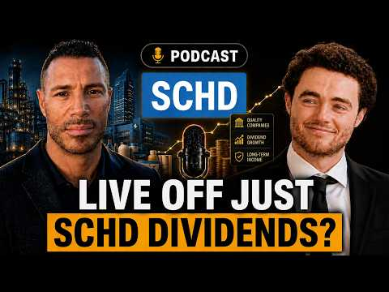
- 챕터: 0:00 Introduction · 1:28 Why Craig started investing i… · 5:15 His $1 million SCHD goal · 6:51 What drives SCHD’s dividend g… · 11:16 SCHD’s long-term performance · 13:18 Can someone retire with only … · 16:58 Pairing SCHD with option-inco… · 21:57 Can SCHD keep outperforming i… · 26:24 SCHD’s expected 2026 dividend… · 30:06 Which stock is currently misp… · 34:29 SCHD and sequence-of-returns …
- 설명 앞부분: In this episode of Mispriced, I sit down with Craig, better known as “SCHD Stan,” to discuss his journey investing in SCHD and his goal of building a $1 million position in the fund. We break down what makes SCHD’s methodology unique, how the ETF has consistently grown its dividend, and whether som…
- 같은 채널 평소 대비 ×7.9 (채널 최근 롱폼 중앙값 16,738회) · 평소 영상: SCHD Just Saw a Massive Change? SCHD Expert Expla… (18,407회) / Dividend Investing vs The 4% Rule ∣ David Bahnsen… (15,069회)
- 대본 (자막, 0.0 음절/초) 첫 20초: “Welcome back everyone. Today we are joined by a very special guest. We are joined by Craig aka SCHD Stan. And if you aren't familiar with Craig, he has become one of the leading experts on SCHD and generally speaking his goal is to one day live off SCHD dividends. So Craig, thank you so much for joi”
- 첫 1분: “Welcome back everyone. Today we are joined by a very special guest. We are joined by Craig aka SCHD Stan. And if you aren't familiar with Craig, he has become one of the leading experts on SCHD and generally speaking his goal is to one day live off SCHD dividends. So Craig, thank you so much for joining us. >> Thank you, Eli. I'm honored to be to be invited on your show. I've been following your d”
- 흐름 (90초마다 첫 문장): 0:03 Welcome back everyone. Today we are → 1:30 accounts and back then it was mutual → 3:01 people started kind of dying on it. → 4:31 a new all-time high, trading around → 6:00 So and I'm at right now I'm at over → 7:30 And that's it. And and look how well → 9:01 finding → 10:32 of built-in → 12:02 total stock market index. So again, when → 13:31 Um → 15:00 honestly think that that SCHD over the → 16:30 hold up much better as well. So, it's → 18:01 my idea's been okay, well really if you → 19:30 GPIQ, the GPIX, but again they tend to → 21:01 time if that net asset value continues → 22:30 but in your opinion, does SCHD have the → 24:03 the beginning of the year when we → 25:30 look like. But, if you're wanting to → 27:02 I don't like to always throw out a a → 28:31 could lead to like
- 댓글 343/354: 좋은 점 — 영상 0 · 감사·응원 0 · 더 알고 싶은 것 0 · 아쉬운 점 — 영상 0 · 반박·불만 — 의견 다름 0 · 정치·사회 0 · 경험 공유 0 · 구독·다음 기대 0

### 69. QLD 거치식 투자, 2배까지 얼마나 걸릴까? QQQ와 비교했더니,, 충격!

- https://www.youtube.com/watch?v=dbQ_xk3IiPg · 두배럭 2XLuck · 구독자 3,120 · 조회수 10,397 (×3.3, 하루 1,500.2) · 좋아요 149 (1.4%) · 16분 · 2026-10-14 · 주제 묶음 11. 투자 일반 · 형식 브이로그·직접 해본 이야기 · 폴더 `W_dbQ_xk3IiPg` (웹 승인)
- 썸네일: 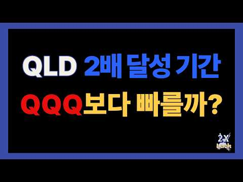
- 설명 앞부분: QLD 거치식 투자하면 언제 2배가 될까? QQQ와 비교하면 결과는 어땠을까요? 이번 영상에서는 QLD와 QQQ에 거치식으로 투자했을 때 투자금이 2배가 되기까지 걸리는 시간을 실제 과거 데이터를 통해 비교해봤습니다. QLD 투자금 2배 달성 기간 2배 달성 과정에서의 최대 낙폭과 회복 기간 QLD와 QQQ의 2배 달성 기간 비교 레버리지 ETF의 수익과 하락 위험 투자 기간과 꾸준한 투자의 중요성 QLD는 과연 QQQ보다 빠르게 2배가 될 수 있었을까요? 실제 과거 데이터를 통해 그 차이와 투자 과정에서 주의해야 할 점까지 확인…
- 같은 채널 평소 대비 ×1.1 (채널 최근 롱폼 중앙값 9,802회) · 평소 영상: QLD 말고 SSO는 어땠을까? 10년 적립식 투자 충격 결과 비교! (9,911회) / QLD 월 100만원 vs 200만원 적립식 투자, 10억까지 실제 얼마나 걸렸을까? (9,693회)
- 대본 없음 (설명) — 음성인식이 끝나면 도입부·흐름이 들어감
- 댓글 21/21: 좋은 점 — 영상 2 · 감사·응원 6 · 더 알고 싶은 것 1 · 아쉬운 점 — 영상 0 · 반박·불만 — 의견 다름 0 · 정치·사회 0 · 경험 공유 1 · 구독·다음 기대 0
  - 좋은 점 — 영상 👍2 “좋은영상 감사합니다”
  - 좋은 점 — 영상 👍1 “너무 좋은 정보네요. 감사합니다.”
  - 감사·응원 👍7 “저는 직투에서는 QLD와 USD를 메인으로 매월 적립중이며 TQQQ는 MDD기준 마이너스 60,70,80으로 떨어졌을때 폭이 더 떨어질수록 현금을 더 투입하는 3분할 진입이며 SOXL은 마이너스 70,80,90일때 분할매수 하고 있는데 기회가 자주 오지는 않습니다 영…”
  - 감사·응원 👍3 “와. Qld. 대박이네요. 앞으로도. 이랫음하는 바램. ㅎㅎ. 감사합니당”
  - 더 알고 싶은 것 👍4 “Tqqq도 궁금합니다~”
  - 경험 공유 👍3 “수고 많으셨습니다. '3배 되는 시기' 좀 해주시면 감사하겠습니다. 제가 3배씩 이익실현 하는 플랜을 짜고 있어서 그렇습니다. 감사합니다 ~”

### 70. I Reinvested Dividends for 30 Years — Here's What Actually Happened

- https://www.youtube.com/watch?v=oZqWOuMZwdA · BudgetMoney · 구독자 2,550 · 조회수 163,584 (×64.2, 하루 1,181.7) · 좋아요 2,204 (1.4%) · 11.3분 · 2026-06-11 · 주제 묶음 기타 · 형식 정보·해설 (그 밖) · 폴더 `W_oZqWOuMZwdA` (웹 승인)
- 썸네일: 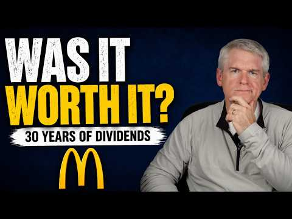
- 챕터: 0:00 What 30 Years Actually Taught… · 1:19 What a Dividend Actually Is · 2:13 The Three Choices: Spend, Rei… · 3:03 30-Year Proof: Dividend Growt… · 6:55 The Tax Reality Nobody Warns … · 8:22 The One Number Nobody Checks:… · 10:07 Rich vs. Wealth — The Real Di…
- 설명 앞부분: I started reinvesting dividends in 1995. For 30 years I watched what compound dividend growth actually does to a portfolio — and it's not what most beginners expect.In this video I break down dividend growth investing from the ground up: what a dividend actually is, the three choices you have every…
- 같은 채널 평소 대비 ×525.1 (채널 최근 롱폼 중앙값 312회) · 평소 영상: Why RobinHood Wants You to Trade More (344회) / The Real Reason You Can't Find a Starter Home (279회)
- 대본 (자막, 0.0 음절/초) 첫 20초: “I started investing in 1995. I was 26 years old. I'd read about compound interest. I'd read about dividend reinvesting. I understood the math. But understanding it on paper and watching it work for 30 years, those are not the same thing. And after three decades, I can tell you there's a difference b” — 도입부 유형: 숫자로 시작
- 첫 1분: “I started investing in 1995. I was 26 years old. I'd read about compound interest. I'd read about dividend reinvesting. I understood the math. But understanding it on paper and watching it work for 30 years, those are not the same thing. And after three decades, I can tell you there's a difference between reading about compounding and watching it happen in your own account. Here's an early McDonal”
- 흐름 (90초마다 첫 문장): 0:00 I started investing in 1995. I was 26 → 1:32 business or pay some of it out to the → 3:00 came from. → 4:32 Let me Let me show you what that → 6:02 roughly around 3%, 3 and 1/2% over the → 7:31 what it is, and then they move on. → 9:01 that dividend is at risk. But here's → 10:30 that's what builds wealth.
- 댓글 336/336: 좋은 점 — 영상 0 · 감사·응원 0 · 더 알고 싶은 것 0 · 아쉬운 점 — 영상 0 · 반박·불만 — 의견 다름 0 · 정치·사회 0 · 경험 공유 0 · 구독·다음 기대 0

### 71. I Bought 1,000 Shares of JEPQ. Here’s What It Pays Me Every Month

- https://www.youtube.com/watch?v=gC-_mODu2gI · Grounded Life Investments · 구독자 5,940 · 조회수 39,558 (×6.7, 하루 2,669.1) · 좋아요 444 (1.1%) · 11.3분 · 2026-10-13 · 주제 묶음 기타 · 형식 정보·해설 (그 밖) · 폴더 `W_gC-_mODu2gI` (웹 승인)
- 썸네일: 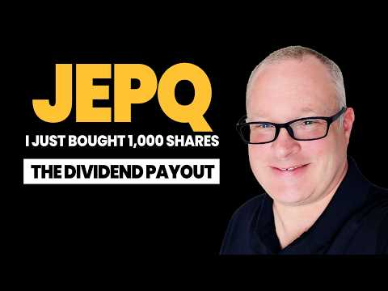
- 설명 앞부분: I Bought 1,000 Shares of JEPQ. Here’s What It Pays Me Every Month. I also talk about who this fund is for and why it is in our investment portfolio. Want to go deeper? The GLI Dashboard gives you dividend screeners, portfolio analysis, and deep dives of the companies and ETF's you need to know abou…
- 같은 채널 평소 대비 ×3.4 (채널 최근 롱폼 중앙값 11,802회) · 평소 영상: I Invested $30 Per Day In SCHD - Here What Happen… (12,241회) / SCHD New All-Time High: I've Paused My DCA & What… (11,363회)
- 대본 없음 (설명) — 음성인식이 끝나면 도입부·흐름이 들어감
- 댓글 68/69: 좋은 점 — 영상 0 · 감사·응원 0 · 더 알고 싶은 것 0 · 아쉬운 점 — 영상 0 · 반박·불만 — 의견 다름 0 · 정치·사회 0 · 경험 공유 0 · 구독·다음 기대 0

### 72. 코스피, 사이드카 발동! 5030P까지의 조정(삼전닉스 타점)

- https://www.youtube.com/watch?v=xO9xlsmI6bY · 차트도령 · 구독자 3,890 · 조회수 13,292 (×3.4, 하루 1,667.0) · 좋아요 158 (1.2%) · 12.8분 · 2026-10-13 · 주제 묶음 5. 국내주식 · 형식 정보·해설 (그 밖) · 폴더 `W_xO9xlsmI6bY` (웹 승인)
- 썸네일: 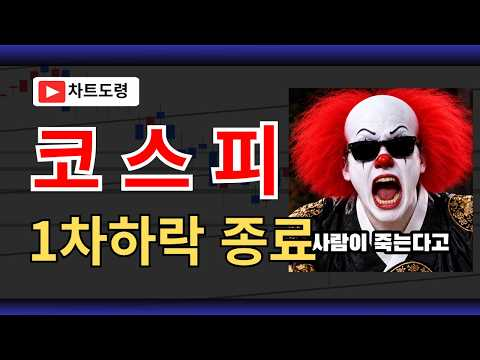
- 챕터: 0:00 시황 · 2:37 코스피 · 7:17 코스닥 · 8:31 삼성전자 · 9:36 SK하이닉스
- 설명 앞부분: 안녕하세요 차트도령입니다. 10월13일 코스피, 코스닥, 삼성전자, sk하이닉스 차트분석입니다. 금일 오랜만에 사이드카가 발동하며 낙폭이 심화되었는데요, 앞으로 추가적인 하락이 예상되지만, 우선 1차적인 하락은 종료되었다고 생각됩니다. 내일은 반등, 하지만 6400포인트를 넘기지 못한다고 보고 있습니다. 본 채널에서 영상을 통해 소개해드리는 종목은 '정보 공유' 차원일 뿐 '종목 추천'이 아닙니다.
- 같은 채널 평소 대비 ×1.6 (채널 최근 롱폼 중앙값 8,214회) · 평소 영상: 코스피, 장난같나요? 8,000P간다니깐요?(삼전닉스 타점) (8,224회) / 코스피 비상, 반도체 상승 이제 끝일까?(삼전닉스 타점) (8,204회)
- 대본 없음 (설명) — 음성인식이 끝나면 도입부·흐름이 들어감
- 댓글 78/78: 좋은 점 — 영상 2 · 감사·응원 13 · 더 알고 싶은 것 5 · 아쉬운 점 — 영상 1 · 반박·불만 — 의견 다름 0 · 정치·사회 0 · 경험 공유 1 · 구독·다음 기대 0
  - 좋은 점 — 영상 👍0 “좋은 영상 감사합니다👍👍 5000초반 매수 준비 중이긴 하지만 깊은 하락을 맞은 종목들은 바운스~바운스 맛있게 먹어봐야죠 오늘 미국 반도체 시황도 봐야겠지만 눈치게임 하듯 맛있게 발라먹어야겠네요 관점 감사합니다”
  - 좋은 점 — 영상 👍0 “오늘도 좋은 강의 감사합니다😊😊 도령님 혹시 실례가 안된다면 (코스피/코스닥) 차트로도 분석이 가능할까요? 코스닥이 아웃퍼폼나올거 같은 차트인데 분석이 힘드네요..”
  - 감사·응원 👍1 “좋은방송 감사합니다 매일 매일 방송해 주시면 감사하겠습니다”
  - 감사·응원 👍0 “와우.. 좋은 분석 감사드립니다.”
  - 더 알고 싶은 것 👍1 “좋은방송 감사합니다 매일 매일 방송해 주시면 감사하겠습니다”
  - 더 알고 싶은 것 👍0 “5030 코스피면 삼전 닉스는 도대체 얼마인가요??? 코스피 5030은 올거같은데 삼전 닉스가 그 가격까지 밀린다는게 믿겨지지가 않네요 ㄷㄷ”
  - 아쉬운 점 — 영상 👍0 “수렴 이탈이 아래 방향이라 아쉽네요 😢”

### 73. AI로 주식 자동 매매하면 어떻게 될까?

- https://www.youtube.com/watch?v=9E9OrcoMCjk · 이영배 · 구독자 20,600 · 조회수 1,105,306 (×53.7, 하루 8,512.0) · 좋아요 5,536 (0.5%) · 11.3분 · 2026-06-20 · 주제 묶음 7. 매매·전략 · 형식 정보·해설 (그 밖) · 폴더 `W_9E9OrcoMCjk` (웹 승인)
- 썸네일: 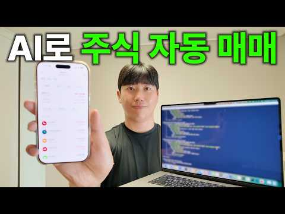
- 같은 채널 평소 대비 ×7.0 (채널 최근 롱폼 중앙값 158,736회) · 평소 영상: AI에게 유튜브 채널을 운영시키면 구독자를 몇 명 모을까? (151,887회) / AI에게 인스타그램 운영을 시키면 팔로워를 몇 명 모을까? (250,867회)
- 대본 (음성인식(앞 5분), 6.8 음절/초) — 앞부분만, 흐름은 그 안까지 첫 20초: “지금부터 AI 두 개로 주식거래 대결 시켜볼 겁니다 누가 더 돈을 많이 벌어올까요? 제가 직접 한번 해보겠습니다 저는 제돈 천만 원을 AI 두 개에게 맡겨봤습니다 하나는 클로드의 오프스 4.8 다른 하나는 오픈 AI의 GPT 5.5인데요 둘 다 현재 최고의 성능을 자랑하는 각 회사의 최신 모델입니다 규칙은 간단합니다 실제 돈 500만 원을 받고 2주, 공일 제외 9 거래일 동안 최대 수익을 내면 됩니다” — 도입부 유형: 질문으로 시작
- 첫 1분: “지금부터 AI 두 개로 주식거래 대결 시켜볼 겁니다 누가 더 돈을 많이 벌어올까요? 제가 직접 한번 해보겠습니다 저는 제돈 천만 원을 AI 두 개에게 맡겨봤습니다 하나는 클로드의 오프스 4.8 다른 하나는 오픈 AI의 GPT 5.5인데요 둘 다 현재 최고의 성능을 자랑하는 각 회사의 최신 모델입니다 규칙은 간단합니다 실제 돈 500만 원을 받고 2주, 공일 제외 9 거래일 동안 최대 수익을 내면 됩니다 가장 먼저 클로드 코드로 거래를 할 수 있는 프로그램을 뚝딱 만들어냈고요 상태를 확인할 수 있는 데시보드도 구현해놨습니다 그래도 2주 동안 함께 하는 녀석들 아닙니까? 그래서 제가 이름도 한번 붙여봤는데 클로드가 짱이냐, 체치 PT가 짱이냐 이걸 정하는 거니까 휠짱이, 체짱이 이렇게 하겠습니다 그렇게 휠짱이와”
- 흐름 (90초마다 첫 문장): 0:00 지금부터 AI 두 개로 주식거래 대결 시켜볼 겁니다 → 1:30 일단 시장을 쭉 관망을 해요 → 3:01 삼성전자를 잇절해서 14만 원을 벌었다고 전 보고를 했단 말이죠 → 4:31 아니 왜 제가 시작하니까 갑자기 이런 일이 생기는 거죠?
- 댓글 578/588: 좋은 점 — 영상 6 · 감사·응원 17 · 더 알고 싶은 것 34 · 아쉬운 점 — 영상 3 · 반박·불만 — 의견 다름 8 · 정치·사회 7 · 경험 공유 34 · 구독·다음 기대 21
  - 좋은 점 — 영상 👍4 “딕션도 좋고 설명이 좋아요 컨텐츠만 좋으면 크게 되실분이다!!화이팅!!”
  - 좋은 점 — 영상 👍2 “영상 잘봤습니다. 앞으로 쭉쭉 좋은 영상 만들어주세요! 응원할게요”
  - 감사·응원 👍4 “딕션도 좋고 설명이 좋아요 컨텐츠만 좋으면 크게 되실분이다!!화이팅!!”
  - 감사·응원 👍3 “형들 마지막에 유튜버분 말들엇지? 현업코딩전문개발자들이 ai사용해서 장기적으로 수익이안나..이말은 전문지식으로 완벽하다 할만큼 만드는데도 지랄발광하면서 디버깅터지고 마이너스맞는거야.. 괜히 난 아이디어가 특별해 하면서 부여잡지마 현업개발자들이 아직 깡깡멀엇다함 미토스…”
  - 더 알고 싶은 것 👍3 “422번째 구독자입니다 올해안에 10만 가실 듯 앞으로도 재밌는 영상부탁드려요!”
  - 더 알고 싶은 것 👍2 “영상 잘봤습니다. 앞으로 쭉쭉 좋은 영상 만들어주세요! 응원할게요”
  - 아쉬운 점 — 영상 👍8 “영상 잘 봤습니다. 우연히 알고리즘 추천에 떠서 봤습니다. 편집이나 말씀 하시는 것도 되게 깔끔하고 보기 좋았습니다.”
  - 아쉬운 점 — 영상 👍4 “영상편집이나 진행. 딕션까지. 우연히 알고리즘에 떠서 봤는데 잼있네요. 구독하고가요”
  - 반박·불만 — 의견 다름 👍200 “재밌어요. 구독자 68명 퀄이아닌데요 머지”
  - 반박·불만 — 의견 다름 👍1 “영상 재밌게 봤습니다. 저도 개인 자동매매 시스템을 직접 개발해서 운영 중인데, 이 영상 보면서 왜 이런 결과가 나왔는지 조금 다른 각도에서 짚어보고 싶어요. **1. "가격을 임의로 예측해서 넣은" 그 버그가 핵심입니다** 영상에서 매도가를 못 불러와서 봇이 알아서…”
  - 정치·사회 👍0 “6월4일이면 선거 끝나고네 선가 전에 주가 올리고 선거끝나고 주가빠지고”
  - 정치·사회 👍0 “대한 외국인이네 딛,ㄹ 곱게 자란 인간들”
  - 경험 공유 👍147 “저도 직접 자동매매 시스템 만들어서 실제 운용 중인데, 느낀 점이 AI한테 판단을 맡기는 게 아니라 내 철학을 코드로 번역하는 게 핵심이더라고요. 언제 사고 언제 파느냐를 AI가 즉흥으로 결정하게 두면 결국 감정매매랑 다를 게 없어요. 시스템이 일관성을 갖추려면 철학…”
  - 경험 공유 👍13 “저도 ai로 코딩하여 자동매매 돌리는중인데 결국은 ai는 프로그램 만드는 툴로만 써야하고 전략은 내가짜야됨..”
  - 구독·다음 기대 👍16 “영상주기만 빨라지만 훨씬 대형채널이 될거같네요 저점매수 구독하고갑니다”
  - 구독·다음 기대 👍9 “이야 ㅋㅋㅋㅋ 주제 ㅅㅌㅊ 돈 잃었으니 바아로 구독합니다”

### 74. 월 배당 100만원, JEPQ는 7년 10개월. SCHD는 15년 해도 못 갔다 (그런데 반전) [ 재테크/미국주식/배당주식/슈드/노후대책 ]

- https://www.youtube.com/watch?v=UlkFX8ai4OI · 경제기상도 · 구독자 4,470 · 조회수 23,274 (×5.2, 하루 1,736.3) · 좋아요 55 (0.2%) · 20.1분 · 2026-10-14 · 주제 묶음 4. 미국·해외주식 · 형식 인터뷰·강연·대담 · 폴더 `W_UlkFX8ai4OI` (웹 승인)
- 썸네일: 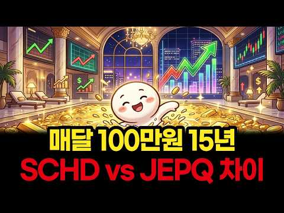
- 설명 앞부분: 같은 날, 같은 돈, 같은 15년. 매달 100만원씩 SCHD와 JEPQ에 나눠 넣은 두 친구의 총자산은 3.7억 vs 3.8억으로 거의 같았습니다. 그런데 세후 월 배당은 86만원 vs 280만원, 3배가 넘게 벌어졌습니다. 월 배당 100만원에 먼저 도착한 쪽이 정말 이긴 걸까요? 네 개의 결승선으로 끝까지 따져봤습니다. 이런 분께 추천합니다 매달 일정 금액을 미국 배당 ETF에 적립하고 있는 직장인 SCHD와 JEPQ 중 무엇을 고를지, 또는 어떤 비율로 섞을지 고민 중인 분 분배율 10%가 넘는 커버드콜 ETF로 갈아타고 …
- 같은 채널 평소 대비 ×2.6 (채널 최근 롱폼 중앙값 8,988회) · 평소 영상: 1억 한 번에 vs 매달 50만원, 20년 뒤 누가 더 부자일까? ∣ SCHD 20년 승… (8,998회) / 첫 3억은 14년, 다음 3억은 7년? 시드머니 3억에서 복리가 눈을 뜬다 [ 재테크/미… (8,977회)
- 대본 없음 (설명) — 음성인식이 끝나면 도입부·흐름이 들어감
- 댓글 2/3: 좋은 점 — 영상 0 · 감사·응원 1 · 더 알고 싶은 것 0 · 아쉬운 점 — 영상 0 · 반박·불만 — 의견 다름 0 · 정치·사회 0 · 경험 공유 0 · 구독·다음 기대 0
  - 감사·응원 👍0 “잘 들었습니다~ 감사합니다 ^^”

### 75. [차트 강의] 100조 운용역이 신입 펀드매니저에게 가르쳤던 차트 패턴 8가지 (박재훈)

- https://www.youtube.com/watch?v=0JHEax_R7DE · 박재훈의 투자농장 · 구독자 21,600 · 조회수 206,708 (×9.6, 하루 8,201.8) · 좋아요 1,991 (1.0%) · 16.5분 · 2026-10-03 · 주제 묶음 6. 종목 고르기·분석 · 형식 인터뷰·강연·대담 · 폴더 `W_0JHEax_R7DE` (웹 승인)
- 썸네일: 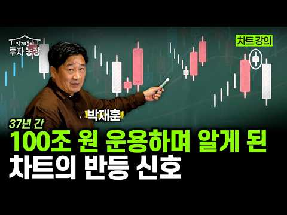
- 설명 앞부분: 10/24(토) 오전 10시, 합정역 인근에서 진행됩니다. 1부는 하반기 투자전략을 점검하고, 2부는 실전 차트강의를 진행합니다. 안녕하세요 이웃님들, 투자 농장지기 박재훈입니다. 저는 투자를 할 때 '손실을 덜 보는 것'이 가장 중요하다고 생각합니다. 그래서 오늘은 차트에서 하락에서 상승, 상승에서 하락으로 추세가 전환되는 신호를 읽는 방법을 알려드렸습니다. 제가 펀드매니저로 일하던 시절, 신입들에게 가르쳤던 내용이기도 합니다. 이웃님들의 투자에 꼭 도움이 되셨기를 바라며.. 하반기 투자전략을 점검하고, 실전 차트 강의를 듣고 …
- 같은 채널 평소 대비 ×23.5 (채널 최근 롱폼 중앙값 8,806회) · 평소 영상: 코스피 방향성 어떻게 될까? 저는 '이격도'를 확인합니다 (박재훈) (8,806회) / "미국 국채금리 더 오를까?" 지금 채권시장의 핵심은 '이것'입니다 (박재훈) (10,202회)
- 대본 없음 (설명) — 음성인식이 끝나면 도입부·흐름이 들어감
- 댓글 76/81: 좋은 점 — 영상 7 · 감사·응원 17 · 더 알고 싶은 것 5 · 아쉬운 점 — 영상 1 · 반박·불만 — 의견 다름 0 · 정치·사회 0 · 경험 공유 3 · 구독·다음 기대 0
  - 좋은 점 — 영상 👍5 “진작에 이런 공부 배웠으면 작전세력들한테 덜 당했을것인데! 지금이라도 공부하고 암기하면서 실제 나타나는 모양들과 비교분석하는 눈 썰미를 키워 보겠습니다. 선생님덕분에 저의 소중한 돈 잘 지키겠습니다.”
  - 좋은 점 — 영상 👍0 “유익하게 감사히 잘 봤습니다”
  - 감사·응원 👍2 “목소리도 시원시원하시고 설명도 깔끔! 감사히 잘 들었습니다. 무료강의 신청했습니다^^”
  - 감사·응원 👍1 “선생님 안녕하세요. 잘 보고 있습니다. 장대양봉에 대해서 어느정도 기준을 알고싶습니다. 말 뜻은 이해하고 있지만 얼마만큼의 길이가 장대양봉이고 장대음봉인지.. 구분하고싶습니다. 감사합니다.”
  - 더 알고 싶은 것 👍1 “선생님 안녕하세요. 잘 보고 있습니다. 장대양봉에 대해서 어느정도 기준을 알고싶습니다. 말 뜻은 이해하고 있지만 얼마만큼의 길이가 장대양봉이고 장대음봉인지.. 구분하고싶습니다. 감사합니다.”
  - 더 알고 싶은 것 👍0 “선생님 이게 개별종목에도 적용이 되는건지 아님 지수 차트에만 해당하는건지 궁금합니다. 영상 잘 봤습니다.”
  - 아쉬운 점 — 영상 👍0 “쏙쏙 이해가 잘되요 반복해서 봐야지 ㄱㅅ”
  - 경험 공유 👍1 “저 엄청 잘해요 추세 전환 찾는거 제가 고수 ㅋ 6월말에 다 던지고 7월말에 샀어요”
  - 경험 공유 👍0 “저희쪽으로 모시고 싶습니다^^ 영상 볼때마다 느낍니다”

### 76. I Let AI Invest for Me on Trading 212, Here's What Happened

- https://www.youtube.com/watch?v=8zUa4JnCrRw · Financial Interest · 구독자 19,500 · 조회수 478,434 (×24.5, 하루 7,058.6) · 좋아요 3,830 (0.8%) · 11.8분 · 2026-08-21 · 주제 묶음 기타 · 형식 정보·해설 (그 밖) · 폴더 `W_8zUa4JnCrRw` (웹 승인)
- 썸네일: 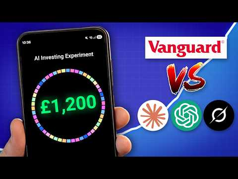
- 챕터: 0:00 The setup · 0:44 Introducing the contestants · 1:23 The initial prompt · 2:45 Building the AI portfolios · 3:30 Making the first investments · 4:03 The results · 5:36 Each AI's portfolio breakdown · 8:48 Who did AI think would win? · 10:56 Who wins long term?
- 설명 앞부분: Honestly we made this to try to show that this is probably a terrible idea long-term. Hope we can prove that long-term! Enjoy. Get free fractional shares worth up to £100 with Trading 212 via this link: This is an affiliate link, we will earn a small commission. If you do not get your free share af…
- 같은 채널 평소 대비 ×83.3 (채널 최근 롱폼 중앙값 5,742회) · 평소 영상: Should You Use InvestEngine in 2026? (5,924회) / The Best Stocks & Shares ISA in 2026 (Lowest Fees… (5,927회)
- 대본 없음 (설명) — 음성인식이 끝나면 도입부·흐름이 들어감
- 댓글 193/201: 좋은 점 — 영상 0 · 감사·응원 0 · 더 알고 싶은 것 0 · 아쉬운 점 — 영상 0 · 반박·불만 — 의견 다름 0 · 정치·사회 0 · 경험 공유 0 · 구독·다음 기대 0

### 77. 복리가 부를 만드는 진짜 시작점｜언제부터 돈이 스스로 일하기 시작할까

- https://www.youtube.com/watch?v=JExUQaROk40 · 돈의 통찰 · 구독자 3,930 · 조회수 134,266 (×34.2, 하루 1,371.1) · 좋아요 1,547 (1.1%) · 17.8분 · 2026-07-22 · 주제 묶음 1. 주식 기초·초보 · 형식 정보·해설 (그 밖) · 폴더 `W_JExUQaROk40` (웹 승인)
- 썸네일: 
- 설명 앞부분: 복리는 단순히 이자를 더해주는 원리가 아닙니다. 대부분의 사람들은 복리의 힘이 나타나기 전에 포기합니다. 이 영상에서는 복리가 언제부터 눈에 보이는 자산 성장으로 이어지는지, 돈이 스스로 일하기 시작하는 진짜 전환점은 언제인지 실제 숫자와 사례를 통해 쉽게 설명합니다. 장기 투자, 경제적 자유, 자산 증식을 목표로 한다면 꼭 끝까지 시청해 보세요.
- 같은 채널 평소 대비 ×9.4 (채널 최근 롱폼 중앙값 14,279회) · 평소 영상: 나이에 비해 가진 게 없다면… 당신은 정말 뒤처진 걸까? (14,279회) / 부유한 은퇴자들이 돈이 있어도 절대 사지 않는 10가지 물건. (14,371회)
- 대본 없음 (설명) — 음성인식이 끝나면 도입부·흐름이 들어감
- 댓글 103/104: 좋은 점 — 영상 9 · 감사·응원 15 · 더 알고 싶은 것 1 · 아쉬운 점 — 영상 0 · 반박·불만 — 의견 다름 1 · 정치·사회 0 · 경험 공유 12 · 구독·다음 기대 1
  - 좋은 점 — 영상 👍15 “도움되는 영상!구독했어요.기억할께요.복리의 힘.주식시장 떠나지 말고 세월로 돈을 엉덩이로 깔고 않아서 건강만 챙기기.감사합니다.”
  - 좋은 점 — 영상 👍8 “좋은 영상 감사합니다”
  - 감사·응원 👍15 “도움되는 영상!구독했어요.기억할께요.복리의 힘.주식시장 떠나지 말고 세월로 돈을 엉덩이로 깔고 않아서 건강만 챙기기.감사합니다.”
  - 감사·응원 👍8 “좋은 영상 감사합니다”
  - 반박·불만 — 의견 다름 👍7 “늦으면 복리의 마법에 못올라타는게 아니다.. 예를들어 50만원씩 매월 납입을 했다고 가정하면 약 1년 8개월 정도면 1천만원을 달성한다.. 그럼 나는 딱 12개월뒤에 1천만원을 넣었다면? 복리가 답인것 같지만 실제는 원금의 규모다, 개별주로 자금을 불리는 사람도 있다…”
  - 경험 공유 👍96 “제가 4년전 2022년 1~2월달 무렵 그당시 요식업 식당 다니고 있을때 어렵게 모은 종잣돈 8천7백만원이 있었어요...그때 이 돈으로 장사해볼까 정말 고민의 고민을 했어요ㅠ실행 직전까지 갔는데 마지막에 내 자신도 컨트롤 못하는데 내가 요식업 차려서 직원을 잘 컨트롤…”
  - 경험 공유 👍32 “진짜 맞말입니다 이제 고작 3년차 연저펀 에쎈피500 하고있는데요 시간이...와ㅏㅏㅏㅏ 아주 맞는말 😊”
  - 구독·다음 기대 👍15 “도움되는 영상!구독했어요.기억할께요.복리의 힘.주식시장 떠나지 말고 세월로 돈을 엉덩이로 깔고 않아서 건강만 챙기기.감사합니다.”

### 78. Stop Guessing! Growth vs Dividend Stocks Explained in 20 Minutes

- https://www.youtube.com/watch?v=hkRXzD3CH3c · Finance Simplified · 구독자 3,600 · 조회수 118,746 (×33.0, 하루 1,239.2) · 좋아요 2,079 (1.8%) · 21.2분 · 2026-07-24 · 주제 묶음 기타 · 형식 정보·해설 (그 밖) · 폴더 `W_hkRXzD3CH3c` (웹 승인)
- 썸네일: 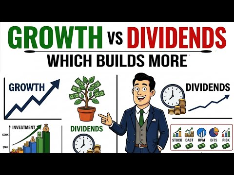
- 챕터: 0:00 The Truth Nobody Tells You Ab… · 0:25 The Biggest Investing Myth · 3:00 What Is a Growth Stock? ($10,… · 5:45 What Is a Dividend Stock? (4%… · 8:30 The $100,000 Challenge: 30-Ye… · 12:15 Who Should Buy Growth Stocks? · 14:15 Who Should Buy Dividend Stock… · 16:15 The Millionaire Strategy (80/… · 18:15 The 6 Biggest Mistakes Invest… · 20:30 The Final Verdict
- 설명 앞부분: Growth vs Dividend Stocks Growth stocks vs dividend stocks — which one actually builds more wealth? We ran the real math on $100,000 over 30 years, and the result surprised us. Most investors pick a side based on a feeling, not a number. Dividends feel safe because cash hits your account every thre…
- 같은 채널 평소 대비 ×23.8 (채널 최근 롱폼 중앙값 4,982회) · 평소 영상: SCHD vs VOO: What Happens to $10,000 After 20 Yea… (5,023회) / $250,000 in Dividend Stocks vs. Bonds: Which Pays… (4,942회)
- 대본 없음 (설명) — 음성인식이 끝나면 도입부·흐름이 들어감
- 댓글 191/191: 좋은 점 — 영상 0 · 감사·응원 0 · 더 알고 싶은 것 0 · 아쉬운 점 — 영상 0 · 반박·불만 — 의견 다름 0 · 정치·사회 0 · 경험 공유 0 · 구독·다음 기대 0

### 79. 4200억 단타 일본 천재가 초간단 매매법, 죽어라 이것만하세요

- https://www.youtube.com/watch?v=UH4UFmdXXo0 · 세력시그널 · 구독자 3,590 · 조회수 91,107 (×25.4, 하루 1,230.8) · 좋아요 2,149 (2.4%) · 20.6분 · 2026-08-15 · 주제 묶음 7. 매매·전략 · 형식 정보·해설 (그 밖) · 폴더 `W_UH4UFmdXXo0` (웹 승인)
- 썸네일: 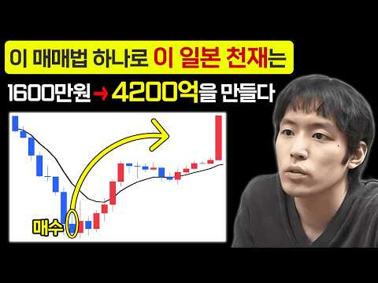
- 챕터: 0:00 BNF 코테카와 타카시 ∣ 1,600만 원으로 시작한… · 2:35 슈퍼 트레이더 자동매매 봇 안내 · 2:46 BNF의 은둔형 투자 생활 ∣ 주식에 인생을 건 전업… · 3:41 제이콤 주식 사건 ∣ BNF가 16분 만에 200억 … · 5:49 독학으로 성공한 BNF ∣ 제시 리버모어와 실전 차트… · 6:30 BNF 투자 원칙 ① 가격 움직임과 시장 심리 · 7:30 BNF 투자 원칙 ② 기계적 손절과 리스크 관리 · 8:12 BNF 투자 원칙 ③ 거래량·캔들로 판단하는 익절 타… · 8:44 BNF 투자 원칙 ④ 공포와 탐욕을 이용한 역발상 매매 · 9:32 BNF 투자 원칙 ⑤ 개장 후 첫 30분 관찰 전략 · 10:17 BNF 투자 원칙 ⑥ 감정을 배제한 확률 기반 매매 · 11:00 BNF 투자 원칙 ⑦ 거래량과 종목 선정 기준 · 12:12 BNF 역추세 매매법 ∣ 급락주 바닥을 찾는 3가지 … · 13:15 25일 이동평균선 이격도 ∣ BNF의 급락주 매수 기준 · 14:21 BNF 차트 세팅 ∣ 25일 지수이동평균선·RSI·M… · 15:25 이격도 측정법 ∣ 25일선 대비 -20~35% 과매도… · 16:12 대형주·중소형주·상승장·하락장 이격도 기준 · 17:31 BNF 매수 타이밍 4단계 ∣ 이격도·RSI·MACD… · 18:25 지지선·저항선 활용 ∣ BNF 역추세 매매법 실전 응용 · 19:35 상승장·하락장별 익절과 손절 전략
- 설명 앞부분: 4200억 단타 일본 천재가 초간단 매매법, 죽어라 이것만하세요 🌟슈퍼트레이더 자동 매매봇 신청하기🌟 🌟 BNF 트레이딩 비법 전자책 신청하기🌟
- 같은 채널 평소 대비 ×29.7 (채널 최근 롱폼 중앙값 3,072회) · 평소 영상: 볼린저밴드 투자기법으로 완벽한 매매 타점 잡는법(차트 보는법 모르는 초보도 가능) (3,072회) / 거래량 보는법과 매매기법, 이 영상만 보면 크게 먹습니다 (3,576회)
- 대본 없음 (설명) — 음성인식이 끝나면 도입부·흐름이 들어감
- 댓글 216/223: 좋은 점 — 영상 5 · 감사·응원 28 · 더 알고 싶은 것 0 · 아쉬운 점 — 영상 1 · 반박·불만 — 의견 다름 6 · 정치·사회 0 · 경험 공유 2 · 구독·다음 기대 0
  - 좋은 점 — 영상 👍1 “BNF 정말 유익한 영상이네요. 감사합니다.”
  - 좋은 점 — 영상 👍0 “BNF~ 이걸 이제 봤네요^^; 유익한 내용 공유에 감사드립니다”
  - 감사·응원 👍5 “ㅋㅋㅋㅋㅋㅋㅋㅋㅋㅋ 그냥 ㅈㄴ 웃기네요 BNF 기본 매매법 저대로 시장에 적용해보세요~ 저 진입 조건에 맞는 종목을 찾을 수 있을까요? 화이팅~!!”
  - 감사·응원 👍4 “BNF 정말 잘 봤습니다 감사합니다”
  - 아쉬운 점 — 영상 👍0 “얘들은 한결같네. 낚시질로 펌핑해놓고 걸려들면 전화해서 하루에 얼마씩 거래하는지 시드는 얼마냐는둥 이따구 소리만 해대면서 막상 지표는 안보내고 어떻게든 빨대꽂아서 학원비 받아쳐 먹으려는 공통적인 수법인데...또한가지는 지표신청서 작성을 하면 그이후로 어중이 떠중이로부…”
  - 경험 공유 👍1 “아 나도 할줄알면 이해라도 하는데 무슨말인지조차 모르는 불쌍한1인”

### 80. "원금 안 깎여요" 진화형 커버드콜 ETF 황금 포트폴리오 공개

- https://www.youtube.com/watch?v=yGuybuoroRI · 투자360 · 구독자 16,300 · 조회수 657,743 (×40.4, 하루 5,577.0) · 좋아요 6,300 (1.0%) · 22.2분 · 2026-07-02 · 주제 묶음 2. 장기투자·ETF·지수 · 형식 브이로그·직접 해본 이야기 · 폴더 `W_yGuybuoroRI` (웹 승인)
- 썸네일: 
- 설명 앞부분: 커버드콜 ETF는 정말 원금을 깎아먹는 상품일까요? 한국투자신탁운용 염정인 부장과 함께 커버드콜 ETF의 오해와 진실, 활용법까지 알아봤습니다. 국내 주식형 커버드콜이 절세에 유리한 이유는 무엇인지, 미국 주식형 커버드콜은 왜 연금저축·IRP 계좌에서 활용하는 것이 좋은지도 함께 짚어봅니다. 또한 국내 커버드콜, 해외 커버드콜, 파킹형 ETF 또는 채권형 ETF으로 구성하는 포트폴리오 전략과 계좌별 인출 순서까지 정리했습니다. 노후자금을 지키면서 매달 현금흐름을 만들고 싶은 분들이라면 끝까지 시청해 주세요. 핵심만 골라보기
- 같은 채널 평소 대비 ×17.1 (채널 최근 롱폼 중앙값 38,497회) · 평소 영상: 환율 내린 지금이 기회! 삼전닉스 팔아서 현금 '여기로' 옮기세요 #부자탐사대 #효라클 … (38,497회) / “지금까지 금투자 방법 다 틀렸습니다” 금 투자, 개미는 ‘이렇게’ 사야 돈 법니다 ∣ … (34,619회)
- 대본 (음성인식(앞 5분), 5.7 음절/초) — 앞부분만, 흐름은 그 안까지 첫 20초: “그러니까 한마디로 원금 깎아 먹지 않고 오히려 원금을 늘려가면서 꾸준한 분배율도 제공하고 있다 예를 들어 산 5억원 정도 은퇴자금이 있고 여기서 매달 300만 원씩 꺼냈으면 이제 20년이 최안되는 사이에 원금이 다 없어지거든요 제가 보통 추천을 드리는 거는 40, 40, 20씩 이제 말씀을 드려요 커버드 콜 매달 높은 배당금을 준다고 하니” — 도입부 유형: 숫자로 시작
- 첫 1분: “그러니까 한마디로 원금 깎아 먹지 않고 오히려 원금을 늘려가면서 꾸준한 분배율도 제공하고 있다 예를 들어 산 5억원 정도 은퇴자금이 있고 여기서 매달 300만 원씩 꺼냈으면 이제 20년이 최안되는 사이에 원금이 다 없어지거든요 제가 보통 추천을 드리는 거는 40, 40, 20씩 이제 말씀을 드려요 커버드 콜 매달 높은 배당금을 준다고 하니 눈길이 가지만 이러다 이거 결국 내 원금 까먹으면서 쓴 돈 아닌가 하는 생각도 듭니다 오늘은 한국 투자신탁 운용 염정인 부장님과 함께 커버드 콜의 오해와 진실을 명쾌하게 풀어드리고 또 소득 공백기 동안 원금 손실 없이 안전하게 월급을 꺼냈을 수 있는 실전 연금 세팅법까지 상세하게 알아보겠습니다 부장님 안녕하세요 안녕하세요 반갑습니다 부장님과 함께 저희가 이제 소중한 노후”
- 흐름 (90초마다 첫 문장): 0:00 그러니까 한마디로 원금 깎아 먹지 않고 → 1:33 내가 운 좋게 정년까지 갔다 하더라도 → 3:03 커버드콜 말은 좀 어렵지만 → 4:32 나는 그냥 배당만 받고
- 댓글 577/580: 좋은 점 — 영상 4 · 감사·응원 19 · 더 알고 싶은 것 29 · 아쉬운 점 — 영상 8 · 반박·불만 — 의견 다름 7 · 정치·사회 1 · 경험 공유 24 · 구독·다음 기대 0
  - 좋은 점 — 영상 👍10 “그렇게 노다지 좋으면 혼자만 알고있지 왜 동네방네 소문 내고 다니는지 이해가 잘 안가네요..”
  - 감사·응원 👍41 “3:37 거위가 어느 정도 이상으로 홀쭉해지고 나면, 다시는 이전 상태만큼 살이 오르지 "않을지도 모른다는" 위험성을 알려주시는게 맞지 않을까요? 4:40 옛날 커버드콜 상품들은 그러했지만, 최근 출시된 상품들은 이제 그러한 문제점을 개선했다 라고 주장하기엔, 닷컴버…”
  - 감사·응원 👍35 “댓글로도 배웁니다 감사합니다 😊”
  - 더 알고 싶은 것 👍7 “상품을 예시로 설명해주셨으면 좋을거같은데요”
  - 더 알고 싶은 것 👍6 “커버드콜 상품은 기본적으로 주가가올라도 상승에 제한이 있는상품입니다. 지금은 주가 상승기이니 커버콜 상품이 판을치는듯 합니다. 하락시기에는 어떨까요? 판단은 개인몫 2022년 같은 장기 하락기에도 커버콜 상품 권하는분 있을까요? 약장사들 많습니다. 차라리 S&P500…”
  - 아쉬운 점 — 영상 👍1 “본주가 하락하먼 원금도 떨어지는데 제목 어그로가 좀 있네요. 정확히는 배당 준다고 원금 까먹지 않은 커버드콜이 있는거겠지요.”
  - 아쉬운 점 — 영상 👍0 “커버드콜은 누가 돈을 법니까? 옵션장사로 수익내서 분배하는것이기 때문에 옵션장사를 하는 증권사가 수수료를 가져갑니다. 주식이나 주식100% ETF는요? 수수료 경쟁때문에 증권사 수수료가 거의 없다시피 합니다. 누가 돈을버는지 핵심만 이해하면 뭘 해야하는지 뭘 안해야하…”
  - 반박·불만 — 의견 다름 👍28 “지금 시장이 상승하고 있으니까 원금 보장 된다고 떠드는데 하락장 들어가면 바로 원금 박살나고 원금에서 배당 나간다. 위험없이 연15% 배당 나오는 상품이 있는데 세계적인 투자자들이 멍청해서 투자 안하고 있을거라 생각하는지 정말 웃기는 인생들 많구나...ㅉㅉㅉ”
  - 반박·불만 — 의견 다름 👍12 “원금 깎이는게 나쁜게 아닙니다. 세금전략 짤때 배당과 양도, 종합소득 사이의 간격 맞출때 사용함 그리고 사회초년생이면 배당주는 사지마세요 가장 비싼 시간가치를 배당이란 헐값에 파는거임”
  - 경험 공유 👍30 “커버드콜 3년째 하고 있는데ᆢ 좋습니다 ^^ 하락장이오든ᆢ 상승장이 오든 신경끄고 있을수 있어서ᆢ 짱입니다^^”
  - 경험 공유 👍5 “커버드콜 2년째 하고 있는데 개별주보다 훨씬 좋습니다 당연히 분산투자가 되어야 하고 국내지수, 미국지수, 반도체, 미배당, 금 etf 등등 성장도 하고 하락장에는 어느정도 방어되는 섹터도 있어야 되는겁니다 커버드콜의 최고의 매력은 하락장에도 꾸준히 나오는 분배금으로 …”

