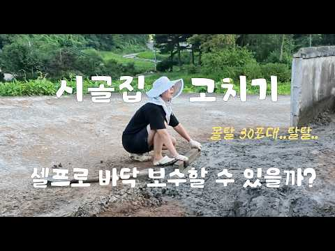
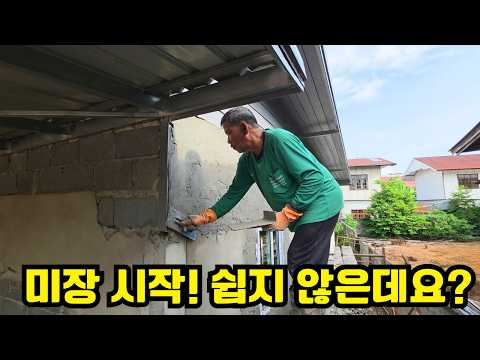
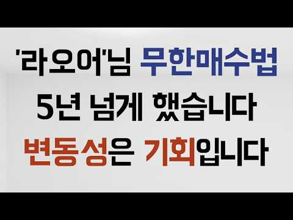
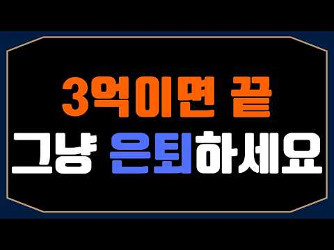

# 주식 — 성공 사례 분석: 사례별 자세히 #41–#67

`analysis.md` 의 9번 (같은 # 번호). 자동 생성 — `tools/success_analysis.py` v1.4.1 (2026-10-15 14:13 UTC). ※ 연구·교육용 — 투자 권유가 아님.

### 41. [주식차트보는법] 단타말고 이 '차트패턴' 하나로 꾸준히 수익낸 엄청난 비결 지금 딱 한번만 노출하겠습니다. 주식하는법중 이게 최고입니다 (종가베팅 매매기법 및…

- https://www.youtube.com/watch?v=3h7Di1vQHgY · 주식차트연구소 · 구독자 1,270 · 조회수 12,707 (×10.0, 하루 274.6) · 좋아요 134 (1.1%) · 14.6분 · 2026-08-30 · 주제 묶음 6. 종목 고르기·분석 · 형식 정보·해설 (그 밖) · 폴더 `W_3h7Di1vQHgY` (웹 승인)
- 썸네일: 
- 설명 앞부분: [주식차트보는법] 단타말고 이 '차트패턴' 하나로 꾸준히 수익낸 엄청난 비결 지금 딱 한번만 노출하겠습니다. 주식하는법중 이게 최고입니다 (종가베팅 매매기법 및 종목선별)
- 같은 채널 평소 대비 ×24.2 (채널 최근 롱폼 중앙값 526회) · 평소 영상: [주식차트보는법] 유료강의고 나발이고 상한가 뜨고 급등했을 때 우리가 매수 할 수 있는 … (527회) / [주식차트보는법] 주식 깡통차고 "이 차트패턴"하나 얻었는데 지금은 10억준다해도 공개안… (525회)
- 대본 없음 (설명) — 음성인식이 끝나면 도입부·흐름이 들어감
- 댓글 1/1: 좋은 점 — 영상 0 · 감사·응원 0 · 더 알고 싶은 것 0 · 아쉬운 점 — 영상 0 · 반박·불만 — 의견 다름 0 · 정치·사회 0 · 경험 공유 0 · 구독·다음 기대 0

### 42. [차트 강의] 100조 운용역이 신입 펀드매니저에게 가르쳤던 차트 패턴 8가지 (박재훈)

- https://www.youtube.com/watch?v=0JHEax_R7DE · 박재훈의 투자농장 · 구독자 20,300 · 조회수 189,097 (×9.3, 하루 15,158.9) · 좋아요 1,878 (1.0%) · 16.5분 · 2026-10-03 · 주제 묶음 6. 종목 고르기·분석 · 형식 인터뷰·강연·대담 · 폴더 `W_0JHEax_R7DE` (웹 승인)
- 썸네일: 
- 설명 앞부분: 10/24(토) 오전 10시, 합정역 인근에서 진행됩니다. 1부는 하반기 투자전략을 점검하고, 2부는 실전 차트강의를 진행합니다. 안녕하세요 이웃님들, 투자 농장지기 박재훈입니다. 저는 투자를 할 때 '손실을 덜 보는 것'이 가장 중요하다고 생각합니다. 그래서 오늘은 차트에서 하락에서 상승, 상승에서 하락으로 추세가 전환되는 신호를 읽는 방법을 알려드렸습니다. 제가 펀드매니저로 일하던 시절, 신입들에게 가르쳤던 내용이기도 합니다. 이웃님들의 투자에 꼭 도움이 되셨기를 바라며.. 하반기 투자전략을 점검하고, 실전 차트 강의를 듣고 …
- 같은 채널 평소 대비 ×30.4 (채널 최근 롱폼 중앙값 6,228회) · 평소 영상: 100조 펀드매니저가 하락장에서 버틸 수 있었던 이기는 투자 원칙 (박재훈) (6,762회) / 미국 국가 부채 40조 달러, 당장 금 투자해도 될까? '이 숫자'부터 확인하세요 (박재… (5,695회)
- 대본 없음 (설명) — 음성인식이 끝나면 도입부·흐름이 들어감
- 댓글 76/76: 좋은 점 — 영상 7 · 감사·응원 17 · 더 알고 싶은 것 5 · 아쉬운 점 — 영상 1 · 반박·불만 — 의견 다름 0 · 정치·사회 0 · 경험 공유 3 · 구독·다음 기대 0
  - 좋은 점 — 영상 👍5 “진작에 이런 공부 배웠으면 작전세력들한테 덜 당했을것인데! 지금이라도 공부하고 암기하면서 실제 나타나는 모양들과 비교분석하는 눈 썰미를 키워 보겠습니다. 선생님덕분에 저의 소중한 돈 잘 지키겠습니다.”
  - 좋은 점 — 영상 👍0 “유익하게 감사히 잘 봤습니다”
  - 감사·응원 👍2 “목소리도 시원시원하시고 설명도 깔끔! 감사히 잘 들었습니다. 무료강의 신청했습니다^^”
  - 감사·응원 👍1 “선생님 안녕하세요. 잘 보고 있습니다. 장대양봉에 대해서 어느정도 기준을 알고싶습니다. 말 뜻은 이해하고 있지만 얼마만큼의 길이가 장대양봉이고 장대음봉인지.. 구분하고싶습니다. 감사합니다.”
  - 더 알고 싶은 것 👍1 “선생님 안녕하세요. 잘 보고 있습니다. 장대양봉에 대해서 어느정도 기준을 알고싶습니다. 말 뜻은 이해하고 있지만 얼마만큼의 길이가 장대양봉이고 장대음봉인지.. 구분하고싶습니다. 감사합니다.”
  - 더 알고 싶은 것 👍0 “선생님 이게 개별종목에도 적용이 되는건지 아님 지수 차트에만 해당하는건지 궁금합니다. 영상 잘 봤습니다.”
  - 아쉬운 점 — 영상 👍0 “쏙쏙 이해가 잘되요 반복해서 봐야지 ㄱㅅ”
  - 경험 공유 👍1 “저 엄청 잘해요 추세 전환 찾는거 제가 고수 ㅋ 6월말에 다 던지고 7월말에 샀어요”
  - 경험 공유 👍0 “저희쪽으로 모시고 싶습니다^^ 영상 볼때마다 느낍니다”

### 43. 월 100만원 ETF 투자하면, 60대에 "진짜 부자"가 됩니다

- https://www.youtube.com/watch?v=WGkQ7wwHHlQ · 농부의 경제학 · 구독자 8,260 · 조회수 76,665 (×9.3, 하루 1,174.4) · 좋아요 1,370 (1.8%) · 13.4분 · 2026-08-11 · 주제 묶음 2. 장기투자·ETF·지수 · 형식 정보·해설 (그 밖) · 폴더 `W_WGkQ7wwHHlQ` (웹 승인)
- 썸네일: 
- 설명 앞부분: 50세 노후 준비, 결코 늦지 않았습니다. 주변에서 스무 살부터 시작해야 복리가 붙는다고 말하지만, 50세부터 매달 100만 원씩 15년 동안 미국 ETF에 투자하면 65세 은퇴 후 세금을 떼고도 매달 236만 원의 마르지 않는 현금흐름을 만들 수 있습니다. 오늘 영상에서는 미국 대표 ETF인 SCHD(40%), SPYM(40%), QQQM(20%) 포트폴리오를 통해 배당 수익과 자산 성장을 동시에 챙기는 가장 현실적인 노후 자금 설계법을 상세히 풀어드립니다. 은퇴 후 원금을 깎아 먹지 않고 죽을 때까지 통장 잔고가 늘어나는 미국…
- 같은 채널 평소 대비 ×8.9 (채널 최근 롱폼 중앙값 8,646회) · 평소 영상: 상위 1% 투자자들이 주식 창 끄고 매일 하는 '… (8,673회) / 내가 사면 떨어지고 팔면 오르는 '진짜 이유' (8,619회)
- 대본 없음 (설명) — 음성인식이 끝나면 도입부·흐름이 들어감
- 댓글 82/82: 좋은 점 — 영상 4 · 감사·응원 7 · 더 알고 싶은 것 5 · 아쉬운 점 — 영상 1 · 반박·불만 — 의견 다름 0 · 정치·사회 1 · 경험 공유 5 · 구독·다음 기대 0
  - 좋은 점 — 영상 👍15 “개꿀팁!!이렇게 해볼게요”
  - 좋은 점 — 영상 👍4 “어렵네요. PDF로 정리해 주시면 감사하겠습니다”
  - 감사·응원 👍15 “비슷한 관련된 영상 정말 많이 봤는데, 이 영상이 제일 잘 정리가 되어 있고, 이해 하기가 쉬운 것 같아요. 주변에 많이 공유 하겠습니다. 영상 감사드려요.👍”
  - 감사·응원 👍4 “어렵네요. PDF로 정리해 주시면 감사하겠습니다”
  - 더 알고 싶은 것 👍7 “은퇴후(10년후예상)현금흐름이 있어서 하락장 방어 가능하다면 슨피 500, 나스닥 100을 5:5로 가져가도 괜찮을까요?”
  - 더 알고 싶은 것 👍4 “어렵네요. PDF로 정리해 주시면 감사하겠습니다”
  - 아쉬운 점 — 영상 👍6 “Schd가 월배당 이었으면 좋을텐데, 아쉽습니다”
  - 경험 공유 👍10 “51세, 배당적립식 투자 3년차 입니다 약 월50만원 배당금 받습니다 (가족 1인당 65세전 월100목표로) 월 150만원 적립식으로 모아갑니다 미래를 알수는 없으나 긍정론자라서ㆍㆍㆍ”
  - 경험 공유 👍2 “뻥이다ETF엔터테이먼트4년째 마이너스53%부추기지마라 이ㅅ 본전안올것같음”

### 44. 와..미친.. 캔들 차트 보는 법 핵심을 공개한다고? (주식 강의 추천, 주식 초보 매매 방법)

- https://www.youtube.com/watch?v=KwvGol5A8m4 · 트트남 | 주식 차트 보는법 · 구독자 1,410 · 조회수 12,792 (×9.1, 하루 276.0) · 좋아요 166 (1.3%) · 15.8분 · 2026-08-30 · 주제 묶음 1. 주식 기초·초보 · 형식 인터뷰·강연·대담 · 폴더 `W_KwvGol5A8m4` (웹 승인)
- 썸네일: 
- 설명 앞부분: [수익부터 출금까지 성공시키는 현실적인 방법] [소통방 입장하기] 차트 보는 법, 이 영상 하나로 기준부터 다시 잡아보세요. 주식 공부를 해도 실전 매매가 계속 흔들리는 이유는 기술적 분석을 몰라서만이 아닙니다. 진짜 문제는 이평선, RSI, MACD, 매물대, 지지저항, 피보나치, 추세선, 엘리엇 파동, 하모닉 패턴, 거래량을 따로따로 외우고 실전 차트 앞에서는 무엇을 먼저 봐야 할지 모른다는 것입니다. 이번 영상에서는 차트 보는 법을 기초부터 실전까지 정리합니다. 이평선으로 추세를 보는 법, RSI와 MACD 다이버전스로 반등…
- 같은 채널 평소 대비 ×27.7 (채널 최근 롱폼 중앙값 462회) · 평소 영상: "개미가 망하는 이유" 얘기할 건데 퍼트리면 안된다 ∣ 11년차 현직 트레이더가 알려드립… (462회) / RSI 지표 보는법, 이 영상 하나로 누구나 쉽게 끝냅니다 (사용법, 매매기법, 다이버전… (369회)
- 대본 없음 (설명) — 음성인식이 끝나면 도입부·흐름이 들어감
- 댓글 2/2: 좋은 점 — 영상 0 · 감사·응원 1 · 더 알고 싶은 것 0 · 아쉬운 점 — 영상 0 · 반박·불만 — 의견 다름 0 · 정치·사회 0 · 경험 공유 0 · 구독·다음 기대 0
  - 감사·응원 👍1 “😊감사합니다 열씨미 노력해 보겠습니다 ❤”

### 45. 월급없는 현실, 일하지않고 배당금만 받고 살아가는 미혼남 생존기

- https://www.youtube.com/watch?v=mcd_S953Gno · 배당아저씨 · 구독자 32,400 · 조회수 292,780 (×9.0, 하루 2,828.5) · 좋아요 4,719 (1.6%) · 8.6분 · 2026-07-04 · 주제 묶음 3. 배당 · 형식 정보·해설 (그 밖) · 폴더 `W_mcd_S953Gno` (웹 승인)
- 썸네일: 
- 설명 앞부분: 영상 속 배당아저씨의 미니멀라이프 내돈내산 재료&용품들 (쿠팡 파트너스 및 인플루언서 활동의 일환으로 구매시 일정액의 수수료를 제공 받을 수 있습니다) 이 채널은 저의 투자 경험과 생각을 공유하는 공간입니다. 저의 투자 방식을 그대로 따라 하시는 것은 권장드리지 않으며, 충분한 고민과 공부 후 판단하시길 바랍니다.
- 같은 채널 평소 대비 ×5.9 (채널 최근 롱폼 중앙값 49,500회) · 평소 영상: 미국주식 3억, 배당금으로 직장 없이 살고 있어요_배당파이어 장단점 (50,568회) / 배당금으로 혼자사는 미혼남의 현실 (48,432회)
- 대본 없음 (설명) — 음성인식이 끝나면 도입부·흐름이 들어감
- 댓글 1,076/1,076: 좋은 점 — 영상 9 · 감사·응원 57 · 더 알고 싶은 것 58 · 아쉬운 점 — 영상 3 · 반박·불만 — 의견 다름 11 · 정치·사회 8 · 경험 공유 107 · 구독·다음 기대 12
  - 좋은 점 — 영상 👍5 “제가 준비하고 있는 삶을 일찍 시작하고 계셨네요.. 구독/좋아요 찍고 갑니다. 좋은 정보 공유 하입시다. 응원합니다 👍👍👍👍”
  - 좋은 점 — 영상 👍1 “저와 많이 비슷하신것같아 구독하고 즐겨보는중입니다. 오늘도 좋은 영상 감사합니다”
  - 감사·응원 👍88 “남의 기준은 전혀 중요하지않더라고요, 인생 별것두없고, 내가 필요한 월 생활비를 배당으로 세팅후 소소하게 행복누리며 건강하게사는게 최고인거같아요. 응원합니다.😊”
  - 감사·응원 👍87 “저는 84년생 여자로 미국 시민권자이고 그래서 미국에 계좌가 있고 달러로 투자하는데요. 저는 2021년 11월에 38만불로 (3배 레버리지 etf만 투자) 조기은퇴했다가 2022년 하락장에 1/3 토막나서 잠깐 다시 알바해서 3만 3천불 더 투자해서 2023년 3월에…”
  - 더 알고 싶은 것 👍20 “나의 목표인 삶을 살고 계세요~영상 자주 올려주세요~큰 힘이 되고 있어요. 좋은하루 보내세요!”
  - 더 알고 싶은 것 👍15 “배당이 꾀 나오시는데 금융종합과세랑 건보료 어떤지 알고싶습니다”
  - 아쉬운 점 — 영상 👍1 “이 좋은 걸 님 부모님이 아셨으면 딱이었을 것 같네요~~ 너무나 아쉽네요.”
  - 아쉬운 점 — 영상 👍0 “근로소득 없이 배당금 2,000만 원이며, 집 5천만 원(공시가), 차가 없는 지역가입자의 세금과 건보료 요약입니다. 복사해서 바로 쓰실 수 있게 핵심만 정리했습니다. ​1. 세금: 추가 납부 없음 (종결) ​배당금 받을 때 이미 15.4%(308만 원)를 원천징수로…”
  - 반박·불만 — 의견 다름 👍15 “세금 건보 장난이 아닙니다.배당월300세금 25만원 건보30여만원 거의60만원 몌상.세금신고 안했다면. 나중에 미신고가산세폭탄맞음.3억이면 m7+몇개만 잘굴려도. 500이상 나옵니다.집,직장없으니 건보 3만원데 금융소득 종과세 배당세없이”
  - 반박·불만 — 의견 다름 👍3 “관두고싶은데,공뭔이라 못 관두겠어요 이것또한 욕심이라는걸 저도 압니다.. 부럽습니다..부럽습니다.. 40후반되니 여기저기 아프고 , 6월달 치과포함 , 피부과 등 병원비 백만원정도 들어가네요. 나이들면 병원비 많이 들어간다더니, 딱히 지병이 있는것도 아닌데, 벌써부터…”
  - 정치·사회 👍2 “10살입니다 하이닉스 단타쳐서 한달만에 총 6천억원 벌었습니다 그돈으로 강남. 아파트 5채 사놓고. 파이어족 함. 요즘엔 단타로 하루에 30억정도 벌고 만족함 2ㅇ살 성인이 되면 대통령 출마해서 돈을 더 벌생각임”
  - 정치·사회 👍0 “이렇게 배당금 받아서 다람쥐 루틴으로 사는 것보다는 더 보람있는 일을 하시면서 사시면 좋을 것 같아요.. 그냥 죽을 때까지 루틴을 돌리면 ... 나중에 남는 건 상속인이 없어서 3 억원 모두를 나라가 가져가고 고독사한 자신 밖에 없어요. 저라면, 컨테이너 등 짐 보관…”
  - 경험 공유 👍1,066 “40세 찍으면서 분당인근 자가아파트와 강남역에 오피스텔, 금융자산 5억 정도 갖고 파이어 했습니다. 50세가 조금 넘은 지금 그 자산들이 22억을 찍고 있네요. 엄마와 여행다니고, 내가 좋아하는 취미생활하고 한달에 두어번 봉사활동하면서 내가 하고 싶은 일들만 하고 사…”
  - 경험 공유 👍272 “4억정도 모은 40대 아재입니다 저도 이번달 까지만하고 저한테 휴식을 제공하려고합니다 지친 내몸을 보니 더 일을 하기 힘들더라고요”
  - 구독·다음 기대 👍31 “맞아요. 이거에요 이거.. 제가 원하는 삶. 하루하루 알람맞춰놓고 일찍 일어나 출근해서 하루종일 정신 나가고 욕먹고.. 이런 거에 치이기 싫어요. 돈 많이 버는게 중요한게 아니라 이렇게 하루하루 뭐할지 고민하며 사는 삶이 즐거울 것 같다고 느끼고 있습니다. 직장생활 …”
  - 구독·다음 기대 👍5 “제가추구하는삶이네요~~구독합니다”

### 46. 시골집 고치기 ∣ 몰탈 30포대로 흙바닥 보수부터 콘크리트 미장까지 ∣ 구옥 셀프 리모델링

- https://www.youtube.com/watch?v=fPN8ENZl2Y8 · 오손도손 하우스 Odo house · 구독자 1,580 · 조회수 13,989 (×8.8, 하루 282.3) · 좋아요 93 (0.7%) · 7.3분 · 2026-08-27 · 주제 묶음 4. 미국·해외주식 · 형식 정보·해설 (그 밖) · 폴더 `W_fPN8ENZl2Y8` (웹 승인)
- 썸네일: 
- 설명 앞부분: 안녕하세요. 오손도손하우스입니다. 인테리어 초보, 4인가족 구옥 주택 셀프 리모델링 과정! 5도 2촌 생활할때는 몰랐던 문제를 마주했습니다. 직접 살아보니 주차장에 빗물이 고여서 질펀한 흙바닥이 고민거리였는데, 마당 작업하면서 주차장 입구쪽에 배수 문제를 함께 해결했습니다-! 서투르지만 직접 하나씩 채워가는 이 시간이 참 뿌듯하고 소중합니다. 오늘도 완벽하지 않지만 행복했던 시골에서의 하루, 함께해 주셔서 감사합니다. 브금대통령
- 같은 채널 평소 대비 ×3.4 (채널 최근 롱폼 중앙값 4,148회) · 평소 영상: 시골집 고치기 ∣ 샷시 설치 준비 ∣ 독일식 시스템 창호 가격 300만원대 시공한 팁 (4,148회) / 시골집 고치기 슬레이트 지붕 철거 지원사업 신청했더니? (3,986회)
- 대본 없음 (설명) — 음성인식이 끝나면 도입부·흐름이 들어감
- 댓글 9/9: 좋은 점 — 영상 0 · 감사·응원 0 · 더 알고 싶은 것 0 · 아쉬운 점 — 영상 0 · 반박·불만 — 의견 다름 0 · 정치·사회 0 · 경험 공유 0 · 구독·다음 기대 0

### 47. 코스피 9,000에도 웃지 못하는 ∣ 고독한 ITZY(있지) 팬미팅 [ENG]

- https://www.youtube.com/watch?v=SKogeS0bYpM · 룩백lkbk · 구독자 46,800 · 조회수 365,892 (×7.8, 하루 3,288.7) · 좋아요 13,838 (3.8%) · 27.3분 · 2026-06-26 · 주제 묶음 5. 국내주식 · 형식 정보·해설 (그 밖) · 폴더 `W_SKogeS0bYpM` (웹 승인)
- 썸네일: 
- 설명 앞부분: 투자는 여윳돈으로 하는 게 정신건강에 이롭습니다.
- 같은 채널 평소 대비 ×1.2 (채널 최근 롱폼 중앙값 310,716회) · 평소 영상: 같은 88년생이라고 다 같은 88인 줄 아나 ∣ 고독한 팬미팅 태양 1부 [ENG] (312,695회) / 사랑에 관한 시시한 고찰 ∣ 포포 : 죽어도 사랑해 ∣ OKINAWA.3 (308,736회)
- 대본 없음 (설명) — 음성인식이 끝나면 도입부·흐름이 들어감
- 댓글 466/466: 좋은 점 — 영상 1 · 감사·응원 4 · 더 알고 싶은 것 4 · 아쉬운 점 — 영상 1 · 반박·불만 — 의견 다름 1 · 정치·사회 0 · 경험 공유 0 · 구독·다음 기대 1
  - 감사·응원 👍9 “요즘 매일 1영상이 나오네 있지 화이팅!”
  - 감사·응원 👍2 “01즈가 진짜 오랜만에 유튜브에 ☺️💕 초대해주셔서 너무 감사합니당 믿지는 행복합니다 16:27 령이누나 진짜 너무 예쁘다… 멍 때리고 보게 되는 미모”
  - 더 알고 싶은 것 👍2 “새미의 잔망스러움과 끼 부리는 눈빛이 너무 그리워요! 다음 고독한 팬미팅 여자 아이돌 편에 새미도 팬으로 특별 출연시켜 주시면 안 되나요? 제발요 피디님!”
  - 더 알고 싶은 것 👍1 “어디서 웃어야지 알려주세요”
  - 아쉬운 점 — 영상 👍0 “병재님이 신고계신 부츠 출처를 알고 싶은데 부탁 드립니다.”
  - 반박·불만 — 의견 다름 👍0 “난 있지팬은 아닌데 류진 채령 이친구들은 뭔가 좋음 ㅋㅋ그 막내유나는 원래 유명하니 그러고 예지라는 리더랑 리아라는 친구도 좀 좋긴하더라고 그다음은 그냥 그럼....”
  - 구독·다음 기대 👍2 “음...유진님은 가진 매력 대비 너무 인지도가 낮음....내보기엔 좀더 활동적이면 지금보단 훨 인기 더 많을듯 ㅎ기대합니다 ❤”

### 48. 삼성전자 지금 시작인가? 노무라가 목표주가 67만원 제시한 이유가 소름입니다... 여기서 90% 더 오를 수 있다? 상승 전망 전부 분석했습니다 #삼성전자 #삼…

- https://www.youtube.com/watch?v=JJG1mtkTN6g · 코스피 읽는 개미 · 구독자 2,190 · 조회수 16,840 (×7.7, 하루 152.5) · 좋아요 395 (2.4%) · 15.7분 · 2026-06-27 · 주제 묶음 1. 주식 기초·초보 · 형식 정보·해설 (그 밖) · 폴더 `W_JJG1mtkTN6g` (웹 승인)
- 썸네일: 
- 설명 앞부분: 삼성전자, 정말 다시 시작일까요? 노무라가 삼성전자 목표주가를 67만원으로 상향하며 시장의 관심이 집중되고 있습니다. AI 반도체 수요 확대, 메모리 실적 개선, 비용 부담 감소까지. 하지만 비메모리 사업 리스크와 시장 변동성도 함께 체크해야 합니다. 이번 영상에서는 목표주가 상향 이유 90% 상승 전망의 근거 앞으로 주목해야 할 핵심 포인트 투자자가 놓치면 안 되는 위험 요소까지 정리했습니다. 여러분은 삼성전자, 아직 기회라고 보시나요?
- 같은 채널 평소 대비 ×37.3 (채널 최근 롱폼 중앙값 451회) · 평소 영상: [ 삼성전자 ] 대폭발 시작되나? 반도체 수출 150% 급증…주가 대반전 "신호" 떴다! (451회) / 삼성전자 26만원 무너졌다...지금 흔들리는 투자자분들 "이것" 확인하세요 (460회)
- 대본 없음 (설명) — 음성인식이 끝나면 도입부·흐름이 들어감
- 댓글 25/25: 좋은 점 — 영상 0 · 감사·응원 1 · 더 알고 싶은 것 0 · 아쉬운 점 — 영상 0 · 반박·불만 — 의견 다름 0 · 정치·사회 0 · 경험 공유 0 · 구독·다음 기대 1
  - 감사·응원 👍1 “감사합니다 정보 🎉❤”
  - 구독·다음 기대 👍1 “구독완료”

### 49. 연금고수들이 연금저축계좌 반드시 담는 ETF 3가지

- https://www.youtube.com/watch?v=iMkvDXx86dE · 경제나침반 · 구독자 14,000 · 조회수 105,121 (×7.5, 하루 1,324.1) · 좋아요 2,048 (1.9%) · 25.2분 · 2026-07-28 · 주제 묶음 2. 장기투자·ETF·지수 · 형식 정보·해설 (그 밖) · 폴더 `W_iMkvDXx86dE` (웹 승인)
- 썸네일: 
- 설명 앞부분: 📈 오늘 시장에서 꼭 알아야 할 경제와 투자 인사이트를 쉽고 명확하게 정리해드립니다. 💡 주식, ETF, 미국주식, 경제 전망, 금리, AI, 반도체, 부동산까지 투자자가 반드시 알아야 할 핵심 정보를 함께 살펴보세요. 이번 영상에서는 최신 경제 뉴스와 금융시장 흐름을 바탕으로 투자에 도움이 되는 핵심 내용을 쉽고 이해하기 편하게 설명해드립니다. 경제나침반은 경제공부, 주식투자, ETF 투자, 미국주식, 한국 증시, 경제 전망, 재테크, 자산관리, 금리와 환율, AI 및 반도체 산업 등 다양한 주제를 객관적인 자료와 시장 흐름을 …
- 대본 없음 (설명) — 음성인식이 끝나면 도입부·흐름이 들어감
- 댓글 67/67: 좋은 점 — 영상 3 · 감사·응원 5 · 더 알고 싶은 것 2 · 아쉬운 점 — 영상 1 · 반박·불만 — 의견 다름 1 · 정치·사회 0 · 경험 공유 3 · 구독·다음 기대 0
  - 좋은 점 — 영상 👍3 “좋은 정보 감사합니다~^^ 나스닥과 S&P500, 미국배당다우존스, 미국 10년국채랑 단기채권, 국내 고배당, 금, 국내외 리츠 ETF 갖고 있네요. IRP에서 안전자산 30%는 나스닥미국채혼합이랑 미국배당미국채혼합으로 채우고 있고요~”
  - 감사·응원 👍3 “감사합니다”
  - 감사·응원 👍3 “좋은 정보 감사합니다~^^ 나스닥과 S&P500, 미국배당다우존스, 미국 10년국채랑 단기채권, 국내 고배당, 금, 국내외 리츠 ETF 갖고 있네요. IRP에서 안전자산 30%는 나스닥미국채혼합이랑 미국배당미국채혼합으로 채우고 있고요~”
  - 더 알고 싶은 것 👍4 “56세 인데 절세계좌만 만들고 아직 아무것도 못담았어요 일반주식계좌에는 다행히 반도채, 원전쪽 수익률 좋아 100프로 넘다가 지금은 50프로 아래로 내려가는 중이고요.' 각설하고 제 나이때는 연금저축 시작해봐야 늦을까요 아직 안 늦었다면 절세계죄로 담을 종목과 최대한…”
  - 더 알고 싶은 것 👍4 “isa / 퇴직연금 / irp / 주식계좌 etf 뭐 담아야 할지? 궁금합니다.”
  - 아쉬운 점 — 영상 👍1 “화질구지다”
  - 반박·불만 — 의견 다름 👍0 “액티브 국내형 ETF면 손해가 아닙니다.”
  - 경험 공유 👍25 “일단 본인이 주식에 돈을 쓸 여윳돈이 얼마나 되느냐에따라 다름 돈이 많아서 세액공제 받고 또 투자 여력이 있다면 일반계좌에 국내주식 담아도 됨. 그런데 세액공제 받을만큼만 여력이 된다? 세금 신경쓰지말고 국내주식 담아도 됨. 코스피 2500에서 9000 갈때까지 세금…”
  - 경험 공유 👍7 “연금 저축 공부좀 해봤는데 여기 정보가 진짜 정확하고 알차고 핵샘을 다 담고 있네요”

### 50. ETF 이 '2가지'만 사두면 됩니다. '나머지는 필요없어요' 100억 자산 관리자의 꿀팁(백승호 단장 풀버전) #ETF #배당주 #주식 #백승호

- https://www.youtube.com/watch?v=1qlywudP2oY · 자람들 - 자립하는사람들 · 구독자 33,600 · 조회수 250,018 (×7.4, 하루 7,961.0) · 좋아요 2,081 (0.8%) · 69.7분 · 2026-09-14 · 주제 묶음 2. 장기투자·ETF·지수 · 형식 인터뷰·강연·대담 · 폴더 `W_1qlywudP2oY` (웹 승인)
- 썸네일: 
- 설명 앞부분: 👤 오늘의 게스트: 백승호 단장 개인 재무 컨설팅 전문가 & 유튜버·작가로도 활동 20년간 몇백 명의 고객 자산을 관리해온 재무 컨설턴트입니다. 현재 관리하는 총 자산만 100억원이 넘지만, 폭락장에도 노트북에 손 하나 대지 않을 만큼 평온한 태도로 유명합니다. 비결은 단 하나, "투자해도 되는 돈"과 "투자하면 안 되는 돈"을 철저히 구분하는 원칙입니다. 시드머니 없이 매주 조금씩 사 모으는 전략, 차트나 재무제표 대신 "내 지갑"을 믿고 애플·넷플릭스·구글 같은 주식을 고르는 방법, 그리고 레버리지·인버스 상품에 대한 강한 경…
- 같은 채널 평소 대비 ×10.0 (채널 최근 롱폼 중앙값 24,892회) · 평소 영상: 월 500만원 배당 노하우, 시드 5천 '이렇게' 구성하세요. 평범한 직장인이 파이어한 … (24,892회) / 연 2200 배당금받는, 전직 배달 기사.. 3억으로 은퇴했습니다. (또배당 3부) #배… (25,523회)
- 대본 없음 (설명) — 음성인식이 끝나면 도입부·흐름이 들어감
- 댓글 71/71: 좋은 점 — 영상 6 · 감사·응원 11 · 더 알고 싶은 것 3 · 아쉬운 점 — 영상 4 · 반박·불만 — 의견 다름 1 · 정치·사회 1 · 경험 공유 1 · 구독·다음 기대 1
  - 좋은 점 — 영상 👍6 “많이 배웠습니다. 감사합니다.”
  - 좋은 점 — 영상 👍5 “영상 너무 유익해서 메모하면서 보고 돌려 보고 너무 감사했습니다. 주식 입문 2달 조금넘었는데 원칙을 지키면서 잘해보자 합니다.”
  - 감사·응원 👍8 “와..이분 이 영상에서 처음 뵀는데 인상도 정말 좋으시고, 말씀도 편안하고 겸손하신데 무엇보다 내용이 명확하고 깔끔하시네요! 구독과 좋아요 누르고 갑니다. 귀한 영상 감사히 잘 봤습니다^^”
  - 감사·응원 👍7 “영상 감사드립니다🎉 Kodex200커버드콜 같은 것을 지금 사도 될 지 모르갰어오..우리나라가 갑자기 넘 오른 거 같아서요😅”
  - 더 알고 싶은 것 👍3 “오늘 선생님 유튜브 처음 들었는데 저와 투자 철학이 맞네요 좋아요.구독 눌렀습니다. 유선으로 통화하고 싶은데 어떻게 하면 되나요???”
  - 더 알고 싶은 것 👍2 “여기서 추천하는 "2 etf"는 어떤것인가요?”
  - 아쉬운 점 — 영상 👍85 “너무 길어요... AI에 요약을 요청~ 심플이즈 베스트: 일반 투자자에게는 S&P500과 나스닥100 ETF 두 가지만 꾸준히 사 모으는 것을 0순위로 추천합니다 (30:38). 결국 이 2개...ㅋ”
  - 아쉬운 점 — 영상 👍20 “13년전에 별생각없이 가입한 변액연금보험 10년납입 끝나고 2년정도 놔뒀는데 지금 수익률이 250퍼센트 넘어요. 조금더 많이 넣을껄하는 아쉬움이...”
  - 정치·사회 👍7 “영상 감사드립니다🎉 Kodex200커버드콜 같은 것을 지금 사도 될 지 모르갰어오..우리나라가 갑자기 넘 오른 거 같아서요😅”
  - 구독·다음 기대 👍3 “찐 투자의 길라잡이네요. 빽담화TV 구독과 알림 설정 들어갑니다.^^”

### 51. S&P500 하나로 채운 ISA 3년 투자 총정리 ∣ 5년 연장 대신 지금 해지한 이유 ∣ 직접 경험한 이전 절차 포함

- https://www.youtube.com/watch?v=WGCZYnwacuo · 원원 - 파이어 준비생 · 구독자 16,900 · 조회수 120,491 (×7.1, 하루 1,367.3) · 좋아요 2,866 (2.4%) · 22.5분 · 2026-07-19 · 주제 묶음 2. 장기투자·ETF·지수 · 형식 오디오북·낭독 (명언·인생조언) · 폴더 `W_WGCZYnwacuo` (웹 승인)
- 썸네일: 
- 설명 앞부분: 💫 :: won spirit 적립식 ETF 투자 관리 플랫폼 & 커뮤니티 안녕하세요! 금융권 직장인으로서 파이어(FIRE: Financial Independence, Retire Early)를 준비하며, 미국 S&P500 ETF, 단 하나로 목표를 이루는 여정을 기록하고 있습니다. S&P500을 현재 2.4억 정도 투자중이며, 매월 투명한 투자 내역 공개를 하고 그 밖에 투자 마인드, 투자 공부, 그리고 직장인의 삶을 공유합니다. 특히, 단순하면서도 누구나 실천 가능한 투자 전략으로 재정 독립을 목표로 하고 있습니다.💡 ➡️ 이번…
- 같은 채널 평소 대비 ×24.4 (채널 최근 롱폼 중앙값 4,934회) · 평소 영상: [1월결산] S&P500 투자자가 코스피 5,000 돌파를 바라보며! (4,850회) / 직장인이 부자 되려면 반드시 거쳐야 할 단계들! (4,849회)
- 대본 없음 (설명) — 음성인식이 끝나면 도입부·흐름이 들어감
- 댓글 544/544: 좋은 점 — 영상 31 · 감사·응원 66 · 더 알고 싶은 것 49 · 아쉬운 점 — 영상 2 · 반박·불만 — 의견 다름 2 · 정치·사회 0 · 경험 공유 51 · 구독·다음 기대 4
  - 좋은 점 — 영상 👍15 “3:05 꿀팁이네요 목소리 듣기 좋아요 이런 어렵고 복잡한거 듣기 딱좋음”
  - 좋은 점 — 영상 👍15 “ISA 계좌 저도 내년 5월이면 3년 만기입니다. 무척 유익한 내용이었습니다. 궁금한 점도 많이 해소 되었구요. 원원님 혹시 노후에 생활비로 연금계좌 운영은 어떤 방식으로 하실런지요. . . ? 이 내용을 주제로 영상을 한번 찍어 주시던지 아니면 간단한 답변이라도 부…”
  - 감사·응원 👍17 “제가 찾던 영상이에요. 구독하고 저장해서 계속 봐야겠어요. 40대후반 처음 isa와 연금저축계좌를 열고 s&p 500조금씩 사고 있어요. 큰 도움 되었습니당. 감사합니다^^”
  - 감사·응원 👍15 “ISA 계좌 저도 내년 5월이면 3년 만기입니다. 무척 유익한 내용이었습니다. 궁금한 점도 많이 해소 되었구요. 원원님 혹시 노후에 생활비로 연금계좌 운영은 어떤 방식으로 하실런지요. . . ? 이 내용을 주제로 영상을 한번 찍어 주시던지 아니면 간단한 답변이라도 부…”
  - 더 알고 싶은 것 👍15 “ISA 계좌 저도 내년 5월이면 3년 만기입니다. 무척 유익한 내용이었습니다. 궁금한 점도 많이 해소 되었구요. 원원님 혹시 노후에 생활비로 연금계좌 운영은 어떤 방식으로 하실런지요. . . ? 이 내용을 주제로 영상을 한번 찍어 주시던지 아니면 간단한 답변이라도 부…”
  - 더 알고 싶은 것 👍3 “저도 isa가 이번 년도 10월에 만기라서 이전할 예정인데 완전 유익한 정보 감사합니다.. 그리고 절세계좌 운영계획이 저랑 거의 90%이상 똑같네요... ㅎㅎㅎ 원원님의 계획과 달성 내용들을 보면서 참고를 많이 해야겠습니다. 좋은 정보 많이 많이 부탁드립니다. 감사합…”
  - 아쉬운 점 — 영상 👍1 “어쩜. 저랑 생각이 똑같으실가요. 저도 노후준비자금을 단일종목 에센피500에 연금계좌,ISA에 풀매수할려구요 함께 가겠습니다 원원님함께라면 지루한 장기투자 흔들림없이 쭉~갈수 있을 것 같아요 멘토링해주셔서 마음이 든든합니다😊 여직껏 제가 본 중 영상 중에 가장 심플하…”
  - 경험 공유 👍17 “제가 찾던 영상이에요. 구독하고 저장해서 계속 봐야겠어요. 40대후반 처음 isa와 연금저축계좌를 열고 s&p 500조금씩 사고 있어요. 큰 도움 되었습니당. 감사합니다^^”
  - 경험 공유 👍15 “ISA 계좌 저도 내년 5월이면 3년 만기입니다. 무척 유익한 내용이었습니다. 궁금한 점도 많이 해소 되었구요. 원원님 혹시 노후에 생활비로 연금계좌 운영은 어떤 방식으로 하실런지요. . . ? 이 내용을 주제로 영상을 한번 찍어 주시던지 아니면 간단한 답변이라도 부…”
  - 구독·다음 기대 👍17 “제가 찾던 영상이에요. 구독하고 저장해서 계속 봐야겠어요. 40대후반 처음 isa와 연금저축계좌를 열고 s&p 500조금씩 사고 있어요. 큰 도움 되었습니당. 감사합니다^^”
  - 구독·다음 기대 👍3 “나중에 챙겨볼께요!!”

### 52. 수익 -60%에서 멘탈 관리하는 법..?? 주식 물린 사람들 들어오세요

- https://www.youtube.com/watch?v=BL8sygt6dgw · 룸넘버 ROOM NUMBER · 구독자 9,990 · 조회수 69,331 (×6.9, 하루 725.6) · 좋아요 1,302 (1.9%) · 24.1분 · 2026-07-12 · 주제 묶음 8. 투자 심리·실패 · 형식 사연·드라마 · 폴더 `W_BL8sygt6dgw` (웹 승인)
- 썸네일: 
- 챕터: 0:00 하이라이트 · 0:30 오프닝 · 1:13 사연1 - 대기업 강박증 · 11:51 사연자 선물 골라주기 · 12:24 사연2 - 주식중독 · 22:59 사연자 선물 골라주기 · 22:36 다음 이야기
- 설명 앞부분: 다음 라이브 7/14(화) 밤 7시 영상에 나온 더현대Hi 살펴보기👇
- 같은 채널 평소 대비 ×4.2 (채널 최근 롱폼 중앙값 16,449회) · 평소 영상: [연휴특집] 아빠와 딸 몰아보기 주식 편 (16,449회) / [연휴특집] 아빠와 딸 몰아보기 연애 결혼 편 (12,722회)
- 대본 없음 (설명) — 음성인식이 끝나면 도입부·흐름이 들어감
- 댓글 203/203: 좋은 점 — 영상 1 · 감사·응원 0 · 더 알고 싶은 것 2 · 아쉬운 점 — 영상 0 · 반박·불만 — 의견 다름 1 · 정치·사회 2 · 경험 공유 7 · 구독·다음 기대 1
  - 좋은 점 — 영상 👍2 “유익한 정보 ❤❤❤❤❤”
  - 더 알고 싶은 것 👍0 “뚠뚠이 연애썰 궁금해요~”
  - 더 알고 싶은 것 👍0 “니니는 언제 나가나요?”
  - 반박·불만 — 의견 다름 👍2 “나란히 앉아서 그런가 닮은거같은데 딸 아니죠?ㅎㅎ”
  - 정치·사회 👍2 “레버리지ETF만든 김용범 이재명이 돌맞아야함.”
  - 정치·사회 👍0 “자구나가먼 사장 문재인”
  - 경험 공유 👍53 “근데 루시아가 확실히 생각이 깊긴하다. 3:00 그 때의 나도 나다 이게 진짜 핵심이네”
  - 경험 공유 👍23 “제가 대기업 이직을 많이한 프로이직러? 인데. 사실상. 직장도 섹터별로 주식과 같아요 . 해본 결과로는 , 와 지금 반도체가 좋아서 저 대기업 좋아해서 들어가잖아요? , 그럼 첫 입사 시 성과급 받는 제한 % 걸려서 얼마 못받고 그 기간 끝나면 또 산업의 섹터가 로테…”
  - 구독·다음 기대 👍2 “화요일 기대할게요”

### 53. 배당금으로 혼자 사는 미혼남, 3억 파이어 미니멀라이프

- https://www.youtube.com/watch?v=iGI_fzwOyoY · 배당아저씨 · 구독자 32,400 · 조회수 224,310 (×6.9, 하루 8,461.7) · 좋아요 2,093 (0.9%) · 8.6분 · 2026-09-19 · 주제 묶음 3. 배당 · 형식 정보·해설 (그 밖) · 폴더 `W_iGI_fzwOyoY` (웹 승인)
- 썸네일: 
- 설명 앞부분: 영상 속 배당아저씨의 미니멀라이프 내돈내산 재료&용품들 (쿠팡 파트너스 및 인플루언서 활동의 일환으로 구매시 일정액의 수수료를 제공 받을 수 있습니다) 이 채널은 저의 투자 경험과 생각을 공유하는 공간입니다. 저의 투자 방식을 그대로 따라 하시는 것은 권장드리지 않으며, 충분한 고민과 공부 후 판단하시길 바랍니다.
- 같은 채널 평소 대비 ×4.5 (채널 최근 롱폼 중앙값 49,500회) · 평소 영상: 미국주식 3억, 배당금으로 직장 없이 살고 있어요_배당파이어 장단점 (50,568회) / 배당금으로 혼자사는 미혼남의 현실 (48,432회)
- 대본 없음 (설명) — 음성인식이 끝나면 도입부·흐름이 들어감
- 댓글 612/619: 좋은 점 — 영상 9 · 감사·응원 57 · 더 알고 싶은 것 26 · 아쉬운 점 — 영상 5 · 반박·불만 — 의견 다름 8 · 정치·사회 0 · 경험 공유 82 · 구독·다음 기대 1
  - 좋은 점 — 영상 👍6 “캥거루로 살며 대충 6억 모았는데 연금계좌+퇴직DC에 에슨피1.5억 나스닥 1.5억이라 55세까지 사용못하는돈이고 1-2년 사이 3 억정도로 배당세팅해야하는 입장으로 도움이 됩니다 저도 40대 이제 좋은거 살만큼 다 사봤기에 지금은 다이소 티 사입네요( 작년에 올만에…”
  - 좋은 점 — 영상 👍2 “기다렸어요~나의 정신 안정제 영상😊 배경음악도 목소리도 잔잔하니 듣기 좋네요.”
  - 감사·응원 👍141 “자기가 만족하는 삶 자체가 행복이죠.항상 응원합니다 배당아저씨🙏🏻”
  - 감사·응원 👍115 “집에만 있어 처량하다고 하시는분들은 아직 크나큰 괴로움이 없었다고(?) 볼수도 있습니다. 행복은 하고싶은걸 할때보다 하기싫은걸 하지않을때 훨씬 크다고 생각합니다. 배당아저씨 응원합니다.”
  - 더 알고 싶은 것 👍7 “댓글이 다양하니재미습니다 궁금해서 다봅니다 시간이 좀 많이 소요되네예^^”
  - 더 알고 싶은 것 👍4 “유튜브 수익은 얼마나 되나요?”
  - 아쉬운 점 — 영상 👍1 “이 형은 목소리가 너무 좋아”
  - 아쉬운 점 — 영상 👍1 “혹시 카메라는 뭐쓰세요? 화질이 좋아서요”
  - 반박·불만 — 의견 다름 👍25 “올해 40살 2억으로 파이어했고 1억은 국내 커버드콜 배당주로 isa계좌로 월 180 받고있고 월세 통신비 보험료 합해서 60만원 식비 월60만원으로 써도 월 60만원이 남습니다. 나머지 1억은 성장주 자율 투자중입니다 . 3억원 결코 작은돈 아니고 쉬운 금액 아닙니…”
  - 반박·불만 — 의견 다름 👍2 “다름을 틀림으로 인식하는 안타까운 사람들이 생각보다 많습니다 자기가 생각하는 삶이 아니라면 불쌍하고 틀렸다라고 정의하는것이죠 삶을 살아보고 배우고 느끼다 보면 개개인의 평범한 삶도 가치가있고 리스펙하게 되더군요 저는 배당아저씨님의 소소하고행복한 일상이 너무 부러워요 …”
  - 경험 공유 👍204 “퇴직했습니다~^^ 저도 3억으로 시작해요~.”
  - 경험 공유 👍49 “다른 사람들이 하는 오해가 <집에 있으면 답답할 것 같다>인데 집수니인 저의 입장에서는 너무나 행복한 일이에요 저도 퇴사 해서 집에만 있는 게 너무너무 좋아요.다른 사람 신경 쓰지 말고 삽시다 우리 ^^”
  - 구독·다음 기대 👍1 “안녕하세요. 구독하고 처음으로 댓글 다네요. ^^ 힘내시고 앞으로도 계속 쭉 성공투자 이어가길 응원합니다. 항상 건강하고 편안한 시간 보내세요. 😊 화이팅입니다~~”

### 54. 외벽부터 시작된 미장! 아무나 하는게 아니구나..?!

- https://www.youtube.com/watch?v=T4fyGyjVYbQ · 이싼부부 ISSAN_BUBU · 구독자 21,900 · 조회수 150,093 (×6.8, 하루 4,484.8) · 좋아요 3,699 (2.5%) · 27.4분 · 2026-09-12 · 주제 묶음 1. 주식 기초·초보 · 형식 브이로그·직접 해본 이야기 · 폴더 `W_T4fyGyjVYbQ` (웹 승인)
- 썸네일: 
- 설명 앞부분: 한평생 꿈도 가져보지 못하셨던 장모님의 새보금자리 현실로 진행합니다. 이제서야 그꿈을 이뤄드리려 하는 리얼한 현장! 영상으로 자세히 담아 보여드리겠습니다! 채널에 가입하여 혜택을 누려보세요.
- 같은 채널 평소 대비 ×1.7 (채널 최근 롱폼 중앙값 85,864회) · 평소 영상: 셀프 줄눈시공작업! 이게 맞는건지 일단 즐기고 보는?! (92,209회) / 처갓집 집 짓던 와중 문제가 생겼습니다...그것도 하나가 아닌... (79,520회)
- 대본 없음 (설명) — 음성인식이 끝나면 도입부·흐름이 들어감
- 댓글 154/154: 좋은 점 — 영상 0 · 감사·응원 12 · 더 알고 싶은 것 3 · 아쉬운 점 — 영상 0 · 반박·불만 — 의견 다름 1 · 정치·사회 0 · 경험 공유 2 · 구독·다음 기대 2
  - 감사·응원 👍12 “점점 집이 이쁘지네요. 이쁜 보영씨 처가집 마무리 잘하세요.😊 한국사위 🇰🇷 응원합니다.😊”
  - 감사·응원 👍11 “예쁘고 착하고 귀엽고 사랑스러운 보영님 항상응원합니다 화이팅 하세요 ❤❤❤❤😂😂😂😂😂😂😂😂😂😂😂😂😂😂😂😂😂”
  - 더 알고 싶은 것 👍5 “내일이 일요일인데 보너스 영상으로 35분정도 1편 더 올려주세요 ᆢ”
  - 더 알고 싶은 것 👍2 “벽 저거 철근같은거 안넣어도 되나요?? 벽에 기대면 그냥 벽이 넘어갈거 같은 느낌이 드는데..”
  - 반박·불만 — 의견 다름 👍8 “거실좌측벽면에도 창문이없네요 많이 어둡습니다 창문을내어야 밝기도 환기도.. 추운곳도 아닌데”
  - 경험 공유 👍3 “저도 한태부부입니다. 반갑습니다. 저도 우본라차타니에 가족들이 있습니다. 아직은 기러기이지만 빨리 합류하기를 기대합니다. 응원합니다. 수수!!”
  - 경험 공유 👍1 “창문 문 작다 적다했었는데 그런 이유가 있었군요. 한국 눈높이만 생각했었네요. 죄송. 근대 공사속도가 동남아답지않게 초속인듯. 멋진집 기대합니다. 화이팅.”
  - 구독·다음 기대 👍3 “저도 한태부부입니다. 반갑습니다. 저도 우본라차타니에 가족들이 있습니다. 아직은 기러기이지만 빨리 합류하기를 기대합니다. 응원합니다. 수수!!”
  - 구독·다음 기대 👍1 “창문 문 작다 적다했었는데 그런 이유가 있었군요. 한국 눈높이만 생각했었네요. 죄송. 근대 공사속도가 동남아답지않게 초속인듯. 멋진집 기대합니다. 화이팅.”

### 55. "S&P500 ETF, 종목보다 '계좌'가 20년 뒤를 바꾸는 진짜 이유 (연금·ISA)"

- https://www.youtube.com/watch?v=fmQLRfIm28Y · 야무진 경제학 · 구독자 22,500 · 조회수 137,193 (×6.1, 하루 1,376.4) · 좋아요 3,514 (2.6%) · 28.4분 · 2026-07-07 · 주제 묶음 2. 장기투자·ETF·지수 · 형식 정보·해설 (그 밖) · 폴더 `W_fmQLRfIm28Y` (웹 승인)
- 썸네일: 
- 챕터: 0:00 종목은 담았는데 왜 내 계좌만 이 모양일까 · 2:19 원칙 ① 짐을 줄여라 — 종목이 많을수록 위험한 이유 · 5:02 원칙 ② 오래 메고 걸어라 — 매달 30만원 20년의… · 8:26 40세 시작 vs 50세 시작, 10년이 만든 격차 · 10:03 목돈 한 번에? 나눠서? 리밸런싱은 언제 · 10:44 우리가 가장 많이 하는 두 가지 오해 · 11:49 달콤한 함정 — 월배당·커버드콜의 진실 (금감원 경보) · 15:25 반전 — 짐이 아니라 '배낭'을 바꾸는 고수들 · 16:42 방수 배낭 ① 연금저축·IRP, 148만원 돌려받는 법 · 19:25 방수 배낭 ② ISA, 3년 유연 + 비과세 · 20:59 같은 상품 김 씨 vs 박 씨, 10년 뒤 잔고 차이 · 22:38 ISA를 연금으로 갈아타 혜택 두 번 챙기는 기술 · 24:04 꼭 알아야 할 주의점 — 중도해지 벌금 & ISA 한… · 25:47 오늘 걸어온 길 정리 — 짐이 아니라 배낭이 결과를 …
- 설명 앞부분: S&P500 ETF, 좋다는 종목만 열심히 담았는데 왜 내 계좌만 안 불어날까요? 문제는 '무엇을 담느냐'가 아니라 '어떤 계좌에 담느냐'입니다. 오늘은 ETF 투자를 배낭여행에 빗대, 20년 뒤 통장을 바꾸는 절세계좌(연금저축·IRP·ISA) 활용법을 한 번에 정리했습니다. 똑같은 미국 지수 ETF를 일반계좌(비닐봉지)에 담은 사람과 절세계좌(방수 배낭)에 담은 사람의 결과가 왜 갈리는지, 그리고 요즘 인기인 월배당·커버드콜의 숨은 함정(금융감독원 소비자경보)까지 짚습니다. 종목 압축, 복리의 시간, 절세계좌라는 세 가지 뼈대만…
- 같은 채널 평소 대비 ×12.2 (채널 최근 롱폼 중앙값 11,202회) · 평소 영상: "50대 노후 준비 10년째 못 하는 진짜 이유, 놓친 4가지" (11,202회) / "미국 ETF, 2026년엔 이 순서로 담으세요 (연금·IRP·ISA)" (11,286회)
- 대본 없음 (설명) — 음성인식이 끝나면 도입부·흐름이 들어감
- 댓글 115/115: 좋은 점 — 영상 6 · 감사·응원 9 · 더 알고 싶은 것 11 · 아쉬운 점 — 영상 2 · 반박·불만 — 의견 다름 0 · 정치·사회 0 · 경험 공유 4 · 구독·다음 기대 1
  - 좋은 점 — 영상 👍2 “노인초보자가 보기에 아주 핵심적이고 유익해서 구독 했어요❤😅😅 목소리도 좋아요”
  - 좋은 점 — 영상 👍2 “감사합니다 이해가 잘 되네요~~~”
  - 감사·응원 👍9 “감사드립니다 저두 5~6개 담고 있는데 정리하겠습니다”
  - 감사·응원 👍4 “감사합니다”
  - 더 알고 싶은 것 👍9 “연금계좌는 1년에 얼마까지입금(투자)가능한가요?”
  - 더 알고 싶은 것 👍4 “종합과세 때문에 isa 개설이 안되요..ㅜㅜ 비닐봉지에라도 담아야 할까요? 3년뒤 isa개설 가능해지면 그때 담는게 나을까요?”
  - 아쉬운 점 — 영상 👍5 “영상이 깔끔하고 편집이 잘 되어 있어서 보기 편하네요.”
  - 아쉬운 점 — 영상 👍2 “말을 너무 길게 늘림”
  - 경험 공유 👍3 “자식공부시키고 집산다고 그간 세월 다 보낸 60중반인 저희들은 어떻게해야하나요? 😢”
  - 경험 공유 👍1 “내가 들어보니 커버드콜 한번도 투자해 본적없고 주식투자경력10년도 안되었네...좃도 모르네...”
  - 구독·다음 기대 👍2 “구독, 좋아요 ,알림설정 다 눌렀습니다.서운해 하지 마세요~😅”

### 56. 나스닥 2배 QLD 무지성 적립식매수 vs. 공포탐욕지수 활용 매수 I QQQ, QLD, TQQQ, SOXL

- https://www.youtube.com/watch?v=V_RecmLncz4 · 레버리지 하는 미국회계사 장기투자 여정 · 구독자 13,100 · 조회수 74,483 (×5.7, 하루 1,339.2) · 좋아요 1,354 (1.8%) · 16.1분 · 2026-08-20 · 주제 묶음 2. 장기투자·ETF·지수 · 형식 정보·해설 (그 밖) · 폴더 `W_V_RecmLncz4` (웹 승인)
- 썸네일: 
- 챕터: 0:00 공포탐욕지수 활용한 매수 질문 · 1:45 공포탐욕지수란? + 백테스트 가정 · 5:17 공포탐욕지수 활용 전략 결과 · 6:33 레니프 유니백 체어 프로 제품 지원 영상 · 7:10 공포탐욕지수 최대 활용전략? · 10:01 공포탐욕지수 스윙 전략 · 14:08 공포탐욕지수 매수 결론
- 설명 앞부분: 레니프 유니백 체어 프로 10월 큰 할인 행사 · 10월 10일(토) 23:59까지 349,000원 (공식몰 399,000원) · 구매확정 시 2단 발받침대 증정 공포탐욕지수 보면서 비중 조절해서 매수하는 것과, 그냥 무지성으로 매일 적립식 매수하는 것. 둘 중 뭐가 더 나을까요? ⏱ 타임스탬프 이런 분들께 추천드려요 QLD, TQQQ 같은 레버리지 ETF로 적립식 투자 중이신 분 공포탐욕지수 활용법이 궁금하신 분 법인투자, 세금 효율화에 관심 있으신 분 📖 법인투자 무작정따라하기 (전자책) ⚠️ 저는 미국공인회계사(CPA)이며,…
- 같은 채널 평소 대비 ×5.1 (채널 최근 롱폼 중앙값 14,469회) · 평소 영상: QLD 매일 매월 매수? 타이밍 보다 더 중요한 건 '언제 사서 언제 파느냐'다(QQQ,… (14,631회) / QLD랑 가장 잘 어울리는 배당주는 무엇인가 I SCHD, VYM, DGRO, VIG, … (14,307회)
- 대본 없음 (설명) — 음성인식이 끝나면 도입부·흐름이 들어감
- 댓글 181/181: 좋은 점 — 영상 6 · 감사·응원 27 · 더 알고 싶은 것 18 · 아쉬운 점 — 영상 0 · 반박·불만 — 의견 다름 0 · 정치·사회 1 · 경험 공유 8 · 구독·다음 기대 1
  - 좋은 점 — 영상 👍6 “정말 궁금했던 부분을 알려주셔서 감사합니다~!! ❤”
  - 좋은 점 — 영상 👍6 “도움이 되는 좋은 영상이네요. 하지만, 안타깝게도 예전부터 세상에 좋은 장기 투자방법은 정말 많았지만, 그것을 실제로 실행해서 지키는 투자자는 세상에 1% 밖에 없음. 좋은 투자방법을 만들거나 찾는 것보다 뚝심과 끈기로 꾸준히 지키는 것이 천배, 만배 더 어렵고 중요…”
  - 감사·응원 👍9 “매주 소수점이라도 시작해 보겠습니다. 훌륭한 데이타 감사합니다.”
  - 감사·응원 👍7 “어떻게 제가 딱 원하는 영상인지 감사합니다 꾸준히 사다가 많이 떨어질 때 더 사야겠어요ㅋㅋㅋㅋㅋㅋ 그냥 제 심신의 안정을 위하여”
  - 더 알고 싶은 것 👍2 “영상 감사히 보았습니다 올려주신 qld+tq스윙과 무지성 tq 매일 적립도 한번 비교해주실 수 있나요?”
  - 더 알고 싶은 것 👍1 “혹시 카메라랑 마이크 어떤거 쓰시는지 알 수 있을까요?”
  - 정치·사회 👍0 “미국회계사시라고 해서 기대했는데... 송팀장 이라는 채널이 있는데 어제 올라온 35년 백테스트 영상 참고해보시면 좋을것 같아요”
  - 경험 공유 👍13 “무지성으로 1년째모으고있는데 환차손 때문에 몇천손해중..”
  - 경험 공유 👍7 “어떻게 제가 딱 원하는 영상인지 감사합니다 꾸준히 사다가 많이 떨어질 때 더 사야겠어요ㅋㅋㅋㅋㅋㅋ 그냥 제 심신의 안정을 위하여”
  - 구독·다음 기대 👍0 “미국 회계사님 유투브 최근에 알게되서 구독하고 열심히 보고 있습니다. 현재 캘리 OC 에 거주하는데 라이브방송 보는데 캘리포니아에서 사셧다고 해서 반가웠습니다 ㅎㅎ 미국에 거주하시면서 투자하는 유투버분 들이 별로 없어서 미국에서 투자할때 절세나 연금관련부분이 한국과 …”

### 57. 주식 공부부터 하면 지칩니다. 6년 투자 후 깨달은 것) #50대투자 #월배당etf #레버리지etf

- https://www.youtube.com/watch?v=0cS1EHLkDiQ · 50대 투자 라이프 · 구독자 2,560 · 조회수 14,105 (×5.5, 하루 379.4) · 좋아요 151 (1.1%) · 6.9분 · 2026-09-08 · 주제 묶음 9. 빚투·레버리지 · 형식 정보·해설 (그 밖) · 폴더 `W_0cS1EHLkDiQ` (웹 승인)
- 썸네일: 
- 설명 앞부분: 주린입니다.
- 같은 채널 평소 대비 ×5.5 (채널 최근 롱폼 중앙값 2,559회) · 평소 영상: 자산 7억 모으고 바뀐 2가지와 이번주 SOXL 수익률 900%로 일부 매도 이야기 #S… (2,559회) / 1년 만에 금융자산 4억에서 7억이 된 이유(50대 직장인 투자 습관) #레버리지etf … (2,461회)
- 대본 없음 (설명) — 음성인식이 끝나면 도입부·흐름이 들어감
- 댓글 20/20: 좋은 점 — 영상 2 · 감사·응원 2 · 더 알고 싶은 것 0 · 아쉬운 점 — 영상 0 · 반박·불만 — 의견 다름 0 · 정치·사회 0 · 경험 공유 0 · 구독·다음 기대 1
  - 좋은 점 — 영상 👍0 “초보에게 맘에 와닿는 얘기네요.”
  - 좋은 점 — 영상 👍0 “옳은 말씀이네요.”
  - 감사·응원 👍0 “항상 부지런 하시네요~ 화이팅~^#♡♡”
  - 감사·응원 👍0 “주식 고수이십니다 화이팅!!!!!”
  - 구독·다음 기대 👍1 “일부이겠지만 보유하신 종목 보니 야수의 심장을 가지셨네요 투자 스타일이 저랑 비슷하신 거 같아 구독합니다^^”

### 58. 라오어님의 TQQQ, SOXL 무한매수법 정말 좋아합니다(QQQ, QLD, TQQQ, SOXL)

- https://www.youtube.com/watch?v=QTrCmMxmAdg · 레버리지 하는 미국회계사 장기투자 여정 · 구독자 13,100 · 조회수 67,136 (×5.1, 하루 631.7) · 좋아요 1,036 (1.5%) · 5.2분 · 2026-07-01 · 주제 묶음 7. 매매·전략 · 형식 정보·해설 (그 밖) · 폴더 `W_QTrCmMxmAdg` (웹 승인)
- 썸네일: 
- 챕터: 0:00 라오어 무한매수법이란? 하게 된 계기 · 1:34 무한매수법 실제 운용 현황 (법인 계좌 TQQQ, S… · 2:08 무한매수법 핵심 — 변동성에 투자한다는 것 · 3:23 무한매수법 수익률 30%, 충분한건가? · 3:54 라오어님의 증여 이야기 · 4:34 무한매수법 세금, 법인 통한 절세
- 설명 앞부분: 저는 라오어님의 무한매수법을 5년 넘게 해오고 있고, 지금은 법인 계좌로 TQQQ와 SOXL 40분할 사이클을 운영하면서 절세까지 하고 있습니다. 회계사로 일하면서 오히려 레버리지 상품을 불신했던 제가 어떻게 생각이 바뀌었는지, 지금 실전에서 어떤 구조로 운영하고 있는지 빠르게 정리해드립니다. 🎯 이 영상에서 다루는 내용 라오어 무한매수법이란 무엇인가 회계사인 제가 레버리지를 불신하다가 시작하게 된 계기 지금 법인 계좌 2개로 운영 중인 SOXL 40분할 구조와 최근 수익률 무매를 계속하는 이유 — 변동성에 투자한다는 것 연 30…
- 같은 채널 평소 대비 ×4.6 (채널 최근 롱폼 중앙값 14,469회) · 평소 영상: QLD 매일 매월 매수? 타이밍 보다 더 중요한 건 '언제 사서 언제 파느냐'다(QQQ,… (14,631회) / QLD랑 가장 잘 어울리는 배당주는 무엇인가 I SCHD, VYM, DGRO, VIG, … (14,307회)
- 대본 없음 (설명) — 음성인식이 끝나면 도입부·흐름이 들어감
- 댓글 200/200: 좋은 점 — 영상 4 · 감사·응원 21 · 더 알고 싶은 것 29 · 아쉬운 점 — 영상 0 · 반박·불만 — 의견 다름 2 · 정치·사회 0 · 경험 공유 20 · 구독·다음 기대 1
  - 좋은 점 — 영상 👍1 “회계사님 영상 잘봤습니다! 무한매수법 책은 읽은상태인데 머리가 좋은편이 아니라 큰 흐름만 이해한 상태네요 ㅠㅠ 엑셀이나 무매무매, 파이어게이트 어플로 가이드 방향으로 그냥 하는 방법도있던데 회계사님께서 하는 방법도 이해하기 쉽게 영상으로 제작 좀 부탁드려도될까요??ㅠ…”
  - 좋은 점 — 영상 👍0 “멋집니다. 영상도 깔끔하고 듣기 편하네요.”
  - 감사·응원 👍20 “SPYM 8개월 수익과 TQQQ 5일차 수익이 똑같아서 TQQQ 분할매수중입니다 저도 저의 도파민입니다 꾸준히 매수누릅니다 -10% -20% -30% 트리거오면 현금 이빠이 넣으려고요 열심히 살겠습니다 감사합니다!”
  - 감사·응원 👍6 “저도 무매법 몇달전에 시작했습니다. 미국에서 살고 있기에 실시간으로 가격변동을 보기에 투자금의 20% 까지는 빠질 때마다 공격적으로 매수합니다, 20% 이후 부터는 원칙대로 하죠. 무매법 수익률만 6월달에 투자금액의 20% 넘었습니다. 변동성이 무지 심한달이어서 그랬…”
  - 더 알고 싶은 것 👍9 “영상 잘보고 있습니다. 문득 궁금증이 들어서요 1. 라오어 tqqq vr(밸류리밸런싱, 장투법)도 알고 계실 듯한데 이거 대신 qld장투로 가져가는 이유를 알 수 있을까요? 2. 추측건대 라오어님은 vr이 qld장투의 상위호환전략이라고 생각하시기 때문에 vr로 장투하…”
  - 더 알고 싶은 것 👍4 “저도 무한매수법 배우고싶은데요 자세히 하는방법 다루어주시기를 부탁드립니다 저는그냐 사서 가지고가고있습니다”
  - 경험 공유 👍20 “SPYM 8개월 수익과 TQQQ 5일차 수익이 똑같아서 TQQQ 분할매수중입니다 저도 저의 도파민입니다 꾸준히 매수누릅니다 -10% -20% -30% 트리거오면 현금 이빠이 넣으려고요 열심히 살겠습니다 감사합니다!”
  - 경험 공유 👍9 “영상 잘보고 있습니다. 문득 궁금증이 들어서요 1. 라오어 tqqq vr(밸류리밸런싱, 장투법)도 알고 계실 듯한데 이거 대신 qld장투로 가져가는 이유를 알 수 있을까요? 2. 추측건대 라오어님은 vr이 qld장투의 상위호환전략이라고 생각하시기 때문에 vr로 장투하…”
  - 구독·다음 기대 👍0 “세상에나...고퀄 영상 감사합니다. 정주행하고 있는데 이해력이 낮아 답답할 뿐입니다. 51살 아줌마고요 63세까지는 일할 수 있을 것 같습니다. qld나 tqqq 하기에는 좀 애매한 나이일까요? 그냥 qqq를 해야할까요? 현재 isa계좌에 맥쿼리인프라 8000만원어치…”

### 59. 경제공부 시작하는 법 ∣ 하루 10분이면 됩니다! (해야하는 이유) 🗞️ 📊 💸

- https://www.youtube.com/watch?v=z7fHe2Og-zE · 찌니ZZINI · 구독자 30,600 · 조회수 144,028 (×4.7, 하루 870.5) · 좋아요 0 (0.0%) · 17.5분 · 2026-05-03 · 주제 묶음 1. 주식 기초·초보 · 형식 정보·해설 (그 밖) · 폴더 `W_z7fHe2Og-zE` (웹 승인)
- 썸네일: 
- 챕터: 0:00 영상시작 · 0:12 경제공부 하는 이유? · 2:56 어피니 머니레터 · 5:24 매일경제신문 · 13:42 유튜브/팟캐스트 · 14:18 경제책 · 16:10 디그 · 16:44 마무리
- 설명 앞부분: 다이어리는 meeplus에서 제공받아 촬영되었습니다. 🔻다이어리 + 속지 어느덧 매일경제신문을 읽은지 1년이 다되어가네요 ! 꾸준히 10분씩만 하자였는데 1년을 하게 되었어요 경제공부를 해야하는 이유 투자, 부동산매매가 아니더라도 제가 느낀 이유가 있었어요. 하루 10분만 투자하기 초보자도 누구나 가능 ! 누구나 쉽게 할수있게 제가 정리를 했어요. 영상으로 만들었으니 재미있게 봐주세요 🙂
- 같은 채널 평소 대비 ×9.1 (채널 최근 롱폼 중앙값 15,878회) · 평소 영상: 📓 요즘 내가 좋아하는 다이어리, 모텀 ∣ 프로퍼빌롱잉즈 단테 1달 써봤다! (15,878회) / Vlog ∣ 다이어리 그만좀 사 ∣ 한정선 맛있나..❓∣ 모닝페이지, 경제공부 ∣ 양귀자… (14,784회)
- 대본 없음 (설명) — 음성인식이 끝나면 도입부·흐름이 들어감
- 댓글 147/147: 좋은 점 — 영상 11 · 감사·응원 22 · 더 알고 싶은 것 14 · 아쉬운 점 — 영상 1 · 반박·불만 — 의견 다름 0 · 정치·사회 1 · 경험 공유 6 · 구독·다음 기대 3
  - 좋은 점 — 영상 👍311 “신문사에서 가장 중요하게 생각하는 페이지의 순서는 1> 3면이라고 합니다. 그래서 1면의 심층기사가 3면에 계속되는게 보통이라고 들었습니다. 저는 1,3,world,market 섹션은 꼭 읽고 나머지는 시간이 되면 읽는 편입니다. 못읽는날도 스트레스 없이 그냥 넘기고…”
  - 좋은 점 — 영상 👍111 “안녕하세요 늘 영상 잘 보고 있습니다^^ 하나 꿀팁 드리면 press reader 앱 사용하면 매일경제신문 무료로 읽는거 가능합니다 다른 신문도 볼 수 있어요 저는 제가 졸업한 대학교 이메일 계정으로 이용 중이에요^^ 저도 경제공부 열심히 해봐야겠어요 큰 도움 되는 …”
  - 감사·응원 👍111 “안녕하세요 늘 영상 잘 보고 있습니다^^ 하나 꿀팁 드리면 press reader 앱 사용하면 매일경제신문 무료로 읽는거 가능합니다 다른 신문도 볼 수 있어요 저는 제가 졸업한 대학교 이메일 계정으로 이용 중이에요^^ 저도 경제공부 열심히 해봐야겠어요 큰 도움 되는 …”
  - 감사·응원 👍69 “경제 공부 시작하려고 했는데 이렇게 좋은 타이밍에 좋은 영상을 발견했네요! 귀한 정보 알려주셔서 너무 감사하고 참고해서 열심히 공부해보겠습니다!!”
  - 더 알고 싶은 것 👍5 “정말 세세하네요 신문 보기 시작하는데 어떻게 봐야하는지 몰라서 매번 중간 포기했는데 너무 좋은거같아요! 궁금한점은 하루 몇시간 투자해서 공부하시나요? 저는 아침에유튜브로 한경을 보고 머니레터만 보고있는데 확 공부가 된다는 느낌이 없네요😢”
  - 더 알고 싶은 것 👍3 “저는 해외에 살아서 추천해주신 신문들은 못봐서 여기신문으로 시작할려고 하는데 질문있어요. 모르는 경제용어같은건 어떤식으로 배우시나요? 경제에 대해서 1도 몰라서 처음에는 가볍게 시작하고 싶은데 처음부터 너무 깊이 들어갈까하는 고민이있어요. 그리고 읽어도 뉴스의 흐름을…”
  - 아쉬운 점 — 영상 👍311 “신문사에서 가장 중요하게 생각하는 페이지의 순서는 1> 3면이라고 합니다. 그래서 1면의 심층기사가 3면에 계속되는게 보통이라고 들었습니다. 저는 1,3,world,market 섹션은 꼭 읽고 나머지는 시간이 되면 읽는 편입니다. 못읽는날도 스트레스 없이 그냥 넘기고…”
  - 경험 공유 👍311 “신문사에서 가장 중요하게 생각하는 페이지의 순서는 1> 3면이라고 합니다. 그래서 1면의 심층기사가 3면에 계속되는게 보통이라고 들었습니다. 저는 1,3,world,market 섹션은 꼭 읽고 나머지는 시간이 되면 읽는 편입니다. 못읽는날도 스트레스 없이 그냥 넘기고…”
  - 경험 공유 👍111 “안녕하세요 늘 영상 잘 보고 있습니다^^ 하나 꿀팁 드리면 press reader 앱 사용하면 매일경제신문 무료로 읽는거 가능합니다 다른 신문도 볼 수 있어요 저는 제가 졸업한 대학교 이메일 계정으로 이용 중이에요^^ 저도 경제공부 열심히 해봐야겠어요 큰 도움 되는 …”
  - 구독·다음 기대 👍2 “경제 공부 시작하는 법이라니 어떻게 해야 하는지 궁금하네요 입술에 피어싱을 하셧다니...놀랍네요 주변에 입술 피어싱 한분을 한분도 못봤다 보니 더 신기하고 놀라워요 경제 공부를 시작하신 이유가 더 현실적으로 와 닿네요 내 월급은 조금뿐이 안 올렸는데 계란값만 3배라니…”
  - 구독·다음 기대 👍1 “이 영상으로 처음 뵙는데 구독하고 갈게요! 이북리더기 탐나네요,ㅎㅎㅋㅋㅋ 원래 쓰던게 고장나서 새로 사야하나싶었는데,,,, 어디꺼쓰시나요?! 이뻐서 따라사고싶어용 ㅎㅎ”

### 60. 206. 사지말아야 할 커버드콜 ETF가 있습니다

- https://www.youtube.com/watch?v=wJWVgIVC7RI · 배당머니 : 숫자로 증명하는 ETF · 구독자 23,800 · 조회수 111,730 (×4.7, 하루 2,345.6) · 좋아요 1,449 (1.3%) · 19.2분 · 2026-08-28 · 주제 묶음 2. 장기투자·ETF·지수 · 형식 정보·해설 (그 밖) · 폴더 `W_wJWVgIVC7RI` (웹 승인)
- 썸네일: 
- 챕터: 0:00 인트로 · 2:58 피해야 할 커버드콜 2개 · 4:15 미스매칭 커버드콜 사례 · 7:27 커버드콜의 옵션 자산 · 11:52 KODEX 미국나스닥100데일리커버드콜OTM · 12:54 TIGER vs KODEX 커버드콜 비교 · 17:34 결론
- 설명 앞부분: 커버드콜 ETF는 최근 투자자들 사이에서 필수 선택지 중 하나로 자리잡혔습니다. 특히 은퇴자분들께 큰 인기를 끌고 있는 상품들인데요. 주로 추천하는 커버드콜 ETF들을 말씀드려왔지만 오늘 영상에서는 제가 생각하기에 확률적으로 좋지 못한 구조인 상품들을 두가지 말씀드려봅니다.
- 같은 채널 평소 대비 ×6.5 (채널 최근 롱폼 중앙값 17,278회) · 평소 영상: 192. 특별배당하고 있는 5개의 ETF, 지금이 기회입니다 (17,278회) / 174. 나스닥 커버드콜 논란 종결, 숫자로 보여드립니다 (17,530회)
- 대본 없음 (설명) — 음성인식이 끝나면 도입부·흐름이 들어감
- 댓글 140/140: 좋은 점 — 영상 12 · 감사·응원 25 · 더 알고 싶은 것 9 · 아쉬운 점 — 영상 0 · 반박·불만 — 의견 다름 1 · 정치·사회 0 · 경험 공유 7 · 구독·다음 기대 0
  - 좋은 점 — 영상 👍7 “ETF를 설명하는 유튜브 채널중에 이 채널이 ETF에 대해 가장 심층적으로 분석해서 실제 투자에 도움이 많이 될것라고 추천을 자주 하고 다니는데, 조회수와 좋아요가 많이 증가하는 것 같아서 좋네요^^ 오늘도 좋은 영상 고맙습니다.”
  - 좋은 점 — 영상 👍4 “정말로 유익한 내용이었습니다 감사합니다”
  - 감사·응원 👍7 “ETF를 설명하는 유튜브 채널중에 이 채널이 ETF에 대해 가장 심층적으로 분석해서 실제 투자에 도움이 많이 될것라고 추천을 자주 하고 다니는데, 조회수와 좋아요가 많이 증가하는 것 같아서 좋네요^^ 오늘도 좋은 영상 고맙습니다.”
  - 감사·응원 👍6 “단순히 그냥 본주 추종 커버드콜이라 생각했는데 진짜 제대로 알고 갑니다 ㄷㄷ;; 슈드는 진짜 생각도 못했어요.. 잘보고 갑니다 많이 배워요 감사합니다”
  - 더 알고 싶은 것 👍5 “잘 들었는데요. kodex 미국나스닥100데일리커버드콜OTM에 대하여, 배당머니께서 2026.1.30. '방어력 치중이나 조만간 나스닥이 조정/횡보를 예상한다면 좋은선택지'가 될 수 있다고 하셨는데, 현재는 위 조건 예상을 벗어나서 사지말아야 한다고 하신건가요? 궁금…”
  - 더 알고 싶은 것 👍4 “좀 더 간략하고 핵심위주로 설명해주셨으면 해요. 살짝 장황한 느낌이 그래서 스킵하면서 보게 된다는”
  - 반박·불만 — 의견 다름 👍1 “커버드콜도 하나의 주식입니다. 사고 파는 거에요. 무조건 평단 낮게 관리하는게 최선이고. 사놓고 방치하면 알아서 되는게 아닙니다. 사팔사팔하지 마라는데 좋게 얘기하면 리벨런싱 (사팔,비중조절) 해야해요”
  - 경험 공유 👍10 “제가 보유 중인 종목이 나올까봐 영상 보기 전부터 두근두근.... 😂 다행이 둘 다 아니네요. 😊”
  - 경험 공유 👍3 “저도 TIGER 미국배당다우존스 타겟데일리커버드콜이 숨은 꿀 ETF라고 생각했는데 소개되어서 반갑네요 ㅎㅎ 차트보니 심지어 일반 미국배당다우존스보다 상승률도 좋고 배당도 월등하더라구요~”

### 61. 배당으로 사는 은퇴자가 법인을 만든 이유 5가지

- https://www.youtube.com/watch?v=kidc-Cza18s · 은퇴머니 - 은퇴 현금흐름 설계 · 구독자 30,000 · 조회수 137,289 (×4.6, 하루 2,071.5) · 좋아요 1,524 (1.1%) · 10.7분 · 2026-08-10 · 주제 묶음 3. 배당 · 형식 정보·해설 (그 밖) · 폴더 `W_kidc-Cza18s` (웹 승인)
- 썸네일: 
- 챕터: 0:00 은퇴 전에 법인을 만든 이유 · 2:06 금융소득 2,000만원 기준 · 3:27 건강보험료 차이 · 4:40 받는 시점을 정하는 방법 · 5:39 손실 이월 · 6:25 비용 인정 · 7:58 법인 투자에 대한 반론 · 9:11 다섯 가지 정리와 다음 편 예고
- 설명 앞부분: 배당으로 은퇴 현금흐름을 만들면 세금과 건강보험료를 함께 고민하게 됩니다. 제가 은퇴 전에 1인 법인을 만든 이유를 다섯 가지로 정리했습니다. 금융소득 종합과세, 건강보험료, 받는 시점, 손실 이월과 비용 인정까지 살펴봅니다. 법인 투자가 누구에게나 유리한 것은 아닙니다. 실제 결정 전에는 본인 상황을 세무 전문가와 확인하시기 바랍니다. 영상 타임라인 📑 영상 PPT 자료 영상 내용을 정리한 슬라이드를 웹에서 바로 보고, PDF로도 내려받을 수 있습니다.
- 같은 채널 평소 대비 ×10.1 (채널 최근 롱폼 중앙값 13,599회) · 평소 영상: ETF 포트폴리오, 은퇴 전에 확인해야 할 또 하나의 기준 (14,258회) / 은퇴 포트폴리오가 사람마다 다른 이유 (12,940회)
- 대본 없음 (설명) — 음성인식이 끝나면 도입부·흐름이 들어감
- 댓글 70/70: 좋은 점 — 영상 5 · 감사·응원 9 · 더 알고 싶은 것 4 · 아쉬운 점 — 영상 1 · 반박·불만 — 의견 다름 2 · 정치·사회 1 · 경험 공유 8 · 구독·다음 기대 2
  - 좋은 점 — 영상 👍15 “법인 운용을 고민 하는 가장 큰 이유는 건강보험료 아닌가요? 어지간한 자산가가 아니고선 법인 운영을 할 필요는 없어요. 그리고 투자를 위한 자금을 법인에 넣었다면 다시 빼오는것도 가능해요. 법인에 돈을 넣고 투자를 해서 수익을 본 자금이 법인소득이라면 그 금액을 따지…”
  - 좋은 점 — 영상 👍9 “영상 정보 고맙습니다. 저도 은퇴후 건보료 문제로 투자법인을 해야할지 고민입니다. 도움이 많이 되었습니다. 후속편 기대됩니다.”
  - 감사·응원 👍15 “법인 운용을 고민 하는 가장 큰 이유는 건강보험료 아닌가요? 어지간한 자산가가 아니고선 법인 운영을 할 필요는 없어요. 그리고 투자를 위한 자금을 법인에 넣었다면 다시 빼오는것도 가능해요. 법인에 돈을 넣고 투자를 해서 수익을 본 자금이 법인소득이라면 그 금액을 따지…”
  - 감사·응원 👍9 “영상 정보 고맙습니다. 저도 은퇴후 건보료 문제로 투자법인을 해야할지 고민입니다. 도움이 많이 되었습니다. 후속편 기대됩니다.”
  - 더 알고 싶은 것 👍0 “법인을 어떻게 만들고 주식은 어떻게 옮기는지? 그게 중요하지 않나요”
  - 더 알고 싶은 것 👍0 “기타금융투자법인으로 만들어야 하나요? 법인 설립시 비용 절감 노하우가 궁금합니다.”
  - 아쉬운 점 — 영상 👍0 “좋은정보 감사합니다. 예전 유료 컨텐츠도 구매 했었는데 늘 좋네요. 괜찮으시다면 영상을 노트북 lm으로 요약해서 제 유튜브에 출처를 밝히고 올려도 될까 여쭙습니다.^^”
  - 반박·불만 — 의견 다름 👍0 “절댜 법인으로 주투하지 마세요, 그돈 법인돈 갸인돈 아닙니다 말씀하신 장점 다 본인 이익 관점인데 완전 잘못 생각함 ㅡ 번인돈 챙기면 횡령 . 댓글이 필요한가”
  - 정치·사회 👍22 “나라가 그렇게 호락호락하지 않아요.법인이 유리해보이지만 왜 많은 사람들이 개인으로 돌아거는지 사업해본 사람들은 이해하죠”
  - 경험 공유 👍15 “법인 운용을 고민 하는 가장 큰 이유는 건강보험료 아닌가요? 어지간한 자산가가 아니고선 법인 운영을 할 필요는 없어요. 그리고 투자를 위한 자금을 법인에 넣었다면 다시 빼오는것도 가능해요. 법인에 돈을 넣고 투자를 해서 수익을 본 자금이 법인소득이라면 그 금액을 따지…”
  - 경험 공유 👍9 “영상 정보 고맙습니다. 저도 은퇴후 건보료 문제로 투자법인을 해야할지 고민입니다. 도움이 많이 되었습니다. 후속편 기대됩니다.”
  - 구독·다음 기대 👍9 “영상 정보 고맙습니다. 저도 은퇴후 건보료 문제로 투자법인을 해야할지 고민입니다. 도움이 많이 되었습니다. 후속편 기대됩니다.”
  - 구독·다음 기대 👍2 “은퇴 싯점이 점점 다가 오고 있어 꼬마빌딩을 법인으로 구입하여 법인 급여와 일부를 사적연금과공적연금으로 구성할려고 생각중입니다 어느것이 더 세금과 건강보험, 비용등에 유리할지 고민하고 있는데 너무 좋은 영상 감사합니다 그리고 다음편 기다려 집니다”

### 62. 다음주 코스피 심상치 않습니다 '이때' 팔고 바로 현금 챙기세요 (이승조 대표 / 통합본 1부)

- https://www.youtube.com/watch?v=EkR5dj-diWw · 웅달책방_투자 · 구독자 3,210 · 조회수 14,673 (×4.6, 하루 345.5) · 좋아요 262 (1.8%) · 31.7분 · 2026-09-03 · 주제 묶음 5. 국내주식 · 형식 인터뷰·강연·대담 · 폴더 `W_EkR5dj-diWw` (웹 승인)
- 썸네일: 
- 설명 앞부분: 🌕 삼전닉스 '이 가격' 아래라면 그냥 겁없이 많이 사세요 (이승조 대표 / 통합본 1부) 본 영상은 9월 3일에 촬영되었습니다 (시청에 참고해 주세요) ※ 출연자에 대한 비난, 욕설, 비속어 등을 포함한 댓글은 무통보 삭제될 수 있습니다. 성숙한 소통 문화 형성에 동참해주시길 바라겠습니다. 감사합니다.
- 같은 채널 평소 대비 ×2.0 (채널 최근 롱폼 중앙값 7,165회) · 평소 영상: 삼성전자 50만원 이제 끝인가? 진짜 솔직하게 말씀드립니다 (이화진 차장 / 2부) (7,165회) / "소신발언 하겠습니다" 지금 당장 삼전닉스 사야 한다 '이때' 주가 폭발할 겁니다 (이재… (7,708회)
- 대본 없음 (설명) — 음성인식이 끝나면 도입부·흐름이 들어감
- 댓글 8/8: 좋은 점 — 영상 1 · 감사·응원 1 · 더 알고 싶은 것 0 · 아쉬운 점 — 영상 1 · 반박·불만 — 의견 다름 1 · 정치·사회 0 · 경험 공유 0 · 구독·다음 기대 0
  - 좋은 점 — 영상 👍1 “썸네일과 내용이 일치하지 않습니다 운영자께서는 낚시에만 치중하지 마시고 독자들이 한눈에 내용을 이해하기 쉽게 썸네일을 작성해 주세요”
  - 감사·응원 👍1 “고맙습니다 날마다 여러번씩 선생님방송보고 주식조금하는거 도움받고있습니다”
  - 아쉬운 점 — 영상 👍1 “썸네일과 내용이 일치하지 않습니다 운영자께서는 낚시에만 치중하지 마시고 독자들이 한눈에 내용을 이해하기 쉽게 썸네일을 작성해 주세요”
  - 반박·불만 — 의견 다름 👍1 “이자식은헛소리만니나팔어라”

### 63. 경제신문 무료로 보는법 📰 (경제공부 초보 읽는 방법 👀)

- https://www.youtube.com/watch?v=PIiGnsoTl7I · 찌니ZZINI · 구독자 30,600 · 조회수 131,191 (×4.3, 하루 827.7) · 좋아요 0 (0.0%) · 10.2분 · 2026-05-10 · 주제 묶음 1. 주식 기초·초보 · 형식 정보·해설 (그 밖) · 폴더 `W_PIiGnsoTl7I` (웹 승인)
- 썸네일: 
- 챕터: 0:00 영상시작 · 0:19 첫주식투자 도전 · 1:22 경제신문 무료 방법 · 5:10 경제공부방법 질문 · 9:36 책추천 · 10:00 마무리
- 설명 앞부분: 🔻아래 사이트로 들어가서 국립중앙도서관과 연동하기 오늘은 경제신문 무료로 보는법을 가지고 왔어요 ! 어느덧 1년이 지났더라구요 🙂 연락을 주셨을때 내심 뿌듯하기도 하고 1년전 저의 모습이 보이더라구요 ✨ 많은 분들이 도움 되셨음 좋겠습니다! ⏰ 타임라인
- 같은 채널 평소 대비 ×8.3 (채널 최근 롱폼 중앙값 15,878회) · 평소 영상: 📓 요즘 내가 좋아하는 다이어리, 모텀 ∣ 프로퍼빌롱잉즈 단테 1달 써봤다! (15,878회) / Vlog ∣ 다이어리 그만좀 사 ∣ 한정선 맛있나..❓∣ 모닝페이지, 경제공부 ∣ 양귀자… (14,784회)
- 대본 없음 (설명) — 음성인식이 끝나면 도입부·흐름이 들어감
- 댓글 334/334: 좋은 점 — 영상 37 · 감사·응원 86 · 더 알고 싶은 것 14 · 아쉬운 점 — 영상 1 · 반박·불만 — 의견 다름 0 · 정치·사회 2 · 경험 공유 10 · 구독·다음 기대 2
  - 좋은 점 — 영상 👍26 “경제신문을 굳이 돈 주고 볼 필요는 없다고 생각하는 편입니다. 다만 솔직히 말씀드리면, 복잡한 절차를 거쳐 무료로 보는 방식은 오래 유지하기 쉽지 않더라고요. 물론 잘 활용하시는 분들도 계시겠지만 때마다 로그인하고 도서관 연동하고 매번 들어가는 과정 자체가 생각보다 …”
  - 좋은 점 — 영상 👍17 “와... 경제지 뿐만 아니라 여러나라의 신문도 한번 쯤 보고 싶었는데.. 이런 서비스가 있었는 지 몰랐네요. 정말 감사합니다. 큰 도움이 되었습니다.”
  - 감사·응원 👍74 “헐 이렇게 쉽게 성공하다니..!! 예전에 저도 국립중앙도서관으로 하면 프레스리더로 무료 읽기 된다구 해서 시도했다가 실패했었는데 알려주신대로 시도했더니 바로 인증됐어요ㅠㅠ 정말 감사해요~~!!”
  - 감사·응원 👍17 “와... 경제지 뿐만 아니라 여러나라의 신문도 한번 쯤 보고 싶었는데.. 이런 서비스가 있었는 지 몰랐네요. 정말 감사합니다. 큰 도움이 되었습니다.”
  - 더 알고 싶은 것 👍4 “이런 정보 몰랐다면 덜컥 돈 주고 구독했을 것 같은데… 너무 감사해요!! 🥹 그리고 혹시 1:22 이 기기는 이름이 뭔지 알 수 있을까요?”
  - 더 알고 싶은 것 👍3 “몇일이 지난후에는 무료로 안되네요 로그아웃하고 다시 로긴해도 프리미엄 가입 안내가 나오면서 볼수 없게 되네요 맞나요?”
  - 정치·사회 👍1 “매일경제 경향신문 한겨레 다 좌파 성향 신문이네요ㅠ 그건 좀 아쉽 좌파 우파 둘 다 보고싶은데”
  - 정치·사회 👍0 “나라가 넘어가도 ㅈㅍ언론사 신문을 읽네”
  - 경험 공유 👍74 “헐 이렇게 쉽게 성공하다니..!! 예전에 저도 국립중앙도서관으로 하면 프레스리더로 무료 읽기 된다구 해서 시도했다가 실패했었는데 알려주신대로 시도했더니 바로 인증됐어요ㅠㅠ 정말 감사해요~~!!”
  - 경험 공유 👍26 “경제신문을 굳이 돈 주고 볼 필요는 없다고 생각하는 편입니다. 다만 솔직히 말씀드리면, 복잡한 절차를 거쳐 무료로 보는 방식은 오래 유지하기 쉽지 않더라고요. 물론 잘 활용하시는 분들도 계시겠지만 때마다 로그인하고 도서관 연동하고 매번 들어가는 과정 자체가 생각보다 …”
  - 구독·다음 기대 👍4 “이런 정보 몰랐다면 덜컥 돈 주고 구독했을 것 같은데… 너무 감사해요!! 🥹 그리고 혹시 1:22 이 기기는 이름이 뭔지 알 수 있을까요?”
  - 구독·다음 기대 👍1 “우와 좋은 정보 감사해요 ! 만드시는 컨텐츠 결이 제 관심사랑 맞아서 쭉 보고 싶어지네요 ㅎㅎ 다음 영상도 기다릴게욤💚”

### 64. 3억만 모으면 은퇴할 수 있습니다｜제가 만든 FIRE 시나리오

- https://www.youtube.com/watch?v=fRLt1WvUlZ4 · 돈재이 DONJAY · 구독자 19,800 · 조회수 81,405 (×4.1, 하루 1,586.8) · 좋아요 1,189 (1.5%) · 24.1분 · 2026-08-25 · 주제 묶음 10. 노후·연금 투자 · 형식 오디오북·낭독 (명언·인생조언) · 폴더 `W_fRLt1WvUlZ4` (웹 승인)
- 썸네일: 
- 설명 앞부분: ⭐안녕하세요, 본 채널은 저의 개인적인 투자 여정과 장기 투자 철학을 기록하는 공간입니다. 제가 겪은 시행착오와 시장을 바라보는 관점이 여러분의 투자 공부에 작은 참고가 되기를 희망합니다. 다만, 채널의 모든 콘텐츠는 정보 전달을 목적으로 제작되었습니다. 여러분의 성공적인 투자 여정을 응원합니다.
- 같은 채널 평소 대비 ×4.6 (채널 최근 롱폼 중앙값 17,661회) · 평소 영상: 환율 계속 떨어지는데 QLD 투자해도 될까? 제 결론입니다 (17,661회) / 수익률 200%차이? 적립식 투자 수익률 어떤 것이 더 높을까? 매일 사기 vs 매주 사… (17,818회)
- 대본 없음 (설명) — 음성인식이 끝나면 도입부·흐름이 들어감
- 댓글 211/211: 좋은 점 — 영상 4 · 감사·응원 14 · 더 알고 싶은 것 8 · 아쉬운 점 — 영상 0 · 반박·불만 — 의견 다름 2 · 정치·사회 0 · 경험 공유 15 · 구독·다음 기대 1
  - 좋은 점 — 영상 👍3 “돈재이 채널을 이 영상으로 처음 접하게 되었습니다. 지금까지 수 많은 경제관련 유튜브를 봤는데, 이 영상만큼 진실하고 속시원하고 명쾌한 영상을 본 적이 없습니다. 방금 구독했고요, 남은 하루 채널 영상 다 볼 예정입니다. 카페 어디에요, 카페도 가입해야지”
  - 좋은 점 — 영상 👍1 “돈재이님 이런 유익한 영상 만들어주셔서 너무 고맙습니다. 열투 아자아자!”
  - 감사·응원 👍5 “감사합니다 ~^^ 이제 3억5천만 모으면되네요”
  - 감사·응원 👍4 “저는 부동산 매각중인데 거의10억다왓습니다 .,86년생 범띠 화이팅”
  - 더 알고 싶은 것 👍3 “10년 정도에 가장 안전한 방법으로 100억 만들려면 어떤 방법이 제일 좋을까요?”
  - 더 알고 싶은 것 👍2 “영상잘봤습니다. 저도 미래에 그 모임에 가고 싶네요ㅠ 현재 3억이상은 모았습니다. 하지만 아직은 대부분 성장주구요 왜냐하면 나중에 파이어할때 종소세랑 건보료 상승을 제 시나리오에 아직 고려못해서요.. 영상에서 종소세,건보료도 고려하신건지 궁금합니다.”
  - 반박·불만 — 의견 다름 👍2 “2025년 대한민국 '가구 기준' 순자산 11억이 상위 10%임. 약 35억이 상위 1%고, 약 95~100억이 상위 0.1%임. 참고로 0.1%는 2~3년 전만 해도 75~80억 수준이었는데 최근에 자산 가격이 많이 오름에 따라 부자들의 자산 가격 상승폭은 높아졌음…”
  - 경험 공유 👍6 “저도 5억으로 은퇴하려고 합니다. 3억은 QLD, 2억은 현금흐름 창출로 살아가 보고자 하거든요.”
  - 경험 공유 👍3 “얼마 전에 3억 도달한 사람인데 그 이전에는 수익 나도 조금 유리한 은행 이자 받는다는 느낌이었다면 3억부터는 확실히 돈이 일한다는 게 무슨 느낌인지 알 것 같더라구요 연간 금융 소득이 근로 소득을 안정적으로 초과하기 시작하니까”
  - 구독·다음 기대 👍3 “돈재이 채널을 이 영상으로 처음 접하게 되었습니다. 지금까지 수 많은 경제관련 유튜브를 봤는데, 이 영상만큼 진실하고 속시원하고 명쾌한 영상을 본 적이 없습니다. 방금 구독했고요, 남은 하루 채널 영상 다 볼 예정입니다. 카페 어디에요, 카페도 가입해야지”

### 65. 배당 10%를 주면서 동시에 주가도 20% 오른 단 6개의 ETF [1,099개 ETF 모두 뒤져봤습니다.]

- https://www.youtube.com/watch?v=4Gy4lBNuebE · 우아한짠테크 TV · 구독자 37,200 · 조회수 150,704 (×4.0, 하루 987.4) · 좋아요 4,481 (3.0%) · 12.7분 · 2026-05-15 · 주제 묶음 2. 장기투자·ETF·지수 · 형식 정보·해설 (그 밖) · 폴더 `W_4Gy4lBNuebE` (웹 승인)
- 썸네일: 
- 설명 앞부분: 안녕하세요, 우아한짠테크 '우짠'입니다! "배당 많이 받으면 주가는 안 오른다?" 이 상식을 완벽하게 깨부쉈습니다. 국내 상장 ETF 1,099개를 일일이 전수조사해 [배당 10% + 주가 상승 20% + 순자산 3,000억 이상]이라는 미친 조건을 통과한 ETF만 걸러냈습니다. 심지어 이 중에는 수익률 무려 103%를 찍어버린 전설적인 종목도 숨어있는데요! 월배당 투자자라면 무조건 계좌에 담아야 할 상위 0.55%의 기적 같은 ETF, 오늘 영상에서 확인하세요!
- 같은 채널 평소 대비 ×13.8 (채널 최근 롱폼 중앙값 10,926회) · 평소 영상: 매월 100만원으로 시작해 '월 배당 300만원' 연금처럼 받으세요. (11,105회) / ISA, 연금계좌 S&P500만 샀다고요? 10년 뒤 땅을 치고 후회합니다. (10,746회)
- 대본 없음 (설명) — 음성인식이 끝나면 도입부·흐름이 들어감
- 댓글 316/316: 좋은 점 — 영상 22 · 감사·응원 61 · 더 알고 싶은 것 16 · 아쉬운 점 — 영상 1 · 반박·불만 — 의견 다름 0 · 정치·사회 1 · 경험 공유 10 · 구독·다음 기대 3
  - 좋은 점 — 영상 👍7 “도움이 됩니다.감사합니다.”
  - 좋은 점 — 영상 👍7 “은퇴한지 오래된 주린이. 고정구독자입니다. 아직은 고정현금 흐름이 있기에, 절세계좌 (isa,연금저축, 비과세종합저축계좌) 에서 , 성장주와 고배당주에 투자중입니다. 항상 커버드콜에 관심이 있었는데, 커버드콜에 대한 공부가 아직은 확실히 덜되어 있었는데, 오늘 영상이…”
  - 감사·응원 👍14 “깔끔한 정리 감사합니다.”
  - 감사·응원 👍7 “도움이 됩니다.감사합니다.”
  - 더 알고 싶은 것 👍3 “저기 중에서 1-2개는 담아가야 겠어요:) 없어서 아쉬웠는데! 이렇게 분석해주셔서 감사합니다. 우짠님 어찌 생각하시나요?~ 요즘 장신없어 자주 못왔는데! 우짠님 현재 포트폴리오도 궁금하네요~~~”
  - 더 알고 싶은 것 👍3 “비교분석 감사합니다. 반은 있고 반은 없네요.^^ 다행히 아직까진 수익률도 빨간블이고~ 최근 상장한 ETF들 국내 몇개 있던데요. 비교.예측 부탁드립다. 구독.❤하고 갑니다.”
  - 아쉬운 점 — 영상 👍3 “저기 중에서 1-2개는 담아가야 겠어요:) 없어서 아쉬웠는데! 이렇게 분석해주셔서 감사합니다. 우짠님 어찌 생각하시나요?~ 요즘 장신없어 자주 못왔는데! 우짠님 현재 포트폴리오도 궁금하네요~~~”
  - 경험 공유 👍66 “분석 하시느라 수고 많으셨습니다 언급 하신 여섯개 종목 중에 저희 포트폴리오 안에는 총 4개 종목이 포함되어 있네요 그래서인지 현재 손실 중인 종목은 단 한개도 없고 전체 계좌 총 수익률은 어제 기준 16% 입니다”
  - 경험 공유 👍6 “감사합니다. 제가 기존에 갖고있던 3가지 etf 와 이 6개 모두 총 9가지 etf만 매수해야겠습니다. 유익한 정보 정말 감사드립니다 ~~~~!”
  - 구독·다음 기대 👍12 “깔끔한 정리 아주 좋네요~~ 구독갑니다”
  - 구독·다음 기대 👍2 “왕왕 주린이인대 너무 잘봤어요 매일봐도 모르겟었는데 도움받고가요 근데 커버드콜도 장투하는 개념인지 안전한지 궁금합니다 감사합니다”

### 66. 208. 국내 커버드콜 액티브 ETF, 최고는 이겁니다

- https://www.youtube.com/watch?v=NW_PJ7iDbQI · 배당머니 : 숫자로 증명하는 ETF · 구독자 23,800 · 조회수 76,521 (×3.2, 하루 1,883.2) · 좋아요 1,238 (1.6%) · 18.2분 · 2026-09-04 · 주제 묶음 2. 장기투자·ETF·지수 · 형식 정보·해설 (그 밖) · 폴더 `W_NW_PJ7iDbQI` (웹 승인)
- 썸네일: 
- 챕터: 0:00 인트로 · 2:39 구성종목 비교 · 3:30 옵션자산 비교 · 7:01 상품설명서 비교 · 9:54 KODEX vs TIGER 성과 비교 · 12:39 저라면 이렇게합니다 · 16:59 결론
- 설명 앞부분: KODEX와 TIGER의 커버드콜액티브 요즘 많은 분들이 투자하고 계신것 같습니다. 두 ETF의 차이점은 사실상 크게 없지만 옵션전략은 생각보다 큰 차이를 보입니다. 다소 지루할 수 있겠지만 옵션을 세세하게 분석한 내용입니다.
- 같은 채널 평소 대비 ×4.4 (채널 최근 롱폼 중앙값 17,278회) · 평소 영상: 192. 특별배당하고 있는 5개의 ETF, 지금이 기회입니다 (17,278회) / 174. 나스닥 커버드콜 논란 종결, 숫자로 보여드립니다 (17,530회)
- 대본 없음 (설명) — 음성인식이 끝나면 도입부·흐름이 들어감
- 댓글 73/73: 좋은 점 — 영상 8 · 감사·응원 14 · 더 알고 싶은 것 4 · 아쉬운 점 — 영상 0 · 반박·불만 — 의견 다름 0 · 정치·사회 0 · 경험 공유 3 · 구독·다음 기대 1
  - 좋은 점 — 영상 👍18 “빈말이 아니라 이제껏 본 고배당ETF 영상 중에서 가장 유익했습니다👍👏 구독했구요, 앞으로도 좋은 영상 부탁 드리겠습니다😊”
  - 좋은 점 — 영상 👍6 “감사합니다. 많은 도움이 되는것 같습니다.”
  - 감사·응원 👍8 “이거 진짜 다들 많이 팔린 상품들인데 이런 내용을 알고 투자하시는 분 한명도 없을듯... 귀한 지식 나눔에 감사합니다 배당류 채널중에 압도적 원탑 채널이라고 생각합니다”
  - 감사·응원 👍6 “감사합니다. 많은 도움이 되는것 같습니다.”
  - 더 알고 싶은 것 👍4 “내용 매우 유익합니다. 말씀하신 내용처럼 (TIGER or KODEX) + RISE에 ACE고배당플러스커버드콜액티브를 같이 투자하고 있습니다. 코스피가 변동이 심해 ACE를 추가했는데 이 종목은 어떻게 보시는지 궁금하네요”
  - 더 알고 싶은 것 👍2 “영상 꾸준히 잘보고있어요. 요즘은 금리 상황이 제일 중요한거 같은데요. 채권이 혼합된 etf도 한번 다뤄주셨으면 좋겠습니다.”
  - 경험 공유 👍1 “저도 자가배당주의 지만, 행여나 신경안쓰고 현금흐름이 필요하다 판단되면, 생각해볼수 있는 전략이겠네요. 특히나 국내 커버들콜은 세금적 이득도 있으니, 해외커버드콜에 없는 장점도 있구요.”
  - 경험 공유 👍1 “타임은 환율상승분은 제거 해야 됨 20프로는 다운시켜야 본래 상승분 임....제가 타임 나스닥 가지고 있는데 마이너스 22프로 임”
  - 구독·다음 기대 👍18 “빈말이 아니라 이제껏 본 고배당ETF 영상 중에서 가장 유익했습니다👍👏 구독했구요, 앞으로도 좋은 영상 부탁 드리겠습니다😊”

### 67. 원금 손실 우려 없는 최고의 커버드콜 ETF를 드디어 찾았습니다

- https://www.youtube.com/watch?v=2G0epuL2UbI · MZ파이어족 · 구독자 20,700 · 조회수 65,776 (×3.2, 하루 600.4) · 좋아요 2,186 (3.3%) · 18.8분 · 2026-06-28 · 주제 묶음 2. 장기투자·ETF·지수 · 형식 정보·해설 (그 밖) · 폴더 `W_2G0epuL2UbI` (웹 승인)
- 썸네일: 
- 같은 채널 평소 대비 ×15.7 (채널 최근 롱폼 중앙값 4,198회) · 평소 영상: 커버드콜이 결국 조삼모사인 이유 (4,306회) / 월 2% 배당 주면서 본주 성과를 뛰어넘고 있는 지수 기반 커버드콜 ETF를 직접 매수해… (4,091회)
- 대본 없음 (없음) — 음성인식이 끝나면 도입부·흐름이 들어감
- 댓글 115/115: 좋은 점 — 영상 12 · 감사·응원 26 · 더 알고 싶은 것 15 · 아쉬운 점 — 영상 0 · 반박·불만 — 의견 다름 0 · 정치·사회 0 · 경험 공유 11 · 구독·다음 기대 2
  - 좋은 점 — 영상 👍9 “근래 봤던 영상중에 가장 유익한 정보를 얻었습니다!”
  - 좋은 점 — 영상 👍8 “좋은 영상 감사합니다~ Kodex 미국성장커버드콜 도 궁금합니다ㅎㅎ”
  - 감사·응원 👍8 “좋은 영상 감사합니다~ Kodex 미국성장커버드콜 도 궁금합니다ㅎㅎ”
  - 감사·응원 👍6 “넘 훌륭하신 분석 풀어주셔서 감사합니다. 고민되네요. 하지만 매우 감사합니다.”
  - 더 알고 싶은 것 👍8 “좋은 영상 감사합니다~ Kodex 미국성장커버드콜 도 궁금합니다ㅎㅎ”
  - 더 알고 싶은 것 👍7 “QDVO는 어떻게 생각하시나요?”
  - 경험 공유 👍2 “은퇴 5년 앞둔 저도 커버드콜 꽤 많은 투자중인데, 좋은 분석 컨텐츠 👍”
  - 경험 공유 👍2 “저도 DIVO+GPIQ랑 GPIX 단독이랑 고민하다가 GPIX로 갔는데 이런것도 비교가 될까요? 또 GPIX SPYI DIVO도 비대칭 수익률 비교가 될까요? 현실적이고 비슷한 고민이라 구독합니다~”
  - 구독·다음 기대 👍2 “저도 DIVO+GPIQ랑 GPIX 단독이랑 고민하다가 GPIX로 갔는데 이런것도 비교가 될까요? 또 GPIX SPYI DIVO도 비대칭 수익률 비교가 될까요? 현실적이고 비슷한 고민이라 구독합니다~”
  - 구독·다음 기대 👍1 “많은 도움이 되엇네여 감사합니다.구독하고 많이 배우겠습니다”

