# 주식 — 성공 사례 분석: 사례별 자세히 #41–#80

`analysis.md` 의 9번 (같은 # 번호). 자동 생성 — `tools/success_analysis.py` v1.6 (2026-11-18 13:20 UTC). ※ 연구·교육용 — 투자 권유가 아님.

### 41. 오늘부터 오후 8시까지 애프터마켓 오픈!! 주식패턴 ‘이렇게’ 완전히 바뀐다

- https://www.youtube.com/watch?v=wwrCztntACs · 잘되라대한민국 · 구독자 6,580 · 조회수 244,253 (×37.1, 하루 3,753.2) · 좋아요 964 (0.4%) · 8.2분 · 2026-09-14 · 주제 묶음 기타 · 형식 정보·해설 (그 밖) · 폴더 `W_wwrCztntACs` (웹 승인)
- 썸네일: 
- 챕터: 0:00 오늘부터 열리는 주식 애프터마켓 전격 도입 배경 · 1:00 거래소 애프터마켓 이용 방법 및 주요 거래 규칙 · 2:21 정규장과 애프터마켓의 결정적 차이 (시장가 주문 불가… · 3:00 넥스트레이드와 KRX 애프터마켓의 관계 · 4:47 한국거래소가 애프터마켓을 도입한 진짜 이유와 우려스러… · 6:25 개인 투자자가 꼭 알아야 할 애프터마켓 투자 체크포인트
- 설명 앞부분: [겸공_12시에만나요 260914] 오늘부터 본격적으로 시작된 한국거래소(KRX) 애프터마켓 개시 소식과 투자자 체크포인트를 완벽하게 분석해 드립니다. 오후 4시부터 저녁 8시까지 연장된 거래 시간, 시장가 주문 불가와 자동 승계 미지원 등 기존 정규장과 달라지는 핵심 규칙들을 낱낱이 파헤쳐 봅니다. 새로운 제도 도입에 따른 숨겨진 변동성 위험과 투자 전략을 지금 바로 확인해 보세요! 타임라인
- 같은 채널 평소 대비 ×8.7 (채널 최근 롱폼 중앙값 28,087회) · 평소 영상: 삼전 67만 하닉 470만 ‘유지’ JP모건, 코스피 15000은 ‘삭제’ (28,233회) / 삼성전자 어닝콜, 소각은 우선주만? 증여세 깎으려 하나··· 역대급 실망 (27,219회)
- 대본 (음성인식(앞 5분), 5.4 음절/초) — 앞부분만, 흐름은 그 안까지 첫 20초: “그러면 이제 전혀 새로운 패턴이 또 나올 수 있다는 걸 좀 염두에 두셔야 될 것 같아요. 왜냐하면 4시 넘어서 그동안 거래 안 되는 종목이 거래되는 600개고 이제 새로 열리면 한 1500개 이상 이제 새로 될 텐데 그러면 이제 8시까지 거의 본장 이어지는 셈이나 마찬가지거든요. 그럼 우리 본장에서 미국 선물을 그대로 보면서 할 수 있는 상황이 되는 거니까”
- 첫 1분: “그러면 이제 전혀 새로운 패턴이 또 나올 수 있다는 걸 좀 염두에 두셔야 될 것 같아요. 왜냐하면 4시 넘어서 그동안 거래 안 되는 종목이 거래되는 600개고 이제 새로 열리면 한 1500개 이상 이제 새로 될 텐데 그러면 이제 8시까지 거의 본장 이어지는 셈이나 마찬가지거든요. 그럼 우리 본장에서 미국 선물을 그대로 보면서 할 수 있는 상황이 되는 거니까 오늘부터 저녁 8시까지 주식 거래가 가능해진다는 사실 알고 계셨나요? 본장에서 미국 선물을 보면서 투자할 수 있게 되는데요. 이렇게 되면 앞으로는 주식시장의 전혀 새로운 패턴이 시작될 예정입니다. 과연 우리에게 독이 될지 아니면 새로운 기회가 될지 그 숨겨진 이야기가 지금 바로 공개됩니다. 그래서 왜 오늘부터 애프터마켓이 오픈되는 겁니다? 저녁 8시까지”
- 흐름 (90초마다 첫 문장): 0:00 그러면 이제 전혀 새로운 패턴이 또 나올 수 있다는 걸 좀 염두에 두셔… → 1:33 그래서 별도입니다. → 3:00 그래서 얘네들이 아침에 8시에 프리로 한 번 열고 또 저녁에 3시 40분 → 4:33 박시동 대표님 말씀처럼 한국 거래소가 단순히 돈 벌려고 자기네들이
- 댓글 253/253: 좋은 점 — 영상 0 · 감사·응원 0 · 더 알고 싶은 것 4 · 아쉬운 점 — 영상 0 · 반박·불만 — 의견 다름 2 · 정치·사회 45 · 경험 공유 3 · 구독·다음 기대 0
  - 더 알고 싶은 것 👍32 “아니 예수금은 다음날 언제 받는건가요? 대체 거래소 에프터장은 이리쉽게 뚝딱 처리하연서~~~”
  - 더 알고 싶은 것 👍4 “정부에 항의부탁드립니다 정말 답답하고 화가납니다 왜 주식시장 을 개판으로 만드는 나쁜놈들”
  - 반박·불만 — 의견 다름 👍0 “잣됐다 대한민국. 선동질하지마라.”
  - 정치·사회 👍35 “이걸 정책으로 시행하라고 허가를 해준 정부가 문제죠? 국민들 의견은 들어보지 않고, 결국 국민들이 주식판 보는 시간만 늘어나서 일을 못하게 합니다. 진짜 이건 누구 생각인지 그리고 또 누가 허가를 했는지 조사해야 합니다.”
  - 정치·사회 👍24 “이재명은 지지율이 왜그렇게빠지는지 진정 모르나??? 개인자산을 건드려서인걸 모르네”
  - 경험 공유 👍1 “난 얘들보면 선대인하고 밧데리아저씨가 오버렙이 되더라고... 과거에 선대인이 원랜 부동산 전문가 코스프레를 하면서 지금 이광수가 했던 소리와 판박이같은 소릴하면서 폭락 기우제를 지냈는데 그때도 그 소리 믿고 쪽박찬 인간들 엄청나게 양산했어. 그러다니 어느날 갑자기 대…”
  - 경험 공유 👍0 “난 이잼 정부 지지자이고 문조털래유최 까지 계속 까던 사람이다 . 그리고 국장만 2009년 부터 해왔고 근데 이게 먼 개 ㅈㄹ 이냐 이걸 승인한 놈들이나 이잼도 이번에 생각좀 해줬으면 한다 . 1주라도 주식 매수 매도 한 사람들 투표 하던지 이건 뭐 주식투자자들과 아…”

### 42. 레버리지 ETF 상장폐지 논란🔥도박판 코스피 알고도 레버리지 ETF 상폐 못하는 이유🔥위험 알고도 도장 찍은 사람🔥금리인상 악제🔥역대급 반도체 실적 국민돈증발🔥…

- https://www.youtube.com/watch?v=O4-jY0zyhDo · 리얼경제 · 구독자 1,340 · 조회수 93,682 (×69.9, 하루 755.6) · 좋아요 2,368 (2.5%) · 15분 · 2026-07-17 · 주제 묶음 9. 빚투·레버리지 · 형식 정보·해설 (그 밖) · 폴더 `W_O4-jY0zyhDo` (웹 승인)
- 썸네일: 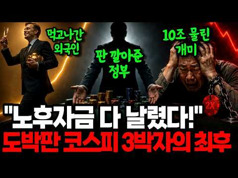
- 챕터: 0:00 인트로 — 89조 잔치인데 국민 돈은 증발 · 0:44 검은 월요일 — 올해만 서킷브레이커 7번 · 2:01 범인의 등장 — 5월 27일 상장된 그 '상품' · 3:35 세 개의 함정 — 왜 도박판이 됐나 · 7:07 대(大)아이러니 — 실적 최대인데 주가 최대 폭락, … · 9:44 앞으로 어떻게 되나 — 상폐 못 하는 이유와 정부의 … · 13:31 착지 — 호황의 나라에서 국민이 죽는다
- 설명 앞부분: 🔎 삼성전자가 2분기 영업이익 89조 4천억 원으로 3분기 연속 최대를 기록하고, 7월 반도체 수출은 193% 폭증해 사상 최대를 찍었습니다. 나라는 반도체로 호황입니다. 그런데 바로 그 삼성전자와 SK하이닉스를 '미끼'로 만든 단일종목 레버리지 ETF에 국민 돈 10조 원이 넘게 묶인 채 녹아내리고, 올해에만 서킷브레이커가 일곱 번 울렸습니다. 실적은 최대인데 주가는 최대 폭락하는 기막힌 아이러니. 세계 1등 실적을 낸 나라에서 어쩌다 국민이 도박판에 앉게 됐는지, 레버리지 ETF의 세 가지 함정(복리손실·지수 착시·리밸런싱 증…
- 같은 채널 평소 대비 ×495.7 (채널 최근 롱폼 중앙값 189회) · 평소 영상: 삼성노조가 800조 호남 반도체 메가프로젝트 막아선 진짜 이유...부메랑 노란봉투법 삼성… (189회) / 엔비디아 손잡은 네이버 집중분석🔎아시아 AI 인프라회사로?🔥14조 유치🔥GPU 6만장🔥1… (147회)
- 대본 (음성인식(앞 5분), 5.5 음절/초) — 앞부분만, 흐름은 그 안까지 첫 20초: “여러분 지금 우리나라는 반도체로 잔치집입니다. 삼성전자가 한분기에 89조를 벌었어요. 3분기 연속, 역대 최대입니다. 그야말로 세계가 우리 반도체 앞에 앞다터 줄을 선 거예요. 그런데 말입니다. 바로 그 삼성을 믿기로 만든 어떤 상품에 지금 국민 돈 10조가 도박판처럼 놓고 있습니다. 올해에만 주식거래를 통째로 멈춰세우는 비상벨이 7번 울렸어요.” — 도입부 유형: 시청자 부르기
- 첫 1분: “여러분 지금 우리나라는 반도체로 잔치집입니다. 삼성전자가 한분기에 89조를 벌었어요. 3분기 연속, 역대 최대입니다. 그야말로 세계가 우리 반도체 앞에 앞다터 줄을 선 거예요. 그런데 말입니다. 바로 그 삼성을 믿기로 만든 어떤 상품에 지금 국민 돈 10조가 도박판처럼 놓고 있습니다. 올해에만 주식거래를 통째로 멈춰세우는 비상벨이 7번 울렸어요. 모두가 외칩니다. 그 상품, 없애버리라고. 그런데 당국은 답합니다. 뾰족한 수가 없다, 두 손을 든 겁니다. 세계 1등 실적을 낸 나라에서 왜 국민만 도박판에 앉았을까요? 그리고 이 판, 앞으로 대체 어떻게 되는 걸까요? 오늘 그 이야기 처음부터 끝까지 아주 속시원이 다 풀어드리겠습니다. 지금 바로 시작합니다. 2026년 7월 13일 사람들이 검은 월요일이라 부르는”
- 흐름 (90초마다 첫 문장): 0:00 여러분 지금 우리나라는 반도체로 잔치집입니다. → 1:31 20분 동안 모든 거래를 강제로 멈춰 세우는 → 3:00 도박의 판 돈이 붙은 셈이죠. → 4:30 그 출렁임 자체가 비용이 돼서
- 댓글 648/648: 좋은 점 — 영상 2 · 감사·응원 10 · 더 알고 싶은 것 1 · 아쉬운 점 — 영상 1 · 반박·불만 — 의견 다름 5 · 정치·사회 150 · 경험 공유 17 · 구독·다음 기대 0
  - 좋은 점 — 영상 👍1 “유익한 정보 감사합니다 ㅎㅎ”
  - 좋은 점 — 영상 👍1 “좋은 설명이네.”
  - 감사·응원 👍4 “자세한 설명 감사합니다 아무리 실적 좋아도 레버리지 2배 때문에 주식시장을 쑥대밭을 만드네요 매일 서커브레이크 카지노 도박판 실적분석 필요없어요 코스닥 돈빼 레버리지 산다고합니다 아휴 답답 한숨 정부지도자들 자기들은 강건너 불구경 힘드네요”
  - 감사·응원 👍1 “감사합니다.”
  - 아쉬운 점 — 영상 👍1 “왜? 이렇게 Ai목소리가 듣기싫지 직접방송하라”
  - 반박·불만 — 의견 다름 👍1 “헛소리 그만하고 오늘 일단 3일 연속 써킷 갑니다.”
  - 반박·불만 — 의견 다름 👍1 “외국주식시장은 레버리지 2배이상짜리도 많은데 어떻게 돌아가냐 미국주식시장 같으면 벌써 망했어야 정상아니냐~ 선전선동질 그만해라 그놈의 남탓 ㅋㅋㅋㅋ”
  - 정치·사회 👍135 “이상품에 직접투자한 사람들만의 손실이 문제가 아니다ㆍ덕분에 수급쏠림으로 인한 코스닥의 붕괴다ㆍ챠트를보면 전쟁터진 나라보다 더 폭락해버렸다ㆍ그리고 정부는 모르쇠로 일관ㆍ배신감이 분노로 바뀌고 결국 정부의 정체성까지 의심하고있다ㆍ머슴이 주인을 물어뜯고 과연 무사할까?”
  - 정치·사회 👍82 “이정부는 결국 주식으로 국민의 신뢰를 얻다가 주식으로 신뢰를 잃어가고 망해가고있네 참 세상이 아이러니하네”
  - 경험 공유 👍19 “도박 좋아하는 놈들이 정책을 해서. 나라 전체를 강원랜드로 만들고 .저평가 가치주까지 다른 종목 다 반토막. 미장은 이렇게 안 망가졌다. 내가 하면 투자.니가 하면 투기”
  - 경험 공유 👍10 “이래서.. 내가 국내주식을 안하는 이유다 미국우량주식만 장기매수하는 거 그 게 그나마 맘편하다”

### 43. 주식투자 5년간 실패하던 내가 깨달은 '이것'

- https://www.youtube.com/watch?v=OPL1VmC5nC4 · 리채피 richappy · 구독자 10,100 · 조회수 168,981 (×16.7, 하루 5,561.8) · 좋아요 2,144 (1.3%) · 18.3분 · 2026-10-19 · 주제 묶음 11. 투자 일반 · 형식 정보·해설 (그 밖) · 폴더 `W_OPL1VmC5nC4` (웹 승인)
- 챕터: 0:00 5년간 죽어라 투자했는데 한 푼도 못 번 이유 · 0:53 결론: 시장을 이기기 전에 크게 지지 않는 팀부터 만… · 1:19 약팀이 맞불을 놓으면 뒷공간이 비는 이유 · 2:13 지난여름 국내 증시의 장면: 코스피 하루 10% 하락… · 3:07 찰스 엘리스의 「패자의 게임」과 아마추어 테니스 · 4:27 가장 많이 사고판 20%의 수익률: 연평균 11.4%… · 5:44 주식 시장은 토너먼트가 아니라 리그입니다: 퇴장당하지… · 6:10 첫 번째 조건 수비: 유로 2004 그리스와 현금 골… · 7:58 두 번째 조건 포메이션: 골키퍼부터 공격수까지 역할 … · 9:43 세 번째 조건 역습: 우승 배당 5,000대 1이었던… · 10:35 모두가 들떴을 때 현금 만들기, 모두가 겁먹었을 때 … · 12:20 현금 들고 기다리는 건 겁쟁이 투자 아닌가요 · 14:06 달라진 것은 실력이 아니라 순서였습니다 · 15:25 오늘 점검해 볼 세 가지
- 설명 앞부분: 주식 투자, 열심히 사고팔아도 5년 동안 한 푼도 못 벌었다면 공격보다 수비부터 점검하세요. 평범한 회사원이 5년의 실패 끝에 찾은 선수비 후역습 전략과 축구 포메이션 자산 배분을 공개합니다. 매일 호가창을 보며 사고팔았는데도 계좌가 제자리인 분이 많습니다. 이는 개인 투자자가 분석할 시간과 정보가 부족한 약팀인데도 처음부터 공격만 하는 팀처럼 움직이기 때문입니다. 투자는 단순히 큰 수익을 노리는 일이 아니라 퇴장당하지 않고 리그에 남는 일입니다. 그래서 크게 지지 않는 수비부터 시작해 자산마다 역할을 나누는 포메이션, 그리고 기…
- 같은 채널 평소 대비 ×14.6 (채널 최근 롱폼 중앙값 11,573회) · 평소 영상: 5년간 '이걸' 몰라서 주식투자에 실패했습니다. 개인투자자가 주식시장에서 이기는 방법 (11,573회) / 주식투자에서 늘 지던 내가 뒤늦게 알게 된 '이것' (11,252회)
- 대본 없음 (설명) — 음성인식이 끝나면 도입부·흐름이 들어감
- 댓글 78/78: 좋은 점 — 영상 7 · 감사·응원 24 · 더 알고 싶은 것 1 · 아쉬운 점 — 영상 1 · 반박·불만 — 의견 다름 0 · 정치·사회 1 · 경험 공유 4 · 구독·다음 기대 1
  - 좋은 점 — 영상 👍10 “주식 투자의 원칙을 이해하기 쉽게 잘 설명해주셔서 감사합니다. 이걸 지키지 못한 아니 알지 못한 주린이로서의 뇌동매매가 후회가 되네요.”
  - 좋은 점 — 영상 👍4 “좋은 정보 감사합니다 🎉🎉🎉”
  - 감사·응원 👍11 “저가 들어본 주식방송 중 제일 진솔한 방송 인것 같습니다 잘들었습니다 감사합니다”
  - 감사·응원 👍10 “주식 투자의 원칙을 이해하기 쉽게 잘 설명해주셔서 감사합니다. 이걸 지키지 못한 아니 알지 못한 주린이로서의 뇌동매매가 후회가 되네요.”
  - 더 알고 싶은 것 👍0 “사팔사팔로 올해 폭망하였습니다😢 좋은 조언 감사하고 지속적으로 부탁드립니다”
  - 아쉬운 점 — 영상 👍3 “많이 배우고 뒤돌아 봅니다 아쉬움 닉스 삼십에 사서 전쟁도 견디고 해서 만족했는데 믿고보는 방송에서 좋아질거란 말 믿고 120원대 기다렸는데 오늘 던질려고 하다 이방송 보고 참아봅니다 140만 10주 현금있는게 조금 위로 ㅎ ㅎ”
  - 정치·사회 👍23 “외국인과 기관을 이기는 방법...사팔사팔 안하고 개안은 시간이라는 가장 강한 장점을 가지고 이를 스스로 포기..애초에 사팔사팔 안할 주식을 사고 실제로 거의 팔지 않는게 외국인 기관을 이기고 시장에 오래 뛸수 있느냐? 아녀유?”
  - 경험 공유 👍10 “감사 합니다 많이 배우고 실천 할려고 합니다 저도 5년 동안 돈 못 벌있어요 그래도 살아 남아 있으니 저도 행복한 부자가 됩니다 😅😅😅❤❤❤”
  - 경험 공유 👍2 “나도 요새 저 전략을 연습중...패턴을 박자에 맞추면 스윙으로 계속 득점 가능...”
  - 구독·다음 기대 👍0 “오늘 새롭게 공븐 시작입니다. 수익을 다 토해내고 새롭게. 마음을 답아 봅니다. 구독하고 텔레그램에 입장하여 또 배울수 있게 해 주셔서 감사합니다”

### 44. Gold and Silver Investors Are Getting Caught Out by the ATO

- https://www.youtube.com/watch?v=sY77wNqqiLA · Navexa · 구독자 7,610 · 조회수 126,209 (×16.6, 하루 3,666.3) · 좋아요 1,095 (0.9%) · 10.2분 · 2026-10-14 · 주제 묶음 기타 · 형식 정보·해설 (그 밖) · 폴더 `W_sY77wNqqiLA` (웹 승인)
- 썸네일: 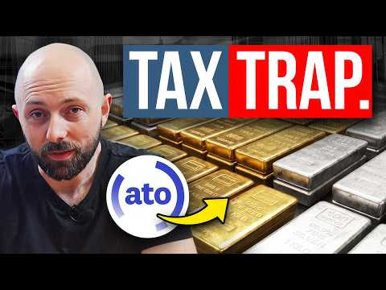
- 설명 앞부분: Gold and silver get taxed the moment you dispose of them, whether you sell, swap, gift or move them into a trust or SMSF, and that's true whether or not the ATO is watching. The bigger risk is substantiation. Without records you can't prove your cost base, your holding period, the premium you paid …
- 같은 채널 평소 대비 ×19.9 (채널 최근 롱폼 중앙값 6,336회) · 평소 영상: One Hack That Dramatically Lowers Tax on Your ETFs (6,336회) / The Dollar-Cost Averaging Mistake Costing Austral… (6,985회)
- 대본 없음 (설명) — 음성인식이 끝나면 도입부·흐름이 들어감
- 댓글 486/577: 좋은 점 — 영상 0 · 감사·응원 0 · 더 알고 싶은 것 0 · 아쉬운 점 — 영상 0 · 반박·불만 — 의견 다름 0 · 정치·사회 0 · 경험 공유 0 · 구독·다음 기대 0

### 45. Mutual Fund Manager's Guide To Investing For The Next 10 Years

- https://www.youtube.com/watch?v=_gnrJW4h_lE · Angel One Podcasts · 구독자 4,880 · 조회수 82,673 (×16.9, 하루 2,309.3) · 좋아요 792 (1.0%) · 53.9분 · 2026-10-13 · 주제 묶음 기타 · 형식 정보·해설 (그 밖) · 폴더 `W__gnrJW4h_lE` (웹 승인)
- 썸네일: 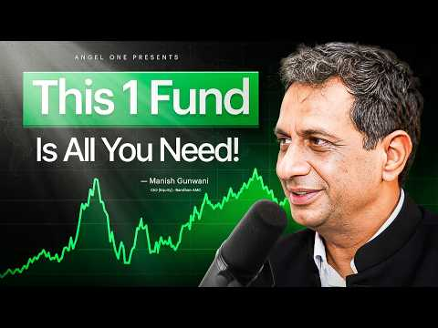
- 챕터: 0:00 Intro · 2:00 Why Are Foreign Investors Sel… · 7:45 Is The Worst Behind Us In The… · 9:04 Is This The Right Time To Inv… · 13:05 How Much Should You Allocate … · 14:49 What Returns Should You Expec… · 15:59 How To Identify A Good Small-… · 18:42 What Makes A Small-Cap Fund O… · 21:06 How Do Fund Managers Pick Win… · 25:14 How To Find Stocks That Can D… · 27:57 When Should You Sell A Stock? · 31:15 When Should You Book Profits … · 32:54 3 Sectors That Could Drive In… · 37:01 Can Indian Manufacturing Beco… · 38:56 Where Is India's Premium Cons… · 40:18 How Should Indian Investors A… · 42:59 Should You Invest In India Or… · 45:16 How To Build Your First ₹1 Cr… · 47:13 Small Caps Vs Large Caps: Whe… · 48:50 The One Investing Question Pe…
- 설명 앞부분: Is the Indian stock market sending mixed signals? Global investors have been cautious, domestic investors are putting in record SIP money, and company earnings are strong. In this podcast, Manish Gunwani, CIO of Bandhan AMC, decodes this contradiction, shares how he thinks about market cycles and r…
- 같은 채널 평소 대비 ×0.7 (채널 최근 롱폼 중앙값 119,253회) · 평소 영상: Where Kirtan Shah Is Investing for 2027 (119,253회) / How To Make ₹0 to ₹1 Crore Through Mutual Fund SI… (126,136회)
- 대본 없음 (설명) — 음성인식이 끝나면 도입부·흐름이 들어감
- 댓글 34/38: 좋은 점 — 영상 0 · 감사·응원 0 · 더 알고 싶은 것 0 · 아쉬운 점 — 영상 0 · 반박·불만 — 의견 다름 0 · 정치·사회 0 · 경험 공유 0 · 구독·다음 기대 0

### 46. 나스닥 투자하기 전에 이 영상 꼭 보세요 ∣ QLD만 모아가는 이유

- https://www.youtube.com/watch?v=g10Y6ZA7rng · 올레버 · 구독자 1,600 · 조회수 122,189 (×76.4, 하루 722.7) · 좋아요 1,657 (1.4%) · 5.7분 · 2026-06-02 · 주제 묶음 2. 장기투자·ETF·지수 · 형식 정보·해설 (그 밖) · 폴더 `W_g10Y6ZA7rng` (웹 승인)
- 썸네일: 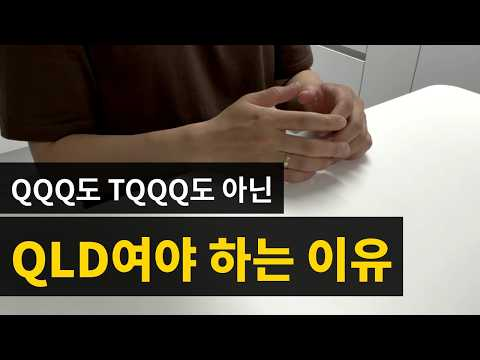
- 챕터: 0:00 도입 — QLD를 추천하는 이유 · 0:12 레버리지의 음의 복리(Volatility Decay)… · 1:31 나스닥에서 음의 복리가 반은 틀린 이유 · 2:02 QQQ / QLD / TQQQ 수익률 비교 (2010… · 3:05 왜 TQQQ보다 QLD인가 — 최적 레버리지 배율 · 4:01 2021년 차트로 보는 변동성 비교 · 4:29 장기 투자자에게 QLD가 적합한 이유 · 4:52 개인 목표 (10년 순자산 30억) 기준으로 본 QLD · 5:18 리스크 안내 및 마무리
- 설명 앞부분: 나스닥 ETF, 어떤 걸 사야 할까요? QQQ, QLD, TQQQ. 다들 나스닥 기반인데 뭐가 다른지, 그리고 왜 저는 QLD를 선택했는지 오늘 얘기해볼게요. 이런 분들께 추천드려요 나스닥 ETF 투자를 고민 중인 분 QQQ, QLD, TQQQ 차이가 궁금한 분 레버리지 ETF가 위험하다고 들었는데 궁금한 분 📊 영상에서 다루는 내용 QQQ / QLD / TQQQ 각각 뭐가 다른가 레버리지는 장기 보유하면 녹는다? 진실은 나스닥 각 배율별 10년 수익률 비교 10년 뒤 30억을 위해 필요한 수익률 🎯 목표 : 순자산 30억 파이어…
- 같은 채널 평소 대비 ×165.3 (채널 최근 롱폼 중앙값 739회) · 평소 영상: 배달 뛰다가 워렌버핏의 말을 이해했습니다 ∣ 투자관을 바꾸게 된 계기 (739회) / 이제 저축 안 늘립니다. 30억 파이어족 계획 (586회)
- 대본 (음성인식(앞 5분), 4.2 음절/초) — 앞부분만, 흐름은 그 안까지 첫 20초: “QQQ, QLD, TQQQ 세 가지 중 고민하는 분들이 많은데 저는 그 중 QLD를 적극 추천드리고 있습니다. 그 이후 바로 설명드리겠습니다. 많은 분들이 QLD, TQQQ에 앞서서 우선 레버리지에 대해 부정적인 시각은 가진 분들이 많아요. 그 중 가장 많이 언급되는 게 레버리지는 장기 보유할수록 녹는다 즉 음의 복리인데요.” — 도입부 유형: 내 이야기·사연
- 첫 1분: “QQQ, QLD, TQQQ 세 가지 중 고민하는 분들이 많은데 저는 그 중 QLD를 적극 추천드리고 있습니다. 그 이후 바로 설명드리겠습니다. 많은 분들이 QLD, TQQQ에 앞서서 우선 레버리지에 대해 부정적인 시각은 가진 분들이 많아요. 그 중 가장 많이 언급되는 게 레버리지는 장기 보유할수록 녹는다 즉 음의 복리인데요. 레버리지 상품 자체가 장기적으로 묻어드는 수단이 아니라고 관계자들도 언급을 하고 있고 그리고 실제로 음의 복리가 발생하는 상품이 맞습니다. 두 배 세 배라고 해서 그래프처럼 정확하게 배율대로 가지 않는데요. 이는 1일 변동폭을 추정하고 있기 때문입니다. 쉽게 얘기해서 여기 이 차트를 보시면 1만에서 나스닥이 시작했을 때 1일차에 나스닥이 20% 빠지면 8천이 되고 QLD는 그의 두 배인”
- 흐름 (90초마다 첫 문장): 0:00 QQQ, QLD, TQQQ 세 가지 중 고민하는 분들이 많은데 저는 그… → 1:30 하지만 나스닥에는 반은 맞고 반은 틀렸습니다. → 3:02 유의미한 성장율을 보이고 있다는 거죠. → 4:33 앞으로 몇 번의 폭등과 폭락장이 있을지 모르는 장기 투자를 저희는 해야…
- 댓글 347/349: 좋은 점 — 영상 4 · 감사·응원 18 · 더 알고 싶은 것 24 · 아쉬운 점 — 영상 1 · 반박·불만 — 의견 다름 5 · 정치·사회 0 · 경험 공유 17 · 구독·다음 기대 2
  - 좋은 점 — 영상 👍7 “구독 눌렀어요 좋은정보 앞으로도 부탁드려요😂”
  - 좋은 점 — 영상 👍7 “10~25 년까지는 초저금리 기반 빅테크 대상승장이었죠. 닷컴버블 직후(00~10년)처럼 10년 동안 박스권 횡보장세였다면 진정한 음의 복리 마법을 맛봤을 겁니다.. 그리고 큰 MDD 낙폭은 실제로 겪지 않으면 그게 어떤 느낌인지 피부로 안 와닿아요. 내 투자자산이 …”
  - 감사·응원 👍12 “1.닷컴버블 폭락 기간: 약 2년 6개월 (31개월) 회복 기간: 약 4년 5개월 (53개월) 내 돈이 묶인 총 기간: 약 7년 1개월 2. 리먼 브라더스 사태 폭락 기간: 약 1년 5개월 (17개월) 회복 기간: 약 4년 (48개월) 내 돈이 묶인 총 기간: 약 5…”
  - 감사·응원 👍3 “저도 맘 편해서 QLD 매달 100 좀 넘게 모아갑니다. 최근 하락시 좀 더 사서 모으고 ㅎㅎ 앞으로도 파이팅입니다~😊”
  - 더 알고 싶은 것 👍8 “도움 많이 되었네요! 근데 4:44초에 저런 비교 데이터는 어디에서 볼 수 있을까요?!”
  - 더 알고 싶은 것 👍7 “구독 눌렀어요 좋은정보 앞으로도 부탁드려요😂”
  - 아쉬운 점 — 영상 👍0 “연저펀에 못담는게 아쉽네요.”
  - 반박·불만 — 의견 다름 👍41 “QLD 6년차, 만5년 매도 없이 모아가는 중입니다. 여러분, 레버리지는 하락장 횡보장에 다 녹는 다는 말에 너무 매몰 되지 마세요. 하락후 반드시 찾아오게 되는 긴 상승장에서의 양의 복리는 퍼포먼스가 두배가 아닙니다. 속된말로 존나 오릅니다. 횡보, 하락장에서 추종…”
  - 반박·불만 — 의견 다름 👍13 “하락장 자신없는분은 건드리지도 마세요. 좋다좋다그래도 레버리지는 막 하는거 아닙니다”
  - 경험 공유 👍41 “QLD 6년차, 만5년 매도 없이 모아가는 중입니다. 여러분, 레버리지는 하락장 횡보장에 다 녹는 다는 말에 너무 매몰 되지 마세요. 하락후 반드시 찾아오게 되는 긴 상승장에서의 양의 복리는 퍼포먼스가 두배가 아닙니다. 속된말로 존나 오릅니다. 횡보, 하락장에서 추종…”
  - 경험 공유 👍19 “폭락을 경험해보지도 않은 이런 핏덩이들이 레버리지 좋다고 주절 대는게 너무 귀엽네 ㅋㅋ”
  - 구독·다음 기대 👍3 “구독했습니다~~ 혹시 경상도 이신가요? ㅎㅎ”

### 47. 삼성·하이닉스 이대로 끝인가?… 지금 시장이 숨기고 있는 진짜 진실

- https://www.youtube.com/watch?v=peJD7gf8MVw · 잘되라대한민국 · 구독자 6,580 · 조회수 106,557 (×16.2, 하루 2,880.8) · 좋아요 692 (0.7%) · 15.1분 · 2026-10-12 · 주제 묶음 기타 · 형식 정보·해설 (그 밖) · 폴더 `W_peJD7gf8MVw` (웹 승인)
- 썸네일: 
- 챕터: 0:00 오프닝 및 반도체 수출 펀더멘탈과 수급 점검 · 4:36 최태원 SK회장 용인·호남 클러스터 동시 구축 언급 … · 6:14 주요 증권사 반도체 리포트 분석 (삼성전자 '세계 최… · 8:20 펀더멘탈은 좋은데 주가가 역주행하는 답답한 시장 상황 · 10:14 '진실은 언젠가 나타난다' : 불확실성에 가려진 본질… · 11:49 한국 증시가 유독 두들겨 맞는 4가지 이유 (자사주 … · 14:30 매물대와 저평가 구간에 대한 부연 및 마무리
- 설명 앞부분: [겸공_12시에만나요 261012] 실적은 사상 최대라는데, 내 계좌는 왜 이 모양일까요? 펀더멘탈에는 이상이 없다고 외치지만, 유독 한국 증시만 두들겨 맞는 진짜 이유를 파헤칩니다. 자사주 매입 종료와 100조 원대 매물대 장벽, 그리고 외국인이 집을 떠나지 못하는 이유까지! 꼬일 대로 꼬인 수급의 비밀과, 안개가 걷힌 뒤 마주할 반도체 본질의 진실을 확인해 보세요.
- 같은 채널 평소 대비 ×3.8 (채널 최근 롱폼 중앙값 28,087회) · 평소 영상: 삼전 67만 하닉 470만 ‘유지’ JP모건, 코스피 15000은 ‘삭제’ (28,233회) / 삼성전자 어닝콜, 소각은 우선주만? 증여세 깎으려 하나··· 역대급 실망 (27,219회)
- 대본 (음성인식(앞 5분), 5.5 음절/초) — 앞부분만, 흐름은 그 안까지 첫 20초: “반도체 관한 수출 가격 fundamental 그건 그만 얘기하자 이상이 없다 이런 얘기예요 그럼 결국에는 수급으로 봐야 된다 저는 그렇게 보고 있고요 그럼 그쵸적으로 뭐가 문제지? 냉정하게 얘기하면 3전 하이닉스의 자사조 매입 사실상 3전은 끝났고 한익도 이제 오늘의 일임이 끝나요 그러니까 이제 던지면 사줄 세력이 없다는 건 인정해야 돼요 그쵸? 오토메틱으로 사는 사람은 없어요” — 도입부 유형: 질문으로 시작, 내 이야기·사연
- 첫 1분: “반도체 관한 수출 가격 fundamental 그건 그만 얘기하자 이상이 없다 이런 얘기예요 그럼 결국에는 수급으로 봐야 된다 저는 그렇게 보고 있고요 그럼 그쵸적으로 뭐가 문제지? 냉정하게 얘기하면 3전 하이닉스의 자사조 매입 사실상 3전은 끝났고 한익도 이제 오늘의 일임이 끝나요 그러니까 이제 던지면 사줄 세력이 없다는 건 인정해야 돼요 그쵸? 오토메틱으로 사는 사람은 없어요 분명 실적은 사상 최대 라는데 명확한 이유도 없이 한국 증심한 유독 두둘겨맞는 지금 많은 분들이 내가 모르는 뭔가 있나 라며 지쳐가고 계십니다 하지만 전 세계에서 돈을 제일 많이 벌고 전력부터 조선 엔진까지 만드는 이 나라의 주식이 진짜 싸구려인 걸까요? 한국 증시를 짓 누르는 이 공포의 실체 과연 언제까지 가려져 있을지 그 진실을”
- 흐름 (90초마다 첫 문장): 0:00 반도체 관한 수출 가격 fundamental 그건 그만 얘기하자 → 1:30 투자를 확대해 나가고 있고 → 3:03 디렘 평균 판매 가격의 상승을 이끌 것이다 라는 내용이었습니다 → 4:32 어쨌든 실적도 좋고 업항도 좋습니다
- 댓글 165/165: 좋은 점 — 영상 2 · 감사·응원 1 · 더 알고 싶은 것 0 · 아쉬운 점 — 영상 0 · 반박·불만 — 의견 다름 3 · 정치·사회 30 · 경험 공유 3 · 구독·다음 기대 0
  - 반박·불만 — 의견 다름 👍0 “그냥 데이터로 분석해서 알려줘야는데 마치 모든걸 다 꿰뚫어 보고 있는 사람처럼 msg를 쳐서 말하니 투자자들이 기업에 대해서 분석 따윈 필요없는 것처럼 순간 솔깃하게 말하는 재주가 있음. 싼데 왜 하락함? 싼데 떨어지면 또 정부탓 기업탓 하고 있을꺼임.. 신랑이랑 내…”
  - 반박·불만 — 의견 다름 👍0 “여러분들 여지껏 박시동 이광수의 주장이 맞은 게 있는지 돌아보세요. 제가 가장 경계하는 것이 특정인의 말을 너무 지나치게 매몰되어서 믿는 것입니다. 주식전문가라는 사람들 절대 너무 믿어서는 안됩니다. 자꾸 실적이 사상 최대 역사적으로 최초 이런 수식어들 붙이고 있지만…”
  - 정치·사회 👍13 “명확한 이유가 있는데. 세계 1위 영업이익 삼성전자는 임직원 준다고 자사주 매입만하고 소각은 안하고 주주환원은 배당으로 한다니 굳이 지금 살필요도 없고 배당하기 한달전쯤부터 사다가 배당기준일까지 갖고 있다가 팔면 되는거 아닌가? 빅테크중에 누가 주주환원을 배당으로 하…”
  - 정치·사회 👍11 “여기 3명 보면 무슨 종교 집단 같음. 신념으로 똘똘 뭉쳐있음. 문제는 그 신념이 전문가라는 명목으로 타인한테 강요함. 국장은 실적 따윈 의미 없음.. 수급이 문제 인데 외국인이 던지는 물량을 개인이 받아줘야하는데, 지난 7월에 레버리지에 다 털려서 돈이 없음. 진짜…”
  - 경험 공유 👍2 “이런방송을 할때는 말의 책임과 무게를 알고 해야한다고 생각합니다 주가방송은 맞으면 제가 말했죠 떨어지면 온갖 이유와 앞으로는 괜찮을거다 기다려봅시다 얘기를 반복할뿐입니다 아무도 책임을 안집니다 대통령조차 웃으면서 주식은 귀신도 모른다 강요한적없다고 말하고 ETF하라던…”
  - 경험 공유 👍0 “그냥 데이터로 분석해서 알려줘야는데 마치 모든걸 다 꿰뚫어 보고 있는 사람처럼 msg를 쳐서 말하니 투자자들이 기업에 대해서 분석 따윈 필요없는 것처럼 순간 솔깃하게 말하는 재주가 있음. 싼데 왜 하락함? 싼데 떨어지면 또 정부탓 기업탓 하고 있을꺼임.. 신랑이랑 내…”

### 48. 물린 주식 10년, 결국 전부 팔았습니다 (feat. 복구 심리의 함정)

- https://www.youtube.com/watch?v=OKHm1gUNyPA · 어쩌다마흔 · 구독자 1,840 · 조회수 87,010 (×47.3, 하루 804.0) · 좋아요 1,810 (2.1%) · 9.9분 · 2026-08-02 · 주제 묶음 8. 투자 심리·실패 · 형식 인터뷰·강연·대담 · 폴더 `W_OKHm1gUNyPA` (웹 승인)
- 썸네일: 
- 설명 앞부분: 10년 넘게 국내 개별주식에 투자했습니다. 수익 난 종목도 있었지만, 물린 종목이 더 많았습니다. 전체로 보면 꽤 큰 손실. 결국 얼마 전, 며칠에 걸쳐 전부 팔았습니다. 이번 영상은 계산이나 시장 분석이 아니라 제 이야기입니다. 왜 손실을 확정하면서까지 전량 매도를 택했는지, 그 이유 세 가지와 매도 이후에도 흔들렸던 '복구 심리'까지 솔직하게 담았습니다. 계좌에 물린 종목을 몇 년째 들고 고민 중이시라면, 오늘 영상이 판단에 참고가 되시길 바랍니다.
- 같은 채널 평소 대비 ×10.6 (채널 최근 롱폼 중앙값 8,218회) · 평소 영상: 부부 식비 40만원, 남은 돈 절반 미국주식 샀습니다 (8,430회) / 환율 1,350원 깨지고 미국주식 올인 했습니다 (8,005회)
- 대본 (음성인식(앞 5분), 4.3 음절/초) — 앞부분만, 흐름은 그 안까지 첫 20초: “10년 넘게 하던 국내 주식을 며칠 전 전부 팔고 정리했습니다. 수익이 나서 판 건 아닙니다. 손실을 확정하면서 팔았습니다. 오늘은 쓰라리게 아팠던 제 최근 이야기입니다.” — 도입부 유형: 숫자로 시작
- 첫 1분: “10년 넘게 하던 국내 주식을 며칠 전 전부 팔고 정리했습니다. 수익이 나서 판 건 아닙니다. 손실을 확정하면서 팔았습니다. 오늘은 쓰라리게 아팠던 제 최근 이야기입니다. 안녕하세요 어쩌다 마흔입니다. 오늘은 계산도 시장 얘기도 아닙니다. 제 얘기를 해볼까 합니다. 이번 주도 금요일을 제외하고는 계속 카락장이 이어져서 멘탈이 힘든 한주였습니다. 그리고 저는 계좌에 일부 있던 국내 개별 주식을 며칠에 걸쳐 전부 정리했습니다. 10년 넘게 개별 주 투자를 해온 사람이 그것도 손실을 확정하면서 왜 마흔이 넘어 전부 팔았는지 그 이후 3가지를 오늘 말씀드려볼까 합니다. 이 결정이 결코 정답이라는 얘기가 아닙니다. 다만 저와 비슷한 시기에 계좌에 물린 종목을 들고 고민 중인 분이라면”
- 흐름 (90초마다 첫 문장): 0:00 10년 넘게 하던 국내 주식을 며칠 전 전부 팔고 정리했습니다. → 1:32 수익이 난 종목도 있었습니다. → 3:05 이러도 복구할 시간이 있었으니까요. → 4:31 시간을 쓰고 어느 정도 벌었어도 다시 생각해볼 문제인데
- 댓글 957/963: 좋은 점 — 영상 13 · 감사·응원 36 · 더 알고 싶은 것 5 · 아쉬운 점 — 영상 11 · 반박·불만 — 의견 다름 14 · 정치·사회 16 · 경험 공유 90 · 구독·다음 기대 4
  - 좋은 점 — 영상 👍3 “너무 아쉬워서 댓글올립니다. 현재재무상황과 현재밸류로 하면 당연히 수익이 어렵더라구요.ㅠ 확실한미래성장과 촉매(주가가 부각될 트리거)감안하여, 투자하시면 분명 성과가 있더라구요. 고전(그레이엄,피터린치,코스톨라니,레이달리오.등의 )책을 좀 읽으시면 ETF 선정하시는대…”
  - 좋은 점 — 영상 👍3 “좋은 이야기도 있는데 말하는 사고방식이 본인은 안다고 생각할수도 있겠지만 워렌 버팟의 본질을 전혀 이해 못하고 있다고 할까나 😅 말이나 설명을 하는 사고방식이 아직도 트레이더에요 . 트레이더의 탐욕에 절여진 전혀 벗어나있지를 않는. 좋게 봐줘도 하워드 막스의 통찰을 …”
  - 감사·응원 👍70 “많은 고민이 묻어 나옵니다. 고생하셨습니다. 저도 심각히 고민중입니다. 국장은 절대 개미가 도전할 시장은 아니라는 생각입니다. 말씀 새겨서 결정에 참고하겠습니다. 감사드립니다.”
  - 감사·응원 👍23 “속은 쓰리시겠지만, 길게 보면 잘하셨습니다^^ 저도 과거 오랫동안 개별주로만 투자를 했고, 괜찮은 수익을 얻었지만, 지금은 ETF 투자로 주로 하고, 개별주는 정말 소액만 투자하고 있습니다. 회계사 생활을 오랫동안 하면서, 기업분석과 투자에 나름 자신도 있었지만, 언…”
  - 더 알고 싶은 것 👍1 “얼마 손해 보셨나요?”
  - 더 알고 싶은 것 👍1 “리스크라쓰고 불확실성이라읽어야되여 그불확실에대해 어떤일을 했나요? 추세판단은했나요? 자금을잃지않으려는노력은 그무엇보다중요해요 .. 그러려면예비비확보 분할매매 9시 12시 오후3시 그리고온갖쏟아지는 착시만주는노이즈에대해선어떻게 대응했는지요? 자금 안 읽고오래 시장에 머…”
  - 아쉬운 점 — 영상 👍13 “주식은 자기가 좋아하는 기업 응원하는 마음으로 사서 고수익은 아니더라도 은행금리만큼정도는 이득 아니면 손해일거라 생각했는데, 결국은 큰손들의 도박장인게 너무 실망스럽니다.”
  - 아쉬운 점 — 영상 👍2 “아...한달만 빨리 정리했어도 어쩌면 수익이 났을지도 모르는데 아쉽네요.”
  - 반박·불만 — 의견 다름 👍63 “하루에 지수가 10프로 등락하는 국장은 정상이 아니죠”
  - 반박·불만 — 의견 다름 👍5 “공부해서 주식하려면 미장가세요.. 여기는 상식적인 시장이 아닙니다”
  - 정치·사회 👍24 “그냥주식은 도박이에요 정부에서 인정한 오르고 내리고 하는거 그냥 짜고치는 고스돕같은거 다연기 공부필요없어요 그냥 정부와 기업이 맘대로 올리고 내리고 전 이걸아는순간 이젠안해요 금은사지”
  - 정치·사회 👍6 “국장은 그냥 수급 사줄 놈이 없으면 안올라가지요. 삼닉이 1000조를 벌어도 사줄 놈이 없어요 이번 금요일 국내 탑5 전부 상한가 갔지요? 전부 환호하지만 실상은 외국인들이 10조만 있어도 모든 종목 상한가 보낼 수 있다는 경고 같았어요. 저도 8년 국장하고 이번에 …”
  - 경험 공유 👍113 “저도 다 팔고 미장으로 옮겼습니다. 돈이 문제가 아니라 널뛰기 국장에서는 일상생활이 안됩니다.”
  - 경험 공유 👍70 “많은 고민이 묻어 나옵니다. 고생하셨습니다. 저도 심각히 고민중입니다. 국장은 절대 개미가 도전할 시장은 아니라는 생각입니다. 말씀 새겨서 결정에 참고하겠습니다. 감사드립니다.”
  - 구독·다음 기대 👍6 “같은나이대라 그런지 공감이 많이 됩니다. 늘 영상 기다려요. 응원합니다.^^”
  - 구독·다음 기대 👍2 “감사합니다 구독하고 볼게요 sk하이닉스 들어갈려고했는데 도저히 자신이 없네요”

### 49. 코스피, 사이드카 발동! 5030P까지의 조정(삼전닉스 타점)

- https://www.youtube.com/watch?v=xO9xlsmI6bY · 차트도령 · 구독자 3,890 · 조회수 13,292 (×3.4, 하루 1,667.0) · 좋아요 158 (1.2%) · 12.8분 · 2026-10-13 · 주제 묶음 5. 국내주식 · 형식 정보·해설 (그 밖) · 폴더 `W_xO9xlsmI6bY` (웹 승인)
- 썸네일: 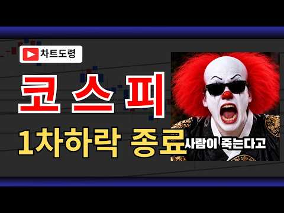
- 챕터: 0:00 시황 · 2:37 코스피 · 7:17 코스닥 · 8:31 삼성전자 · 9:36 SK하이닉스
- 설명 앞부분: 안녕하세요 차트도령입니다. 10월13일 코스피, 코스닥, 삼성전자, sk하이닉스 차트분석입니다. 금일 오랜만에 사이드카가 발동하며 낙폭이 심화되었는데요, 앞으로 추가적인 하락이 예상되지만, 우선 1차적인 하락은 종료되었다고 생각됩니다. 내일은 반등, 하지만 6400포인트를 넘기지 못한다고 보고 있습니다. 본 채널에서 영상을 통해 소개해드리는 종목은 '정보 공유' 차원일 뿐 '종목 추천'이 아닙니다.
- 같은 채널 평소 대비 ×1.2 (채널 최근 롱폼 중앙값 11,260회) · 평소 영상: 현대차, 물타기 잘못하면 목 돌아갑니다 (11,260회) / 코스피, 가짜반등 속임수에 넘어가지 마세요(삼전닉스) (11,279회)
- 대본 (음성인식(앞 5분), 6.6 음절/초) — 앞부분만, 흐름은 그 안까지 첫 20초: “네 반갑습니다 차트 도정입니다 금요일 우리 시장이 많이 하락하면서 여러분들 당황하셨을 거라고 생각을 합니다 오랜만에 사이드카가 걸리는 모습이었죠 장중에 6천포인트를 깨는 일도 발생을 했는데 그럼 지금 자리에서 어디로 갈까 일단 첫 번째 하락은 거의 다 나왔다고 생각을 합니다 오늘 개파락하면서 상단 6400포인트까지의 갭이 형성이 되었기 때문에 요구가는 어느 정도 매우고 내려가지 않을까라는 관점을 먼저 말씀을 드리겠습니다” — 도입부 유형: 숫자로 시작, 시청자 부르기
- 첫 1분: “네 반갑습니다 차트 도정입니다 금요일 우리 시장이 많이 하락하면서 여러분들 당황하셨을 거라고 생각을 합니다 오랜만에 사이드카가 걸리는 모습이었죠 장중에 6천포인트를 깨는 일도 발생을 했는데 그럼 지금 자리에서 어디로 갈까 일단 첫 번째 하락은 거의 다 나왔다고 생각을 합니다 오늘 개파락하면서 상단 6400포인트까지의 갭이 형성이 되었기 때문에 요구가는 어느 정도 매우고 내려가지 않을까라는 관점을 먼저 말씀을 드리겠습니다 영상을 꾸준히 보셨던 분들은 어느 정도 예방주사를 맞으셨을 거라고 생각을 해요 삼성전자와 하이닉스 하락을 피하신 분들이 많으실 거고요 아무래도 지수에 크게 영향을 주는 종목들이 빠지다 보니 지수도 상대적으로 많이 밀리는 모습을 보여줬습니다 삼성전자 하이닉스를 매도하셨더라도 다른 종목들을 가지”
- 흐름 (90초마다 첫 문장): 0:00 네 반갑습니다 차트 도정입니다 금요일 우리 시장이 많이 하락하면서 여러… → 1:35 시장 종합을 보여드리도록 할게요 코스피 보시면 247종목 상승을 했고요… → 3:03 그리고 상단에 갭이 형성이 되었기 때문에 요구간을 매우고 갈 수 있다라… → 4:32 현재 꼬리 달면서 일부 반등하는 모습
- 댓글 78/78: 좋은 점 — 영상 2 · 감사·응원 13 · 더 알고 싶은 것 5 · 아쉬운 점 — 영상 1 · 반박·불만 — 의견 다름 0 · 정치·사회 0 · 경험 공유 1 · 구독·다음 기대 0
  - 좋은 점 — 영상 👍0 “좋은 영상 감사합니다👍👍 5000초반 매수 준비 중이긴 하지만 깊은 하락을 맞은 종목들은 바운스~바운스 맛있게 먹어봐야죠 오늘 미국 반도체 시황도 봐야겠지만 눈치게임 하듯 맛있게 발라먹어야겠네요 관점 감사합니다”
  - 좋은 점 — 영상 👍0 “오늘도 좋은 강의 감사합니다😊😊 도령님 혹시 실례가 안된다면 (코스피/코스닥) 차트로도 분석이 가능할까요? 코스닥이 아웃퍼폼나올거 같은 차트인데 분석이 힘드네요..”
  - 감사·응원 👍1 “좋은방송 감사합니다 매일 매일 방송해 주시면 감사하겠습니다”
  - 감사·응원 👍0 “와우.. 좋은 분석 감사드립니다.”
  - 더 알고 싶은 것 👍1 “좋은방송 감사합니다 매일 매일 방송해 주시면 감사하겠습니다”
  - 더 알고 싶은 것 👍0 “5030 코스피면 삼전 닉스는 도대체 얼마인가요??? 코스피 5030은 올거같은데 삼전 닉스가 그 가격까지 밀린다는게 믿겨지지가 않네요 ㄷㄷ”
  - 아쉬운 점 — 영상 👍0 “수렴 이탈이 아래 방향이라 아쉽네요 😢”

### 50. SCHD ETF Analysis: The Most Complete Schwab US Dividend Equity ETF Breakdown

- https://www.youtube.com/watch?v=ys_pR1yxEgo · Goldman Starch · 구독자 1,390 · 조회수 20,827 (×15.0, 하루 588.6) · 좋아요 502 (2.4%) · 32.2분 · 2026-10-14 · 주제 묶음 2. 장기투자·ETF·지수 · 형식 정보·해설 (그 밖) · 폴더 `W_ys_pR1yxEgo` (웹 승인)
- 썸네일: 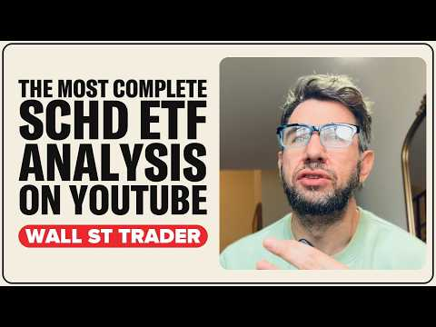
- 챕터: 0:00 SCHD ETF analysis: the record… · 1:13 What SCHD owns: the 4 screens · 2:04 The 4% cap and why Texas Inst… · 2:49 March reconstitution: who got… · 3:18 The 2 biggest holdings are ch… · 4:07 Why SCHD beat the S&P in 2026… · 4:53 The last time SCHD out-yielde… · 5:34 The 5% break: down 6.9% while… · 6:30 2022: why SCHD held up · 7:03 2023 to 2025: trailing the S&P · 7:49 Every calendar year since lau… · 8:29 SCHD's yield vs T-bills, the … · 9:04 SCHD vs TIPS and SGOV · 9:38 The record negative yield gap · 10:19 2023: the last time the gap l… · 10:49 Fewer than 4% of S&P stocks o… · 11:18 The seesaw: yields up, income… · 12:08 SPHD, DVY, VYM, DGRW: every d… · 12:34 Does SCHD trade like a bond? · 13:18 The dividend stalled: up 0.6%
- 설명 앞부분: SCHD ETF analysis: the most complete breakdown of the Schwab US Dividend Equity ETF (NYSE Arca: SCHD), with the 10-year Treasury yield above 5%. On October 5 the 10-year Treasury paid 2.09 percentage points more than SCHD's dividend yield, the biggest gap in the fund's 15-year history. A 3-month T-…
- 같은 채널 평소 대비 ×3.6 (채널 최근 롱폼 중앙값 5,804회) · 평소 영상: The Real Reason Home Prices Haven't Crashed Yet (… (5,853회) / Jobs Report Revisions: Are the Numbers Wrong? The… (5,755회)
- 대본 없음 (설명) — 음성인식이 끝나면 도입부·흐름이 들어감
- 댓글 76/97: 좋은 점 — 영상 0 · 감사·응원 0 · 더 알고 싶은 것 0 · 아쉬운 점 — 영상 0 · 반박·불만 — 의견 다름 0 · 정치·사회 0 · 경험 공유 0 · 구독·다음 기대 0

### 51. I Just Bought 1,000 Shares Of SCHD: Here's The Dividends It Pays Me

- https://www.youtube.com/watch?v=fPU6Gefdad8 · Grounded Life Investments · 구독자 6,190 · 조회수 114,239 (×18.5, 하루 2,562.1) · 좋아요 962 (0.8%) · 10분 · 2026-10-04 · 주제 묶음 기타 · 형식 정보·해설 (그 밖) · 폴더 `W_fPU6Gefdad8` (웹 승인)
- 썸네일: 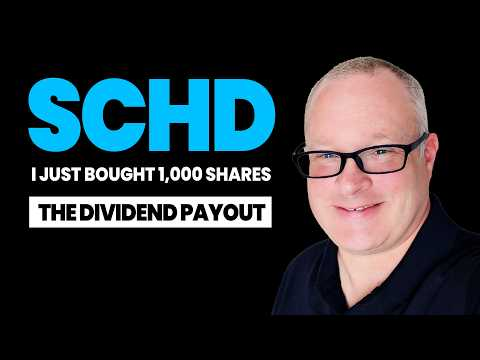
- 설명 앞부분: I just bought 1,000 shares of SCHD for our retirement portfolio. In this video I break down why I bought it and what the resulting dividend payouts will be. Want to go deeper? The GLI Dashboard gives you dividend screeners, portfolio analysis, and deep dives of the companies and ETF's you need to k…
- 같은 채널 평소 대비 ×9.9 (채널 최근 롱폼 중앙값 11,548회) · 평소 영상: Income ETFs Paying 8% to 21% With Zero NAV Erosion (11,695회) / SCHD New All-Time High: I've Paused My DCA & What… (11,400회)
- 대본 없음 (설명) — 음성인식이 끝나면 도입부·흐름이 들어감
- 댓글 141/141: 좋은 점 — 영상 0 · 감사·응원 0 · 더 알고 싶은 것 0 · 아쉬운 점 — 영상 0 · 반박·불만 — 의견 다름 0 · 정치·사회 0 · 경험 공유 0 · 구독·다음 기대 0

### 52. Can You Retire With Just SCHD? ∣ SCHD Expert Explains

- https://www.youtube.com/watch?v=lRlUmwigNYU · The Mispriced Podcast · 구독자 3,780 · 조회수 140,560 (×37.2, 하루 1,550.3) · 좋아요 1,933 (1.4%) · 36.6분 · 2026-08-19 · 주제 묶음 2. 장기투자·ETF·지수 · 형식 정보·해설 (그 밖) · 폴더 `W_lRlUmwigNYU` (웹 승인)
- 썸네일: 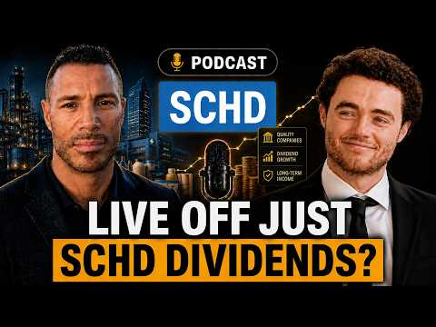
- 챕터: 0:00 Introduction · 1:28 Why Craig started investing i… · 5:15 His $1 million SCHD goal · 6:51 What drives SCHD’s dividend g… · 11:16 SCHD’s long-term performance · 13:18 Can someone retire with only … · 16:58 Pairing SCHD with option-inco… · 21:57 Can SCHD keep outperforming i… · 26:24 SCHD’s expected 2026 dividend… · 30:06 Which stock is currently misp… · 34:29 SCHD and sequence-of-returns …
- 설명 앞부분: In this episode of Mispriced, I sit down with Craig, better known as “SCHD Stan,” to discuss his journey investing in SCHD and his goal of building a $1 million position in the fund. We break down what makes SCHD’s methodology unique, how the ETF has consistently grown its dividend, and whether som…
- 같은 채널 평소 대비 ×7.4 (채널 최근 롱폼 중앙값 18,879회) · 평소 영상: SCHD Just Saw a Massive Change? SCHD Expert Expla… (18,879회) / The Best REITs to Buy During the Sell-Off ∣ Jussi… (19,435회)
- 대본 (자막, 0.0 음절/초) 첫 20초: “Welcome back everyone. Today we are joined by a very special guest. We are joined by Craig aka SCHD Stan. And if you aren't familiar with Craig, he has become one of the leading experts on SCHD and generally speaking his goal is to one day live off SCHD dividends. So Craig, thank you so much for joi”
- 첫 1분: “Welcome back everyone. Today we are joined by a very special guest. We are joined by Craig aka SCHD Stan. And if you aren't familiar with Craig, he has become one of the leading experts on SCHD and generally speaking his goal is to one day live off SCHD dividends. So Craig, thank you so much for joining us. >> Thank you, Eli. I'm honored to be to be invited on your show. I've been following your d”
- 흐름 (90초마다 첫 문장): 0:03 Welcome back everyone. Today we are → 1:30 accounts and back then it was mutual → 3:01 people started kind of dying on it. → 4:31 a new all-time high, trading around → 6:00 So and I'm at right now I'm at over → 7:30 And that's it. And and look how well → 9:01 finding → 10:32 of built-in → 12:02 total stock market index. So again, when → 13:31 Um → 15:00 honestly think that that SCHD over the → 16:30 hold up much better as well. So, it's → 18:01 my idea's been okay, well really if you → 19:30 GPIQ, the GPIX, but again they tend to → 21:01 time if that net asset value continues → 22:30 but in your opinion, does SCHD have the → 24:03 the beginning of the year when we → 25:30 look like. But, if you're wanting to → 27:02 I don't like to always throw out a a → 28:31 could lead to like
- 댓글 343/363: 좋은 점 — 영상 0 · 감사·응원 0 · 더 알고 싶은 것 0 · 아쉬운 점 — 영상 0 · 반박·불만 — 의견 다름 0 · 정치·사회 0 · 경험 공유 0 · 구독·다음 기대 0

### 53. I Reinvested Dividends for 30 Years — Here's What Actually Happened

- https://www.youtube.com/watch?v=oZqWOuMZwdA · BudgetMoney · 구독자 2,550 · 조회수 163,967 (×64.3, 하루 1,028.0) · 좋아요 2,207 (1.4%) · 11.3분 · 2026-06-11 · 주제 묶음 기타 · 형식 정보·해설 (그 밖) · 폴더 `W_oZqWOuMZwdA` (웹 승인)
- 썸네일: 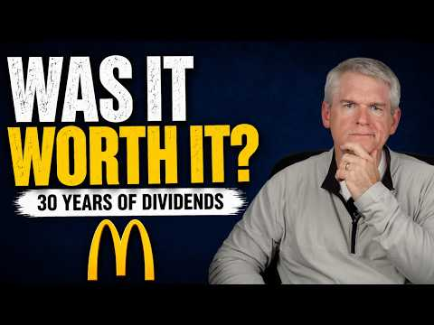
- 챕터: 0:00 What 30 Years Actually Taught… · 1:19 What a Dividend Actually Is · 2:13 The Three Choices: Spend, Rei… · 3:03 30-Year Proof: Dividend Growt… · 6:55 The Tax Reality Nobody Warns … · 8:22 The One Number Nobody Checks:… · 10:07 Rich vs. Wealth — The Real Di…
- 설명 앞부분: I started reinvesting dividends in 1995. For 30 years I watched what compound dividend growth actually does to a portfolio — and it's not what most beginners expect.In this video I break down dividend growth investing from the ground up: what a dividend actually is, the three choices you have every…
- 같은 채널 평소 대비 ×583.5 (채널 최근 롱폼 중앙값 281회) · 평소 영상: The Real Reason You Can't Find a Starter Home (281회) / 30 Years of Investing Taught Me That Less Activit… (279회)
- 대본 (자막, 0.0 음절/초) 첫 20초: “I started investing in 1995. I was 26 years old. I'd read about compound interest. I'd read about dividend reinvesting. I understood the math. But understanding it on paper and watching it work for 30 years, those are not the same thing. And after three decades, I can tell you there's a difference b” — 도입부 유형: 숫자로 시작
- 첫 1분: “I started investing in 1995. I was 26 years old. I'd read about compound interest. I'd read about dividend reinvesting. I understood the math. But understanding it on paper and watching it work for 30 years, those are not the same thing. And after three decades, I can tell you there's a difference between reading about compounding and watching it happen in your own account. Here's an early McDonal”
- 흐름 (90초마다 첫 문장): 0:00 I started investing in 1995. I was 26 → 1:32 business or pay some of it out to the → 3:00 came from. → 4:32 Let me Let me show you what that → 6:02 roughly around 3%, 3 and 1/2% over the → 7:31 what it is, and then they move on. → 9:01 that dividend is at risk. But here's → 10:30 that's what builds wealth.
- 댓글 336/336: 좋은 점 — 영상 0 · 감사·응원 0 · 더 알고 싶은 것 0 · 아쉬운 점 — 영상 0 · 반박·불만 — 의견 다름 0 · 정치·사회 0 · 경험 공유 0 · 구독·다음 기대 0

### 54. 배당주 20년 vs S&P500 20년, 3억 원이 만든 충격적인 자산과 삶의 격차 [ 재테크/미국주식/ETF/배당주/노후준비 ]

- https://www.youtube.com/watch?v=cqgVNBbMYew · 박대리와 황과장의 경제이야기 · 구독자 2,020 · 조회수 86,105 (×42.6, 하루 775.4) · 좋아요 1,171 (1.4%) · 20.5분 · 2026-07-30 · 주제 묶음 4. 미국·해외주식 · 형식 정보·해설 (그 밖) · 폴더 `W_cqgVNBbMYew` (웹 승인)
- 썸네일: 
- 설명 앞부분: 같은 3억 원으로 시작해 20년 동안 완전히 다른 길을 걸어간 두 사람. 미국 배당 성장주에 투자해 매달 현금흐름을 굴린 박 대리와, S&P 500 지수 전체에 투자해 자본의 성장을 노린 황 과장. 20년이라는 긴 세월이 흐른 뒤, 두 사람의 계좌에 찍힌 숫자는 어떻게 달라졌을까요? 그리고 더 중요한 것, 은퇴 후 두 사람의 '진짜 삶의 모습'은 어떻게 갈렸을까요? 단순히 "어느 쪽이 더 많이 벌었나"를 넘어, 자산 형성기에서 은퇴기까지 우리가 투자를 바라보는 관점 자체를 바꿔줄 20년의 실측 데이터 서사를 확인해 보세요. [영상…
- 같은 채널 평소 대비 ×36.8 (채널 최근 롱폼 중앙값 2,342회) · 평소 영상: 배당주 vs 지수 같은 20년, 폭락 3번 중 배당주가 심장을 지켜준 건 단 한 번이었다… (2,388회) / 폭락장에서 파는 것보다 적립을 멈추는 게 더 비쌌다, 6억5천만 원의 청구서 [ 재테크/… (2,295회)
- 대본 (음성인식(앞 5분), 4.9 음절/초) — 앞부분만, 흐름은 그 안까지 첫 20초: “배당주와 지수 주식, 이 두 가지 자산은 같은 주식시장 안에서 가장 오랜 기간 라이벌 관계로 불려왔습니다. 시장이 폭발적인 성장을 온 몸으로 받아내며 지수의 팽창을 누릴 것인가, 새 된 챈 챈 누릴 것인가. 아니면 기업이 만들어내는 당장의 현금 흐름을 매달 꼬박꼬박 재투자하여 복리의 눈덩이를 굴릴 것인가.”
- 첫 1분: “배당주와 지수 주식, 이 두 가지 자산은 같은 주식시장 안에서 가장 오랜 기간 라이벌 관계로 불려왔습니다. 시장이 폭발적인 성장을 온 몸으로 받아내며 지수의 팽창을 누릴 것인가, 새 된 챈 챈 누릴 것인가. 아니면 기업이 만들어내는 당장의 현금 흐름을 매달 꼬박꼬박 재투자하여 복리의 눈덩이를 굴릴 것인가. 오늘 다룰 이야기는 바로 이 질문에서 출발합니다. 출발서는 똑같았습니다. 두 사람에게는 20년 전 각자 핏땀 흘려 모은 종자똥 3억 원이 손에 쥐어져 있었습니다. 대기업 직장인으로 오랜 기간 함께 근무하며 같은 월급을 받고, 같은 점심을 먹고, 같은 퇴근길을 걸었던 박 대리와 황 과장, 두 사람은 어느 날 점심을 먹고 회사 근처 공원 벤치에 앉아 서로의 통장을 열어보았습니다. 각자의 계좌에는 약속이라도 한”
- 흐름 (90초마다 첫 문장): 0:00 배당주와 지수 주식, 이 두 가지 자산은 같은 주식시장 안에서 가장 오… → 1:32 박 대리가 선택한 것은 미국 시장을 대표하는 배당 성장 자산이었습니다. → 3:07 황 과장은 배당에 목매지 않았습니다. → 4:35 S&P 500 역시 연 1.5% 안팎에 소소한 배당을 지급했지만 황과장…
- 댓글 162/167: 좋은 점 — 영상 3 · 감사·응원 4 · 더 알고 싶은 것 3 · 아쉬운 점 — 영상 1 · 반박·불만 — 의견 다름 3 · 정치·사회 5 · 경험 공유 9 · 구독·다음 기대 0
  - 좋은 점 — 영상 👍4 “좋은정보 감사드립니다”
  - 좋은 점 — 영상 👍1 “오 좋은내용감사합니다”
  - 감사·응원 👍4 “좋은정보 감사드립니다”
  - 감사·응원 👍1 “정말 궁금했는데 감사합니당”
  - 더 알고 싶은 것 👍3 “18:07 더이상 근로소득을 기대할수 없는 시점인데 어떻게 생활비로 한푼도 안쓰고 배당 재투자를 할수가 잇을까요?”
  - 더 알고 싶은 것 👍0 “3억 20년 넣고 기다릴 사람이 얼마나될까요? 시드 금액이 넘 큼..1억이면 몰라도.”
  - 아쉬운 점 — 영상 👍0 “지수 팔아서 배당 사면 되는데 결론이 많이 아쉽네요.”
  - 반박·불만 — 의견 다름 👍0 “주식투자에서 가장중요한게 투자기법 심리? 아닙니다 그냥 가만히 있는겁니다 대부분 폭락장에서 90%가 공포에 다던지죠.ㅋㅋ 인간이 가장 힘들어 하는게 가~만히 있는거죠”
  - 반박·불만 — 의견 다름 👍0 “말도 안되는 소리를 하네. 은퇴싯점에 S&P를 팔아서 배당주로 옮기면 되지. 물론, 22%의 양도소득세를 내야 하는데, 그걸 감안해도 황과장이 무조건 이겼구만.”
  - 정치·사회 👍47 “한국 정부는 개인의 노후도 보장 안해주면서, 세계에서 유일하게 세금을 안내는 사람이 세금을 내는 사람보다 혜택이 더욱 많고, 은퇴하면 세금이 더 늘어나고, 중국인을 위해 한국국민이 세금을 더 내게 만든 유일한 나라…”
  - 정치·사회 👍6 “빚내서 그냥 레버타라 정부에서 빚 탕감해준다”
  - 경험 공유 👍5 “운용하기 나름인듯 다만 지수는 손이좀 가고 배당은 손이 조금 덜간다는 차이가 있을뿐. 그리고 배당을 받는경우는 세금문제도 생각해야하고. 수입이 안끊어졌다는 전제로 하락장때 추매를 하면 안되는거였나? 아니면 3억을 한번에 몰아넣지 말고 적립식으로 했었다면?? 지수에 넣…”
  - 경험 공유 👍0 “저는 모든 수익의 절반을 투자 및 재투자하는 방식을 하고 있습니다. 배당주 위주로 하고 있고요. 월급의 절반도 투자, 배당금의 절반도 재투자. 내가 쓸 수 있는 현금도 매년 늘어나고, 배당금도 재투자가 계속 이루어져서 매년 늘어나는 구조죠. 배당금이 2천만원 넘어가면…”

### 55. AI로 주식 자동 매매하면 어떻게 될까?

- https://www.youtube.com/watch?v=9E9OrcoMCjk · 이영배 · 구독자 21,700 · 조회수 1,221,530 (×56.3, 하루 8,094.0) · 좋아요 5,864 (0.5%) · 11.3분 · 2026-06-20 · 주제 묶음 7. 매매·전략 · 형식 정보·해설 (그 밖) · 폴더 `W_9E9OrcoMCjk` (웹 승인)
- 썸네일: 
- 같은 채널 평소 대비 ×6.8 (채널 최근 롱폼 중앙값 179,850회) · 평소 영상: AI에게 유튜브 채널을 운영시키면 구독자를 몇 명 모을까? (192,166회) / AI에게 인스타그램 운영을 시키면 팔로워를 몇 명 모을까? (289,334회)
- 대본 (음성인식(앞 5분), 6.8 음절/초) — 앞부분만, 흐름은 그 안까지 첫 20초: “지금부터 AI 두 개로 주식거래 대결 시켜볼 겁니다 누가 더 돈을 많이 벌어올까요? 제가 직접 한번 해보겠습니다 저는 제돈 천만 원을 AI 두 개에게 맡겨봤습니다 하나는 클로드의 오프스 4.8 다른 하나는 오픈 AI의 GPT 5.5인데요 둘 다 현재 최고의 성능을 자랑하는 각 회사의 최신 모델입니다 규칙은 간단합니다 실제 돈 500만 원을 받고 2주, 공일 제외 9 거래일 동안 최대 수익을 내면 됩니다” — 도입부 유형: 질문으로 시작
- 첫 1분: “지금부터 AI 두 개로 주식거래 대결 시켜볼 겁니다 누가 더 돈을 많이 벌어올까요? 제가 직접 한번 해보겠습니다 저는 제돈 천만 원을 AI 두 개에게 맡겨봤습니다 하나는 클로드의 오프스 4.8 다른 하나는 오픈 AI의 GPT 5.5인데요 둘 다 현재 최고의 성능을 자랑하는 각 회사의 최신 모델입니다 규칙은 간단합니다 실제 돈 500만 원을 받고 2주, 공일 제외 9 거래일 동안 최대 수익을 내면 됩니다 가장 먼저 클로드 코드로 거래를 할 수 있는 프로그램을 뚝딱 만들어냈고요 상태를 확인할 수 있는 데시보드도 구현해놨습니다 그래도 2주 동안 함께 하는 녀석들 아닙니까? 그래서 제가 이름도 한번 붙여봤는데 클로드가 짱이냐, 체치 PT가 짱이냐 이걸 정하는 거니까 휠짱이, 체짱이 이렇게 하겠습니다 그렇게 휠짱이와”
- 흐름 (90초마다 첫 문장): 0:00 지금부터 AI 두 개로 주식거래 대결 시켜볼 겁니다 → 1:30 일단 시장을 쭉 관망을 해요 → 3:01 삼성전자를 잇절해서 14만 원을 벌었다고 전 보고를 했단 말이죠 → 4:31 아니 왜 제가 시작하니까 갑자기 이런 일이 생기는 거죠?
- 댓글 578/604: 좋은 점 — 영상 6 · 감사·응원 17 · 더 알고 싶은 것 34 · 아쉬운 점 — 영상 3 · 반박·불만 — 의견 다름 8 · 정치·사회 7 · 경험 공유 34 · 구독·다음 기대 21
  - 좋은 점 — 영상 👍4 “딕션도 좋고 설명이 좋아요 컨텐츠만 좋으면 크게 되실분이다!!화이팅!!”
  - 좋은 점 — 영상 👍2 “영상 잘봤습니다. 앞으로 쭉쭉 좋은 영상 만들어주세요! 응원할게요”
  - 감사·응원 👍4 “딕션도 좋고 설명이 좋아요 컨텐츠만 좋으면 크게 되실분이다!!화이팅!!”
  - 감사·응원 👍3 “형들 마지막에 유튜버분 말들엇지? 현업코딩전문개발자들이 ai사용해서 장기적으로 수익이안나..이말은 전문지식으로 완벽하다 할만큼 만드는데도 지랄발광하면서 디버깅터지고 마이너스맞는거야.. 괜히 난 아이디어가 특별해 하면서 부여잡지마 현업개발자들이 아직 깡깡멀엇다함 미토스…”
  - 더 알고 싶은 것 👍3 “422번째 구독자입니다 올해안에 10만 가실 듯 앞으로도 재밌는 영상부탁드려요!”
  - 더 알고 싶은 것 👍2 “영상 잘봤습니다. 앞으로 쭉쭉 좋은 영상 만들어주세요! 응원할게요”
  - 아쉬운 점 — 영상 👍8 “영상 잘 봤습니다. 우연히 알고리즘 추천에 떠서 봤습니다. 편집이나 말씀 하시는 것도 되게 깔끔하고 보기 좋았습니다.”
  - 아쉬운 점 — 영상 👍4 “영상편집이나 진행. 딕션까지. 우연히 알고리즘에 떠서 봤는데 잼있네요. 구독하고가요”
  - 반박·불만 — 의견 다름 👍200 “재밌어요. 구독자 68명 퀄이아닌데요 머지”
  - 반박·불만 — 의견 다름 👍1 “영상 재밌게 봤습니다. 저도 개인 자동매매 시스템을 직접 개발해서 운영 중인데, 이 영상 보면서 왜 이런 결과가 나왔는지 조금 다른 각도에서 짚어보고 싶어요. **1. "가격을 임의로 예측해서 넣은" 그 버그가 핵심입니다** 영상에서 매도가를 못 불러와서 봇이 알아서…”
  - 정치·사회 👍0 “6월4일이면 선거 끝나고네 선가 전에 주가 올리고 선거끝나고 주가빠지고”
  - 정치·사회 👍0 “대한 외국인이네 딛,ㄹ 곱게 자란 인간들”
  - 경험 공유 👍147 “저도 직접 자동매매 시스템 만들어서 실제 운용 중인데, 느낀 점이 AI한테 판단을 맡기는 게 아니라 내 철학을 코드로 번역하는 게 핵심이더라고요. 언제 사고 언제 파느냐를 AI가 즉흥으로 결정하게 두면 결국 감정매매랑 다를 게 없어요. 시스템이 일관성을 갖추려면 철학…”
  - 경험 공유 👍13 “저도 ai로 코딩하여 자동매매 돌리는중인데 결국은 ai는 프로그램 만드는 툴로만 써야하고 전략은 내가짜야됨..”
  - 구독·다음 기대 👍16 “영상주기만 빨라지만 훨씬 대형채널이 될거같네요 저점매수 구독하고갑니다”
  - 구독·다음 기대 👍9 “이야 ㅋㅋㅋㅋ 주제 ㅅㅌㅊ 돈 잃었으니 바아로 구독합니다”

### 56. 【NISAおすすめ】オルカン・S＆P500・日本株・FANG＋・NASDAQ100の人気銘柄５つを元銀行員の目線で徹底検証しました！

- https://www.youtube.com/watch?v=EB_-ZGfqX5s · 初心者でも分かる40代50代のための資産形成塾 みく · 구독자 3,590 · 조회수 40,088 (×11.2, 하루 1,291.1) · 좋아요 151 (0.4%) · 37.6분 · 2026-10-18 · 주제 묶음 10. 노후·연금 투자 · 형식 정보·해설 (그 밖) · 폴더 `W_EB_-ZGfqX5s` (웹 승인)
- 썸네일: 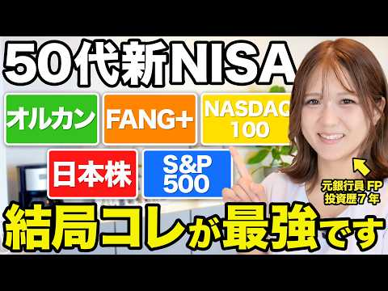
- 챕터: 0:00 オープニング · 2:06 日経平均とTOPIX、何が違う？ · 8:45 オルカンはなぜ人気なの？ · 12:54 S&P500はオルカンと何が違う？ · 15:58 NASDAQ100とFANG+の注意点は？ · 24:10 一番増えた銘柄を選べばいい？ · 27:51 今の組み合わせ、このままでいい？
- 설명 앞부분: ▼公式LINE 公式LINEにご登録後、動画内でお伝えしているキーワードを送っていただくと受け取れます🙆‍♀ 元銀行員でFPの資格を持つ私が 新NISAや老後資金など、お金のことを発信していきます🎙
- 같은 채널 평소 대비 ×1.0 (채널 최근 롱폼 중앙값 41,034회) · 평소 영상: 【50代60代必見！】70歳までにこの資産額さえあれば、もう人生安泰です！ (41,034회) / 【必見】実は資産〇〇万円から、 爆発的に増えはじめる！積立投資の複利効果と絶対に抑えておいてほしい… (45,323회)
- 대본 없음 (설명) — 음성인식이 끝나면 도입부·흐름이 들어감
- 댓글 9/15: 좋은 점 — 영상 0 · 감사·응원 0 · 더 알고 싶은 것 0 · 아쉬운 점 — 영상 0 · 반박·불만 — 의견 다름 0 · 정치·사회 0 · 경험 공유 0 · 구독·다음 기대 0

### 57. POV: Gaji Sama dengan Temanmu, Tapi Kamu Keluar dari Pabrik Lebih Awal Berkat Dividen

- https://www.youtube.com/watch?v=_-rdF2o1v0c · ncek invest · 구독자 7,150 · 조회수 88,947 (×12.4, 하루 2,546.3) · 좋아요 553 (0.6%) · 8.3분 · 2026-10-14 · 주제 묶음 기타 · 형식 정보·해설 (그 밖) · 폴더 `W__-rdF2o1v0c` (웹 승인)
- 썸네일: 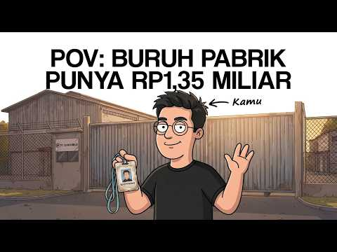
- 챕터: 0:00 Hari terakhir di pabrik · 1:00 Level 1: Gaji dan Dividen · 2:00 Level 2: Dividen Pertama · 3:35 Level 3: Dividen Bisa Turun · 5:05 Level 4: Angka yang Terlalu L… · 6:45 Level 5: Harga Sebuah Bel · 7:45 Penutup
- 설명 앞부분: Teman satu lini bilang, "Pensiun dini dari dividen? Ngimpi lo." Dua puluh satu tahun kemudian, kamu melepas ID card pabrikmu untuk terakhir kali. Di video POV ini, kamu akan menjalani 21 tahun hidup seorang buruh pabrik yang gajinya biasa saja, tapi belajar dari seorang mandor tua bahwa gaji adalah…
- 같은 채널 평소 대비 ×7.9 (채널 최근 롱폼 중앙값 11,189회) · 평소 영상: POV: Hujan 3 Hari, Semua Pedagang Tutup, Tapi Kam… (11,281회) / POV: Temanmu Daftar CPNS untuk Keempat Kalinya, K… (11,097회)
- 대본 없음 (설명) — 음성인식이 끝나면 도입부·흐름이 들어감
- 댓글 36/43: 좋은 점 — 영상 0 · 감사·응원 0 · 더 알고 싶은 것 0 · 아쉬운 점 — 영상 0 · 반박·불만 — 의견 다름 0 · 정치·사회 0 · 경험 공유 0 · 구독·다음 기대 0

### 58. Buy 1 Share of SCHD Every Week—Here’s the Retirement Math

- https://www.youtube.com/watch?v=qFFwr4zsDKQ · Mikey Moran · 구독자 12,900 · 조회수 217,738 (×16.9, 하루 4,587.6) · 좋아요 1,848 (0.9%) · 9.6분 · 2026-10-01 · 주제 묶음 기타 · 형식 정보·해설 (그 밖) · 폴더 `W_qFFwr4zsDKQ` (웹 승인)
- 썸네일: 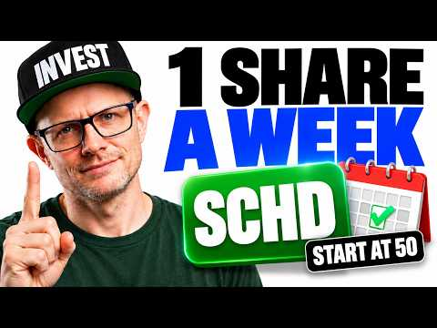
- 설명 앞부분: Starting SCHD at 50? What could buying just 1 share a week mean for your retirement income at 65? I ran the numbers—and the difference between the optimistic and conservative scenarios surprised me. In this video, I explore a hypothetical 15-year investing plan using SCHD, the Schwab U.S. Dividend …
- 같은 채널 평소 대비 ×22.9 (채널 최근 롱폼 중앙값 9,510회) · 평소 영상: I Ranked 12 Income ETFs — My Own Funds FAILED (9,758회) / GPIQ Beat My QQQI… So Why Am I Still Holding QQQI? (9,262회)
- 대본 없음 (설명) — 음성인식이 끝나면 도입부·흐름이 들어감
- 댓글 162/277: 좋은 점 — 영상 0 · 감사·응원 0 · 더 알고 싶은 것 0 · 아쉬운 점 — 영상 0 · 반박·불만 — 의견 다름 0 · 정치·사회 0 · 경험 공유 0 · 구독·다음 기대 0

### 59. 주식투자 5년간 수익이 없던 내가 드디어 깨달은 '이것'

- https://www.youtube.com/watch?v=uqsGXwRgP68 · 리채피 richappy · 구독자 10,100 · 조회수 179,766 (×17.8, 하루 3,498.8) · 좋아요 2,439 (1.4%) · 27.8분 · 2026-09-28 · 주제 묶음 11. 투자 일반 · 형식 정보·해설 (그 밖) · 폴더 `W_uqsGXwRgP68` (웹 승인)
- 썸네일: 
- 챕터: 0:00 인트로 · 1:10 5년 동안 제가 주식으로 번 돈은 0원이었습니다 · 3:01 제일 괴로웠던 건 손실이 아니었습니다 · 5:15 2019년, 제가 모으던 건 정답이었습니다 · 11:59 기준을 배운 직후에 무너졌습니다 · 17:59 코로나 폭락, 계좌가 70~80퍼센트 빠졌습니다 · 24:22 드라마 제작사 투자로 자산이 3배가 됐습니다 · 26:56 2022년 금리 인상기, 마이너스 30퍼센트
- 설명 앞부분: 매주 수요일 오후 9시에 라이브를 진행합니다. 많은 분들이 공부한 만큼 계좌가 따라오지 않는 이유를 아직 공부가 부족해서라고 생각하지만, 실제로는 배운 것을 실제 비중과 행동에 옮기지 못한 데서 오는 경우가 많습니다. 여기에 시장이 오를 때 확인 절차를 건너뛰게 만드는 수익의 착각이 겹치면 같은 자리를 다시 맴돌게 됩니다. 한지우는 2016년에 투자를 시작해 5년 동안 책과 강의, 새벽까지 이어진 기업 분석에 매달렸지만 그 기간 주식으로 번 돈은 없었습니다. 2019년 가치투자 스터디에서 만난 투자자들이 종목이 아니라 기준을 이야…
- 같은 채널 평소 대비 ×15.1 (채널 최근 롱폼 중앙값 11,906회) · 평소 영상: 주식투자 5년을 헤매던 내가 '이것'을 끊고 달라진 이야기 (12,239회) / 5년간 '이걸' 몰라서 주식투자에 실패했습니다. 개인투자자가 주식시장에서 이기는 방법 (11,573회)
- 대본 (음성인식(앞 5분), 5.2 음절/초) — 앞부분만, 흐름은 그 안까지 첫 20초: “요즘은 투자 공부를 할 수 있는 곳이 정말 많습니다. 책도 많고 강의도 많고 예전과는 비교하기 어려울 정도죠. 그런데 공부한 만큼 계좌가 따라오느냐는 또 다른 이야기일 수 있습니다. 저도 그랬습니다. 무려 5년 동안 주식 공부를 했는데도 계좌는 제 자리였습니다. 주변에서는 그 정도 공부했으면 이제 충분하지 않냐는 말까지 들었죠.”
- 첫 1분: “요즘은 투자 공부를 할 수 있는 곳이 정말 많습니다. 책도 많고 강의도 많고 예전과는 비교하기 어려울 정도죠. 그런데 공부한 만큼 계좌가 따라오느냐는 또 다른 이야기일 수 있습니다. 저도 그랬습니다. 무려 5년 동안 주식 공부를 했는데도 계좌는 제 자리였습니다. 주변에서는 그 정도 공부했으면 이제 충분하지 않냐는 말까지 들었죠. 그런데 정작 저는 5년 동안 뭔가를 놓치고 있었습니다. 열심히 공부했지만 제가 놓치고 있었던 건 따로 있었던 겁니다. 그리고 그걸 이해하고 나서부터는 본격적으로 수익이 나기 시작했습니다. 그리고 지금은 경제적 자유를 이루게 됐습니다. 오늘은 제가 그 5년 동안 무엇을 놓치고 있었는지 그리고 수많은 시행차고 끝에 무엇을 깨달았는지 말씀드리겠습니다. 이 영상을 끝까지 보시면 저처럼 오랜”
- 흐름 (90초마다 첫 문장): 0:00 요즘은 투자 공부를 할 수 있는 곳이 정말 많습니다. → 1:30 벌었다가 잃었다가 또 벌었다가 다시 잃었습니다. → 3:01 그런데 무엇보다 돈을 크게 잃었을 때보다 → 4:31 그걸 몰랐던 거죠 3년 차까지는.
- 댓글 111/124: 좋은 점 — 영상 7 · 감사·응원 15 · 더 알고 싶은 것 3 · 아쉬운 점 — 영상 0 · 반박·불만 — 의견 다름 0 · 정치·사회 0 · 경험 공유 12 · 구독·다음 기대 2
  - 좋은 점 — 영상 👍17 “차분하고 솔직한 설명 공감이 가고 참 감동 입니다”
  - 좋은 점 — 영상 👍6 “목소리가 맑고 깨끗해서 듣기좋아요. 마이크가 너무 섬세해서 스피커에 울림이와서 많이거슬려요!”
  - 감사·응원 👍14 “잘봤습니다. 구독. 감사합니다. 뒤늦게 주식에 뛰어든 70초반 입니다. 우선은 오래 버티고 싶습니다.”
  - 감사·응원 👍6 “궁금해서 구독했어요 응원합니다”
  - 더 알고 싶은 것 👍6 “궁금해서 구독했어요 응원합니다”
  - 더 알고 싶은 것 👍0 “반갑습니다60세후반입니다.종가베팅을알고싶어요.참아어렵고힘들어요배움도짧고알고싶어요배움을주세요.감사합니다.”
  - 경험 공유 👍8 “매우 좋은 메시지입니다. 저도 주식에 전념하기로 한 저에게 많은 방향을 주셨습니다.”
  - 경험 공유 👍6 “철저한 절재!!! 다 내려놓고 그걸 행동으로 옮기자. 그 자그만한 행동이 나을 변화 시킨다 다 내꺼가 아니다~ 3년.5개월차에 느낌입니다 잘 하다 크게맞고 또 잘하다 크게맞고 두번 하고 나니까. 아~내가 이런 행동땜에 큰 던을 잊는구나 느끼고 내려놓고 행동으로 옮기니…”
  - 구독·다음 기대 👍6 “궁금해서 구독했어요 응원합니다”
  - 구독·다음 기대 👍4 “구독하고갑니다 감사합니다”

### 60. Stop Guessing! Growth vs Dividend Stocks Explained in 20 Minutes

- https://www.youtube.com/watch?v=hkRXzD3CH3c · Finance Simplified · 구독자 3,800 · 조회수 142,008 (×37.4, 하루 1,214.9) · 좋아요 2,342 (1.7%) · 21.2분 · 2026-07-24 · 주제 묶음 기타 · 형식 정보·해설 (그 밖) · 폴더 `W_hkRXzD3CH3c` (웹 승인)
- 썸네일: 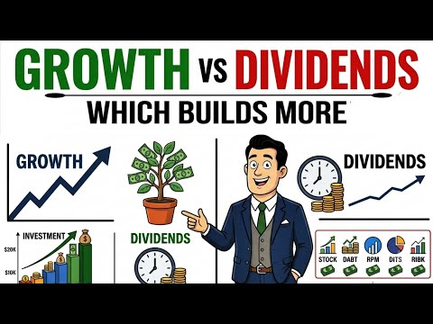
- 챕터: 0:00 The Truth Nobody Tells You Ab… · 0:25 The Biggest Investing Myth · 3:00 What Is a Growth Stock? ($10,… · 5:45 What Is a Dividend Stock? (4%… · 8:30 The $100,000 Challenge: 30-Ye… · 12:15 Who Should Buy Growth Stocks? · 14:15 Who Should Buy Dividend Stock… · 16:15 The Millionaire Strategy (80/… · 18:15 The 6 Biggest Mistakes Invest… · 20:30 The Final Verdict
- 설명 앞부분: Growth vs Dividend Stocks Growth stocks vs dividend stocks — which one actually builds more wealth? We ran the real math on $100,000 over 30 years, and the result surprised us. Most investors pick a side based on a feeling, not a number. Dividends feel safe because cash hits your account every thre…
- 같은 채널 평소 대비 ×95.2 (채널 최근 롱폼 중앙값 1,491회) · 평소 영상: $10,000 in Crypto vs. $10,000 in Dividend Stocks:… (1,522회) / The Portfolio Is About to Happen to Your Portfolio (1,460회)
- 대본 없음 (설명) — 음성인식이 끝나면 도입부·흐름이 들어감
- 댓글 191/210: 좋은 점 — 영상 0 · 감사·응원 0 · 더 알고 싶은 것 0 · 아쉬운 점 — 영상 0 · 반박·불만 — 의견 다름 0 · 정치·사회 0 · 경험 공유 0 · 구독·다음 기대 0

### 61. 4200억 단타 일본 천재가 초간단 매매법, 죽어라 이것만하세요

- https://www.youtube.com/watch?v=UH4UFmdXXo0 · 세력시그널 · 구독자 3,950 · 조회수 119,628 (×30.3, 하루 1,258.1) · 좋아요 2,586 (2.2%) · 20.6분 · 2026-08-15 · 주제 묶음 7. 매매·전략 · 형식 정보·해설 (그 밖) · 폴더 `W_UH4UFmdXXo0` (웹 승인)
- 썸네일: 
- 챕터: 0:00 BNF 코테카와 타카시 ∣ 1,600만 원으로 시작한… · 2:35 슈퍼 트레이더 자동매매 봇 안내 · 2:46 BNF의 은둔형 투자 생활 ∣ 주식에 인생을 건 전업… · 3:41 제이콤 주식 사건 ∣ BNF가 16분 만에 200억 … · 5:49 독학으로 성공한 BNF ∣ 제시 리버모어와 실전 차트… · 6:30 BNF 투자 원칙 ① 가격 움직임과 시장 심리 · 7:30 BNF 투자 원칙 ② 기계적 손절과 리스크 관리 · 8:12 BNF 투자 원칙 ③ 거래량·캔들로 판단하는 익절 타… · 8:44 BNF 투자 원칙 ④ 공포와 탐욕을 이용한 역발상 매매 · 9:32 BNF 투자 원칙 ⑤ 개장 후 첫 30분 관찰 전략 · 10:17 BNF 투자 원칙 ⑥ 감정을 배제한 확률 기반 매매 · 11:00 BNF 투자 원칙 ⑦ 거래량과 종목 선정 기준 · 12:12 BNF 역추세 매매법 ∣ 급락주 바닥을 찾는 3가지 … · 13:15 25일 이동평균선 이격도 ∣ BNF의 급락주 매수 기준 · 14:21 BNF 차트 세팅 ∣ 25일 지수이동평균선·RSI·M… · 15:25 이격도 측정법 ∣ 25일선 대비 -20~35% 과매도… · 16:12 대형주·중소형주·상승장·하락장 이격도 기준 · 17:31 BNF 매수 타이밍 4단계 ∣ 이격도·RSI·MACD… · 18:25 지지선·저항선 활용 ∣ BNF 역추세 매매법 실전 응용 · 19:35 상승장·하락장별 익절과 손절 전략
- 설명 앞부분: 4200억 단타 일본 천재가 초간단 매매법, 죽어라 이것만하세요 🌟슈퍼트레이더 자동 매매봇 신청하기🌟 🌟 BNF 트레이딩 비법 전자책 신청하기🌟
- 같은 채널 평소 대비 ×61.1 (채널 최근 롱폼 중앙값 1,959회) · 평소 영상: 80억을 잃고 깨달은 126 분할매수법 하나로 220억을 번 매매법 (1,959회) / 볼린저 밴드에 RSI를 결합해 수백억 자산가가 된 월가 천재의 매매법 (1,549회)
- 대본 없음 (설명) — 음성인식이 끝나면 도입부·흐름이 들어감
- 댓글 216/250: 좋은 점 — 영상 5 · 감사·응원 28 · 더 알고 싶은 것 0 · 아쉬운 점 — 영상 1 · 반박·불만 — 의견 다름 6 · 정치·사회 0 · 경험 공유 2 · 구독·다음 기대 0
  - 좋은 점 — 영상 👍1 “BNF 정말 유익한 영상이네요. 감사합니다.”
  - 좋은 점 — 영상 👍0 “BNF~ 이걸 이제 봤네요^^; 유익한 내용 공유에 감사드립니다”
  - 감사·응원 👍5 “ㅋㅋㅋㅋㅋㅋㅋㅋㅋㅋ 그냥 ㅈㄴ 웃기네요 BNF 기본 매매법 저대로 시장에 적용해보세요~ 저 진입 조건에 맞는 종목을 찾을 수 있을까요? 화이팅~!!”
  - 감사·응원 👍4 “BNF 정말 잘 봤습니다 감사합니다”
  - 아쉬운 점 — 영상 👍0 “얘들은 한결같네. 낚시질로 펌핑해놓고 걸려들면 전화해서 하루에 얼마씩 거래하는지 시드는 얼마냐는둥 이따구 소리만 해대면서 막상 지표는 안보내고 어떻게든 빨대꽂아서 학원비 받아쳐 먹으려는 공통적인 수법인데...또한가지는 지표신청서 작성을 하면 그이후로 어중이 떠중이로부…”
  - 경험 공유 👍1 “아 나도 할줄알면 이해라도 하는데 무슨말인지조차 모르는 불쌍한1인”

### 62. 세미파이어 부부가 국내주식 안하는 이유

- https://www.youtube.com/watch?v=DNDC7nT7Hmw · 시골사는 배당부부 · 구독자 1,490 · 조회수 14,446 (×9.7, 하루 464.0) · 좋아요 163 (1.1%) · 6.9분 · 2026-10-18 · 주제 묶음 5. 국내주식 · 형식 정보·해설 (그 밖) · 폴더 `W_DNDC7nT7Hmw` (웹 승인)
- 썸네일: 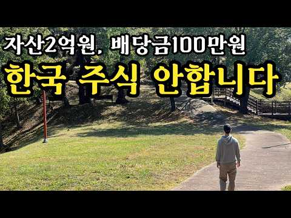
- 설명 앞부분: 안녕하세요 시골사는 배당부부입니다. 오늘은 저희부부가 국내주식을 하지 않는 이유에 대해 얘기 나눠봤습니다
- 같은 채널 평소 대비 ×1.1 (채널 최근 롱폼 중앙값 13,601회) · 평소 영상: 시골 세미파이어 현실 한달 생활비 (13,601회) / 배당금으로 떠난 가을 단풍 여행 (15,967회)
- 대본 (음성인식(앞 5분), 5.2 음절/초) — 앞부분만, 흐름은 그 안까지 첫 20초: “안녕하세요. 시골사는 배당 부부입니다. 가을이 깊어지면서 더 추워지기 전에 아내와 나들이를 다녀왔습니다. 오늘 다녀온 곳은 강원도 인재의 가을꽃 축제입니다. 국화와 구절초가 뒤늦게 절정을 맞으며 축제 기간이 일주일 연장되었는데요.”
- 첫 1분: “안녕하세요. 시골사는 배당 부부입니다. 가을이 깊어지면서 더 추워지기 전에 아내와 나들이를 다녀왔습니다. 오늘 다녀온 곳은 강원도 인재의 가을꽃 축제입니다. 국화와 구절초가 뒤늦게 절정을 맞으며 축제 기간이 일주일 연장되었는데요. 기간을 놓쳐 아쉬웠는데 운이 좋게 다녀왔습니다. 이번 주에는 코스피가 크게 하락하면서 두 달 만에 매도 사이드카가 발동했습니다. 오늘은 저희 부부가 국내 주식 투자하지 않는 이유와 앞으로 어떤 방식으로 투자해 나갈 것인지에 대해 이야기해보려고 합니다. 그 전에 저희 주식 현황부터 살펴보도록 하겠습니다. 이번 주에는 국내 주식과 미국 주식이 모두 하락하면서 전체적인 자산이 떨어졌고 가지고 있는 하이닉스가 아주 크게 하락했습니다. 이번 주에는 리얼티 인컴에서 배당주 42달러가 들어왔습”
- 흐름 (90초마다 첫 문장): 0:00 안녕하세요. 시골사는 배당 부부입니다. 가을이 깊어지면서 더 추워지기 … → 1:37 하지만 문제는 그 다음이었습니다. → 3:04 장기 투자를 지향하는 저에게도 약간의 지루함이 느껴졌습니다. → 4:36 바로 SK하이닉스와 현대차를 매수한 일입니다.
- 댓글 35/35: 좋은 점 — 영상 0 · 감사·응원 2 · 더 알고 싶은 것 0 · 아쉬운 점 — 영상 0 · 반박·불만 — 의견 다름 0 · 정치·사회 0 · 경험 공유 2 · 구독·다음 기대 2
  - 감사·응원 👍1 “모두가 다 다른상황이니 각자에 맞는 투자가 옳은투자지요. 응원합니다.”
  - 감사·응원 👍0 “응원과 구독합니다”
  - 경험 공유 👍9 “나도 예전에는 국내주식만하다 미국주식으로 옮겼지만 절세상으로나 분산차원에서 국내투자는 필요하다고 봄. 대신 코스피200같은 대표지수를 일정비중으로 투자하는건 필요하다 봄니다.”
  - 경험 공유 👍0 “똑소리나는 부부시네요 유튜브자주 업로딩해주세요❤ 구독누르고가요 저도 국장에서 크게실망한적있어서ㅜㅜ.. 고배당주에 한번투자해봐야겠습니다”
  - 구독·다음 기대 👍0 “응원과 구독합니다”
  - 구독·다음 기대 👍0 “똑소리나는 부부시네요 유튜브자주 업로딩해주세요❤ 구독누르고가요 저도 국장에서 크게실망한적있어서ㅜㅜ.. 고배당주에 한번투자해봐야겠습니다”

### 63. I Let AI Invest for Me on Trading 212, Here's What Happened

- https://www.youtube.com/watch?v=8zUa4JnCrRw · Financial Interest · 구독자 19,500 · 조회수 537,649 (×27.6, 하루 6,051.2) · 좋아요 4,107 (0.8%) · 11.8분 · 2026-08-21 · 주제 묶음 기타 · 형식 정보·해설 (그 밖) · 폴더 `W_8zUa4JnCrRw` (웹 승인)
- 썸네일: 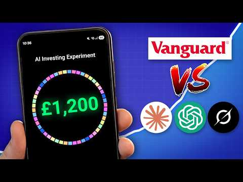
- 챕터: 0:00 The setup · 0:44 Introducing the contestants · 1:23 The initial prompt · 2:45 Building the AI portfolios · 3:30 Making the first investments · 4:03 The results · 5:36 Each AI's portfolio breakdown · 8:48 Who did AI think would win? · 10:56 Who wins long term?
- 설명 앞부분: Honestly we made this to try to show that this is probably a terrible idea long-term. Hope we can prove that long-term! Enjoy. Get free fractional shares worth up to £100 with Trading 212 via this link: This is an affiliate link, we will earn a small commission. If you do not get your free share af…
- 같은 채널 평소 대비 ×86.9 (채널 최근 롱폼 중앙값 6,184회) · 평소 영상: Should You Invest in Leveraged ETFs? (6,356회) / Should You Use InvestEngine in 2026? (6,012회)
- 대본 없음 (설명) — 음성인식이 끝나면 도입부·흐름이 들어감
- 댓글 193/208: 좋은 점 — 영상 0 · 감사·응원 0 · 더 알고 싶은 것 0 · 아쉬운 점 — 영상 0 · 반박·불만 — 의견 다름 0 · 정치·사회 0 · 경험 공유 0 · 구독·다음 기대 0

### 64. Is This the Time to Buy Indian Equities? Pankaj Tibrewal on FII Outflow & Investment Oppo…

- https://www.youtube.com/watch?v=jUrGWhhASXU · Wealth By Motilal Oswal · 구독자 14,700 · 조회수 143,986 (×9.8, 하루 4,498.3) · 좋아요 848 (0.6%) · 64.4분 · 2026-10-17 · 주제 묶음 기타 · 형식 정보·해설 (그 밖) · 폴더 `W_jUrGWhhASXU` (웹 승인)
- 썸네일: 
- 챕터: 0:00 Teaser & Highlights · 1:45 Decoding the Current Market P… · 8:25 Cost of Capital, Global Bond … · 12:30 FII Selling vs Domestic Inflo… · 20:30 The "Two Indias" in the Stock… · 23:50 Promoter's Edge: How to Evalu… · 29:40 Gorilla to King Kong Framewor… · 37:45 Valuing New-Age Tech Companie… · 39:25 Big Mega Trends: Manufacturin… · 44:50 Active vs. Passive Investing … · 47:05 Managing Growth vs. Valuation… · 49:15 Asset Allocation Strategy for… · 52:30 Biggest Mistakes Retail Inves… · 55:30 Developing the Right Temperam… · 58:30 Rapid Fire Round
- 설명 앞부분: In this episode of Wealth by Motilal Oswal, we are joined by Pankaj Tibrewal, Founder of Ikigai Asset Manager and one of India’s most respected fund managers with over two decades of market experience. In a volatile market environment where investors' patience is being tested, Pankaj breaks down hi…
- 같은 채널 평소 대비 ×2.8 (채널 최근 롱폼 중앙값 51,195회) · 평소 영상: Radhika Gupta Gives Practical Framework on How to… (51,195회) / Why Investing Is More About Behaviour Than Return… (55,130회)
- 대본 없음 (설명) — 음성인식이 끝나면 도입부·흐름이 들어감
- 댓글 64/96: 좋은 점 — 영상 0 · 감사·응원 0 · 더 알고 싶은 것 0 · 아쉬운 점 — 영상 0 · 반박·불만 — 의견 다름 0 · 정치·사회 0 · 경험 공유 0 · 구독·다음 기대 0

### 65. 라오어 무한매수법, 정말 계속 해도 될까? TQQQ·QLD로 12년 돌려보고 알게 된 의외의 결과

- https://www.youtube.com/watch?v=nCBMBYmFjOU · 여의도 아빠  · 구독자 2,290 · 조회수 66,105 (×28.9, 하루 681.7) · 좋아요 750 (1.1%) · 7.5분 · 2026-08-13 · 주제 묶음 7. 매매·전략 · 형식 정보·해설 (그 밖) · 폴더 `W_nCBMBYmFjOU` (웹 승인)
- 썸네일: 
- 설명 앞부분: 라오어의 무한매수법, 12년을 그대로 돌려봤습니다. 그런데 가장 놀란 건 수익률이 아니었어요. 돈이 놀고 있는 시간과 현금이 바닥나는 순간이었습니다. QLD 무한매수 19배 vs 그냥 거치 30배 TQQQ 무한매수 19배 vs 그냥 거치 59배 12년 내내 현금의 3분의 1이 놀고 있었다 최악의 타이밍 2021년 꼭지 진입 QLD vs TQQQ 무한매수 평소엔 QLD, 찐 폭락엔 TQQQ 시작
- 같은 채널 평소 대비 ×10.3 (채널 최근 롱폼 중앙값 6,421회) · 평소 영상: 아이에게 매달 10만원씩 미국 ETF를 사줬더니… 20년 뒤 계좌에 찍힌 금액 (S&P5… (6,421회) / S&P500에 2배 투자했는데 QQQ 1배보다 수익률이 낮았습니다… 20년 동안 무슨 일… (6,673회)
- 대본 없음 (설명) — 음성인식이 끝나면 도입부·흐름이 들어감
- 댓글 186/211: 좋은 점 — 영상 5 · 감사·응원 7 · 더 알고 싶은 것 12 · 아쉬운 점 — 영상 1 · 반박·불만 — 의견 다름 6 · 정치·사회 0 · 경험 공유 13 · 구독·다음 기대 0
  - 좋은 점 — 영상 👍4 “좋은 영상 감사합니다! 멘탈 유지에 도움이 많이 돼요!”
  - 좋은 점 — 영상 👍3 “평소엔 qld 폭락엔 TQQQ무한매수.. 공감합니다만 '진짜 폭락' 이라는걸 어찌 알 수 있는지가 관건이네요ㅎㅎ.. 대부분은 그걸 못맞추니 이런 규칙이 나오는건데”
  - 감사·응원 👍21 “부지런히 할필요없이 무한매수법 공개api로 프로그램만들어서 자동으로 돌리고 있습니다 .qld도 같이 하고 있고요 . 결과 흥미롭게 잘봤습니다 감사합니다 .”
  - 감사·응원 👍7 “다른의미로 감사합니다 😘”
  - 더 알고 싶은 것 👍13 “더 좋은 방법을 알려주세요”
  - 더 알고 싶은 것 👍5 “무한매수법 저자가 서울대 자퇴, 경력 10년차 소아개원의 치과의사 맞나요? 검색해도 저자의 실명도 없고 최소한 어느 치대를 졸업했는지 최소한의 정보조차 검색이 안되고 모두 비공개라, 늘 마스크 쓰고 다니니 😢 주식관련 멤버십 비용도 월 12만원 받는다는데 저자에 대한…”
  - 아쉬운 점 — 영상 👍3 “제목으로 어그로 끄는건 여전하네”
  - 반박·불만 — 의견 다름 👍30 “무한매수법의 가장 큰 장점은 수익률이 아닙니다. 정해진 규칙을 따라서 상승장, 횡보장, 하락장에도 맨탈이 흔들리지 않으면서 꾸준히 수익을 내는 방법이지. 다양한 시나리오를 가정한 12년치 백테스트는 이 투자방법이 실전에서 쓸수 있는지 확인하는 좋은 방법이긴 하지만 수…”
  - 반박·불만 — 의견 다름 👍28 “웃고 갑니다. 직접 몇년간 하는 입장에서 라오어님 입장도 모르고 그냥 방법만 겉핥기 식으로만 평가하는 느낌이네요. 무한매수법은 리스크를 줄이기 위한 "단투"지 장투에 적합한 방법은 아닙니다. 무슨 qld 장기보유랑 비교를 해요.. 라오어님도 그냥 이것저것 귀찮으면 q…”
  - 경험 공유 👍41 “무한매수의 단점은 1. 상방이 막혀있고 하방은 열려 있으며, 2. 복리를 스스로 끊고 리셋하며, 3. 계속해서 수익을 확정하면서 텍스를 내야하는 텍스 이펙트를 고려하지 않았고, 4. 항상 이용할 수 있는 자금의 일부분만 사용하기에 수익률은 좋을수 있으니 수익금 측면에…”
  - 경험 공유 👍40 “2022년에 라오어 카페에 가입해서 꾸준히 글씀. 그때 세상이 참 재미있었음. 하수들이 세상이 망한다고 고래고래 소리지르고 거기서 유일하게 비껴간게 라오어 카페였음. 거기도 순탄하진 않았지만 적어도 tq가 80프로 떨어진 그 순간에도 tq를 믿는 사람들이 모였단 말임…”

### 66. "원금 안 깎여요" 진화형 커버드콜 ETF 황금 포트폴리오 공개

- https://www.youtube.com/watch?v=yGuybuoroRI · 투자360 · 구독자 16,700 · 조회수 691,063 (×41.4, 하루 4,971.5) · 좋아요 6,421 (0.9%) · 22.2분 · 2026-07-02 · 주제 묶음 2. 장기투자·ETF·지수 · 형식 브이로그·직접 해본 이야기 · 폴더 `W_yGuybuoroRI` (웹 승인)
- 썸네일: 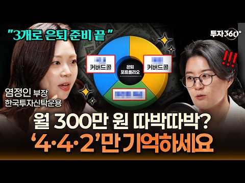
- 설명 앞부분: 커버드콜 ETF는 정말 원금을 깎아먹는 상품일까요? 한국투자신탁운용 염정인 부장과 함께 커버드콜 ETF의 오해와 진실, 활용법까지 알아봤습니다. 국내 주식형 커버드콜이 절세에 유리한 이유는 무엇인지, 미국 주식형 커버드콜은 왜 연금저축·IRP 계좌에서 활용하는 것이 좋은지도 함께 짚어봅니다. 또한 국내 커버드콜, 해외 커버드콜, 파킹형 ETF 또는 채권형 ETF으로 구성하는 포트폴리오 전략과 계좌별 인출 순서까지 정리했습니다. 노후자금을 지키면서 매달 현금흐름을 만들고 싶은 분들이라면 끝까지 시청해 주세요. 핵심만 골라보기
- 같은 채널 평소 대비 ×17.9 (채널 최근 롱폼 중앙값 38,634회) · 평소 영상: 환율 내린 지금이 기회! 삼전닉스 팔아서 현금 '여기로' 옮기세요 #부자탐사대 #효라클 … (38,634회) / “지금까지 금투자 방법 다 틀렸습니다” 금 투자, 개미는 ‘이렇게’ 사야 돈 법니다 ∣ … (36,125회)
- 대본 (음성인식(앞 5분), 5.7 음절/초) — 앞부분만, 흐름은 그 안까지 첫 20초: “그러니까 한마디로 원금 깎아 먹지 않고 오히려 원금을 늘려가면서 꾸준한 분배율도 제공하고 있다 예를 들어 산 5억원 정도 은퇴자금이 있고 여기서 매달 300만 원씩 꺼냈으면 이제 20년이 최안되는 사이에 원금이 다 없어지거든요 제가 보통 추천을 드리는 거는 40, 40, 20씩 이제 말씀을 드려요 커버드 콜 매달 높은 배당금을 준다고 하니” — 도입부 유형: 숫자로 시작
- 첫 1분: “그러니까 한마디로 원금 깎아 먹지 않고 오히려 원금을 늘려가면서 꾸준한 분배율도 제공하고 있다 예를 들어 산 5억원 정도 은퇴자금이 있고 여기서 매달 300만 원씩 꺼냈으면 이제 20년이 최안되는 사이에 원금이 다 없어지거든요 제가 보통 추천을 드리는 거는 40, 40, 20씩 이제 말씀을 드려요 커버드 콜 매달 높은 배당금을 준다고 하니 눈길이 가지만 이러다 이거 결국 내 원금 까먹으면서 쓴 돈 아닌가 하는 생각도 듭니다 오늘은 한국 투자신탁 운용 염정인 부장님과 함께 커버드 콜의 오해와 진실을 명쾌하게 풀어드리고 또 소득 공백기 동안 원금 손실 없이 안전하게 월급을 꺼냈을 수 있는 실전 연금 세팅법까지 상세하게 알아보겠습니다 부장님 안녕하세요 안녕하세요 반갑습니다 부장님과 함께 저희가 이제 소중한 노후”
- 흐름 (90초마다 첫 문장): 0:00 그러니까 한마디로 원금 깎아 먹지 않고 → 1:33 내가 운 좋게 정년까지 갔다 하더라도 → 3:03 커버드콜 말은 좀 어렵지만 → 4:32 나는 그냥 배당만 받고
- 댓글 577/590: 좋은 점 — 영상 4 · 감사·응원 19 · 더 알고 싶은 것 29 · 아쉬운 점 — 영상 8 · 반박·불만 — 의견 다름 7 · 정치·사회 1 · 경험 공유 24 · 구독·다음 기대 0
  - 좋은 점 — 영상 👍10 “그렇게 노다지 좋으면 혼자만 알고있지 왜 동네방네 소문 내고 다니는지 이해가 잘 안가네요..”
  - 감사·응원 👍41 “3:37 거위가 어느 정도 이상으로 홀쭉해지고 나면, 다시는 이전 상태만큼 살이 오르지 "않을지도 모른다는" 위험성을 알려주시는게 맞지 않을까요? 4:40 옛날 커버드콜 상품들은 그러했지만, 최근 출시된 상품들은 이제 그러한 문제점을 개선했다 라고 주장하기엔, 닷컴버…”
  - 감사·응원 👍35 “댓글로도 배웁니다 감사합니다 😊”
  - 더 알고 싶은 것 👍7 “상품을 예시로 설명해주셨으면 좋을거같은데요”
  - 더 알고 싶은 것 👍6 “커버드콜 상품은 기본적으로 주가가올라도 상승에 제한이 있는상품입니다. 지금은 주가 상승기이니 커버콜 상품이 판을치는듯 합니다. 하락시기에는 어떨까요? 판단은 개인몫 2022년 같은 장기 하락기에도 커버콜 상품 권하는분 있을까요? 약장사들 많습니다. 차라리 S&P500…”
  - 아쉬운 점 — 영상 👍1 “본주가 하락하먼 원금도 떨어지는데 제목 어그로가 좀 있네요. 정확히는 배당 준다고 원금 까먹지 않은 커버드콜이 있는거겠지요.”
  - 아쉬운 점 — 영상 👍0 “커버드콜은 누가 돈을 법니까? 옵션장사로 수익내서 분배하는것이기 때문에 옵션장사를 하는 증권사가 수수료를 가져갑니다. 주식이나 주식100% ETF는요? 수수료 경쟁때문에 증권사 수수료가 거의 없다시피 합니다. 누가 돈을버는지 핵심만 이해하면 뭘 해야하는지 뭘 안해야하…”
  - 반박·불만 — 의견 다름 👍28 “지금 시장이 상승하고 있으니까 원금 보장 된다고 떠드는데 하락장 들어가면 바로 원금 박살나고 원금에서 배당 나간다. 위험없이 연15% 배당 나오는 상품이 있는데 세계적인 투자자들이 멍청해서 투자 안하고 있을거라 생각하는지 정말 웃기는 인생들 많구나...ㅉㅉㅉ”
  - 반박·불만 — 의견 다름 👍12 “원금 깎이는게 나쁜게 아닙니다. 세금전략 짤때 배당과 양도, 종합소득 사이의 간격 맞출때 사용함 그리고 사회초년생이면 배당주는 사지마세요 가장 비싼 시간가치를 배당이란 헐값에 파는거임”
  - 경험 공유 👍30 “커버드콜 3년째 하고 있는데ᆢ 좋습니다 ^^ 하락장이오든ᆢ 상승장이 오든 신경끄고 있을수 있어서ᆢ 짱입니다^^”
  - 경험 공유 👍5 “커버드콜 2년째 하고 있는데 개별주보다 훨씬 좋습니다 당연히 분산투자가 되어야 하고 국내지수, 미국지수, 반도체, 미배당, 금 etf 등등 성장도 하고 하락장에는 어느정도 방어되는 섹터도 있어야 되는겁니다 커버드콜의 최고의 매력은 하락장에도 꾸준히 나오는 분배금으로 …”

### 67. 복리가 부를 만드는 진짜 시작점｜언제부터 돈이 스스로 일하기 시작할까

- https://www.youtube.com/watch?v=JExUQaROk40 · 돈의 통찰 · 구독자 3,960 · 조회수 137,550 (×34.7, 하루 1,156.0) · 좋아요 1,561 (1.1%) · 17.8분 · 2026-07-22 · 주제 묶음 1. 주식 기초·초보 · 형식 정보·해설 (그 밖) · 폴더 `W_JExUQaROk40` (웹 승인)
- 썸네일: 
- 설명 앞부분: 복리는 단순히 이자를 더해주는 원리가 아닙니다. 대부분의 사람들은 복리의 힘이 나타나기 전에 포기합니다. 이 영상에서는 복리가 언제부터 눈에 보이는 자산 성장으로 이어지는지, 돈이 스스로 일하기 시작하는 진짜 전환점은 언제인지 실제 숫자와 사례를 통해 쉽게 설명합니다. 장기 투자, 경제적 자유, 자산 증식을 목표로 한다면 꼭 끝까지 시청해 보세요.
- 같은 채널 평소 대비 ×9.7 (채널 최근 롱폼 중앙값 14,160회) · 평소 영상: 나이에 비해 가진 게 없다면… 당신은 정말 뒤처진 걸까? (14,296회) / 돈이 있다고 말하는 순간, 거절의 대가가 커집니다｜자산을 공개하면 생기는 일 (14,024회)
- 대본 없음 (설명) — 음성인식이 끝나면 도입부·흐름이 들어감
- 댓글 103/103: 좋은 점 — 영상 9 · 감사·응원 15 · 더 알고 싶은 것 1 · 아쉬운 점 — 영상 0 · 반박·불만 — 의견 다름 1 · 정치·사회 0 · 경험 공유 12 · 구독·다음 기대 1
  - 좋은 점 — 영상 👍15 “도움되는 영상!구독했어요.기억할께요.복리의 힘.주식시장 떠나지 말고 세월로 돈을 엉덩이로 깔고 않아서 건강만 챙기기.감사합니다.”
  - 좋은 점 — 영상 👍8 “좋은 영상 감사합니다”
  - 감사·응원 👍15 “도움되는 영상!구독했어요.기억할께요.복리의 힘.주식시장 떠나지 말고 세월로 돈을 엉덩이로 깔고 않아서 건강만 챙기기.감사합니다.”
  - 감사·응원 👍8 “좋은 영상 감사합니다”
  - 반박·불만 — 의견 다름 👍7 “늦으면 복리의 마법에 못올라타는게 아니다.. 예를들어 50만원씩 매월 납입을 했다고 가정하면 약 1년 8개월 정도면 1천만원을 달성한다.. 그럼 나는 딱 12개월뒤에 1천만원을 넣었다면? 복리가 답인것 같지만 실제는 원금의 규모다, 개별주로 자금을 불리는 사람도 있다…”
  - 경험 공유 👍96 “제가 4년전 2022년 1~2월달 무렵 그당시 요식업 식당 다니고 있을때 어렵게 모은 종잣돈 8천7백만원이 있었어요...그때 이 돈으로 장사해볼까 정말 고민의 고민을 했어요ㅠ실행 직전까지 갔는데 마지막에 내 자신도 컨트롤 못하는데 내가 요식업 차려서 직원을 잘 컨트롤…”
  - 경험 공유 👍32 “진짜 맞말입니다 이제 고작 3년차 연저펀 에쎈피500 하고있는데요 시간이...와ㅏㅏㅏㅏ 아주 맞는말 😊”
  - 구독·다음 기대 👍15 “도움되는 영상!구독했어요.기억할께요.복리의 힘.주식시장 떠나지 말고 세월로 돈을 엉덩이로 깔고 않아서 건강만 챙기기.감사합니다.”

### 68. 50대에 은퇴하려면 QLD 몇 개 모아야 할까?

- https://www.youtube.com/watch?v=91-r5_pdQUw · 미국회계사 샘돌이 투자연구소 · 구독자 1,660 · 조회수 14,950 (×9.0, 하루 477.6) · 좋아요 101 (0.7%) · 8.2분 · 2026-10-18 · 주제 묶음 10. 노후·연금 투자 · 형식 브이로그·직접 해본 이야기 · 폴더 `W_91-r5_pdQUw` (웹 승인)
- 썸네일: 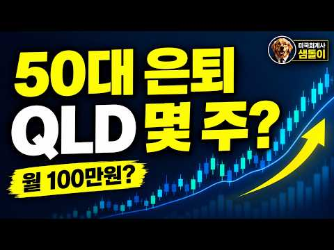
- 설명 앞부분: 50대에 은퇴하려면 도대체 얼마가 필요할까요? 그리고 그 돈을 만들기 위해 매달 얼마를 투자해야 할까요? 이번 영상에서는 은퇴 후 월 300만 원의 현금흐름을 목표로 잡고, S&P500 1배수 투자와 QLD 60% + 단기채 40% 포트폴리오를 비교해봤습니다. 단순히 "20년 뒤 10억입니다"라고 이야기하는 것이 아니라, 50대 은퇴를 위한 목표자산은 얼마인지 S&P500에 투자한다면 매월 얼마가 필요한지 QLD + 단기채 조합이라면 월 적립액이 얼마나 줄어드는지 10억 원을 만들었을 때 QLD는 몇 주가 필요한지 은퇴가 가까워졌…
- 같은 채널 평소 대비 ×3.8 (채널 최근 롱폼 중앙값 3,886회) · 평소 영상: QLD 올인 vs SCHD 적립.. 둘 다 틀렸습니다 (회계사 결산) (4,018회) / SCHD 15년 백테스트로 확인한 장기투자 3가지 맹점 (3,753회)
- 대본 (음성인식(앞 5분), 4.3 음절/초) — 앞부분만, 흐름은 그 안까지 첫 20초: “50대에 은퇴하려면 QRD 4815주 모으면 됩니다. 왜 그런지 지금 증명해 보겠습니다. 안녕하세요 미국 회계사 샘돌이입니다. 여러분 유튜브에서 주식 팩테스트 영상 보시면서 20년 뒤에 8억 됐다 10억 됐다 15억 됐다” — 도입부 유형: 숫자로 시작
- 첫 1분: “50대에 은퇴하려면 QRD 4815주 모으면 됩니다. 왜 그런지 지금 증명해 보겠습니다. 안녕하세요 미국 회계사 샘돌이입니다. 여러분 유튜브에서 주식 팩테스트 영상 보시면서 20년 뒤에 8억 됐다 10억 됐다 15억 됐다 하는 소리 들으시면 어떤 생각 드시나요? 스윙률 대단하네 십다가도 곧바로 이런 생각이 드실 겁니다. 그래서 당장 내가 내 월급으로 매달 얼마씩 사야 50대에 은퇴할 수 있는데 맞습니다. 과거 데이터가 아무리 화려해도 내 현실적인 월급과 은퇴 목표로 역산되지 않으면 그건 그냥 남이 이야기일 뿐입니다. 그래서 오늘은 기획을 완전히 바꿨습니다. 은퇴 후 월 300만 원의 현금 흐름을 만들기 위한 목표 자산을 정해두고 S&P 500 1배 수투자와 QLD 2배수 플러스 단기체 정립식 포트폴리오를”
- 흐름 (90초마다 첫 문장): 0:00 50대에 은퇴하려면 QRD 4815주 모으면 됩니다. → 1:31 자금이 고갈되지 않을 확률을 높이는 경험치인데요. → 3:08 20년이 넘는 장기 기간 동안 연평균 수익률을 계산해 보면 19.15%… → 4:35 월 240만원 정립에 비하면 직장인이 현실적으로 도전해 볼 수 있는 비…
- 댓글 16/17: 좋은 점 — 영상 0 · 감사·응원 0 · 더 알고 싶은 것 1 · 아쉬운 점 — 영상 0 · 반박·불만 — 의견 다름 0 · 정치·사회 0 · 경험 공유 1 · 구독·다음 기대 0
  - 더 알고 싶은 것 👍0 “안녕하세요 AI들은 QLD 완전 극혐하던데.. 60대이후 QLD를 안전하게 관리하는 방법들도 좀 다뤄주시면 좋겠습니다.. 그냥 60대들은 QLD 손 안대는게 좋다고들 하는데.. 방법이 없을까요?”
  - 경험 공유 👍0 “요즘 드는 생각이 제가 대학생에서 사회 초년생 때, 2000년에서 2011 미국 시장 인데요. 이번엔 2000년대 같은 폭락은 피한다 해도…인터넷 붐 및 신기술발전은 망한게 아니라 이 기간 동안 계속 됐잖아요. 근데 미국 주식은 폭락후 약 10년동안 횡보 였거든요. …”

### 69. 단타 천재가 개발한 초간단 매매법(기본 차트 분석법)

- https://www.youtube.com/watch?v=knblsnwXsfg · 차트9단 · 구독자 469 · 조회수 18,483 (×39.4, 하루 127.5) · 좋아요 424 (2.3%) · 20분 · 2026-06-26 · 주제 묶음 6. 종목 고르기·분석 · 형식 인터뷰·강연·대담 · 폴더 `W_knblsnwXsfg` (웹 승인)
- 썸네일: 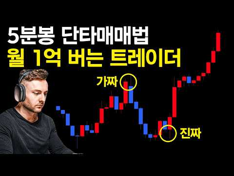
- 챕터: 0:00 시작 · 0:28 이평선 하나면 된다 · 2:21 이평선 사용법 · 5:04 탑다운 매매법 · 8:50 이평선 단타매매법
- 설명 앞부분: 단타 천재가 개발한 초간단 매매법(기본 차트 분석법) 거래량 델타 지표 무료 신청하기 트레이딩 매매법 강의 무료 신청하기 100억 트레이더의 비법서 신청하기 편리한 자동 거래봇 이용 신청하기
- 같은 채널 평소 대비 ×27.1 (채널 최근 롱폼 중앙값 681회) · 평소 영상: 단타 매매법은 딱 두가지만 알면 끝입니다. (이동평균선 거래량 차트보는법) (681회) / 5년동안 단타로 200억 벌어들인 트레이더의 개쉬운 매매법 (256회)
- 대본 없음 (설명) — 음성인식이 끝나면 도입부·흐름이 들어감
- 댓글 7/7: 좋은 점 — 영상 1 · 감사·응원 5 · 더 알고 싶은 것 1 · 아쉬운 점 — 영상 0 · 반박·불만 — 의견 다름 0 · 정치·사회 0 · 경험 공유 0 · 구독·다음 기대 0
  - 좋은 점 — 영상 👍0 “좋은 정보 감사합니다”
  - 감사·응원 👍0 “좋은지표입니다 수고많아요 감사합니다”
  - 감사·응원 👍0 “많이 배웁니다.감사합니다.”
  - 더 알고 싶은 것 👍0 “안녕하십니까 차트9단님 델타거래량지표을 신청합니다 부탁드립니다 감사합니다”

### 70. 남들이 걱정하는 삶을 선택했습니다 #배당투자 #배당은퇴 #경제적자유 #파이어족 #월배당 #고배당주 #주식투자 #재테크#노후준비#배당금생활 #SCHD #JEPI …

- https://www.youtube.com/watch?v=SiE0NjI7Fu0 · ttobaedang또배당 · 구독자 6,870 · 조회수 63,434 (×9.2, 하루 1,809.9) · 좋아요 494 (0.8%) · 9.1분 · 2026-10-14 · 주제 묶음 11. 투자 일반 · 형식 정보·해설 (그 밖) · 폴더 `W_SiE0NjI7Fu0` (웹 승인)
- 썸네일: 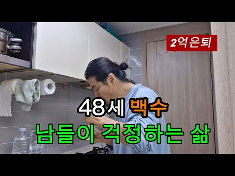
- 같은 채널 평소 대비 ×4.4 (채널 최근 롱폼 중앙값 14,477회) · 평소 영상: 48세백수 10월배당금 유투브 첫수익 #배당투자 #배당은퇴 #경제적자유 #파이어족 #월배… (14,825회) / 돈 없는사람은 이것부터 해야합니다 #배당투자 #배당은퇴 #경제적자유 #파이어족 #월배당 … (14,129회)
- 대본 (음성인식(앞 5분), 4.8 음절/초) — 앞부분만, 흐름은 그 안까지 첫 20초: “저는 올해 48세입니다. 직정도 없고 매달 들어오는 월급도 없습니다. 흔히 말하는 백수입니다. 48세에 직장이 없다고 하면 사람들은 걱정을 합니다. 하지만 돈이 많아서 일을 하지 않는다고 하면 사람들은 부러워합니다.” — 도입부 유형: 숫자로 시작, 내 이야기·사연
- 첫 1분: “저는 올해 48세입니다. 직정도 없고 매달 들어오는 월급도 없습니다. 흔히 말하는 백수입니다. 48세에 직장이 없다고 하면 사람들은 걱정을 합니다. 하지만 돈이 많아서 일을 하지 않는다고 하면 사람들은 부러워합니다. 똑같이 아침에 일어나 밥을 먹고 동네를 산책하며 하루를 보내는데 누군가는 성공한 대자가 되고 누군가는 한심한 백수가 됩니다. 그렇다면 우리가 평가하는 것은 그 사람의 인생일까요? 아니면 그 사람의 가진 돈일까요? 저는 직장을 그만두고 나서 이런 생각을 자주 하게 됐습니다. 사람은 언제부터 살아가는 것만으로는 부족해서 끊임없이 자신의 가치를 증명해야 하는 존재가 되었을까? 오늘은 48세에 백수가 되고 나서 비로소 알게 된 이야기를 해보려고 합니다. 우리는 처음 만난 사람에게 흔히 이렇게 웃습니다.”
- 흐름 (90초마다 첫 문장): 0:00 저는 올해 48세입니다. 직정도 없고 매달 들어오는 월급도 없습니다. … → 1:39 그 사람이 얼마나 많은 실패를 견뎌는지, 누구를 위해 자신의 목수를 포… → 3:12 월요일 아침이면 어딘가로 가야 할 것 같고 하루 종일 집에 있으면 괜히… → 4:38 하지만 그런 걱정을 들으며 한 가지 생각을 하게 됐습니다. 사람은 누구…
- 댓글 174/186: 좋은 점 — 영상 3 · 감사·응원 20 · 더 알고 싶은 것 6 · 아쉬운 점 — 영상 0 · 반박·불만 — 의견 다름 0 · 정치·사회 0 · 경험 공유 11 · 구독·다음 기대 2
  - 좋은 점 — 영상 👍4 “진정성이 느껴지고 서민형이라 와닿는 영상이라 보면서 위로를 받게 되네요. 좋은 영상 자주 올려주세요. 😊❤”
  - 좋은 점 — 영상 👍1 “울림이 있는 story, 공감이 되고 배우고 갑니다~”
  - 감사·응원 👍22 “당신의 직업은 투자자, 유튜버^^ 늘 응원하겠습니다”
  - 감사·응원 👍8 “현대는 직업이 필요가 없어졌습니다. 단지 생활비를 충당할 수 있는 근원지 배당금, 이자, 월세소득 등 원천을 만드는 것이 중요하죠. 또배당금님은 현재 잘 하고 계신거예요. 직장이 없어도 배당금으로 자유롭게 생활하실 수 있는것이 얼마나 대단한것인지 높이 평가해요. 질투…”
  - 더 알고 싶은 것 👍4 “진정성이 느껴지고 서민형이라 와닿는 영상이라 보면서 위로를 받게 되네요. 좋은 영상 자주 올려주세요. 😊❤”
  - 더 알고 싶은 것 👍3 “안녕하십니까 또배당님! 금일 영상은 원고가 매우 훌륭하고 좋습니다 감동적입니다 자신의선택과 책임을 말씀하는 철학은 울림이 있습니다, 다음에 기회가되면 제가 운영하고 있는 다음카페에 칼럼기고를 부탁드려도 될까요”
  - 경험 공유 👍8 “나도 도배당아저씨처럼 할수있다는 희망으로 삽니다”
  - 경험 공유 👍7 “세상을 보는 안목과 생각이 깊고 넓으시군요. 저도 공감되는 말씀입니다.”
  - 구독·다음 기대 👍1 “호동대표님 유튜브보고 구독하러왔어요 자주영상 올려주세요😊 세미파이어족 화이팅!!”

### 71. "중장기 투자? 삼전닉스 말고 스페이스X 모으세요” (정의훈 선임연구원)

- https://www.youtube.com/watch?v=bMR3jvlYDgo · 투자360 · 구독자 16,700 · 조회수 158,205 (×9.5, 하루 4,386.0) · 좋아요 758 (0.5%) · 16분 · 2026-10-13 · 주제 묶음 11. 투자 일반 · 형식 정보·해설 (그 밖) · 폴더 `W_bMR3jvlYDgo` (웹 승인)
- 썸네일: 
- 챕터: 0:00 🔥 하이라이트 · 0:58 🚀 스페이스X 70% 급등, 무슨 일이 있었나 · 3:52 ⚠️ 삼성전자·하이닉스 중장기 투자를 반대하는 이유! · 4:29 💰 70% 오른 스페이스X 개별주 살까? ETF 살까? · 5:59 💰 🌌 우주 데이터센터, 드디어 돈이 되나? · 8:29 📊 스페이스X, 꼭 봐야 할 4가지 지표 · 11:17 🚨 어떤 신호가 나오면 투자를 멈춰야 하나 · 12:55 🔥 스타십·스타링크·AI, 다음 성장동력은? · 14:15 🎯 지금 주가는 고점? “아직 다 반영 안 됐다”
- 설명 앞부분: "삼전닉스 장투 추천 안 합니다. 잘 모르겠으면 스페이스X 사세요” 저점 대비 약 70% 반등한 스페이스X. 지금 들어가기엔 이미 늦은 걸까요? 정의훈 유진투자증권 연구원과 최근 주가 급등 이유부터 특히 현재 주가에 향후 성장 기대가 얼마나 반영됐는지, 어떤 신호가 나오면 투자를 다시 점검해야 하는지도 확인합니다. 🎥촬영일: 2026년 10월 6일 ⏱️ 골라 보는 핵심 투자 포인트
- 같은 채널 평소 대비 ×4.2 (채널 최근 롱폼 중앙값 37,380회) · 평소 영상: 환율 내린 지금이 기회! 삼전닉스 팔아서 현금 '여기로' 옮기세요 #부자탐사대 #효라클 … (38,634회) / “지금까지 금투자 방법 다 틀렸습니다” 금 투자, 개미는 ‘이렇게’ 사야 돈 법니다 ∣ … (36,125회)
- 대본 (음성인식(앞 5분), 6.4 음절/초) — 앞부분만, 흐름은 그 안까지 첫 20초: “녹화의 기준으로 거의 170달러까지 거의 저점 대비 한 70%가 오른 상황인데 현대 주가의 반영이 다 됐다고 보세요? 이런 기대치가? 아니요 지금 당장에 클라우드나 이런 부분들이 매출이 올라온 부분만 좀 반영되어 있다고 보거든요 내년도나 내 훈련도의 실적이나 이런 부분들이 훨씬 더 잘 붙을 거라고 보고 있는데 그렇기 때문에 스페이스 X를 사도 괜찮다고 말씀드리지만” — 도입부 유형: 질문으로 시작, 숫자로 시작
- 첫 1분: “녹화의 기준으로 거의 170달러까지 거의 저점 대비 한 70%가 오른 상황인데 현대 주가의 반영이 다 됐다고 보세요? 이런 기대치가? 아니요 지금 당장에 클라우드나 이런 부분들이 매출이 올라온 부분만 좀 반영되어 있다고 보거든요 내년도나 내 훈련도의 실적이나 이런 부분들이 훨씬 더 잘 붙을 거라고 보고 있는데 그렇기 때문에 스페이스 X를 사도 괜찮다고 말씀드리지만 다른 같은 경우에는 잘 모르겠으면 ETF 사세요라고 하잖아요 잘 모르겠으면 그냥 스페이슥들을 사시라 하하하하 라고 말씀 드리고 있어요 지난 회차에서는 누리호 5차 발사의 의미를 중심으로 국내 우주산업의 현재 그리고 투자 기회를 한번 짚어봤습니다 이번에는 글로벌 시장으로 한 번 더 시선을 넓혀서 우주산업의 대표 주자 스페이스 X를 한 번 살펴보려고”
- 흐름 (90초마다 첫 문장): 0:00 녹화의 기준으로 거의 170달러까지 → 1:30 조금 더 공부를 하셨으면 좋겠는 게 → 3:02 그러면 패시브 자금 → 4:30 이런 분들이 계세요
- 댓글 62/84: 좋은 점 — 영상 0 · 감사·응원 1 · 더 알고 싶은 것 0 · 아쉬운 점 — 영상 0 · 반박·불만 — 의견 다름 1 · 정치·사회 4 · 경험 공유 0 · 구독·다음 기대 0
  - 감사·응원 👍0 “연구원님 저는 믿고 있었습니다 감사합니다 스엑 날라가즈아🎉🎉🎉”
  - 반박·불만 — 의견 다름 👍4 “헛소리말고 지수투자나 해라...”
  - 정치·사회 👍5 “공화당이 중간선거 이기면 스페이스x대상승각이다”
  - 정치·사회 👍4 “스페이스X는 중간선거 이후 사는 게 맞지 않나요? 질문 한번 해주세요~”

### 72. Egyptian Guidelines المستثمر المصري يعمل إيه ؟ عقار ولا ذهب ولا دولار ولا بورصة؟ د. حسن ا…

- https://www.youtube.com/watch?v=F_RSQy0sRtM ·   GroWise |  الاستثمار مع مصطفى خليل  · 구독자 23,700 · 조회수 190,842 (×8.1, 하루 6,040.8) · 좋아요 1,895 (1.0%) · 90.3분 · 2026-10-17 · 주제 묶음 기타 · 형식 정보·해설 (그 밖) · 폴더 `W_F_RSQy0sRtM` (웹 승인)
- 썸네일: 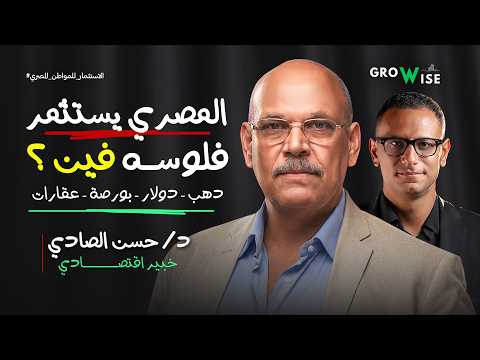
- 챕터: 0:00 ليه المصري بيفضل العقار والذه… · 1:15 رحلة د. حسن الصادي الأكاديمية… · 2:15 إزاي المخاطر الاقتصادية ومخاط… · 4:15 الفرق بين المستثمر والمضارب و… · 5:20 التحليل الأساسي مقابل التحليل… · 6:30 إزاي تقيّم الشركة بدل ما تركز… · 7:30 الأرباح التشغيلية مقابل الأرب… · 8:40 مشاكل هيكل السوق والرقابة وتض… · 10:15 ليه الأرباح التشغيلية مهمة في… · 11:25 دور القواعد التنظيمية في ضبط … · 13:50 الطروحات العامة والطرح الخاص … · 16:40 هل صناديق ضمان خسائر الاكتتاب… · 18:00 تسعير الطروحات: مين بيستفيد م… · 20:40 الاستثمار بالهامش والرافعة ال… · 22:30 التخصيص في الاكتتابات وتأثيره… · 23:30 الحدود السعرية وإيقاف التداول… · 25:00 ليه المستثمر الصغير ممكن يبيع… · 26:15 الاستثمار في الذهب: السبائك و… · 27:30 هل شراء الذهب بيحافظ على الثر… · 29:45 الدولار والذهب والاستثمار الم…
- 설명 앞부분: كيف تختار السهم الصح وتكسب من البورصة؟ Cash Flow, P/E, PEG, Options & Risk Management
- 같은 채널 평소 대비 ×8.2 (채널 최근 롱폼 중앙값 23,234회) · 평소 영상: إزاي تختار أفضل سهم في البورصة المصرية ؟ CIB or T… (23,234회) / كيف تبني ثروة من الصفر؟ ∣ ملخص كتاب The Simple Pa… (33,696회)
- 대본 없음 (설명) — 음성인식이 끝나면 도입부·흐름이 들어감
- 댓글 251/369: 좋은 점 — 영상 0 · 감사·응원 0 · 더 알고 싶은 것 0 · 아쉬운 점 — 영상 0 · 반박·불만 — 의견 다름 0 · 정치·사회 0 · 경험 공유 0 · 구독·다음 기대 0

### 73. 【Eng Sub】AI泡沫會爆嗎？美股一直升？基金經理教你選ETF與科技股｜US Stocks 101

- https://www.youtube.com/watch?v=fMHfTr51OfM · City Spotlight 傾城計話 · 구독자 30,600 · 조회수 212,699 (×7.0, 하루 7,001.2) · 좋아요 3,146 (1.5%) · 50.3분 · 2026-10-19 · 주제 묶음 2. 장기투자·ETF·지수 · 형식 정보·해설 (그 밖) · 폴더 `W_fMHfTr51OfM` (웹 승인)
- 썸네일: 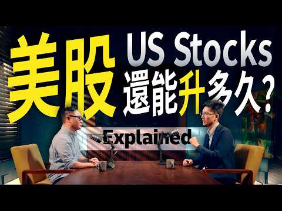
- 챕터: 0:00 精彩內容 ｜ Highlights · 0:52 美股投資入門介紹 ｜ US Stocks 101 · 2:14 買股票如何賺錢？股息與股東權益 ｜ Stock Owner… · 4:09 GOOG與GOOGL有甚麼分別？ ｜ Share Clas… · 5:28 股票成交量與買賣差價怎樣看？ ｜ Volume & Spr… · 6:53 股票價格由誰決定？為甚麼會升跌？ ｜ Stock Pric… · 8:09 公司有好消息，股價為甚麼不升？ ｜ News & Fund… · 9:38 ETF是甚麼？與買個股有甚麼分別？ ｜ ETFs vs. … · 12:04 標普500與納斯達克100怎樣選？ ｜ S&P 500 v… · 13:27 新手買ETF還是個股？先看風險承受能力 ｜ Risk & … · 14:59 退休後怎樣投資？資金用途比年齡更重要？ ｜ Retirem… · 16:56 基金經理為甚麼跑輸大市？ ｜ Active Fund Pe… · 18:16 美股為甚麼長期跑贏港股？ ｜ US vs. Hong Ko… · 22:20 歐洲與亞洲股市表現為何不同？ ｜ Global Marke… · 24:12 美股大跌後會回升，個股也一樣嗎？ ｜ Market Rec… · 25:51 韓國股市為甚麼大升大跌？ ｜ Leverage & Vol… · 27:58 為甚麼美國有這麼多科技公司？ ｜ Tech & Start… · 29:37 投資未上市公司，上市後一定賺錢嗎？ ｜ Private E… · 30:59 為甚麼海外投資者轉買美股？ ｜ Global Capita… · 31:57 AI股票升了很多，現在買是否太遲？ ｜ AI Stock …
- 설명 앞부분: 📈 美股為甚麼長期向上？AI股票已經升了這麼多，現在入市是否太遲？NVIDIA之後，下一個投資機會在哪裏？ 本集《傾城計話 City Spotlight》邀請擁有基金管理經驗的投資專家Wil，深入拆解美股投資、ETF與個股的分別，以及標普500和納斯達克100的投資策略。連專業基金經理都可能跑輸大市，普通人應該如何選擇？ 從退休投資的「錢的年齡」，到AI會否重演科網泡沫、機械人與自動駕駛的未來機會，帶你看懂美股趨勢、投資風險，以及如何更明智地運用自己的資金！ 📈 Why does the US stock market keep rising? Is it too late to inves…
- 같은 채널 평소 대비 ×2.7 (채널 최근 롱폼 중앙값 77,352회) · 평소 영상: 【Eng Sub】收入超標拿不到白卡？中產長者還有哪些照顧補助？｜Senior Care Bene… (77,990회) / 【Eng Sub】老人屋抽中也未必住得入？申請資格、租金補助及輪候真相｜Senior Housin… (76,714회)
- 대본 없음 (설명) — 음성인식이 끝나면 도입부·흐름이 들어감
- 댓글 120/324: 좋은 점 — 영상 0 · 감사·응원 0 · 더 알고 싶은 것 0 · 아쉬운 점 — 영상 0 · 반박·불만 — 의견 다름 0 · 정치·사회 0 · 경험 공유 0 · 구독·다음 기대 0

### 74. 주식 기초 강의 한번 배워서 평생 써먹는 주린이를 위한 주식 투자 방법

- https://www.youtube.com/watch?v=36sFYI8uboE · 마이크로스콥  · 구독자 3,140 · 조회수 28,306 (×9.0, 하루 696.3) · 좋아요 529 (1.9%) · 13.7분 · 2026-10-08 · 주제 묶음 1. 주식 기초·초보 · 형식 인터뷰·강연·대담 · 폴더 `W_36sFYI8uboE` (웹 승인)
- 썸네일: 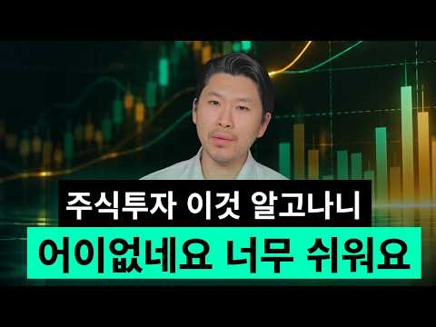
- 챕터: 0:00 주식 기초 강의를 접하게 된 계기 · 0:55 주식 기초 강의가 중요한 이유의 실제 연구와 그 결과 · 2:40 주식 기초 강의의 3요소 · 4:55 주식 기초 강의의 전설 소개 · 6:20 주식 기초 강의에서 가장 유명한 비유 · 8:45 주식 기초 강의 과열과 바닥 구분하는 방법 · 9:55 주식 기초 강의 추천도서 · 11:35 주식 기초 강의의 대가 앙드레 코스톨라니
- 설명 앞부분: 주식 기초 강의를 처음 접하는 분들도 이해할 수 있도록, 꼭 알아야 할 핵심 개념과 투자 원리를 쉽게 정리했습니다. 이번 주식 기초 강의에서는 복잡한 용어보다 실제 투자에 바로 써먹을 수 있는 기본 원칙과 판단 기준을 중심으로 설명합니다. 주식을 처음 시작했다면 이 주식 기초 강의부터 보세요. 한 번 익혀두면 앞으로 투자할 때 계속 활용할 수 있는 기초 내용을 담았습니다. 앙드레 코스톨라니의 돈 뜨겁게 사랑하고 차갑게 다루어라. 추천드립니다. 성공투자 하시길 바랍니다.
- 같은 채널 평소 대비 ×13.8 (채널 최근 롱폼 중앙값 2,048회) · 평소 영상: 크게 수익 내자마자 90%가 범하는 치명적 실수! 결국 전재산 날리는 진짜 원인 (2,048회) / 에버랜드 손님 90만 명 줄었는데 롯데월드는 500억 넘게 투자하는 이유 (2,105회)
- 대본 (음성인식(앞 5분), 5.7 음절/초) — 앞부분만, 흐름은 그 안까지 첫 20초: “여러분 제가 1억원 가까운 돈을 주식과 코인시장에 날리고 나서 진짜 피눈물 흘리면서 막 밤마다 차트책 뒤져보고 호잇쥐라시 막 쫓아다니면서 진짜 온갖 별짓을 다 해봤거든요? 그런데 말이죠 자본시장에서 돈을 버는 그 거장들의 본질적인 원리를 제가 깨닫게 되었을 때 제가 제일 먼저 내뱉었던 말이 뭐였냐면” — 도입부 유형: 질문으로 시작, 숫자로 시작, 내 이야기·사연, 시청자 부르기
- 첫 1분: “여러분 제가 1억원 가까운 돈을 주식과 코인시장에 날리고 나서 진짜 피눈물 흘리면서 막 밤마다 차트책 뒤져보고 호잇쥐라시 막 쫓아다니면서 진짜 온갖 별짓을 다 해봤거든요? 그런데 말이죠 자본시장에서 돈을 버는 그 거장들의 본질적인 원리를 제가 깨닫게 되었을 때 제가 제일 먼저 내뱉었던 말이 뭐였냐면 와... 아니 이게 이렇게 쉬운 거였어? 라는 말이 나왔다는 거예요 왜 그런가 하면 주식으로 돈을 버는 것에 진짜 본질은 말이죠 우리가 막 밤잠 설쳐가며 외웠던 그 차트들의 막 보조 지표들 그리고 수많은 막 숫자들의 향연인 제모재표 거기가 아니라 진짜 본질이 따로 숨어있었다는 겁니다 사실은 너무나도 단순하고 명쾌한 거시적인 법식이 있었는데 그걸 모르고 애 먼 곳에서 정말 피나게 눈물 흘리면서 노력하고 있었다는 거”
- 흐름 (90초마다 첫 문장): 0:00 여러분 제가 1억원 가까운 돈을 주식과 코인시장에 날리고 나서 → 1:30 이게 내 과학과 행동 경제학에서는요 → 3:00 여기서는 차트, 진안 실적 이런 것들이겠죠 → 4:31 수십만 원짜리 차트 강의 결제하시면서
- 댓글 21/45: 좋은 점 — 영상 0 · 감사·응원 4 · 더 알고 싶은 것 0 · 아쉬운 점 — 영상 0 · 반박·불만 — 의견 다름 1 · 정치·사회 0 · 경험 공유 0 · 구독·다음 기대 0
  - 감사·응원 👍5 “깨달음의 경험공유 감사합니다. ✨️Microscope King✨️ 👍👍👍👏👏👏💯🙏”
  - 감사·응원 👍4 “쓰라리지만 소중한 경험을 베풀어 주셔서 고맙습니다. 내년 초에 부동자산 정리되면 현금흐름을 위한 기업투자에 입문하려고 공부 중입니다. 차트보고 기업분석하는 그런 공부는 아닙니다. ETF를 주로 할 것이기 때문에 "계좌 종류, 세금, 종목과 분산, 미국직투 등" 개괄적…”
  - 반박·불만 — 의견 다름 👍4 “쓰라리지만 소중한 경험을 베풀어 주셔서 고맙습니다. 내년 초에 부동자산 정리되면 현금흐름을 위한 기업투자에 입문하려고 공부 중입니다. 차트보고 기업분석하는 그런 공부는 아닙니다. ETF를 주로 할 것이기 때문에 "계좌 종류, 세금, 종목과 분산, 미국직투 등" 개괄적…”

### 75. [차트 강의] 100조 운용역이 신입 펀드매니저에게 가르쳤던 차트 패턴 8가지 (박재훈)

- https://www.youtube.com/watch?v=0JHEax_R7DE · 박재훈의 투자농장 · 구독자 22,300 · 조회수 221,441 (×9.9, 하루 4,786.7) · 좋아요 2,109 (0.9%) · 16.5분 · 2026-10-03 · 주제 묶음 6. 종목 고르기·분석 · 형식 인터뷰·강연·대담 · 폴더 `W_0JHEax_R7DE` (웹 승인)
- 썸네일: 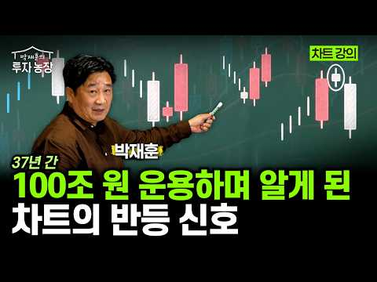
- 설명 앞부분: 10/24(토) 오전 10시, 합정역 인근에서 진행됩니다. 1부는 하반기 투자전략을 점검하고, 2부는 실전 차트강의를 진행합니다. 안녕하세요 이웃님들, 투자 농장지기 박재훈입니다. 저는 투자를 할 때 '손실을 덜 보는 것'이 가장 중요하다고 생각합니다. 그래서 오늘은 차트에서 하락에서 상승, 상승에서 하락으로 추세가 전환되는 신호를 읽는 방법을 알려드렸습니다. 제가 펀드매니저로 일하던 시절, 신입들에게 가르쳤던 내용이기도 합니다. 이웃님들의 투자에 꼭 도움이 되셨기를 바라며.. 하반기 투자전략을 점검하고, 실전 차트 강의를 듣고 …
- 같은 채널 평소 대비 ×19.0 (채널 최근 롱폼 중앙값 11,635회) · 평소 영상: 프랑스 국채 금리 폭등, 주식·채권 시장 영향은? (박재훈) (11,749회) / 똑같은 S&P500인데, 수익률은 왜 다를까? (박재훈) (11,521회)
- 대본 없음 (설명) — 음성인식이 끝나면 도입부·흐름이 들어감
- 댓글 76/83: 좋은 점 — 영상 7 · 감사·응원 17 · 더 알고 싶은 것 5 · 아쉬운 점 — 영상 1 · 반박·불만 — 의견 다름 0 · 정치·사회 0 · 경험 공유 3 · 구독·다음 기대 0
  - 좋은 점 — 영상 👍5 “진작에 이런 공부 배웠으면 작전세력들한테 덜 당했을것인데! 지금이라도 공부하고 암기하면서 실제 나타나는 모양들과 비교분석하는 눈 썰미를 키워 보겠습니다. 선생님덕분에 저의 소중한 돈 잘 지키겠습니다.”
  - 좋은 점 — 영상 👍0 “유익하게 감사히 잘 봤습니다”
  - 감사·응원 👍2 “목소리도 시원시원하시고 설명도 깔끔! 감사히 잘 들었습니다. 무료강의 신청했습니다^^”
  - 감사·응원 👍1 “선생님 안녕하세요. 잘 보고 있습니다. 장대양봉에 대해서 어느정도 기준을 알고싶습니다. 말 뜻은 이해하고 있지만 얼마만큼의 길이가 장대양봉이고 장대음봉인지.. 구분하고싶습니다. 감사합니다.”
  - 더 알고 싶은 것 👍1 “선생님 안녕하세요. 잘 보고 있습니다. 장대양봉에 대해서 어느정도 기준을 알고싶습니다. 말 뜻은 이해하고 있지만 얼마만큼의 길이가 장대양봉이고 장대음봉인지.. 구분하고싶습니다. 감사합니다.”
  - 더 알고 싶은 것 👍0 “선생님 이게 개별종목에도 적용이 되는건지 아님 지수 차트에만 해당하는건지 궁금합니다. 영상 잘 봤습니다.”
  - 아쉬운 점 — 영상 👍0 “쏙쏙 이해가 잘되요 반복해서 봐야지 ㄱㅅ”
  - 경험 공유 👍1 “저 엄청 잘해요 추세 전환 찾는거 제가 고수 ㅋ 6월말에 다 던지고 7월말에 샀어요”
  - 경험 공유 👍0 “저희쪽으로 모시고 싶습니다^^ 영상 볼때마다 느낍니다”

### 76. "당신이 주식으로 망할 수밖에 없던 이유" 개미 99%의 피를 빨아먹는 잔인한 진짜 구조 ∣ 교수 정선용 (통합본)

- https://www.youtube.com/watch?v=-5NhPWk2zF0 · 너와 나의 경제학교 · 구독자 39,300 · 조회수 378,388 (×9.6, 하루 7,893.7) · 좋아요 2,960 (0.8%) · 117분 · 2026-09-10 · 주제 묶음 8. 투자 심리·실패 · 형식 인터뷰·강연·대담 · 폴더 `W_-5NhPWk2zF0` (웹 승인)
- 썸네일: 
- 설명 앞부분: 정선용, 달리고 읽고 쓰는 사람의 하이
- 같은 채널 평소 대비 ×13.8 (채널 최근 롱폼 중앙값 27,396회) · 평소 영상: 단 이틀 만에 시총 1,500억 증발! 바닥에서 매집한 큰손들이 개미에게 고점 주식을 떠… (27,396회) / "지금 당장 도망치세요" AI 버블 붕괴 직전 나타나는 3가지 결정적 신호 ∣ 교수 정선… (27,658회)
- 대본 없음 (설명) — 음성인식이 끝나면 도입부·흐름이 들어감
- 댓글 214/238: 좋은 점 — 영상 9 · 감사·응원 24 · 더 알고 싶은 것 1 · 아쉬운 점 — 영상 4 · 반박·불만 — 의견 다름 5 · 정치·사회 5 · 경험 공유 11 · 구독·다음 기대 1
  - 좋은 점 — 영상 👍30 “교수님 수고 많으세요 항상 맞는말씀만 해주셔서 감사합니다”
  - 좋은 점 — 영상 👍18 “딱ᆢ내이야기 ㅠ 좋은말씀”
  - 감사·응원 👍50 “개미들에게 진심언린 조언 정말 감사합니다ᆢ주식이라는 마귀에홀려서 악어늑대들이 득실거리는 정글에들어간게 후회스럽네요ᆢ돈잃고 건강잃고 집안 잣되고 선생님을 진즉 만나지 못한것이 아쉽네요ᆢ날마다눈물로보내고이슴니다ᆢ마음의 위로가 됩니다ᆢ”
  - 감사·응원 👍49 “1.큰돈 벌생각하면 안됨 2.욕심을 버려야함 3.작은수익도 감사한마음”
  - 더 알고 싶은 것 👍5 “주식잘하는사람이 어떤사람인가요? 이론을 잘아는사람? 매매를 잘하는사람이죠”
  - 아쉬운 점 — 영상 👍50 “개미들에게 진심언린 조언 정말 감사합니다ᆢ주식이라는 마귀에홀려서 악어늑대들이 득실거리는 정글에들어간게 후회스럽네요ᆢ돈잃고 건강잃고 집안 잣되고 선생님을 진즉 만나지 못한것이 아쉽네요ᆢ날마다눈물로보내고이슴니다ᆢ마음의 위로가 됩니다ᆢ”
  - 아쉬운 점 — 영상 👍5 “같은 말만 끊임없이 반복만 하네요”
  - 반박·불만 — 의견 다름 👍3 “그넘어 워렌버픽~~~!! 우리나라 장이 미국장과 같나요??? 절대 같지 않아요 미국장이 기침만해도 우리장은 몸살 걸리는데 이 미친장에서는 오로지 눈치께임~~~!! 그리고 주식 전문가??? 10년전에 주식 시작하면서 의문이 들었던게 저눔들이 추천하는 종목으로 큰돈을번다…”
  - 반박·불만 — 의견 다름 👍2 “주식은 매수시점이 중요하다. 주식은 아무때나 투자 할수 있다는 헛소리 하는 전문가도 있다는게 슬프다. 매도타임 또한 중요하다. 하지만 주식은 익절 손절이 얼마나 힘든지 해보면 안다. 세력에 의해 떨어지는 칼날을 받으면 망하는게 대부분이다.”
  - 정치·사회 👍1 “한국주식,단일종목 흡헐귀 집단● 1.미래에셋 박현주회장:단일종목 상장시키라 김용범 유혹 ㅡ그리하면 김용범과 이찬진 아들 미래에셋 취업시키고,곱버스투자세력 (정권실세50명) 계좌 와 투자관리해서 떼돈 수시로 벌게하겠다 2.국민연금 김성주 이사장:정권 실세들과 짜고 미래…”
  - 정치·사회 👍0 “정지하느놈들이나 대통령 부터 사기치는데 개인들이 벌수 잇겟습니까?”
  - 경험 공유 👍11 “내가 사면 떨어트리고 내가 팔고 나오면 올려데는게 주식입니다 사고 팔고 사고 팔고 해보니 조작이라는걸 알았습니다”
  - 경험 공유 👍7 “처음에 막 벌리길래 놀람. 근데 또 다 털림. 어차피 내돈 아니었어~ 오히려 좋은 경험했다 치고, 자기 합리화~ㅋㅋㅋ”
  - 구독·다음 기대 👍4 “거 희한하다 모두가 정의의 사도라고 자칭하는 사람들은 누구를 위해서 얘기한다는거 .정선용씨는 그러지 않기를 기대합니다 갈수록 태산인라더니 으이그 제발 기관의 나팔수가 아니시길”

### 77. I Own 2,444 Shares of SCHD. Here's What It Actually Pays Me.

- https://www.youtube.com/watch?v=YPkL0BibgL8 · Mikey Moran · 구독자 12,900 · 조회수 222,080 (×17.2, 하루 2,482.4) · 좋아요 1,681 (0.8%) · 9.5분 · 2026-08-20 · 주제 묶음 기타 · 형식 정보·해설 (그 밖) · 폴더 `W_YPkL0BibgL8` (웹 승인)
- 썸네일: 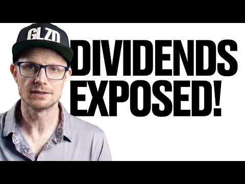
- 챕터: 0:00 The Reality of My SCHD Portfo… · 1:04 My Total Shares and Cost Basis · 1:30 Understanding the SCHD Stock … · 2:12 Real Dividend Payments (State… · 3:30 Why $207 a Month Is Only 2% o… · 4:08 Businesses are the Real Wealt… · 4:50 Why I Autopilot My SCHD Reinv… · 6:25 The Taxable Account Mistake I… · 7:48 Why I’m Behind My 3,000 Share… · 8:58 My Strategy: Boring Stocks, B…
- 설명 앞부분: How much do you actually make from owning 2,444 shares of SCHD? 📬 My weekly investing email — what I actually bought, most Sundays: In this video, I’m pulling back the curtain on my own portfolio to show you the real numbers, straight from my brokerage statements—no calculators or "what-if" scenari…
- 같은 채널 평소 대비 ×23.4 (채널 최근 롱폼 중앙값 9,510회) · 평소 영상: I Ranked 12 Income ETFs — My Own Funds FAILED (9,758회) / GPIQ Beat My QQQI… So Why Am I Still Holding QQQI? (9,262회)
- 대본 (자막, 5.2 음절/초) 첫 20초: “저는 매주 금요일 마다 천 달러 어치의 주식을 삽니다. 그 주에 시장이 어떻게 움직 였는지는 중요 하지 않습니다 . 뉴스 헤드 라인이 뭐라고 하든 상관 없습니다. 금요일 이 되면 돈이 투자 됩니다. 그 금액 중 상당 부분을 3 년 반 동안 한 종목에 투자 해 왔습니다. 현재 저는 SCHD 2,444” — 도입부 유형: 내 이야기·사연
- 첫 1분: “저는 매주 금요일 마다 천 달러 어치의 주식을 삽니다. 그 주에 시장이 어떻게 움직 였는지는 중요 하지 않습니다 . 뉴스 헤드 라인이 뭐라고 하든 상관 없습니다. 금요일 이 되면 돈이 투자 됩니다. 그 금액 중 상당 부분을 3 년 반 동안 한 종목에 투자 해 왔습니다. 현재 저는 SCHD 2,444 주를 보유 하고 있고, 그로 인해 얼마를 받는지 정확히 보여 드리겠습니다. 웹 사이트의 계산기가 아닌 실제 계좌 명세서에 찍힌 진짜 숫자 입니다. 미리 말씀 드리지만, 생각 보다 적을 겁니다. 보시면 첫 반응은 ' 겨우 이거 야?' 일 겁니다. 그 반응을 잘 곱 씹어 보시기 바랍니다. 왜 그 숫자가 작은 지, 그런데도 제가 왜 계속 사는지 이해 하는 것이 숫자 자체 보다 여러분”
- 흐름 (90초마다 첫 문장): 0:00 저는 매주 금요일 마다 천 → 1:30 드리 자면, SCHD는 2024 년 10 월 → 3:00 이유가 있습니다. 첫째, 펀드 → 4:30 회사 성장' 에 걸고 있습니다. → 6:00 하고 싶거든요. 매주 금요일 → 7:30 효과가 엄청 났을 거라는 → 9:01 그게 제 전략의 전부 입니다.
- 댓글 193/238: 좋은 점 — 영상 0 · 감사·응원 0 · 더 알고 싶은 것 0 · 아쉬운 점 — 영상 0 · 반박·불만 — 의견 다름 0 · 정치·사회 0 · 경험 공유 0 · 구독·다음 기대 0

### 78. [주식차트보는법] 단타말고 이 '차트패턴' 하나로 꾸준히 수익낸 엄청난 비결 지금 딱 한번만 노출하겠습니다. 주식하는법중 이게 최고입니다 (종가베팅 매매기법 및…

- https://www.youtube.com/watch?v=3h7Di1vQHgY · 주식차트연구소 · 구독자 1,440 · 조회수 12,707 (×8.8, 하루 270.4) · 좋아요 134 (1.1%) · 14.6분 · 2026-08-30 · 주제 묶음 6. 종목 고르기·분석 · 형식 정보·해설 (그 밖) · 폴더 `W_3h7Di1vQHgY` (웹 승인)
- 썸네일: 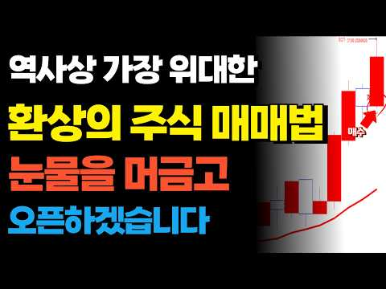
- 설명 앞부분: [주식차트보는법] 단타말고 이 '차트패턴' 하나로 꾸준히 수익낸 엄청난 비결 지금 딱 한번만 노출하겠습니다. 주식하는법중 이게 최고입니다 (종가베팅 매매기법 및 종목선별)
- 같은 채널 평소 대비 ×20.2 (채널 최근 롱폼 중앙값 630회) · 평소 영상: [주식차트보는법] 단타를 못해도 '이것' 하나로 수익낼 수 있습니다! 이 차트패턴으로 1… (630회) / [주식차트보는법] 국장에서 특히 단타가 잘 통하는 이유 오늘 적나라하게 다 밝혀 드립니다… (640회)
- 대본 없음 (설명) — 음성인식이 끝나면 도입부·흐름이 들어감
- 댓글 1/1: 좋은 점 — 영상 0 · 감사·응원 0 · 더 알고 싶은 것 0 · 아쉬운 점 — 영상 0 · 반박·불만 — 의견 다름 0 · 정치·사회 0 · 경험 공유 0 · 구독·다음 기대 0

### 79. I Bought 1,000 Shares of JEPQ. Here’s What It Pays Me Every Month

- https://www.youtube.com/watch?v=gC-_mODu2gI · Grounded Life Investments · 구독자 6,190 · 조회수 41,568 (×6.7, 하루 1,158.4) · 좋아요 471 (1.1%) · 11.3분 · 2026-10-13 · 주제 묶음 기타 · 형식 정보·해설 (그 밖) · 폴더 `W_gC-_mODu2gI` (웹 승인)
- 썸네일: 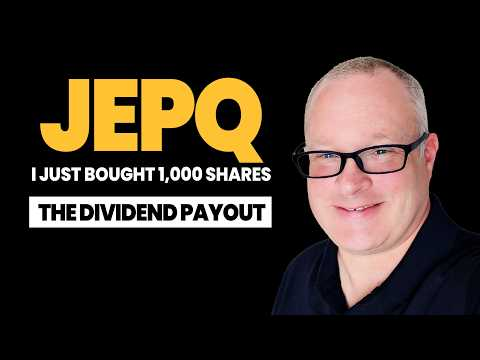
- 설명 앞부분: I Bought 1,000 Shares of JEPQ. Here’s What It Pays Me Every Month. I also talk about who this fund is for and why it is in our investment portfolio. Want to go deeper? The GLI Dashboard gives you dividend screeners, portfolio analysis, and deep dives of the companies and ETF's you need to know abou…
- 같은 채널 평소 대비 ×3.6 (채널 최근 롱폼 중앙값 11,548회) · 평소 영상: Income ETFs Paying 8% to 21% With Zero NAV Erosion (11,695회) / SCHD New All-Time High: I've Paused My DCA & What… (11,400회)
- 대본 없음 (설명) — 음성인식이 끝나면 도입부·흐름이 들어감
- 댓글 68/73: 좋은 점 — 영상 0 · 감사·응원 0 · 더 알고 싶은 것 0 · 아쉬운 점 — 영상 0 · 반박·불만 — 의견 다름 0 · 정치·사회 0 · 경험 공유 0 · 구독·다음 기대 0

### 80. 생활비 한 달 5만원..10년 만에 배당금 월 300만원 받는 이유 (조윤진 1부) #세미파이어 #배당투자

- https://www.youtube.com/watch?v=Wc52vsC6q4U · 자람들 - 자립하는사람들 · 구독자 35,900 · 조회수 828,045 (×23.1, 하루 6,684.6) · 좋아요 6,932 (0.8%) · 29.3분 · 2026-07-17 · 주제 묶음 3. 배당 · 형식 브이로그·직접 해본 이야기 · 폴더 `W_Wc52vsC6q4U` (웹 승인)
- 썸네일: 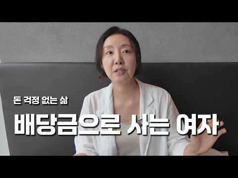
- 설명 앞부분: 👤 오늘의 게스트: 조윤진 작가 '6억으로 시작한 세미파이어' 저자 & 배당으로 부자되기 유튜브 채널 운영 평범한 중소기업 직장인이었던 그녀는 이혼 후 경제적으로 큰 타격을 입고, "목숨 걸고 노후를 준비해야겠다"는 마음으로 10년간 악착같이 아끼고 모았습니다. 5천만 원으로 시작한 시드는 10년 만에 6억 원으로 불어났고, 지금은 매달 통장에 꽂히는 배당금만으로도 마음 편한 노후 시스템을 만들었습니다. 매도 없이 배당만 쌓아가는 그녀만의 투자 철학과, 특별할 것 없는 월급으로도 가능했던 절약과 시드 마련의 여정을 담아 첫 책 '…
- 같은 채널 평소 대비 ×29.7 (채널 최근 롱폼 중앙값 27,867회) · 평소 영상: 무조건 골드바로 사세요. 부자들은 이걸 삽니다. (G1 김봉준 1부) #골드바 #골드 #… (29,256회) / 연 2200 배당금받는, 전직 배달 기사.. 3억으로 은퇴했습니다. (또배당 3부) #배… (26,478회)
- 대본 없음 (설명) — 음성인식이 끝나면 도입부·흐름이 들어감
- 댓글 613/613: 좋은 점 — 영상 30 · 감사·응원 43 · 더 알고 싶은 것 33 · 아쉬운 점 — 영상 3 · 반박·불만 — 의견 다름 7 · 정치·사회 8 · 경험 공유 43 · 구독·다음 기대 2
  - 좋은 점 — 영상 👍755 “돈 모으려면 거지소리 들어가면서 미친듯이 모아도 될까 말까입니다. 그렇게까지 해야하냐는 말하는 사람들하고는 인간관계를 끊는게 내 인생발전에 훨씬 도움이 됩니다.”
  - 좋은 점 — 영상 👍32 “이 영상 첨 보는 데 정말 가슴에 와닿는 이야기네요 보통 사람들이 공감하고 같이 느낄 수 있는 이야기네요 유익한 영상 잘 보았습니다”
  - 감사·응원 👍416 “안녕하세요 인터뷰했던 '6억으로 시작한 세미파이어' 저자 배당으로 부자되기입니다. 비 오는데 진행 잘 이끌어주셔서 즐겁게 촬영했습니다. 이런 다큐 인터뷰 기회 주셔서 감사합니다. 하필 요즘 코스피가 더 내려서 장이 롤러코스터이긴 한데 끝까지 살아남는 배당투자로 노후를…”
  - 감사·응원 👍30 “귀한 영상 감사합니다.♡ 솔직하신 투자 경험 이야기 유익했습니다.♡ 감사합니다.^^ 성투하세요.❤”
  - 더 알고 싶은 것 👍10 “배당주하다가 귀가앏아 삼성 sk 물렸네요 ㅠ내 자신이 한탄스럽네요 ㅠ50대인데 앞이 깜깜해요~~미국배당다우존스는 sol tiger ace중 어느게 나을까요?공부해도 ㅠ”
  - 더 알고 싶은 것 👍3 “세금. 건보료는 어떻게 하시나요?”
  - 아쉬운 점 — 영상 👍27 “내용은 상당히 좋은데요 촬영을 할 때, 카메라를 고정시켜놓고 찍으셔야겠어요. 화면이 흔들거려요. 이건 아주 기본적인 것인데 많이 아쉽네요.”
  - 반박·불만 — 의견 다름 👍0 “커버드콜 하락장 오면 개박살나는구조다.알고투자해야한다.지금까지 미국장이 폭락장이 없어서 커버드콜 할만하지 하락하면 손실 그대로 다때려맞고 수익은 콜옵션매도 권리행사가로 막혀있으니 이런 말도안되는 상품이없다”
  - 반박·불만 — 의견 다름 👍0 “배당률이 영원한게 아닌데...”
  - 정치·사회 👍2 “이런 영상좀 올리지 마라 정부에서 이러니까 배당투자자들 정조준에서 건보료 개편하자나 시바”
  - 정치·사회 👍2 “이젠 코스피마저 나락가네 요즘 전과4범 범죄자 지지율 계속 뚝뚝 떨어지고있는데 부동산 꼼수거래로 본격적으로 나락 가고있는중..무능하고 부패한 전과4범의 범죄자..경제,주식,부동산, 환율, 물가 어느하나 제대로 하고있는게 없다 환율은 Imf때보다 더 미친듯 치솟고 원화…”
  - 경험 공유 👍37 “저도 배당금 500 이상 받고있어요 노후에는 필요한것같아요 매도 안하니까 일상생활에 집중할 수 있고 마음이 편해요~ etf도 모아가고있어요^^”
  - 경험 공유 👍32 “내가 주식29년차인데 깡통4번차고..겨우 살아만있는데 커버드콜로 계속바꾸고있다.현재는80만정도받고있다.목표는달500..😅😅😅”
  - 구독·다음 기대 👍8 “매일 듣기만했는데 이번엔 정말 시도를 해보고 싶네요. 늦은 감이 있지만 시작해보고 싶네요. 말씀 감사합니다.”
  - 구독·다음 기대 👍0 “좋은 영상 감사합니다~ 작가님 구독했어요^^”

