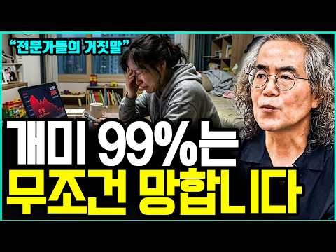
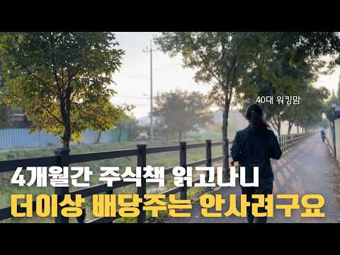
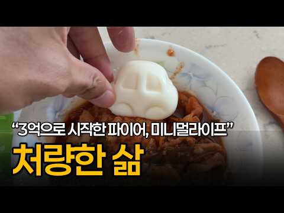

# 주식 — 성공 사례 분석: 사례별 자세히 #41–#51

`analysis.md` 의 9번 (같은 # 번호). 자동 생성 — `tools/success_analysis.py` v1.6.1 (2026-11-28 09:49 UTC). ※ 연구·교육용 — 투자 권유가 아님.

### 41. [차트 강의] 100조 운용역이 신입 펀드매니저에게 가르쳤던 차트 패턴 8가지 (박재훈)

- https://www.youtube.com/watch?v=0JHEax_R7DE · 박재훈의 투자농장 · 구독자 22,300 · 조회수 221,441 (×9.9, 하루 4,786.7) · 좋아요 2,109 (0.9%) · 16.5분 · 2026-10-03 · 주제 묶음 6. 종목 고르기·분석 · 형식 인터뷰·강연·대담 · 폴더 `W_0JHEax_R7DE` (웹 승인)
- 썸네일: 
- 설명 앞부분: 10/24(토) 오전 10시, 합정역 인근에서 진행됩니다. 1부는 하반기 투자전략을 점검하고, 2부는 실전 차트강의를 진행합니다. 안녕하세요 이웃님들, 투자 농장지기 박재훈입니다. 저는 투자를 할 때 '손실을 덜 보는 것'이 가장 중요하다고 생각합니다. 그래서 오늘은 차트에서 하락에서 상승, 상승에서 하락으로 추세가 전환되는 신호를 읽는 방법을 알려드렸습니다. 제가 펀드매니저로 일하던 시절, 신입들에게 가르쳤던 내용이기도 합니다. 이웃님들의 투자에 꼭 도움이 되셨기를 바라며.. 하반기 투자전략을 점검하고, 실전 차트 강의를 듣고 …
- 같은 채널 평소 대비 ×19.2 (채널 최근 롱폼 중앙값 11,521회) · 평소 영상: 똑같은 S&P500인데, 수익률은 왜 다를까? (박재훈) (11,521회) / 급락 후 반등한 나스닥, 200일 이동평균선을 꼭 확인해야 하는 이유 ∣ 100조 운용역… (11,341회)
- 대본 없음 (설명) — 음성인식이 끝나면 도입부·흐름이 들어감
- 댓글 76/83: 좋은 점 — 영상 7 · 감사·응원 17 · 더 알고 싶은 것 5 · 아쉬운 점 — 영상 1 · 반박·불만 — 의견 다름 0 · 정치·사회 0 · 경험 공유 3 · 구독·다음 기대 0
  - 좋은 점 — 영상 👍5 “진작에 이런 공부 배웠으면 작전세력들한테 덜 당했을것인데! 지금이라도 공부하고 암기하면서 실제 나타나는 모양들과 비교분석하는 눈 썰미를 키워 보겠습니다. 선생님덕분에 저의 소중한 돈 잘 지키겠습니다.”
  - 좋은 점 — 영상 👍0 “유익하게 감사히 잘 봤습니다”
  - 감사·응원 👍2 “목소리도 시원시원하시고 설명도 깔끔! 감사히 잘 들었습니다. 무료강의 신청했습니다^^”
  - 감사·응원 👍1 “선생님 안녕하세요. 잘 보고 있습니다. 장대양봉에 대해서 어느정도 기준을 알고싶습니다. 말 뜻은 이해하고 있지만 얼마만큼의 길이가 장대양봉이고 장대음봉인지.. 구분하고싶습니다. 감사합니다.”
  - 더 알고 싶은 것 👍1 “선생님 안녕하세요. 잘 보고 있습니다. 장대양봉에 대해서 어느정도 기준을 알고싶습니다. 말 뜻은 이해하고 있지만 얼마만큼의 길이가 장대양봉이고 장대음봉인지.. 구분하고싶습니다. 감사합니다.”
  - 더 알고 싶은 것 👍0 “선생님 이게 개별종목에도 적용이 되는건지 아님 지수 차트에만 해당하는건지 궁금합니다. 영상 잘 봤습니다.”
  - 아쉬운 점 — 영상 👍0 “쏙쏙 이해가 잘되요 반복해서 봐야지 ㄱㅅ”
  - 경험 공유 👍1 “저 엄청 잘해요 추세 전환 찾는거 제가 고수 ㅋ 6월말에 다 던지고 7월말에 샀어요”
  - 경험 공유 👍0 “저희쪽으로 모시고 싶습니다^^ 영상 볼때마다 느낍니다”

### 42. "당신이 주식으로 망할 수밖에 없던 이유" 개미 99%의 피를 빨아먹는 잔인한 진짜 구조 ∣ 교수 정선용 (통합본)

- https://www.youtube.com/watch?v=-5NhPWk2zF0 · 너와 나의 경제학교 · 구독자 39,300 · 조회수 378,388 (×9.6, 하루 7,893.7) · 좋아요 2,960 (0.8%) · 117분 · 2026-09-10 · 주제 묶음 8. 투자 심리·실패 · 형식 인터뷰·강연·대담 · 폴더 `W_-5NhPWk2zF0` (웹 승인)
- 썸네일: 
- 설명 앞부분: 정선용, 달리고 읽고 쓰는 사람의 하이
- 같은 채널 평소 대비 ×14.1 (채널 최근 롱폼 중앙값 26,762회) · 평소 영상: 증시 폭락하자 서민부터 죽어난다... 대한민국 경제 시스템이 완벽하게 붕괴되고 있는 진짜… (26,762회) / "수익률 캡처에 속지 마세요" 주식 유튜버가 전체 계좌를 죽어도 못 까는 소름 돋는 이유… (26,865회)
- 대본 없음 (설명) — 음성인식이 끝나면 도입부·흐름이 들어감
- 댓글 214/238: 좋은 점 — 영상 9 · 감사·응원 24 · 더 알고 싶은 것 1 · 아쉬운 점 — 영상 4 · 반박·불만 — 의견 다름 5 · 정치·사회 5 · 경험 공유 11 · 구독·다음 기대 1
  - 좋은 점 — 영상 👍30 “교수님 수고 많으세요 항상 맞는말씀만 해주셔서 감사합니다”
  - 좋은 점 — 영상 👍18 “딱ᆢ내이야기 ㅠ 좋은말씀”
  - 감사·응원 👍50 “개미들에게 진심언린 조언 정말 감사합니다ᆢ주식이라는 마귀에홀려서 악어늑대들이 득실거리는 정글에들어간게 후회스럽네요ᆢ돈잃고 건강잃고 집안 잣되고 선생님을 진즉 만나지 못한것이 아쉽네요ᆢ날마다눈물로보내고이슴니다ᆢ마음의 위로가 됩니다ᆢ”
  - 감사·응원 👍49 “1.큰돈 벌생각하면 안됨 2.욕심을 버려야함 3.작은수익도 감사한마음”
  - 더 알고 싶은 것 👍5 “주식잘하는사람이 어떤사람인가요? 이론을 잘아는사람? 매매를 잘하는사람이죠”
  - 아쉬운 점 — 영상 👍50 “개미들에게 진심언린 조언 정말 감사합니다ᆢ주식이라는 마귀에홀려서 악어늑대들이 득실거리는 정글에들어간게 후회스럽네요ᆢ돈잃고 건강잃고 집안 잣되고 선생님을 진즉 만나지 못한것이 아쉽네요ᆢ날마다눈물로보내고이슴니다ᆢ마음의 위로가 됩니다ᆢ”
  - 아쉬운 점 — 영상 👍5 “같은 말만 끊임없이 반복만 하네요”
  - 반박·불만 — 의견 다름 👍3 “그넘어 워렌버픽~~~!! 우리나라 장이 미국장과 같나요??? 절대 같지 않아요 미국장이 기침만해도 우리장은 몸살 걸리는데 이 미친장에서는 오로지 눈치께임~~~!! 그리고 주식 전문가??? 10년전에 주식 시작하면서 의문이 들었던게 저눔들이 추천하는 종목으로 큰돈을번다…”
  - 반박·불만 — 의견 다름 👍2 “주식은 매수시점이 중요하다. 주식은 아무때나 투자 할수 있다는 헛소리 하는 전문가도 있다는게 슬프다. 매도타임 또한 중요하다. 하지만 주식은 익절 손절이 얼마나 힘든지 해보면 안다. 세력에 의해 떨어지는 칼날을 받으면 망하는게 대부분이다.”
  - 정치·사회 👍1 “한국주식,단일종목 흡헐귀 집단● 1.미래에셋 박현주회장:단일종목 상장시키라 김용범 유혹 ㅡ그리하면 김용범과 이찬진 아들 미래에셋 취업시키고,곱버스투자세력 (정권실세50명) 계좌 와 투자관리해서 떼돈 수시로 벌게하겠다 2.국민연금 김성주 이사장:정권 실세들과 짜고 미래…”
  - 정치·사회 👍0 “정지하느놈들이나 대통령 부터 사기치는데 개인들이 벌수 잇겟습니까?”
  - 경험 공유 👍11 “내가 사면 떨어트리고 내가 팔고 나오면 올려데는게 주식입니다 사고 팔고 사고 팔고 해보니 조작이라는걸 알았습니다”
  - 경험 공유 👍7 “처음에 막 벌리길래 놀람. 근데 또 다 털림. 어차피 내돈 아니었어~ 오히려 좋은 경험했다 치고, 자기 합리화~ㅋㅋㅋ”
  - 구독·다음 기대 👍4 “거 희한하다 모두가 정의의 사도라고 자칭하는 사람들은 누구를 위해서 얘기한다는거 .정선용씨는 그러지 않기를 기대합니다 갈수록 태산인라더니 으이그 제발 기관의 나팔수가 아니시길”

### 43. 생활비 한 달 5만원..10년 만에 배당금 월 300만원 받는 이유 (조윤진 1부) #세미파이어 #배당투자

- https://www.youtube.com/watch?v=Wc52vsC6q4U · 자람들 - 자립하는사람들 · 구독자 36,100 · 조회수 828,737 (×23.0, 하루 6,189.2) · 좋아요 6,932 (0.8%) · 29.3분 · 2026-07-17 · 주제 묶음 3. 배당 · 형식 브이로그·직접 해본 이야기 · 폴더 `W_Wc52vsC6q4U` (웹 승인)
- 썸네일: 
- 설명 앞부분: 👤 오늘의 게스트: 조윤진 작가 '6억으로 시작한 세미파이어' 저자 & 배당으로 부자되기 유튜브 채널 운영 평범한 중소기업 직장인이었던 그녀는 이혼 후 경제적으로 큰 타격을 입고, "목숨 걸고 노후를 준비해야겠다"는 마음으로 10년간 악착같이 아끼고 모았습니다. 5천만 원으로 시작한 시드는 10년 만에 6억 원으로 불어났고, 지금은 매달 통장에 꽂히는 배당금만으로도 마음 편한 노후 시스템을 만들었습니다. 매도 없이 배당만 쌓아가는 그녀만의 투자 철학과, 특별할 것 없는 월급으로도 가능했던 절약과 시드 마련의 여정을 담아 첫 책 '…
- 같은 채널 평소 대비 ×33.1 (채널 최근 롱폼 중앙값 25,071회) · 평소 영상: '계좌 26억 찍고 은퇴' 미국주식으로 40억 파이어 성공 (김운아 쁘띠리치 1부) #미… (25,071회) / 월 500만원 배당 노하우, 시드 5천 '이렇게' 구성하세요. 평범한 직장인이 파이어한 … (25,484회)
- 대본 없음 (설명) — 음성인식이 끝나면 도입부·흐름이 들어감
- 댓글 613/613: 좋은 점 — 영상 30 · 감사·응원 43 · 더 알고 싶은 것 33 · 아쉬운 점 — 영상 3 · 반박·불만 — 의견 다름 7 · 정치·사회 8 · 경험 공유 43 · 구독·다음 기대 2
  - 좋은 점 — 영상 👍755 “돈 모으려면 거지소리 들어가면서 미친듯이 모아도 될까 말까입니다. 그렇게까지 해야하냐는 말하는 사람들하고는 인간관계를 끊는게 내 인생발전에 훨씬 도움이 됩니다.”
  - 좋은 점 — 영상 👍32 “이 영상 첨 보는 데 정말 가슴에 와닿는 이야기네요 보통 사람들이 공감하고 같이 느낄 수 있는 이야기네요 유익한 영상 잘 보았습니다”
  - 감사·응원 👍416 “안녕하세요 인터뷰했던 '6억으로 시작한 세미파이어' 저자 배당으로 부자되기입니다. 비 오는데 진행 잘 이끌어주셔서 즐겁게 촬영했습니다. 이런 다큐 인터뷰 기회 주셔서 감사합니다. 하필 요즘 코스피가 더 내려서 장이 롤러코스터이긴 한데 끝까지 살아남는 배당투자로 노후를…”
  - 감사·응원 👍30 “귀한 영상 감사합니다.♡ 솔직하신 투자 경험 이야기 유익했습니다.♡ 감사합니다.^^ 성투하세요.❤”
  - 더 알고 싶은 것 👍10 “배당주하다가 귀가앏아 삼성 sk 물렸네요 ㅠ내 자신이 한탄스럽네요 ㅠ50대인데 앞이 깜깜해요~~미국배당다우존스는 sol tiger ace중 어느게 나을까요?공부해도 ㅠ”
  - 더 알고 싶은 것 👍3 “세금. 건보료는 어떻게 하시나요?”
  - 아쉬운 점 — 영상 👍27 “내용은 상당히 좋은데요 촬영을 할 때, 카메라를 고정시켜놓고 찍으셔야겠어요. 화면이 흔들거려요. 이건 아주 기본적인 것인데 많이 아쉽네요.”
  - 반박·불만 — 의견 다름 👍0 “커버드콜 하락장 오면 개박살나는구조다.알고투자해야한다.지금까지 미국장이 폭락장이 없어서 커버드콜 할만하지 하락하면 손실 그대로 다때려맞고 수익은 콜옵션매도 권리행사가로 막혀있으니 이런 말도안되는 상품이없다”
  - 반박·불만 — 의견 다름 👍0 “배당률이 영원한게 아닌데...”
  - 정치·사회 👍2 “이런 영상좀 올리지 마라 정부에서 이러니까 배당투자자들 정조준에서 건보료 개편하자나 시바”
  - 정치·사회 👍2 “이젠 코스피마저 나락가네 요즘 전과4범 범죄자 지지율 계속 뚝뚝 떨어지고있는데 부동산 꼼수거래로 본격적으로 나락 가고있는중..무능하고 부패한 전과4범의 범죄자..경제,주식,부동산, 환율, 물가 어느하나 제대로 하고있는게 없다 환율은 Imf때보다 더 미친듯 치솟고 원화…”
  - 경험 공유 👍37 “저도 배당금 500 이상 받고있어요 노후에는 필요한것같아요 매도 안하니까 일상생활에 집중할 수 있고 마음이 편해요~ etf도 모아가고있어요^^”
  - 경험 공유 👍32 “내가 주식29년차인데 깡통4번차고..겨우 살아만있는데 커버드콜로 계속바꾸고있다.현재는80만정도받고있다.목표는달500..😅😅😅”
  - 구독·다음 기대 👍8 “매일 듣기만했는데 이번엔 정말 시도를 해보고 싶네요. 늦은 감이 있지만 시작해보고 싶네요. 말씀 감사합니다.”
  - 구독·다음 기대 👍0 “좋은 영상 감사합니다~ 작가님 구독했어요^^”

### 44. 주식 거래시간 밤 8시까지?☑️KRX 애프터마켓 꼭 알아야 할 변화

- https://www.youtube.com/watch?v=xXBHBu6hnCc · 주식캐스터 여니 · 구독자 42,800 · 조회수 475,707 (×11.1, 하루 7,206.7) · 좋아요 1,960 (0.4%) · 9분 · 2026-09-13 · 주제 묶음 기타 · 형식 정보·해설 (그 밖) · 폴더 `W_xXBHBu6hnCc` (웹 승인)
- 썸네일: 
- 같은 채널 평소 대비 ×118.8 (채널 최근 롱폼 중앙값 4,005회) · 평소 영상: 주린이, 경제초보 필수 경제용어 19탄❤️인적분할과 물적분할이란? 인적분할하면 주가는? (4,005회) / 삼성전자, 하이닉스 폭락에 ELS 비상! 고점에 가입한 ELS 폭탄 터지는 구조💣 (4,049회)
- 대본 없음 (없음) — 음성인식이 끝나면 도입부·흐름이 들어감
- 댓글 361/361: 좋은 점 — 영상 6 · 감사·응원 20 · 더 알고 싶은 것 2 · 아쉬운 점 — 영상 0 · 반박·불만 — 의견 다름 4 · 정치·사회 30 · 경험 공유 3 · 구독·다음 기대 0
  - 좋은 점 — 영상 👍31 “정리해 주셔서 감사합니다. 그냥 더 피곤해지는 느낌이 드네요..ㅎ”
  - 좋은 점 — 영상 👍1 “좋은 영상 감사합니다. 100% 남이 돈 버는거 배아파서 따라 만든거.”
  - 감사·응원 👍31 “정리해 주셔서 감사합니다. 그냥 더 피곤해지는 느낌이 드네요..ㅎ”
  - 감사·응원 👍27 “개인투자자들에게 꼭 필요한 정보를 똑 부러지게 잘 설명해 주셨습니다. 감사합니다.”
  - 더 알고 싶은 것 👍1 “SOR이 뭔지 알려주세요. 그동안 NXT이용한다고, 설정해둔것 같은데, KRX거래가 안되네요???”
  - 더 알고 싶은 것 👍1 “오전장몇시부터시작해요?아신분댓글부탁해요”
  - 반박·불만 — 의견 다름 👍8 “국민들 소액주주가 원하는건 거래시간 늘리는게 아닌데.. 그저 재벌들이 자회사, 손자회사, 까지만들면서 0.1% 도 안되는 지주사 지분으로 99.9% 지분의 국민들의 회사를 지배하는 이런 구조를 개선해달라는거다... 자회사 IPO 하는거라면 자회사 주식 지분에 따라 무…”
  - 반박·불만 — 의견 다름 👍6 “금융카르텔들만 좋을일 낫구먼유 삼전닉스 거래대금 빼면 언발에 오줌눟킨데 말도 안되는 이유로 카르텔 배불리기만”
  - 정치·사회 👍21 “재명이정권 지지율 떡락하는소리 들린다”
  - 정치·사회 👍12 “개인 투자자에겐 지옥문이 열린것이다 이재명 아웃 정권 타도”
  - 경험 공유 👍0 “도박쟁이들 왜케 많냐?단타만 맨날 쳐하니까 핸드폰만 8시까지 보란소리냐 이딴 소리 하고있지 사팔사팔해봤자 결국엔 손해임 걍 넣어놓고 분기별로 한번씩만 보면 됨 한국사람 주식보유기간 길어봤자 3달이고 평균 10일이라더니 여기다 모여있네 하긴 S&P500 나스닥100 같…”

### 45. 내 주변에 주식으로 돈 번 사람이 '진짜' 단 1명도 없는 소름 돋는 이유 ∣ 교수 정선용 (통합본)

- https://www.youtube.com/watch?v=SwW4n0ERlS8 · 너와 나의 경제학교 · 구독자 39,300 · 조회수 620,890 (×15.8, 하루 6,468.0) · 좋아요 11,614 (1.9%) · 52.7분 · 2026-08-14 · 주제 묶음 11. 투자 일반 · 형식 인터뷰·강연·대담 · 폴더 `W_SwW4n0ERlS8` (웹 승인)
- 썸네일: 
- 설명 앞부분: 정선용, 달리고 읽고 쓰는 사람의 하이
- 같은 채널 평소 대비 ×23.2 (채널 최근 롱폼 중앙값 26,762회) · 평소 영상: 증시 폭락하자 서민부터 죽어난다... 대한민국 경제 시스템이 완벽하게 붕괴되고 있는 진짜… (26,762회) / "수익률 캡처에 속지 마세요" 주식 유튜버가 전체 계좌를 죽어도 못 까는 소름 돋는 이유… (26,865회)
- 대본 없음 (설명) — 음성인식이 끝나면 도입부·흐름이 들어감
- 댓글 1,622/1,622: 좋은 점 — 영상 54 · 감사·응원 77 · 더 알고 싶은 것 15 · 아쉬운 점 — 영상 15 · 반박·불만 — 의견 다름 53 · 정치·사회 45 · 경험 공유 131 · 구독·다음 기대 3
  - 좋은 점 — 영상 👍332 “이분이 최고의 주식 전문가 입니다 인정합니다 허황된 꿈을 부추기지 않고 현실적인 필요하고 도움되는 얘기만 하시네요”
  - 좋은 점 — 영상 👍196 “구구절절 맞는말입니다 사람 좋아 보이는거랑 그들의 속마음은 다르다는걸 알았습니다”
  - 감사·응원 👍242 “귀한말씀 너무 늦게 들어서 안타까울 따름입니다 삼전 65만 하닉 400간다고 하면서 정작 자신들은 팔고 있었다는것을 나중에 알게됐습니다. 그렇게 보고서를 낸 증권사나 그걸 유튜브에서 전파한 사람들은 앞으로 다신 보지않을것입니다 귀한말씀 다시한번 감사드립니다”
  - 감사·응원 👍221 “안그래도 느꼈어요 요즘은 증권방송 보기도 싷더라구요 소위 주식 전문가들 증권사 직원들 에널리스트들 전부 자기밥그릇 챙기느라 혈안ᆢ 한통속 이예요 ᆢ 그들의 만행을 속시원히 알려주니 감사하네요 ᆢ”
  - 더 알고 싶은 것 👍3 “어떻게 사셨길래 99%가 잃는 주변인만 뒀나요? 교수님 과장도 적당히 하셔요”
  - 더 알고 싶은 것 👍3 “때가어느때인데유투버보고피같은돈을투자할까요?”
  - 아쉬운 점 — 영상 👍6 “어머니 돈을 불려 주겠다고 600만원을 받아서 투자를 하는데 많이 버는것 보다 잃으면 절대 안되겠다 생각이 먼저 들었습니다. 종목을 결정하는데 얼마나 벌지 모르지만 안 잃을거 같은 종목만 매수 해서 시장의 관심을 받으면 매도하고 다시 반복해서 현재 연복리65% 수익에…”
  - 아쉬운 점 — 영상 👍3 “이 사람도 결국에는 공포 마케팅으로 구독자 어그로 끄는 거임”
  - 반박·불만 — 의견 다름 👍31 “누구 믿고 투자한다는 인간들은 절대 투자하지 말아야 될 사람이에요. 결국 그 의존성 때문에 손실납니다. 그냥 저축하는 편이 안 망하는 길입니다. 주식은 원금 지키며 쌓는 저축이 아닙니다. 손실 볼 수 있는 투자에요.”
  - 반박·불만 — 의견 다름 👍24 “대가들의 책만 몇권 읽어봐도 알게됩니다. 전문가,교수,애널리스트들은 당신들의 편이 아닙니다. 그들은 당신들을 이용해서 돈을 버는것이지, 당신들을 부자로 만들어즐 이유가 1도 없어요.”
  - 정치·사회 👍189 “개미들 돈 누가 다 먹었을까요? 다 외국인 기관들한테 갔습니다 증권사는 수수료로 돈 잔치 했겠죠. 그동안 주식해서 번돈 다시 재투자하면서 이제 원금입니다 ㅠ 그나마 다행이지요. ㅠㅠ 그동안 무료 봉사 했어요 주식에~~~~”
  - 정치·사회 👍88 “딱 맞아요... 애널리스트 증권회사 삐끼들입니다. 개미들은 털리게 돼 있어요. 주식은 전문가가 없어요. 나스닥 하세요. 코스피는 증권회사 외국인들 땜에 절대 돈 벌기 힘든 구조예요. 어느정도 이익오면 우선 반은 빼고 시작하세요”
  - 경험 공유 👍314 “진짜 맞습니다 이번에 처음으로 주식하는 분들 많이 당했을꺼에요 저도 그중 한명이네요 ~~~”
  - 경험 공유 👍302 “피같은 돈 주식으로 다 날리고 몇년째 투잡하고 있습니다... 주식으로 3억잃으니 인생이 골로 가는 듯 합니다 무주식이 상팔자입니다”
  - 구독·다음 기대 👍29 “매일매일 듣고 보고 있습니다교수님 감사해요”
  - 구독·다음 기대 👍12 “미국Etf투자 6년째 평균 70프로. 이익중. 노후자금으로 기대됩니다”

### 46. 더이상 배당주는 사지 않아요/40대 워킹맘

- https://www.youtube.com/watch?v=P0j4XK5PaJY · 마스 심플라이프 MasSimpleLife · 구독자 41,800 · 조회수 257,932 (×6.2, 하루 6,724.3) · 좋아요 1,404 (0.5%) · 10.8분 · 2026-10-11 · 주제 묶음 3. 배당 · 형식 브이로그·직접 해본 이야기 · 폴더 `W_P0j4XK5PaJY` (웹 승인)
- 썸네일: 
- 설명 앞부분: ⏰ 연 5천만원 모으는 습관 클럽(연오클) 11기를 모집합니다. ^^ 함께 새벽습관을 잡고, 돈공부와 독서를 하면서 경제마인드를 잡아가고 싶으신분들 함께해요~ ^^ 남과 비교하지 않고 어제의 나와 비교하며, 내 삶의 주도권을 되찾아갈 (연오클 11기)멤버를 모집합니다. (연오클이 궁금하시다면 네이버에 '연오클'을 검색해보세요~ ^^) 전 주로 집에 있는 재료를 이용하는 편이구요~ 요리책의 레시피가 있어도 레시피대로 잘 안하고 있는 재료를 주로 활용하고 있답니다~ 사실.. 저도 요리할때마다 레시피가 바뀌어요~ㅋㅋ *^^ 🍒 돼지고기…
- 같은 채널 평소 대비 ×8.2 (채널 최근 롱폼 중앙값 31,548회) · 평소 영상: 생활비 90만원으로 돈 모으는 일상/40대 워킹맘 (31,269회) / 연6천만원 모으는 방법~(Q&A) /40대 워킹맘 돈모으는 루틴(오이지, 황태계란국) (32,745회)
- 대본 (자막, 5.9 음절/초) 첫 20초: “안녕하세요. 마스입니다. 어느덧 10월입니다. 아침 저녁으로 제법 쌀쌀한 바람이 부는 완연한 가을이 되었어요. 10월부터는 저희 아침 운동 루틴에도 약간의 변화를 주었답니다. 출근을 해야 하는 주 중에는 수영을 하고 조깅은 주말에 하기로 했어요. 가을이 깊어지면서 아침에도 늦게 뜨고”
- 첫 1분: “안녕하세요. 마스입니다. 어느덧 10월입니다. 아침 저녁으로 제법 쌀쌀한 바람이 부는 완연한 가을이 되었어요. 10월부터는 저희 아침 운동 루틴에도 약간의 변화를 주었답니다. 출근을 해야 하는 주 중에는 수영을 하고 조깅은 주말에 하기로 했어요. 가을이 깊어지면서 아침에도 늦게 뜨고 [음악] 새벽 5시에 나가면 아직 깜깜한 데다가 날도 꽤 쌀쌀하더라고요. 무리에서 어둠 속을 달리기보다는 주말에 해가 뜬 후에 따뜻한 햇살 아래 남편과 함께 느긋하게 슬로우 조깅하는 것으로 바꿨습니다. [음악] 이게 저희 중년 부부가 조깅을 포기하지 않고 계속할 수 있는 방법이란 생각이 들더라고요. 영상을 보는 구독자님들도 날은 추워지지만 [음악] 건강을 위해 운동을 멈추지 않으시길 바랍니다. 이제 우린 생존을 위해 운동해야 하”
- 흐름 (90초마다 첫 문장): 0:01 안녕하세요. 마스입니다. 어느덧 → 1:30 하지만 그간 미니벌 라이프로 얻은 → 3:01 주식으로 매월 높은 배당금을 받으면서 → 4:31 현금 흐름이 나올 수 있고 → 6:01 때문입니다. 미국 주식 중에서도 앞서 → 7:32 편안히 쉬면서 매달 나오는 연금만 → 9:01 한시간씩 걸어다니며 극단적으로 → 10:31 바랍니다. 구독과 좋아요는 제가 매주
- 댓글 104/207: 좋은 점 — 영상 1 · 감사·응원 5 · 더 알고 싶은 것 3 · 아쉬운 점 — 영상 0 · 반박·불만 — 의견 다름 2 · 정치·사회 0 · 경험 공유 15 · 구독·다음 기대 0
  - 좋은 점 — 영상 👍2 “매번 좋은 내용을 볼 수 있어서 감사합니다.오늘 특히 정리가 되는 영상이었어요.^^”
  - 감사·응원 👍3 “항상 잘 보고 있어요 채칼 정보 알려주시면 감사하겠습니다😊”
  - 감사·응원 👍2 “매번 좋은 내용을 볼 수 있어서 감사합니다.오늘 특히 정리가 되는 영상이었어요.^^”
  - 더 알고 싶은 것 👍3 “항상 잘 보고 있어요 채칼 정보 알려주시면 감사하겠습니다😊”
  - 더 알고 싶은 것 👍1 “전 1도 몰라요 뭘 어떻게 시작해야할지 모르겠어요 저같은 초짜는 어떻게 시작해야될까요?”
  - 반박·불만 — 의견 다름 👍6 “하락장 아프게 한번 맞아보면 또 생각이 바뀝니다 배당주를 하시던 성장주를 하시던 투자하고 있는 지금 상황에 박수를 드립니다 어느쪽은 중요하지 않습니다 선택한 그 투자를 얼마나 오래 지속 할수있을지만 고민 하시면 됩니다 중요한건 어떤 상품이 아닙니다”
  - 반박·불만 — 의견 다름 👍0 “예전 부모님 세대로서........... "집에서 편안히 쉬면서 연금만으로 살 수 있는 호시절"은 아닌데.......한편, 자녀들의 시대에는 지금 40대 위킹맘의 상황보다 더욱 혹독하겠습니다. 맞아요. 예전에는 돈돈 하면서 살진 않았는데...그렇다고 돈이 중요한 걸 …”
  - 경험 공유 👍49 “난 주식 20년차인데 결국 배당주가 답이라는걸 찾음”
  - 경험 공유 👍14 “남말에 귀닫고 노동소득의 80%는 한국주식을 사고있는 50살 23년차 주식쟁이입니다 에코프로는 10년 이상 3만주 이상을 들고 있으며 에코프로로 노후준비는 다 끝났습니다 개인연금저축펀드 퇴직연금IRP는 20년째 들고 있습니다 주식에는 전문가란게 없고 과학이 아니라서 …”

### 47. 주식 상위 2%만 아는 10가지 절대 생존 원칙 (돈의 원리)

- https://www.youtube.com/watch?v=fFURFeLTdAg · 준의 경제노트 (jun’s Note) · 구독자 12,500 · 조회수 308,396 (×24.7, 하루 1,922.2) · 좋아요 6,936 (2.2%) · 21.6분 · 2026-06-10 · 주제 묶음 11. 투자 일반 · 형식 오디오북·낭독 (명언·인생조언) · 폴더 `W_fFURFeLTdAg` (웹 승인)
- 썸네일: 
- 챕터: 0:00 주식 시장, 살아남는 자가 강하다 · 1:25 금융 천재 vs 평범한 경비원, 진짜 승자는? · 3:10 주식 투자는 지능이 아닌 '행동'의 영역 · 3:52 원칙 1. 예측하지 말고, 대응하라 · 5:22 원칙 2. 손실의 비대칭성을 이해하라 (바벨 전략) · 7:23 원칙 3. 승률이 아니라, 손익비로 계산하라 · 9:05 원칙 4. 좋은 회사가 아니라, 싼 주식을 사라 · 11:00 원칙 5. 현금은 쓰레기가 아니라, 무기다 · 12:56 원칙 6. 살 때는 신중하게, 팔 때는 과감하게 · 14:00 원칙 7. 공포에 사고, 환희에 팔아라 · 15:35 원칙 8. 좋은 종목만 사라 · 16:45 원칙 9. 본전 심리를 버려라 · 17:50 원칙 10. 감정과 싸우지 말고, 회피하라 · 19:25 실전 적용: 시장의 주인이 되는 법 · 20:20 마무리: 10년 생존을 위한 자가 진단
- 설명 앞부분: 주식 투자자 10명 중 9명은 왜 돈을 잃을까요?** 📉 예측에 의존하는 투자가 아닌, 진짜 부자들만 아는 '10가지 절대 생존 원칙'을 공개합니다. 평생 경비원으로 일하며 95억 원의 유산을 남긴 로널드 리드와, 화려한 경력에도 파산한 금융 천재의 결정적 차이는 무엇이었을까요? 이 영상에서 자산을 수십 배로 불리는 투자의 본질을 확실히 해부해 드립니다. 핵심 요약 주식 투자는 지능의 게임이 아니라 '행동'의 영역입니다. 10년, 20년 동안 시장에서 살아남아 끝까지 승리하는 상위 2%가 되고 싶다면, 영상에서 제시하는 생존 지도…
- 같은 채널 평소 대비 ×388.4 (채널 최근 롱폼 중앙값 794회) · 평소 영상: 1억을 20억, 30억으로 만드는 4가지 전략 ∣ 99%가 모르는 부자의 비밀 (794회) / 유통물량 5%로 나스닥100 편입까지? 스페이스X 일론 머스크가 그리는 우주 AI 제국의… (613회)
- 대본 없음 (설명) — 음성인식이 끝나면 도입부·흐름이 들어감
- 댓글 189/191: 좋은 점 — 영상 8 · 감사·응원 20 · 더 알고 싶은 것 2 · 아쉬운 점 — 영상 4 · 반박·불만 — 의견 다름 3 · 정치·사회 0 · 경험 공유 13 · 구독·다음 기대 0
  - 좋은 점 — 영상 👍20 “백배 공감합니다 꼭 간직하겠습니다. 감사합니다 ❤”
  - 좋은 점 — 영상 👍17 “정말 큰 도움이 되는 영상이였습니다 덕분에 주식으로 이백억을 벌것 같습니다”
  - 감사·응원 👍20 “백배 공감합니다 꼭 간직하겠습니다. 감사합니다 ❤”
  - 감사·응원 👍14 “항상 좋은정보 감사합니다. 투자를 하다보면은 지키기 어려운데 공감가네요.”
  - 더 알고 싶은 것 👍3 “평생마트주차장 관리인 , 경비원, 미련하게 악착같이 주식모아서 결국 어떻게 되었나요? .... 죽었습니다. 끝.”
  - 더 알고 싶은 것 👍1 “좋은 강의 감사합니다. 싼 주식의 기준은, 또는 평가는 무엇인지요? 저Per? 실적? 수주액? 부탁합니다.”
  - 아쉬운 점 — 영상 👍22 “나는 뻔한 예가 나오면 흐름이 끊겨서 거기까지만 듣고 나갑니다.”
  - 아쉬운 점 — 영상 👍4 “ai목소리 질려서 안보게되네요 다 똑같은 목소리라 채널구분도 안되구”
  - 반박·불만 — 의견 다름 👍6 “맞는말인듯😊전 샀다팔았다 하지 않으려고 연금저축펀드 에쎈피500!!!😊 감사합니다!! 그리고 딴분들이 웃기는겤ㅋㅋㅋㅋ아니 영상만들어 주신분한테 목소리가 어떻니 왜 그러심? 물림? ㅋㅋㅋㅋㅋㅋ 그런 댓글 작성할 시간에 영상 올려주신분께 감사하다고 좋아요 한번 눌러욬ㅋㅋ…”
  - 반박·불만 — 의견 다름 👍5 “모두 맞는 이야기 이지만 2번 손해안보는 안전한 자산에 85~90%를 넣어두고 나머지만 위험을 감수한 투자를 한다는 것은 틀렸네요. 현재 안전한 투자는 한국 단기채권은 3% 초반, 미국단기채권은 4% 초반으로 이자율이 나오는데 대한민국의 최근 10년간 연평균 화폐증가…”
  - 경험 공유 👍137 “120만원으로 시작해서 7년만에 1억 4천넘게 벌어보고 느낀점 버핏옹의 투자원칙 첫번째 원칙 돈을 지켜라 두번째 원칙 첫번째 원칙을 지켜라 이말은 진리고 내가 주식시장에서 돈을 벌 수 있던 말이다 저말을 뜻을 깨닫는다면 시장에서 돈을 벌수 있다 이걸 설명하기 어려운건…”
  - 경험 공유 👍4 “저는 초단타 14년차 1억으로 무한 3%”

### 48. 불기둥 세운 코스피, 코스닥! 폭등한 이유와 향후 전략

- https://www.youtube.com/watch?v=Pel5gTXKRkQ · K파민 · 구독자 6,460 · 조회수 102,742 (×15.9, 하루 933.5) · 좋아요 1,605 (1.6%) · 24.8분 · 2026-07-31 · 주제 묶음 5. 국내주식 · 형식 정보·해설 (그 밖) · 폴더 `W_Pel5gTXKRkQ` (웹 승인)
- 썸네일: 
- 설명 앞부분: 7월 31일인 오늘 역사를 세웠습니다. 코스피가 하루 만에 1000포인트 넘게 상승하는 장세를 보이며 단숨에 6500선을 회복했습니다. 또한, 외국인의 일일 순매수액과 개인의 일일 순매도액 모두 역대 최대 규모를 세웠는데요, 주가 폭등의 이유와 향후 전략까지 영상으로 확인해 보세요.
- 같은 채널 평소 대비 ×4.9 (채널 최근 롱폼 중앙값 20,846회) · 평소 영상: (대만 반응) "한국엔 애국 유전자가 있어요" 한국 얘기만 나오면 똘똘 뭉쳐 감탄 쏟아낸… (20,846회) / (대만 반응) "정말 신기하네요!" 한국 패널의 소주병 회오리 묘기에 깜짝 놀란 외국 패… (18,216회)
- 대본 없음 (설명) — 음성인식이 끝나면 도입부·흐름이 들어감
- 댓글 139/139: 좋은 점 — 영상 2 · 감사·응원 2 · 더 알고 싶은 것 1 · 아쉬운 점 — 영상 0 · 반박·불만 — 의견 다름 3 · 정치·사회 7 · 경험 공유 4 · 구독·다음 기대 0
  - 좋은 점 — 영상 👍21 “진짜 맞는 말씀 두 MC. 배워라”
  - 좋은 점 — 영상 👍0 “그래..우리 평범한 사람들은 확실할 대답을 원하지만, 전문가들이 예언자가 아니고 투자는 시장의 변동에 따라 수시로 바뀌니 정답도 예언도 할 수 없죠. 주식 투자는 화단을 가꾸는 것과 같다는 말 공감되네요.”
  - 감사·응원 👍9 “윤지호선생님 대단히 고맙습니다 ❤”
  - 감사·응원 👍3 “1) 부동산 폭등 대출규제로 국민죽이는 정부 2) 부동산 팔아서 주식사라더니 전문가 들도 위험하다고 반대한 ETF강행으로 2000만 투자자를 거지로 내몬 정부 3) 금감원,금융위,대검,감사원, 국민권익위에 접수된지가 도대체 언젠데 하루 1백만원씩 쓰도 1369년 10…”
  - 더 알고 싶은 것 👍0 “인버스 레버리지 없애면 안되나요?”
  - 반박·불만 — 의견 다름 👍6 “뭘 그리 양다리 걸치는 평론을.. 9월에 9천 년말까지 만천갑니다. 수익이 계속 증명되면 수 많은 가정 다 헛소리이예요”
  - 반박·불만 — 의견 다름 👍2 “과한거 아닙니다 실적 대로 가눈거죠”
  - 정치·사회 👍8 “저기여 정부에서 주식재난특별지원금을 언제 지급 하나요?😅”
  - 정치·사회 👍5 “이재명이 만든 도박장!!”
  - 경험 공유 👍2 “코스피 곧 만 넘게 간다고 했었는데😢 재해처럼 어느날 갑자기 뒤집어질 수 있다는 걸 겪으면서 배우네요. 근데 수업료가 너~무 비싸서 과다 출혈이 문제”
  - 경험 공유 👍2 “경제 주식에 대해 공부하지 않고 남들이 하니 나도 해봐야지,주식이 계속 오르네? 나도 들어가 봐야지 란 인식으로 주식을 접해 피해를 보시는 분들이 없었으면 좋겠습니다. 주식 투자는 본인의 의지고 본인의 책임이 따르기 때문에 어설프게 다가가서 힘들어 하지 마시고 그런분…”

### 49. 단타 천재가 개발한 하이킨아시 스캘핑 매매법, 죽어라 이것만 하세요.

- https://www.youtube.com/watch?v=55hFmXD0lh0 · 알파개미 · 구독자 2,780 · 조회수 54,854 (×19.7, 하루 324.7) · 좋아요 1,776 (3.2%) · 19.6분 · 2026-06-02 · 주제 묶음 7. 매매·전략 · 형식 인터뷰·강연·대담 · 폴더 `W_55hFmXD0lh0` (웹 승인)
- 썸네일: 
- 챕터: 0:00 인트로 · 1:26 하이킨아시 개요 · 3:09 하이킨아시 캔들 3가지 · 3:47 일반 캔들 vs 하이킨아시 · 4:39 추세 전환 기준 3가지 · 6:17 추세 반전 신호 · 7:21 실전 하이킨아시 패턴 5가지 · 8:42 전략 1.지지/저항 및 돌파 매매법 · 9:42 전략 2.돌파 매매법 · 10:15 전략 3.이동평균선(EMA) 결합 매매법 · 11:51 전략 4.추세반전 매매법 · 12:30 전략 5.RSI 지표 결합 매매법 · 13:43 전략 6.알파 하이킨아시 매매법 · 18:45 마무리 정리[지표 신청방법] / 아웃트로
- 설명 앞부분: 단타 천재가 개발한 하이킨아시 스캘핑 매매법, 죽어라 이것만 하세요. 📈 알파 하이킨아시 지표 무료 신청하기 📈 신청 코드: "알파 하이킨아시" 입력 📈 자동 매매 프로그램 무료 사용 신청하기 📈 📼차트 매매법 무료 강의 신청하기📼 📢 중요 안내: 본 방송에서 제공되는 모든 정보는 전문가의 개인적인 의견입니다.
- 같은 채널 평소 대비 ×80.9 (채널 최근 롱폼 중앙값 678회) · 평소 영상: 이동평균선 3개로 1,400억을 번 천재의 매매법 (단타, 스윙 매매) (678회) / -5억을 잃고 알았습니다. "이 차트 보는 방법" 하나면 충분하다는 걸 (637회)
- 대본 없음 (설명) — 음성인식이 끝나면 도입부·흐름이 들어감
- 댓글 1,049/1,055: 좋은 점 — 영상 19 · 감사·응원 81 · 더 알고 싶은 것 26 · 아쉬운 점 — 영상 0 · 반박·불만 — 의견 다름 0 · 정치·사회 0 · 경험 공유 3 · 구독·다음 기대 50
  - 좋은 점 — 영상 👍0 “너무 좋은 영상이네요~ 알파 하이킨아시 신청드립니다!^^”
  - 좋은 점 — 영상 👍0 “좋은정보 감사합니다 하이킨아시 신청합니다”
  - 감사·응원 👍1 “구독 좋아요 완료했어요 알파 하이컨아시 신청합니다 미리 감사합니다”
  - 감사·응원 👍1 “주린인데 차트보기가 너무 좋아요.. 신청합니다.감사합니다.. 스마트폰에도 가능한지도 궁금합니다”
  - 더 알고 싶은 것 👍1 “주린인데 차트보기가 너무 좋아요.. 신청합니다.감사합니다.. 스마트폰에도 가능한지도 궁금합니다”
  - 더 알고 싶은 것 👍0 “훌륭한 정보 대단히 감사합니다. 앞으로도 이런 정보 부탁드립니다 구독과 조아요는 기본 체크입니다❤❤❤”
  - 경험 공유 👍0 “우와. 저도 알파하이킨아시 신청합니다”
  - 경험 공유 👍0 “저도 알파 하이킨아시 신청합니다”
  - 구독·다음 기대 👍1 “알파 하이킨아시 신청했습니다. 영상 내용도 좋고 하이킨아시 차트 지표도 좋아보이네요. 영상 잘 챙겨볼께요~”
  - 구독·다음 기대 👍0 “구독했씁니당 알파하이킨아시”

### 50. 배당금으로 혼자 사는 미혼남, 3억 파이어 미니멀라이프

- https://www.youtube.com/watch?v=iGI_fzwOyoY · 배당아저씨 · 구독자 33,700 · 조회수 233,471 (×6.9, 하루 3,872.1) · 좋아요 2,140 (0.9%) · 8.6분 · 2026-09-19 · 주제 묶음 3. 배당 · 형식 정보·해설 (그 밖) · 폴더 `W_iGI_fzwOyoY` (웹 승인)
- 썸네일: 
- 설명 앞부분: 영상 속 배당아저씨의 미니멀라이프 내돈내산 재료&용품들 (쿠팡 파트너스 및 인플루언서 활동의 일환으로 구매시 일정액의 수수료를 제공 받을 수 있습니다) 이 채널은 저의 투자 경험과 생각을 공유하는 공간입니다. 저의 투자 방식을 그대로 따라 하시는 것은 권장드리지 않으며, 충분한 고민과 공부 후 판단하시길 바랍니다.
- 같은 채널 평소 대비 ×4.5 (채널 최근 롱폼 중앙값 51,793회) · 평소 영상: 미국주식 3억, 배당금으로 직장 없이 살고 있어요_배당파이어 장단점 (52,438회) / 일하지 않고 배당금 받아 살면 나라가 망한다, 3억으로 시작한 파이어 미니멀라이프 (51,148회)
- 대본 없음 (설명) — 음성인식이 끝나면 도입부·흐름이 들어감
- 댓글 612/624: 좋은 점 — 영상 9 · 감사·응원 57 · 더 알고 싶은 것 26 · 아쉬운 점 — 영상 5 · 반박·불만 — 의견 다름 8 · 정치·사회 0 · 경험 공유 82 · 구독·다음 기대 1
  - 좋은 점 — 영상 👍6 “캥거루로 살며 대충 6억 모았는데 연금계좌+퇴직DC에 에슨피1.5억 나스닥 1.5억이라 55세까지 사용못하는돈이고 1-2년 사이 3 억정도로 배당세팅해야하는 입장으로 도움이 됩니다 저도 40대 이제 좋은거 살만큼 다 사봤기에 지금은 다이소 티 사입네요( 작년에 올만에…”
  - 좋은 점 — 영상 👍2 “기다렸어요~나의 정신 안정제 영상😊 배경음악도 목소리도 잔잔하니 듣기 좋네요.”
  - 감사·응원 👍141 “자기가 만족하는 삶 자체가 행복이죠.항상 응원합니다 배당아저씨🙏🏻”
  - 감사·응원 👍115 “집에만 있어 처량하다고 하시는분들은 아직 크나큰 괴로움이 없었다고(?) 볼수도 있습니다. 행복은 하고싶은걸 할때보다 하기싫은걸 하지않을때 훨씬 크다고 생각합니다. 배당아저씨 응원합니다.”
  - 더 알고 싶은 것 👍7 “댓글이 다양하니재미습니다 궁금해서 다봅니다 시간이 좀 많이 소요되네예^^”
  - 더 알고 싶은 것 👍4 “유튜브 수익은 얼마나 되나요?”
  - 아쉬운 점 — 영상 👍1 “이 형은 목소리가 너무 좋아”
  - 아쉬운 점 — 영상 👍1 “혹시 카메라는 뭐쓰세요? 화질이 좋아서요”
  - 반박·불만 — 의견 다름 👍25 “올해 40살 2억으로 파이어했고 1억은 국내 커버드콜 배당주로 isa계좌로 월 180 받고있고 월세 통신비 보험료 합해서 60만원 식비 월60만원으로 써도 월 60만원이 남습니다. 나머지 1억은 성장주 자율 투자중입니다 . 3억원 결코 작은돈 아니고 쉬운 금액 아닙니…”
  - 반박·불만 — 의견 다름 👍2 “다름을 틀림으로 인식하는 안타까운 사람들이 생각보다 많습니다 자기가 생각하는 삶이 아니라면 불쌍하고 틀렸다라고 정의하는것이죠 삶을 살아보고 배우고 느끼다 보면 개개인의 평범한 삶도 가치가있고 리스펙하게 되더군요 저는 배당아저씨님의 소소하고행복한 일상이 너무 부러워요 …”
  - 경험 공유 👍204 “퇴직했습니다~^^ 저도 3억으로 시작해요~.”
  - 경험 공유 👍49 “다른 사람들이 하는 오해가 <집에 있으면 답답할 것 같다>인데 집수니인 저의 입장에서는 너무나 행복한 일이에요 저도 퇴사 해서 집에만 있는 게 너무너무 좋아요.다른 사람 신경 쓰지 말고 삽시다 우리 ^^”
  - 구독·다음 기대 👍1 “안녕하세요. 구독하고 처음으로 댓글 다네요. ^^ 힘내시고 앞으로도 계속 쭉 성공투자 이어가길 응원합니다. 항상 건강하고 편안한 시간 보내세요. 😊 화이팅입니다~~”

### 51. "역대급 저평가라던 코스피" 하루 만에 620조 추락.. 그 뒤에 숨겨진 코스피의 잔혹한 진실

- https://www.youtube.com/watch?v=6VAsPNYeTRQ · 더 리치 - 돈의 흐름을 읽어라 · 구독자 8,020 · 조회수 116,610 (×14.5, 하루 911.0) · 좋아요 3,100 (2.7%) · 21.2분 · 2026-07-13 · 주제 묶음 5. 국내주식 · 형식 정보·해설 (그 밖) · 폴더 `W_6VAsPNYeTRQ` (웹 승인)
- 썸네일: 
- 챕터: 0:00 역대급 저평가와 폭락의 모순 · 2:11 사이드카와 서킷브레이커 발동 · 3:53 개인이 받아낸 3.9조 매물 폭탄 · 5:15 폭락의 방아쇠 SK하이닉스 · 6:50 시장을 무너뜨린 진짜 원인 빚 · 9:02 반대매매와 레버리지의 함정 · 10:51 코스피가 역사상 가장 싼 이유 · 14:17 반도체 펀더멘털과 빚의 청산 · 16:44 향후 증시 향방과 주요 변수 · 18:20 반드시 확인해야 할 두 가지 지표
- 설명 앞부분: "역대급 저평가라던 시장이 밀린, 38조 원의 빚의 모순" 외국인과 기관의 자금 3조 9천억 원이 시장 밖으로 빠져나가고 그 빈자리를 개인이 홀로 채우며 시장의 주인이 바뀌었습니다. 코스피 7,000선이 무너진 무대 위에서 삼성전자와 SK하이닉스를 지탱하던 거대한 자금 축이 시스템에 의해 강제로 해체되는 흐름이 나타났습니다. 이번 폭락은 반도체의 실적 훼손이 아닌 신용 잔고의 청산 과정에서 발생한 기계적 이동입니다. 저평가라는 본질보다 빚의 무게가 가격을 결정하는 국면에서 금리와 물가라는 매크로 환경이 이 자금의 퇴로를 어떻게 열…
- 같은 채널 평소 대비 ×41.7 (채널 최근 롱폼 중앙값 2,795회) · 평소 영상: “480조 호재에도 1% 상승" 삼성·SK도 예외가 아닌 ‘선반영’의 무서운 함정 (2,812회) / "내가 사서 떨어지는 건가?" 개미만 모르는 외국인들의 소름돋는 수법 (2,778회)
- 대본 없음 (설명) — 음성인식이 끝나면 도입부·흐름이 들어감
- 댓글 294/294: 좋은 점 — 영상 4 · 감사·응원 9 · 더 알고 싶은 것 1 · 아쉬운 점 — 영상 2 · 반박·불만 — 의견 다름 3 · 정치·사회 44 · 경험 공유 6 · 구독·다음 기대 0
  - 좋은 점 — 영상 👍7 “잘썼어요.도움이 됩니다”
  - 좋은 점 — 영상 👍1 “좋은 정보를 감사합니다”
  - 감사·응원 👍2 “탁월한분석 입니다..많은 도움 될것 같네요..감사합니다”
  - 감사·응원 👍1 “상세하고 정확한 설명 감사합니다.🎁 최고의 채널입니다.👍🌹”
  - 더 알고 싶은 것 👍0 “근데 언제 빚이청산 되는가요?”
  - 아쉬운 점 — 영상 👍0 “너무길고 속도가 느려요 고령층 ㆍ노인들에겐 좋은 속도일수도 있지만”
  - 아쉬운 점 — 영상 👍0 “정치 리스크가 이런겁니다 다들 이걸 생각 안하시네요 세계금융의 중심이 어딘지 그돈에 돈줄이 어딘지 기억하세요 불안한 지역엔 투자들 하게나요? 연기금 등 기관의 돈으로 끌어올려봐야 기관은 돈이없고 연기금은 더이상 매수여력이 없읍니다 그래서 도박판이 된겁니다 개인이 개인…”
  - 반박·불만 — 의견 다름 👍18 “무능한 정부의 도박판 국민선동”
  - 반박·불만 — 의견 다름 👍15 “*.헛소리 말고 공매도 없애고 *단일 레리지 페지 해야 합니다”
  - 정치·사회 👍142 “국민연금이 제 때 수익실현 안하고 유예한게 가장 큰원인이다. 결국 외국인만 좋은 일 시키고 개인들은 고점에 물린거다 국민연금 특검해야 한다”
  - 정치·사회 👍63 “이제 5000 으로 내려가야지 그런데 국민연금은 팔지도 못하고 갖고있는 주식만 떨어졌는데 국민들 노후비용은 어떻게 할려나 국민연금이 주가를 9000으로 올릴때 외국인들이 신나게 팔아치웠으니 국민연금 돈을 외국인들이 합법적으로 훔쳐간거다”
  - 경험 공유 👍15 “내가 말햇잖아 낙수효과로 관련 중소형주 사라고 코스닥에 주목해 코스피와 갭차이가 너무나서 이젠 차이가 줄어들게되어있다 삼전닉스로 단타치는 단타쟁이들 재미좀 보다가 작살나는 시기다”
  - 경험 공유 👍1 “근본적으로 경제를 정치논리로 밀어 부치는 이재명 정부 주관도 없고 전문성도 없는 김용범정책실장이 단일종목 레버리지ETF 출시로 주식시장을 투기판으로 만들어 개미투자들에게 깡통차게 한 놈! 이게 시장경제 정책이냐!!! 오죽하면 금융감독원장 이찬진이 레버리지ETF 출시를…”

