# 주식 — 성공 사례 분석: 사례별 자세히 #41–#80

`analysis.md` 의 9번 (같은 # 번호). 자동 생성 — `tools/success_analysis.py` v1.6.1 (2026-11-28 11:24 UTC). ※ 연구·교육용 — 투자 권유가 아님.

### 41. 은퇴 후 절대 하면 안 되는 5가지

- https://www.youtube.com/watch?v=aJE9llnpZiI · 돈사냥꾼-TV · 구독자 3,490 · 조회수 102,031 (×29.2, 하루 3,368.5) · 좋아요 611 (0.6%) · 23.7분 · 2026-10-29 · 주제 묶음 10. 노후·연금 투자 · 형식 정보·해설 (그 밖) · 폴더 `W_aJE9llnpZiI` (웹 승인)
- 썸네일: 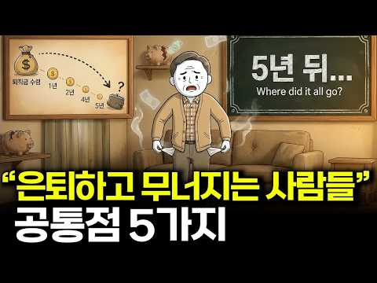
- 설명 앞부분: KBS 기자 KBS 디지털 뉴스 본부장 KBS 울산 방송국 본부장, KBS 해설위원, KBS 교통공무원노조 위원장 등을 역임하며 미디어와 저널리즘 분야에서 풍부한 경험을 쌓아 왔습니다. 이러한 실무 경험을 바탕으로, 현재 미디어 환경에 대한 정확한 정보, 심층 분석, 그리고 솔직한 시각을 제공하기 위해 최선을 다하고 있습니다. 여러분의 지지와 협력은 투명하고 신뢰받는 저널리즘을 향한 저희의 지속적인 노력에 원동력이 됩니다.
- 같은 채널 평소 대비 ×37.1 (채널 최근 롱폼 중앙값 2,747회) · 평소 영상: ＂지금 예적금 하지 마세요＂ 현금 안전하게 굴리는 방법 (2,747회) / 100년 데이터가 증명한 부자 공식ㅣ코스피 신고가에 지금 사도 되는 이유 (2,582회)
- 대본 없음 (설명) — 음성인식이 끝나면 도입부·흐름이 들어감
- 댓글 15/15: 좋은 점 — 영상 0 · 감사·응원 0 · 더 알고 싶은 것 0 · 아쉬운 점 — 영상 1 · 반박·불만 — 의견 다름 1 · 정치·사회 0 · 경험 공유 0 · 구독·다음 기대 0
  - 아쉬운 점 — 영상 👍6 “AI 목소리 바꿀수 없나...? 여러 유투버들 다 같은 AI 목소리들 질린다”

### 42. 슈퍼개미 이정윤의 HTS 세팅법 ∣ 이세무사

- https://www.youtube.com/watch?v=rqdf0xO4PDo · 이정윤의 다정한주식 · 구독자 7,840 · 조회수 108,176 (×13.8, 하루 7,551.8) · 좋아요 1,926 (1.8%) · 19.1분 · 2026-11-14 · 주제 묶음 8. 투자 심리·실패 · 형식 정보·해설 (그 밖) · 폴더 `W_rqdf0xO4PDo` (웹 승인)
- 설명 앞부분: "매일 아침 HTS를 켜면, 어떤 화면부터 보시나요?" 매일 휴대폰으로 주가를 확인하지만, 무엇을 보고 판단해야 할지 막막했던 적 있으신가요? 그 첫 이야기로, 제가 30년 넘게 매일 아침 가장 먼저 여는 HTS 화면을 하나씩 보여드릴게요. HTS와 MTS의 차이부터 미국 증시, 야간 선물지수, 코스피 차트까지, 장이 열리기 전 무엇을 확인해야 하는지 쉽게 알려드립니다. 좋은 종목을 찾기 전에, 시장 전체의 흐름부터 읽는 연습을 함께 시작해 보세요. 언제나 여러분 곁에서 함께하겠습니다. 감사합니다. 이번 영상에서 함께 볼 내용 H…
- 대본 없음 (설명) — 음성인식이 끝나면 도입부·흐름이 들어감
- 댓글 198/214: 좋은 점 — 영상 11 · 감사·응원 74 · 더 알고 싶은 것 2 · 아쉬운 점 — 영상 1 · 반박·불만 — 의견 다름 0 · 정치·사회 0 · 경험 공유 3 · 구독·다음 기대 0
  - 좋은 점 — 영상 👍4 “항상 좋은 말씀 감사합니다 이세무사님을 응원하겠습니다.”
  - 좋은 점 — 영상 👍2 “14일 나눔 콘서트 참석하고 집에 가는 길에 듣습니다. 감사하다는 표현을 하지 못했지만 멀리서 좋은 기운으로 반짝 반짝 빛나시는걸 느끼고 많은걸 배우고 갑니다. 손실이 많아서 눈물나고 힘이 없었는데 다짐하며 도닥이면서 가는 중입니다. 감사드립니다.”
  - 감사·응원 👍17 “아버님의 명복을 빕니다. 주일을 맞아 아버님의 평안한 쉼과 세무사님의 일상에도 평안이 자리하길 기도하겠습니다. 늘 감사합니다.”
  - 감사·응원 👍11 “항상 감사합니다. 대표님 힘드신중에도 항상 노력하시는 모습 본받도록 노력하겠습니다 존경합니다.”
  - 더 알고 싶은 것 👍0 “명성은 오래 들었는데 유툽채널은 이제 여신건가요? 다른 채널에서 보고 너무 좋아 흘러왔습니다. 이름도 좋습니다. 다정. 잘 부탁드립니다. 미국에서 미장만 하는데 3년간 벌어놓은 돈이 다 날라가고, 다음 주는 또 어떤 다이내믹이 휘몰아 칠 지 걱정되는데 회계사님 영상 …”
  - 더 알고 싶은 것 👍0 “모바일만 하다가 키움증권 HTS 따라하기 하려고 했는데 많이 어렵네요.^^ 키움 HTS 메뉴 쉽게 찾는 법이 있을까요?”
  - 아쉬운 점 — 영상 👍0 “삼가 고인의 명복을 빕니다 저는 7월에 아버지가 돌아가셨습니다 아버지가 문득 생각이 날때면 가슴이 먹먹합니다 생전에 손이라도 한번 더 잡아드리지 못한게 많이 아쉽습니다”
  - 경험 공유 👍1 “위로의 말씀을 드립니다 저희 아버님도 작년에 소천하셨는데 지금도많이 그립습니다. 힘내시고 건강관리 잘하세요”
  - 경험 공유 👍1 “저도 항상 감사드려요~ 힘내세요!!”

### 43. 마이너스 주식 계좌 가장 쉽게 탈출하는 방법 물타기? 존버? 고민하지 않아도 되는 물린 종목 최대한 손실을 줄이며 정리하는 현명한 방법

- https://www.youtube.com/watch?v=v6rUCbULG2A · 머니스트랩 · 구독자 1,060 · 조회수 97,470 (×92.0, 하루 1,000.5) · 좋아요 1,124 (1.1%) · 30.5분 · 2026-08-23 · 주제 묶음 8. 투자 심리·실패 · 형식 정보·해설 (그 밖) · 폴더 `W_v6rUCbULG2A` (웹 승인)
- 썸네일: 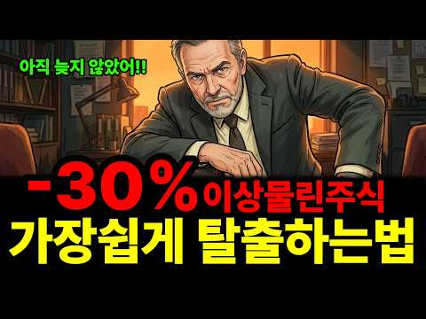
- 설명 앞부분: 지수는 사상 최고를 찍었는데 왜 내 계좌만 파란색일까요. 개인 투자자 240만 명의 계좌를 열어본 자료에서 출발해, 물린 종목을 손실을 줄이며 정리하고 제대로 된 자리로 옮기는 순서를 정리했습니다. 이 영상에서 다루는 내용
- 같은 채널 평소 대비 ×206.1 (채널 최근 롱폼 중앙값 473회) · 평소 영상: 편의점 사장님은 최저임금도 못 받는다? 계약서 속 숨겨진 진실 (472회) / 매출 3조 빵 시장 1위 SPC 삼립 적자가 심하다는데 어떻게 되는걸까 (482회)
- 대본 (음성인식(앞 5분), 4.9 음절/초) — 앞부분만, 흐름은 그 안까지 첫 20초: “물려 있다는 사실을 잊고 계셨다면 그나마 나은 쪽입니다. 진짜 문제는 매일 확인하면서도 아무것도 못하는 경우입니다. 아마 셋 중 하나일 겁니다. 계좌에 있는 줄도 모르고 몇 년을 지나친 종목. 매일 열어보지만 몇 년째 빠져나오지 못한 종목. 그리고 지금 팔면 정말 끝이라 참아 손을 못 떼는 종목.”
- 첫 1분: “물려 있다는 사실을 잊고 계셨다면 그나마 나은 쪽입니다. 진짜 문제는 매일 확인하면서도 아무것도 못하는 경우입니다. 아마 셋 중 하나일 겁니다. 계좌에 있는 줄도 모르고 몇 년을 지나친 종목. 매일 열어보지만 몇 년째 빠져나오지 못한 종목. 그리고 지금 팔면 정말 끝이라 참아 손을 못 떼는 종목. 마지막에 해당하신다면 오늘은 끝까지 보셔야 합니다. 그 결정을 미루는 동안 여러분 계좌에서 무엇이 사라지고 있는지 숫자로 보여드리겠습니다. 2025년 10월 31이었습니다. 그날 아침 뉴스의 첫 곡지는 코스피가 사상 최고치를 갈아치웠다는 소식이었죠. 빨간 숫자로 가득 찬 전광판 화면이 하루 종일 흘러 나왔고 증권 방송에서는 축포 같은 표현들이 오갔습니다. 바로 그날 한 대형증권사가 자사 고객의 계좌를 통째로 들여다”
- 흐름 (90초마다 첫 문장): 0:00 물려 있다는 사실을 잊고 계셨다면 그나마 나은 쪽입니다. → 1:35 물론 모두가 같은 크기로 물려 있는 건 아닙니다. → 3:00 우리는 보통 이 둘을 하나로 놓고 생각합니다. → 4:31 16번 통째로 갈아옵는다는 뜻이죠.
- 댓글 38/38: 좋은 점 — 영상 2 · 감사·응원 4 · 더 알고 싶은 것 1 · 아쉬운 점 — 영상 0 · 반박·불만 — 의견 다름 0 · 정치·사회 2 · 경험 공유 1 · 구독·다음 기대 0
  - 좋은 점 — 영상 👍16 “많은 도움이 됬습니다 로봇주애 _47% 물려있는데 하락장애서 매도 찬스를 놓쳐서 ㅠㅠ 처음엔 물타기 하다가 그때마다 하락해서 더 나락.ㅠㅠ 지근은 포기하고 분할매도 하고 반 남았는데 나머지도 분할매도 할 예정입니다”
  - 좋은 점 — 영상 👍1 “좋은 강의입니다.👍👍👍”
  - 감사·응원 👍8 “감사합니다..........”
  - 감사·응원 👍6 “카카오 안산다 ㅋ 감사 합니다”
  - 더 알고 싶은 것 👍0 “그럼 오른건 언제파나요?”
  - 정치·사회 👍5 “이재명 대통령님 응원합니다.”
  - 정치·사회 👍0 “웃기지마라 개미들 구십프로가 아작이났는데 뭐가 오십 팔프로라고 개소리 그만해 이번주식시장은 정부가 외국펀드투자판을 깔아준것인데 무슨 개소리 개미가 아무리 잘한다해도 거대한 자본으로 죠지는데 무슨 뾰쪽한수가 있나 솔직히 말해서 지금은 개미들 돈이 없어서 주식시장에 가고…”
  - 경험 공유 👍3 “내가 ㅅㅂ 이걸 28분을 들었어 아 진짜 내시간 금같은 내시간 이 목소리 절대듣지말자 늘 그랬건만 ㅅㅂ 아ㅅㅂ 진짜 내시간”

### 44. 코스피 5천선 붕괴에 "개미 살려.." 정부의 긴급 대책은?

- https://www.youtube.com/watch?v=UDPq6kqjWhM · 정치시간 · 구독자 610 · 조회수 12,140 (×19.9, 하루 568.0) · 좋아요 437 (3.6%) · 29.5분 · 2026-11-07 · 주제 묶음 5. 국내주식 · 형식 정보·해설 (그 밖) · 폴더 `W_UDPq6kqjWhM` (웹 승인)
- 썸네일: 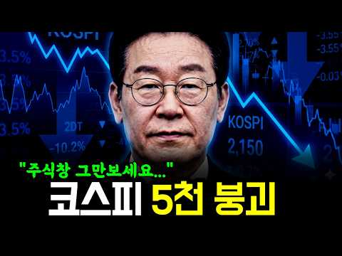
- 설명 앞부분: 코스피 5천 선이 다시 무너져 엄청난 충격이 발생했습니다. 미국 중간선거 결과가 국내 주식시장에 미친영향과 함께, 국민연금을 동원한 억지부양의 핵심을 전달합니다. 내년도 역대 최대규모의 820조 규모로 슈퍼예산으로 불러올 국가 채무의 늪, 그리고 정치권 내부의 씁쓸한 이면까지 냉철하게 분석했습니다. 본 영상은 공개된 언론 보도 및 경제 데이터를 바탕으로 제작된 정치·경제 해설 콘텐츠입니다. 특정 정당이나 인물에 대한 맹목적인 지지나 비방을 배제하며, 시청자 여러분께 객관적이고 균형 잡힌 시각과 알 권리를 제공하는 것을 원칙으로 합…
- 같은 채널 평소 대비 ×3.9 (채널 최근 롱폼 중앙값 3,105회) · 평소 영상: 북한 '미사일 도발'에 특전사는 '모델워킹'으로 자세교육? 안보 충격에 발칵! (2,790회) / 의사가 본 소아응급실 덮친 경찰의 압수수색 논란.. 필수의료 붕괴와 국민연금 위기 진단 … (5,750회)
- 대본 없음 (설명) — 음성인식이 끝나면 도입부·흐름이 들어감
- 댓글 68/68: 좋은 점 — 영상 0 · 감사·응원 0 · 더 알고 싶은 것 0 · 아쉬운 점 — 영상 0 · 반박·불만 — 의견 다름 0 · 정치·사회 28 · 경험 공유 3 · 구독·다음 기대 0
  - 정치·사회 👍15 “반대매매금지.내돈으로내가결정하는데.왜정부가지랄이냐.정부너희가하잔데로했다가개털됐는데.또지랄이냐.”
  - 정치·사회 👍14 “‘집 팔아 주식에 투자하라’고 혹세무민(惑世誣民)한 정부를 믿고 투자한 개미들은 패가망신(敗家亡身)했다. 6.3 지방선거 당시 정청래 집권 여당 대표는 “주식으로 돈을 번 것은 대통령님 덕택이다”라고 아양을 떨었다. 정청래와 정부는 답하라. 주식 폭락으로 패가망신한 …”
  - 경험 공유 👍2 “주식 대책이 반대매매 금지? 저번에는 주식대책으로 삼전닉스 단일종목 ETF 레버리지 보증금을 3,000만원 상향? 지나가는 개,소가 웃을 일이다. 주식 40년차가 한마디 거듭니다. 삼전닉스 단일종목 ETF가 존재하는 한 죽어도 못간다.. 외국인들이 대거 파는 것이 다…”
  - 경험 공유 👍0 “지역 상품권에 30조를 쓴다고? 그것도 빚내서... 우리는 충분히 상품권이 일회성 이라는 것을 겪었잖아요. 정신 이상자인가? 정말 겁나는 사람이네요”

### 45. 코스피 1만 가는 진짜 지름길 나왔다 ‘이것’만 되면 한달 안에 코스피1만

- https://www.youtube.com/watch?v=x5ZWmQxLFzg · 잘되라대한민국 · 구독자 6,680 · 조회수 92,172 (×13.8, 하루 6,126.2) · 좋아요 757 (0.8%) · 14.6분 · 2026-11-13 · 주제 묶음 5. 국내주식 · 형식 정보·해설 (그 밖) · 폴더 `W_x5ZWmQxLFzg` (웹 승인)
- 썸네일: 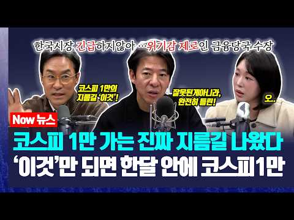
- 챕터: 0:00 오프닝: 불화살이 쏟아지는데 농사 타령? 위기감 없는… · 0:54 [금감위장 발언 비판] "증안펀드는 아직 때가 아니다… · 2:08 80인 대규모 자금시장 간담회 전격 개최: 대통령 주… · 5:00 [핵심 쟁점] 의무공개매수 50+1 논란의 진실: 대… · 6:09 코스피 1만 가는 진짜 지름길 '적대적 M&A': J… · 7:42 한국 금융당국의 근본적 한계: 규제기관의 발상이 '무… · 11:47 클로징: 최악을 방지하기 위해서 움직여야 할 골든타임…
- 설명 앞부분: [겸공_12시에만나요 261113] 대한민국 증시가 전 세계에서 가장 가파른 폭락의 늪에 빠져 허우적거리는 동안, 금융위원장은 "아직 증안펀드를 투입할 때는 아니다"라며 한가한 소리로 시장의 분통을 터뜨렸습니다! 불화살이 쏟아지는 전시 상황에 씨앗이나 뿌리겠다는 식의 안일한 당국 인식이 외국인마저 실망하여 한국 증시를 등지게 만들고 있습니다. 하지만 대통령 주재로 열린 80인 대규모 자금시장 간담회에서 마침내 코스피 1만 시대를 한 달 만에 열어젖힐 수 있는 메가톤급 화두, '적대적 M&A와 의무공개매수 개혁'이 수면 위로 떠올랐…
- 같은 채널 평소 대비 ×3.3 (채널 최근 롱폼 중앙값 28,240회) · 평소 영상: 삼전 67만 하닉 470만 ‘유지’ JP모건, 코스피 15000은 ‘삭제’ (28,240회) / 삼성전자 어닝콜, 소각은 우선주만? 증여세 깎으려 하나··· 역대급 실망 (27,284회)
- 대본 없음 (설명) — 음성인식이 끝나면 도입부·흐름이 들어감
- 댓글 221/221: 좋은 점 — 영상 1 · 감사·응원 3 · 더 알고 싶은 것 1 · 아쉬운 점 — 영상 0 · 반박·불만 — 의견 다름 6 · 정치·사회 61 · 경험 공유 8 · 구독·다음 기대 0
  - 좋은 점 — 영상 👍0 “진짜100%다 맞는말씀하십니다”
  - 감사·응원 👍3 “한동훈이랑 국정감사때 맨트하는거 보고 저게 사람인가 했네 이억원이”
  - 감사·응원 👍0 “이광수 박시동 김어준 방송이라 봤는데 김어준 생각이 안들어 갔으면 좋겠다.. 나도 아직은 김어준 방송 보는 사람!! 왜? 그 시간에 볼게 없으니.까.. 암튼 김어준과 상관없이 방송 해 주세요.. 응원할게요..”
  - 더 알고 싶은 것 👍0 “이광수 박시동 김어준 방송이라 봤는데 김어준 생각이 안들어 갔으면 좋겠다.. 나도 아직은 김어준 방송 보는 사람!! 왜? 그 시간에 볼게 없으니.까.. 암튼 김어준과 상관없이 방송 해 주세요.. 응원할게요..”
  - 반박·불만 — 의견 다름 👍13 “금융위원장 봐줄만큼 봐준것같은데 정부기조와도 안맞는거같고 대응보면 증시시장에 적대적인것같은 느낌이 한두번아닙니다. ISA 개선책? 방해책? 내놨을 때도 그렇고 레버리지도 그렇고 타이밍도 그렇고 당장바뀌어야할사람이 왜 이리 오래자리잡고있는지 모르겠습니다. 제발좀 바꿔줬…”
  - 반박·불만 — 의견 다름 👍2 “광우병 선전선동에는 개끓듯이 모여도 주식시장에서 지들돈 다 빼가도 아휴 내잘못이지 하는 국민들이 절반이여 프랑스는 남의 얘기일뿐”
  - 정치·사회 👍88 “금융위원장 탄핵합시다 ㅡㅡ”
  - 정치·사회 👍65 “이억원이 아니라 이억장...지지율 떨어뜨리는데 한몫을 하네”
  - 경험 공유 👍20 “연초에 선거전 망국적부동산에서 생산적 금융으로 자본 이동시키겠다~ 코스닥 3000 위원회~ 밸류업~ 등등 정부와 여당 소리듣고 돈넣은 청년들과 은퇴하고 퇴직금 넣은 노년들....절망하고 있다. 도대체 이억원은 지금 계엄정부 보다 못한 코스닥 소부장 빼면 계엄정부 때 …”
  - 경험 공유 👍7 “이사람들 삼전닉스 고점에서 내려올대 팔지말고 버티라고한 사람들이여 ~~ 말을 들은 내가 바보지 누굴 탓하리.”

### 46. 지난 폭락과는 완전히 다릅니다…코스피가 진짜 위험한 이유 (Feat. 박병창 MP파트너스 대표) [딥플 Deep-ple]

- https://www.youtube.com/watch?v=y_mvodyrXhQ · 핀플 - Finple · 구독자 48,500 · 조회수 193,740 (×4.0, 하루 39,883.8) · 좋아요 2,910 (1.5%) · 60분 · 2026-10-16 · 주제 묶음 5. 국내주식 · 형식 인터뷰·강연·대담 · 폴더 `W_y_mvodyrXhQ` (웹 승인)
- 썸네일: 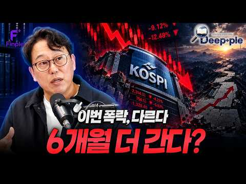
- 설명 앞부분: 딥플 클릭 보기 순서 1Q 코스닥150채권혼합50액티브 ETF (0186S0) 1️⃣ “코스닥 활성화 정책 기대감” 2025.12.19, 금융위원회 ‘코스닥 신뢰+혁신 제고 방안’ 발표 2️⃣ “주식 비중을 높인 2세대 채권혼합형” ‘코스닥150 지수’ 약 50% + ‘단기국공채 지수’ 약 50% 2023.11.16, 퇴직연금감독규정에 따라 주식 편입한도 40% 이내 → 50% 미만으로 상향 성장성과 안정성 둘 다 잡은 ETF 투자도 하나(Hana)면 됩니다. 1Q K반도체TOP2 시리즈 ETF 1Q K반도체TOP2+ ETF (0…
- 같은 채널 평소 대비 ×39.5 (채널 최근 롱폼 중앙값 4,908회) · 평소 영상: 코스피 5천선마저 무너졌다! 외국인 1.5조 매도… 삼성전자·SK하이닉스 지금 팔아야 할… (6,507회) / 코스피 5천선마저 위험하다! 외국인이 삼성전자·SK하이닉스를 집중 매도하는 이유 [더 파… (3,310회)
- 대본 (음성인식(앞 5분), 5.3 음절/초) — 앞부분만, 흐름은 그 안까지 첫 20초: “그 오늘도 지금 호시피가 막 7, 8% 이렇게 급락을 하락에 대한 이유를 여러 가지를 이야기하지만 다 꼬집어서 100% 이거다라고 말씀하시는 분들이 잘 없잖아요 떨어지는 이유를 지금 콕 찝을 수가 있는 상황입니까? 그럼요 이유는 명확하게 있어요” — 도입부 유형: 질문으로 시작, 숫자로 시작
- 첫 1분: “그 오늘도 지금 호시피가 막 7, 8% 이렇게 급락을 하락에 대한 이유를 여러 가지를 이야기하지만 다 꼬집어서 100% 이거다라고 말씀하시는 분들이 잘 없잖아요 떨어지는 이유를 지금 콕 찝을 수가 있는 상황입니까? 그럼요 이유는 명확하게 있어요 내년도에도 엄청 저는 좀 위험하다고 저는 사실 생각을 하거든요 그래서 만약에 더욱 강하게 공속하고 전쟁을 벌이면 어떻게 돼요? 그렇게 현상이 있을 것 같지 않으세요? 우리 지금 얘기하는 동안에 썩게브레이크 걸려서 거래가 정지됐어요 명확한 이유가 이때니까요 지금 이게 해결되려면 네 핀플 가족분들 안녕하십니까 오늘 촬영일이 10월 15일 목요일 점심시간이 좀 지나가고 있는데요 호시피가 8% 가까이 떨어지고 있습니다 5,535 정도 이렇게 지나가고 있는데요 여기 보시다시피”
- 흐름 (90초마다 첫 문장): 0:00 그 오늘도 지금 호시피가 막 7, 8% 이렇게 급락을 하락에 대한 이유… → 1:30 그런 시간을 좀 마련했습니다 → 3:02 가져가야 된다고 생각하거든요 → 4:30 제가 그 설명을 드려보면요
- 댓글 360/360: 좋은 점 — 영상 16 · 감사·응원 26 · 더 알고 싶은 것 1 · 아쉬운 점 — 영상 2 · 반박·불만 — 의견 다름 7 · 정치·사회 28 · 경험 공유 21 · 구독·다음 기대 1
  - 좋은 점 — 영상 👍27 “박병창님의 강의 넘 유익했습니다. 3프로에서 믿을맨중 하나죠”
  - 좋은 점 — 영상 👍20 “와~박병찬 대표님! 제가 가려웠던 부분을 잘 알려주셔서 감사해요~~ 민준님도 핵심을 잘 짚어 질문해주시네요😊”
  - 감사·응원 👍20 “와~박병찬 대표님! 제가 가려웠던 부분을 잘 알려주셔서 감사해요~~ 민준님도 핵심을 잘 짚어 질문해주시네요😊”
  - 감사·응원 👍19 “작년방송에서 올해전망 예측하신대로 흘러감에 경외감을 느낍니다. 상반기 좋고, 하반기 위험, 금리5 돌파시 도망. 경험자의 안목에 큰 도움받았고 감사를 전하고싶습니다.”
  - 더 알고 싶은 것 👍0 “직전에 잘나간주식 장비 두산테스나나 이차전지원통형 신흥 이런거 사면 되나요?”
  - 아쉬운 점 — 영상 👍3 “다시 반복해서 들어봐야겠어요 좋네요”
  - 아쉬운 점 — 영상 👍0 “그러니까 요약좀 해줘요 ㅋ”
  - 반박·불만 — 의견 다름 👍377 “반도체 업계 종사자입니다 중국 반도체 신기술(특히 창신메모리 CXMT의 차세대 D램 '4F²' 연내 출시 발표 등) 정치적·시장적 과장(선동에 가까운 쇼맨십)이 99%, 무시 못 할 기술적 우회 시도가 0.1%' 정도로 보시는 것이 가장 냉정한 팩트입니다. 단순히 '…”
  - 반박·불만 — 의견 다름 👍4 “헛소리를 겁나게 길게하네 말 맨날 바뀌면서ㅋㅋㅋㅋㅋ”
  - 정치·사회 👍16 “내년의 실적을 의심하는 것이 아니라 질적에 관계없이 난 팔겠다는 외국인이 무서운거지 수급”
  - 정치·사회 👍13 “확실히 이번 하락은 좀 다른듯 월요일 쌍바닥도 깨질거같은데 전쟁끝나거나 선거끝날떄까지 관망해야하는 장세인듯”
  - 경험 공유 👍20 “와~박병찬 대표님! 제가 가려웠던 부분을 잘 알려주셔서 감사해요~~ 민준님도 핵심을 잘 짚어 질문해주시네요😊”
  - 경험 공유 👍14 “아저씨 갑자기 이러니까. 세상에 해안이 있는 것처럼 떠들지 마 당신도 언젠가 평탄한 길이 있었을 때 이럴 땐 매수해야 된다고 말했던 사람이잖아. 정답은 없지. 그러나 지금 정답이 있는 것처럼 내가 마치 예언가인 것처럼. 이야기하는 건 너무 창피하지 않아?”
  - 구독·다음 기대 👍0 “이런 채널이 있는줄 물랐는데 박대표님 들으러 들어왔습니다. 일단 구독했습니다.”

### 47. '2억빚' 옥탑방부부 고혈압, 고지혈증, 당뇨 남편과 먹고사는 이야기

- https://www.youtube.com/watch?v=wa5zxxVqfk0 · 반백살, 옥탑방 이야기 · 구독자 786 · 조회수 53,652 (×68.3, 하루 639.0) · 좋아요 309 (0.6%) · 9분 · 2026-09-05 · 주제 묶음 1. 주식 기초·초보 · 형식 브이로그·직접 해본 이야기 · 폴더 `W_wa5zxxVqfk0` (웹 승인)
- 썸네일: 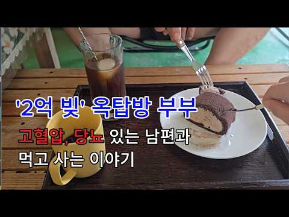
- 설명 앞부분: 안녕하세요? 50대 부부의 '반백살 옥탑방 이야기'입니다. 고혈압, 고지혈증, 당뇨가 있는 남편이 5일간의 출장을 마치고 휴무일입니다. 파김치가 되어 잠든 남편을 보며, 하루빨리 어깨의 짐을 덜어주고 싶어 오늘도 홀로 주식차트를 공부합니다. 비록 지금은 옥탑방에서 넉넉지 않은 살림이지만, 함께 웃으며 밥을 먹을 수 있는 오늘 하루에 감사합니다. 저희 부부가 빚을 갚아나가며 희망을 찾아가는 여정을 감사합니다.
- 같은 채널 평소 대비 ×14.4 (채널 최근 롱폼 중앙값 3,718회) · 평소 영상: 8월 폭염 속, 침침해진 눈으로 배달을 나섭니다. (3,718회) / "여보 제발 나가지 마!" 돈 없는데 비 온다고 일 안 못나가는 이유 (3,743회)
- 대본 없음 (설명) — 음성인식이 끝나면 도입부·흐름이 들어감
- 댓글 105/105: 좋은 점 — 영상 0 · 감사·응원 11 · 더 알고 싶은 것 1 · 아쉬운 점 — 영상 1 · 반박·불만 — 의견 다름 2 · 정치·사회 2 · 경험 공유 6 · 구독·다음 기대 0
  - 감사·응원 👍18 “돈 없어도 마음은 부자네요 빚많으면 파산하고 돈 못벌면 생활보흐대상자 되고 이렇게 살 수 있는데 정부 도움받지 않고 살아야 제대로 된 삶이죠 잘 헤쳐나가길 응원합니다 파산하지 않고 생활보호 받지 않고 자립하면 괜챦은 삶인데 빚도 못갚고 빌어먹게 되면 구차한 삶이죠”
  - 감사·응원 👍15 “한두달에 한번인데 억지로 참는거보다 땡길때 맛나게 먹는게 나아요. 힘내세요.”
  - 더 알고 싶은 것 👍0 “아이 없이 사는것 같은데 맞나요?”
  - 아쉬운 점 — 영상 👍1 “빚갚느라고 힘드시겠어요~~ㅠㅠ 전 빚은 0원인데 계속 버는돈을 5천모으면 다잃고 3천모으면 다잃고 이런걸 열번도 넘게 반복해서 지금도 0원에서 새출발이라 마음에 착잡하네요~ 빚은 얼마나 남으신건가요? 힘내십시요~”
  - 반박·불만 — 의견 다름 👍26 “개인 투자는 거의 실빼 30년 햇는 사람으로 한국 주식장은 아닙니다 그시간에 알바하는게 주식보다 수만배 더 벌어요 스트레스 받는것 하지마세요 기관들이 돈 벌어요”
  - 반박·불만 — 의견 다름 👍15 “주식은 많이 안다고 벌수있는게 아닙니다 열심히 한다고 벌수있는게 아닙니다. 대단히 잘못생각하고 계십니다”
  - 정치·사회 👍5 “나이들면 3고 고혈압.고지혈 당뇨 많은 분들이 달고 살어요 병이라기보다 나이들어서 관리 하면 큰문제는 없는듯 난 70대입니다 그모든겄 다 달고잇어요 관리형 50대면 아직 청년입니다 랑이나 두분다 힘들수록 적지만 땀흘려 노력하는 근로 소득이 오히려 더 찐 수입이지 않나…”
  - 경험 공유 👍22 “빚까지 있는데 돈지랄 양이까지 키우시다니요. 양이 아파봐야 돈이 많이 들어간다는걸 깨달을걸요. 내아는 분 양이한테 3천들어갔다고 하던데. 거기에 주식까지? 빚청산이 먼저 아닌가요. 주식하면 돈이 벌어집니까! 챠트는 볼줄 아시나요! 증권사 애들이 좋아라할겁니다. 호구 …”
  - 경험 공유 👍14 “주식으로 수익내기 정말 힘들어요. 삼성전자 아니면 우리 같은 초짜들은 돈 다 털리고 말죠. 꾸준한 수익을 원하시면 무조건 쌀 때 사서 겨울이나 다음 년도 초까지 장투하시는 길뿐이에요. 신용이나 미수 잘못 쓰면 또 다 털리구요. 차라리 돈을 조금씩 모아서 눈 딱 감고 …”

### 48. 천재도 경제학자도 주식에 실패한 진짜 이유는 '이걸' 몰랐기 때문입니다

- https://www.youtube.com/watch?v=bHp0fIqQesQ · 리채피 richappy · 구독자 12,500 · 조회수 124,578 (×10.0, 하루 10,034.7) · 좋아요 1,628 (1.3%) · 15분 · 2026-11-16 · 주제 묶음 8. 투자 심리·실패 · 형식 정보·해설 (그 밖) · 폴더 `W_bHp0fIqQesQ` (웹 승인)
- 썸네일: 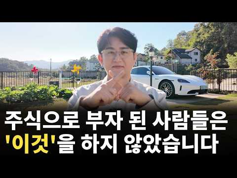
- 챕터: 0:00 천재도 경제학자도 주식에 실패한 이유, 딱 하나 · 0:48 결론부터, 시간을 내 편으로 만든 사람이 이긴다 · 1:38 밤새 금리 발표를 기다리던 예전의 저 · 2:12 경기를 맞히려던 경제학자, 케인스 · 3:58 "주가는 고원에 올랐다" 열흘 뒤 무너진 어빙 피셔 · 4:57 천재 뉴턴은 왜 다시 샀을까 · 6:57 폭락 뒤 케인스가 바꾼 것 · 8:00 두 번째 폭락에서 달라진 행동 · 8:42 미리 정해 두면 정말 지켜질까 · 9:54 규칙대로면 기계 같지 않나요? · 10:42 시간을 내 편으로 만드는 법 · 11:55 기다릴 수 있다는 개인 투자자의 강점 · 12:32 흔들리지 않으려고 지키는 세 가지 · 13:30 오늘 내용 정리
- 설명 앞부분: 주식은 맞히는 사람이 아니라, 시간을 내 편으로 만든 사람이 이깁니다. 역사상 가장 똑똑했다는 천재 뉴턴, 20세기 최고의 경제학자 케인스, 대공황 직전 "주가는 고원에 올랐다"고 말한 어빙 피셔의 주식투자 기록으로 그 이유를 살펴봅니다. 공부를 많이 해도 주식 계좌가 제자리인 분이 많습니다. 주가와 경기를 정확히 맞히려 할수록 뉴스와 전망에 흔들려, 조금 오르면 불안해서 팔고 떨어지면 망설이다 더 크게 잃기 때문입니다. 시장을 맞히려는 시도는 경제를 가장 잘 안다는 사람들도 실패했습니다. 그래서 필요한 것은 더 많은 정보가 아니…
- 같은 채널 평소 대비 ×11.9 (채널 최근 롱폼 중앙값 10,496회) · 평소 영상: 주식투자에서 늘 지던 내가 뒤늦게 알게 된 '이것' (11,713회) / 세계적인 투자자가 평생 붙든 '이것' (9,279회)
- 대본 없음 (설명) — 음성인식이 끝나면 도입부·흐름이 들어감
- 댓글 90/90: 좋은 점 — 영상 14 · 감사·응원 15 · 더 알고 싶은 것 1 · 아쉬운 점 — 영상 1 · 반박·불만 — 의견 다름 0 · 정치·사회 0 · 경험 공유 5 · 구독·다음 기대 1
  - 좋은 점 — 영상 👍63 “시간을 내편으로 만드는 방법 (1) 싸졌을 때 매수, (2) 충분히 기다리고,, (3) 많이 오르면 덜어내고, (4) 다음을 준비한다는 것입니다. 주식은 맞히는 것이 아니라 시간을 내편으로 만드는 방법을 택하라는 좋은 말씀 마음에 새기겠습니다. 지금껏 주식 투자하면서…”
  - 좋은 점 — 영상 👍10 “요즘같은 시기에 영상이 도움이 많이 됩니다 감사합니다 ~”
  - 감사·응원 👍63 “시간을 내편으로 만드는 방법 (1) 싸졌을 때 매수, (2) 충분히 기다리고,, (3) 많이 오르면 덜어내고, (4) 다음을 준비한다는 것입니다. 주식은 맞히는 것이 아니라 시간을 내편으로 만드는 방법을 택하라는 좋은 말씀 마음에 새기겠습니다. 지금껏 주식 투자하면서…”
  - 감사·응원 👍10 “요즘같은 시기에 영상이 도움이 많이 됩니다 감사합니다 ~”
  - 더 알고 싶은 것 👍0 “왼쪽에 피피티 어떤 프로그램으로 만드는 건지 궁금합니다!!”
  - 아쉬운 점 — 영상 👍0 “이제는 정보 과잉의 시대입니다 내게 맞는 정보와 틀린 정보를 구분하는것도 중요한 능력이 되는 세상이네요 좋은 영상 감사합니다~”
  - 경험 공유 👍2 “제가 4년동안 한경험 ㅡ제얘기 하시는듯 뜨끔하네요 올해부터는 떨어져도 흔들리지않고 올라도 흥분하지 않으니 편안해 집니다”
  - 경험 공유 👍2 “제가 본 주식 영상중 최고입니다. time!!!!!!!!!”
  - 구독·다음 기대 👍2 “진짜좋은내용이네요!! 구독했습니다!!”

### 49. 하락장에서 계좌를 지키는 세 가지

- https://www.youtube.com/watch?v=AUeEkRnKeM8 · 리채피 richappy · 구독자 12,500 · 조회수 319,206 (×25.5, 하루 9,552.8) · 좋아요 4,288 (1.3%) · 16.7분 · 2026-10-26 · 주제 묶음 11. 투자 일반 · 형식 정보·해설 (그 밖) · 폴더 `W_AUeEkRnKeM8` (웹 승인)
- 썸네일: 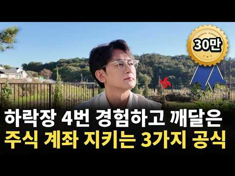
- 챕터: 0:00 하락장이 고통스러운 진짜 이유 · 1:06 하락장의 두 얼굴: 급락과 긴 횡보 · 2:33 지금 시장은 어디쯤인가: 민스키의 빚의 세 단계 · 3:43 급락이 끝난 다음, 사람들이 시장을 떠나는 구간 · 5:12 감정이 흔들린 투자자의 성적표 · 6:40 같은 사람도 상태에 따라 다르게 고른다: 투자 게임 … · 8:03 다들 떠날 때 사는 사람들: 워런 버핏의 2008년 · 9:54 그냥 버티라는 말 아닌가요? · 11:19 제가 지나온 하락장: 2020년과 2022년 · 13:21 달라진 것은 순서였습니다 · 14:02 오늘부터 해볼 세 가지 · 15:19 오늘 내용 정리
- 설명 앞부분: 주식 하락장, 급락보다 그 뒤의 긴 횡보가 더 고통스럽다면 바닥을 맞히기보다 그 구간을 지나갈 준비부터 하세요. 하락장을 네 번 지나며 알게 된 개인 투자자의 마음 관리법과 실제 대응을 공개합니다. 하락장에서 좋은 자산을 싼 가격에 팔고 시장을 떠나는 분이 많습니다. 이는 급락이 만드는 공포와, 그 뒤 긴 횡보가 쌓는 지루함과 답답함이 판단을 흔들기 때문입니다. 하락장은 단순히 주가가 떨어지는 시기가 아니라, 마음이 먼저 무너지기 쉬운 시기입니다. 그래서 지금 시장이 어느 구간인지 아는 것부터 시작해, 그다음 구간이 왜 더 어려운…
- 같은 채널 평소 대비 ×30.4 (채널 최근 롱폼 중앙값 10,496회) · 평소 영상: 주식투자에서 늘 지던 내가 뒤늦게 알게 된 '이것' (11,713회) / 세계적인 투자자가 평생 붙든 '이것' (9,279회)
- 대본 없음 (설명) — 음성인식이 끝나면 도입부·흐름이 들어감
- 댓글 312/312: 좋은 점 — 영상 22 · 감사·응원 37 · 더 알고 싶은 것 1 · 아쉬운 점 — 영상 4 · 반박·불만 — 의견 다름 1 · 정치·사회 2 · 경험 공유 19 · 구독·다음 기대 2
  - 좋은 점 — 영상 👍31 “사라마라 부추기는 컨텐츠들보다 백배만배 더 유익하네요....”
  - 좋은 점 — 영상 👍19 “이분 말씀 백퍼 공감합니다 저는 가정주부로 살면서 주식을 시작했고 어느덧 26년째 투자자로 살고 있습니다 2000년에 주식투자를 시작했습니다 남편은 아직도 제 계좌에 얼마가 있는지 모릅니다 저는 그동안 집도 샀고 아이들 교육에 많은 돈을 쓰기도 했습니다 사실 주식에 …”
  - 감사·응원 👍30 “요즘같은 시기에 너무 공감되고 힘이되는 영상이네요. 감사합니다”
  - 감사·응원 👍26 “유투브 내용이 좋고 참 알찹니다. 소중하고 귀한 나눔 감사합니다. 리채피님도 더 건강하시고 행복하시기 바랍니다~~”
  - 더 알고 싶은 것 👍1 “저도 이번만은 다르다는 말이 제일 공포스럽습니다.그러나 지나보면 큰 틀에서는 같은 맥락이었다는걸 이번만은 제가 꼭 경험하는 시간이었으면 좋겠습니다.격려부탁드립니다.감사합니다”
  - 아쉬운 점 — 영상 👍19 “이분 말씀 백퍼 공감합니다 저는 가정주부로 살면서 주식을 시작했고 어느덧 26년째 투자자로 살고 있습니다 2000년에 주식투자를 시작했습니다 남편은 아직도 제 계좌에 얼마가 있는지 모릅니다 저는 그동안 집도 샀고 아이들 교육에 많은 돈을 쓰기도 했습니다 사실 주식에 …”
  - 아쉬운 점 — 영상 👍0 “결론부터..좋아요!”
  - 경험 공유 👍37 “하락장 자체가 문제가 아니에요 그걸로 인해 심리가 불안해지고 심하면 잠도 안오고 온종일 그 이유를 고민하고 일상생활에 지장을 줍니다 대부분 이런 상태를 버티지 못하고 던지게 댑니다. 하락장을 여러번 경험했어도 적응이 힘들죠 이 고통스러움에서 벗어나고 싶어서 던지는겁니…”
  - 경험 공유 👍24 “맞아요~ 대형주. 우량주.. 상폐될일없고.. 몇년뒤 오를꺼에요.. 시간이 해결해줄꺼에요.. 못견디고 팔면 지는거랬어요.. 주식은 안팔면 잃은거 아니라고.. ㅠㅠ 저도 빚은 아니라.. -50퍼 넘지만.. 하루하루 넘 힘든데.. 버텨 봅니다.. 회사 가치만 보면 이제 시…”
  - 구독·다음 기대 👍24 “바닥이다싶을때부터 분할매수해야 달리는 말에 올라탑니다. 크리스마스까지 기다려요!”
  - 구독·다음 기대 👍1 “차분한 분석에 마음이 편해져서 구독합니다, 저도 하락장에 계속 추매해서 마이너스 15%지만 금액은 많지 않습니다, 전부 제 여윳돈이고요, 조금 상승하면 일부 매도해서 현금을 마련, 하락할때 추매하여 단가를 낮추었어요”

### 50. "반도체 대폭락 위기 찾아왔다" 다음주 월요일 삼전닉스 주가 '이렇게' 될 겁니다

- https://www.youtube.com/watch?v=HKHeBCM-RkE · 알기쉬운 경제스쿨 · 구독자 47,600 · 조회수 244,681 (×5.1, 하루 34,272.9) · 좋아요 1,822 (0.7%) · 35.5분 · 2026-11-21 · 주제 묶음 2. 장기투자·ETF·지수 · 형식 정보·해설 (그 밖) · 폴더 `W_HKHeBCM-RkE` (웹 승인)
- 썸네일: 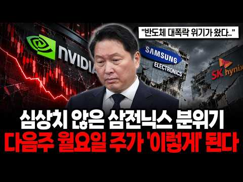
- 설명 앞부분: 미국 나스닥이 5.3퍼센트 폭락하고 엔비디아는 10월 고점 대비 48퍼센트 빠졌습니다. 11월 23일 월요일 삼성전자와 SK하이닉스가 받을 충격의 크기, 2주 전 같은 폭락 다음 날의 흐름, 그리고 이 하락이 끝나는 신호를 정리했습니다. litt.ly/econschool.official 경제스쿨 채널은 투자를 강요하거나 리딩방을 운영하지 않습니다
- 같은 채널 평소 대비 ×11.9 (채널 최근 롱폼 중앙값 20,615회) · 평소 영상: 심상치 않은 삼전닉스 분위기, 12월 어마무시한 일 터집니다 ∣ 하창봉 대표 3부 (20,615회) / 삼전닉스 주가 예사롭지 않다, 내일 아침은 더 무서울 겁니다 ∣ 하창봉 대표 1부 (25,166회)
- 대본 없음 (설명) — 음성인식이 끝나면 도입부·흐름이 들어감
- 댓글 234/234: 좋은 점 — 영상 1 · 감사·응원 8 · 더 알고 싶은 것 5 · 아쉬운 점 — 영상 1 · 반박·불만 — 의견 다름 3 · 정치·사회 27 · 경험 공유 0 · 구독·다음 기대 1
  - 감사·응원 👍2 “귀한 내용 고맙습니다”
  - 감사·응원 👍1 “그저 와준 "300"이 고맙기는 했는데 . 죽어도 오고 마는 "90"이 두렵다 아 ! 닉스형 "111"이하면 마이너스인데 어떻게 해야하나...???”
  - 더 알고 싶은 것 👍2 “금요일 저녁 미장에 SEC가 엔비디아 회계조사도 한다는 카더라로 시작해서 미장이 박살났는데 12월2일에 하는 청문회가 어떻게 될지 모르는데 CEO를 찾을수 있을가 의문이네여 청문회가 잘끝나야 그담 스탭이 나올거같은데 아닌가여?거기에 12월9일에 금리인상 할거고 예상과…”
  - 더 알고 싶은 것 👍1 “하이닉스 직원들에게 주는 성과급은 어떻게 되는가요?”
  - 아쉬운 점 — 영상 👍0 “영상 내용 너무길다 ㅜㅜ”
  - 정치·사회 👍8 “삼전닉스가 얼마나 더 내려갈까요? 2026년 1월 SK하이닉스는 530,000원으로 상승하기 시작하였고 삼성전자는 98,000원으로 시작한걸로 알고 있습니다. 즉, 위 두 가격이 시작으로 대량의 외국인들이 한국 증권시장에 쓸어들어왔거든요. 진자 저점은 어디까지인지 가…”
  - 정치·사회 👍7 “공매도일시정지와 주가누르기방지법 꼭 조속히 시행해야합니다. 서연 이란 종목보고 깜짝놀란게 벌어드린 1년 영업이익 보다 시가총액이 적은데 신저가 갱신하는 이런 기업을 금융위에서 조사해 봐야하는게 아닌가요? 대주주 증여세 줄이려고 이런짓하는 상장 국내기업 무지 많은데 이…”
  - 구독·다음 기대 👍0 “안녕하세요! 저는 당신의 열렬한 팬이고 당신의 영상을 정말 즐겨 보고 있습니다. 저는 현재 홍콩 톈마 퀀티테이티브 캐피털 인터내셔널 투자 유한회사에서 프로젝트 매니저로 근무하고 있습니다. 당신의 콘텐츠가 너무 좋아서 연락드렸습니다. 광고 또는 스폰서십 협업에 관심이 …”

### 51. 하루만에 ‘삼성전자’ HBM 뒤흔든 젠슨황… TSMC ‘3나노’ 돌연 채택 뜻밖의 변수 발생

- https://www.youtube.com/watch?v=whybLg0YCWg · 경제한잔 · 구독자 7,370 · 조회수 200,618 (×27.2, 하루 5,155.3) · 좋아요 827 (0.4%) · 17.2분 · 2026-10-20 · 주제 묶음 7. 매매·전략 · 형식 정보·해설 (그 밖) · 폴더 `W_whybLg0YCWg` (웹 승인)
- 썸네일: 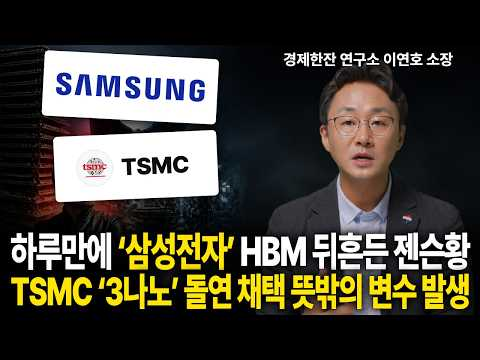
- 챕터: 0:00 하루 만에 뒤집힌 삼성전자 HBM 전략과 젠슨황의 한… · 0:43 메모리도 삼성 밑판도 삼성, 완벽했던 그림이 찢어진 … · 1:10 엔비디아 젠슨황이 TSMC에 맡기라 던진 결정적 한마디 · 1:26 세계 1위 메모리 기업이 핵심 부품을 경쟁사에 맡긴 … · 1:47 HBM 구조를 아파트에 비유해 쉽게 이해하기 · 2:15 수십 층 D램을 받치는 베이스 다이의 정체 · 2:28 단순 통로였던 베이스 다이가 HBM4에서 바뀐 이유 · 2:51 데이터를 직접 처리하는 두뇌로 격상된 로직 칩 · 3:05 두뇌 역할에 최첨단 파운드리 기술이 필요한 이유 · 3:23 메모리도 파운드리도 가진 삼성전자의 오랜 꿈 · 3:47 D램은 메모리가 베이스 다이는 파운드리가, 자급자족의… · 4:03 TSMC 없이 다 한다는 삼성의 마지막 자존심 · 4:44 엔비디아가 한마디로 박살 낸 삼성의 꿈 · 4:49 엔비디아 전용 맞춤 설계 NVHBM과 TSMC 3나노… · 5:22 집안에서 다 해결하려던 그림을 정면 부정한 폭탄 · 5:43 세계 최대 고객의 요구를 삼성전자가 거절할 수 있었을까 · 6:16 자존심이냐 매출이냐, 삼성 내부의 치열한 고민 · 6:34 엔비디아가 TSMC 3나노를 콕 집은 진짜 계산 · 7:00 삼성 파운드리 수율과 신뢰성에 대한 엔비디아의 부담 · 7:26 GPU도 TSMC, 같은 생태계 궁합이 만든 결정
- 설명 앞부분: 하루 사이에 뒤집힌 소식, 혹시 보셨나요? 😮 바로 삼성전자의 HBM 전략 이야기입니다. 분명 어제까지만 해도 "메모리도 삼성, 그 밑판도 삼성" 이렇게 처음부터 끝까지 다 자체적으로 해내겠다던 삼성전자가, 단 24시간 만에 그 그림을 통째로 뒤집었거든요. 그 중심에는 엔비디아의 젠슨 황이 있었습니다. 🔥 이 영상은 '하루 만에 삼성전자 HBM 전략이 흔들린 사건'의 속사정을 처음부터 끝까지 쉽게 풀어드리는 내용입니다. 엔비디아가 커스텀 HBM, 그러니까 자기네 GPU에 딱 맞춘 특별 주문품인 NVHBM의 베이스 다이를 TSMC …
- 같은 채널 평소 대비 ×18.4 (채널 최근 롱폼 중앙값 10,876회) · 평소 영상: 삼성전자 9%, 하이닉스는 0.3%…주도주 상승폭 갈라진 이유는? (11,656회) / 잘 생각해보면 남의 일이 아닌 프랑스 혼란(시위, 금리, 정치) (10,097회)
- 대본 없음 (설명) — 음성인식이 끝나면 도입부·흐름이 들어감
- 댓글 78/78: 좋은 점 — 영상 0 · 감사·응원 4 · 더 알고 싶은 것 0 · 아쉬운 점 — 영상 1 · 반박·불만 — 의견 다름 1 · 정치·사회 2 · 경험 공유 2 · 구독·다음 기대 0
  - 감사·응원 👍10 “설명이 속속 들어와요 감사합니다”
  - 감사·응원 👍5 “포인트는 그거라고 봅니다. 삼전의 베이스 다이 제작 파운드리 기술이 TSMC에 못 미친다는 엔비디아의 판단이 있었냐는 거죠. 그렇다면 공정이 더 복잡해지는 앞으로의 고대역에서도 삼전은 베이스 다이를 되찾아오기가 어렵다는 겁니다. 참 아쉽네요. 기대가 컷는데. 좋은 컨…”
  - 아쉬운 점 — 영상 👍5 “포인트는 그거라고 봅니다. 삼전의 베이스 다이 제작 파운드리 기술이 TSMC에 못 미친다는 엔비디아의 판단이 있었냐는 거죠. 그렇다면 공정이 더 복잡해지는 앞으로의 고대역에서도 삼전은 베이스 다이를 되찾아오기가 어렵다는 겁니다. 참 아쉽네요. 기대가 컷는데. 좋은 컨…”
  - 정치·사회 👍1 “같은 중국인 챙기네요. 삼성을 무한히 응원합니다”
  - 정치·사회 👍0 “젠슨황은 중국인. 대만도 중국인… 중국스런운것.. 그리고 삼성에 의존하는 구조를 안가지려는것.. 주도권을 갖겠다는것.. 삼성도 다양한 수요업체 개발”
  - 경험 공유 👍1 “내가 젠슨황이래도 tsmc를 선택했을듯 두뇌베이스다이랑 tsmc cpu가 호환이되고 궁합이 맞으니 결국 메모리만 삼성걸 쓰겠다는것임”
  - 경험 공유 👍1 “내가 젠슨 황이라도 내 불쌍한 조국 대만을 위해 TSMC 를 돕는게 당연 ! 난 ..충분히 이해가 됨.”

### 52. "아이렌, 냉정하게 버틸 수 있는 기업인가? -2억진행중인 내 계좌는 버틸수 있는가?..ft.아이렌맨"

- https://www.youtube.com/watch?v=tM1uNrlIb8w · 아이렌맨 : IREN을 사랑하는 남자 · 구독자 9,490 · 조회수 53,919 (×5.7, 하루 6,453.1) · 좋아요 454 (0.8%) · 10.5분 · 2026-11-20 · 주제 묶음 기타 · 형식 인터뷰·강연·대담 · 폴더 `W_tM1uNrlIb8w` (웹 승인)
- 썸네일: 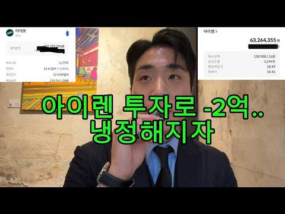
- 설명 앞부분: 2027년 유동성 위기설과 함께 "빚으로 데이터센터를 짓는 AI 기업부터 깨진다"는 이야기가 나오고 있습니다. 그럼 아이렌(IREN)은 그 '약한 고리'일까요? 그리고 대출의 대한 생각
- 같은 채널 평소 대비 ×2.3 (채널 최근 롱폼 중앙값 23,126회) · 평소 영상: "아이렌,머스크 "AI로는 부족해" 'SpaceXAI → SpaceXSI(초지능)이름까지… (23,126회) / "앤트로픽이 아이렌을?! 프리장 +9% 폭등 → 하루 만에 전부 반납한 진짜 이유" ft… (23,346회)
- 대본 없음 (설명) — 음성인식이 끝나면 도입부·흐름이 들어감
- 댓글 1,078/1,078: 좋은 점 — 영상 5 · 감사·응원 106 · 더 알고 싶은 것 18 · 아쉬운 점 — 영상 1 · 반박·불만 — 의견 다름 26 · 정치·사회 5 · 경험 공유 69 · 구독·다음 기대 0
  - 좋은 점 — 영상 👍6 “아이렌 자체에 문제가 없더라도 외부적인 요인들이 받춰줘야 상승합니다.그러나 그외부 요인들이 지금 너무나 안좋아요 금리, 정치 등등 그게 해결되기 전까지는 쉽게 회복하기 힘들어요.. 그게 언제냐 인거죠 성질급한 물타기도 많이 하셨고... 아이렌이 문제가 아니라 내가 문…”
  - 좋은 점 — 영상 👍5 “걍 이젠 한심하다, 한종목에 맹신헤서, 그냥 좋은소리 좋은정보로만 편파적인 시선으로 보지마라.. 극좌,극우랑 뭐가 다르냐😂”
  - 감사·응원 👍21 “12불깨진다..ㄷㄷㄷ 수익 2억의 엄청난 행운을 감사할 줄 몰랐던 벌..ㄷ 무섭다 시장..”
  - 감사·응원 👍18 “자꾸 비판하는 사람들을 악마화 시키는것 같은데. 정작 여기서 응원이랍시고 떠드는 사람들이 가장 악랄한 사람들임. 비판하는 사람들은 제발 정신차리라고 일침을 놔주는거고. 응원하는 사람들이야말로 달콤한 악마의 속삭임으로 지옥 끝까지 붙들고 늘어지는 악마같은 존재들임. 다…”
  - 더 알고 싶은 것 👍6 “12달러까지 곤두박질치는데요?? 언제증명하나요??”
  - 더 알고 싶은 것 👍4 “하루에 5개 업로드 부탁해요”
  - 반박·불만 — 의견 다름 👍17 “경고했는데 결국 원금 싹 다 날리셨네 허구한날 현실파악은 못하고 말도 안되는 희망댓글만 다는놈들이 더 문제다 이쯤되면 누가 진짜 악플이고 진짜 못된놈인지 스스로들 좀 알아라”
  - 반박·불만 — 의견 다름 👍17 “주식 경력 없는게 티가 많이 나네요. 고베타 (인덱스 펀드 대비 위,아래 움직임이 큰 기업)은 절대 높은 비중으로 투자하는게 아닙니다. 왜 수 많은 거장들이 첫째 원칙으로 돈을 잃지마라 라고 말할까요? 대출을 받은 순간 이자만 내고 하는게 중요한게 아닙니다. 이미 기…”
  - 정치·사회 👍10 “숏치시라고 107번째 간곡히 말씀드립니다... 전 진작 손절하고 손익분기점 넘겼습니다. 반도체 시즌 아웃이고 데센이 돈을 벌수있는 구조는 데센을 더 짓는구조가 아니면 안되는건데 민주당이 집권한 이상 답이없어요 ㅠㅠ 주식을 믿음으로만 하면 큰돈 잃어요.”
  - 정치·사회 👍3 “어이 동상 바텀업 말고 탑다운으로 볼수있어야지 금리인상(빅스텝까지) 총선민주당압승 젠슨황사임(순환금리문제)”
  - 경험 공유 👍34 “멘탈 갑이십니다..저도 아이렌 투자중이지만 살짝 멘붕 올려고 하네요 ^^ 힘든시기인데 다같이 힘냅시다”
  - 경험 공유 👍33 “'이렇게 떨어질 일인가?' 라는 의문이 들면 '왜 이렇게 올랐지?' 라고 생각해봤을때 답이 나오겠죠”

### 53. 주식 초보를 위한 하루 100만 원 번다는 매매법 리뷰. 단타 고수들의 진짜 매매법.

- https://www.youtube.com/watch?v=rOk7aKpWJVQ · 마이크로스콥  · 구독자 3,740 · 조회수 51,610 (×13.8, 하루 2,488.7) · 좋아요 938 (1.8%) · 18.8분 · 2026-11-07 · 주제 묶음 1. 주식 기초·초보 · 형식 정보·해설 (그 밖) · 폴더 `W_rOk7aKpWJVQ` (웹 승인)
- 썸네일: 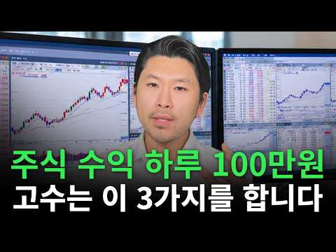
- 챕터: 0:00 주식 초보가 반드시 해야 하는 고수의 세가지 원칙 · 2:00 주식 초보가 반드시 지켜야 하는 수익률 · 3:29 주식 초보가 절대 하면 안되는 두가지 · 8:55 주식 초보가 배워야 하는 고수의 매수점 · 11:35 주식 초보는 이 거래시간은 피하세요 · 15:15 주식 초보에게 추천하는 하는 세가지 매매 준비 과정
- 설명 앞부분: 주식초보라면 하루 100만 원을 번다는 단타 고수의 매매법을 그대로 따라 하기 전에, 무엇부터 확인해야 하는지 살펴봅니다. 이번 영상에서는 주식초보가 고수의 방법을 거꾸로 따라 하다가 손실을 보는 이유와 매수 전에 꼭 체크해야 할 3가지 기준을 정리합니다. 단순히 빠르게 사고파는 법이 아니라, 주식초보가 실제 시장에서 오래 살아남기 위해 필요한 판단 기준을 쉽게 설명합니다.
- 같은 채널 평소 대비 ×23.6 (채널 최근 롱폼 중앙값 2,184회) · 평소 영상: 주식 초보 개미가 주식으로 돈을 잃는 4가지 이유_주식 초보 기초 강의 (2,209회) / 에버랜드 손님 90만 명 줄었는데 롯데월드는 500억 넘게 투자하는 이유 (2,159회)
- 대본 없음 (설명) — 음성인식이 끝나면 도입부·흐름이 들어감
- 댓글 26/26: 좋은 점 — 영상 1 · 감사·응원 3 · 더 알고 싶은 것 2 · 아쉬운 점 — 영상 0 · 반박·불만 — 의견 다름 1 · 정치·사회 0 · 경험 공유 4 · 구독·다음 기대 0
  - 좋은 점 — 영상 👍2 “좋은 정보 고맙습니다.”
  - 감사·응원 👍8 “하지 말아야할 3가지 매매 다 저한테 해당 돼는 내용이네요 그것땜에 한번 깡통 차고 다시 오르려 합니다. 너무 잘 봤습니다 영상 자주 올려주세요 따라가겠습니다 감사합니다!! 구독 좋아요 꾸욱”
  - 감사·응원 👍2 “좋은 정보 고맙습니다.”
  - 더 알고 싶은 것 👍8 “하지 말아야할 3가지 매매 다 저한테 해당 돼는 내용이네요 그것땜에 한번 깡통 차고 다시 오르려 합니다. 너무 잘 봤습니다 영상 자주 올려주세요 따라가겠습니다 감사합니다!! 구독 좋아요 꾸욱”
  - 경험 공유 👍1 “신용비율 11%넘는 종목찾기도 힘들다 삼전 하닉이 신용비율이 높아서 폭락하냐? 1%도 안되는데 그냥 증권사도적놈들이 작전세력과 짜고 미수 신용 반대매매단가 실시간데이터 전부 보면서 가지고 노는거야 정부도 세금손안대고 코푸는데 묵인하는거고 돈있는곳에 사기가 있는법 그게…”
  - 경험 공유 👍0 “제가 그래요😊”

### 54. 이재명 "집 팔아 주식 사라더니…" 코스피 폭락에 국민연금 증발 실태 #이재명 #코스피 #국민연금

- https://www.youtube.com/watch?v=c3vq8lj05Yk · 정치시간 · 구독자 610 · 조회수 15,875 (×26.0, 하루 373.9) · 좋아요 322 (2.0%) · 18.9분 · 2026-10-16 · 주제 묶음 5. 국내주식 · 형식 정보·해설 (그 밖) · 폴더 `W_c3vq8lj05Yk` (웹 승인)
- 썸네일: 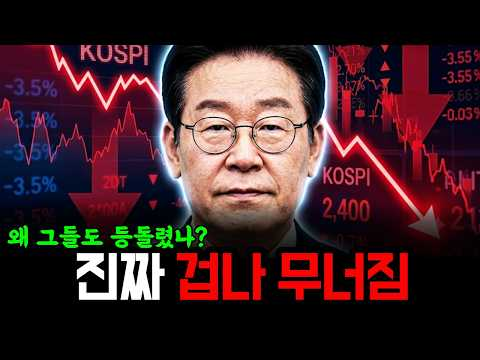
- 설명 앞부분: 최근 코스피 지수가 연이은 하락세를 보이며 증시 변동성이 극대화되고 있습니다. 삼성전자와 SK하이닉스 등 주요 대형주의 실적 발표 및 자사주 소각 이슈에도 불구하고, 외국인 투자자들의 대규모 매도세와 국민연금의 주식 비중 조정 여파로 투자자들의 불안감이 커지고 있습니다.
- 같은 채널 평소 대비 ×5.1 (채널 최근 롱폼 중앙값 3,105회) · 평소 영상: 북한 '미사일 도발'에 특전사는 '모델워킹'으로 자세교육? 안보 충격에 발칵! (2,790회) / 의사가 본 소아응급실 덮친 경찰의 압수수색 논란.. 필수의료 붕괴와 국민연금 위기 진단 … (5,750회)
- 대본 (음성인식(앞 5분), 5.2 음절/초) — 앞부분만, 흐름은 그 안까지 첫 20초: “오늘 코스피가요 대폭락을 또 했습니다. 아니 내가 이재명 말을 듣고 주식을 투자했는데 그 주식 다 까먹고 거기다가 지금 내 국민연금까지 유투력다고 하니까 지금 화가 단단히 난 그런 상황인 것 같아요. 최근 코스피가 연속 하락하며 투자자들의 불안이 커진 상황인데요. 오를 때는 그 난리치더니 왜 떨어질 때는 조용한 걸까요?”
- 첫 1분: “오늘 코스피가요 대폭락을 또 했습니다. 아니 내가 이재명 말을 듣고 주식을 투자했는데 그 주식 다 까먹고 거기다가 지금 내 국민연금까지 유투력다고 하니까 지금 화가 단단히 난 그런 상황인 것 같아요. 최근 코스피가 연속 하락하며 투자자들의 불안이 커진 상황인데요. 오를 때는 그 난리치더니 왜 떨어질 때는 조용한 걸까요? 특히 국민연금의 무리한 투자로 인한 리스크는 정말 심각한 상황입니다. 강성 지지하던 개딸들조차 등돌리는 요즘 사태를 자세히 살펴보시죠. 6,035 장중 한때 6,000선이 무너져 가지고 5,910일 5,900석까지 무너질뻔 했는데 이게 말입니다. 지난 10월 2일 이후에 5 거래일 연속 하락이고요. 계속 떨어졌고 문제가 말입니다. 이게 삼성전자가 얼마 전에 영업이 107조 세 개 최고 규모의”
- 흐름 (90초마다 첫 문장): 0:00 오늘 코스피가요 대폭락을 또 했습니다. → 1:31 그런데 7월에서 9월 그다음에 10월까지 해서 → 3:03 그러니까 SK가 열심히 외국인들이 파는 걸 사줬다는 얘기는 해요. → 4:30 청산이 됩니다.
- 댓글 28/44: 좋은 점 — 영상 0 · 감사·응원 0 · 더 알고 싶은 것 0 · 아쉬운 점 — 영상 0 · 반박·불만 — 의견 다름 0 · 정치·사회 14 · 경험 공유 1 · 구독·다음 기대 0
  - 정치·사회 👍16 “1년사이 개쓰레기나라가 되가고 있다.”
  - 정치·사회 👍8 “믿을인간들 한테 믿어야지 나라가 어느한군데 온전한데가 없내”
  - 경험 공유 👍5 “이대통령 자주하는말...내가 언제 그랬어요?”

### 55. 상상도 못한 금값 전망 떴다 가진 금 전부 '이렇게' 하세요 (유신익 박사 / 통합본 2부)

- https://www.youtube.com/watch?v=FnpS27bmW9Y · 웅달책방_투자 · 구독자 3,780 · 조회수 122,447 (×32.4, 하루 2,214.2) · 좋아요 520 (0.4%) · 29.6분 · 2026-10-04 · 주제 묶음 2. 장기투자·ETF·지수 · 형식 인터뷰·강연·대담 · 폴더 `W_FnpS27bmW9Y` (웹 승인)
- 썸네일: 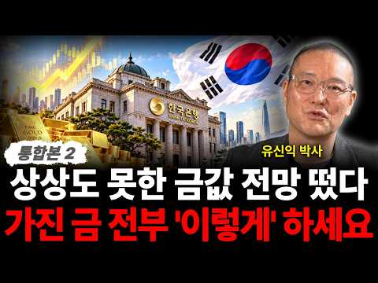
- 설명 앞부분: 🌕"금값 1971년과 판박입니다" 지금 '이렇게' 해야 돈 법니다 (유신익 박사 / 통합본 2부) 본 영상은 9월 29일에 촬영되었습니다 (시청에 참고해 주세요) ※ 출연자에 대한 비난, 욕설, 비속어 등을 포함한 댓글은 무통보 삭제될 수 있습니다. 성숙한 소통 문화 형성에 동참해주시길 바라겠습니다. 감사합니다.
- 같은 채널 평소 대비 ×18.4 (채널 최근 롱폼 중앙값 6,664회) · 평소 영상: 삼성 판 개미들 잠 다 잤다 월요일 아침 '이렇게' 될 겁니다 (차영주 소장 / 통합본 … (6,704회) / 한국 증시 왜 이렇게 망가졌나 솔직히 싹다 말씀드립니다 (주식장인 이창대 대표 / 통합본… (6,625회)
- 대본 없음 (설명) — 음성인식이 끝나면 도입부·흐름이 들어감
- 댓글 29/29: 좋은 점 — 영상 0 · 감사·응원 0 · 더 알고 싶은 것 0 · 아쉬운 점 — 영상 0 · 반박·불만 — 의견 다름 1 · 정치·사회 2 · 경험 공유 1 · 구독·다음 기대 0
  - 반박·불만 — 의견 다름 👍16 “한번도 제대로 금 사본적 없는 사람들이 교과서적인 이야기나 하는 헛소리 같네. 뭐 사보고 이야기하지. 정말 우리나라 자칭 전문가들은 하나 알면 다 아는것처럼 이야기. 참 외국 사람들과 정말 내공이 비교가 안되네.”
  - 정치·사회 👍2 “결국은 비트코인이 답이에요 세계 공 영 무역 화폐를 사실은 만들었어야 되는데 미국에 우격다짐으로 달러를 기축통화로 써서 이제 전세계가 지옥문으로 들어가는 거죠. 환율이 아직 나고 금리가 올라가고 모든 경제가 무너집니다 모든 나라가”
  - 정치·사회 👍0 “트럼프 정권11월아면 끝인데?”
  - 경험 공유 👍1 “난 불확실한 변동성보다 확실한 우하향이라도 제한적일거란걸 알기에 내 성격에도 맞고해서 몇개월 전부터 국내 발행한거 절세계좌에서 미국금현물 4%커버드콜 etf. 국내 2종 리츠 etf 8%대부터 기존 보유분 국내외 3세대 커버드콜 매월 분배금 2백만원대 들어오는거로 매…”

### 56. 코스피 7% 폭락, 외인 30분만에 1조 순매도, 무언가 수상합니다

- https://www.youtube.com/watch?v=hjIgX9ppDe4 · 경제한잔 · 구독자 7,370 · 조회수 180,147 (×24.4, 하루 4,193.7) · 좋아요 880 (0.5%) · 14분 · 2026-10-16 · 주제 묶음 5. 국내주식 · 형식 정보·해설 (그 밖) · 폴더 `W_hjIgX9ppDe4` (웹 승인)
- 썸네일: 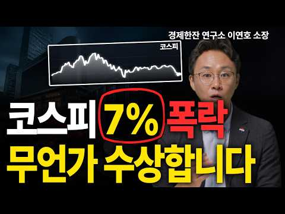
- 챕터: 0:00 코스피 폭락 7퍼센트, 외국인 순매도 30분 1조의 … · 0:49 외국인 순매도 하루치를 30분에 쏟아낸 비정상 신호 · 1:20 삼성전자 하이닉스 과매도가 코스피 지수를 꺾은 이유 · 2:11 이 물량 누가 왜 던졌나 진짜 질문의 시작 · 2:19 실적은 범인이 아니다 반도체주 사상 최고 실적 · 2:55 코스피 폭락 설명할 결정타 뉴스가 없다 · 3:21 글로벌 동반 하락만으로 설명 안 되는 괴리 · 3:56 쉬운 답 세 개가 전부 지워진 수상한 지점 · 4:11 프로그램 매매 선물 공매도 다섯 용의자 공개 · 4:48 전부 사람 손이 아니다 기계적 매도의 공통점 · 5:17 선물 현물 베이시스로 보는 30분 1조 메커니즘 · 6:03 반대매매 눈사태 하락이 하락을 부르는 구조 · 6:36 왜 기업 가치보다 더 깊게 과매도됐나 · 7:15 기계가 던졌는데 왜 하필 한국인가 · 7:26 위험자산 회피 달러 강세 매크로 흐름 · 7:56 외국인에게 한국 증시는 현금인출기 ATM · 8:34 반도체 사이클 선반영 외국인 순매도 습관 · 9:13 공포가 아니라 계산된 포지션 조정일 가능성 · 9:28 현물 팔고 선물 사는 움직임이 말해주는 것 · 10:10 가격이 가치에서 떨어져 나간 과매도의 본질
- 설명 앞부분: 📉 오늘 코스피가 7% 넘게 폭락했습니다. 삼성전자 7%, SK하이닉스 9% 급락, 그리고 외국인이 단 30분 만에 1조 원을 순매도했죠. 화면이 온통 파란색으로 물들면, 누구나 똑같은 생각을 합니다. "외국인이 다 던지고 도망간다, 한국 증시 끝난 거 아니야?" 🥵 혹시 오늘 계좌를 보면서 가슴이 철렁 내려앉았다면, 이 영상을 끝까지 꼭 봐주세요. 오늘의 폭락은 단순한 공포가 아니라, 그 안에 아주 수상한 구조가 숨어 있습니다. 🔍 이 영상에서 다루는 핵심 요약 외국인이 하루 종일 파는 금액은 보통 많아야 몇천억, 세게 던져도 …
- 같은 채널 평소 대비 ×16.6 (채널 최근 롱폼 중앙값 10,876회) · 평소 영상: 삼성전자 9%, 하이닉스는 0.3%…주도주 상승폭 갈라진 이유는? (11,656회) / 잘 생각해보면 남의 일이 아닌 프랑스 혼란(시위, 금리, 정치) (10,097회)
- 대본 (음성인식(앞 5분), 4.6 음절/초) — 앞부분만, 흐름은 그 안까지 첫 20초: “오늘 코스피가 7% 넘게 폭락했습니다. 하이맥스는 9% 삼성전자도 7% 넘게 빠졌죠. 그런데 진짜 이상한 건 따로 있습니다. 외국인이 단 30분만에 1조 원을 순매도 했거든요. 솔직히 이건 그 누구도 받아낼 수 없는 물량입니다. 단순히 겁먹고 도망치는 걸까요?” — 도입부 유형: 숫자로 시작
- 첫 1분: “오늘 코스피가 7% 넘게 폭락했습니다. 하이맥스는 9% 삼성전자도 7% 넘게 빠졌죠. 그런데 진짜 이상한 건 따로 있습니다. 외국인이 단 30분만에 1조 원을 순매도 했거든요. 솔직히 이건 그 누구도 받아낼 수 없는 물량입니다. 단순히 겁먹고 도망치는 걸까요? 아니면 하방에 돈을 걸어둔 걸까요? 공매도일까요? 아니면 선물로 파생을 노리는 걸까요? 지금 기업들이 돈벌는 능력에는 아무 문제가 없습니다. 시장을 무너뜨릴 결정탄 유수도 없고요. 그런데도 주가는 기업 가치보다 훨씬 더 깊게 빠졌습니다. 그래서 오늘만큼은 그냥 유동성이 말랐다고 넘기기엔 뭔가 수상한 구석이 있습니다. 그래서 오늘은 이 30분의 1조라는 숫자부터 제대로 뜯어보려고 합니다. 이게 왜 비정상이냐면요. 평소에 외국인이 우리 시장에서 하루 종일”
- 흐름 (90초마다 첫 문장): 0:00 오늘 코스피가 7% 넘게 폭락했습니다. → 1:32 거의 절반에 가깝습니다. → 3:02 코스피를 7% 통째로 무너뜨릴 만한 단일 악재가 없어요. → 4:35 3번 옵션이나 변동성에 걸려 있던 포지션이 한꺼번에 청산되는 경우
- 댓글 51/70: 좋은 점 — 영상 2 · 감사·응원 5 · 더 알고 싶은 것 0 · 아쉬운 점 — 영상 1 · 반박·불만 — 의견 다름 0 · 정치·사회 11 · 경험 공유 0 · 구독·다음 기대 5
  - 좋은 점 — 영상 👍2 “구독했어요!!!너무 유익해요!!감사합니다”
  - 좋은 점 — 영상 👍2 “이해하기쉽게 화면을 구성하셨네요 구독했습니다”
  - 감사·응원 👍5 “영상 감사합니다!”
  - 감사·응원 👍4 “감사합니다 버터야 됩니다”
  - 아쉬운 점 — 영상 👍0 “ㅋ 광고하는 주식과 정치와 관련된 주식은 사는게 아니다.. 그리고 실적을 보고 기대치가 높아져있어서 그런거고 실적치로만 주가가 올라가면 얼마나 좋겠냐..실적에 비해 기대치까지 주가가 오르지 못하니 하락하는거.. 반대로 반도체쪽 말고 기대도 안하는 2차전지는 실적치가 …”
  - 정치·사회 👍16 “최고의 명강의였습니다. 멍청한 이재명 정부의 관료들때문에 개인투자자들은 피눈물을 흘리네요.”
  - 정치·사회 👍12 “한국주식은. 투명유리. 외국인만 조은일 시키는 어리석은 정부”
  - 구독·다음 기대 👍12 “작금의 사태를 명확하게 분석해 주었습니다. 구독합니다.”
  - 구독·다음 기대 👍7 “난 주식설명 다욕하는데 이채널은 논리적이고 최근 선물가격 때매 현물이 안올라가는 현상을 본 것까지 맞음 그래서 우선 구독박고감”

### 57. 반도체 폭락 뒤 찾아온 9배 상승, 이번에도 반복될까?

- https://www.youtube.com/watch?v=1b-TwEDV4iM · 테스프레소 · 구독자 10,700 · 조회수 228,839 (×21.4, 하루 6,072.3) · 좋아요 2,350 (1.0%) · 23.4분 · 2026-10-21 · 주제 묶음 기타 · 형식 정보·해설 (그 밖) · 폴더 `W_1b-TwEDV4iM` (웹 승인)
- 썸네일: 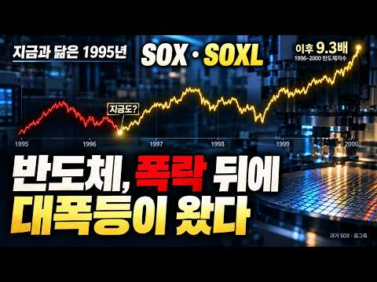
- 설명 앞부분: 실적은 사상 최대인데 반도체 주가는 떨어집니다. 버블이 터지는 걸까요, 더 큰 상승을 앞둔 조정인지 살펴 봅니다. 1995년 하락 이후 반도체지수는 저점에서 9배 넘게 올랐습니다. 그리고 그 뒤에 진짜 붕괴가 찾아왔죠. 이번 영상에서는 1995~2002년의 상승과 폭락을 끝까지 따라가며, 지금 반도체 시장과 비교합니다. 반등을 앞당겼던 금리 변화, 상승을 끝낸 투자 축소, 그리고 앞으로 확인해야 할 신호까지 짚어봅니다.
- 같은 채널 평소 대비 ×23.8 (채널 최근 롱폼 중앙값 9,634회) · 평소 영상: [특이점매수 2편] 하루사이 반등한 TQQQ, 반등이 매수 기회일지 과거 하락을 진단합니… (9,634회) / 젠슨황의 복귀 사임. 엔비디아 실적발표가 증시 방향을 바꿔야 합니다. 특이점 지수 진단 … (9,582회)
- 대본 없음 (설명) — 음성인식이 끝나면 도입부·흐름이 들어감
- 댓글 217/217: 좋은 점 — 영상 4 · 감사·응원 13 · 더 알고 싶은 것 0 · 아쉬운 점 — 영상 4 · 반박·불만 — 의견 다름 4 · 정치·사회 4 · 경험 공유 3 · 구독·다음 기대 5
  - 좋은 점 — 영상 👍5 “좋은 내용 감사합니다”
  - 좋은 점 — 영상 👍4 “딴거 다 보고 흔들리느니 이거 하나 보는게 남! 너무 좋은 영상❤”
  - 감사·응원 👍11 “영상 기다려집니다. 건강보다는 분석과 영상이 우선이에요^^ 농담이고요 ㅎ 정말 감사합니다”
  - 감사·응원 👍10 “최고네요 감사합니다.”
  - 아쉬운 점 — 영상 👍1 “과거의 반복이야 ... 아니면 새로운 역사를 쓰느냐 ... 과거의 반복은 아닐 것 같음. 이미 그 때를 겪은 사람들도 똑같은 생각을 가지고 투자를 하니까 ... 그래서 쉽게 다시 반도체에 대한 기대를 하지 않겠지. 지난 한주만 봐도 ... 주가가 오르락 내리락 하지도…”
  - 아쉬운 점 — 영상 👍0 “튀어라 ㅋㅋ실발이후에도 투심이죽고 폭락한다면 하락장 시작이라는거지 지루하게 괴롭힐거다 내년에 오르겠지”
  - 반박·불만 — 의견 다름 👍1 “웃기는군요 차라리 동전 앞뒤 맞추기를 하세요 ㅋㅋㅋㅋ 반도체 물려서 멘탈 흔들리는 개미들이 딱 좋아할 영상이네”
  - 반박·불만 — 의견 다름 👍1 “아닙니다”
  - 정치·사회 👍5 “중간선거이후 거의19승으로 역사적으로 상승했음”
  - 정치·사회 👍0 “수급이 무너짐..외인이 슈퍼갑 시장. 연기금 물리고 개인자금 없고 외인은 매도세인데 양치기하믄서 탈출하고 개인돈 뺏어가는중 시장에 돈은 줄어들고 금리는 오르고 현금이 강해지면 예금이 늘어나고 악재가 더많음. 전쟁 끝나면 기술적 반등은 있지만 국민은 주식 쳐다도 안보고…”
  - 경험 공유 👍3 “근데 이거 얘기한데 꽤 많았고 중요한건 내가 본 순간 이 수익 메카니즘이 기가막히게 꺾인다 ㅋㅋ 유투브 알고리즘은 어떻게든 많은 사람들을 몰아넣는데 탁월하다 ㅋ”
  - 경험 공유 👍1 “과거의 반복이야 ... 아니면 새로운 역사를 쓰느냐 ... 과거의 반복은 아닐 것 같음. 이미 그 때를 겪은 사람들도 똑같은 생각을 가지고 투자를 하니까 ... 그래서 쉽게 다시 반도체에 대한 기대를 하지 않겠지. 지난 한주만 봐도 ... 주가가 오르락 내리락 하지도…”
  - 구독·다음 기대 👍12 “바로 구독했어요”
  - 구독·다음 기대 👍11 “영상 기다려집니다. 건강보다는 분석과 영상이 우선이에요^^ 농담이고요 ㅎ 정말 감사합니다”

### 58. 월배당금 70만원, 시골에서 사는 배당부부!

- https://www.youtube.com/watch?v=vJF30ea4r7Q · 시골사는 배당부부 · 구독자 1,930 · 조회수 116,341 (×60.3, 하루 1,064.9) · 좋아요 741 (0.6%) · 5분 · 2026-08-11 · 주제 묶음 3. 배당 · 형식 정보·해설 (그 밖) · 폴더 `W_vJF30ea4r7Q` (웹 승인)
- 썸네일: 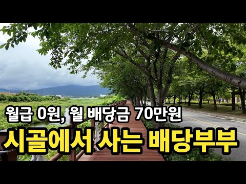
- 설명 앞부분: 안녕하세요 수도권에서 떠나 시골에서 둘이 살고 있는 배당부부 입니다. 월 배당금으로 생활비를 채우는 것을 목표로 부업하면서 살아가고 있습니다. 앞으로 저희가 채워나가보려고 합니다.
- 같은 채널 평소 대비 ×9.6 (채널 최근 롱폼 중앙값 12,122회) · 평소 영상: 시골 세미파이어 현실 한달 생활비 (13,933회) / 세미파이어 부부의 소비 철칙 (10,312회)
- 대본 없음 (설명) — 음성인식이 끝나면 도입부·흐름이 들어감
- 댓글 110/110: 좋은 점 — 영상 1 · 감사·응원 13 · 더 알고 싶은 것 6 · 아쉬운 점 — 영상 1 · 반박·불만 — 의견 다름 2 · 정치·사회 0 · 경험 공유 9 · 구독·다음 기대 4
  - 좋은 점 — 영상 👍1 “안녕하세요 첨뵈어요😊 결코 쉽지않은 결정하시고 시골와서 사시는군요~~ 놀란건 사모님이 같이 오셨다는게 더 놀라워요~~😊😊스트레스 없는 삶 응원하며 좋은영상 공유해요 구독 좋아요 알림설정하고 갑니다 🎉🎉”
  - 감사·응원 👍7 “세미파이어 관심 있어서 알고리즘 타고 들어왔어요 시작이 반인데 시작이 어렵네요 시작하신게 대단 하십니다😊 응원 합니다”
  - 감사·응원 👍6 “안온한 삶 보다 도전적 삶을 응원합니다~ 젊음이 최고의 자본입니다~”
  - 더 알고 싶은 것 👍13 “배당70만원..솔직히 생활이 가능한가요? 저도 40대중반 파이어인데 자녀2명이라 월지출이 장난아니거든요. 보여지는 소비는 줄인다치더라도 절제력이 대단하신것 같습니다.”
  - 더 알고 싶은 것 👍5 “사는얘기 올려주세요 구독 눌렀으니 자주 찾아와서 응원하겠습니다! 화이팅!”
  - 반박·불만 — 의견 다름 👍12 “멋지네요. 배당금도 많은 것도 아닌데”
  - 반박·불만 — 의견 다름 👍0 “저희의 최종 목표는 먹고 노는 파이어족이 아닙니다 생활비를 채워줄 배당금이 들어오는 여유로움입니다 라고하셨는데 뭐가다른건지 은근히 파이어족을 까시네요”
  - 경험 공유 👍35 “배당금 70만원이면 많다면 많고, 적다면 적은 금맥 같지만 결코 작은 금액은 아닌 듯...배당금 월 10만원도 안되는 사람들도 많습니다. 지수 투자 하느라 그런게 아니라 매달 생활비 빼고 투자할수 있는 돈이 그닥 많지 않기 때문이겠죠! 저도 배당금 월 100을 목표로…”
  - 경험 공유 👍13 “배당70만원..솔직히 생활이 가능한가요? 저도 40대중반 파이어인데 자녀2명이라 월지출이 장난아니거든요. 보여지는 소비는 줄인다치더라도 절제력이 대단하신것 같습니다.”
  - 구독·다음 기대 👍2 “구독했어요. 영상 올릴때마다 또 올께요!ㅎㅎ 혹시 강원도 어느 지역이신지요?”
  - 구독·다음 기대 👍1 “안녕하세요 첨뵈어요😊 결코 쉽지않은 결정하시고 시골와서 사시는군요~~ 놀란건 사모님이 같이 오셨다는게 더 놀라워요~~😊😊스트레스 없는 삶 응원하며 좋은영상 공유해요 구독 좋아요 알림설정하고 갑니다 🎉🎉”

### 59. [이선엽X염승환] "싸니까 사라? 지금 중요한 건 '물린 거' 어떻게 해..아닐까요?" #염승환 #염블리 #이선엽 _261023

- https://www.youtube.com/watch?v=kO2Rh9UjBQI · 경제통마늘 · 구독자 16,800 · 조회수 335,474 (×20.0, 하루 9,233.1) · 좋아요 1,798 (0.5%) · 16.4분 · 2026-10-23 · 주제 묶음 2. 장기투자·ETF·지수 · 형식 오디오북·낭독 (명언·인생조언) · 폴더 `W_kO2Rh9UjBQI` (웹 승인)
- 썸네일: 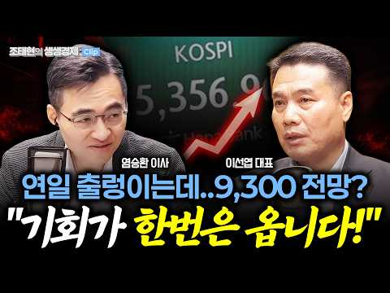
- 설명 앞부분: "이 판국에?" 내년 9,300 전망..코스피 기회는 다시 올까 [이선엽 AFW파트너스 대표] SK하이닉스 솔리다임 상장 철회, "너무나 당연하고, 굉장히 다행스런 일" 외국인 7천억 내다판 이유? 솔리다임 상장 때문 "상장 철회 넘 당연한 것, 근데 왜 하필 오늘일까요? 더 올라갈 수 있었는데.." 연일 출렁이는데…한화증권 "내년 코스피 최대 9,300" 전망 "기회가 한번은 옵니다!" 美증시, 급락에도 하락 종목보다 상승 종목이 더 많아 시장이 진짜 안좋다면 '방어주'도 필요 없어 미 국채시장에 주목해야할 이유 국채금리 하락하…
- 같은 채널 평소 대비 ×411.6 (채널 최근 롱폼 중앙값 815회) · 평소 영상: AI주 팔아 앤트로픽? 뉴욕증시 돈이 말랐다_261120 (1,894회) / [앤트로픽_삼전닉스] AMD -7.7% 급락 여파, 19만전자도 깨져_261120 (6,497회)
- 대본 없음 (설명) — 음성인식이 끝나면 도입부·흐름이 들어감
- 댓글 223/223: 좋은 점 — 영상 1 · 감사·응원 4 · 더 알고 싶은 것 1 · 아쉬운 점 — 영상 1 · 반박·불만 — 의견 다름 3 · 정치·사회 14 · 경험 공유 9 · 구독·다음 기대 0
  - 좋은 점 — 영상 👍0 “차라리 존 리나 배재규 대표 강의를 듣는게 도움이 되죠”
  - 감사·응원 👍3 “이선엽 전문가님 감사합니다”
  - 감사·응원 👍2 “두분의 말씀 감사합니다”
  - 더 알고 싶은 것 👍0 “광주강연은 언제인가요??”
  - 아쉬운 점 — 영상 👍32 “악질 두명 세트로 나왔네 50년에 한번 올까말까할 기회라고 한 이선엽 250에도 안팔고 가만히 있으라건 염승환 머 좋다고 웃으면서 전문가인척 하는지 하는 소리라곤 개나소나 다 아는 뻔한소리만 주구장창 얘들때매 계좌 반이상 녹아내린 피해자만 수십만명일듯”
  - 반박·불만 — 의견 다름 👍4 “최근 이 두양반 예상도 다 틀렸지.. 주식투자는 세력들에게 돈 갖다바치는 바보놀음.”
  - 반박·불만 — 의견 다름 👍1 “육갑이와 모지리 2명이 만니서 헛소리 오지네”
  - 정치·사회 👍4 “외국인이 안산데요. 2십 7만 오면 들어온데요.”
  - 정치·사회 👍2 “외국인이 들어오면 그때가 싼거다. per가 1일이라도 pbr 이 0.1 이라도 아무도 안 사면 비싼거지..”
  - 경험 공유 👍8 “이선엽대표님 여름휴가 가지말고 주식하라해서 했는데 쫄딱 망했네요 ㅜㅜ 기회가 한번은 옵니다??ㅎㅎ 썰물만 있겠어요. 그런말은 나도 하고 당연히 오르겠지요.”
  - 경험 공유 👍2 “주가예측에 보수적이라는 노무라 증권이 코스피 1만2천 간다고 했었지.... JP모건, 골드만삭스, 모건 스탠리.... ...같은 양코백이들은 노무라증권보다 더 높게 불렀었고..... 근데 그때 9300찍고 거의 반토막 났다 ㅋㅋㅋㅋ ㅠㅠ”

### 60. "보이지 않는 손이 실패하고 있다" 샘 올트먼이 본 메모리시장ㅣ"1년에 1000억 달러씩, 그것도 매년, AI가 끝날 때까지"

- https://www.youtube.com/watch?v=E2Kz9bbb878 · Just In Timeㅣ저스트인타임 · 구독자 19,800 · 조회수 282,624 (×14.3, 하루 10,791.2) · 좋아요 693 (0.2%) · 8.2분 · 2026-11-02 · 주제 묶음 8. 투자 심리·실패 · 형식 정보·해설 (그 밖) · 폴더 `W_E2Kz9bbb878` (웹 승인)
- 썸네일: 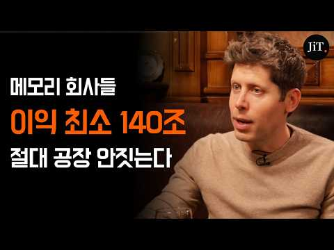
- 챕터: 0:00 "1년에 각각 1,000억 달러" · 0:09 해설: 누가, 언제 · 1:22 보이지 않는 손이 실패하고 있다 · 1:59 해설: 가격은 올랐는데 공급은 왜 · 2:44 200억 투자해서 190억 벌던 사람들 · 3:20 해설: 190억 달러의 기억 · 4:07 "램을 각자 쌓아두는 건 끔찍하다" · 4:36 해설: 그래서 "끔찍하다"는 말 · 5:23 호황도 불황도 온다 · 6:05 해설: 올트먼도 과잉을 말한다 · 6:53 모래를 지능으로 바꾸는 비용 · 7:32 정리
- 설명 앞부분: [원본] Cheeky Pint (Stripe) · Why Sam Altman is against a single superintelligence · 2026년 10월 29일 공개 · 진행 존 콜리슨(스트라이프 공동창업자) ※ 원본 발언을 한국어로 옮기고 해설한 영상입니다. 오픈AI CEO 샘 올트먼이 "램을 각자 쌓아두는 건 끔찍하다"고 말한 그 대화의 앞뒤를 봅니다. 그가 먼저 한 말은 "보이지 않는 손이 지금 실패하고 있다"였습니다. 메모리 값이 1년 사이 다섯 배가 올랐는데 왜 공급이 안 느는가. 올트먼의 답은 역사입니다. …
- 같은 채널 평소 대비 ×4.7 (채널 최근 롱폼 중앙값 59,756회) · 평소 영상: "닷컴은 버블. AI는 실체가 있다. 하지만.." ∣ 닷컴 버블을 두 달 전에 경고한 남… (59,756회) / 나스닥 애매한 반등은 무엇을 의미하는가 ∣ "데이터센터 75%는 이미 승인, 20%가 사… (55,198회)
- 대본 없음 (설명) — 음성인식이 끝나면 도입부·흐름이 들어감
- 댓글 295/295: 좋은 점 — 영상 0 · 감사·응원 0 · 더 알고 싶은 것 0 · 아쉬운 점 — 영상 1 · 반박·불만 — 의견 다름 8 · 정치·사회 8 · 경험 공유 14 · 구독·다음 기대 0
  - 아쉬운 점 — 영상 👍0 “이번에는 과거와 또 디른 게임임 핵심은 AI 기술의 성숙도임 지금은 새로운 기술이 하루가 멀다하고 나와서 더 높은 성능을 공격적으뢰 원하는 시장임 기술이 성숙되면 어찌될지 몰라도 최소한 변동성은 줄어들꺼임 뻔한 얘기 같지만 예전과 다른 지점은 이 새로운 기술이 예전과…”
  - 반박·불만 — 의견 다름 👍2 “애초에 반도체 회사만 말도 안되는 per 인 거 보면 답이 나온다.”
  - 반박·불만 — 의견 다름 👍0 “메반이 싸기는 했다 진짜 말도 안 되게 쌌다 과자 값이었지 요즘은 너무 올랐다”
  - 정치·사회 👍1 “코스피 오를땐 대재명하더니 다 작살나니까 왜 미국탓하는지 지령인가 이것도?ㅋㅋㅋ 아니면 진짜 뇌가없어서 좌파인건가? 메모리 공장도 그당이 강제로 시키고 뭘까 너무 대놓고하니까 확신뿐~”
  - 정치·사회 👍1 “뭔가 여러가지가 보인다. 중간선거 직전에 전세계에서 한달치 식량 준비하라고 난리였지. 혹시라도 공화당이 이기면 바로 전쟁각이었던거 같음. 근데 민주당이 이긴거지. 모든 근원은 중국이고. 중국입장에서는 전쟁을 하지 않고는 지금 반도체 시장에서의 제재, ai시장에서의 갈…”
  - 경험 공유 👍221 “반도체 회사들은 이 게임을 해봤거든”
  - 경험 공유 👍68 “내가 본 가장 오만한 사이코패스가 이놈임”

### 61. 나스닥 5% 폭락에 삼성전자 하이닉스 와르르… 그런데 '우리엔 호재'라는 이유

- https://www.youtube.com/watch?v=Phf8TrqtNv4 · 경제야! 놀자~ · 구독자 11,400 · 조회수 136,067 (×11.9, 하루 6,134.5) · 좋아요 659 (0.5%) · 11분 · 2026-11-06 · 주제 묶음 2. 장기투자·ETF·지수 · 형식 정보·해설 (그 밖) · 폴더 `W_Phf8TrqtNv4` (웹 승인)
- 썸네일: 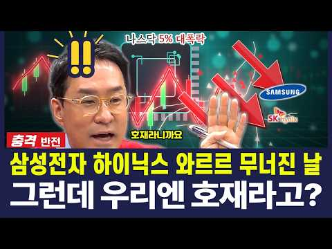
- 챕터: 0:00 하이라이트 — 마이크론 증설 중단, 우리 입장에선 호재 · 0:21 [경제야놀자 해설] 나스닥 하루 5% 급락 · 0:37 나스닥 하루 5% — 2020년대 6~7번뿐 · 1:22 카더라만으론 5% 안 빠진다 · 30분마다 악재 · 2:28 [경제야놀자 해설] 흔치 않은 5% 급락 · 2:54 CAPEX 총액 축소, 처음 나온 자극적 헤드라인 · 3:38 마이크론 대만 신규 건설 중단 · 협상용? · 4:29 헤지펀드 청산 보도 · 앤스로픽 상장 회의론 · 5:49 [경제야놀자 해설] 시장을 때린 뉴스 4가지 · 6:09 아이렌은 잘된다 · 축소 아닌 관리 강화 · 7:42 치킨게임 앞둔 우리엔 땡큐 · 9:01 [경제야놀자 해설] 걷어내고 보니 · 9:21 좋은 소식도 — 구글 170억불 추가 투자 · 9:36 결론 — 걷어내면 이 정도 충격 아닐 수도 · 10:15 [경제야놀자 해설] 오늘의 세 줄 정리
- 설명 앞부분: 5%. 나스닥이 하루에 빠진 폭입니다. 박시동 평론가는 2020년대 들어 이만큼 빠진 날이 여섯, 일곱 번뿐이었고, 대부분 코로나나 관세 같은 큰 사건이 있던 날이었다고 했습니다. 이번엔 큰 사건 대신 의구심 섞인 뉴스가 30분에 하나꼴로 쏟아졌습니다. MS의 아이렌 CAPEX 축소, 엔스케일 확장 옵션 포기, 마이크론 대만 공장 신규 건설 중단, 헤지펀드 청산 보도까지요. 하나씩 걷어내 보면 그림이 달라집니다. 아이렌은 실적 발표 뒤 12%대 급등했고, 엔스케일은 전력이 안 들어와 확장을 미룬 것이라 MS 쪽은 축소가 아니라 관…
- 대본 없음 (설명) — 음성인식이 끝나면 도입부·흐름이 들어감
- 댓글 149/149: 좋은 점 — 영상 0 · 감사·응원 1 · 더 알고 싶은 것 1 · 아쉬운 점 — 영상 0 · 반박·불만 — 의견 다름 4 · 정치·사회 8 · 경험 공유 6 · 구독·다음 기대 0
  - 감사·응원 👍1 “삼성 예전에 4년 물린적도 잇엇다 버텨라 장기 예금 넣엇다 생각하고 화이팅”
  - 더 알고 싶은 것 👍1 “이놈들 방송 봐주는 이유- 오늘 또 어떤 말을 씨부리나 궁금해서”
  - 반박·불만 — 의견 다름 👍9 “이 양반은 헛소리가 너무 심하네 9천에서 꼬라박을때도 사라 5천에서 7천 다시 반등하니 싸다 사라 이 두인간 정말 양심없네”
  - 반박·불만 — 의견 다름 👍0 “맛간것 놀음판에 수금이 무너지면 호재는 헛소리”
  - 정치·사회 👍8 “민주당이 태클걸어 ai패권이 중국한테 넘어가면 젓되는거야~~”
  - 정치·사회 👍0 “정신차려라, 그동안 실적이 안좋았나, 기술개발이 퇴보했나, 투자등.. 현재 시장은 매수자가 없다, 기관 외국인 년말 차익 실현이다.. 코스피 4000까지 간다 M&A가 없다면, 잡주를 누가 사냐”
  - 경험 공유 👍2 “나도 길게 봤을때는 아주좋은 호재입니다~ 내년까지는 최소한 기다립시다 ㅎ”
  - 경험 공유 👍0 “ㅋㅋㅋㅋㅋ우리나라 왜이런지 방구석 전문가인 제가 한말 하겠습니다. 우리나라 거래대금 상위권이 전부다 레버리지 인버스 ETF입니다. 이게 한국인들 도박 충동을 일으킴 왜냐구요? 차트충들이 넘쳐나거든 ㅋㅋㅋㅋㅋ 차트보고 지금 보고 어디선 맞았다 싶으면 한쪽으로 달려가는거…”

### 62. 집은 팔았고, 주식은 물렸고

- https://www.youtube.com/watch?v=SbEfHnF8DdY · 로텐션 LOWTENSIONS · 구독자 7,170 · 조회수 160,986 (×22.4, 하루 3,848.1) · 좋아요 997 (0.6%) · 16.3분 · 2026-10-17 · 주제 묶음 11. 투자 일반 · 형식 브이로그·직접 해본 이야기 · 폴더 `W_SbEfHnF8DdY` (웹 승인)
- 썸네일: 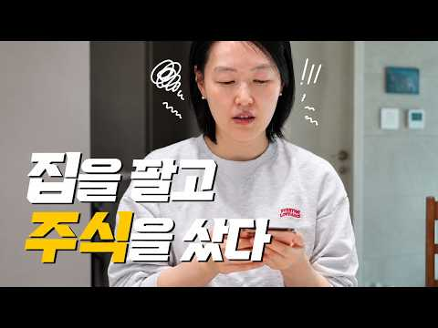
- 설명 앞부분: 집을 팔고 이사까지 마치니 이제 조금은 마음 편히 지낼 수 있을 줄 알았는데, 인생은 늘 예상과 다르게 흘러가네요. 집을 팔고 주식을 샀습니다. 집은 잘 팔았는데, 주식은 잘못 산 걸까요. 그래도 일상은 계속됩니다. 출근도 하고, 밥도 먹고, 이번 영상에는 그렇게 흘러가는 저희 부부의 평범한 일상을 담았습니다. 오늘도 함께해 주셔서 감사합니다. 제이 & 윤 [Video Source Support] Youtube channel "freeticon" : / freeticon
- 같은 채널 평소 대비 ×14.3 (채널 최근 롱폼 중앙값 11,279회) · 평소 영상: 대만 타이중 현지인 줄서는 맛집만 갔습니다 대만 타이중 먹방 여행 (12,171회) / 집밥 해 먹는 이유 40대 부부 현실적인 한 달 식비 정산 외식 배달 이대로 괜찮은가? … (10,387회)
- 대본 (음성인식(앞 5분), 4.1 음절/초) — 앞부분만, 흐름은 그 안까지 첫 20초: “굉장히 밑에로 없습니다. 위기에 난다. 코리아 서키트를 앤엑스트에서 설해 보고 흔들었더니 역시 줄때 먹어야 된다. 주식도 밥도 줄때 먹어야 된다. 느닷없이 집이 팔려 후다닥 이사한 지도 어느덧 한 달이 넘었다. 이제는 제법 익숙해진 새 집에서”
- 첫 1분: “굉장히 밑에로 없습니다. 위기에 난다. 코리아 서키트를 앤엑스트에서 설해 보고 흔들었더니 역시 줄때 먹어야 된다. 주식도 밥도 줄때 먹어야 된다. 느닷없이 집이 팔려 후다닥 이사한 지도 어느덧 한 달이 넘었다. 이제는 제법 익숙해진 새 집에서 밥도 해 먹고 집 팔고 남은 돈으로 주식도 사며 평범한 일상을 이어가는 중이다. 숱을 갈아입고 나와면 안경을 벗고 안경 벗고 가야지. 아니, 안경을 벗는 게 거의... 에이프지. 이건 너무 안경. 제인의 안경을 웃으면 큰일 났지. 안경을 껴야 됐어. 괜찮아. 죄송합니다. 남편 제인의 뽀로로와 유재성만큼 안경이 필수다. 안경 껴야 돼. 항상 껴와. 시라소니 같애는 시라소니. 그냥 못 껄 껄 본 것 같아. 어디서 이렇게 진정하면 안 돼? 아카수너.”
- 흐름 (90초마다 첫 문장): 0:00 굉장히 밑에로 없습니다. 위기에 난다. → 1:30 이게 아이콘 XS인가? → 3:00 훨씬 더 이쁘다는 생각이 드는 거야. → 4:33 우리에겐 우리 집이 최고의 커피 맛집이다.
- 댓글 185/206: 좋은 점 — 영상 1 · 감사·응원 14 · 더 알고 싶은 것 2 · 아쉬운 점 — 영상 1 · 반박·불만 — 의견 다름 2 · 정치·사회 8 · 경험 공유 19 · 구독·다음 기대 3
  - 좋은 점 — 영상 👍11 “주식을 오래하고 꾸준한 수익을 원한다면 외부의 귀을 닫고 나만의 방법이 필요한데 화려하지도 않고 큰 기술이 필요하지도 않습니다. 단순합니다. 욕심부리지 않고 돈을 차갑고 신중히 한번 더 생각하고 다루어라!! 고점에서 떨어지는 종목은 쳐다 보지도 말아라 미련을 버려라 …”
  - 감사·응원 👍22 “저도 주식 너무 팔고 싶네요😂 상승장 언능타고 제이님 입맛 돌아오시길 바랄께요! 우리 모두 화이팅해요!”
  - 감사·응원 👍13 “어떤 인내심보다 주식을 하면서 진짜 인내심을 배우고 있습니다. ㅎㅎ 제 이야기 하시는줄 알았어요. 오늘도 소중한 영상 고맙습니다. ^^ 항상 건강 및 행복하세요!! 응원해요!!”
  - 더 알고 싶은 것 👍22 “악~~! 이렇게 금방 올라오다니 선물같고 너무 좋네요. 로텐션 영상 너무 제 취향입니다. 오늘도 여러편 또 보고.. 앞으로도 빠른 업데이트 많은 영상 부탁드립니다~😊”
  - 더 알고 싶은 것 👍0 “얼마정도를 하시나요?? 힘내세요”
  - 아쉬운 점 — 영상 👍8 “60대고 2천~3천 정도로 주식하는데 사팔사팔 하면서 하루를 보내니 지루하지 않네요. 마이너스도 있지만 기다리면 오겠죠. 이러고 세월 보냅니다.”
  - 반박·불만 — 의견 다름 👍3 “그렇게 사팔사팔하는건 투기지 투자가 아닙니다. 투자는 펀더멘탈 좋은 코스피 우량주 사서 가다리는거여ㅣ요. 부동산도 하루하루 보는게아니듯 주식도 그래요. 그리고 그때그때 뷰가 바뀌면 방향도 수정해야해요. 단기간 승부를 보려는건 위험해요. 되도록 코스닥으 하지말고 시총이…”
  - 정치·사회 👍11 “이재명이 해냈구나 집팔아 주식하라 니덜 인생 조진거 같다”
  - 정치·사회 👍8 “어머나, 이리 빨리 영상이 올라오면 구독자는 너무 좋잖아요❤ 하얀색 바탕에 때가 타면 정말 참을 수 없는데😂 어서 빨리 매직블럭 찾으셨으면 좋겠어요! 제이님이 타 주시는 커피엔 비할 수 없겠지만, 커피 내리기 귀찮으실 땐 루카스나인 카페라떼도 추천드려요☕️ 주식은 정…”
  - 경험 공유 👍22 “저도 주식 너무 팔고 싶네요😂 상승장 언능타고 제이님 입맛 돌아오시길 바랄께요! 우리 모두 화이팅해요!”
  - 경험 공유 👍12 “부러우면 지는 거라던데, 남이 해준 아침밥 언제 먹어봤는지 기억이 안나네요.😢 저도 백수 5개월차 전업투자 합니다. 종목거래는 수수료가 많아 ETF로 차트 봐가며 스캘핑. 저한테는 그게 딱 맞더라구요, 큰 하락도 피할수 있고. 처음 보는 채널인데 뭔가 공감도 되고 두…”
  - 구독·다음 기대 👍12 “부러우면 지는 거라던데, 남이 해준 아침밥 언제 먹어봤는지 기억이 안나네요.😢 저도 백수 5개월차 전업투자 합니다. 종목거래는 수수료가 많아 ETF로 차트 봐가며 스캘핑. 저한테는 그게 딱 맞더라구요, 큰 하락도 피할수 있고. 처음 보는 채널인데 뭔가 공감도 되고 두…”
  - 구독·다음 기대 👍6 “오늘 처음 알고리즘타서 잼나게 보고 구독합니다~^^ 50대 후반이데 1억 5천 정도를 한계좌에 물을 타지 않고 물리면 다른 계좌 터서 사기를 10여개가 넘는다는..ㅋ 계좌마다 시체들이 그득 그득하지만 삼성전자니까 하고 물린계좌 끌어안고 기다립니다ㅋ 일상적이지만 우리들…”

### 63. 주식 투자 공부 ∣ 주식으로 인생 망하는 사람들의 공통점 #주식투자공부 #주식 #투자공부 #빚투 #투자 (자산 관리 템플릿 무료 증정)

- https://www.youtube.com/watch?v=EqDWhvLTARA · 방구석 금고지기 · 구독자 195 · 조회수 14,178 (×72.7, 하루 104.4) · 좋아요 312 (2.2%) · 9.9분 · 2026-07-15 · 주제 묶음 11. 투자 일반 · 형식 인터뷰·강연·대담 · 폴더 `W_EqDWhvLTARA` (웹 승인)
- 썸네일: 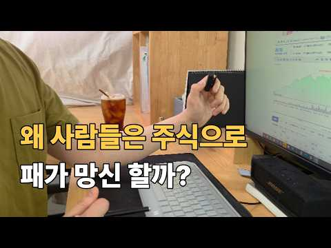
- 챕터: 0:00 왜 사람들은 주식으로 인생이 망할까? · 1:49 비기너스 럭과 과신의 시작 · 3:42 과신이 만든 레버리지와 빚 투자 · 5:01 손절 실패와 복수 매매의 함정 · 6:55 반대매매, 그리고 시장을 떠나는 사람들 · 8:35 살아남는 투자자가 결국 돈을 번다
- 설명 앞부분: 이 영상은 단순히 돈을 잃는 이유를 설명하는 것이 아니라, 개인 투자자가 왜 결국 시장을 떠나게 되는지를 이야기합니다. 주식 투자 공부를 시작한 많은 사람들이 처음에는 수익보다 불안과 조급함에 흔들립니다. 그래서 주식 투자 공부할때 가장 중요한 것은 종목 선택보다 자신의 심리를 이해하는 일입니다. 지금 투자 중이거나 앞으로 투자를 시작하려는 분이라면, 이 영상을 통해 실패의 패턴을 점검해 보세요. 장기적으로 살아남는 투자자가 되기 위해 꼭 알아야 할 내용이며, 꾸준히 주식 투자 공부 후 실천하는 분들에게 특히 도움이 될 것입니다.
- 같은 채널 평소 대비 ×51.2 (채널 최근 롱폼 중앙값 277회) · 평소 영상: 이 소비 5가지만 끊었는데 1억이 모였습니다 (모르면 평생 돈 못 모읍니다) (380회) / 왜 남자는 주식을 할수록 돈을 잃을까? #주식 #투자 #재테크 (390회)
- 대본 없음 (설명) — 음성인식이 끝나면 도입부·흐름이 들어감
- 댓글 39/39: 좋은 점 — 영상 1 · 감사·응원 1 · 더 알고 싶은 것 0 · 아쉬운 점 — 영상 1 · 반박·불만 — 의견 다름 1 · 정치·사회 0 · 경험 공유 4 · 구독·다음 기대 0
  - 좋은 점 — 영상 👍3 “피와살이되는 좋은정보네요 감사합니다”
  - 감사·응원 👍3 “피와살이되는 좋은정보네요 감사합니다”
  - 반박·불만 — 의견 다름 👍8 “저도 평생 예적금만 하다가 지난달에 고점에 들어가서 현재 마이너스 80입니다... 스트레스 장난 아닙니다..”
  - 경험 공유 👍8 “저도 평생 예적금만 하다가 지난달에 고점에 들어가서 현재 마이너스 80입니다... 스트레스 장난 아닙니다..”
  - 경험 공유 👍0 “내가 사기로 보는 100%인 것들 1.주식 2.코인 3.스포츠 토토 4.경마 5.다단계 6.지인.타인 돈거래 7.빚보증 8.기획 부동산 매입 9.전세 부동산 거래.계약 끝”

### 64. 레버리지 ETF 상장폐지 논란🔥도박판 코스피 알고도 레버리지 ETF 상폐 못하는 이유🔥위험 알고도 도장 찍은 사람🔥금리인상 악제🔥역대급 반도체 실적 국민돈증발🔥…

- https://www.youtube.com/watch?v=O4-jY0zyhDo · 리얼경제 · 구독자 1,330 · 조회수 93,698 (×70.5, 하루 699.2) · 좋아요 2,368 (2.5%) · 15분 · 2026-07-17 · 주제 묶음 9. 빚투·레버리지 · 형식 정보·해설 (그 밖) · 폴더 `W_O4-jY0zyhDo` (웹 승인)
- 썸네일: 
- 챕터: 0:00 인트로 — 89조 잔치인데 국민 돈은 증발 · 0:44 검은 월요일 — 올해만 서킷브레이커 7번 · 2:01 범인의 등장 — 5월 27일 상장된 그 '상품' · 3:35 세 개의 함정 — 왜 도박판이 됐나 · 7:07 대(大)아이러니 — 실적 최대인데 주가 최대 폭락, … · 9:44 앞으로 어떻게 되나 — 상폐 못 하는 이유와 정부의 … · 13:31 착지 — 호황의 나라에서 국민이 죽는다
- 설명 앞부분: 🔎 삼성전자가 2분기 영업이익 89조 4천억 원으로 3분기 연속 최대를 기록하고, 7월 반도체 수출은 193% 폭증해 사상 최대를 찍었습니다. 나라는 반도체로 호황입니다. 그런데 바로 그 삼성전자와 SK하이닉스를 '미끼'로 만든 단일종목 레버리지 ETF에 국민 돈 10조 원이 넘게 묶인 채 녹아내리고, 올해에만 서킷브레이커가 일곱 번 울렸습니다. 실적은 최대인데 주가는 최대 폭락하는 기막힌 아이러니. 세계 1등 실적을 낸 나라에서 어쩌다 국민이 도박판에 앉게 됐는지, 레버리지 ETF의 세 가지 함정(복리손실·지수 착시·리밸런싱 증…
- 같은 채널 평소 대비 ×495.8 (채널 최근 롱폼 중앙값 189회) · 평소 영상: 삼성노조가 800조 호남 반도체 메가프로젝트 막아선 진짜 이유...부메랑 노란봉투법 삼성… (189회) / 엔비디아 손잡은 네이버 집중분석🔎아시아 AI 인프라회사로?🔥14조 유치🔥GPU 6만장🔥1… (147회)
- 대본 (음성인식(앞 5분), 5.5 음절/초) — 앞부분만, 흐름은 그 안까지 첫 20초: “여러분 지금 우리나라는 반도체로 잔치집입니다. 삼성전자가 한분기에 89조를 벌었어요. 3분기 연속, 역대 최대입니다. 그야말로 세계가 우리 반도체 앞에 앞다터 줄을 선 거예요. 그런데 말입니다. 바로 그 삼성을 믿기로 만든 어떤 상품에 지금 국민 돈 10조가 도박판처럼 놓고 있습니다. 올해에만 주식거래를 통째로 멈춰세우는 비상벨이 7번 울렸어요.” — 도입부 유형: 시청자 부르기
- 첫 1분: “여러분 지금 우리나라는 반도체로 잔치집입니다. 삼성전자가 한분기에 89조를 벌었어요. 3분기 연속, 역대 최대입니다. 그야말로 세계가 우리 반도체 앞에 앞다터 줄을 선 거예요. 그런데 말입니다. 바로 그 삼성을 믿기로 만든 어떤 상품에 지금 국민 돈 10조가 도박판처럼 놓고 있습니다. 올해에만 주식거래를 통째로 멈춰세우는 비상벨이 7번 울렸어요. 모두가 외칩니다. 그 상품, 없애버리라고. 그런데 당국은 답합니다. 뾰족한 수가 없다, 두 손을 든 겁니다. 세계 1등 실적을 낸 나라에서 왜 국민만 도박판에 앉았을까요? 그리고 이 판, 앞으로 대체 어떻게 되는 걸까요? 오늘 그 이야기 처음부터 끝까지 아주 속시원이 다 풀어드리겠습니다. 지금 바로 시작합니다. 2026년 7월 13일 사람들이 검은 월요일이라 부르는”
- 흐름 (90초마다 첫 문장): 0:00 여러분 지금 우리나라는 반도체로 잔치집입니다. → 1:31 20분 동안 모든 거래를 강제로 멈춰 세우는 → 3:00 도박의 판 돈이 붙은 셈이죠. → 4:30 그 출렁임 자체가 비용이 돼서
- 댓글 648/648: 좋은 점 — 영상 2 · 감사·응원 10 · 더 알고 싶은 것 1 · 아쉬운 점 — 영상 1 · 반박·불만 — 의견 다름 5 · 정치·사회 150 · 경험 공유 17 · 구독·다음 기대 0
  - 좋은 점 — 영상 👍1 “유익한 정보 감사합니다 ㅎㅎ”
  - 좋은 점 — 영상 👍1 “좋은 설명이네.”
  - 감사·응원 👍4 “자세한 설명 감사합니다 아무리 실적 좋아도 레버리지 2배 때문에 주식시장을 쑥대밭을 만드네요 매일 서커브레이크 카지노 도박판 실적분석 필요없어요 코스닥 돈빼 레버리지 산다고합니다 아휴 답답 한숨 정부지도자들 자기들은 강건너 불구경 힘드네요”
  - 감사·응원 👍1 “감사합니다.”
  - 아쉬운 점 — 영상 👍1 “왜? 이렇게 Ai목소리가 듣기싫지 직접방송하라”
  - 반박·불만 — 의견 다름 👍1 “헛소리 그만하고 오늘 일단 3일 연속 써킷 갑니다.”
  - 반박·불만 — 의견 다름 👍1 “외국주식시장은 레버리지 2배이상짜리도 많은데 어떻게 돌아가냐 미국주식시장 같으면 벌써 망했어야 정상아니냐~ 선전선동질 그만해라 그놈의 남탓 ㅋㅋㅋㅋ”
  - 정치·사회 👍135 “이상품에 직접투자한 사람들만의 손실이 문제가 아니다ㆍ덕분에 수급쏠림으로 인한 코스닥의 붕괴다ㆍ챠트를보면 전쟁터진 나라보다 더 폭락해버렸다ㆍ그리고 정부는 모르쇠로 일관ㆍ배신감이 분노로 바뀌고 결국 정부의 정체성까지 의심하고있다ㆍ머슴이 주인을 물어뜯고 과연 무사할까?”
  - 정치·사회 👍82 “이정부는 결국 주식으로 국민의 신뢰를 얻다가 주식으로 신뢰를 잃어가고 망해가고있네 참 세상이 아이러니하네”
  - 경험 공유 👍19 “도박 좋아하는 놈들이 정책을 해서. 나라 전체를 강원랜드로 만들고 .저평가 가치주까지 다른 종목 다 반토막. 미장은 이렇게 안 망가졌다. 내가 하면 투자.니가 하면 투기”
  - 경험 공유 👍10 “이래서.. 내가 국내주식을 안하는 이유다 미국우량주식만 장기매수하는 거 그 게 그나마 맘편하다”

### 65. "지금 실적보다 미래 경쟁력이 진짜 걱정"..'위기'라는 현대차 상황 / 이슈빡 / 뉴스헌터스

- https://www.youtube.com/watch?v=RYJSFU8X2hE · 뉴스헌터스 · 구독자 9,920 · 조회수 200,293 (×20.2, 하루 5,141.9) · 좋아요 353 (0.2%) · 18.4분 · 2026-10-20 · 주제 묶음 6. 종목 고르기·분석 · 형식 인터뷰·강연·대담 · 폴더 `W_RYJSFU8X2hE` (웹 승인)
- 썸네일: 
- 설명 앞부분: [뉴스헌터스] ■ 진행 : 김종원, 윤태진 앵커 ■ 대담 : 권순우 (삼프로TV 본부장), 이재일 (유진투자증권 자동차 애널리스트) 지난 15일(현지시간) 미국서 공개된 테슬라 로드스터. 거꾸로 달리고 공중 회전까지 하는 모습으로 발표 당일 놀라움을 준 데 이어 각종 AI 패러디까지 쏟아져 나오면서 화제를 이어가고 있습니다. 테슬라는 지난 9월 국내에서 가장 많이 팔린 승용차이기도 한데요, 이럴수록 속 타는 건 현대차가 아닐까요. 가성비에서도 자율주행에서도 밀리는 모양새인데, 주가가 고점 대비 60%나 빠진 현 상황을 타개할 카드…
- 대본 없음 (설명) — 음성인식이 끝나면 도입부·흐름이 들어감
- 댓글 464/464: 좋은 점 — 영상 1 · 감사·응원 4 · 더 알고 싶은 것 0 · 아쉬운 점 — 영상 1 · 반박·불만 — 의견 다름 8 · 정치·사회 15 · 경험 공유 11 · 구독·다음 기대 0
  - 감사·응원 👍121 “ㅋㅋㅋ 일론 머스크가 한국에 있었으면 매년 국정감사에 나왔을 거라는 말에 빵 터짐.”
  - 감사·응원 👍12 “테블릿 하나 넣고 계기판 빼면서 몇백 올리고… 자율주행 시대에 앞시트 돌아간다고 자랑하는 현대차 ㅋㅋㅋ 화이팅!”
  - 반박·불만 — 의견 다름 👍1 “경쟁력을 높이기 위해 방법을 찾아서 해결을 할 생각을 해야지 수입을 막아야 한다? 이 뭔 개소리야? 이런 놈들이 방송에 나와서 헛소리 하는 것을 들어야겠냐? 정말 한심하다”
  - 반박·불만 — 의견 다름 👍1 “아반테 4300에 내 놓고, 투싼 가격 못 내놓다가..... 찌라시로 5천 넘게 중고차 사이트로 뿌리고.... 실제 가격은 4700으로 내놓으니.... 유튜버들 와~ 싸게 나왔다 ㅋㅋㅋㅋㅋㅋㅋ 조삼모사 길들이는 것도 아니고 ㅋㅋㅋㅋㅋ 뭐 이런 바보들이 다 있는지...…”
  - 정치·사회 👍2 “현기차 망한다고 정부에서 세금 지원.뻔한거지....국내에서 경쟁자가 없다보니 해마다 가격 쳐 올리고 옵션 장난질이나 하고....그러다가 골로 가는거지.차 품질도 원가절감 한다고 알게모르게 하나씩 빼버려...”
  - 정치·사회 👍1 “현대 기아차 판매 부진은 노조들의 책임이 크다. 많은 복지 혜택을 받으면서도 일을 제대로 하지 않고 사사건건 회사 발전에 방해만 하는 자들이다. 이러한 방대한 노조의 권한들을 도운 자들이 바로 민주당 좌파정권들이다. 노동법, 노조법, 최저임금법 등 법률을 만들어 충분…”
  - 경험 공유 👍4 “나도 전기차 타지만. 테슬라에서 내연기관 차량도 많들어 줬으면 좋겠다.”
  - 경험 공유 👍3 “저런 소형차 탈거 같은가? 미래는 피지컬 로봇과 같이 이동해야기 때문에 소형차는 없어지지?내가볼땐 딱 10년짜리.”

### 66. 데드캣 바운스일까 vs 대반등의 신호탄일까 ∣ 1994년 이후 반도체 10% 폭락 열 번이 말해 주는 것 ∣ 개인은 팔았고 기관은 받았다

- https://www.youtube.com/watch?v=x0-ObXRPfJA · 뉴욕대디 다니엘 · 구독자 15,400 · 조회수 155,823 (×10.1, 하루 7,391.3) · 좋아요 1,850 (1.2%) · 13.8분 · 2026-11-07 · 주제 묶음 기타 · 형식 정보·해설 (그 밖) · 폴더 `W_x0-ObXRPfJA` (웹 승인)
- 썸네일: 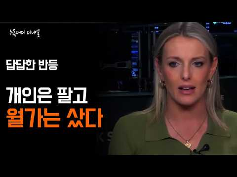
- 챕터: 0:00 오프닝: −5.5%, 그리고 +1.1% · 1:01 현장: 금요일의 숫자 · 2:56 역사: 반도체가 하루 10% 빠진 다음엔 · 4:28 왜 애매했나 ① 개인이 안 샀다 · 6:22 왜 애매했나 ② AI를 기다릴 인내심 · 7:56 왜 애매했나 ③ 차트 · 9:41 좋은 소식: 고용은 탄탄했다 · 11:15 한국: 이틀 동안 −11% · 12:07 반등이 진짜인지 확인할 신호 세 가지 · 12:56 정리
- 설명 앞부분: 안녕하세요, 뉴욕대디 다니엘입니다. 목요일 나스닥은 5.5% 빠졌는데, 금요일 반등은 1.1%에 그쳤습니다. 개장 15분 만에 1.9%까지 올랐다가 힘이 빠졌고, 반도체 지수도 4.2% 오르는 데 그쳤습니다. 많이 아쉽네요.. 그래서 이번 영상에서는 1994년 이후 반도체 지수가 하루 10% 안팎 빠진 날을 실제 종가로 모두 찾아, 그다음에 무슨 일이 있었는지부터 확인해 봤습니다. 그리고 반등이 애매했던 이유 세 가지를 슈왑 전략가들의 목소리로 짚었습니다. 받아 줄 개인 투자자가 오히려 팔았고, AI 투자를 기다릴 인내심이 줄었고…
- 같은 채널 평소 대비 ×15.6 (채널 최근 롱폼 중앙값 10,007회) · 평소 영상: 젠슨황 떠나자마자 중국 수상한 움직임 ∣ AI 반도체 전쟁 중국 이길 방법은 단 하나 ∣… (10,007회) / 반도체 폭락 뒤 반드시 찾아오는 대폭등의 역사, 9배 '파멸적 상승' 월가가 기다리는 단… (10,291회)
- 대본 없음 (설명) — 음성인식이 끝나면 도입부·흐름이 들어감
- 댓글 234/234: 좋은 점 — 영상 7 · 감사·응원 17 · 더 알고 싶은 것 4 · 아쉬운 점 — 영상 6 · 반박·불만 — 의견 다름 3 · 정치·사회 11 · 경험 공유 14 · 구독·다음 기대 3
  - 좋은 점 — 영상 👍16 “정말 유익한 정보입니다 강추”
  - 좋은 점 — 영상 👍11 “바로 구독 박습니다 너무나 쉽게 이해되네요 좋은영상 기대하겠습니다”
  - 감사·응원 👍6 “구독했습니다 이제 시작하는 채널인데 이정도 고퀄리티라니 좋은 인사이트 감사합니다”
  - 감사·응원 👍4 “정보감사요”
  - 더 알고 싶은 것 👍1 “영상 너무 좋네요 많이많이 만들어주세요..! 감사합니다”
  - 더 알고 싶은 것 👍1 “제프리 건들락의 과거 리스크의 내용이 논리적으로 설득력이 있었던거 같습니다~ 제프리 건들락 영상 좀 부탁드립니다”
  - 아쉬운 점 — 영상 👍5 “엔트로피 IPO자금이 1700조원. 우리나라에서 준비금으로 빠질 자금 4%만 잡아도 약 70조. 10월에만 30조 팔고 나갔고, 그 이전부터 준비를 하느라 빼갔을테니, 앞으로 11월중순까지 약 20조 더 빼겠네요. 우리 시장이 나쁘거나, 기업이 안좋아서 팔고 나가는게…”
  - 아쉬운 점 — 영상 👍4 “이거 AI 목소리 인가요 요즘 이 목소리 정말 많던데”
  - 반박·불만 — 의견 다름 👍5 “금요일 미국 증시의 반등이 국내 증시에 아직 반영되지 않았다는 건 부정확한 설명 같습니다. 실제 시장 흐름을 확인하고 영상을 제작하셨으면 합니다. 이미 한국 정규장 시작 전 넥스트레이드 프리마켓에서 하이닉스는 15% 넘게, 삼성전자는 13% 가까이 폭락했습니다. 이후…”
  - 반박·불만 — 의견 다름 👍4 “모르니 쬐끔씩 사는겁니다 누가 알겠어요 과거 데이터로 미래를 글쎄요 그냥 쬐끔씩 사는게 글구 기다리세요 2년이든 3년이든”
  - 정치·사회 👍12 “제 개인적인 생각은 그간 있었던 일 중 가장 유사해 보이는게 2년전 쯤 엔캐리 트레이드 청산된다고 과한 하락이 있었죠 그 당시 ai 초창기였는데 말도 안되는 가격에 거래가 되서 해프닝으로 끝났는데, 이번 중간 선거에서 블루 웨이브로 바뀐 것, 그 이상 아무것도 없을 …”
  - 정치·사회 👍11 “오늘 날짜기준으로 코스피 지수 주가는 고점에서 47% 이상 하락중인데.. 다른 나라 지수들조 조정 중이지만 많이 빠졌어도 20%도 조정이 안왔네요.. 유독 한국 증시만 이렇게 빠진건 지수가 오를때 찢죄명 정부에서 억지로 연기금을 못팔게 통제한 점과 삼전과 하이닉스의 …”
  - 경험 공유 👍5 “금요일 미국 증시의 반등이 국내 증시에 아직 반영되지 않았다는 건 부정확한 설명 같습니다. 실제 시장 흐름을 확인하고 영상을 제작하셨으면 합니다. 이미 한국 정규장 시작 전 넥스트레이드 프리마켓에서 하이닉스는 15% 넘게, 삼성전자는 13% 가까이 폭락했습니다. 이후…”
  - 경험 공유 👍2 “11월말까지 단기매매해야 됩니다 하락 채널 가둘거고요. 전 월요일 본장에서 SOXX 크게 반등 할 확률 높다고 생각해요. 롱 손절매가 엄청나게 나왔고 개인들이 롱에서 숏으로 다 들어갔습니다. 코스피 보면 더 재밌습니다. 외국인은 선물 롱 Oi가 증가하면서 쌓이고 있습…”
  - 구독·다음 기대 👍6 “구독했습니다 이제 시작하는 채널인데 이정도 고퀄리티라니 좋은 인사이트 감사합니다”
  - 구독·다음 기대 👍1 “구독합니다. 도움이 되네요”

### 67. 삼성전자 하이닉스 고점 대비 30~40% 빠졌다, 지금 팔아야 하나? 버핏의 한마디

- https://www.youtube.com/watch?v=3k8pAgOmcF4 · 경제야! 놀자~ · 구독자 11,400 · 조회수 125,743 (×11.0, 하루 5,419.6) · 좋아요 505 (0.4%) · 11.3분 · 2026-11-05 · 주제 묶음 5. 국내주식 · 형식 정보·해설 (그 밖) · 폴더 `W_3k8pAgOmcF4` (웹 승인)
- 썸네일: 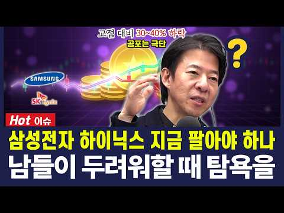
- 챕터: 0:00 하이라이트 — 고점 대비 30~40%, 손실 50% … · 0:19 [경제야놀자 해설] 고점 대비 40% 하락 · 0:38 삼성전자 하이닉스 들고 있다면 어떻게 대응할까 · 1:23 금리 내려도, 전쟁 끝나도 안 오른다 · 공포는 극단 · 2:48 빅테크는 반등했는데 반도체만 빠진다 · 3:48 [경제야놀자 해설] 공포는 극단 · 4:04 박시동 — 돈이 제일 많다 · 2029년까지 문제없다 · 5:31 이해 안 되는 흐름 · 싸게 사 가려는 꼼수? · 6:41 [경제야놀자 해설] 돈도 수요도 이상 없다 · 6:59 버핏 2008년 — 남들이 두려워할 때 탐욕스러워져라 · 9:08 공포에 반대로 선택하면 또 다른 실수 · 9:38 [경제야놀자 해설] 버핏의 한마디 · 9:53 감내할 손실을 정하고, 그 아래면 비중 줄이기 · 10:33 [경제야놀자 해설] 오늘의 세 줄 정리
- 설명 앞부분: 삼성전자, SK하이닉스를 들고 계신다면 지금 팔아야 할까요, 버텨야 할까요? 이광수 대표는 고점 대비 30~40% 빠졌고 이제 50%를 향해 가는 지금, 이 고민을 하는 분이 많을 거라고 했습니다. 금리가 내려도, 전쟁이 끝난다는 소식에도 반도체만 빠지는 흐름을 두고는 "일종의 공포는 극단"이라고 봤습니다. 박시동 평론가의 진단은 조금 결이 다릅니다. 메모리 회사들은 지금 돈이 가장 많고, 2029년까지 잡힌 수요에도 문제가 없다는 겁니다. 이광수 대표가 꺼낸 건 워런 버핏이 2008년 10월 뉴욕타임스에 남긴 글이었습니다. 남들…
- 대본 없음 (설명) — 음성인식이 끝나면 도입부·흐름이 들어감
- 댓글 168/168: 좋은 점 — 영상 1 · 감사·응원 1 · 더 알고 싶은 것 1 · 아쉬운 점 — 영상 0 · 반박·불만 — 의견 다름 4 · 정치·사회 6 · 경험 공유 4 · 구독·다음 기대 0
  - 좋은 점 — 영상 👍0 “그놈의 버핏 이야기 그만하시고 도움되는 말이나 하세요”
  - 감사·응원 👍0 “감사합니다. 바로 오늘이 가장 두려운 시점인듯해요.”
  - 더 알고 싶은 것 👍0 “이양반들 삼전 닉스 평단가가 궁금하다”
  - 반박·불만 — 의견 다름 👍6 “헛소리 그만 하세요”
  - 반박·불만 — 의견 다름 👍1 “아직도 선동이냐?”
  - 정치·사회 👍2 “선한 의도로 매수를 주장할지라도 그게 나쁜 결과를 줄 수 있습니다. 외국인들은 뭐 몰라서 던질까요? 선생님들 보는 지표 다 보고 그 이상도 전망하면서 던지는 거 아닐까요? 미장도 반도체만 이미 약세장 진입했어요. 툭하면 저PER이 어쩌고 저쩌고 하는데 솔직히 그 저P…”
  - 정치·사회 👍0 “국장 농락하는건 외국인이라니깐.여기에 초점맞춰서 대책세워라”
  - 경험 공유 👍2 “반도체 투자 안해보셨나.. 장기투자 해본 경험상 고점치고 3~4년 하락횡보 해야지 다시 신고가 나오더라. 반도체 시장이 커진다는것을 믿는다면 4년 기다려 보셔.”
  - 경험 공유 👍1 “저도 돈이 많지는 않습니다. 주식에 넣은것도 많지 않구요 근대 지금까지 그래도 손해 안보고 팔거나 뭐 수익 본이유가 단타 할줄도 모르고 그저 대기업 삼성 LG 가등등 이런 기업에 장기 투자로 벌었습니다. 여러분 적금이라 생각하고 빠질때는 구입보다 그냥 가만히 계셔요.…”

### 68. "AI가 문제가 아니다!" 지금 전 세계 증시가 무너지는 진짜 이유 (Feat. 김효진 신영증권 박사) [딥플 Deep-ple]

- https://www.youtube.com/watch?v=uuePBzam50g · 핀플 - Finple · 구독자 48,500 · 조회수 164,378 (×3.4, 하루 22,420.5) · 좋아요 1,416 (0.9%) · 46.6분 · 2026-11-21 · 주제 묶음 기타 · 형식 인터뷰·강연·대담 · 폴더 `W_uuePBzam50g` (웹 승인)
- 썸네일: 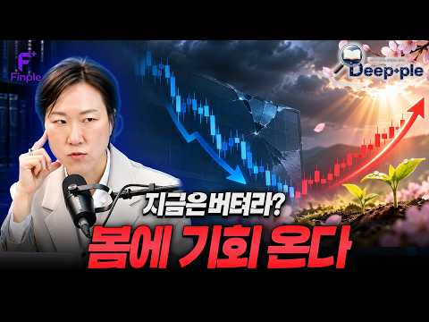
- 설명 앞부분: 본 영상은 11월 19일에 녹화 된 영상입니다 [핀플X엄마표요리] 🍜26년전통 귀빈정 통오징어 짬뽕탕 2인분 740g 양질의 제품을 가장 저렴하게 만나는 핀플이 만든 쇼핑몰! [핀플마켓 강력추천] 🥚난각번호 1번 자연방사 유정란 대·특란 초란 (20구/40구/60구) [핀플마켓 추천상품] 🛏️플래비안 카본 워셔블 디지털 전기요 다이아·헤링본 2종 🍠2026년 해남 햇 꿀고구마 특상 (3kg/5kg/10kg) 🛏️루나온 그래핀 발열 이불 (SS / Q) 💊뉴트리원 최저가 모음전 🥔강원도 감자 옹심이/장칼국수 7/10인분 (감자전 증…
- 같은 채널 평소 대비 ×49.7 (채널 최근 롱폼 중앙값 3,310회) · 평소 영상: 코스피 5천선마저 위험하다! 외국인이 삼성전자·SK하이닉스를 집중 매도하는 이유 [더 파… (3,310회) / 삼성전자·SK하이닉스 역대급 실적인데 주가는 왜 빠질까? 짚은 진짜 문제 [더 파이널 콜… (3,092회)
- 대본 없음 (설명) — 음성인식이 끝나면 도입부·흐름이 들어감
- 댓글 239/239: 좋은 점 — 영상 0 · 감사·응원 4 · 더 알고 싶은 것 4 · 아쉬운 점 — 영상 2 · 반박·불만 — 의견 다름 7 · 정치·사회 13 · 경험 공유 16 · 구독·다음 기대 0
  - 감사·응원 👍2 “감사합니다!!!김효진 박사님!!”
  - 감사·응원 👍1 “통찰력 있는 정보 감사드립니다”
  - 더 알고 싶은 것 👍0 “금리 인상은~ 단발이다! 외쳤던 그녀는 여의도 전문가가 맞나요?”
  - 더 알고 싶은 것 👍0 “너무 길다. 무너지는 이유는 언제 나오나요?”
  - 아쉬운 점 — 영상 👍13 “무슨소린지 결론이 없는 소리만 주저리 주저리”
  - 아쉬운 점 — 영상 👍0 “너무 길다. 무너지는 이유는 언제 나오나요?”
  - 반박·불만 — 의견 다름 👍9 “1분뒤 지운명도 모르면서. 기본적으로 난 모르다 이걸 전제로 이야기 해야지 뭐있는것처럼 희망고문해서 개미들 다 밖살낸 자칭 유튜브 전문가들..개미들 증시 떠난면 다 굶어 죽을것들이라 절때 손절이나 분할매도 하라고 하지 않지.. 난 3억 5천 전부 9천부터 팔기시작해서…”
  - 반박·불만 — 의견 다름 👍3 “이 분도 상반기에 아주 크게 대차게 틀렸음. 즉, 들으나마나한 소리다 이거죠 참고도 안됨”
  - 정치·사회 👍18 “방송은 책임을 느껴야 합니다. 유튜브라는 가벼운 소통창구지만 누군가는 이런 방송을 보고 투자를 합니다. 투자는 개인의 책임이란 말을 좋아하지 않습니다. 그 매수하는 과정의 의사결정속에 당신들의 의견이 없을거 같습니까?? 입으로 먹고 사는 사람중 진실을 말하는 자는 누…”
  - 정치·사회 👍13 “그넘의버텨라는... 11월초만해도 미국선거후 랠리다 하더니 내년봄? 하락각도가 계속 내년봄까지 가면 지수 2천대가있겠다. 재명이는 활화산에 기름칠하더니 개쫄아서 나서야할때는 못나서내 병진임”
  - 경험 공유 👍65 “나도 전문가, 나도 박사”
  - 경험 공유 👍18 “방송은 책임을 느껴야 합니다. 유튜브라는 가벼운 소통창구지만 누군가는 이런 방송을 보고 투자를 합니다. 투자는 개인의 책임이란 말을 좋아하지 않습니다. 그 매수하는 과정의 의사결정속에 당신들의 의견이 없을거 같습니까?? 입으로 먹고 사는 사람중 진실을 말하는 자는 누…”

### 69. "환율 떨어지면 좋은 거 아니었나요?" 1,560원에서 1,390원까지, 내 통장에 실제로 벌어진 일

- https://www.youtube.com/watch?v=6xWwJbLDnVc · 돈의 행방 · 구독자 742 · 조회수 32,164 (×43.4, 하루 324.6) · 좋아요 655 (2.0%) · 18.9분 · 2026-08-21 · 주제 묶음 4. 미국·해외주식 · 형식 정보·해설 (그 밖) · 폴더 `W_6xWwJbLDnVc` (웹 승인)
- 썸네일: 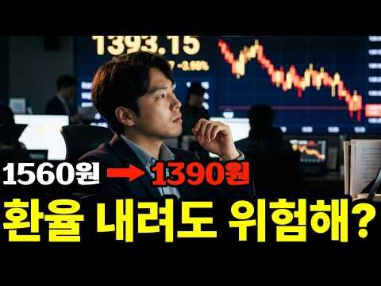
- 설명 앞부분: 두 달 반 만에 1,562원에서 1,392원까지, 178원이 내려왔습니다. 그런데 왜 아무도 웃지 않을까요. 환율이 내려간 진짜 이유와, 지금 여러분이 은행 앱에서 확인해야 할 네 가지를 정리했습니다. 이 영상에서 다루는 내용 사상 최고점은 1,600원이 아니라 1,562.47원이었습니다. 기억이 부풀려진 이유 미국이 금리를 내린 게 아닙니다. 미 정책금리는 3.50~3.75% 그대로, 오히려 한국은행이 7월 16일에 2.50%→2.75%로 올렸습니다 6월 경상수지 497.3억 달러 사상 최대인데 시장엔 달러가 없었던 이유 — 수…
- 같은 채널 평소 대비 ×139.2 (채널 최근 롱폼 중앙값 231회) · 평소 영상: "1년에 정전 9분이라고?" 한국에서 정전이 사라진 진짜 이유 (231회) / "바닷물을 다 빼 봤더니" 빙하기 황해는 통째로 땅이었는데 대한해협만 끝내 안 막힌 진짜… (221회)
- 대본 없음 (설명) — 음성인식이 끝나면 도입부·흐름이 들어감
- 댓글 59/59: 좋은 점 — 영상 0 · 감사·응원 0 · 더 알고 싶은 것 0 · 아쉬운 점 — 영상 0 · 반박·불만 — 의견 다름 3 · 정치·사회 3 · 경험 공유 1 · 구독·다음 기대 0
  - 반박·불만 — 의견 다름 👍32 “남조선 선전선동부 이완룡총재는 서학개미 탓이랬지 하닉 adr을꼼짝 없이 내놓으니 잠시 주춤 언발에 오줌눈거다”
  - 반박·불만 — 의견 다름 👍11 “환율 폭등 나라 망한다.고 선동하는 매국 YouTube. 매국 댓글이 넘쳐나더니 이제는. 내려간다고. 나라 망한다고 지랄발광 선동하러나”
  - 정치·사회 👍0 “환율 오를때 국격 상승한다던 좌빨. 내리니까 이재명 칭송..걔가 뭐했는데? 하면 아닥..원자재 1500원대 수입해서 물건 만들어 1300원대로 수출하니 기업들 참 좋겠다~”
  - 정치·사회 👍0 “제가 보기엔 민주당과 전과자가 하는짓은 나라망하게 만드는것임”
  - 경험 공유 👍0 “제가 보기엔 민주당과 전과자가 하는짓은 나라망하게 만드는것임”

### 70. 결국 120만원 깨진 하이닉스..삼전 7만•하닉 20만이 정말 바닥? / 이슈빡 / 뉴스헌터스

- https://www.youtube.com/watch?v=LWIQK6aKoYI · 뉴스헌터스 · 구독자 9,920 · 조회수 172,897 (×17.4, 하루 4,327.9) · 좋아요 327 (0.2%) · 19분 · 2026-10-19 · 주제 묶음 5. 국내주식 · 형식 인터뷰·강연·대담 · 폴더 `W_LWIQK6aKoYI` (웹 승인)
- 썸네일: 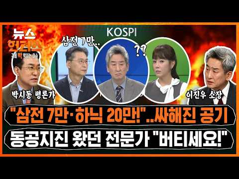
- 설명 앞부분: [뉴스헌터스] ■ 진행 : 김종원, 윤태진 앵커 ■ 대담 : 박시동 (경제평론가), 이진우 (GFM투자연구소장) 반도체 대장주 삼전닉스의 급락으로 이번 달 코스피 수익률은 전세계 꼴찌를 기록하고 있습니다. 순매도를 이어가고 있는 외국인은 200조원을 팔았고, 삼성전자의 외국인 지분율은 2008년 금융위기 이후 최저치로 떨어졌습니다. 오늘 '검은 월요일'은 간신히 피했지만 불안감은 여전한 상황. 앞으로 증시엔 또 어떤 변수들을 주목해야 할까요? ※ 자세한 내용은 동영상으로 확인하실 수 있습니다.
- 대본 없음 (설명) — 음성인식이 끝나면 도입부·흐름이 들어감
- 댓글 210/210: 좋은 점 — 영상 1 · 감사·응원 2 · 더 알고 싶은 것 0 · 아쉬운 점 — 영상 0 · 반박·불만 — 의견 다름 5 · 정치·사회 14 · 경험 공유 9 · 구독·다음 기대 0
  - 좋은 점 — 영상 👍2 “주가에 안 좋은 얘기하면 욕하면서 죽일듯이 달려드니까 죄다 좋은 소리만 하게 됨 어떤 현상이든 긍정적 전망과 부정적 전망이 공존해야 개미들이 분석하는데에 도움이 되는거임 왕이 듣기좋은 소리만 쫓다보면 간신들만 남는 거랑 비슷함”
  - 감사·응원 👍7 “소신발언 그 자체는 정말 응원합니다.”
  - 감사·응원 👍0 “덕분에 8영업일 정도 곱버스로 맛있게 먹고갑니다 감사합니다 대 주 완 킹 주 완 신 주 완”
  - 반박·불만 — 의견 다름 👍1 “진짜 이런 어이없는 븅신들을 패널을...ㅋㅋㅋㅋ 삼성 5000 원올랏다고..... 이런걸 올랏다고 하는 븅신색이들은 정신병자들이다,,,,,,,,,,내가할께 요번주안에 5000 간다,,,,븅신들아,,,,,,”
  - 반박·불만 — 의견 다름 👍0 “내가 이틀전에는 저 말이 맞다 삼전은 딱 7만이다 이렇게 댓글을 달았는데 어제 내가 삼전을 샀네 고로 헛소리 하지마”
  - 정치·사회 👍15 “선거용이었음.정부.금감원.관련기관합작으로 선거용이었음.”
  - 정치·사회 👍3 “웃긴게 대통령이란 사람이 오를땐 빠르긴 하지만 예상 적정가가 어쩌고 저쩌고 하더니 막상 폭락하니까 기업이 어쩌고 저쩌고 남탓 시전하더만 대체 국민 재산을 얼마나 날려먹은거니?ㄷㄷㄷ”
  - 경험 공유 👍73 “저 박사라는 사람은 삼전 5만원 할때도 떨어진다고 했던 박사님임.. 근데 37만원갈때까지 아무 소리도 안하다가 떨어지기 시작하니까 또 나타나서 7만원 타령함...ㅋㅋㅋㅋㅋ 나도 박사하겠다...”
  - 경험 공유 👍20 “말한대로 되면 내가 그랬제~ 안되면 그냥 조용~”

### 71. 나스닥 투자하기 전에 이 영상 꼭 보세요 ∣ QLD만 모아가는 이유

- https://www.youtube.com/watch?v=g10Y6ZA7rng · 올레버 · 구독자 1,600 · 조회수 123,587 (×77.2, 하루 690.1) · 좋아요 1,667 (1.4%) · 5.7분 · 2026-06-02 · 주제 묶음 2. 장기투자·ETF·지수 · 형식 정보·해설 (그 밖) · 폴더 `W_g10Y6ZA7rng` (웹 승인)
- 썸네일: 
- 챕터: 0:00 도입 — QLD를 추천하는 이유 · 0:12 레버리지의 음의 복리(Volatility Decay)… · 1:31 나스닥에서 음의 복리가 반은 틀린 이유 · 2:02 QQQ / QLD / TQQQ 수익률 비교 (2010… · 3:05 왜 TQQQ보다 QLD인가 — 최적 레버리지 배율 · 4:01 2021년 차트로 보는 변동성 비교 · 4:29 장기 투자자에게 QLD가 적합한 이유 · 4:52 개인 목표 (10년 순자산 30억) 기준으로 본 QLD · 5:18 리스크 안내 및 마무리
- 설명 앞부분: 나스닥 ETF, 어떤 걸 사야 할까요? QQQ, QLD, TQQQ. 다들 나스닥 기반인데 뭐가 다른지, 그리고 왜 저는 QLD를 선택했는지 오늘 얘기해볼게요. 이런 분들께 추천드려요 나스닥 ETF 투자를 고민 중인 분 QQQ, QLD, TQQQ 차이가 궁금한 분 레버리지 ETF가 위험하다고 들었는데 궁금한 분 📊 영상에서 다루는 내용 QQQ / QLD / TQQQ 각각 뭐가 다른가 레버리지는 장기 보유하면 녹는다? 진실은 나스닥 각 배율별 10년 수익률 비교 10년 뒤 30억을 위해 필요한 수익률 🎯 목표 : 순자산 30억 파이어…
- 같은 채널 평소 대비 ×165.2 (채널 최근 롱폼 중앙값 748회) · 평소 영상: 배달 뛰다가 워렌버핏의 말을 이해했습니다 ∣ 투자관을 바꾸게 된 계기 (748회) / 이제 저축 안 늘립니다. 30억 파이어족 계획 (592회)
- 대본 (음성인식(앞 5분), 4.2 음절/초) — 앞부분만, 흐름은 그 안까지 첫 20초: “QQQ, QLD, TQQQ 세 가지 중 고민하는 분들이 많은데 저는 그 중 QLD를 적극 추천드리고 있습니다. 그 이후 바로 설명드리겠습니다. 많은 분들이 QLD, TQQQ에 앞서서 우선 레버리지에 대해 부정적인 시각은 가진 분들이 많아요. 그 중 가장 많이 언급되는 게 레버리지는 장기 보유할수록 녹는다 즉 음의 복리인데요.” — 도입부 유형: 내 이야기·사연
- 첫 1분: “QQQ, QLD, TQQQ 세 가지 중 고민하는 분들이 많은데 저는 그 중 QLD를 적극 추천드리고 있습니다. 그 이후 바로 설명드리겠습니다. 많은 분들이 QLD, TQQQ에 앞서서 우선 레버리지에 대해 부정적인 시각은 가진 분들이 많아요. 그 중 가장 많이 언급되는 게 레버리지는 장기 보유할수록 녹는다 즉 음의 복리인데요. 레버리지 상품 자체가 장기적으로 묻어드는 수단이 아니라고 관계자들도 언급을 하고 있고 그리고 실제로 음의 복리가 발생하는 상품이 맞습니다. 두 배 세 배라고 해서 그래프처럼 정확하게 배율대로 가지 않는데요. 이는 1일 변동폭을 추정하고 있기 때문입니다. 쉽게 얘기해서 여기 이 차트를 보시면 1만에서 나스닥이 시작했을 때 1일차에 나스닥이 20% 빠지면 8천이 되고 QLD는 그의 두 배인”
- 흐름 (90초마다 첫 문장): 0:00 QQQ, QLD, TQQQ 세 가지 중 고민하는 분들이 많은데 저는 그… → 1:30 하지만 나스닥에는 반은 맞고 반은 틀렸습니다. → 3:02 유의미한 성장율을 보이고 있다는 거죠. → 4:33 앞으로 몇 번의 폭등과 폭락장이 있을지 모르는 장기 투자를 저희는 해야…
- 댓글 347/349: 좋은 점 — 영상 4 · 감사·응원 18 · 더 알고 싶은 것 24 · 아쉬운 점 — 영상 1 · 반박·불만 — 의견 다름 5 · 정치·사회 0 · 경험 공유 17 · 구독·다음 기대 2
  - 좋은 점 — 영상 👍7 “구독 눌렀어요 좋은정보 앞으로도 부탁드려요😂”
  - 좋은 점 — 영상 👍7 “10~25 년까지는 초저금리 기반 빅테크 대상승장이었죠. 닷컴버블 직후(00~10년)처럼 10년 동안 박스권 횡보장세였다면 진정한 음의 복리 마법을 맛봤을 겁니다.. 그리고 큰 MDD 낙폭은 실제로 겪지 않으면 그게 어떤 느낌인지 피부로 안 와닿아요. 내 투자자산이 …”
  - 감사·응원 👍12 “1.닷컴버블 폭락 기간: 약 2년 6개월 (31개월) 회복 기간: 약 4년 5개월 (53개월) 내 돈이 묶인 총 기간: 약 7년 1개월 2. 리먼 브라더스 사태 폭락 기간: 약 1년 5개월 (17개월) 회복 기간: 약 4년 (48개월) 내 돈이 묶인 총 기간: 약 5…”
  - 감사·응원 👍3 “저도 맘 편해서 QLD 매달 100 좀 넘게 모아갑니다. 최근 하락시 좀 더 사서 모으고 ㅎㅎ 앞으로도 파이팅입니다~😊”
  - 더 알고 싶은 것 👍8 “도움 많이 되었네요! 근데 4:44초에 저런 비교 데이터는 어디에서 볼 수 있을까요?!”
  - 더 알고 싶은 것 👍7 “구독 눌렀어요 좋은정보 앞으로도 부탁드려요😂”
  - 아쉬운 점 — 영상 👍0 “연저펀에 못담는게 아쉽네요.”
  - 반박·불만 — 의견 다름 👍41 “QLD 6년차, 만5년 매도 없이 모아가는 중입니다. 여러분, 레버리지는 하락장 횡보장에 다 녹는 다는 말에 너무 매몰 되지 마세요. 하락후 반드시 찾아오게 되는 긴 상승장에서의 양의 복리는 퍼포먼스가 두배가 아닙니다. 속된말로 존나 오릅니다. 횡보, 하락장에서 추종…”
  - 반박·불만 — 의견 다름 👍13 “하락장 자신없는분은 건드리지도 마세요. 좋다좋다그래도 레버리지는 막 하는거 아닙니다”
  - 경험 공유 👍41 “QLD 6년차, 만5년 매도 없이 모아가는 중입니다. 여러분, 레버리지는 하락장 횡보장에 다 녹는 다는 말에 너무 매몰 되지 마세요. 하락후 반드시 찾아오게 되는 긴 상승장에서의 양의 복리는 퍼포먼스가 두배가 아닙니다. 속된말로 존나 오릅니다. 횡보, 하락장에서 추종…”
  - 경험 공유 👍19 “폭락을 경험해보지도 않은 이런 핏덩이들이 레버리지 좋다고 주절 대는게 너무 귀엽네 ㅋㅋ”
  - 구독·다음 기대 👍3 “구독했습니다~~ 혹시 경상도 이신가요? ㅎㅎ”

### 72. 손정의의 26년, 닷컴 버블에서 오픈AI까지

- https://www.youtube.com/watch?v=3gezC7Acv-M · 차트너머 · 구독자 5,180 · 조회수 54,988 (×10.6, 하루 2,206.1) · 좋아요 182 (0.3%) · 15.1분 · 2026-11-03 · 주제 묶음 6. 종목 고르기·분석 · 형식 정보·해설 (그 밖) · 폴더 `W_3gezC7Acv-M` (웹 승인)
- 썸네일: 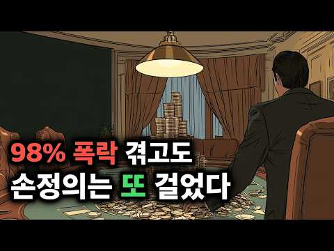
- 챕터: 0:00 일본 시가총액 1위, 그리고 절반 · 1:09 재일 한국인 아이의 첫 밑천 · 2:04 소프트뱅크와 야후 · 3:15 닷컴 버블이 꺼질 때 · 4:05 NTT에 건 싸움, 야후 BB · 5:15 보다폰 재팬과 아이폰 · 6:04 알리바바에 넣은 2,000만 달러 · 6:46 Arm, 비전펀드, 위워크 · 7:41 엔비디아를 판 대가 · 8:17 코로나와 21년 만의 반전 · 9:21 다시 무너진 비전펀드 · 9:52 수비에서 공격으로 · 10:37 엔비디아를 팔아 오픈AI로 · 11:33 6조 엔의 정체와 빚의 크기 · 12:49 흔들린 10월 · 13:27 2000년의 재방송일까
- 설명 앞부분: 2026년 6월, 소프트뱅크그룹이 도요타를 제치고 일본 시가총액 1위에 올랐습니다. 26년 전 닷컴 버블 때도 꼭대기에 섰다가 주가의 98%를 잃었던 회사입니다. 그 일을 겪은 손정의는 무엇을 배웠을까요? 재일 한국인 아이가 버클리에서 첫 밑천을 만들고, 야후로 사흘 동안 세계 최고 부자가 됐다가 무너지는 장면에서 시작합니다. 이어서 NTT와의 요금 전쟁, 보다폰 재팬과 아이폰, 알리바바에 넣은 2,000만 달러, 비전펀드와 위워크, 두 번이나 판 엔비디아를 따라갑니다. 그리고 지금, 빚으로 마련한 646억 달러를 오픈AI 한 회…
- 같은 채널 평소 대비 ×2.5 (채널 최근 롱폼 중앙값 22,162회) · 평소 영상: 엔비디아는 제2의 시스코일까? 닷컴버블 세계 1위의 25년 (25,538회) / 레전드 CEO들의 사퇴의 역사, 그 뒤 회사는 어떻게 됐나 (18,786회)
- 대본 없음 (설명) — 음성인식이 끝나면 도입부·흐름이 들어감
- 댓글 23/23: 좋은 점 — 영상 0 · 감사·응원 0 · 더 알고 싶은 것 0 · 아쉬운 점 — 영상 0 · 반박·불만 — 의견 다름 1 · 정치·사회 0 · 경험 공유 2 · 구독·다음 기대 0

### 73. 누가 그리고 왜 메모리를 흔드나 ∣ 악재를 '고의'로 만드는 시장 ∣ 헤지펀드 청산 기계적 매도 더 큰 공포를 만든다

- https://www.youtube.com/watch?v=SdicEcYHg70 · Just In Timeㅣ저스트인타임 · 구독자 19,800 · 조회수 154,941 (×7.8, 하루 8,091.4) · 좋아요 755 (0.5%) · 16.6분 · 2026-11-09 · 주제 묶음 7. 매매·전략 · 형식 정보·해설 (그 밖) · 폴더 `W_SdicEcYHg70` (웹 승인)
- 썸네일: 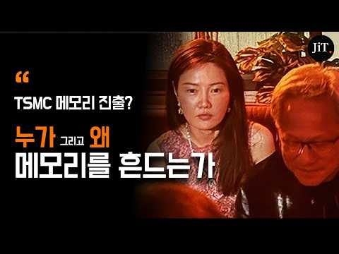
- 챕터: 0:00 오프닝: 누가 메모리를 흔드는가 · 2:20 무엇이 보도됐나 · 3:35 이유 하나: 기술 — 로직과 D램은 다른 물건 · 5:14 3D D램: 3사도 아직 못 연 문 · 6:34 이유 둘: 돈과 시간 · 7:54 중국 CXMT: 나라가 10년을 걸어도 · 9:08 이유 셋: 고객을 적으로 돌린다 · 11:36 그럼 이 소문은 왜 계속 나오나 · 13:28 블루웨이브 폭락, 과했나 · 15:28 정리
- 설명 앞부분: 메모리 주식이 무너진 바로 다음 날, "TSMC가 엔비디아의 요청으로 D램을 만든다"는 기사 한 줄이 전 세계를 돌았습니다. 이 소식은 어디서 시작됐고, 왜 하필 지금, 왜 메모리였을까요. 이 소문이 왜 현실이 되기 어려운지 세 가지로 따져 봤습니다. 첫째, 기술 — 로직과 D램은 목표도 공정도 다르고, 3D D램은 메모리 3사에게도 아직 몇 년 뒤의 기술입니다. 둘째, 돈과 시간 — 3사는 D램 설비에만 매년 약 85조 원을 쏟고, 일본·대만·중국도 국가를 걸고 들어왔지만 벽을 넘지 못했습니다. 셋째, 고객 — 메모리 3사는 T…
- 같은 채널 평소 대비 ×2.6 (채널 최근 롱폼 중앙값 59,756회) · 평소 영상: "닷컴은 버블. AI는 실체가 있다. 하지만.." ∣ 닷컴 버블을 두 달 전에 경고한 남… (59,756회) / 나스닥 애매한 반등은 무엇을 의미하는가 ∣ "데이터센터 75%는 이미 승인, 20%가 사… (55,198회)
- 대본 없음 (설명) — 음성인식이 끝나면 도입부·흐름이 들어감
- 댓글 158/158: 좋은 점 — 영상 3 · 감사·응원 2 · 더 알고 싶은 것 0 · 아쉬운 점 — 영상 3 · 반박·불만 — 의견 다름 3 · 정치·사회 4 · 경험 공유 6 · 구독·다음 기대 0
  - 좋은 점 — 영상 👍19 “이슈가 깔끔하게 정리되네요. 유익했습니다.”
  - 좋은 점 — 영상 👍0 “취업준비하면서 주식너무 사고싶었는데 돈이없으니까 사지는못하고 구경만했는데 입사하고나니까 예전에 사고싶었던 회사들 주식이 너무 폭등해서 사지는 않고 현금5천 저금해논상태에서 폭락이왔어요 지금 구글280에 2천만원, 엔비디아160에 5백만원 들어간상태인데 매달 4백씩 적…”
  - 감사·응원 👍1 “C.C.Wei tsmc사장 파이팅, 3회사가 떵떵거리는 꼴 못봐주겠던대, tsmc가 한방 먹여주시오”
  - 아쉬운 점 — 영상 👍4 “dram기술 장벽이 높아서가 아니라 돈이 안되서 투자를 안함. 투자하면 다른 기업이 투자해서 치킨게임하고 하나가 탈락하면 다시 투자를 줄이고 투자를 줄이면 가격이 상승하고 가격이 상승해서 돈을 챙기면 캐파싸움하고 이걸 30년에 메모리가 돈이 된다고 들어가면 역사는 반…”
  - 아쉬운 점 — 영상 👍0 “너무 길다. 핵심만 하면 될 것.”
  - 반박·불만 — 의견 다름 👍8 “TSMC 주주들은 바보가 아니죠 메모리 반도체는 반도체 사이클이 있다면서 같은 규모 팹 만드는데 2배나 비싼 메모리 반도체 팹 만들고 반도체 사이클 하락해서 적자 팹 될까 걱정 없는 비메모리 팹 더 짓는게 현명하죠 TSMC 주주들이 반대 할걸요”
  - 반박·불만 — 의견 다름 👍1 “다 헛소리야”
  - 정치·사회 👍14 “지금 미국 보니까 젠슨황 조지려고하는거 같던데요. 자꾸 타이완 커넥션을 만들려고하니까요. 미국 정부는 젠슨황이 중국으로 ai연산칩 밀반입 증거도 가지고 있는걸로 보이고. 그러니까 젠슨황 장녀가 부랴부랴 일정 취소하고 미국으로 돌아갔겠죠. aI연산이나 학습칩이 대체제가…”
  - 경험 공유 👍1 “젠슨 불륜 뉴스는 헤드라인성 FUD 기사가 맞긴함. 사실 2년전부터 싱가폴 밀반입 이건 저도 얘기한적있고( 왜냐면 그당시에 엔비디아 숏치고 있었기때문에) 근데 지금 그걸 불륜이라는 도덕론과 관련하여 FUD를 타이밍 좋게 월요일이랑, 지수가 많이 하락했을때 쓰는건 다 …”
  - 경험 공유 👍0 “쏘리..내가 흔들었어..”

### 74. 한강뷰 사는 사람도 피할 수 없는 주식 현실을 알려드립니다

- https://www.youtube.com/watch?v=PdH2FX8Nz78 · 육감 김수용 · 구독자 7,730 · 조회수 62,943 (×8.1, 하루 3,130.5) · 좋아요 873 (1.4%) · 14분 · 2026-11-08 · 주제 묶음 기타 · 형식 정보·해설 (그 밖) · 폴더 `W_PdH2FX8Nz78` (웹 승인)
- 썸네일: 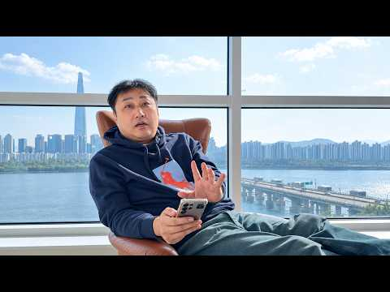
- 설명 앞부분: 주식 수익률을 자랑하지 마세요 남의 수익에 흔들리지 마세요 모르는 종목은 쳐다보지도 마세요 ※ 영상에 등장하는 한강뷰 세컨하우스 장만 내용은 연출된 허구이며, 해당 공간은 시간당 2만 원에 대여한 스튜디오임을 안내드립니다.
- 대본 없음 (설명) — 음성인식이 끝나면 도입부·흐름이 들어감
- 댓글 62/62: 좋은 점 — 영상 0 · 감사·응원 2 · 더 알고 싶은 것 1 · 아쉬운 점 — 영상 1 · 반박·불만 — 의견 다름 0 · 정치·사회 1 · 경험 공유 3 · 구독·다음 기대 0
  - 감사·응원 👍2 “응원 합니다❤”
  - 감사·응원 👍0 “힘내세요```😛”
  - 더 알고 싶은 것 👍0 “형 Lg이노텍도 다뤄주세요!! 아오 형 나 진짜 겁나물림... 마 2천 몇백에 털고 42층에 삿는데... 또 마 3천이 넘어..ㅠㅠ”
  - 아쉬운 점 — 영상 👍14 “ㅋㅋㅋㅋㅋㅋㅋㅋㅋㅋㅋㅋㅋ배경이 진짜 같지가않고 ai 같아요…”
  - 정치·사회 👍0 “얘 좌파잖아”
  - 경험 공유 👍4 “저도 주식 계좌가 녹고 있어요 ㅎㅎ😂”
  - 경험 공유 👍1 “셀트리온땜에 맘고생 6년째.삼전닉스 쭈우쭉 올라갈때 슬프더만 요즘 위로가된다. 6년참으면 올라~~~~”

### 75. 13만 8천 원 레깅스의 몰락…룰루레몬은 왜 무너졌나? #룰루레몬 #경제이야기

- https://www.youtube.com/watch?v=Q4iwkHxVTZ0 · 이슈'S · 구독자 840 · 조회수 15,343 (×18.3, 하루 317.7) · 좋아요 23 (0.1%) · 15.6분 · 2026-10-11 · 주제 묶음 6. 종목 고르기·분석 · 형식 정보·해설 (그 밖) · 폴더 `W_Q4iwkHxVTZ0` (웹 승인)
- 썸네일: 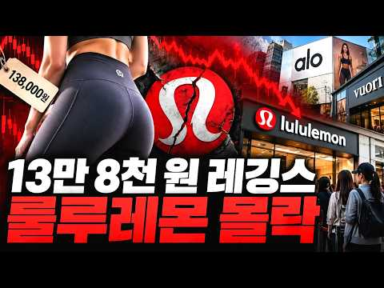
- 설명 앞부분: 레깅스 한 장에 13만 8천 원. 한때 ‘요가복계의 샤넬’이라 불리던 룰루레몬은 왜 위기에 빠졌을까요? 비싼 가격에도 줄을 서서 구매하던 소비자들은 어디로 갔을까요? 이번 영상에서는 룰루레몬의 프리미엄 브랜드 전략, 2013년 레깅스 품질 논란과 창업자 칩 윌슨의 발언, 알로요가·뷰오리의 성장, 2026년 제품 논란, 실적 악화와 한국 시장의 상반된 흐름을 살펴봅니다. 특히 룰루레몬 13만 8천 원, 알로요가 19만 원, 젝시믹스 5만 9천 원이라는 가격 비교를 통해 소비자가 프리미엄 브랜드에 돈을 지불하는 이유가 무엇인지 짚어봅…
- 같은 채널 평소 대비 ×35.6 (채널 최근 롱폼 중앙값 431회) · 평소 영상: 북한 돈이 무너지는데, 왜 내 세금이 걱정될까? 통일 비용을 가르는 경로 #북한경제 #통… (440회) / 샤넬은 2조, 펜디는 42% 감소… 한국 명품 시장은 왜 갈라졌나 #명품시장 (422회)
- 대본 없음 (설명) — 음성인식이 끝나면 도입부·흐름이 들어감
- 댓글 7/7: 좋은 점 — 영상 0 · 감사·응원 0 · 더 알고 싶은 것 0 · 아쉬운 점 — 영상 0 · 반박·불만 — 의견 다름 0 · 정치·사회 0 · 경험 공유 0 · 구독·다음 기대 0

### 76. AI로 주식 자동 매매하면 어떻게 될까?

- https://www.youtube.com/watch?v=9E9OrcoMCjk · 이영배 · 구독자 22,200 · 조회수 1,279,782 (×57.6, 하루 7,951.2) · 좋아요 5,985 (0.5%) · 11.3분 · 2026-06-20 · 주제 묶음 7. 매매·전략 · 형식 정보·해설 (그 밖) · 폴더 `W_9E9OrcoMCjk` (웹 승인)
- 썸네일: 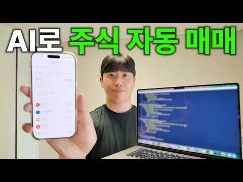
- 같은 채널 평소 대비 ×7.6 (채널 최근 롱폼 중앙값 169,008회) · 평소 영상: AI에게 유튜브 채널을 운영시키면 구독자를 몇 명 모을까? (215,281회) / AI에게 인스타그램 운영을 시키면 팔로워를 몇 명 모을까? (311,894회)
- 대본 (음성인식(앞 5분), 6.8 음절/초) — 앞부분만, 흐름은 그 안까지 첫 20초: “지금부터 AI 두 개로 주식거래 대결 시켜볼 겁니다 누가 더 돈을 많이 벌어올까요? 제가 직접 한번 해보겠습니다 저는 제돈 천만 원을 AI 두 개에게 맡겨봤습니다 하나는 클로드의 오프스 4.8 다른 하나는 오픈 AI의 GPT 5.5인데요 둘 다 현재 최고의 성능을 자랑하는 각 회사의 최신 모델입니다 규칙은 간단합니다 실제 돈 500만 원을 받고 2주, 공일 제외 9 거래일 동안 최대 수익을 내면 됩니다” — 도입부 유형: 질문으로 시작
- 첫 1분: “지금부터 AI 두 개로 주식거래 대결 시켜볼 겁니다 누가 더 돈을 많이 벌어올까요? 제가 직접 한번 해보겠습니다 저는 제돈 천만 원을 AI 두 개에게 맡겨봤습니다 하나는 클로드의 오프스 4.8 다른 하나는 오픈 AI의 GPT 5.5인데요 둘 다 현재 최고의 성능을 자랑하는 각 회사의 최신 모델입니다 규칙은 간단합니다 실제 돈 500만 원을 받고 2주, 공일 제외 9 거래일 동안 최대 수익을 내면 됩니다 가장 먼저 클로드 코드로 거래를 할 수 있는 프로그램을 뚝딱 만들어냈고요 상태를 확인할 수 있는 데시보드도 구현해놨습니다 그래도 2주 동안 함께 하는 녀석들 아닙니까? 그래서 제가 이름도 한번 붙여봤는데 클로드가 짱이냐, 체치 PT가 짱이냐 이걸 정하는 거니까 휠짱이, 체짱이 이렇게 하겠습니다 그렇게 휠짱이와”
- 흐름 (90초마다 첫 문장): 0:00 지금부터 AI 두 개로 주식거래 대결 시켜볼 겁니다 → 1:30 일단 시장을 쭉 관망을 해요 → 3:01 삼성전자를 잇절해서 14만 원을 벌었다고 전 보고를 했단 말이죠 → 4:31 아니 왜 제가 시작하니까 갑자기 이런 일이 생기는 거죠?
- 댓글 578/611: 좋은 점 — 영상 6 · 감사·응원 17 · 더 알고 싶은 것 34 · 아쉬운 점 — 영상 3 · 반박·불만 — 의견 다름 8 · 정치·사회 7 · 경험 공유 34 · 구독·다음 기대 21
  - 좋은 점 — 영상 👍4 “딕션도 좋고 설명이 좋아요 컨텐츠만 좋으면 크게 되실분이다!!화이팅!!”
  - 좋은 점 — 영상 👍2 “영상 잘봤습니다. 앞으로 쭉쭉 좋은 영상 만들어주세요! 응원할게요”
  - 감사·응원 👍4 “딕션도 좋고 설명이 좋아요 컨텐츠만 좋으면 크게 되실분이다!!화이팅!!”
  - 감사·응원 👍3 “형들 마지막에 유튜버분 말들엇지? 현업코딩전문개발자들이 ai사용해서 장기적으로 수익이안나..이말은 전문지식으로 완벽하다 할만큼 만드는데도 지랄발광하면서 디버깅터지고 마이너스맞는거야.. 괜히 난 아이디어가 특별해 하면서 부여잡지마 현업개발자들이 아직 깡깡멀엇다함 미토스…”
  - 더 알고 싶은 것 👍3 “422번째 구독자입니다 올해안에 10만 가실 듯 앞으로도 재밌는 영상부탁드려요!”
  - 더 알고 싶은 것 👍2 “영상 잘봤습니다. 앞으로 쭉쭉 좋은 영상 만들어주세요! 응원할게요”
  - 아쉬운 점 — 영상 👍8 “영상 잘 봤습니다. 우연히 알고리즘 추천에 떠서 봤습니다. 편집이나 말씀 하시는 것도 되게 깔끔하고 보기 좋았습니다.”
  - 아쉬운 점 — 영상 👍4 “영상편집이나 진행. 딕션까지. 우연히 알고리즘에 떠서 봤는데 잼있네요. 구독하고가요”
  - 반박·불만 — 의견 다름 👍200 “재밌어요. 구독자 68명 퀄이아닌데요 머지”
  - 반박·불만 — 의견 다름 👍1 “영상 재밌게 봤습니다. 저도 개인 자동매매 시스템을 직접 개발해서 운영 중인데, 이 영상 보면서 왜 이런 결과가 나왔는지 조금 다른 각도에서 짚어보고 싶어요. **1. "가격을 임의로 예측해서 넣은" 그 버그가 핵심입니다** 영상에서 매도가를 못 불러와서 봇이 알아서…”
  - 정치·사회 👍0 “6월4일이면 선거 끝나고네 선가 전에 주가 올리고 선거끝나고 주가빠지고”
  - 정치·사회 👍0 “대한 외국인이네 딛,ㄹ 곱게 자란 인간들”
  - 경험 공유 👍147 “저도 직접 자동매매 시스템 만들어서 실제 운용 중인데, 느낀 점이 AI한테 판단을 맡기는 게 아니라 내 철학을 코드로 번역하는 게 핵심이더라고요. 언제 사고 언제 파느냐를 AI가 즉흥으로 결정하게 두면 결국 감정매매랑 다를 게 없어요. 시스템이 일관성을 갖추려면 철학…”
  - 경험 공유 👍13 “저도 ai로 코딩하여 자동매매 돌리는중인데 결국은 ai는 프로그램 만드는 툴로만 써야하고 전략은 내가짜야됨..”
  - 구독·다음 기대 👍16 “영상주기만 빨라지만 훨씬 대형채널이 될거같네요 저점매수 구독하고갑니다”
  - 구독·다음 기대 👍9 “이야 ㅋㅋㅋㅋ 주제 ㅅㅌㅊ 돈 잃었으니 바아로 구독합니다”

### 77. 배당주 20년 vs S&P500 20년, 3억 원이 만든 충격적인 자산과 삶의 격차 [ 재테크/미국주식/ETF/배당주/노후준비 ]

- https://www.youtube.com/watch?v=cqgVNBbMYew · 박대리와 황과장의 경제이야기 · 구독자 2,020 · 조회수 87,613 (×43.4, 하루 723.6) · 좋아요 1,184 (1.4%) · 20.5분 · 2026-07-30 · 주제 묶음 4. 미국·해외주식 · 형식 정보·해설 (그 밖) · 폴더 `W_cqgVNBbMYew` (웹 승인)
- 썸네일: 
- 설명 앞부분: 같은 3억 원으로 시작해 20년 동안 완전히 다른 길을 걸어간 두 사람. 미국 배당 성장주에 투자해 매달 현금흐름을 굴린 박 대리와, S&P 500 지수 전체에 투자해 자본의 성장을 노린 황 과장. 20년이라는 긴 세월이 흐른 뒤, 두 사람의 계좌에 찍힌 숫자는 어떻게 달라졌을까요? 그리고 더 중요한 것, 은퇴 후 두 사람의 '진짜 삶의 모습'은 어떻게 갈렸을까요? 단순히 "어느 쪽이 더 많이 벌었나"를 넘어, 자산 형성기에서 은퇴기까지 우리가 투자를 바라보는 관점 자체를 바꿔줄 20년의 실측 데이터 서사를 확인해 보세요. [영상…
- 같은 채널 평소 대비 ×37.3 (채널 최근 롱폼 중앙값 2,346회) · 평소 영상: 배당주 vs 지수 같은 20년, 폭락 3번 중 배당주가 심장을 지켜준 건 단 한 번이었다… (2,389회) / 폭락장에서 파는 것보다 적립을 멈추는 게 더 비쌌다, 6억5천만 원의 청구서 [ 재테크/… (2,304회)
- 대본 (음성인식(앞 5분), 4.9 음절/초) — 앞부분만, 흐름은 그 안까지 첫 20초: “배당주와 지수 주식, 이 두 가지 자산은 같은 주식시장 안에서 가장 오랜 기간 라이벌 관계로 불려왔습니다. 시장이 폭발적인 성장을 온 몸으로 받아내며 지수의 팽창을 누릴 것인가, 새 된 챈 챈 누릴 것인가. 아니면 기업이 만들어내는 당장의 현금 흐름을 매달 꼬박꼬박 재투자하여 복리의 눈덩이를 굴릴 것인가.”
- 첫 1분: “배당주와 지수 주식, 이 두 가지 자산은 같은 주식시장 안에서 가장 오랜 기간 라이벌 관계로 불려왔습니다. 시장이 폭발적인 성장을 온 몸으로 받아내며 지수의 팽창을 누릴 것인가, 새 된 챈 챈 누릴 것인가. 아니면 기업이 만들어내는 당장의 현금 흐름을 매달 꼬박꼬박 재투자하여 복리의 눈덩이를 굴릴 것인가. 오늘 다룰 이야기는 바로 이 질문에서 출발합니다. 출발서는 똑같았습니다. 두 사람에게는 20년 전 각자 핏땀 흘려 모은 종자똥 3억 원이 손에 쥐어져 있었습니다. 대기업 직장인으로 오랜 기간 함께 근무하며 같은 월급을 받고, 같은 점심을 먹고, 같은 퇴근길을 걸었던 박 대리와 황 과장, 두 사람은 어느 날 점심을 먹고 회사 근처 공원 벤치에 앉아 서로의 통장을 열어보았습니다. 각자의 계좌에는 약속이라도 한”
- 흐름 (90초마다 첫 문장): 0:00 배당주와 지수 주식, 이 두 가지 자산은 같은 주식시장 안에서 가장 오… → 1:32 박 대리가 선택한 것은 미국 시장을 대표하는 배당 성장 자산이었습니다. → 3:07 황 과장은 배당에 목매지 않았습니다. → 4:35 S&P 500 역시 연 1.5% 안팎에 소소한 배당을 지급했지만 황과장…
- 댓글 162/168: 좋은 점 — 영상 3 · 감사·응원 4 · 더 알고 싶은 것 3 · 아쉬운 점 — 영상 1 · 반박·불만 — 의견 다름 3 · 정치·사회 5 · 경험 공유 9 · 구독·다음 기대 0
  - 좋은 점 — 영상 👍4 “좋은정보 감사드립니다”
  - 좋은 점 — 영상 👍1 “오 좋은내용감사합니다”
  - 감사·응원 👍4 “좋은정보 감사드립니다”
  - 감사·응원 👍1 “정말 궁금했는데 감사합니당”
  - 더 알고 싶은 것 👍3 “18:07 더이상 근로소득을 기대할수 없는 시점인데 어떻게 생활비로 한푼도 안쓰고 배당 재투자를 할수가 잇을까요?”
  - 더 알고 싶은 것 👍0 “3억 20년 넣고 기다릴 사람이 얼마나될까요? 시드 금액이 넘 큼..1억이면 몰라도.”
  - 아쉬운 점 — 영상 👍0 “지수 팔아서 배당 사면 되는데 결론이 많이 아쉽네요.”
  - 반박·불만 — 의견 다름 👍0 “주식투자에서 가장중요한게 투자기법 심리? 아닙니다 그냥 가만히 있는겁니다 대부분 폭락장에서 90%가 공포에 다던지죠.ㅋㅋ 인간이 가장 힘들어 하는게 가~만히 있는거죠”
  - 반박·불만 — 의견 다름 👍0 “말도 안되는 소리를 하네. 은퇴싯점에 S&P를 팔아서 배당주로 옮기면 되지. 물론, 22%의 양도소득세를 내야 하는데, 그걸 감안해도 황과장이 무조건 이겼구만.”
  - 정치·사회 👍47 “한국 정부는 개인의 노후도 보장 안해주면서, 세계에서 유일하게 세금을 안내는 사람이 세금을 내는 사람보다 혜택이 더욱 많고, 은퇴하면 세금이 더 늘어나고, 중국인을 위해 한국국민이 세금을 더 내게 만든 유일한 나라…”
  - 정치·사회 👍6 “빚내서 그냥 레버타라 정부에서 빚 탕감해준다”
  - 경험 공유 👍5 “운용하기 나름인듯 다만 지수는 손이좀 가고 배당은 손이 조금 덜간다는 차이가 있을뿐. 그리고 배당을 받는경우는 세금문제도 생각해야하고. 수입이 안끊어졌다는 전제로 하락장때 추매를 하면 안되는거였나? 아니면 3억을 한번에 몰아넣지 말고 적립식으로 했었다면?? 지수에 넣…”
  - 경험 공유 👍0 “저는 모든 수익의 절반을 투자 및 재투자하는 방식을 하고 있습니다. 배당주 위주로 하고 있고요. 월급의 절반도 투자, 배당금의 절반도 재투자. 내가 쓸 수 있는 현금도 매년 늘어나고, 배당금도 재투자가 계속 이루어져서 매년 늘어나는 구조죠. 배당금이 2천만원 넘어가면…”

### 78. "이 방법" 대로 사면 TQQQ보다 최소 12억은 더 법니다. 진짜입니다.

- https://www.youtube.com/watch?v=nD8WGVgUJbY · 레버리지 투자노트 · 구독자 4,710 · 조회수 51,212 (×10.9, 하루 1,600.9) · 좋아요 1,230 (2.4%) · 13.8분 · 2026-10-27 · 주제 묶음 기타 · 형식 정보·해설 (그 밖) · 폴더 `W_nD8WGVgUJbY` (웹 승인)
- 썸네일: 
- 챕터: 0:00 TQQQ 그냥 들고 있으면 된다? 2022년 −82%… · 0:33 루프투자법이란? 3배 레버리지를 계좌 일부만 · 0:45 10년 백테스트, TQQQ보다 12억 더 번 이유 · 1:25 언제 시작해도 3년 뒤 손실 0번 · 1:52 이 투자법이 포기한 것, TQQQ 그냥 보유가 더 번… · 2:23 시작한 달이 달라도 연평균 36~39%? · 2:57 2022년 한 해가 10년 결과를 뒤집은 이유 · 3:19 사람이 폭락을 못 버티는 진짜 이유 · 3:51 왜 이름이 "루프"일까? 1루프와 복리 · 4:20 등대, 배, 바닷물로 보는 루프투자법 · 4:56 하나만 빼도 결과가 바뀌는 4가지 장치 · 5:16 장치① 3배는 계좌의 3분의 1만 (SOXL −90.… · 6:17 장치② 떨어진 날 사고 오른 날 판다 · 7:09 그냥 들고 있으면 3배가 녹는 이유 (변동성 끌림) · 7:35 왜 TQQQ가 아니라 SOXL을 골랐을까 · 7:49 하루 한 번, 장 마감 가격으로만 거래하는 이유 · 8:14 장치③ 등대 TQQQ, 반도체에만 걸지 않는다 · 9:18 장치④ 밀물과 썰물, 늘 밀물이면 −72% · 11:07 4가지 장치, 하나라도 빼면 생기는 일 · 11:34 11월 2일 SOXL TQQQ 첫 주문표 공개
- 설명 앞부분: TQQQ를 그냥 들고만 있었다면 2022년에 고점 대비 82%가 사라졌습니다. 같은 3배 레버리지로 더 벌면서, 흔들림은 1배 수준으로 줄인 방법. 제가 만든 루프투자법을 처음으로 공개합니다. 11월 2일부터 제 돈 1만 달러로 이 방법 그대로 사고팝니다. ⏱️ 타임스탬프 ※ 백테스트는 2026년 10월 14일 종가 기준이며 매매 수수료 0.07%를 반영했습니다. 세금과 환율은 제외했습니다. 과거 수익률이 미래 수익을 보장하지 않습니다.
- 같은 채널 평소 대비 ×40.5 (채널 최근 롱폼 중앙값 1,266회) · 평소 영상: 주식투자에 실패 하는 공통적인 이유. 이렇게 해결하세요! (1,044회) / 바빠도 꼭 보세요. 미국주식 투자한다면 무조건 봐야하는 이유 (1,783회)
- 대본 없음 (설명) — 음성인식이 끝나면 도입부·흐름이 들어감
- 댓글 324/324: 좋은 점 — 영상 11 · 감사·응원 27 · 더 알고 싶은 것 36 · 아쉬운 점 — 영상 3 · 반박·불만 — 의견 다름 2 · 정치·사회 0 · 경험 공유 9 · 구독·다음 기대 12
  - 좋은 점 — 영상 👍7 “라오어 책도 빌려보고 따라해보려 했지만 이해가 잘 가지 않았는데 이건 해 볼 만 할거 같네요”
  - 좋은 점 — 영상 👍4 “와 알고리즘으로 떠서 우연히 한번 봤다가 유튜브 바다에서 또 하나의 보석을 발견했네요. 동기 부여 되고 심장 뛰게 하는 아주 좋은 영상입니다. 좋아요 구독 알림까지 다 완료했습니다. 감사하빈다.”
  - 감사·응원 👍5 “이 영상을 보게된것만으로 운이 좋은거 같습니다!! 영상을 100프로 이해하긴 힘들지만 매수 loc는 하락률에 따라 매수 물량이 달라지고 그 물량의 묶음만큼은 그 묶음 평단가 보다 높은 상승 loc로 정리하는 방법론인거 같네요. 장기적인 하락장에서도 물량이 계속 쌓이는…”
  - 감사·응원 👍5 “매수매도방법이궁금하네요 구독해놓고 기다리겠습니다~^^ 감사합니다”
  - 더 알고 싶은 것 👍5 “매수매도방법이궁금하네요 구독해놓고 기다리겠습니다~^^ 감사합니다”
  - 더 알고 싶은 것 👍4 “1. 상승장 하락장 판단 기준이 어떻게 되나요? 2. 90퍼 soxl 1회 구매 비율 3. Loc매수 스프레드 기준 4. 만약 하루 과대 낙폭 시, 또는 장기 하락 시 손절 기준 5. 수익 시 Loc매도 기준가 기준이 궁금한게 많네요 조건에 따라 테스트 돌려보고 싶네…”
  - 아쉬운 점 — 영상 👍3 “시작하실때 저도 살짝 따라해보고싶네요 속슬 물려서 장기투자된계좌랑 매일 자동매수 계좌 있고 지루함 때문에 하고있는계좌 있는데 하시는 방법이 갠찮으면 1만달러. 계좌 속슬만 사팔하는거 있는데 함께 해볼게요 응원합니다”
  - 아쉬운 점 — 영상 👍0 “로직에대한설명은 5프로도안하고 왜 해야하는지에대한 설명만 구구절절이라 뭘 하고자하는지 이해가안됨. 계속반복해서 보면 이해가되겠지만. 그정도는 아닌거 같고 매일매일 계산을해사 LOC주문 넣는것도 쉽지않은일”
  - 반박·불만 — 의견 다름 👍0 “이해가 안됨 100달러를 사고97달러에도 사면 평단은 97달러가아닌데..”
  - 반박·불만 — 의견 다름 👍0 “당신의 방법을 잘 사용하면 부자가 될 수는 있습니다. (나의 매매법보다 공격적임) 하지만 최적화된 매매법은 "만능"은 아닙니다. "만능"은 자신의 최적화가 깨졌을 때 살아남을 수 있어야 합니다. 난 살아남을 수 있습니다. 환율 최고점에서 나의 자산 7억 8천만 원, …”
  - 경험 공유 👍3 “시작하실때 저도 살짝 따라해보고싶네요 속슬 물려서 장기투자된계좌랑 매일 자동매수 계좌 있고 지루함 때문에 하고있는계좌 있는데 하시는 방법이 갠찮으면 1만달러. 계좌 속슬만 사팔하는거 있는데 함께 해볼게요 응원합니다”
  - 경험 공유 👍3 “안녕하세요? Invest Awaken님 님 영상을 보고... (이 로직으로 시작한지 얼마안되었지만... ) 제가 가지고 있는 전략(로직)과 거의 흡사해서 깜짝 놀랬습니다. 구독과 좋아요를 안 누를 수 없네요. 다음영상 기대해봅니다. 빨리 올려주세요”
  - 구독·다음 기대 👍4 “떨사오팔 비슷한것같네요... 1/3만 쓰고 더이상 쓸돈이 없을 때 나머지 2/3를 다시 티어를 나눠 순차 투입하는걸까요~? 구독하고 기다릴게요”
  - 구독·다음 기대 👍3 “안녕하세요? Invest Awaken님 님 영상을 보고... (이 로직으로 시작한지 얼마안되었지만... ) 제가 가지고 있는 전략(로직)과 거의 흡사해서 깜짝 놀랬습니다. 구독과 좋아요를 안 누를 수 없네요. 다음영상 기대해봅니다. 빨리 올려주세요”

### 79. 월급없는삶 1억2000증발 결국 #배당투자 #배당은퇴 #경제적자유 #파이어족 #월배당 #고배당주 #주식투자 #재테크#노후준비#배당금생활 #SCHD #JEPI #…

- https://www.youtube.com/watch?v=tKMTyK8VZ-E · ttobaedang또배당 · 구독자 8,380 · 조회수 54,583 (×6.5, 하루 2,719.0) · 좋아요 640 (1.2%) · 13.7분 · 2026-11-08 · 주제 묶음 11. 투자 일반 · 형식 정보·해설 (그 밖) · 폴더 `W_tKMTyK8VZ-E` (웹 승인)
- 썸네일: 
- 같은 채널 평소 대비 ×3.6 (채널 최근 롱폼 중앙값 15,357회) · 평소 영상: 100만원으로 은퇴해도 행복한이유 #배당투자 #배당은퇴 #경제적자유 #파이어족 #월배당 … (15,357회) / 48세백수 10월배당금 유투브 첫수익 #배당투자 #배당은퇴 #경제적자유 #파이어족 #월배… (15,220회)
- 대본 없음 (없음) — 음성인식이 끝나면 도입부·흐름이 들어감
- 댓글 267/267: 좋은 점 — 영상 4 · 감사·응원 29 · 더 알고 싶은 것 4 · 아쉬운 점 — 영상 2 · 반박·불만 — 의견 다름 3 · 정치·사회 4 · 경험 공유 28 · 구독·다음 기대 2
  - 좋은 점 — 영상 👍17 “일요일 영상 직접 말하시는거 도움이 많이되요ㅎ 감사합니다😊”
  - 좋은 점 — 영상 👍4 “이번에 찾아보니 제이피모건. 코스트코. 코카콜라. 존슨앤존슨. 비자 같은 기업주가가 5년 기준으로 qqq보다 높더라고요 ㅋㅋ 이게 참.. 다들 기술주 보고 있을 때 이러는거 보면.. 정말 정답은 없네요. 솔직히 20대 젊고 고소득이면 Schd+schg만 모아가도 좋을…”
  - 감사·응원 👍27 “계좌의 잔고보다 옆에서 천천히 공감해주고 응원해주는 아내분이 제일 부럽네요 ㅎ”
  - 감사·응원 👍18 “또배당님 참고하면서 마음단단히 부여잡고 이번장을 잘넘겨보려고합니다. 또배당님의 영상이 저같은 주린이에게는 멘탈관리에 정말 많은 도움됩니다. ~~^^오늘도 영상 감사합니다~”
  - 더 알고 싶은 것 👍8 “ISA계좌 5년동안 연2천만원씩 1억을 채우고, 오로지 커버드콜로 운영하니 대략 배당이 170만원정도 나오고 있는거 같아요. 원금손실이 좀 있긴 하지만, 그래도 버티고 있습니다. 궁금한건 만약 배당을 재투자 한다면 어떤걸 해야될까요?? 그냥 커버드콜로만 계속 채워나가…”
  - 더 알고 싶은 것 👍4 “어디카페인지 알수있을까요? 가보고 싶어요ㅎ”
  - 아쉬운 점 — 영상 👍1 “어제영상중에 손실확정후 주식 다시매수 라는 말씀에서 잠시제가 잊고있었던걸 깨우쳐주셔서 아침장에서 내년 해외양도세 나올금액을 계산해서 손실확정후 재매수했습니다. 영상을 반복해서 듣다보니 또배당님이 말씀하신부분이 귀에 딱들어오더라고요.잠시 잊고있던부분이였어요. 진솔한말씀…”
  - 아쉬운 점 — 영상 👍1 “월 배당이 100만원이든 200만원이든 밋밋함과 지루함을 견디고 한 곳만 바라보고 투자한다는게 사실 도파민 희열을 느끼는 사람에겐 고통입니다 또배당님 또한 배당이라는 안정감 그리고 3배레버리지의 도파민 투자 어느 것 놓치고 쉽지 않겠죠 월 배당만 받고 편히 살고 싶다…”
  - 반박·불만 — 의견 다름 👍1 “팔기전엔 손실이 아니죠 사팔 사팔 단타족이나 힘들지 배당 받고 미래 장기투자는 편안합니다. 형님도 흔들리지 않고 투자하시는데 저도 편하게 가겠습니다.”
  - 반박·불만 — 의견 다름 👍1 “상승장에 파이어 하라고 했던 책임을 지고 있는 중이지요(뭐 선생님이 파이어 하란 소리 한건 아니라고 생각합니다) 그 있거든요..나는 못 쉬는데 저사람은 쉬네? 어? 시장이 달라지니 이 사람 이제 틀렸네 막 따라와서 왘왘 거리는 사람들 근데 그 것 때문에 구독자 얻고 …”
  - 정치·사회 👍3 “Soxl작년3.4월12000원에 매수해서 16000원에 매도. 첫미장주식이였어요.그뒤로 올라가는거보고선 미쿡은 다르구나~~했던기억이ㅠ 다시 작년가격으로 많이내려왔지만 전 qld로 분할매수들어갔네요.좀 더 기다렸다 매수할까했는데 맘이급해서리😂 전qqqi를 좀 더 매수해…”
  - 정치·사회 👍1 “너무 인생을 날로 먹으려는거 아닌지...전형적인 민주당스럽노”
  - 경험 공유 👍12 “48세때가 엊그제 같고 내가 벌써 낼 모레 50이라니 너무 우울했었는데 벌써 54살이 됐네요 ㅜㅜ 그냥 48세가 부럽습니다...그리고 배당주나 커버드콜은 긴 횡보장이나 상승장에 원금이 보장되고 버블기에는 사면 안됩니다...국내주식 25년차 미국주식 10년차 수많은 시…”
  - 경험 공유 👍9 “저도 이번장에서 국장.미장에서 2.5억 녹았네요.ㅜ”
  - 구독·다음 기대 👍8 “구독합니다 마인드가 좋으세요”

### 80. 월요일 어마무시한 일 터질겁니다, 한국 개미들만 모르고 있는 충격적인 상황

- https://www.youtube.com/watch?v=tdF_OyN0XZY · 경제사관학교 · 구독자 13,200 · 조회수 111,840 (×8.5, 하루 4,137.2) · 좋아요 796 (0.7%) · 18.7분 · 2026-11-01 · 주제 묶음 8. 투자 심리·실패 · 형식 정보·해설 (그 밖) · 폴더 `W_tdF_OyN0XZY` (웹 승인)
- 썸네일: 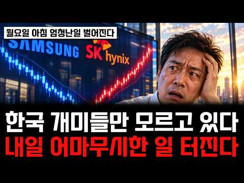
- 챕터: 0:00 월요일 삼성전자, 하이닉스에 큰일 터집니다... 우리… · 0:58 우리 장이 닫힌 그날 밤, 나스닥은 왜 무너졌을까? · 3:09 인텔을 무너뜨린 게, 왜 하필 메모리 값일까? · 5:06 메모리 값이 오르는데, 하이닉스는 왜 7%나 빠졌을까? · 7:15 미국 반도체가 7% 무너진 다음 날, 한국은 어땠을까? · 9:03 금요일에 미리 맞은 매, 월요일엔 덜 아플까? · 11:02 10월 수출 성적표는, 반대편에서 버텨 줄까? · 12:43 월요일만 넘기면, 정말 끝일까? · 14:05 제 시각으로, 월요일 아침 가장 먼저 볼 선은 어디일… · 16:15 그래서 월요일 아침, 내 계좌는 무엇을 해야 할까?
- 설명 앞부분: 10월 30일 종가 자료로 정리했습니다. 10월 30일 금요일, 코스피가 하루 만에 3.48% 내린 5,730으로 마감했고 오전에는 매도 사이드카까지 울렸습니다. 그런데 이건 미국의 폭락을 받기 전이었습니다. 우리 장이 닫힌 그날 밤 나스닥은 2.86%, 미국 반도체지수는 하루 7.2% 빠졌고, 인텔은 하루 만에 28.58% 폭락했습니다. 2000년 이후 금요일 밤 미국 반도체가 이렇게 무너진 여섯 번, 그 뒤 월요일 코스피는 여섯 번 모두 하락으로 끝났습니다. 인텔이 무너진 이유에 왜 메모리 값이 나오는지, 메모리 값이 오르는데…
- 대본 없음 (설명) — 음성인식이 끝나면 도입부·흐름이 들어감
- 댓글 104/104: 좋은 점 — 영상 0 · 감사·응원 0 · 더 알고 싶은 것 0 · 아쉬운 점 — 영상 0 · 반박·불만 — 의견 다름 2 · 정치·사회 3 · 경험 공유 1 · 구독·다음 기대 0
  - 반박·불만 — 의견 다름 👍12 “인텔은700%오른것에 30%로 빠졌다 생각하면 별것아닌데 요새 주식은 한치앞을 모르니 과연 내일 월요일 어떻게될지...”
  - 반박·불만 — 의견 다름 👍0 “헛소리 그만 주둥이 다물어”
  - 정치·사회 👍14 “대통령이란자가 가만히있는 이스라엘,(유대인)자본을건들어서(외인)들이떠날거고 걱정이네요ㅡ”
  - 정치·사회 👍4 “국내주식은 안하는게 돈버는거다 미국주식30%폭락해도 그전에 50% 오른거다 국내주식 공매도가 결정한다 특히 민주당정부는 주식판에 100%관여한다고 본다 여론 나쁘면 올리거나 폭락시킴 난 다시는 민주당 안찍음”
  - 경험 공유 👍5 “나도 알고있는데 모두가 알고있겠지 삼전 10만원 까지 떨어질까 ㆍ기다려본다”

