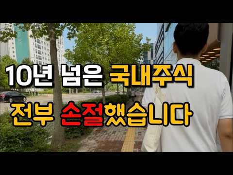
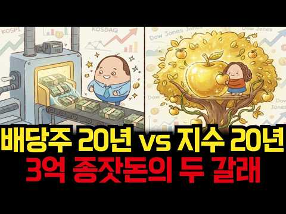
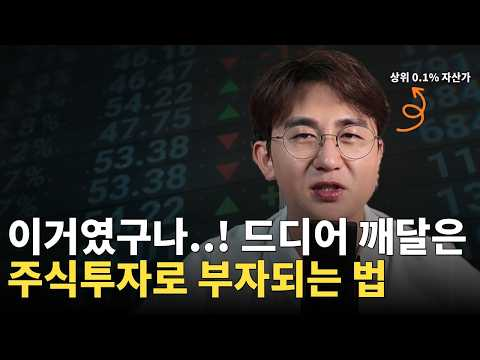
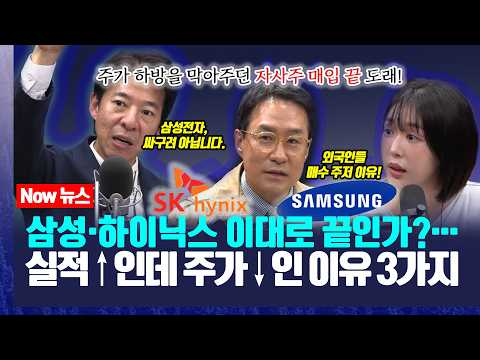
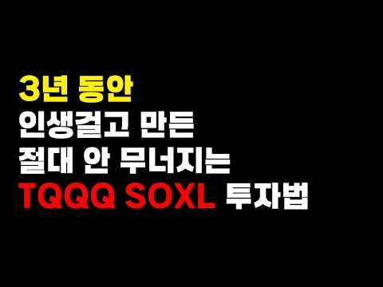
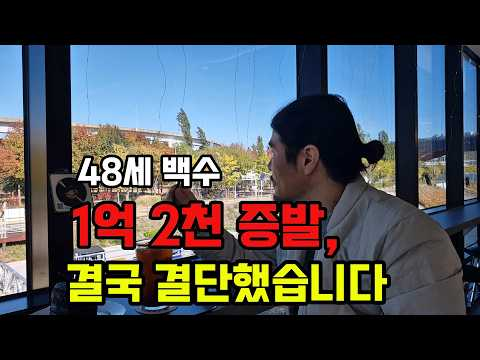
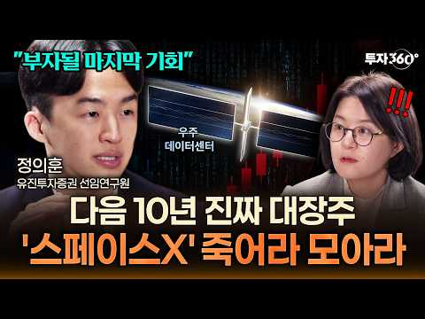
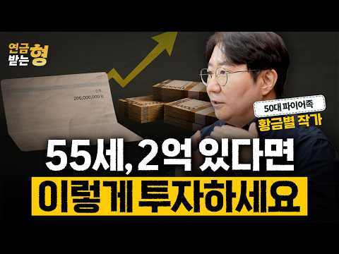
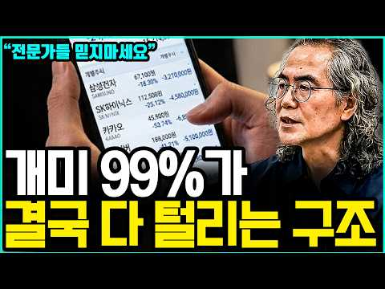
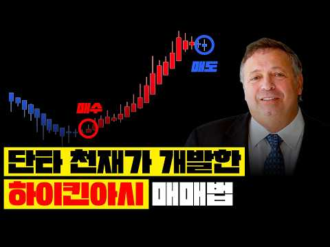

# 주식 — 성공 사례 분석: 사례별 자세히 #41–#68

`analysis.md` 의 9번 (같은 # 번호). 자동 생성 — `tools/success_analysis.py` v1.6.1 (2026-11-28 10:35 UTC). ※ 연구·교육용 — 투자 권유가 아님.

### 41. 나스닥 투자하기 전에 이 영상 꼭 보세요 ∣ QLD만 모아가는 이유

- https://www.youtube.com/watch?v=g10Y6ZA7rng · 올레버 · 구독자 1,600 · 조회수 123,587 (×77.2, 하루 690.1) · 좋아요 1,667 (1.4%) · 5.7분 · 2026-06-02 · 주제 묶음 2. 장기투자·ETF·지수 · 형식 정보·해설 (그 밖) · 폴더 `W_g10Y6ZA7rng` (웹 승인)
- 썸네일: 
- 챕터: 0:00 도입 — QLD를 추천하는 이유 · 0:12 레버리지의 음의 복리(Volatility Decay)… · 1:31 나스닥에서 음의 복리가 반은 틀린 이유 · 2:02 QQQ / QLD / TQQQ 수익률 비교 (2010… · 3:05 왜 TQQQ보다 QLD인가 — 최적 레버리지 배율 · 4:01 2021년 차트로 보는 변동성 비교 · 4:29 장기 투자자에게 QLD가 적합한 이유 · 4:52 개인 목표 (10년 순자산 30억) 기준으로 본 QLD · 5:18 리스크 안내 및 마무리
- 설명 앞부분: 나스닥 ETF, 어떤 걸 사야 할까요? QQQ, QLD, TQQQ. 다들 나스닥 기반인데 뭐가 다른지, 그리고 왜 저는 QLD를 선택했는지 오늘 얘기해볼게요. 이런 분들께 추천드려요 나스닥 ETF 투자를 고민 중인 분 QQQ, QLD, TQQQ 차이가 궁금한 분 레버리지 ETF가 위험하다고 들었는데 궁금한 분 📊 영상에서 다루는 내용 QQQ / QLD / TQQQ 각각 뭐가 다른가 레버리지는 장기 보유하면 녹는다? 진실은 나스닥 각 배율별 10년 수익률 비교 10년 뒤 30억을 위해 필요한 수익률 🎯 목표 : 순자산 30억 파이어…
- 같은 채널 평소 대비 ×165.2 (채널 최근 롱폼 중앙값 748회) · 평소 영상: 배달 뛰다가 워렌버핏의 말을 이해했습니다 ∣ 투자관을 바꾸게 된 계기 (748회) / 이제 저축 안 늘립니다. 30억 파이어족 계획 (592회)
- 대본 (음성인식(앞 5분), 4.2 음절/초) — 앞부분만, 흐름은 그 안까지 첫 20초: “QQQ, QLD, TQQQ 세 가지 중 고민하는 분들이 많은데 저는 그 중 QLD를 적극 추천드리고 있습니다. 그 이후 바로 설명드리겠습니다. 많은 분들이 QLD, TQQQ에 앞서서 우선 레버리지에 대해 부정적인 시각은 가진 분들이 많아요. 그 중 가장 많이 언급되는 게 레버리지는 장기 보유할수록 녹는다 즉 음의 복리인데요.” — 도입부 유형: 내 이야기·사연
- 첫 1분: “QQQ, QLD, TQQQ 세 가지 중 고민하는 분들이 많은데 저는 그 중 QLD를 적극 추천드리고 있습니다. 그 이후 바로 설명드리겠습니다. 많은 분들이 QLD, TQQQ에 앞서서 우선 레버리지에 대해 부정적인 시각은 가진 분들이 많아요. 그 중 가장 많이 언급되는 게 레버리지는 장기 보유할수록 녹는다 즉 음의 복리인데요. 레버리지 상품 자체가 장기적으로 묻어드는 수단이 아니라고 관계자들도 언급을 하고 있고 그리고 실제로 음의 복리가 발생하는 상품이 맞습니다. 두 배 세 배라고 해서 그래프처럼 정확하게 배율대로 가지 않는데요. 이는 1일 변동폭을 추정하고 있기 때문입니다. 쉽게 얘기해서 여기 이 차트를 보시면 1만에서 나스닥이 시작했을 때 1일차에 나스닥이 20% 빠지면 8천이 되고 QLD는 그의 두 배인”
- 흐름 (90초마다 첫 문장): 0:00 QQQ, QLD, TQQQ 세 가지 중 고민하는 분들이 많은데 저는 그… → 1:30 하지만 나스닥에는 반은 맞고 반은 틀렸습니다. → 3:02 유의미한 성장율을 보이고 있다는 거죠. → 4:33 앞으로 몇 번의 폭등과 폭락장이 있을지 모르는 장기 투자를 저희는 해야…
- 댓글 347/349: 좋은 점 — 영상 4 · 감사·응원 18 · 더 알고 싶은 것 24 · 아쉬운 점 — 영상 1 · 반박·불만 — 의견 다름 5 · 정치·사회 0 · 경험 공유 17 · 구독·다음 기대 2
  - 좋은 점 — 영상 👍7 “구독 눌렀어요 좋은정보 앞으로도 부탁드려요😂”
  - 좋은 점 — 영상 👍7 “10~25 년까지는 초저금리 기반 빅테크 대상승장이었죠. 닷컴버블 직후(00~10년)처럼 10년 동안 박스권 횡보장세였다면 진정한 음의 복리 마법을 맛봤을 겁니다.. 그리고 큰 MDD 낙폭은 실제로 겪지 않으면 그게 어떤 느낌인지 피부로 안 와닿아요. 내 투자자산이 …”
  - 감사·응원 👍12 “1.닷컴버블 폭락 기간: 약 2년 6개월 (31개월) 회복 기간: 약 4년 5개월 (53개월) 내 돈이 묶인 총 기간: 약 7년 1개월 2. 리먼 브라더스 사태 폭락 기간: 약 1년 5개월 (17개월) 회복 기간: 약 4년 (48개월) 내 돈이 묶인 총 기간: 약 5…”
  - 감사·응원 👍3 “저도 맘 편해서 QLD 매달 100 좀 넘게 모아갑니다. 최근 하락시 좀 더 사서 모으고 ㅎㅎ 앞으로도 파이팅입니다~😊”
  - 더 알고 싶은 것 👍8 “도움 많이 되었네요! 근데 4:44초에 저런 비교 데이터는 어디에서 볼 수 있을까요?!”
  - 더 알고 싶은 것 👍7 “구독 눌렀어요 좋은정보 앞으로도 부탁드려요😂”
  - 아쉬운 점 — 영상 👍0 “연저펀에 못담는게 아쉽네요.”
  - 반박·불만 — 의견 다름 👍41 “QLD 6년차, 만5년 매도 없이 모아가는 중입니다. 여러분, 레버리지는 하락장 횡보장에 다 녹는 다는 말에 너무 매몰 되지 마세요. 하락후 반드시 찾아오게 되는 긴 상승장에서의 양의 복리는 퍼포먼스가 두배가 아닙니다. 속된말로 존나 오릅니다. 횡보, 하락장에서 추종…”
  - 반박·불만 — 의견 다름 👍13 “하락장 자신없는분은 건드리지도 마세요. 좋다좋다그래도 레버리지는 막 하는거 아닙니다”
  - 경험 공유 👍41 “QLD 6년차, 만5년 매도 없이 모아가는 중입니다. 여러분, 레버리지는 하락장 횡보장에 다 녹는 다는 말에 너무 매몰 되지 마세요. 하락후 반드시 찾아오게 되는 긴 상승장에서의 양의 복리는 퍼포먼스가 두배가 아닙니다. 속된말로 존나 오릅니다. 횡보, 하락장에서 추종…”
  - 경험 공유 👍19 “폭락을 경험해보지도 않은 이런 핏덩이들이 레버리지 좋다고 주절 대는게 너무 귀엽네 ㅋㅋ”
  - 구독·다음 기대 👍3 “구독했습니다~~ 혹시 경상도 이신가요? ㅎㅎ”

### 42. 물린 주식 10년, 결국 전부 팔았습니다 (feat. 복구 심리의 함정)

- https://www.youtube.com/watch?v=OKHm1gUNyPA · 어쩌다마흔 · 구독자 1,840 · 조회수 89,505 (×48.6, 하루 756.9) · 좋아요 1,815 (2.0%) · 9.9분 · 2026-08-02 · 주제 묶음 8. 투자 심리·실패 · 형식 인터뷰·강연·대담 · 폴더 `W_OKHm1gUNyPA` (웹 승인)
- 썸네일: 
- 설명 앞부분: 10년 넘게 국내 개별주식에 투자했습니다. 수익 난 종목도 있었지만, 물린 종목이 더 많았습니다. 전체로 보면 꽤 큰 손실. 결국 얼마 전, 며칠에 걸쳐 전부 팔았습니다. 이번 영상은 계산이나 시장 분석이 아니라 제 이야기입니다. 왜 손실을 확정하면서까지 전량 매도를 택했는지, 그 이유 세 가지와 매도 이후에도 흔들렸던 '복구 심리'까지 솔직하게 담았습니다. 계좌에 물린 종목을 몇 년째 들고 고민 중이시라면, 오늘 영상이 판단에 참고가 되시길 바랍니다.
- 같은 채널 평소 대비 ×11.0 (채널 최근 롱폼 중앙값 8,113회) · 평소 영상: 환율 1,350원 깨지고 미국주식 올인 했습니다 (8,113회) / 부부 식비 40만원, 남은 돈 절반 미국주식 샀습니다 (8,465회)
- 대본 (음성인식(앞 5분), 4.3 음절/초) — 앞부분만, 흐름은 그 안까지 첫 20초: “10년 넘게 하던 국내 주식을 며칠 전 전부 팔고 정리했습니다. 수익이 나서 판 건 아닙니다. 손실을 확정하면서 팔았습니다. 오늘은 쓰라리게 아팠던 제 최근 이야기입니다.” — 도입부 유형: 숫자로 시작
- 첫 1분: “10년 넘게 하던 국내 주식을 며칠 전 전부 팔고 정리했습니다. 수익이 나서 판 건 아닙니다. 손실을 확정하면서 팔았습니다. 오늘은 쓰라리게 아팠던 제 최근 이야기입니다. 안녕하세요 어쩌다 마흔입니다. 오늘은 계산도 시장 얘기도 아닙니다. 제 얘기를 해볼까 합니다. 이번 주도 금요일을 제외하고는 계속 카락장이 이어져서 멘탈이 힘든 한주였습니다. 그리고 저는 계좌에 일부 있던 국내 개별 주식을 며칠에 걸쳐 전부 정리했습니다. 10년 넘게 개별 주 투자를 해온 사람이 그것도 손실을 확정하면서 왜 마흔이 넘어 전부 팔았는지 그 이후 3가지를 오늘 말씀드려볼까 합니다. 이 결정이 결코 정답이라는 얘기가 아닙니다. 다만 저와 비슷한 시기에 계좌에 물린 종목을 들고 고민 중인 분이라면”
- 흐름 (90초마다 첫 문장): 0:00 10년 넘게 하던 국내 주식을 며칠 전 전부 팔고 정리했습니다. → 1:32 수익이 난 종목도 있었습니다. → 3:05 이러도 복구할 시간이 있었으니까요. → 4:31 시간을 쓰고 어느 정도 벌었어도 다시 생각해볼 문제인데
- 댓글 957/970: 좋은 점 — 영상 13 · 감사·응원 36 · 더 알고 싶은 것 5 · 아쉬운 점 — 영상 11 · 반박·불만 — 의견 다름 14 · 정치·사회 16 · 경험 공유 90 · 구독·다음 기대 4
  - 좋은 점 — 영상 👍3 “너무 아쉬워서 댓글올립니다. 현재재무상황과 현재밸류로 하면 당연히 수익이 어렵더라구요.ㅠ 확실한미래성장과 촉매(주가가 부각될 트리거)감안하여, 투자하시면 분명 성과가 있더라구요. 고전(그레이엄,피터린치,코스톨라니,레이달리오.등의 )책을 좀 읽으시면 ETF 선정하시는대…”
  - 좋은 점 — 영상 👍3 “좋은 이야기도 있는데 말하는 사고방식이 본인은 안다고 생각할수도 있겠지만 워렌 버팟의 본질을 전혀 이해 못하고 있다고 할까나 😅 말이나 설명을 하는 사고방식이 아직도 트레이더에요 . 트레이더의 탐욕에 절여진 전혀 벗어나있지를 않는. 좋게 봐줘도 하워드 막스의 통찰을 …”
  - 감사·응원 👍70 “많은 고민이 묻어 나옵니다. 고생하셨습니다. 저도 심각히 고민중입니다. 국장은 절대 개미가 도전할 시장은 아니라는 생각입니다. 말씀 새겨서 결정에 참고하겠습니다. 감사드립니다.”
  - 감사·응원 👍23 “속은 쓰리시겠지만, 길게 보면 잘하셨습니다^^ 저도 과거 오랫동안 개별주로만 투자를 했고, 괜찮은 수익을 얻었지만, 지금은 ETF 투자로 주로 하고, 개별주는 정말 소액만 투자하고 있습니다. 회계사 생활을 오랫동안 하면서, 기업분석과 투자에 나름 자신도 있었지만, 언…”
  - 더 알고 싶은 것 👍1 “얼마 손해 보셨나요?”
  - 더 알고 싶은 것 👍1 “리스크라쓰고 불확실성이라읽어야되여 그불확실에대해 어떤일을 했나요? 추세판단은했나요? 자금을잃지않으려는노력은 그무엇보다중요해요 .. 그러려면예비비확보 분할매매 9시 12시 오후3시 그리고온갖쏟아지는 착시만주는노이즈에대해선어떻게 대응했는지요? 자금 안 읽고오래 시장에 머…”
  - 아쉬운 점 — 영상 👍13 “주식은 자기가 좋아하는 기업 응원하는 마음으로 사서 고수익은 아니더라도 은행금리만큼정도는 이득 아니면 손해일거라 생각했는데, 결국은 큰손들의 도박장인게 너무 실망스럽니다.”
  - 아쉬운 점 — 영상 👍2 “아...한달만 빨리 정리했어도 어쩌면 수익이 났을지도 모르는데 아쉽네요.”
  - 반박·불만 — 의견 다름 👍63 “하루에 지수가 10프로 등락하는 국장은 정상이 아니죠”
  - 반박·불만 — 의견 다름 👍5 “공부해서 주식하려면 미장가세요.. 여기는 상식적인 시장이 아닙니다”
  - 정치·사회 👍24 “그냥주식은 도박이에요 정부에서 인정한 오르고 내리고 하는거 그냥 짜고치는 고스돕같은거 다연기 공부필요없어요 그냥 정부와 기업이 맘대로 올리고 내리고 전 이걸아는순간 이젠안해요 금은사지”
  - 정치·사회 👍6 “국장은 그냥 수급 사줄 놈이 없으면 안올라가지요. 삼닉이 1000조를 벌어도 사줄 놈이 없어요 이번 금요일 국내 탑5 전부 상한가 갔지요? 전부 환호하지만 실상은 외국인들이 10조만 있어도 모든 종목 상한가 보낼 수 있다는 경고 같았어요. 저도 8년 국장하고 이번에 …”
  - 경험 공유 👍113 “저도 다 팔고 미장으로 옮겼습니다. 돈이 문제가 아니라 널뛰기 국장에서는 일상생활이 안됩니다.”
  - 경험 공유 👍70 “많은 고민이 묻어 나옵니다. 고생하셨습니다. 저도 심각히 고민중입니다. 국장은 절대 개미가 도전할 시장은 아니라는 생각입니다. 말씀 새겨서 결정에 참고하겠습니다. 감사드립니다.”
  - 구독·다음 기대 👍6 “같은나이대라 그런지 공감이 많이 됩니다. 늘 영상 기다려요. 응원합니다.^^”
  - 구독·다음 기대 👍2 “감사합니다 구독하고 볼게요 sk하이닉스 들어갈려고했는데 도저히 자신이 없네요”

### 43. SOXL−40% 하루 만에 2조 5천억 달러 증발 ∣ AI 반도체 왜 하루 늦게 터졌을까 ∣ 월가는 '쇼핑 리스트'를 꺼냈다

- https://www.youtube.com/watch?v=XEfn9wjIk40 · 뉴욕대디 다니엘 · 구독자 15,400 · 조회수 129,895 (×8.4, 하루 5,884.4) · 좋아요 959 (0.7%) · 16.9분 · 2026-11-06 · 주제 묶음 기타 · 형식 정보·해설 (그 밖) · 폴더 `W_XEfn9wjIk40` (웹 승인)
- 썸네일: 
- 챕터: 0:00 오프닝: 2조 5천억 달러가 사라진 날 · 1:21 현장: 11월 5일의 숫자 · 2:30 첫 번째 단서: 정치 · 4:28 두 번째 단서: 회사들 스스로 · 6:19 세 번째 단서: 헤지펀드 · 7:28 네 번째 단서: 기계 · 8:29 그래서, 누가 설계했나 · 9:35 3배 레버리지의 함정 · 10:34 역사: 이런 날 뒤에 무슨 일이 · 12:42 누가 버티나 · 15:07 반대편 목소리 · 15:42 정리 · 16:23 마무리
- 설명 앞부분: 안녕하세요, 뉴욕대디 다니엘입니다. 11월 5일, 미국 증시에서 하루 만에 2조 5천억 달러가 사라졌어요. 충격적입니다.. 반도체 지수는 12.25% 빠져 1994년 이후 두 번째로 큰 하락을 기록했어요. 마이크론 −17.5%, AMD −17.3%, 엔비디아 −9.3%, SK하이닉스 −9.5%. 반도체 3배 ETF인 SOXL은 하루 만에 40%가 빠졌습니다. 그런데 선거 결과는 이미 그 전날 나와 있었어요. 폭락은 왜 하루 늦게 왔을까요? 정말 누군가 설계한 걸까요? 정치, 회사들 스스로, 헤지펀드, 그리고 규칙대로 움직이는 기계…
- 같은 채널 평소 대비 ×13.0 (채널 최근 롱폼 중앙값 10,007회) · 평소 영상: 젠슨황 떠나자마자 중국 수상한 움직임 ∣ AI 반도체 전쟁 중국 이길 방법은 단 하나 ∣… (10,007회) / 반도체 폭락 뒤 반드시 찾아오는 대폭등의 역사, 9배 '파멸적 상승' 월가가 기다리는 단… (10,291회)
- 대본 없음 (설명) — 음성인식이 끝나면 도입부·흐름이 들어감
- 댓글 78/78: 좋은 점 — 영상 4 · 감사·응원 8 · 더 알고 싶은 것 2 · 아쉬운 점 — 영상 2 · 반박·불만 — 의견 다름 3 · 정치·사회 0 · 경험 공유 1 · 구독·다음 기대 1
  - 좋은 점 — 영상 👍2 “대박이다~~!! 너무 좋은 영상 감사합니다 매크로 공부하는 많은 도움 되네요😂❤😅😊”
  - 좋은 점 — 영상 👍1 “좋은 영상이네요..근데 외인들은 3년전에 실적이 좋아질것을 알고 미리 사고 미리 빠져나갔다면.. 우리는 실적이라는 희망고문 때문에 손절은 못하고 있는건 아닌지 돌아봐야 될거 같습니다”
  - 감사·응원 👍8 “잘 보았습니다. 감사합니다. 채널 승승장구 하세요”
  - 감사·응원 👍2 “빠른 소식 감사드립니다. 앞으로 잘 부탁드립니다^^”
  - 더 알고 싶은 것 👍2 “빠른 소식 감사드립니다. 앞으로 잘 부탁드립니다^^”
  - 더 알고 싶은 것 👍0 “실적? 만약 Data Center 가 중지되면 실적은 어떻게 되나요?”
  - 아쉬운 점 — 영상 👍0 “ai목소리가 아닌거죠? 귀에 속속 들어오네요. 좋은 내용 감사합니다~”
  - 아쉬운 점 — 영상 👍0 “광고가 넘 많이 나와요ㅠ”
  - 반박·불만 — 의견 다름 👍5 “Soxx는 110 ~ 120 단가바닥입니다 매물대가 없습니다 이후 반등 후 또 바닥을 칠겁니다. 월요일 반등 올 지 모르겠지만, 얼마 안 올거고 다시 매도세가 나올 지 모르겠네요 화요일 CPI 발표 후 엄청난 매도세가 나올 수 있습니다. 11월말까지 나스닥,반도체는 …”
  - 반박·불만 — 의견 다름 👍1 “ai순환금융 구조가 지금 고유가 고물가 고금리 시대에 너무 취약함 결국 트럼프 이 정신 병자가 이란 전쟁 일으킨게 문제지 ㅋㅋㅋ 칩을 담보로 대출 받는 구조를 취하는게 지금 ai 순환금융인데, 이 연쇄구조에서 한 회사가 무너지면 그 칩의 담보가치가 하락해서 연쇄적으로…”
  - 경험 공유 👍1 “그냥 본인 목소리로 쭈욱 설명 해주세요... 내가 인용하는.. 정보가 사실이라는 점을...굳이..증명을 하려는 듯..일일이.. 자막 틀고..직접 당사자 발언.. 소개 하지 말고. 계속 본이 목소리로 설명하세요..... 소파에 누워서 계속...듣게.......사람들 영…”
  - 구독·다음 기대 👍1 “영상 좋네요, 구독하고 갑니다”

### 44. AI로 주식 자동 매매하면 어떻게 될까?

- https://www.youtube.com/watch?v=9E9OrcoMCjk · 이영배 · 구독자 21,700 · 조회수 1,279,782 (×59.0, 하루 7,951.2) · 좋아요 5,985 (0.5%) · 11.3분 · 2026-06-20 · 주제 묶음 7. 매매·전략 · 형식 정보·해설 (그 밖) · 폴더 `W_9E9OrcoMCjk` (웹 승인)
- 썸네일: 
- 같은 채널 평소 대비 ×7.6 (채널 최근 롱폼 중앙값 169,008회) · 평소 영상: AI에게 유튜브 채널을 운영시키면 구독자를 몇 명 모을까? (215,281회) / AI에게 인스타그램 운영을 시키면 팔로워를 몇 명 모을까? (311,894회)
- 대본 (음성인식(앞 5분), 6.8 음절/초) — 앞부분만, 흐름은 그 안까지 첫 20초: “지금부터 AI 두 개로 주식거래 대결 시켜볼 겁니다 누가 더 돈을 많이 벌어올까요? 제가 직접 한번 해보겠습니다 저는 제돈 천만 원을 AI 두 개에게 맡겨봤습니다 하나는 클로드의 오프스 4.8 다른 하나는 오픈 AI의 GPT 5.5인데요 둘 다 현재 최고의 성능을 자랑하는 각 회사의 최신 모델입니다 규칙은 간단합니다 실제 돈 500만 원을 받고 2주, 공일 제외 9 거래일 동안 최대 수익을 내면 됩니다” — 도입부 유형: 질문으로 시작
- 첫 1분: “지금부터 AI 두 개로 주식거래 대결 시켜볼 겁니다 누가 더 돈을 많이 벌어올까요? 제가 직접 한번 해보겠습니다 저는 제돈 천만 원을 AI 두 개에게 맡겨봤습니다 하나는 클로드의 오프스 4.8 다른 하나는 오픈 AI의 GPT 5.5인데요 둘 다 현재 최고의 성능을 자랑하는 각 회사의 최신 모델입니다 규칙은 간단합니다 실제 돈 500만 원을 받고 2주, 공일 제외 9 거래일 동안 최대 수익을 내면 됩니다 가장 먼저 클로드 코드로 거래를 할 수 있는 프로그램을 뚝딱 만들어냈고요 상태를 확인할 수 있는 데시보드도 구현해놨습니다 그래도 2주 동안 함께 하는 녀석들 아닙니까? 그래서 제가 이름도 한번 붙여봤는데 클로드가 짱이냐, 체치 PT가 짱이냐 이걸 정하는 거니까 휠짱이, 체짱이 이렇게 하겠습니다 그렇게 휠짱이와”
- 흐름 (90초마다 첫 문장): 0:00 지금부터 AI 두 개로 주식거래 대결 시켜볼 겁니다 → 1:30 일단 시장을 쭉 관망을 해요 → 3:01 삼성전자를 잇절해서 14만 원을 벌었다고 전 보고를 했단 말이죠 → 4:31 아니 왜 제가 시작하니까 갑자기 이런 일이 생기는 거죠?
- 댓글 578/611: 좋은 점 — 영상 6 · 감사·응원 17 · 더 알고 싶은 것 34 · 아쉬운 점 — 영상 3 · 반박·불만 — 의견 다름 8 · 정치·사회 7 · 경험 공유 34 · 구독·다음 기대 21
  - 좋은 점 — 영상 👍4 “딕션도 좋고 설명이 좋아요 컨텐츠만 좋으면 크게 되실분이다!!화이팅!!”
  - 좋은 점 — 영상 👍2 “영상 잘봤습니다. 앞으로 쭉쭉 좋은 영상 만들어주세요! 응원할게요”
  - 감사·응원 👍4 “딕션도 좋고 설명이 좋아요 컨텐츠만 좋으면 크게 되실분이다!!화이팅!!”
  - 감사·응원 👍3 “형들 마지막에 유튜버분 말들엇지? 현업코딩전문개발자들이 ai사용해서 장기적으로 수익이안나..이말은 전문지식으로 완벽하다 할만큼 만드는데도 지랄발광하면서 디버깅터지고 마이너스맞는거야.. 괜히 난 아이디어가 특별해 하면서 부여잡지마 현업개발자들이 아직 깡깡멀엇다함 미토스…”
  - 더 알고 싶은 것 👍3 “422번째 구독자입니다 올해안에 10만 가실 듯 앞으로도 재밌는 영상부탁드려요!”
  - 더 알고 싶은 것 👍2 “영상 잘봤습니다. 앞으로 쭉쭉 좋은 영상 만들어주세요! 응원할게요”
  - 아쉬운 점 — 영상 👍8 “영상 잘 봤습니다. 우연히 알고리즘 추천에 떠서 봤습니다. 편집이나 말씀 하시는 것도 되게 깔끔하고 보기 좋았습니다.”
  - 아쉬운 점 — 영상 👍4 “영상편집이나 진행. 딕션까지. 우연히 알고리즘에 떠서 봤는데 잼있네요. 구독하고가요”
  - 반박·불만 — 의견 다름 👍200 “재밌어요. 구독자 68명 퀄이아닌데요 머지”
  - 반박·불만 — 의견 다름 👍1 “영상 재밌게 봤습니다. 저도 개인 자동매매 시스템을 직접 개발해서 운영 중인데, 이 영상 보면서 왜 이런 결과가 나왔는지 조금 다른 각도에서 짚어보고 싶어요. **1. "가격을 임의로 예측해서 넣은" 그 버그가 핵심입니다** 영상에서 매도가를 못 불러와서 봇이 알아서…”
  - 정치·사회 👍0 “6월4일이면 선거 끝나고네 선가 전에 주가 올리고 선거끝나고 주가빠지고”
  - 정치·사회 👍0 “대한 외국인이네 딛,ㄹ 곱게 자란 인간들”
  - 경험 공유 👍147 “저도 직접 자동매매 시스템 만들어서 실제 운용 중인데, 느낀 점이 AI한테 판단을 맡기는 게 아니라 내 철학을 코드로 번역하는 게 핵심이더라고요. 언제 사고 언제 파느냐를 AI가 즉흥으로 결정하게 두면 결국 감정매매랑 다를 게 없어요. 시스템이 일관성을 갖추려면 철학…”
  - 경험 공유 👍13 “저도 ai로 코딩하여 자동매매 돌리는중인데 결국은 ai는 프로그램 만드는 툴로만 써야하고 전략은 내가짜야됨..”
  - 구독·다음 기대 👍16 “영상주기만 빨라지만 훨씬 대형채널이 될거같네요 저점매수 구독하고갑니다”
  - 구독·다음 기대 👍9 “이야 ㅋㅋㅋㅋ 주제 ㅅㅌㅊ 돈 잃었으니 바아로 구독합니다”

### 45. 배당주 20년 vs S&P500 20년, 3억 원이 만든 충격적인 자산과 삶의 격차 [ 재테크/미국주식/ETF/배당주/노후준비 ]

- https://www.youtube.com/watch?v=cqgVNBbMYew · 박대리와 황과장의 경제이야기 · 구독자 2,020 · 조회수 87,613 (×43.4, 하루 723.6) · 좋아요 1,184 (1.4%) · 20.5분 · 2026-07-30 · 주제 묶음 4. 미국·해외주식 · 형식 정보·해설 (그 밖) · 폴더 `W_cqgVNBbMYew` (웹 승인)
- 썸네일: 
- 설명 앞부분: 같은 3억 원으로 시작해 20년 동안 완전히 다른 길을 걸어간 두 사람. 미국 배당 성장주에 투자해 매달 현금흐름을 굴린 박 대리와, S&P 500 지수 전체에 투자해 자본의 성장을 노린 황 과장. 20년이라는 긴 세월이 흐른 뒤, 두 사람의 계좌에 찍힌 숫자는 어떻게 달라졌을까요? 그리고 더 중요한 것, 은퇴 후 두 사람의 '진짜 삶의 모습'은 어떻게 갈렸을까요? 단순히 "어느 쪽이 더 많이 벌었나"를 넘어, 자산 형성기에서 은퇴기까지 우리가 투자를 바라보는 관점 자체를 바꿔줄 20년의 실측 데이터 서사를 확인해 보세요. [영상…
- 같은 채널 평소 대비 ×37.3 (채널 최근 롱폼 중앙값 2,346회) · 평소 영상: 배당주 vs 지수 같은 20년, 폭락 3번 중 배당주가 심장을 지켜준 건 단 한 번이었다… (2,389회) / 폭락장에서 파는 것보다 적립을 멈추는 게 더 비쌌다, 6억5천만 원의 청구서 [ 재테크/… (2,304회)
- 대본 (음성인식(앞 5분), 4.9 음절/초) — 앞부분만, 흐름은 그 안까지 첫 20초: “배당주와 지수 주식, 이 두 가지 자산은 같은 주식시장 안에서 가장 오랜 기간 라이벌 관계로 불려왔습니다. 시장이 폭발적인 성장을 온 몸으로 받아내며 지수의 팽창을 누릴 것인가, 새 된 챈 챈 누릴 것인가. 아니면 기업이 만들어내는 당장의 현금 흐름을 매달 꼬박꼬박 재투자하여 복리의 눈덩이를 굴릴 것인가.”
- 첫 1분: “배당주와 지수 주식, 이 두 가지 자산은 같은 주식시장 안에서 가장 오랜 기간 라이벌 관계로 불려왔습니다. 시장이 폭발적인 성장을 온 몸으로 받아내며 지수의 팽창을 누릴 것인가, 새 된 챈 챈 누릴 것인가. 아니면 기업이 만들어내는 당장의 현금 흐름을 매달 꼬박꼬박 재투자하여 복리의 눈덩이를 굴릴 것인가. 오늘 다룰 이야기는 바로 이 질문에서 출발합니다. 출발서는 똑같았습니다. 두 사람에게는 20년 전 각자 핏땀 흘려 모은 종자똥 3억 원이 손에 쥐어져 있었습니다. 대기업 직장인으로 오랜 기간 함께 근무하며 같은 월급을 받고, 같은 점심을 먹고, 같은 퇴근길을 걸었던 박 대리와 황 과장, 두 사람은 어느 날 점심을 먹고 회사 근처 공원 벤치에 앉아 서로의 통장을 열어보았습니다. 각자의 계좌에는 약속이라도 한”
- 흐름 (90초마다 첫 문장): 0:00 배당주와 지수 주식, 이 두 가지 자산은 같은 주식시장 안에서 가장 오… → 1:32 박 대리가 선택한 것은 미국 시장을 대표하는 배당 성장 자산이었습니다. → 3:07 황 과장은 배당에 목매지 않았습니다. → 4:35 S&P 500 역시 연 1.5% 안팎에 소소한 배당을 지급했지만 황과장…
- 댓글 162/168: 좋은 점 — 영상 3 · 감사·응원 4 · 더 알고 싶은 것 3 · 아쉬운 점 — 영상 1 · 반박·불만 — 의견 다름 3 · 정치·사회 5 · 경험 공유 9 · 구독·다음 기대 0
  - 좋은 점 — 영상 👍4 “좋은정보 감사드립니다”
  - 좋은 점 — 영상 👍1 “오 좋은내용감사합니다”
  - 감사·응원 👍4 “좋은정보 감사드립니다”
  - 감사·응원 👍1 “정말 궁금했는데 감사합니당”
  - 더 알고 싶은 것 👍3 “18:07 더이상 근로소득을 기대할수 없는 시점인데 어떻게 생활비로 한푼도 안쓰고 배당 재투자를 할수가 잇을까요?”
  - 더 알고 싶은 것 👍0 “3억 20년 넣고 기다릴 사람이 얼마나될까요? 시드 금액이 넘 큼..1억이면 몰라도.”
  - 아쉬운 점 — 영상 👍0 “지수 팔아서 배당 사면 되는데 결론이 많이 아쉽네요.”
  - 반박·불만 — 의견 다름 👍0 “주식투자에서 가장중요한게 투자기법 심리? 아닙니다 그냥 가만히 있는겁니다 대부분 폭락장에서 90%가 공포에 다던지죠.ㅋㅋ 인간이 가장 힘들어 하는게 가~만히 있는거죠”
  - 반박·불만 — 의견 다름 👍0 “말도 안되는 소리를 하네. 은퇴싯점에 S&P를 팔아서 배당주로 옮기면 되지. 물론, 22%의 양도소득세를 내야 하는데, 그걸 감안해도 황과장이 무조건 이겼구만.”
  - 정치·사회 👍47 “한국 정부는 개인의 노후도 보장 안해주면서, 세계에서 유일하게 세금을 안내는 사람이 세금을 내는 사람보다 혜택이 더욱 많고, 은퇴하면 세금이 더 늘어나고, 중국인을 위해 한국국민이 세금을 더 내게 만든 유일한 나라…”
  - 정치·사회 👍6 “빚내서 그냥 레버타라 정부에서 빚 탕감해준다”
  - 경험 공유 👍5 “운용하기 나름인듯 다만 지수는 손이좀 가고 배당은 손이 조금 덜간다는 차이가 있을뿐. 그리고 배당을 받는경우는 세금문제도 생각해야하고. 수입이 안끊어졌다는 전제로 하락장때 추매를 하면 안되는거였나? 아니면 3억을 한번에 몰아넣지 말고 적립식으로 했었다면?? 지수에 넣…”
  - 경험 공유 👍0 “저는 모든 수익의 절반을 투자 및 재투자하는 방식을 하고 있습니다. 배당주 위주로 하고 있고요. 월급의 절반도 투자, 배당금의 절반도 재투자. 내가 쓸 수 있는 현금도 매년 늘어나고, 배당금도 재투자가 계속 이루어져서 매년 늘어나는 구조죠. 배당금이 2천만원 넘어가면…”

### 46. 주식투자 5년간 수익이 없던 내가 드디어 깨달은 '이것'

- https://www.youtube.com/watch?v=uqsGXwRgP68 · 리채피 richappy · 구독자 10,100 · 조회수 179,766 (×17.8, 하루 3,498.8) · 좋아요 2,439 (1.4%) · 27.8분 · 2026-09-28 · 주제 묶음 11. 투자 일반 · 형식 정보·해설 (그 밖) · 폴더 `W_uqsGXwRgP68` (웹 승인)
- 썸네일: 
- 챕터: 0:00 인트로 · 1:10 5년 동안 제가 주식으로 번 돈은 0원이었습니다 · 3:01 제일 괴로웠던 건 손실이 아니었습니다 · 5:15 2019년, 제가 모으던 건 정답이었습니다 · 11:59 기준을 배운 직후에 무너졌습니다 · 17:59 코로나 폭락, 계좌가 70~80퍼센트 빠졌습니다 · 24:22 드라마 제작사 투자로 자산이 3배가 됐습니다 · 26:56 2022년 금리 인상기, 마이너스 30퍼센트
- 설명 앞부분: 매주 수요일 오후 9시에 라이브를 진행합니다. 많은 분들이 공부한 만큼 계좌가 따라오지 않는 이유를 아직 공부가 부족해서라고 생각하지만, 실제로는 배운 것을 실제 비중과 행동에 옮기지 못한 데서 오는 경우가 많습니다. 여기에 시장이 오를 때 확인 절차를 건너뛰게 만드는 수익의 착각이 겹치면 같은 자리를 다시 맴돌게 됩니다. 한지우는 2016년에 투자를 시작해 5년 동안 책과 강의, 새벽까지 이어진 기업 분석에 매달렸지만 그 기간 주식으로 번 돈은 없었습니다. 2019년 가치투자 스터디에서 만난 투자자들이 종목이 아니라 기준을 이야…
- 같은 채널 평소 대비 ×15.3 (채널 최근 롱폼 중앙값 11,713회) · 평소 영상: 주식투자에서 늘 지던 내가 뒤늦게 알게 된 '이것' (11,713회) / 세계적인 투자자가 평생 붙든 '이것' (9,279회)
- 대본 (음성인식(앞 5분), 5.2 음절/초) — 앞부분만, 흐름은 그 안까지 첫 20초: “요즘은 투자 공부를 할 수 있는 곳이 정말 많습니다. 책도 많고 강의도 많고 예전과는 비교하기 어려울 정도죠. 그런데 공부한 만큼 계좌가 따라오느냐는 또 다른 이야기일 수 있습니다. 저도 그랬습니다. 무려 5년 동안 주식 공부를 했는데도 계좌는 제 자리였습니다. 주변에서는 그 정도 공부했으면 이제 충분하지 않냐는 말까지 들었죠.”
- 첫 1분: “요즘은 투자 공부를 할 수 있는 곳이 정말 많습니다. 책도 많고 강의도 많고 예전과는 비교하기 어려울 정도죠. 그런데 공부한 만큼 계좌가 따라오느냐는 또 다른 이야기일 수 있습니다. 저도 그랬습니다. 무려 5년 동안 주식 공부를 했는데도 계좌는 제 자리였습니다. 주변에서는 그 정도 공부했으면 이제 충분하지 않냐는 말까지 들었죠. 그런데 정작 저는 5년 동안 뭔가를 놓치고 있었습니다. 열심히 공부했지만 제가 놓치고 있었던 건 따로 있었던 겁니다. 그리고 그걸 이해하고 나서부터는 본격적으로 수익이 나기 시작했습니다. 그리고 지금은 경제적 자유를 이루게 됐습니다. 오늘은 제가 그 5년 동안 무엇을 놓치고 있었는지 그리고 수많은 시행차고 끝에 무엇을 깨달았는지 말씀드리겠습니다. 이 영상을 끝까지 보시면 저처럼 오랜”
- 흐름 (90초마다 첫 문장): 0:00 요즘은 투자 공부를 할 수 있는 곳이 정말 많습니다. → 1:30 벌었다가 잃었다가 또 벌었다가 다시 잃었습니다. → 3:01 그런데 무엇보다 돈을 크게 잃었을 때보다 → 4:31 그걸 몰랐던 거죠 3년 차까지는.
- 댓글 111/124: 좋은 점 — 영상 7 · 감사·응원 15 · 더 알고 싶은 것 3 · 아쉬운 점 — 영상 0 · 반박·불만 — 의견 다름 0 · 정치·사회 0 · 경험 공유 12 · 구독·다음 기대 2
  - 좋은 점 — 영상 👍17 “차분하고 솔직한 설명 공감이 가고 참 감동 입니다”
  - 좋은 점 — 영상 👍6 “목소리가 맑고 깨끗해서 듣기좋아요. 마이크가 너무 섬세해서 스피커에 울림이와서 많이거슬려요!”
  - 감사·응원 👍14 “잘봤습니다. 구독. 감사합니다. 뒤늦게 주식에 뛰어든 70초반 입니다. 우선은 오래 버티고 싶습니다.”
  - 감사·응원 👍6 “궁금해서 구독했어요 응원합니다”
  - 더 알고 싶은 것 👍6 “궁금해서 구독했어요 응원합니다”
  - 더 알고 싶은 것 👍0 “반갑습니다60세후반입니다.종가베팅을알고싶어요.참아어렵고힘들어요배움도짧고알고싶어요배움을주세요.감사합니다.”
  - 경험 공유 👍8 “매우 좋은 메시지입니다. 저도 주식에 전념하기로 한 저에게 많은 방향을 주셨습니다.”
  - 경험 공유 👍6 “철저한 절재!!! 다 내려놓고 그걸 행동으로 옮기자. 그 자그만한 행동이 나을 변화 시킨다 다 내꺼가 아니다~ 3년.5개월차에 느낌입니다 잘 하다 크게맞고 또 잘하다 크게맞고 두번 하고 나니까. 아~내가 이런 행동땜에 큰 던을 잊는구나 느끼고 내려놓고 행동으로 옮기니…”
  - 구독·다음 기대 👍6 “궁금해서 구독했어요 응원합니다”
  - 구독·다음 기대 👍4 “구독하고갑니다 감사합니다”

### 47. 삼성·하이닉스 이대로 끝인가?… 지금 시장이 숨기고 있는 진짜 진실

- https://www.youtube.com/watch?v=peJD7gf8MVw · 잘되라대한민국 · 구독자 6,580 · 조회수 106,569 (×16.2, 하루 2,266.4) · 좋아요 692 (0.7%) · 15.1분 · 2026-10-12 · 주제 묶음 기타 · 형식 정보·해설 (그 밖) · 폴더 `W_peJD7gf8MVw` (웹 승인)
- 썸네일: 
- 챕터: 0:00 오프닝 및 반도체 수출 펀더멘탈과 수급 점검 · 4:36 최태원 SK회장 용인·호남 클러스터 동시 구축 언급 … · 6:14 주요 증권사 반도체 리포트 분석 (삼성전자 '세계 최… · 8:20 펀더멘탈은 좋은데 주가가 역주행하는 답답한 시장 상황 · 10:14 '진실은 언젠가 나타난다' : 불확실성에 가려진 본질… · 11:49 한국 증시가 유독 두들겨 맞는 4가지 이유 (자사주 … · 14:30 매물대와 저평가 구간에 대한 부연 및 마무리
- 설명 앞부분: [겸공_12시에만나요 261012] 실적은 사상 최대라는데, 내 계좌는 왜 이 모양일까요? 펀더멘탈에는 이상이 없다고 외치지만, 유독 한국 증시만 두들겨 맞는 진짜 이유를 파헤칩니다. 자사주 매입 종료와 100조 원대 매물대 장벽, 그리고 외국인이 집을 떠나지 못하는 이유까지! 꼬일 대로 꼬인 수급의 비밀과, 안개가 걷힌 뒤 마주할 반도체 본질의 진실을 확인해 보세요.
- 같은 채널 평소 대비 ×3.8 (채널 최근 롱폼 중앙값 28,240회) · 평소 영상: 삼전 67만 하닉 470만 ‘유지’ JP모건, 코스피 15000은 ‘삭제’ (28,240회) / 삼성전자 어닝콜, 소각은 우선주만? 증여세 깎으려 하나··· 역대급 실망 (27,284회)
- 대본 (음성인식(앞 5분), 5.5 음절/초) — 앞부분만, 흐름은 그 안까지 첫 20초: “반도체 관한 수출 가격 fundamental 그건 그만 얘기하자 이상이 없다 이런 얘기예요 그럼 결국에는 수급으로 봐야 된다 저는 그렇게 보고 있고요 그럼 그쵸적으로 뭐가 문제지? 냉정하게 얘기하면 3전 하이닉스의 자사조 매입 사실상 3전은 끝났고 한익도 이제 오늘의 일임이 끝나요 그러니까 이제 던지면 사줄 세력이 없다는 건 인정해야 돼요 그쵸? 오토메틱으로 사는 사람은 없어요” — 도입부 유형: 질문으로 시작, 내 이야기·사연
- 첫 1분: “반도체 관한 수출 가격 fundamental 그건 그만 얘기하자 이상이 없다 이런 얘기예요 그럼 결국에는 수급으로 봐야 된다 저는 그렇게 보고 있고요 그럼 그쵸적으로 뭐가 문제지? 냉정하게 얘기하면 3전 하이닉스의 자사조 매입 사실상 3전은 끝났고 한익도 이제 오늘의 일임이 끝나요 그러니까 이제 던지면 사줄 세력이 없다는 건 인정해야 돼요 그쵸? 오토메틱으로 사는 사람은 없어요 분명 실적은 사상 최대 라는데 명확한 이유도 없이 한국 증심한 유독 두둘겨맞는 지금 많은 분들이 내가 모르는 뭔가 있나 라며 지쳐가고 계십니다 하지만 전 세계에서 돈을 제일 많이 벌고 전력부터 조선 엔진까지 만드는 이 나라의 주식이 진짜 싸구려인 걸까요? 한국 증시를 짓 누르는 이 공포의 실체 과연 언제까지 가려져 있을지 그 진실을”
- 흐름 (90초마다 첫 문장): 0:00 반도체 관한 수출 가격 fundamental 그건 그만 얘기하자 → 1:30 투자를 확대해 나가고 있고 → 3:03 디렘 평균 판매 가격의 상승을 이끌 것이다 라는 내용이었습니다 → 4:32 어쨌든 실적도 좋고 업항도 좋습니다
- 댓글 165/165: 좋은 점 — 영상 2 · 감사·응원 1 · 더 알고 싶은 것 0 · 아쉬운 점 — 영상 0 · 반박·불만 — 의견 다름 3 · 정치·사회 30 · 경험 공유 3 · 구독·다음 기대 0
  - 반박·불만 — 의견 다름 👍0 “그냥 데이터로 분석해서 알려줘야는데 마치 모든걸 다 꿰뚫어 보고 있는 사람처럼 msg를 쳐서 말하니 투자자들이 기업에 대해서 분석 따윈 필요없는 것처럼 순간 솔깃하게 말하는 재주가 있음. 싼데 왜 하락함? 싼데 떨어지면 또 정부탓 기업탓 하고 있을꺼임.. 신랑이랑 내…”
  - 반박·불만 — 의견 다름 👍0 “여러분들 여지껏 박시동 이광수의 주장이 맞은 게 있는지 돌아보세요. 제가 가장 경계하는 것이 특정인의 말을 너무 지나치게 매몰되어서 믿는 것입니다. 주식전문가라는 사람들 절대 너무 믿어서는 안됩니다. 자꾸 실적이 사상 최대 역사적으로 최초 이런 수식어들 붙이고 있지만…”
  - 정치·사회 👍13 “명확한 이유가 있는데. 세계 1위 영업이익 삼성전자는 임직원 준다고 자사주 매입만하고 소각은 안하고 주주환원은 배당으로 한다니 굳이 지금 살필요도 없고 배당하기 한달전쯤부터 사다가 배당기준일까지 갖고 있다가 팔면 되는거 아닌가? 빅테크중에 누가 주주환원을 배당으로 하…”
  - 정치·사회 👍11 “여기 3명 보면 무슨 종교 집단 같음. 신념으로 똘똘 뭉쳐있음. 문제는 그 신념이 전문가라는 명목으로 타인한테 강요함. 국장은 실적 따윈 의미 없음.. 수급이 문제 인데 외국인이 던지는 물량을 개인이 받아줘야하는데, 지난 7월에 레버리지에 다 털려서 돈이 없음. 진짜…”
  - 경험 공유 👍2 “이런방송을 할때는 말의 책임과 무게를 알고 해야한다고 생각합니다 주가방송은 맞으면 제가 말했죠 떨어지면 온갖 이유와 앞으로는 괜찮을거다 기다려봅시다 얘기를 반복할뿐입니다 아무도 책임을 안집니다 대통령조차 웃으면서 주식은 귀신도 모른다 강요한적없다고 말하고 ETF하라던…”
  - 경험 공유 👍0 “그냥 데이터로 분석해서 알려줘야는데 마치 모든걸 다 꿰뚫어 보고 있는 사람처럼 msg를 쳐서 말하니 투자자들이 기업에 대해서 분석 따윈 필요없는 것처럼 순간 솔깃하게 말하는 재주가 있음. 싼데 왜 하락함? 싼데 떨어지면 또 정부탓 기업탓 하고 있을꺼임.. 신랑이랑 내…”

### 48. "이 방법" 대로 사면 TQQQ보다 최소 12억은 더 법니다. 진짜입니다.

- https://www.youtube.com/watch?v=nD8WGVgUJbY · 레버리지 투자노트 · 구독자 4,710 · 조회수 51,212 (×10.9, 하루 1,600.9) · 좋아요 1,230 (2.4%) · 13.8분 · 2026-10-27 · 주제 묶음 기타 · 형식 정보·해설 (그 밖) · 폴더 `W_nD8WGVgUJbY` (웹 승인)
- 썸네일: 
- 챕터: 0:00 TQQQ 그냥 들고 있으면 된다? 2022년 −82%… · 0:33 루프투자법이란? 3배 레버리지를 계좌 일부만 · 0:45 10년 백테스트, TQQQ보다 12억 더 번 이유 · 1:25 언제 시작해도 3년 뒤 손실 0번 · 1:52 이 투자법이 포기한 것, TQQQ 그냥 보유가 더 번… · 2:23 시작한 달이 달라도 연평균 36~39%? · 2:57 2022년 한 해가 10년 결과를 뒤집은 이유 · 3:19 사람이 폭락을 못 버티는 진짜 이유 · 3:51 왜 이름이 "루프"일까? 1루프와 복리 · 4:20 등대, 배, 바닷물로 보는 루프투자법 · 4:56 하나만 빼도 결과가 바뀌는 4가지 장치 · 5:16 장치① 3배는 계좌의 3분의 1만 (SOXL −90.… · 6:17 장치② 떨어진 날 사고 오른 날 판다 · 7:09 그냥 들고 있으면 3배가 녹는 이유 (변동성 끌림) · 7:35 왜 TQQQ가 아니라 SOXL을 골랐을까 · 7:49 하루 한 번, 장 마감 가격으로만 거래하는 이유 · 8:14 장치③ 등대 TQQQ, 반도체에만 걸지 않는다 · 9:18 장치④ 밀물과 썰물, 늘 밀물이면 −72% · 11:07 4가지 장치, 하나라도 빼면 생기는 일 · 11:34 11월 2일 SOXL TQQQ 첫 주문표 공개
- 설명 앞부분: TQQQ를 그냥 들고만 있었다면 2022년에 고점 대비 82%가 사라졌습니다. 같은 3배 레버리지로 더 벌면서, 흔들림은 1배 수준으로 줄인 방법. 제가 만든 루프투자법을 처음으로 공개합니다. 11월 2일부터 제 돈 1만 달러로 이 방법 그대로 사고팝니다. ⏱️ 타임스탬프 ※ 백테스트는 2026년 10월 14일 종가 기준이며 매매 수수료 0.07%를 반영했습니다. 세금과 환율은 제외했습니다. 과거 수익률이 미래 수익을 보장하지 않습니다.
- 같은 채널 평소 대비 ×40.5 (채널 최근 롱폼 중앙값 1,266회) · 평소 영상: 주식투자에 실패 하는 공통적인 이유. 이렇게 해결하세요! (1,044회) / 바빠도 꼭 보세요. 미국주식 투자한다면 무조건 봐야하는 이유 (1,783회)
- 대본 없음 (설명) — 음성인식이 끝나면 도입부·흐름이 들어감
- 댓글 324/324: 좋은 점 — 영상 11 · 감사·응원 27 · 더 알고 싶은 것 36 · 아쉬운 점 — 영상 3 · 반박·불만 — 의견 다름 2 · 정치·사회 0 · 경험 공유 9 · 구독·다음 기대 12
  - 좋은 점 — 영상 👍7 “라오어 책도 빌려보고 따라해보려 했지만 이해가 잘 가지 않았는데 이건 해 볼 만 할거 같네요”
  - 좋은 점 — 영상 👍4 “와 알고리즘으로 떠서 우연히 한번 봤다가 유튜브 바다에서 또 하나의 보석을 발견했네요. 동기 부여 되고 심장 뛰게 하는 아주 좋은 영상입니다. 좋아요 구독 알림까지 다 완료했습니다. 감사하빈다.”
  - 감사·응원 👍5 “이 영상을 보게된것만으로 운이 좋은거 같습니다!! 영상을 100프로 이해하긴 힘들지만 매수 loc는 하락률에 따라 매수 물량이 달라지고 그 물량의 묶음만큼은 그 묶음 평단가 보다 높은 상승 loc로 정리하는 방법론인거 같네요. 장기적인 하락장에서도 물량이 계속 쌓이는…”
  - 감사·응원 👍5 “매수매도방법이궁금하네요 구독해놓고 기다리겠습니다~^^ 감사합니다”
  - 더 알고 싶은 것 👍5 “매수매도방법이궁금하네요 구독해놓고 기다리겠습니다~^^ 감사합니다”
  - 더 알고 싶은 것 👍4 “1. 상승장 하락장 판단 기준이 어떻게 되나요? 2. 90퍼 soxl 1회 구매 비율 3. Loc매수 스프레드 기준 4. 만약 하루 과대 낙폭 시, 또는 장기 하락 시 손절 기준 5. 수익 시 Loc매도 기준가 기준이 궁금한게 많네요 조건에 따라 테스트 돌려보고 싶네…”
  - 아쉬운 점 — 영상 👍3 “시작하실때 저도 살짝 따라해보고싶네요 속슬 물려서 장기투자된계좌랑 매일 자동매수 계좌 있고 지루함 때문에 하고있는계좌 있는데 하시는 방법이 갠찮으면 1만달러. 계좌 속슬만 사팔하는거 있는데 함께 해볼게요 응원합니다”
  - 아쉬운 점 — 영상 👍0 “로직에대한설명은 5프로도안하고 왜 해야하는지에대한 설명만 구구절절이라 뭘 하고자하는지 이해가안됨. 계속반복해서 보면 이해가되겠지만. 그정도는 아닌거 같고 매일매일 계산을해사 LOC주문 넣는것도 쉽지않은일”
  - 반박·불만 — 의견 다름 👍0 “이해가 안됨 100달러를 사고97달러에도 사면 평단은 97달러가아닌데..”
  - 반박·불만 — 의견 다름 👍0 “당신의 방법을 잘 사용하면 부자가 될 수는 있습니다. (나의 매매법보다 공격적임) 하지만 최적화된 매매법은 "만능"은 아닙니다. "만능"은 자신의 최적화가 깨졌을 때 살아남을 수 있어야 합니다. 난 살아남을 수 있습니다. 환율 최고점에서 나의 자산 7억 8천만 원, …”
  - 경험 공유 👍3 “시작하실때 저도 살짝 따라해보고싶네요 속슬 물려서 장기투자된계좌랑 매일 자동매수 계좌 있고 지루함 때문에 하고있는계좌 있는데 하시는 방법이 갠찮으면 1만달러. 계좌 속슬만 사팔하는거 있는데 함께 해볼게요 응원합니다”
  - 경험 공유 👍3 “안녕하세요? Invest Awaken님 님 영상을 보고... (이 로직으로 시작한지 얼마안되었지만... ) 제가 가지고 있는 전략(로직)과 거의 흡사해서 깜짝 놀랬습니다. 구독과 좋아요를 안 누를 수 없네요. 다음영상 기대해봅니다. 빨리 올려주세요”
  - 구독·다음 기대 👍4 “떨사오팔 비슷한것같네요... 1/3만 쓰고 더이상 쓸돈이 없을 때 나머지 2/3를 다시 티어를 나눠 순차 투입하는걸까요~? 구독하고 기다릴게요”
  - 구독·다음 기대 👍3 “안녕하세요? Invest Awaken님 님 영상을 보고... (이 로직으로 시작한지 얼마안되었지만... ) 제가 가지고 있는 전략(로직)과 거의 흡사해서 깜짝 놀랬습니다. 구독과 좋아요를 안 누를 수 없네요. 다음영상 기대해봅니다. 빨리 올려주세요”

### 49. 월급없는삶 1억2000증발 결국 #배당투자 #배당은퇴 #경제적자유 #파이어족 #월배당 #고배당주 #주식투자 #재테크#노후준비#배당금생활 #SCHD #JEPI #…

- https://www.youtube.com/watch?v=tKMTyK8VZ-E · ttobaedang또배당 · 구독자 8,380 · 조회수 54,583 (×6.5, 하루 2,719.0) · 좋아요 640 (1.2%) · 13.7분 · 2026-11-08 · 주제 묶음 11. 투자 일반 · 형식 정보·해설 (그 밖) · 폴더 `W_tKMTyK8VZ-E` (웹 승인)
- 썸네일: 
- 같은 채널 평소 대비 ×3.6 (채널 최근 롱폼 중앙값 15,357회) · 평소 영상: 100만원으로 은퇴해도 행복한이유 #배당투자 #배당은퇴 #경제적자유 #파이어족 #월배당 … (15,357회) / 48세백수 10월배당금 유투브 첫수익 #배당투자 #배당은퇴 #경제적자유 #파이어족 #월배… (15,220회)
- 대본 없음 (없음) — 음성인식이 끝나면 도입부·흐름이 들어감
- 댓글 267/267: 좋은 점 — 영상 4 · 감사·응원 29 · 더 알고 싶은 것 4 · 아쉬운 점 — 영상 2 · 반박·불만 — 의견 다름 3 · 정치·사회 4 · 경험 공유 28 · 구독·다음 기대 2
  - 좋은 점 — 영상 👍17 “일요일 영상 직접 말하시는거 도움이 많이되요ㅎ 감사합니다😊”
  - 좋은 점 — 영상 👍4 “이번에 찾아보니 제이피모건. 코스트코. 코카콜라. 존슨앤존슨. 비자 같은 기업주가가 5년 기준으로 qqq보다 높더라고요 ㅋㅋ 이게 참.. 다들 기술주 보고 있을 때 이러는거 보면.. 정말 정답은 없네요. 솔직히 20대 젊고 고소득이면 Schd+schg만 모아가도 좋을…”
  - 감사·응원 👍27 “계좌의 잔고보다 옆에서 천천히 공감해주고 응원해주는 아내분이 제일 부럽네요 ㅎ”
  - 감사·응원 👍18 “또배당님 참고하면서 마음단단히 부여잡고 이번장을 잘넘겨보려고합니다. 또배당님의 영상이 저같은 주린이에게는 멘탈관리에 정말 많은 도움됩니다. ~~^^오늘도 영상 감사합니다~”
  - 더 알고 싶은 것 👍8 “ISA계좌 5년동안 연2천만원씩 1억을 채우고, 오로지 커버드콜로 운영하니 대략 배당이 170만원정도 나오고 있는거 같아요. 원금손실이 좀 있긴 하지만, 그래도 버티고 있습니다. 궁금한건 만약 배당을 재투자 한다면 어떤걸 해야될까요?? 그냥 커버드콜로만 계속 채워나가…”
  - 더 알고 싶은 것 👍4 “어디카페인지 알수있을까요? 가보고 싶어요ㅎ”
  - 아쉬운 점 — 영상 👍1 “어제영상중에 손실확정후 주식 다시매수 라는 말씀에서 잠시제가 잊고있었던걸 깨우쳐주셔서 아침장에서 내년 해외양도세 나올금액을 계산해서 손실확정후 재매수했습니다. 영상을 반복해서 듣다보니 또배당님이 말씀하신부분이 귀에 딱들어오더라고요.잠시 잊고있던부분이였어요. 진솔한말씀…”
  - 아쉬운 점 — 영상 👍1 “월 배당이 100만원이든 200만원이든 밋밋함과 지루함을 견디고 한 곳만 바라보고 투자한다는게 사실 도파민 희열을 느끼는 사람에겐 고통입니다 또배당님 또한 배당이라는 안정감 그리고 3배레버리지의 도파민 투자 어느 것 놓치고 쉽지 않겠죠 월 배당만 받고 편히 살고 싶다…”
  - 반박·불만 — 의견 다름 👍1 “팔기전엔 손실이 아니죠 사팔 사팔 단타족이나 힘들지 배당 받고 미래 장기투자는 편안합니다. 형님도 흔들리지 않고 투자하시는데 저도 편하게 가겠습니다.”
  - 반박·불만 — 의견 다름 👍1 “상승장에 파이어 하라고 했던 책임을 지고 있는 중이지요(뭐 선생님이 파이어 하란 소리 한건 아니라고 생각합니다) 그 있거든요..나는 못 쉬는데 저사람은 쉬네? 어? 시장이 달라지니 이 사람 이제 틀렸네 막 따라와서 왘왘 거리는 사람들 근데 그 것 때문에 구독자 얻고 …”
  - 정치·사회 👍3 “Soxl작년3.4월12000원에 매수해서 16000원에 매도. 첫미장주식이였어요.그뒤로 올라가는거보고선 미쿡은 다르구나~~했던기억이ㅠ 다시 작년가격으로 많이내려왔지만 전 qld로 분할매수들어갔네요.좀 더 기다렸다 매수할까했는데 맘이급해서리😂 전qqqi를 좀 더 매수해…”
  - 정치·사회 👍1 “너무 인생을 날로 먹으려는거 아닌지...전형적인 민주당스럽노”
  - 경험 공유 👍12 “48세때가 엊그제 같고 내가 벌써 낼 모레 50이라니 너무 우울했었는데 벌써 54살이 됐네요 ㅜㅜ 그냥 48세가 부럽습니다...그리고 배당주나 커버드콜은 긴 횡보장이나 상승장에 원금이 보장되고 버블기에는 사면 안됩니다...국내주식 25년차 미국주식 10년차 수많은 시…”
  - 경험 공유 👍9 “저도 이번장에서 국장.미장에서 2.5억 녹았네요.ㅜ”
  - 구독·다음 기대 👍8 “구독합니다 마인드가 좋으세요”

### 50. 월요일 어마무시한 일 터질겁니다, 한국 개미들만 모르고 있는 충격적인 상황

- https://www.youtube.com/watch?v=tdF_OyN0XZY · 경제사관학교 · 구독자 13,200 · 조회수 111,840 (×8.5, 하루 4,137.2) · 좋아요 796 (0.7%) · 18.7분 · 2026-11-01 · 주제 묶음 8. 투자 심리·실패 · 형식 정보·해설 (그 밖) · 폴더 `W_tdF_OyN0XZY` (웹 승인)
- 썸네일: 
- 챕터: 0:00 월요일 삼성전자, 하이닉스에 큰일 터집니다... 우리… · 0:58 우리 장이 닫힌 그날 밤, 나스닥은 왜 무너졌을까? · 3:09 인텔을 무너뜨린 게, 왜 하필 메모리 값일까? · 5:06 메모리 값이 오르는데, 하이닉스는 왜 7%나 빠졌을까? · 7:15 미국 반도체가 7% 무너진 다음 날, 한국은 어땠을까? · 9:03 금요일에 미리 맞은 매, 월요일엔 덜 아플까? · 11:02 10월 수출 성적표는, 반대편에서 버텨 줄까? · 12:43 월요일만 넘기면, 정말 끝일까? · 14:05 제 시각으로, 월요일 아침 가장 먼저 볼 선은 어디일… · 16:15 그래서 월요일 아침, 내 계좌는 무엇을 해야 할까?
- 설명 앞부분: 10월 30일 종가 자료로 정리했습니다. 10월 30일 금요일, 코스피가 하루 만에 3.48% 내린 5,730으로 마감했고 오전에는 매도 사이드카까지 울렸습니다. 그런데 이건 미국의 폭락을 받기 전이었습니다. 우리 장이 닫힌 그날 밤 나스닥은 2.86%, 미국 반도체지수는 하루 7.2% 빠졌고, 인텔은 하루 만에 28.58% 폭락했습니다. 2000년 이후 금요일 밤 미국 반도체가 이렇게 무너진 여섯 번, 그 뒤 월요일 코스피는 여섯 번 모두 하락으로 끝났습니다. 인텔이 무너진 이유에 왜 메모리 값이 나오는지, 메모리 값이 오르는데…
- 대본 없음 (설명) — 음성인식이 끝나면 도입부·흐름이 들어감
- 댓글 104/104: 좋은 점 — 영상 0 · 감사·응원 0 · 더 알고 싶은 것 0 · 아쉬운 점 — 영상 0 · 반박·불만 — 의견 다름 2 · 정치·사회 3 · 경험 공유 1 · 구독·다음 기대 0
  - 반박·불만 — 의견 다름 👍12 “인텔은700%오른것에 30%로 빠졌다 생각하면 별것아닌데 요새 주식은 한치앞을 모르니 과연 내일 월요일 어떻게될지...”
  - 반박·불만 — 의견 다름 👍0 “헛소리 그만 주둥이 다물어”
  - 정치·사회 👍14 “대통령이란자가 가만히있는 이스라엘,(유대인)자본을건들어서(외인)들이떠날거고 걱정이네요ㅡ”
  - 정치·사회 👍4 “국내주식은 안하는게 돈버는거다 미국주식30%폭락해도 그전에 50% 오른거다 국내주식 공매도가 결정한다 특히 민주당정부는 주식판에 100%관여한다고 본다 여론 나쁘면 올리거나 폭락시킴 난 다시는 민주당 안찍음”
  - 경험 공유 👍5 “나도 알고있는데 모두가 알고있겠지 삼전 10만원 까지 떨어질까 ㆍ기다려본다”

### 51. 4200억 단타 일본 천재가 초간단 매매법, 죽어라 이것만하세요

- https://www.youtube.com/watch?v=UH4UFmdXXo0 · 세력시그널 · 구독자 3,950 · 조회수 120,540 (×30.5, 하루 1,146.7) · 좋아요 2,588 (2.1%) · 20.6분 · 2026-08-15 · 주제 묶음 7. 매매·전략 · 형식 정보·해설 (그 밖) · 폴더 `W_UH4UFmdXXo0` (웹 승인)
- 썸네일: 
- 챕터: 0:00 BNF 코테카와 타카시 ∣ 1,600만 원으로 시작한… · 2:35 슈퍼 트레이더 자동매매 봇 안내 · 2:46 BNF의 은둔형 투자 생활 ∣ 주식에 인생을 건 전업… · 3:41 제이콤 주식 사건 ∣ BNF가 16분 만에 200억 … · 5:49 독학으로 성공한 BNF ∣ 제시 리버모어와 실전 차트… · 6:30 BNF 투자 원칙 ① 가격 움직임과 시장 심리 · 7:30 BNF 투자 원칙 ② 기계적 손절과 리스크 관리 · 8:12 BNF 투자 원칙 ③ 거래량·캔들로 판단하는 익절 타… · 8:44 BNF 투자 원칙 ④ 공포와 탐욕을 이용한 역발상 매매 · 9:32 BNF 투자 원칙 ⑤ 개장 후 첫 30분 관찰 전략 · 10:17 BNF 투자 원칙 ⑥ 감정을 배제한 확률 기반 매매 · 11:00 BNF 투자 원칙 ⑦ 거래량과 종목 선정 기준 · 12:12 BNF 역추세 매매법 ∣ 급락주 바닥을 찾는 3가지 … · 13:15 25일 이동평균선 이격도 ∣ BNF의 급락주 매수 기준 · 14:21 BNF 차트 세팅 ∣ 25일 지수이동평균선·RSI·M… · 15:25 이격도 측정법 ∣ 25일선 대비 -20~35% 과매도… · 16:12 대형주·중소형주·상승장·하락장 이격도 기준 · 17:31 BNF 매수 타이밍 4단계 ∣ 이격도·RSI·MACD… · 18:25 지지선·저항선 활용 ∣ BNF 역추세 매매법 실전 응용 · 19:35 상승장·하락장별 익절과 손절 전략
- 설명 앞부분: 4200억 단타 일본 천재가 초간단 매매법, 죽어라 이것만하세요 🌟슈퍼트레이더 자동 매매봇 신청하기🌟 🌟 BNF 트레이딩 비법 전자책 신청하기🌟
- 같은 채널 평소 대비 ×60.0 (채널 최근 롱폼 중앙값 2,010회) · 평소 영상: 80억을 잃고 깨달은 126 분할매수법 하나로 220억을 번 매매법 (2,010회) / 볼린저 밴드에 RSI를 결합해 수백억 자산가가 된 월가 천재의 매매법 (1,577회)
- 대본 없음 (설명) — 음성인식이 끝나면 도입부·흐름이 들어감
- 댓글 216/249: 좋은 점 — 영상 5 · 감사·응원 28 · 더 알고 싶은 것 0 · 아쉬운 점 — 영상 1 · 반박·불만 — 의견 다름 6 · 정치·사회 0 · 경험 공유 2 · 구독·다음 기대 0
  - 좋은 점 — 영상 👍1 “BNF 정말 유익한 영상이네요. 감사합니다.”
  - 좋은 점 — 영상 👍0 “BNF~ 이걸 이제 봤네요^^; 유익한 내용 공유에 감사드립니다”
  - 감사·응원 👍5 “ㅋㅋㅋㅋㅋㅋㅋㅋㅋㅋ 그냥 ㅈㄴ 웃기네요 BNF 기본 매매법 저대로 시장에 적용해보세요~ 저 진입 조건에 맞는 종목을 찾을 수 있을까요? 화이팅~!!”
  - 감사·응원 👍4 “BNF 정말 잘 봤습니다 감사합니다”
  - 아쉬운 점 — 영상 👍0 “얘들은 한결같네. 낚시질로 펌핑해놓고 걸려들면 전화해서 하루에 얼마씩 거래하는지 시드는 얼마냐는둥 이따구 소리만 해대면서 막상 지표는 안보내고 어떻게든 빨대꽂아서 학원비 받아쳐 먹으려는 공통적인 수법인데...또한가지는 지표신청서 작성을 하면 그이후로 어중이 떠중이로부…”
  - 경험 공유 👍1 “아 나도 할줄알면 이해라도 하는데 무슨말인지조차 모르는 불쌍한1인”

### 52. "원금 안 깎여요" 진화형 커버드콜 ETF 황금 포트폴리오 공개

- https://www.youtube.com/watch?v=yGuybuoroRI · 투자360 · 구독자 16,800 · 조회수 703,371 (×41.9, 하루 4,719.6) · 좋아요 6,467 (0.9%) · 22.2분 · 2026-07-02 · 주제 묶음 2. 장기투자·ETF·지수 · 형식 브이로그·직접 해본 이야기 · 폴더 `W_yGuybuoroRI` (웹 승인)
- 썸네일: 
- 설명 앞부분: 커버드콜 ETF는 정말 원금을 깎아먹는 상품일까요? 한국투자신탁운용 염정인 부장과 함께 커버드콜 ETF의 오해와 진실, 활용법까지 알아봤습니다. 국내 주식형 커버드콜이 절세에 유리한 이유는 무엇인지, 미국 주식형 커버드콜은 왜 연금저축·IRP 계좌에서 활용하는 것이 좋은지도 함께 짚어봅니다. 또한 국내 커버드콜, 해외 커버드콜, 파킹형 ETF 또는 채권형 ETF으로 구성하는 포트폴리오 전략과 계좌별 인출 순서까지 정리했습니다. 노후자금을 지키면서 매달 현금흐름을 만들고 싶은 분들이라면 끝까지 시청해 주세요. 핵심만 골라보기
- 같은 채널 평소 대비 ×26.4 (채널 최근 롱폼 중앙값 26,669회) · 평소 영상: 연금계좌 무엇을 얼마나 담아야할까? 은퇴 시기별 황금 포트폴리오 공개! (16,268회) / 코스피 폭락, 월배당이 답이다? 고금리 시대 커버드콜·단기채·배당주 비중 전략 ∣ 이동후… (11,726회)
- 대본 (음성인식(앞 5분), 5.7 음절/초) — 앞부분만, 흐름은 그 안까지 첫 20초: “그러니까 한마디로 원금 깎아 먹지 않고 오히려 원금을 늘려가면서 꾸준한 분배율도 제공하고 있다 예를 들어 산 5억원 정도 은퇴자금이 있고 여기서 매달 300만 원씩 꺼냈으면 이제 20년이 최안되는 사이에 원금이 다 없어지거든요 제가 보통 추천을 드리는 거는 40, 40, 20씩 이제 말씀을 드려요 커버드 콜 매달 높은 배당금을 준다고 하니” — 도입부 유형: 숫자로 시작
- 첫 1분: “그러니까 한마디로 원금 깎아 먹지 않고 오히려 원금을 늘려가면서 꾸준한 분배율도 제공하고 있다 예를 들어 산 5억원 정도 은퇴자금이 있고 여기서 매달 300만 원씩 꺼냈으면 이제 20년이 최안되는 사이에 원금이 다 없어지거든요 제가 보통 추천을 드리는 거는 40, 40, 20씩 이제 말씀을 드려요 커버드 콜 매달 높은 배당금을 준다고 하니 눈길이 가지만 이러다 이거 결국 내 원금 까먹으면서 쓴 돈 아닌가 하는 생각도 듭니다 오늘은 한국 투자신탁 운용 염정인 부장님과 함께 커버드 콜의 오해와 진실을 명쾌하게 풀어드리고 또 소득 공백기 동안 원금 손실 없이 안전하게 월급을 꺼냈을 수 있는 실전 연금 세팅법까지 상세하게 알아보겠습니다 부장님 안녕하세요 안녕하세요 반갑습니다 부장님과 함께 저희가 이제 소중한 노후”
- 흐름 (90초마다 첫 문장): 0:00 그러니까 한마디로 원금 깎아 먹지 않고 → 1:33 내가 운 좋게 정년까지 갔다 하더라도 → 3:03 커버드콜 말은 좀 어렵지만 → 4:32 나는 그냥 배당만 받고
- 댓글 577/591: 좋은 점 — 영상 4 · 감사·응원 19 · 더 알고 싶은 것 29 · 아쉬운 점 — 영상 8 · 반박·불만 — 의견 다름 7 · 정치·사회 1 · 경험 공유 24 · 구독·다음 기대 0
  - 좋은 점 — 영상 👍10 “그렇게 노다지 좋으면 혼자만 알고있지 왜 동네방네 소문 내고 다니는지 이해가 잘 안가네요..”
  - 감사·응원 👍41 “3:37 거위가 어느 정도 이상으로 홀쭉해지고 나면, 다시는 이전 상태만큼 살이 오르지 "않을지도 모른다는" 위험성을 알려주시는게 맞지 않을까요? 4:40 옛날 커버드콜 상품들은 그러했지만, 최근 출시된 상품들은 이제 그러한 문제점을 개선했다 라고 주장하기엔, 닷컴버…”
  - 감사·응원 👍35 “댓글로도 배웁니다 감사합니다 😊”
  - 더 알고 싶은 것 👍7 “상품을 예시로 설명해주셨으면 좋을거같은데요”
  - 더 알고 싶은 것 👍6 “커버드콜 상품은 기본적으로 주가가올라도 상승에 제한이 있는상품입니다. 지금은 주가 상승기이니 커버콜 상품이 판을치는듯 합니다. 하락시기에는 어떨까요? 판단은 개인몫 2022년 같은 장기 하락기에도 커버콜 상품 권하는분 있을까요? 약장사들 많습니다. 차라리 S&P500…”
  - 아쉬운 점 — 영상 👍1 “본주가 하락하먼 원금도 떨어지는데 제목 어그로가 좀 있네요. 정확히는 배당 준다고 원금 까먹지 않은 커버드콜이 있는거겠지요.”
  - 아쉬운 점 — 영상 👍0 “커버드콜은 누가 돈을 법니까? 옵션장사로 수익내서 분배하는것이기 때문에 옵션장사를 하는 증권사가 수수료를 가져갑니다. 주식이나 주식100% ETF는요? 수수료 경쟁때문에 증권사 수수료가 거의 없다시피 합니다. 누가 돈을버는지 핵심만 이해하면 뭘 해야하는지 뭘 안해야하…”
  - 반박·불만 — 의견 다름 👍28 “지금 시장이 상승하고 있으니까 원금 보장 된다고 떠드는데 하락장 들어가면 바로 원금 박살나고 원금에서 배당 나간다. 위험없이 연15% 배당 나오는 상품이 있는데 세계적인 투자자들이 멍청해서 투자 안하고 있을거라 생각하는지 정말 웃기는 인생들 많구나...ㅉㅉㅉ”
  - 반박·불만 — 의견 다름 👍12 “원금 깎이는게 나쁜게 아닙니다. 세금전략 짤때 배당과 양도, 종합소득 사이의 간격 맞출때 사용함 그리고 사회초년생이면 배당주는 사지마세요 가장 비싼 시간가치를 배당이란 헐값에 파는거임”
  - 경험 공유 👍30 “커버드콜 3년째 하고 있는데ᆢ 좋습니다 ^^ 하락장이오든ᆢ 상승장이 오든 신경끄고 있을수 있어서ᆢ 짱입니다^^”
  - 경험 공유 👍5 “커버드콜 2년째 하고 있는데 개별주보다 훨씬 좋습니다 당연히 분산투자가 되어야 하고 국내지수, 미국지수, 반도체, 미배당, 금 etf 등등 성장도 하고 하락장에는 어느정도 방어되는 섹터도 있어야 되는겁니다 커버드콜의 최고의 매력은 하락장에도 꾸준히 나오는 분배금으로 …”

### 53. 복리가 부를 만드는 진짜 시작점｜언제부터 돈이 스스로 일하기 시작할까

- https://www.youtube.com/watch?v=JExUQaROk40 · 돈의 통찰 · 구독자 3,960 · 조회수 138,144 (×34.9, 하루 1,070.7) · 좋아요 1,562 (1.1%) · 17.8분 · 2026-07-22 · 주제 묶음 1. 주식 기초·초보 · 형식 정보·해설 (그 밖) · 폴더 `W_JExUQaROk40` (웹 승인)
- 썸네일: 
- 설명 앞부분: 복리는 단순히 이자를 더해주는 원리가 아닙니다. 대부분의 사람들은 복리의 힘이 나타나기 전에 포기합니다. 이 영상에서는 복리가 언제부터 눈에 보이는 자산 성장으로 이어지는지, 돈이 스스로 일하기 시작하는 진짜 전환점은 언제인지 실제 숫자와 사례를 통해 쉽게 설명합니다. 장기 투자, 경제적 자유, 자산 증식을 목표로 한다면 꼭 끝까지 시청해 보세요.
- 같은 채널 평소 대비 ×9.9 (채널 최근 롱폼 중앙값 13,920회) · 평소 영상: 돈이 있다고 말하는 순간, 거절의 대가가 커집니다｜자산을 공개하면 생기는 일 (14,035회) / 부자처럼 보이는 사람과 진짜 부자의 결정적 차이｜이 신호를 보세요 (13,804회)
- 대본 없음 (설명) — 음성인식이 끝나면 도입부·흐름이 들어감
- 댓글 103/104: 좋은 점 — 영상 9 · 감사·응원 15 · 더 알고 싶은 것 1 · 아쉬운 점 — 영상 0 · 반박·불만 — 의견 다름 1 · 정치·사회 0 · 경험 공유 12 · 구독·다음 기대 1
  - 좋은 점 — 영상 👍15 “도움되는 영상!구독했어요.기억할께요.복리의 힘.주식시장 떠나지 말고 세월로 돈을 엉덩이로 깔고 않아서 건강만 챙기기.감사합니다.”
  - 좋은 점 — 영상 👍8 “좋은 영상 감사합니다”
  - 감사·응원 👍15 “도움되는 영상!구독했어요.기억할께요.복리의 힘.주식시장 떠나지 말고 세월로 돈을 엉덩이로 깔고 않아서 건강만 챙기기.감사합니다.”
  - 감사·응원 👍8 “좋은 영상 감사합니다”
  - 반박·불만 — 의견 다름 👍7 “늦으면 복리의 마법에 못올라타는게 아니다.. 예를들어 50만원씩 매월 납입을 했다고 가정하면 약 1년 8개월 정도면 1천만원을 달성한다.. 그럼 나는 딱 12개월뒤에 1천만원을 넣었다면? 복리가 답인것 같지만 실제는 원금의 규모다, 개별주로 자금을 불리는 사람도 있다…”
  - 경험 공유 👍96 “제가 4년전 2022년 1~2월달 무렵 그당시 요식업 식당 다니고 있을때 어렵게 모은 종잣돈 8천7백만원이 있었어요...그때 이 돈으로 장사해볼까 정말 고민의 고민을 했어요ㅠ실행 직전까지 갔는데 마지막에 내 자신도 컨트롤 못하는데 내가 요식업 차려서 직원을 잘 컨트롤…”
  - 경험 공유 👍32 “진짜 맞말입니다 이제 고작 3년차 연저펀 에쎈피500 하고있는데요 시간이...와ㅏㅏㅏㅏ 아주 맞는말 😊”
  - 구독·다음 기대 👍15 “도움되는 영상!구독했어요.기억할께요.복리의 힘.주식시장 떠나지 말고 세월로 돈을 엉덩이로 깔고 않아서 건강만 챙기기.감사합니다.”

### 54. 단타 천재가 개발한 초간단 매매법(기본 차트 분석법)

- https://www.youtube.com/watch?v=knblsnwXsfg · 차트9단 · 구독자 469 · 조회수 19,082 (×40.7, 하루 123.1) · 좋아요 426 (2.2%) · 20분 · 2026-06-26 · 주제 묶음 6. 종목 고르기·분석 · 형식 인터뷰·강연·대담 · 폴더 `W_knblsnwXsfg` (웹 승인)
- 썸네일: 
- 챕터: 0:00 시작 · 0:28 이평선 하나면 된다 · 2:21 이평선 사용법 · 5:04 탑다운 매매법 · 8:50 이평선 단타매매법
- 설명 앞부분: 단타 천재가 개발한 초간단 매매법(기본 차트 분석법) 거래량 델타 지표 무료 신청하기 트레이딩 매매법 강의 무료 신청하기 100억 트레이더의 비법서 신청하기 편리한 자동 거래봇 이용 신청하기
- 같은 채널 평소 대비 ×37.8 (채널 최근 롱폼 중앙값 504회) · 평소 영상: 단타 매매법은 딱 두가지만 알면 끝입니다. (이동평균선 거래량 차트보는법) (690회) / 일목균형표 단타 매매법, 이 영상 하나로 종결합니다. (차트 설정법) (319회)
- 대본 없음 (설명) — 음성인식이 끝나면 도입부·흐름이 들어감
- 댓글 7/7: 좋은 점 — 영상 1 · 감사·응원 5 · 더 알고 싶은 것 1 · 아쉬운 점 — 영상 0 · 반박·불만 — 의견 다름 0 · 정치·사회 0 · 경험 공유 0 · 구독·다음 기대 0
  - 좋은 점 — 영상 👍0 “좋은 정보 감사합니다”
  - 감사·응원 👍0 “좋은지표입니다 수고많아요 감사합니다”
  - 감사·응원 👍0 “많이 배웁니다.감사합니다.”
  - 더 알고 싶은 것 👍0 “안녕하십니까 차트9단님 델타거래량지표을 신청합니다 부탁드립니다 감사합니다”

### 55. 라오어 무한매수법, 정말 계속 해도 될까? TQQQ·QLD로 12년 돌려보고 알게 된 의외의 결과

- https://www.youtube.com/watch?v=nCBMBYmFjOU · 여의도 아빠  · 구독자 2,570 · 조회수 68,884 (×26.8, 하루 643.8) · 좋아요 767 (1.1%) · 7.5분 · 2026-08-13 · 주제 묶음 7. 매매·전략 · 형식 정보·해설 (그 밖) · 폴더 `W_nCBMBYmFjOU` (웹 승인)
- 썸네일: 
- 설명 앞부분: 라오어의 무한매수법, 12년을 그대로 돌려봤습니다. 그런데 가장 놀란 건 수익률이 아니었어요. 돈이 놀고 있는 시간과 현금이 바닥나는 순간이었습니다. QLD 무한매수 19배 vs 그냥 거치 30배 TQQQ 무한매수 19배 vs 그냥 거치 59배 12년 내내 현금의 3분의 1이 놀고 있었다 최악의 타이밍 2021년 꼭지 진입 QLD vs TQQQ 무한매수 평소엔 QLD, 찐 폭락엔 TQQQ 시작
- 같은 채널 평소 대비 ×10.5 (채널 최근 롱폼 중앙값 6,578회) · 평소 영상: S&P500에 2배 투자했는데 QQQ 1배보다 수익률이 낮았습니다… 20년 동안 무슨 일… (6,709회) / 아이에게 매달 10만원씩 미국 ETF를 사줬더니… 20년 뒤 계좌에 찍힌 금액 (S&P5… (6,448회)
- 대본 없음 (설명) — 음성인식이 끝나면 도입부·흐름이 들어감
- 댓글 186/215: 좋은 점 — 영상 5 · 감사·응원 7 · 더 알고 싶은 것 12 · 아쉬운 점 — 영상 1 · 반박·불만 — 의견 다름 6 · 정치·사회 0 · 경험 공유 13 · 구독·다음 기대 0
  - 좋은 점 — 영상 👍4 “좋은 영상 감사합니다! 멘탈 유지에 도움이 많이 돼요!”
  - 좋은 점 — 영상 👍3 “평소엔 qld 폭락엔 TQQQ무한매수.. 공감합니다만 '진짜 폭락' 이라는걸 어찌 알 수 있는지가 관건이네요ㅎㅎ.. 대부분은 그걸 못맞추니 이런 규칙이 나오는건데”
  - 감사·응원 👍21 “부지런히 할필요없이 무한매수법 공개api로 프로그램만들어서 자동으로 돌리고 있습니다 .qld도 같이 하고 있고요 . 결과 흥미롭게 잘봤습니다 감사합니다 .”
  - 감사·응원 👍7 “다른의미로 감사합니다 😘”
  - 더 알고 싶은 것 👍13 “더 좋은 방법을 알려주세요”
  - 더 알고 싶은 것 👍5 “무한매수법 저자가 서울대 자퇴, 경력 10년차 소아개원의 치과의사 맞나요? 검색해도 저자의 실명도 없고 최소한 어느 치대를 졸업했는지 최소한의 정보조차 검색이 안되고 모두 비공개라, 늘 마스크 쓰고 다니니 😢 주식관련 멤버십 비용도 월 12만원 받는다는데 저자에 대한…”
  - 아쉬운 점 — 영상 👍3 “제목으로 어그로 끄는건 여전하네”
  - 반박·불만 — 의견 다름 👍30 “무한매수법의 가장 큰 장점은 수익률이 아닙니다. 정해진 규칙을 따라서 상승장, 횡보장, 하락장에도 맨탈이 흔들리지 않으면서 꾸준히 수익을 내는 방법이지. 다양한 시나리오를 가정한 12년치 백테스트는 이 투자방법이 실전에서 쓸수 있는지 확인하는 좋은 방법이긴 하지만 수…”
  - 반박·불만 — 의견 다름 👍28 “웃고 갑니다. 직접 몇년간 하는 입장에서 라오어님 입장도 모르고 그냥 방법만 겉핥기 식으로만 평가하는 느낌이네요. 무한매수법은 리스크를 줄이기 위한 "단투"지 장투에 적합한 방법은 아닙니다. 무슨 qld 장기보유랑 비교를 해요.. 라오어님도 그냥 이것저것 귀찮으면 q…”
  - 경험 공유 👍41 “무한매수의 단점은 1. 상방이 막혀있고 하방은 열려 있으며, 2. 복리를 스스로 끊고 리셋하며, 3. 계속해서 수익을 확정하면서 텍스를 내야하는 텍스 이펙트를 고려하지 않았고, 4. 항상 이용할 수 있는 자금의 일부분만 사용하기에 수익률은 좋을수 있으니 수익금 측면에…”
  - 경험 공유 👍40 “2022년에 라오어 카페에 가입해서 꾸준히 글씀. 그때 세상이 참 재미있었음. 하수들이 세상이 망한다고 고래고래 소리지르고 거기서 유일하게 비껴간게 라오어 카페였음. 거기도 순탄하진 않았지만 적어도 tq가 80프로 떨어진 그 순간에도 tq를 믿는 사람들이 모였단 말임…”

### 56. "중장기 투자? 삼전닉스 말고 스페이스X 모으세요” (정의훈 선임연구원)

- https://www.youtube.com/watch?v=bMR3jvlYDgo · 투자360 · 구독자 16,800 · 조회수 171,781 (×10.2, 하루 3,726.1) · 좋아요 799 (0.5%) · 16분 · 2026-10-13 · 주제 묶음 11. 투자 일반 · 형식 정보·해설 (그 밖) · 폴더 `W_bMR3jvlYDgo` (웹 승인)
- 썸네일: 
- 챕터: 0:00 🔥 하이라이트 · 0:58 🚀 스페이스X 70% 급등, 무슨 일이 있었나 · 3:52 ⚠️ 삼성전자·하이닉스 중장기 투자를 반대하는 이유! · 4:29 💰 70% 오른 스페이스X 개별주 살까? ETF 살까? · 5:59 💰 🌌 우주 데이터센터, 드디어 돈이 되나? · 8:29 📊 스페이스X, 꼭 봐야 할 4가지 지표 · 11:17 🚨 어떤 신호가 나오면 투자를 멈춰야 하나 · 12:55 🔥 스타십·스타링크·AI, 다음 성장동력은? · 14:15 🎯 지금 주가는 고점? “아직 다 반영 안 됐다”
- 설명 앞부분: "삼전닉스 장투 추천 안 합니다. 잘 모르겠으면 스페이스X 사세요” 저점 대비 약 70% 반등한 스페이스X. 지금 들어가기엔 이미 늦은 걸까요? 정의훈 유진투자증권 연구원과 최근 주가 급등 이유부터 특히 현재 주가에 향후 성장 기대가 얼마나 반영됐는지, 어떤 신호가 나오면 투자를 다시 점검해야 하는지도 확인합니다. 🎥촬영일: 2026년 10월 6일 ⏱️ 골라 보는 핵심 투자 포인트
- 같은 채널 평소 대비 ×8.0 (채널 최근 롱폼 중앙값 21,468회) · 평소 영상: 연금계좌 무엇을 얼마나 담아야할까? 은퇴 시기별 황금 포트폴리오 공개! (16,268회) / 코스피 폭락, 월배당이 답이다? 고금리 시대 커버드콜·단기채·배당주 비중 전략 ∣ 이동후… (11,726회)
- 대본 (음성인식(앞 5분), 6.4 음절/초) — 앞부분만, 흐름은 그 안까지 첫 20초: “녹화의 기준으로 거의 170달러까지 거의 저점 대비 한 70%가 오른 상황인데 현대 주가의 반영이 다 됐다고 보세요? 이런 기대치가? 아니요 지금 당장에 클라우드나 이런 부분들이 매출이 올라온 부분만 좀 반영되어 있다고 보거든요 내년도나 내 훈련도의 실적이나 이런 부분들이 훨씬 더 잘 붙을 거라고 보고 있는데 그렇기 때문에 스페이스 X를 사도 괜찮다고 말씀드리지만” — 도입부 유형: 질문으로 시작, 숫자로 시작
- 첫 1분: “녹화의 기준으로 거의 170달러까지 거의 저점 대비 한 70%가 오른 상황인데 현대 주가의 반영이 다 됐다고 보세요? 이런 기대치가? 아니요 지금 당장에 클라우드나 이런 부분들이 매출이 올라온 부분만 좀 반영되어 있다고 보거든요 내년도나 내 훈련도의 실적이나 이런 부분들이 훨씬 더 잘 붙을 거라고 보고 있는데 그렇기 때문에 스페이스 X를 사도 괜찮다고 말씀드리지만 다른 같은 경우에는 잘 모르겠으면 ETF 사세요라고 하잖아요 잘 모르겠으면 그냥 스페이슥들을 사시라 하하하하 라고 말씀 드리고 있어요 지난 회차에서는 누리호 5차 발사의 의미를 중심으로 국내 우주산업의 현재 그리고 투자 기회를 한번 짚어봤습니다 이번에는 글로벌 시장으로 한 번 더 시선을 넓혀서 우주산업의 대표 주자 스페이스 X를 한 번 살펴보려고”
- 흐름 (90초마다 첫 문장): 0:00 녹화의 기준으로 거의 170달러까지 → 1:30 조금 더 공부를 하셨으면 좋겠는 게 → 3:02 그러면 패시브 자금 → 4:30 이런 분들이 계세요
- 댓글 62/89: 좋은 점 — 영상 0 · 감사·응원 1 · 더 알고 싶은 것 0 · 아쉬운 점 — 영상 0 · 반박·불만 — 의견 다름 1 · 정치·사회 4 · 경험 공유 0 · 구독·다음 기대 0
  - 감사·응원 👍0 “연구원님 저는 믿고 있었습니다 감사합니다 스엑 날라가즈아🎉🎉🎉”
  - 반박·불만 — 의견 다름 👍4 “헛소리말고 지수투자나 해라...”
  - 정치·사회 👍5 “공화당이 중간선거 이기면 스페이스x대상승각이다”
  - 정치·사회 👍4 “스페이스X는 중간선거 이후 사는 게 맞지 않나요? 질문 한번 해주세요~”

### 57. "당신이 주식으로 망할 수밖에 없던 이유" 개미 99%의 피를 빨아먹는 잔인한 진짜 구조 ∣ 교수 정선용 (통합본)

- https://www.youtube.com/watch?v=-5NhPWk2zF0 · 너와 나의 경제학교 · 구독자 39,300 · 조회수 378,388 (×9.6, 하루 7,893.7) · 좋아요 2,960 (0.8%) · 117분 · 2026-09-10 · 주제 묶음 8. 투자 심리·실패 · 형식 인터뷰·강연·대담 · 폴더 `W_-5NhPWk2zF0` (웹 승인)
- 썸네일: 
- 설명 앞부분: 정선용, 달리고 읽고 쓰는 사람의 하이
- 같은 채널 평소 대비 ×17.3 (채널 최근 롱폼 중앙값 21,870회) · 평소 영상: "바닥인 줄 알고 샀다가 지하실 갑니다" 고금리에 평생 모은 노후자금 흔적 없이 사라지는… (23,824회) / "대기업 임원도 나한테 종목 물어봐" 지인 돈 40억 쓸어담은 현직 치과의사, 검찰이 계… (23,857회)
- 대본 없음 (설명) — 음성인식이 끝나면 도입부·흐름이 들어감
- 댓글 214/238: 좋은 점 — 영상 9 · 감사·응원 24 · 더 알고 싶은 것 1 · 아쉬운 점 — 영상 4 · 반박·불만 — 의견 다름 5 · 정치·사회 5 · 경험 공유 11 · 구독·다음 기대 1
  - 좋은 점 — 영상 👍30 “교수님 수고 많으세요 항상 맞는말씀만 해주셔서 감사합니다”
  - 좋은 점 — 영상 👍18 “딱ᆢ내이야기 ㅠ 좋은말씀”
  - 감사·응원 👍50 “개미들에게 진심언린 조언 정말 감사합니다ᆢ주식이라는 마귀에홀려서 악어늑대들이 득실거리는 정글에들어간게 후회스럽네요ᆢ돈잃고 건강잃고 집안 잣되고 선생님을 진즉 만나지 못한것이 아쉽네요ᆢ날마다눈물로보내고이슴니다ᆢ마음의 위로가 됩니다ᆢ”
  - 감사·응원 👍49 “1.큰돈 벌생각하면 안됨 2.욕심을 버려야함 3.작은수익도 감사한마음”
  - 더 알고 싶은 것 👍5 “주식잘하는사람이 어떤사람인가요? 이론을 잘아는사람? 매매를 잘하는사람이죠”
  - 아쉬운 점 — 영상 👍50 “개미들에게 진심언린 조언 정말 감사합니다ᆢ주식이라는 마귀에홀려서 악어늑대들이 득실거리는 정글에들어간게 후회스럽네요ᆢ돈잃고 건강잃고 집안 잣되고 선생님을 진즉 만나지 못한것이 아쉽네요ᆢ날마다눈물로보내고이슴니다ᆢ마음의 위로가 됩니다ᆢ”
  - 아쉬운 점 — 영상 👍5 “같은 말만 끊임없이 반복만 하네요”
  - 반박·불만 — 의견 다름 👍3 “그넘어 워렌버픽~~~!! 우리나라 장이 미국장과 같나요??? 절대 같지 않아요 미국장이 기침만해도 우리장은 몸살 걸리는데 이 미친장에서는 오로지 눈치께임~~~!! 그리고 주식 전문가??? 10년전에 주식 시작하면서 의문이 들었던게 저눔들이 추천하는 종목으로 큰돈을번다…”
  - 반박·불만 — 의견 다름 👍2 “주식은 매수시점이 중요하다. 주식은 아무때나 투자 할수 있다는 헛소리 하는 전문가도 있다는게 슬프다. 매도타임 또한 중요하다. 하지만 주식은 익절 손절이 얼마나 힘든지 해보면 안다. 세력에 의해 떨어지는 칼날을 받으면 망하는게 대부분이다.”
  - 정치·사회 👍1 “한국주식,단일종목 흡헐귀 집단● 1.미래에셋 박현주회장:단일종목 상장시키라 김용범 유혹 ㅡ그리하면 김용범과 이찬진 아들 미래에셋 취업시키고,곱버스투자세력 (정권실세50명) 계좌 와 투자관리해서 떼돈 수시로 벌게하겠다 2.국민연금 김성주 이사장:정권 실세들과 짜고 미래…”
  - 정치·사회 👍0 “정지하느놈들이나 대통령 부터 사기치는데 개인들이 벌수 잇겟습니까?”
  - 경험 공유 👍11 “내가 사면 떨어트리고 내가 팔고 나오면 올려데는게 주식입니다 사고 팔고 사고 팔고 해보니 조작이라는걸 알았습니다”
  - 경험 공유 👍7 “처음에 막 벌리길래 놀람. 근데 또 다 털림. 어차피 내돈 아니었어~ 오히려 좋은 경험했다 치고, 자기 합리화~ㅋㅋㅋ”
  - 구독·다음 기대 👍4 “거 희한하다 모두가 정의의 사도라고 자칭하는 사람들은 누구를 위해서 얘기한다는거 .정선용씨는 그러지 않기를 기대합니다 갈수록 태산인라더니 으이그 제발 기관의 나팔수가 아니시길”

### 58. [차트 강의] 100조 운용역이 신입 펀드매니저에게 가르쳤던 차트 패턴 8가지 (박재훈)

- https://www.youtube.com/watch?v=0JHEax_R7DE · 박재훈의 투자농장 · 구독자 22,300 · 조회수 223,197 (×10.0, 하루 3,964.6) · 좋아요 2,134 (1.0%) · 16.5분 · 2026-10-03 · 주제 묶음 6. 종목 고르기·분석 · 형식 인터뷰·강연·대담 · 폴더 `W_0JHEax_R7DE` (웹 승인)
- 썸네일: 
- 설명 앞부분: 10/24(토) 오전 10시, 합정역 인근에서 진행됩니다. 1부는 하반기 투자전략을 점검하고, 2부는 실전 차트강의를 진행합니다. 안녕하세요 이웃님들, 투자 농장지기 박재훈입니다. 저는 투자를 할 때 '손실을 덜 보는 것'이 가장 중요하다고 생각합니다. 그래서 오늘은 차트에서 하락에서 상승, 상승에서 하락으로 추세가 전환되는 신호를 읽는 방법을 알려드렸습니다. 제가 펀드매니저로 일하던 시절, 신입들에게 가르쳤던 내용이기도 합니다. 이웃님들의 투자에 꼭 도움이 되셨기를 바라며.. 하반기 투자전략을 점검하고, 실전 차트 강의를 듣고 …
- 같은 채널 평소 대비 ×18.0 (채널 최근 롱폼 중앙값 12,418회) · 평소 영상: 급락 후 반등한 나스닥, 200일 이동평균선을 꼭 확인해야 하는 이유 ∣ 100조 운용역… (12,418회) / 금리인상 계속된다? 앞으로의 투자 전략 '이렇게' 가져가세요 (박재훈) (11,878회)
- 대본 없음 (설명) — 음성인식이 끝나면 도입부·흐름이 들어감
- 댓글 76/80: 좋은 점 — 영상 7 · 감사·응원 17 · 더 알고 싶은 것 5 · 아쉬운 점 — 영상 1 · 반박·불만 — 의견 다름 0 · 정치·사회 0 · 경험 공유 3 · 구독·다음 기대 0
  - 좋은 점 — 영상 👍5 “진작에 이런 공부 배웠으면 작전세력들한테 덜 당했을것인데! 지금이라도 공부하고 암기하면서 실제 나타나는 모양들과 비교분석하는 눈 썰미를 키워 보겠습니다. 선생님덕분에 저의 소중한 돈 잘 지키겠습니다.”
  - 좋은 점 — 영상 👍0 “유익하게 감사히 잘 봤습니다”
  - 감사·응원 👍2 “목소리도 시원시원하시고 설명도 깔끔! 감사히 잘 들었습니다. 무료강의 신청했습니다^^”
  - 감사·응원 👍1 “선생님 안녕하세요. 잘 보고 있습니다. 장대양봉에 대해서 어느정도 기준을 알고싶습니다. 말 뜻은 이해하고 있지만 얼마만큼의 길이가 장대양봉이고 장대음봉인지.. 구분하고싶습니다. 감사합니다.”
  - 더 알고 싶은 것 👍1 “선생님 안녕하세요. 잘 보고 있습니다. 장대양봉에 대해서 어느정도 기준을 알고싶습니다. 말 뜻은 이해하고 있지만 얼마만큼의 길이가 장대양봉이고 장대음봉인지.. 구분하고싶습니다. 감사합니다.”
  - 더 알고 싶은 것 👍0 “선생님 이게 개별종목에도 적용이 되는건지 아님 지수 차트에만 해당하는건지 궁금합니다. 영상 잘 봤습니다.”
  - 아쉬운 점 — 영상 👍0 “쏙쏙 이해가 잘되요 반복해서 봐야지 ㄱㅅ”
  - 경험 공유 👍1 “저 엄청 잘해요 추세 전환 찾는거 제가 고수 ㅋ 6월말에 다 던지고 7월말에 샀어요”
  - 경험 공유 👍0 “저희쪽으로 모시고 싶습니다^^ 영상 볼때마다 느낍니다”

### 59. 생활비 한 달 5만원..10년 만에 배당금 월 300만원 받는 이유 (조윤진 1부) #세미파이어 #배당투자

- https://www.youtube.com/watch?v=Wc52vsC6q4U · 자람들 - 자립하는사람들 · 구독자 36,100 · 조회수 828,737 (×23.0, 하루 6,189.2) · 좋아요 6,932 (0.8%) · 29.3분 · 2026-07-17 · 주제 묶음 3. 배당 · 형식 브이로그·직접 해본 이야기 · 폴더 `W_Wc52vsC6q4U` (웹 승인)
- 썸네일: 
- 설명 앞부분: 👤 오늘의 게스트: 조윤진 작가 '6억으로 시작한 세미파이어' 저자 & 배당으로 부자되기 유튜브 채널 운영 평범한 중소기업 직장인이었던 그녀는 이혼 후 경제적으로 큰 타격을 입고, "목숨 걸고 노후를 준비해야겠다"는 마음으로 10년간 악착같이 아끼고 모았습니다. 5천만 원으로 시작한 시드는 10년 만에 6억 원으로 불어났고, 지금은 매달 통장에 꽂히는 배당금만으로도 마음 편한 노후 시스템을 만들었습니다. 매도 없이 배당만 쌓아가는 그녀만의 투자 철학과, 특별할 것 없는 월급으로도 가능했던 절약과 시드 마련의 여정을 담아 첫 책 '…
- 같은 채널 평소 대비 ×42.2 (채널 최근 롱폼 중앙값 19,630회) · 평소 영상: '40억 파이어족' 이렇게 10년 살면 부자 안 되기가 더 어렵습니다. 진짜 부자 되는 … (19,630회) / '월 500 배당으로 파이어 달성' 6년 만에 5억 만든 스토리 공개 (박차장 3부) #… (16,634회)
- 대본 없음 (설명) — 음성인식이 끝나면 도입부·흐름이 들어감
- 댓글 613/613: 좋은 점 — 영상 30 · 감사·응원 43 · 더 알고 싶은 것 33 · 아쉬운 점 — 영상 3 · 반박·불만 — 의견 다름 7 · 정치·사회 8 · 경험 공유 43 · 구독·다음 기대 2
  - 좋은 점 — 영상 👍755 “돈 모으려면 거지소리 들어가면서 미친듯이 모아도 될까 말까입니다. 그렇게까지 해야하냐는 말하는 사람들하고는 인간관계를 끊는게 내 인생발전에 훨씬 도움이 됩니다.”
  - 좋은 점 — 영상 👍32 “이 영상 첨 보는 데 정말 가슴에 와닿는 이야기네요 보통 사람들이 공감하고 같이 느낄 수 있는 이야기네요 유익한 영상 잘 보았습니다”
  - 감사·응원 👍416 “안녕하세요 인터뷰했던 '6억으로 시작한 세미파이어' 저자 배당으로 부자되기입니다. 비 오는데 진행 잘 이끌어주셔서 즐겁게 촬영했습니다. 이런 다큐 인터뷰 기회 주셔서 감사합니다. 하필 요즘 코스피가 더 내려서 장이 롤러코스터이긴 한데 끝까지 살아남는 배당투자로 노후를…”
  - 감사·응원 👍30 “귀한 영상 감사합니다.♡ 솔직하신 투자 경험 이야기 유익했습니다.♡ 감사합니다.^^ 성투하세요.❤”
  - 더 알고 싶은 것 👍10 “배당주하다가 귀가앏아 삼성 sk 물렸네요 ㅠ내 자신이 한탄스럽네요 ㅠ50대인데 앞이 깜깜해요~~미국배당다우존스는 sol tiger ace중 어느게 나을까요?공부해도 ㅠ”
  - 더 알고 싶은 것 👍3 “세금. 건보료는 어떻게 하시나요?”
  - 아쉬운 점 — 영상 👍27 “내용은 상당히 좋은데요 촬영을 할 때, 카메라를 고정시켜놓고 찍으셔야겠어요. 화면이 흔들거려요. 이건 아주 기본적인 것인데 많이 아쉽네요.”
  - 반박·불만 — 의견 다름 👍0 “커버드콜 하락장 오면 개박살나는구조다.알고투자해야한다.지금까지 미국장이 폭락장이 없어서 커버드콜 할만하지 하락하면 손실 그대로 다때려맞고 수익은 콜옵션매도 권리행사가로 막혀있으니 이런 말도안되는 상품이없다”
  - 반박·불만 — 의견 다름 👍0 “배당률이 영원한게 아닌데...”
  - 정치·사회 👍2 “이런 영상좀 올리지 마라 정부에서 이러니까 배당투자자들 정조준에서 건보료 개편하자나 시바”
  - 정치·사회 👍2 “이젠 코스피마저 나락가네 요즘 전과4범 범죄자 지지율 계속 뚝뚝 떨어지고있는데 부동산 꼼수거래로 본격적으로 나락 가고있는중..무능하고 부패한 전과4범의 범죄자..경제,주식,부동산, 환율, 물가 어느하나 제대로 하고있는게 없다 환율은 Imf때보다 더 미친듯 치솟고 원화…”
  - 경험 공유 👍37 “저도 배당금 500 이상 받고있어요 노후에는 필요한것같아요 매도 안하니까 일상생활에 집중할 수 있고 마음이 편해요~ etf도 모아가고있어요^^”
  - 경험 공유 👍32 “내가 주식29년차인데 깡통4번차고..겨우 살아만있는데 커버드콜로 계속바꾸고있다.현재는80만정도받고있다.목표는달500..😅😅😅”
  - 구독·다음 기대 👍8 “매일 듣기만했는데 이번엔 정말 시도를 해보고 싶네요. 늦은 감이 있지만 시작해보고 싶네요. 말씀 감사합니다.”
  - 구독·다음 기대 👍0 “좋은 영상 감사합니다~ 작가님 구독했어요^^”

### 60. 남들이 걱정하는 삶을 선택했습니다 #배당투자 #배당은퇴 #경제적자유 #파이어족 #월배당 #고배당주 #주식투자 #재테크#노후준비#배당금생활 #SCHD #JEPI …

- https://www.youtube.com/watch?v=SiE0NjI7Fu0 · ttobaedang또배당 · 구독자 8,380 · 조회수 64,379 (×7.7, 하루 1,428.1) · 좋아요 498 (0.8%) · 9.1분 · 2026-10-14 · 주제 묶음 11. 투자 일반 · 형식 정보·해설 (그 밖) · 폴더 `W_SiE0NjI7Fu0` (웹 승인)
- 썸네일: 
- 같은 채널 평소 대비 ×4.2 (채널 최근 롱폼 중앙값 15,357회) · 평소 영상: 100만원으로 은퇴해도 행복한이유 #배당투자 #배당은퇴 #경제적자유 #파이어족 #월배당 … (15,357회) / 48세백수 10월배당금 유투브 첫수익 #배당투자 #배당은퇴 #경제적자유 #파이어족 #월배… (15,220회)
- 대본 (음성인식(앞 5분), 4.8 음절/초) — 앞부분만, 흐름은 그 안까지 첫 20초: “저는 올해 48세입니다. 직정도 없고 매달 들어오는 월급도 없습니다. 흔히 말하는 백수입니다. 48세에 직장이 없다고 하면 사람들은 걱정을 합니다. 하지만 돈이 많아서 일을 하지 않는다고 하면 사람들은 부러워합니다.” — 도입부 유형: 숫자로 시작, 내 이야기·사연
- 첫 1분: “저는 올해 48세입니다. 직정도 없고 매달 들어오는 월급도 없습니다. 흔히 말하는 백수입니다. 48세에 직장이 없다고 하면 사람들은 걱정을 합니다. 하지만 돈이 많아서 일을 하지 않는다고 하면 사람들은 부러워합니다. 똑같이 아침에 일어나 밥을 먹고 동네를 산책하며 하루를 보내는데 누군가는 성공한 대자가 되고 누군가는 한심한 백수가 됩니다. 그렇다면 우리가 평가하는 것은 그 사람의 인생일까요? 아니면 그 사람의 가진 돈일까요? 저는 직장을 그만두고 나서 이런 생각을 자주 하게 됐습니다. 사람은 언제부터 살아가는 것만으로는 부족해서 끊임없이 자신의 가치를 증명해야 하는 존재가 되었을까? 오늘은 48세에 백수가 되고 나서 비로소 알게 된 이야기를 해보려고 합니다. 우리는 처음 만난 사람에게 흔히 이렇게 웃습니다.”
- 흐름 (90초마다 첫 문장): 0:00 저는 올해 48세입니다. 직정도 없고 매달 들어오는 월급도 없습니다. … → 1:39 그 사람이 얼마나 많은 실패를 견뎌는지, 누구를 위해 자신의 목수를 포… → 3:12 월요일 아침이면 어딘가로 가야 할 것 같고 하루 종일 집에 있으면 괜히… → 4:38 하지만 그런 걱정을 들으며 한 가지 생각을 하게 됐습니다. 사람은 누구…
- 댓글 174/186: 좋은 점 — 영상 3 · 감사·응원 20 · 더 알고 싶은 것 6 · 아쉬운 점 — 영상 0 · 반박·불만 — 의견 다름 0 · 정치·사회 0 · 경험 공유 11 · 구독·다음 기대 2
  - 좋은 점 — 영상 👍4 “진정성이 느껴지고 서민형이라 와닿는 영상이라 보면서 위로를 받게 되네요. 좋은 영상 자주 올려주세요. 😊❤”
  - 좋은 점 — 영상 👍1 “울림이 있는 story, 공감이 되고 배우고 갑니다~”
  - 감사·응원 👍22 “당신의 직업은 투자자, 유튜버^^ 늘 응원하겠습니다”
  - 감사·응원 👍8 “현대는 직업이 필요가 없어졌습니다. 단지 생활비를 충당할 수 있는 근원지 배당금, 이자, 월세소득 등 원천을 만드는 것이 중요하죠. 또배당금님은 현재 잘 하고 계신거예요. 직장이 없어도 배당금으로 자유롭게 생활하실 수 있는것이 얼마나 대단한것인지 높이 평가해요. 질투…”
  - 더 알고 싶은 것 👍4 “진정성이 느껴지고 서민형이라 와닿는 영상이라 보면서 위로를 받게 되네요. 좋은 영상 자주 올려주세요. 😊❤”
  - 더 알고 싶은 것 👍3 “안녕하십니까 또배당님! 금일 영상은 원고가 매우 훌륭하고 좋습니다 감동적입니다 자신의선택과 책임을 말씀하는 철학은 울림이 있습니다, 다음에 기회가되면 제가 운영하고 있는 다음카페에 칼럼기고를 부탁드려도 될까요”
  - 경험 공유 👍8 “나도 도배당아저씨처럼 할수있다는 희망으로 삽니다”
  - 경험 공유 👍7 “세상을 보는 안목과 생각이 깊고 넓으시군요. 저도 공감되는 말씀입니다.”
  - 구독·다음 기대 👍1 “호동대표님 유튜브보고 구독하러왔어요 자주영상 올려주세요😊 세미파이어족 화이팅!!”

### 61. "2억 모았다면 이제 '이렇게' 투자하세요" 손실 없이 돈을 불리는 확실한 투자 전략 ∣ 황금별 작가 ∣ 연금받는형

- https://www.youtube.com/watch?v=-ZozYKj6CxU · 연금 받는 형 · 구독자 25,700 · 조회수 135,424 (×5.3, 하루 4,375.6) · 좋아요 558 (0.4%) · 27.8분 · 2026-10-28 · 주제 묶음 7. 매매·전략 · 형식 정보·해설 (그 밖) · 폴더 `W_-ZozYKj6CxU` (웹 승인)
- 썸네일: 
- 설명 앞부분: 은퇴는 다가오는데 주식이 폭락했다면, 회복할 때까지 무조건 버티면 될까요? 같은 하락장이라도 어떤 자산을 가지고 있는지, 생활비로 쓸 돈을 따로 준비했는지에 따라 대응은 달라집니다. 은퇴를 앞뒀다면 얼마나 더 벌 수 있을지만큼, 떨어지는 시장을 얼마나 견딜 수 있을지도 생각해야 합니다. 황금별 작가는 배당주와 지수형 자산, 현금과 달러를 중심에 두고 은퇴 후를 준비하는 방법을 이야기합니다. 시장의 방향을 맞히려 하기보다 생활비와 투자 자금을 구분하고, 하락했을 때 어떻게 대응할지 미리 기준을 세우는 것입니다. 이번 영상에서는 은퇴…
- 같은 채널 평소 대비 ×2.9 (채널 최근 롱폼 중앙값 47,157회) · 평소 영상: 건보료·기초연금 아끼려다 노후 망칩니다. 국민연금 줄이면 안 되는 이유 ∣ 김윤로 대표 … (47,157회) / “일찍 받으면 손해, 늦게 받으면 이득?” 국민연금 계산에서 빠진 한 가지 ∣ 김윤로 대… (47,796회)
- 대본 없음 (설명) — 음성인식이 끝나면 도입부·흐름이 들어감
- 댓글 31/31: 좋은 점 — 영상 1 · 감사·응원 2 · 더 알고 싶은 것 2 · 아쉬운 점 — 영상 0 · 반박·불만 — 의견 다름 0 · 정치·사회 3 · 경험 공유 3 · 구독·다음 기대 0
  - 좋은 점 — 영상 👍1 “항상 좋은 영상을 제공해 주셔서 감사드립니다 ^^”
  - 감사·응원 👍9 “직접 해 보시고 경험에서 나오시는 말씀❤감사합니다”
  - 감사·응원 👍1 “항상 좋은 영상을 제공해 주셔서 감사드립니다 ^^”
  - 더 알고 싶은 것 👍17 “하이닉스 270만원 물린 사람은 원금으로 몇년기다리면 탈출가능할까요?”
  - 더 알고 싶은 것 👍0 “채권 투자하셨던 분인데 어떻게 됐나요?”
  - 정치·사회 👍1 “한국이 안고 있는 가장 큰 이슈는 항상 정치이슈였음. 현재 외국인이 썰물되는 이유는 판래기 리스크임.”
  - 정치·사회 👍1 “국장은 정권때문에 안됨.”
  - 경험 공유 👍6 “절세계좌에서 1억대etf 모았는데 정년까지 쭉모아서 연금으로 활용하려고 합니다. 시간과 복리를 믿어요~ 3년차입니다~”
  - 경험 공유 👍0 “금투자에 대한 포지션이 저와 동일하네요^^ 저도 전체 자산에서 5~10%만 담고 포트에서 제외시켜 놓고 길~~게 가져가고 있습니다 조언이 아주 현명하십니다”

### 62. 내 주변에 주식으로 돈 번 사람이 '진짜' 단 1명도 없는 소름 돋는 이유 ∣ 교수 정선용 (통합본)

- https://www.youtube.com/watch?v=SwW4n0ERlS8 · 너와 나의 경제학교 · 구독자 39,300 · 조회수 620,890 (×15.8, 하루 6,468.0) · 좋아요 11,614 (1.9%) · 52.7분 · 2026-08-14 · 주제 묶음 11. 투자 일반 · 형식 인터뷰·강연·대담 · 폴더 `W_SwW4n0ERlS8` (웹 승인)
- 썸네일: 
- 설명 앞부분: 정선용, 달리고 읽고 쓰는 사람의 하이
- 같은 채널 평소 대비 ×28.4 (채널 최근 롱폼 중앙값 21,870회) · 평소 영상: "바닥인 줄 알고 샀다가 지하실 갑니다" 고금리에 평생 모은 노후자금 흔적 없이 사라지는… (23,824회) / "대기업 임원도 나한테 종목 물어봐" 지인 돈 40억 쓸어담은 현직 치과의사, 검찰이 계… (23,857회)
- 대본 없음 (설명) — 음성인식이 끝나면 도입부·흐름이 들어감
- 댓글 1,622/1,622: 좋은 점 — 영상 54 · 감사·응원 77 · 더 알고 싶은 것 15 · 아쉬운 점 — 영상 15 · 반박·불만 — 의견 다름 53 · 정치·사회 45 · 경험 공유 131 · 구독·다음 기대 3
  - 좋은 점 — 영상 👍332 “이분이 최고의 주식 전문가 입니다 인정합니다 허황된 꿈을 부추기지 않고 현실적인 필요하고 도움되는 얘기만 하시네요”
  - 좋은 점 — 영상 👍196 “구구절절 맞는말입니다 사람 좋아 보이는거랑 그들의 속마음은 다르다는걸 알았습니다”
  - 감사·응원 👍242 “귀한말씀 너무 늦게 들어서 안타까울 따름입니다 삼전 65만 하닉 400간다고 하면서 정작 자신들은 팔고 있었다는것을 나중에 알게됐습니다. 그렇게 보고서를 낸 증권사나 그걸 유튜브에서 전파한 사람들은 앞으로 다신 보지않을것입니다 귀한말씀 다시한번 감사드립니다”
  - 감사·응원 👍221 “안그래도 느꼈어요 요즘은 증권방송 보기도 싷더라구요 소위 주식 전문가들 증권사 직원들 에널리스트들 전부 자기밥그릇 챙기느라 혈안ᆢ 한통속 이예요 ᆢ 그들의 만행을 속시원히 알려주니 감사하네요 ᆢ”
  - 더 알고 싶은 것 👍3 “어떻게 사셨길래 99%가 잃는 주변인만 뒀나요? 교수님 과장도 적당히 하셔요”
  - 더 알고 싶은 것 👍3 “때가어느때인데유투버보고피같은돈을투자할까요?”
  - 아쉬운 점 — 영상 👍6 “어머니 돈을 불려 주겠다고 600만원을 받아서 투자를 하는데 많이 버는것 보다 잃으면 절대 안되겠다 생각이 먼저 들었습니다. 종목을 결정하는데 얼마나 벌지 모르지만 안 잃을거 같은 종목만 매수 해서 시장의 관심을 받으면 매도하고 다시 반복해서 현재 연복리65% 수익에…”
  - 아쉬운 점 — 영상 👍3 “이 사람도 결국에는 공포 마케팅으로 구독자 어그로 끄는 거임”
  - 반박·불만 — 의견 다름 👍31 “누구 믿고 투자한다는 인간들은 절대 투자하지 말아야 될 사람이에요. 결국 그 의존성 때문에 손실납니다. 그냥 저축하는 편이 안 망하는 길입니다. 주식은 원금 지키며 쌓는 저축이 아닙니다. 손실 볼 수 있는 투자에요.”
  - 반박·불만 — 의견 다름 👍24 “대가들의 책만 몇권 읽어봐도 알게됩니다. 전문가,교수,애널리스트들은 당신들의 편이 아닙니다. 그들은 당신들을 이용해서 돈을 버는것이지, 당신들을 부자로 만들어즐 이유가 1도 없어요.”
  - 정치·사회 👍189 “개미들 돈 누가 다 먹었을까요? 다 외국인 기관들한테 갔습니다 증권사는 수수료로 돈 잔치 했겠죠. 그동안 주식해서 번돈 다시 재투자하면서 이제 원금입니다 ㅠ 그나마 다행이지요. ㅠㅠ 그동안 무료 봉사 했어요 주식에~~~~”
  - 정치·사회 👍88 “딱 맞아요... 애널리스트 증권회사 삐끼들입니다. 개미들은 털리게 돼 있어요. 주식은 전문가가 없어요. 나스닥 하세요. 코스피는 증권회사 외국인들 땜에 절대 돈 벌기 힘든 구조예요. 어느정도 이익오면 우선 반은 빼고 시작하세요”
  - 경험 공유 👍314 “진짜 맞습니다 이번에 처음으로 주식하는 분들 많이 당했을꺼에요 저도 그중 한명이네요 ~~~”
  - 경험 공유 👍302 “피같은 돈 주식으로 다 날리고 몇년째 투잡하고 있습니다... 주식으로 3억잃으니 인생이 골로 가는 듯 합니다 무주식이 상팔자입니다”
  - 구독·다음 기대 👍29 “매일매일 듣고 보고 있습니다교수님 감사해요”
  - 구독·다음 기대 👍12 “미국Etf투자 6년째 평균 70프로. 이익중. 노후자금으로 기대됩니다”

### 63. 주식 상위 2%만 아는 10가지 절대 생존 원칙 (돈의 원리)

- https://www.youtube.com/watch?v=fFURFeLTdAg · 준의 경제노트 (jun’s Note) · 구독자 12,500 · 조회수 308,396 (×24.7, 하루 1,922.2) · 좋아요 6,936 (2.2%) · 21.6분 · 2026-06-10 · 주제 묶음 11. 투자 일반 · 형식 오디오북·낭독 (명언·인생조언) · 폴더 `W_fFURFeLTdAg` (웹 승인)
- 썸네일: 
- 챕터: 0:00 주식 시장, 살아남는 자가 강하다 · 1:25 금융 천재 vs 평범한 경비원, 진짜 승자는? · 3:10 주식 투자는 지능이 아닌 '행동'의 영역 · 3:52 원칙 1. 예측하지 말고, 대응하라 · 5:22 원칙 2. 손실의 비대칭성을 이해하라 (바벨 전략) · 7:23 원칙 3. 승률이 아니라, 손익비로 계산하라 · 9:05 원칙 4. 좋은 회사가 아니라, 싼 주식을 사라 · 11:00 원칙 5. 현금은 쓰레기가 아니라, 무기다 · 12:56 원칙 6. 살 때는 신중하게, 팔 때는 과감하게 · 14:00 원칙 7. 공포에 사고, 환희에 팔아라 · 15:35 원칙 8. 좋은 종목만 사라 · 16:45 원칙 9. 본전 심리를 버려라 · 17:50 원칙 10. 감정과 싸우지 말고, 회피하라 · 19:25 실전 적용: 시장의 주인이 되는 법 · 20:20 마무리: 10년 생존을 위한 자가 진단
- 설명 앞부분: 주식 투자자 10명 중 9명은 왜 돈을 잃을까요?** 📉 예측에 의존하는 투자가 아닌, 진짜 부자들만 아는 '10가지 절대 생존 원칙'을 공개합니다. 평생 경비원으로 일하며 95억 원의 유산을 남긴 로널드 리드와, 화려한 경력에도 파산한 금융 천재의 결정적 차이는 무엇이었을까요? 이 영상에서 자산을 수십 배로 불리는 투자의 본질을 확실히 해부해 드립니다. 핵심 요약 주식 투자는 지능의 게임이 아니라 '행동'의 영역입니다. 10년, 20년 동안 시장에서 살아남아 끝까지 승리하는 상위 2%가 되고 싶다면, 영상에서 제시하는 생존 지도…
- 같은 채널 평소 대비 ×387.4 (채널 최근 롱폼 중앙값 796회) · 평소 영상: 1억을 20억, 30억으로 만드는 4가지 전략 ∣ 99%가 모르는 부자의 비밀 (796회) / 유통물량 5%로 나스닥100 편입까지? 스페이스X 일론 머스크가 그리는 우주 AI 제국의… (613회)
- 대본 없음 (설명) — 음성인식이 끝나면 도입부·흐름이 들어감
- 댓글 189/191: 좋은 점 — 영상 8 · 감사·응원 20 · 더 알고 싶은 것 2 · 아쉬운 점 — 영상 4 · 반박·불만 — 의견 다름 3 · 정치·사회 0 · 경험 공유 13 · 구독·다음 기대 0
  - 좋은 점 — 영상 👍20 “백배 공감합니다 꼭 간직하겠습니다. 감사합니다 ❤”
  - 좋은 점 — 영상 👍17 “정말 큰 도움이 되는 영상이였습니다 덕분에 주식으로 이백억을 벌것 같습니다”
  - 감사·응원 👍20 “백배 공감합니다 꼭 간직하겠습니다. 감사합니다 ❤”
  - 감사·응원 👍14 “항상 좋은정보 감사합니다. 투자를 하다보면은 지키기 어려운데 공감가네요.”
  - 더 알고 싶은 것 👍3 “평생마트주차장 관리인 , 경비원, 미련하게 악착같이 주식모아서 결국 어떻게 되었나요? .... 죽었습니다. 끝.”
  - 더 알고 싶은 것 👍1 “좋은 강의 감사합니다. 싼 주식의 기준은, 또는 평가는 무엇인지요? 저Per? 실적? 수주액? 부탁합니다.”
  - 아쉬운 점 — 영상 👍22 “나는 뻔한 예가 나오면 흐름이 끊겨서 거기까지만 듣고 나갑니다.”
  - 아쉬운 점 — 영상 👍4 “ai목소리 질려서 안보게되네요 다 똑같은 목소리라 채널구분도 안되구”
  - 반박·불만 — 의견 다름 👍6 “맞는말인듯😊전 샀다팔았다 하지 않으려고 연금저축펀드 에쎈피500!!!😊 감사합니다!! 그리고 딴분들이 웃기는겤ㅋㅋㅋㅋ아니 영상만들어 주신분한테 목소리가 어떻니 왜 그러심? 물림? ㅋㅋㅋㅋㅋㅋ 그런 댓글 작성할 시간에 영상 올려주신분께 감사하다고 좋아요 한번 눌러욬ㅋㅋ…”
  - 반박·불만 — 의견 다름 👍5 “모두 맞는 이야기 이지만 2번 손해안보는 안전한 자산에 85~90%를 넣어두고 나머지만 위험을 감수한 투자를 한다는 것은 틀렸네요. 현재 안전한 투자는 한국 단기채권은 3% 초반, 미국단기채권은 4% 초반으로 이자율이 나오는데 대한민국의 최근 10년간 연평균 화폐증가…”
  - 경험 공유 👍137 “120만원으로 시작해서 7년만에 1억 4천넘게 벌어보고 느낀점 버핏옹의 투자원칙 첫번째 원칙 돈을 지켜라 두번째 원칙 첫번째 원칙을 지켜라 이말은 진리고 내가 주식시장에서 돈을 벌 수 있던 말이다 저말을 뜻을 깨닫는다면 시장에서 돈을 벌수 있다 이걸 설명하기 어려운건…”
  - 경험 공유 👍4 “저는 초단타 14년차 1억으로 무한 3%”

### 64. 주식 거래시간 밤 8시까지?☑️KRX 애프터마켓 꼭 알아야 할 변화

- https://www.youtube.com/watch?v=xXBHBu6hnCc · 주식캐스터 여니 · 구독자 42,800 · 조회수 476,913 (×11.1, 하루 6,271.5) · 좋아요 1,962 (0.4%) · 9분 · 2026-09-13 · 주제 묶음 기타 · 형식 정보·해설 (그 밖) · 폴더 `W_xXBHBu6hnCc` (웹 승인)
- 썸네일: 
- 같은 채널 평소 대비 ×118.8 (채널 최근 롱폼 중앙값 4,014회) · 평소 영상: 주린이, 경제초보 필수 경제용어 19탄❤️인적분할과 물적분할이란? 인적분할하면 주가는? (4,014회) / 삼전닉스 자사주 매입도 끝자락! 외국인 대량 매도 속 홀로 웃고 있는 업종은? (4,507회)
- 대본 없음 (없음) — 음성인식이 끝나면 도입부·흐름이 들어감
- 댓글 361/361: 좋은 점 — 영상 6 · 감사·응원 20 · 더 알고 싶은 것 2 · 아쉬운 점 — 영상 0 · 반박·불만 — 의견 다름 4 · 정치·사회 30 · 경험 공유 3 · 구독·다음 기대 0
  - 좋은 점 — 영상 👍31 “정리해 주셔서 감사합니다. 그냥 더 피곤해지는 느낌이 드네요..ㅎ”
  - 좋은 점 — 영상 👍1 “좋은 영상 감사합니다. 100% 남이 돈 버는거 배아파서 따라 만든거.”
  - 감사·응원 👍31 “정리해 주셔서 감사합니다. 그냥 더 피곤해지는 느낌이 드네요..ㅎ”
  - 감사·응원 👍27 “개인투자자들에게 꼭 필요한 정보를 똑 부러지게 잘 설명해 주셨습니다. 감사합니다.”
  - 더 알고 싶은 것 👍1 “SOR이 뭔지 알려주세요. 그동안 NXT이용한다고, 설정해둔것 같은데, KRX거래가 안되네요???”
  - 더 알고 싶은 것 👍1 “오전장몇시부터시작해요?아신분댓글부탁해요”
  - 반박·불만 — 의견 다름 👍8 “국민들 소액주주가 원하는건 거래시간 늘리는게 아닌데.. 그저 재벌들이 자회사, 손자회사, 까지만들면서 0.1% 도 안되는 지주사 지분으로 99.9% 지분의 국민들의 회사를 지배하는 이런 구조를 개선해달라는거다... 자회사 IPO 하는거라면 자회사 주식 지분에 따라 무…”
  - 반박·불만 — 의견 다름 👍6 “금융카르텔들만 좋을일 낫구먼유 삼전닉스 거래대금 빼면 언발에 오줌눟킨데 말도 안되는 이유로 카르텔 배불리기만”
  - 정치·사회 👍21 “재명이정권 지지율 떡락하는소리 들린다”
  - 정치·사회 👍12 “개인 투자자에겐 지옥문이 열린것이다 이재명 아웃 정권 타도”
  - 경험 공유 👍0 “도박쟁이들 왜케 많냐?단타만 맨날 쳐하니까 핸드폰만 8시까지 보란소리냐 이딴 소리 하고있지 사팔사팔해봤자 결국엔 손해임 걍 넣어놓고 분기별로 한번씩만 보면 됨 한국사람 주식보유기간 길어봤자 3달이고 평균 10일이라더니 여기다 모여있네 하긴 S&P500 나스닥100 같…”

### 65. 불기둥 세운 코스피, 코스닥! 폭등한 이유와 향후 전략

- https://www.youtube.com/watch?v=Pel5gTXKRkQ · K파민 · 구독자 6,460 · 조회수 102,742 (×15.9, 하루 933.5) · 좋아요 1,605 (1.6%) · 24.8분 · 2026-07-31 · 주제 묶음 5. 국내주식 · 형식 정보·해설 (그 밖) · 폴더 `W_Pel5gTXKRkQ` (웹 승인)
- 썸네일: 
- 설명 앞부분: 7월 31일인 오늘 역사를 세웠습니다. 코스피가 하루 만에 1000포인트 넘게 상승하는 장세를 보이며 단숨에 6500선을 회복했습니다. 또한, 외국인의 일일 순매수액과 개인의 일일 순매도액 모두 역대 최대 규모를 세웠는데요, 주가 폭등의 이유와 향후 전략까지 영상으로 확인해 보세요.
- 같은 채널 평소 대비 ×4.6 (채널 최근 롱폼 중앙값 22,552회) · 평소 영상: (대만 반응) "한국엔 애국 유전자가 있어요" 한국 얘기만 나오면 똘똘 뭉쳐 감탄 쏟아낸… (23,037회) / (대만 반응) "지갑으로 자리를 맡아요!" 귀중품으로 자리 맡는 한국에 깜짝 놀란 외국 … (22,068회)
- 대본 없음 (설명) — 음성인식이 끝나면 도입부·흐름이 들어감
- 댓글 139/139: 좋은 점 — 영상 2 · 감사·응원 2 · 더 알고 싶은 것 1 · 아쉬운 점 — 영상 0 · 반박·불만 — 의견 다름 3 · 정치·사회 7 · 경험 공유 4 · 구독·다음 기대 0
  - 좋은 점 — 영상 👍21 “진짜 맞는 말씀 두 MC. 배워라”
  - 좋은 점 — 영상 👍0 “그래..우리 평범한 사람들은 확실할 대답을 원하지만, 전문가들이 예언자가 아니고 투자는 시장의 변동에 따라 수시로 바뀌니 정답도 예언도 할 수 없죠. 주식 투자는 화단을 가꾸는 것과 같다는 말 공감되네요.”
  - 감사·응원 👍9 “윤지호선생님 대단히 고맙습니다 ❤”
  - 감사·응원 👍3 “1) 부동산 폭등 대출규제로 국민죽이는 정부 2) 부동산 팔아서 주식사라더니 전문가 들도 위험하다고 반대한 ETF강행으로 2000만 투자자를 거지로 내몬 정부 3) 금감원,금융위,대검,감사원, 국민권익위에 접수된지가 도대체 언젠데 하루 1백만원씩 쓰도 1369년 10…”
  - 더 알고 싶은 것 👍0 “인버스 레버리지 없애면 안되나요?”
  - 반박·불만 — 의견 다름 👍6 “뭘 그리 양다리 걸치는 평론을.. 9월에 9천 년말까지 만천갑니다. 수익이 계속 증명되면 수 많은 가정 다 헛소리이예요”
  - 반박·불만 — 의견 다름 👍2 “과한거 아닙니다 실적 대로 가눈거죠”
  - 정치·사회 👍8 “저기여 정부에서 주식재난특별지원금을 언제 지급 하나요?😅”
  - 정치·사회 👍5 “이재명이 만든 도박장!!”
  - 경험 공유 👍2 “코스피 곧 만 넘게 간다고 했었는데😢 재해처럼 어느날 갑자기 뒤집어질 수 있다는 걸 겪으면서 배우네요. 근데 수업료가 너~무 비싸서 과다 출혈이 문제”
  - 경험 공유 👍2 “경제 주식에 대해 공부하지 않고 남들이 하니 나도 해봐야지,주식이 계속 오르네? 나도 들어가 봐야지 란 인식으로 주식을 접해 피해를 보시는 분들이 없었으면 좋겠습니다. 주식 투자는 본인의 의지고 본인의 책임이 따르기 때문에 어설프게 다가가서 힘들어 하지 마시고 그런분…”

### 66. 더이상 배당주는 사지 않아요/40대 워킹맘

- https://www.youtube.com/watch?v=P0j4XK5PaJY · 마스 심플라이프 MasSimpleLife · 구독자 41,800 · 조회수 282,996 (×6.8, 하루 5,847.8) · 좋아요 1,480 (0.5%) · 10.8분 · 2026-10-11 · 주제 묶음 3. 배당 · 형식 브이로그·직접 해본 이야기 · 폴더 `W_P0j4XK5PaJY` (웹 승인)
- 썸네일: 
- 설명 앞부분: ⏰ 연 5천만원 모으는 습관 클럽(연오클) 11기를 모집합니다. ^^ 함께 새벽습관을 잡고, 돈공부와 독서를 하면서 경제마인드를 잡아가고 싶으신분들 함께해요~ ^^ 남과 비교하지 않고 어제의 나와 비교하며, 내 삶의 주도권을 되찾아갈 (연오클 11기)멤버를 모집합니다. (연오클이 궁금하시다면 네이버에 '연오클'을 검색해보세요~ ^^) 전 주로 집에 있는 재료를 이용하는 편이구요~ 요리책의 레시피가 있어도 레시피대로 잘 안하고 있는 재료를 주로 활용하고 있답니다~ 사실.. 저도 요리할때마다 레시피가 바뀌어요~ㅋㅋ *^^ 🍒 돼지고기…
- 같은 채널 평소 대비 ×8.9 (채널 최근 롱폼 중앙값 31,756회) · 평소 영상: 생활비 90만원으로 돈 모으는 일상/40대 워킹맘 (31,852회) / 40대 워킹맘의 집밥하며 절약하는 루틴/사실.. 매일이 똑같아요. (30,365회)
- 대본 (자막, 5.9 음절/초) 첫 20초: “안녕하세요. 마스입니다. 어느덧 10월입니다. 아침 저녁으로 제법 쌀쌀한 바람이 부는 완연한 가을이 되었어요. 10월부터는 저희 아침 운동 루틴에도 약간의 변화를 주었답니다. 출근을 해야 하는 주 중에는 수영을 하고 조깅은 주말에 하기로 했어요. 가을이 깊어지면서 아침에도 늦게 뜨고”
- 첫 1분: “안녕하세요. 마스입니다. 어느덧 10월입니다. 아침 저녁으로 제법 쌀쌀한 바람이 부는 완연한 가을이 되었어요. 10월부터는 저희 아침 운동 루틴에도 약간의 변화를 주었답니다. 출근을 해야 하는 주 중에는 수영을 하고 조깅은 주말에 하기로 했어요. 가을이 깊어지면서 아침에도 늦게 뜨고 [음악] 새벽 5시에 나가면 아직 깜깜한 데다가 날도 꽤 쌀쌀하더라고요. 무리에서 어둠 속을 달리기보다는 주말에 해가 뜬 후에 따뜻한 햇살 아래 남편과 함께 느긋하게 슬로우 조깅하는 것으로 바꿨습니다. [음악] 이게 저희 중년 부부가 조깅을 포기하지 않고 계속할 수 있는 방법이란 생각이 들더라고요. 영상을 보는 구독자님들도 날은 추워지지만 [음악] 건강을 위해 운동을 멈추지 않으시길 바랍니다. 이제 우린 생존을 위해 운동해야 하”
- 흐름 (90초마다 첫 문장): 0:01 안녕하세요. 마스입니다. 어느덧 → 1:30 하지만 그간 미니벌 라이프로 얻은 → 3:01 주식으로 매월 높은 배당금을 받으면서 → 4:31 현금 흐름이 나올 수 있고 → 6:01 때문입니다. 미국 주식 중에서도 앞서 → 7:32 편안히 쉬면서 매달 나오는 연금만 → 9:01 한시간씩 걸어다니며 극단적으로 → 10:31 바랍니다. 구독과 좋아요는 제가 매주
- 댓글 104/232: 좋은 점 — 영상 1 · 감사·응원 5 · 더 알고 싶은 것 3 · 아쉬운 점 — 영상 0 · 반박·불만 — 의견 다름 2 · 정치·사회 0 · 경험 공유 15 · 구독·다음 기대 0
  - 좋은 점 — 영상 👍2 “매번 좋은 내용을 볼 수 있어서 감사합니다.오늘 특히 정리가 되는 영상이었어요.^^”
  - 감사·응원 👍3 “항상 잘 보고 있어요 채칼 정보 알려주시면 감사하겠습니다😊”
  - 감사·응원 👍2 “매번 좋은 내용을 볼 수 있어서 감사합니다.오늘 특히 정리가 되는 영상이었어요.^^”
  - 더 알고 싶은 것 👍3 “항상 잘 보고 있어요 채칼 정보 알려주시면 감사하겠습니다😊”
  - 더 알고 싶은 것 👍1 “전 1도 몰라요 뭘 어떻게 시작해야할지 모르겠어요 저같은 초짜는 어떻게 시작해야될까요?”
  - 반박·불만 — 의견 다름 👍6 “하락장 아프게 한번 맞아보면 또 생각이 바뀝니다 배당주를 하시던 성장주를 하시던 투자하고 있는 지금 상황에 박수를 드립니다 어느쪽은 중요하지 않습니다 선택한 그 투자를 얼마나 오래 지속 할수있을지만 고민 하시면 됩니다 중요한건 어떤 상품이 아닙니다”
  - 반박·불만 — 의견 다름 👍0 “예전 부모님 세대로서........... "집에서 편안히 쉬면서 연금만으로 살 수 있는 호시절"은 아닌데.......한편, 자녀들의 시대에는 지금 40대 위킹맘의 상황보다 더욱 혹독하겠습니다. 맞아요. 예전에는 돈돈 하면서 살진 않았는데...그렇다고 돈이 중요한 걸 …”
  - 경험 공유 👍49 “난 주식 20년차인데 결국 배당주가 답이라는걸 찾음”
  - 경험 공유 👍14 “남말에 귀닫고 노동소득의 80%는 한국주식을 사고있는 50살 23년차 주식쟁이입니다 에코프로는 10년 이상 3만주 이상을 들고 있으며 에코프로로 노후준비는 다 끝났습니다 개인연금저축펀드 퇴직연금IRP는 20년째 들고 있습니다 주식에는 전문가란게 없고 과학이 아니라서 …”

### 67. "역대급 저평가라던 코스피" 하루 만에 620조 추락.. 그 뒤에 숨겨진 코스피의 잔혹한 진실

- https://www.youtube.com/watch?v=6VAsPNYeTRQ · 더 리치 - 돈의 흐름을 읽어라 · 구독자 8,020 · 조회수 116,610 (×14.5, 하루 911.0) · 좋아요 3,100 (2.7%) · 21.2분 · 2026-07-13 · 주제 묶음 5. 국내주식 · 형식 정보·해설 (그 밖) · 폴더 `W_6VAsPNYeTRQ` (웹 승인)
- 썸네일: 
- 챕터: 0:00 역대급 저평가와 폭락의 모순 · 2:11 사이드카와 서킷브레이커 발동 · 3:53 개인이 받아낸 3.9조 매물 폭탄 · 5:15 폭락의 방아쇠 SK하이닉스 · 6:50 시장을 무너뜨린 진짜 원인 빚 · 9:02 반대매매와 레버리지의 함정 · 10:51 코스피가 역사상 가장 싼 이유 · 14:17 반도체 펀더멘털과 빚의 청산 · 16:44 향후 증시 향방과 주요 변수 · 18:20 반드시 확인해야 할 두 가지 지표
- 설명 앞부분: "역대급 저평가라던 시장이 밀린, 38조 원의 빚의 모순" 외국인과 기관의 자금 3조 9천억 원이 시장 밖으로 빠져나가고 그 빈자리를 개인이 홀로 채우며 시장의 주인이 바뀌었습니다. 코스피 7,000선이 무너진 무대 위에서 삼성전자와 SK하이닉스를 지탱하던 거대한 자금 축이 시스템에 의해 강제로 해체되는 흐름이 나타났습니다. 이번 폭락은 반도체의 실적 훼손이 아닌 신용 잔고의 청산 과정에서 발생한 기계적 이동입니다. 저평가라는 본질보다 빚의 무게가 가격을 결정하는 국면에서 금리와 물가라는 매크로 환경이 이 자금의 퇴로를 어떻게 열…
- 같은 채널 평소 대비 ×41.7 (채널 최근 롱폼 중앙값 2,796회) · 평소 영상: “480조 호재에도 1% 상승" 삼성·SK도 예외가 아닌 ‘선반영’의 무서운 함정 (2,813회) / "내가 사서 떨어지는 건가?" 개미만 모르는 외국인들의 소름돋는 수법 (2,778회)
- 대본 없음 (설명) — 음성인식이 끝나면 도입부·흐름이 들어감
- 댓글 294/294: 좋은 점 — 영상 4 · 감사·응원 9 · 더 알고 싶은 것 1 · 아쉬운 점 — 영상 2 · 반박·불만 — 의견 다름 3 · 정치·사회 44 · 경험 공유 6 · 구독·다음 기대 0
  - 좋은 점 — 영상 👍7 “잘썼어요.도움이 됩니다”
  - 좋은 점 — 영상 👍1 “좋은 정보를 감사합니다”
  - 감사·응원 👍2 “탁월한분석 입니다..많은 도움 될것 같네요..감사합니다”
  - 감사·응원 👍1 “상세하고 정확한 설명 감사합니다.🎁 최고의 채널입니다.👍🌹”
  - 더 알고 싶은 것 👍0 “근데 언제 빚이청산 되는가요?”
  - 아쉬운 점 — 영상 👍0 “너무길고 속도가 느려요 고령층 ㆍ노인들에겐 좋은 속도일수도 있지만”
  - 아쉬운 점 — 영상 👍0 “정치 리스크가 이런겁니다 다들 이걸 생각 안하시네요 세계금융의 중심이 어딘지 그돈에 돈줄이 어딘지 기억하세요 불안한 지역엔 투자들 하게나요? 연기금 등 기관의 돈으로 끌어올려봐야 기관은 돈이없고 연기금은 더이상 매수여력이 없읍니다 그래서 도박판이 된겁니다 개인이 개인…”
  - 반박·불만 — 의견 다름 👍18 “무능한 정부의 도박판 국민선동”
  - 반박·불만 — 의견 다름 👍15 “*.헛소리 말고 공매도 없애고 *단일 레리지 페지 해야 합니다”
  - 정치·사회 👍142 “국민연금이 제 때 수익실현 안하고 유예한게 가장 큰원인이다. 결국 외국인만 좋은 일 시키고 개인들은 고점에 물린거다 국민연금 특검해야 한다”
  - 정치·사회 👍63 “이제 5000 으로 내려가야지 그런데 국민연금은 팔지도 못하고 갖고있는 주식만 떨어졌는데 국민들 노후비용은 어떻게 할려나 국민연금이 주가를 9000으로 올릴때 외국인들이 신나게 팔아치웠으니 국민연금 돈을 외국인들이 합법적으로 훔쳐간거다”
  - 경험 공유 👍15 “내가 말햇잖아 낙수효과로 관련 중소형주 사라고 코스닥에 주목해 코스피와 갭차이가 너무나서 이젠 차이가 줄어들게되어있다 삼전닉스로 단타치는 단타쟁이들 재미좀 보다가 작살나는 시기다”
  - 경험 공유 👍1 “근본적으로 경제를 정치논리로 밀어 부치는 이재명 정부 주관도 없고 전문성도 없는 김용범정책실장이 단일종목 레버리지ETF 출시로 주식시장을 투기판으로 만들어 개미투자들에게 깡통차게 한 놈! 이게 시장경제 정책이냐!!! 오죽하면 금융감독원장 이찬진이 레버리지ETF 출시를…”

### 68. 단타 천재가 개발한 하이킨아시 스캘핑 매매법, 죽어라 이것만 하세요.

- https://www.youtube.com/watch?v=55hFmXD0lh0 · 알파개미 · 구독자 2,780 · 조회수 55,089 (×19.8, 하루 307.8) · 좋아요 1,779 (3.2%) · 19.6분 · 2026-06-02 · 주제 묶음 7. 매매·전략 · 형식 인터뷰·강연·대담 · 폴더 `W_55hFmXD0lh0` (웹 승인)
- 썸네일: 
- 챕터: 0:00 인트로 · 1:26 하이킨아시 개요 · 3:09 하이킨아시 캔들 3가지 · 3:47 일반 캔들 vs 하이킨아시 · 4:39 추세 전환 기준 3가지 · 6:17 추세 반전 신호 · 7:21 실전 하이킨아시 패턴 5가지 · 8:42 전략 1.지지/저항 및 돌파 매매법 · 9:42 전략 2.돌파 매매법 · 10:15 전략 3.이동평균선(EMA) 결합 매매법 · 11:51 전략 4.추세반전 매매법 · 12:30 전략 5.RSI 지표 결합 매매법 · 13:43 전략 6.알파 하이킨아시 매매법 · 18:45 마무리 정리[지표 신청방법] / 아웃트로
- 설명 앞부분: 단타 천재가 개발한 하이킨아시 스캘핑 매매법, 죽어라 이것만 하세요. 📈 알파 하이킨아시 지표 무료 신청하기 📈 신청 코드: "알파 하이킨아시" 입력 📈 자동 매매 프로그램 무료 사용 신청하기 📈 📼차트 매매법 무료 강의 신청하기📼 📢 중요 안내: 본 방송에서 제공되는 모든 정보는 전문가의 개인적인 의견입니다.
- 같은 채널 평소 대비 ×81.0 (채널 최근 롱폼 중앙값 680회) · 평소 영상: 이동평균선 3개로 1,400억을 번 천재의 매매법 (단타, 스윙 매매) (680회) / -5억을 잃고 알았습니다. "이 차트 보는 방법" 하나면 충분하다는 걸 (638회)
- 대본 없음 (설명) — 음성인식이 끝나면 도입부·흐름이 들어감
- 댓글 1,049/1,055: 좋은 점 — 영상 19 · 감사·응원 81 · 더 알고 싶은 것 26 · 아쉬운 점 — 영상 0 · 반박·불만 — 의견 다름 0 · 정치·사회 0 · 경험 공유 3 · 구독·다음 기대 50
  - 좋은 점 — 영상 👍0 “너무 좋은 영상이네요~ 알파 하이킨아시 신청드립니다!^^”
  - 좋은 점 — 영상 👍0 “좋은정보 감사합니다 하이킨아시 신청합니다”
  - 감사·응원 👍1 “구독 좋아요 완료했어요 알파 하이컨아시 신청합니다 미리 감사합니다”
  - 감사·응원 👍1 “주린인데 차트보기가 너무 좋아요.. 신청합니다.감사합니다.. 스마트폰에도 가능한지도 궁금합니다”
  - 더 알고 싶은 것 👍1 “주린인데 차트보기가 너무 좋아요.. 신청합니다.감사합니다.. 스마트폰에도 가능한지도 궁금합니다”
  - 더 알고 싶은 것 👍0 “훌륭한 정보 대단히 감사합니다. 앞으로도 이런 정보 부탁드립니다 구독과 조아요는 기본 체크입니다❤❤❤”
  - 경험 공유 👍0 “우와. 저도 알파하이킨아시 신청합니다”
  - 경험 공유 👍0 “저도 알파 하이킨아시 신청합니다”
  - 구독·다음 기대 👍1 “알파 하이킨아시 신청했습니다. 영상 내용도 좋고 하이킨아시 차트 지표도 좋아보이네요. 영상 잘 챙겨볼께요~”
  - 구독·다음 기대 👍0 “구독했씁니당 알파하이킨아시”

