# 주식 — 성공 사례 분석: 사례별 자세히 #41–#80

`analysis.md` 의 9번 (같은 # 번호). 자동 생성 — `tools/success_analysis.py` v1.6 (2026-11-06 08:46 UTC). ※ 연구·교육용 — 투자 권유가 아님.

### 41. 【14年ぶり買い場？】魅力もリスクも分かるJ-REIT解説｜利回り5.6％到達で妙味◎｜どれを買う？

- https://www.youtube.com/watch?v=G88drSUsZFk · トリノストック【高配当&株主優待】 · 구독자 797 · 조회수 13,566 (×17.0, 하루 1,039.2) · 좋아요 80 (0.6%) · 26.8분 · 2026-10-24 · 주제 묶음 기타 · 형식 정보·해설 (그 밖) · 폴더 `W_G88drSUsZFk` (웹 승인)
- 챕터: 0:00 OP · 1:03 REITとは · 6:40 なぜ下落？ · 8:36 用途別の特徴 · 20:57 投資アイデア · 25:17 ED
- 설명 앞부분: NTT都市開発リート投資法人 ▼ETF・投資信託 iシェアーズ・コア Ｊリート ETF eMAXIS Slim 国内リートインデックス 【BGM】 何かありましたら、noteかチャンネルトップに記載のメールアドレスからお願いいたします。 タイアップについてはnoteに記事を作っています。
- 같은 채널 평소 대비 ×8.1 (채널 최근 롱폼 중앙값 1,674회) · 평소 영상: 【絶好調】JT：実はたばこ事業が成長中！人気高配当株の今後を考える【JT 株】 (1,946회) / 【株価38％下落】カゴメ：見た目より業績悪くない！知名度抜群の優待銘柄【カゴメ 株】 (1,951회)
- 대본 없음 (설명) — 음성인식이 끝나면 도입부·흐름이 들어감
- 댓글 5/5: 좋은 점 — 영상 0 · 감사·응원 0 · 더 알고 싶은 것 0 · 아쉬운 점 — 영상 0 · 반박·불만 — 의견 다름 0 · 정치·사회 0 · 경험 공유 0 · 구독·다음 기대 0

### 42. 70배당할머니 배당금으로 자동차 샀어요

- https://www.youtube.com/watch?v=yUIcS9aKUzg · 이수남 · 구독자 1,530 · 조회수 13,155 (×8.6, 하루 1,901.4) · 좋아요 111 (0.8%) · 17.6분 · 2026-10-14 · 주제 묶음 3. 배당 · 형식 정보·해설 (그 밖) · 폴더 `W_yUIcS9aKUzg` (웹 승인)
- 썸네일: 
- 같은 채널 평소 대비 ×5.1 (채널 최근 롱폼 중앙값 2,574회) · 평소 영상: 70배당할머니 삼전사고싶다 (2,596회) / #70배당할머니월말배당주배당받고 다팔고 월중배당주 샀어요 (2,552회)
- 대본 없음 (없음) — 음성인식이 끝나면 도입부·흐름이 들어감
- 댓글 27/27: 좋은 점 — 영상 0 · 감사·응원 1 · 더 알고 싶은 것 1 · 아쉬운 점 — 영상 0 · 반박·불만 — 의견 다름 0 · 정치·사회 0 · 경험 공유 3 · 구독·다음 기대 0
  - 감사·응원 👍2 “진솔한 목소리로 삶의 여정을 들려주셔서 감사합니다. 왠지 살아갈 날들이 무섭지 않네요~~”
  - 더 알고 싶은 것 👍2 “리이즈코리아벨리어커버드코드번호알려주세요”
  - 경험 공유 👍3 “저도 57세에 운전을 시작했어요~^^ 더 나이 먹음 못할거 같고, 정년 이후 여행 하려면 운전은 필수 인거 같아요 ㅎ 요즘 동생이랑 각자 자차로 운전해서 여행 다니는데 너무 좋아요😅😊”
  - 경험 공유 👍2 “자동차 일대기 너무 재미 있어요^^ 노동수입은 한계가 있어요. 몸둥이는 한개인데.. 금융수입이 답이라는 결론을 내리고 저도 배당주올인 입니다^^”

### 43. 코스피 7% 폭락, 외인 30분만에 1조 순매도, 무언가 수상합니다

- https://www.youtube.com/watch?v=hjIgX9ppDe4 · 경제한잔 · 구독자 7,200 · 조회수 179,991 (×25.0, 하루 8,615.4) · 좋아요 884 (0.5%) · 14분 · 2026-10-16 · 주제 묶음 5. 국내주식 · 형식 정보·해설 (그 밖) · 폴더 `W_hjIgX9ppDe4` (웹 승인)
- 썸네일: 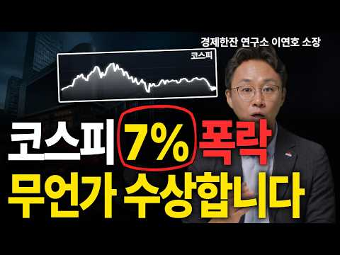
- 챕터: 0:00 코스피 폭락 7퍼센트, 외국인 순매도 30분 1조의 … · 0:49 외국인 순매도 하루치를 30분에 쏟아낸 비정상 신호 · 1:20 삼성전자 하이닉스 과매도가 코스피 지수를 꺾은 이유 · 2:11 이 물량 누가 왜 던졌나 진짜 질문의 시작 · 2:19 실적은 범인이 아니다 반도체주 사상 최고 실적 · 2:55 코스피 폭락 설명할 결정타 뉴스가 없다 · 3:21 글로벌 동반 하락만으로 설명 안 되는 괴리 · 3:56 쉬운 답 세 개가 전부 지워진 수상한 지점 · 4:11 프로그램 매매 선물 공매도 다섯 용의자 공개 · 4:48 전부 사람 손이 아니다 기계적 매도의 공통점 · 5:17 선물 현물 베이시스로 보는 30분 1조 메커니즘 · 6:03 반대매매 눈사태 하락이 하락을 부르는 구조 · 6:36 왜 기업 가치보다 더 깊게 과매도됐나 · 7:15 기계가 던졌는데 왜 하필 한국인가 · 7:26 위험자산 회피 달러 강세 매크로 흐름 · 7:56 외국인에게 한국 증시는 현금인출기 ATM · 8:34 반도체 사이클 선반영 외국인 순매도 습관 · 9:13 공포가 아니라 계산된 포지션 조정일 가능성 · 9:28 현물 팔고 선물 사는 움직임이 말해주는 것 · 10:10 가격이 가치에서 떨어져 나간 과매도의 본질
- 설명 앞부분: 📉 오늘 코스피가 7% 넘게 폭락했습니다. 삼성전자 7%, SK하이닉스 9% 급락, 그리고 외국인이 단 30분 만에 1조 원을 순매도했죠. 화면이 온통 파란색으로 물들면, 누구나 똑같은 생각을 합니다. "외국인이 다 던지고 도망간다, 한국 증시 끝난 거 아니야?" 🥵 혹시 오늘 계좌를 보면서 가슴이 철렁 내려앉았다면, 이 영상을 끝까지 꼭 봐주세요. 오늘의 폭락은 단순한 공포가 아니라, 그 안에 아주 수상한 구조가 숨어 있습니다. 🔍 이 영상에서 다루는 핵심 요약 외국인이 하루 종일 파는 금액은 보통 많아야 몇천억, 세게 던져도 …
- 같은 채널 평소 대비 ×17.8 (채널 최근 롱폼 중앙값 10,093회) · 평소 영상: 잘 생각해보면 남의 일이 아닌 프랑스 혼란(시위, 금리, 정치) (10,093회) / 삼성전자 9%, 하이닉스는 0.3%…주도주 상승폭 갈라진 이유는? (11,659회)
- 대본 없음 (설명) — 음성인식이 끝나면 도입부·흐름이 들어감
- 댓글 51/71: 좋은 점 — 영상 2 · 감사·응원 5 · 더 알고 싶은 것 0 · 아쉬운 점 — 영상 1 · 반박·불만 — 의견 다름 0 · 정치·사회 11 · 경험 공유 0 · 구독·다음 기대 5
  - 좋은 점 — 영상 👍2 “구독했어요!!!너무 유익해요!!감사합니다”
  - 좋은 점 — 영상 👍2 “이해하기쉽게 화면을 구성하셨네요 구독했습니다”
  - 감사·응원 👍5 “영상 감사합니다!”
  - 감사·응원 👍4 “감사합니다 버터야 됩니다”
  - 아쉬운 점 — 영상 👍0 “ㅋ 광고하는 주식과 정치와 관련된 주식은 사는게 아니다.. 그리고 실적을 보고 기대치가 높아져있어서 그런거고 실적치로만 주가가 올라가면 얼마나 좋겠냐..실적에 비해 기대치까지 주가가 오르지 못하니 하락하는거.. 반대로 반도체쪽 말고 기대도 안하는 2차전지는 실적치가 …”
  - 정치·사회 👍16 “최고의 명강의였습니다. 멍청한 이재명 정부의 관료들때문에 개인투자자들은 피눈물을 흘리네요.”
  - 정치·사회 👍12 “한국주식은. 투명유리. 외국인만 조은일 시키는 어리석은 정부”
  - 구독·다음 기대 👍12 “작금의 사태를 명확하게 분석해 주었습니다. 구독합니다.”
  - 구독·다음 기대 👍7 “난 주식설명 다욕하는데 이채널은 논리적이고 최근 선물가격 때매 현물이 안올라가는 현상을 본 것까지 맞음 그래서 우선 구독박고감”

### 44. Corporate Slave to Financially Free: The Passive Income 🐐

- https://www.youtube.com/watch?v=knkqhQrQS60 · The Retail Rundown · 구독자 1,680 · 조회수 88,140 (×52.5, 하루 1,974.1) · 좋아요 849 (1.0%) · 80분 · 2026-09-22 · 주제 묶음 2. 장기투자·ETF·지수 · 형식 정보·해설 (그 밖) · 폴더 `W_knkqhQrQS60` (웹 승인)
- 썸네일: 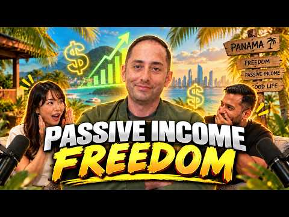
- 챕터: 0:00 Intro · 2:05 Adriano's start in trading · 4:53 Discovering dividends & cover… · 9:00 Selling the condo & hitting f… · 14:26 Quitting their jobs · 16:04 Moving to Panama tax-free · 19:37 Becoming a Canadian non-resid… · 26:51 Cost of living & healthcare i… · 44:05 Income investing & the 25% le… · 58:35 Why covered call ETFs get so … · 70:49 Portfolio reveal: $50K/month …
- 설명 앞부분: That journey led them to quit their jobs in their mid-30s, sell everything, and move to Panama full-time, where a territorial tax system means they pay almost nothing on their income. Adriano breaks down how he built his portfolio from a messy 120-holding starter fund into a focused covered call st…
- 같은 채널 평소 대비 ×12.4 (채널 최근 롱폼 중앙값 7,101회) · 평소 영상: Turning $15 into $4000: The Most UNHINGED Side Hu… (7,101회) / Veteran Portfolio Manager on AI Bubble, Market Cr… (7,243회)
- 대본 (자막, 0.0 음절/초) 첫 20초: “My wife and I were focusing on paying down the mortgage as a priority. So, we paid off our 20-year mortgage in seven years. Now, I would call my banker and say, "Increase the mortgage, increase the mortgage, increase the mortgage." >> Cuz I know Panama is very great for taxes. >> A couple of our fri”
- 첫 1분: “My wife and I were focusing on paying down the mortgage as a priority. So, we paid off our 20-year mortgage in seven years. Now, I would call my banker and say, "Increase the mortgage, increase the mortgage, increase the mortgage." >> Cuz I know Panama is very great for taxes. >> A couple of our friends are moved there, including you. I think you kind of started the whole trend. >> Yeah. I mean, w”
- 흐름 (90초마다 첫 문장): 0:00 My wife and I were focusing on paying → 1:31 call ETFs retirement is never the word → 3:00 um I started well I didn't really know → 4:30 long time ago. We were basically focused → 6:01 worry, I got you. Um, I really like the → 7:31 you were you still paying off your → 9:01 you're not going to get rich off → 10:31 month in Montreal like very comfortably → 12:00 >> Wait, so I want to backtrack a little → 13:30 every single second there's revenue → 15:01 >> She quit first. I continued on still → 16:32 >> So, we started looking into places a… → 18:01 within → 19:31 >> I I still have a Canadian bank accou… → 21:00 >> the day what we left or the day we → 22:31 secondary, a business. Secondary ties → 24:00 cash account. So how it works, you know, → 25:30 don't refund is Canadian eligible → 27:00 become a non-resident. You lose all the → 28:30 would say is
- 댓글 134/173: 좋은 점 — 영상 0 · 감사·응원 0 · 더 알고 싶은 것 0 · 아쉬운 점 — 영상 0 · 반박·불만 — 의견 다름 0 · 정치·사회 0 · 경험 공유 0 · 구독·다음 기대 0

### 45. 삼성전자 주가 1월까지 버텨야 하나? 목표주가 35만원 하향, 외신 '자멸적' 경고

- https://www.youtube.com/watch?v=71fslodqfAY · 경제야! 놀자~ · 구독자 8,620 · 조회수 70,273 (×8.2, 하루 9,968.3) · 좋아요 447 (0.6%) · 10.6분 · 2026-10-30 · 주제 묶음 5. 국내주식 · 형식 정보·해설 (그 밖) · 폴더 `W_71fslodqfAY` (웹 승인)
- 챕터: 0:00 하이라이트 — 로이터 "자멸적이야" · 0:19 [경제야놀자 해설] 오히려 독 · 0:38 로이터 — 보수적인 주주환원, 오히려 독 · 2:11 IBK 리포트 — 목표주가 35만원으로 하향 · 4:11 [경제야놀자 해설] 35만원 하향 · 4:26 이광수 — 괴리율을 줄이라는 요구가 없다 · 5:28 [경제야놀자 해설] 기다리라고? · 5:42 박시동 — 삼성은 늘 그랬다, 1월 이사회 · 6:16 박시동 — 못 기다려, 하이닉스는 바로 매입 · 6:53 그렇다고 삼성이 잡주가 된 건 아니다 · 8:23 [경제야놀자 해설] 못 따라간 속도 · 8:39 이광수 — 주주환원 전 세계 최저 수준 · 9:45 삼성전자가 해 주면 더 빨라진다 · 9:56 [경제야놀자 해설] 오늘의 세 줄 정리
- 설명 앞부분: 35만원. IBK 리포트가 새로 잡은 삼성전자 목표주가다. 투자의견 매수는 그대로 두면서도, 주주환원 정책이 시장 기대치에 못 미쳐 주가 상승은 제한적일 것이라고 적었다. 같은 날 로이터는 삼성의 보수적인 주주환원 정책이 오히려 독이 되고 있다고 썼다. 주가가 6% 하락한 것은 주주들의 불안을 감수할 만큼의 가치가 없음을 시사한다는 평가다. 박시동 평론가는 이 기사를 두고 영어로 보면 "자멸적"이라는 표현이라고 전했다. 국내 애널리스트들의 뉘앙스는 달랐다. 1월 이사회까지 기다려 보자는 쪽이다. 이광수 소장은 목표보다 주가가 많이…
- 대본 없음 (설명) — 음성인식이 끝나면 도입부·흐름이 들어감
- 댓글 94/94: 좋은 점 — 영상 1 · 감사·응원 1 · 더 알고 싶은 것 0 · 아쉬운 점 — 영상 0 · 반박·불만 — 의견 다름 1 · 정치·사회 4 · 경험 공유 1 · 구독·다음 기대 0
  - 감사·응원 👍2 “다 좋은데....영익 350조 냈다고 쳐도 법인세 내고 성과급 주고 거기다 주주환원까지 과도하게 하면 남는 잉여현금흐름이 얼마나 되겠나? 그 돈으로 싸이클침체기와 치킨게임대비 알앤디 투자,중국기업추격 따돌리기,미래 배당가능현금 확보 이런거 가능하겠니? 뜨내기 주주들 …”
  - 반박·불만 — 의견 다름 👍0 “주주환원 안한다는것두아닌데 뭘 차라리 돈몆푼보다 투자만 확실히 하면 그게더 주주들에겐 이익이겠다 하이닉스는 왜떨어지나요 즈주환윈이 문제가 아녀 떨어지니깐 핑게를 대는데”
  - 정치·사회 👍1 “삼성전자 같은회사는 적대적 M&A 법으로 열어두어야 합니다 그래야 회사지키려구 주식가격두 올리겠죠 그리구 소액주주 소송건두 법으로 통과되어야 합니다 대통령과 한국주식의 저평가 원인에 대하여 이야기 하실때 꼭 이 두가지를 법안으로 통과시킬수 있게 제기하여 주시기 바랍니다”
  - 정치·사회 👍1 “삼상전자 최고의 실적 선반영 다좋아 앞으로 전망도 좋아 하지만 주식은 왜 하락이야 이래서 삼성전자 외국인인들이 매수하겠냐 삼성전자 이제는 엽겹다”
  - 경험 공유 👍11 “내년 1월에는 과연 오를까? 경험상 아니라고 봅니다”

### 46. Mutual Fund is Better Than Stocks? Here's Why ∣ Kirtan Shah

- https://www.youtube.com/watch?v=wD3vxxGfaTc · Mutual Funds by PhonePe · 구독자 2,260 · 조회수 24,835 (×11.0, 하루 2,553.4) · 좋아요 297 (1.2%) · 48.4분 · 2026-10-27 · 주제 묶음 기타 · 형식 정보·해설 (그 밖) · 폴더 `W_wD3vxxGfaTc` (웹 승인)
- 챕터: 0:00 Introduction: Who Should Inve… · 1:25 Mutual Fund Masterclass with … · 2:30 What Are Mutual Funds and How… · 4:00 Why Invest Through a Professi… · 5:50 Mutual Funds vs Direct Stock … · 8:30 Who Should Start Mutual Fund … · 9:25 FD vs Stock Market: Understan… · 13:45 Arbitrage Funds Explained · 15:50 Gold Investing Through Mutual… · 18:00 Arbitrage Fund Risks and Retu… · 22:20 Financial Literacy and Changi… · 23:25 Is a ₹500 SIP Worth Starting? · 25:10 When Should You Start Your Fi… · 26:15 Insurance and Emergency Funds… · 28:00 NAV Explained for Beginners · 30:25 What Is the Mutual Fund Expen… · 32:20 Exit Load and Early Withdrawa… · 35:00 Goal-Based Investing and Fina… · 38:10 SIP vs Lump Sum Investment · 40:00 Should You Wait for a Market …
- 설명 앞부분: When Should You Start Investing in Mutual Funds? Is a ₹500 SIP Enough? Learn the basics of mutual fund investing, when to start your first SIP, and how to avoid common mistakes. In this podcast, Kirtan Shah explains everything beginners should understand before investing in mutual funds. Whether yo…
- 같은 채널 평소 대비 ×0.7 (채널 최근 롱폼 중앙값 34,379회) · 평소 영상: Can ₹500 Monthly SIP Turn Into ₹10 Crore? ∣ Kirta… (34,379회) / SIPs Won’t Make You ₹10 Crore? Here’s What Actual… (47,746회)
- 대본 없음 (설명) — 음성인식이 끝나면 도입부·흐름이 들어감
- 댓글 11/11: 좋은 점 — 영상 0 · 감사·응원 0 · 더 알고 싶은 것 0 · 아쉬운 점 — 영상 0 · 반박·불만 — 의견 다름 0 · 정치·사회 0 · 경험 공유 0 · 구독·다음 기대 0

### 47. Supply and Demand Trading Strategy Made Simple (2 Steps) ∣ Stock Trading For Beginners

- https://www.youtube.com/watch?v=lZZ-Qz0m8pc · Trade with Smoke FX · 구독자 1,890 · 조회수 16,990 (×9.0, 하루 2,118.2) · 좋아요 1,989 (11.7%) · 15.8분 · 2026-10-29 · 주제 묶음 기타 · 형식 정보·해설 (그 밖) · 폴더 `W_lZZ-Qz0m8pc` (웹 승인)
- 챕터: 0:00 Intro · 2:02 AI chart scanner · 2:25 When the scanner glitches · 4:26 Going long · 4:57 Support and resistance · 6:01 Risk management · 8:37 Staying calm · 9:26 Did it work? · 11:12 Second trade · 12:02 Reading volume · 14:33 Second result
- 설명 앞부분: TRADING FOR BEGINNERS ∣ SMOKE FX Trading support and resistance made simple: how to mark the levels, read candles and use volume to confirm the move. I test our AI chart scanner live — including the errors and how to fix them — then take a CALL and a PUT trade step by step. Plus why position size a…
- 대본 없음 (설명) — 음성인식이 끝나면 도입부·흐름이 들어감
- 댓글 119/119: 좋은 점 — 영상 0 · 감사·응원 0 · 더 알고 싶은 것 0 · 아쉬운 점 — 영상 0 · 반박·불만 — 의견 다름 0 · 정치·사회 0 · 경험 공유 0 · 구독·다음 기대 0

### 48. 집은 팔았고, 주식은 물렸고

- https://www.youtube.com/watch?v=SbEfHnF8DdY · 로텐션 LOWTENSIONS · 구독자 6,730 · 조회수 142,526 (×21.2, 하루 7,209.0) · 좋아요 908 (0.6%) · 16.3분 · 2026-10-17 · 주제 묶음 11. 투자 일반 · 형식 브이로그·직접 해본 이야기 · 폴더 `W_SbEfHnF8DdY` (웹 승인)
- 썸네일: 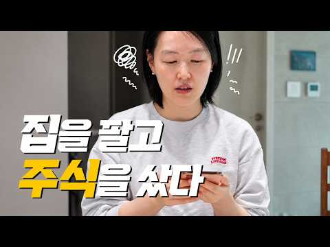
- 설명 앞부분: 집을 팔고 이사까지 마치니 이제 조금은 마음 편히 지낼 수 있을 줄 알았는데, 인생은 늘 예상과 다르게 흘러가네요. 집을 팔고 주식을 샀습니다. 집은 잘 팔았는데, 주식은 잘못 산 걸까요. 그래도 일상은 계속됩니다. 출근도 하고, 밥도 먹고, 이번 영상에는 그렇게 흘러가는 저희 부부의 평범한 일상을 담았습니다. 오늘도 함께해 주셔서 감사합니다. 제이 & 윤 [Video Source Support] Youtube channel "freeticon" : / freeticon
- 같은 채널 평소 대비 ×15.4 (채널 최근 롱폼 중앙값 9,233회) · 평소 영상: 집밥 해 먹는 이유 40대 부부 현실적인 한 달 식비 정산 외식 배달 이대로 괜찮은가? … (9,233회) / 대만 타이중 현지인 줄서는 맛집만 갔습니다 대만 타이중 먹방 여행 (11,421회)
- 대본 없음 (설명) — 음성인식이 끝나면 도입부·흐름이 들어감
- 댓글 185/192: 좋은 점 — 영상 1 · 감사·응원 14 · 더 알고 싶은 것 2 · 아쉬운 점 — 영상 1 · 반박·불만 — 의견 다름 2 · 정치·사회 8 · 경험 공유 19 · 구독·다음 기대 3
  - 좋은 점 — 영상 👍11 “주식을 오래하고 꾸준한 수익을 원한다면 외부의 귀을 닫고 나만의 방법이 필요한데 화려하지도 않고 큰 기술이 필요하지도 않습니다. 단순합니다. 욕심부리지 않고 돈을 차갑고 신중히 한번 더 생각하고 다루어라!! 고점에서 떨어지는 종목은 쳐다 보지도 말아라 미련을 버려라 …”
  - 감사·응원 👍22 “저도 주식 너무 팔고 싶네요😂 상승장 언능타고 제이님 입맛 돌아오시길 바랄께요! 우리 모두 화이팅해요!”
  - 감사·응원 👍13 “어떤 인내심보다 주식을 하면서 진짜 인내심을 배우고 있습니다. ㅎㅎ 제 이야기 하시는줄 알았어요. 오늘도 소중한 영상 고맙습니다. ^^ 항상 건강 및 행복하세요!! 응원해요!!”
  - 더 알고 싶은 것 👍22 “악~~! 이렇게 금방 올라오다니 선물같고 너무 좋네요. 로텐션 영상 너무 제 취향입니다. 오늘도 여러편 또 보고.. 앞으로도 빠른 업데이트 많은 영상 부탁드립니다~😊”
  - 더 알고 싶은 것 👍0 “얼마정도를 하시나요?? 힘내세요”
  - 아쉬운 점 — 영상 👍8 “60대고 2천~3천 정도로 주식하는데 사팔사팔 하면서 하루를 보내니 지루하지 않네요. 마이너스도 있지만 기다리면 오겠죠. 이러고 세월 보냅니다.”
  - 반박·불만 — 의견 다름 👍3 “그렇게 사팔사팔하는건 투기지 투자가 아닙니다. 투자는 펀더멘탈 좋은 코스피 우량주 사서 가다리는거여ㅣ요. 부동산도 하루하루 보는게아니듯 주식도 그래요. 그리고 그때그때 뷰가 바뀌면 방향도 수정해야해요. 단기간 승부를 보려는건 위험해요. 되도록 코스닥으 하지말고 시총이…”
  - 정치·사회 👍11 “이재명이 해냈구나 집팔아 주식하라 니덜 인생 조진거 같다”
  - 정치·사회 👍8 “어머나, 이리 빨리 영상이 올라오면 구독자는 너무 좋잖아요❤ 하얀색 바탕에 때가 타면 정말 참을 수 없는데😂 어서 빨리 매직블럭 찾으셨으면 좋겠어요! 제이님이 타 주시는 커피엔 비할 수 없겠지만, 커피 내리기 귀찮으실 땐 루카스나인 카페라떼도 추천드려요☕️ 주식은 정…”
  - 경험 공유 👍22 “저도 주식 너무 팔고 싶네요😂 상승장 언능타고 제이님 입맛 돌아오시길 바랄께요! 우리 모두 화이팅해요!”
  - 경험 공유 👍12 “부러우면 지는 거라던데, 남이 해준 아침밥 언제 먹어봤는지 기억이 안나네요.😢 저도 백수 5개월차 전업투자 합니다. 종목거래는 수수료가 많아 ETF로 차트 봐가며 스캘핑. 저한테는 그게 딱 맞더라구요, 큰 하락도 피할수 있고. 처음 보는 채널인데 뭔가 공감도 되고 두…”
  - 구독·다음 기대 👍12 “부러우면 지는 거라던데, 남이 해준 아침밥 언제 먹어봤는지 기억이 안나네요.😢 저도 백수 5개월차 전업투자 합니다. 종목거래는 수수료가 많아 ETF로 차트 봐가며 스캘핑. 저한테는 그게 딱 맞더라구요, 큰 하락도 피할수 있고. 처음 보는 채널인데 뭔가 공감도 되고 두…”
  - 구독·다음 기대 👍6 “오늘 처음 알고리즘타서 잼나게 보고 구독합니다~^^ 50대 후반이데 1억 5천 정도를 한계좌에 물을 타지 않고 물리면 다른 계좌 터서 사기를 10여개가 넘는다는..ㅋ 계좌마다 시체들이 그득 그득하지만 삼성전자니까 하고 물린계좌 끌어안고 기다립니다ㅋ 일상적이지만 우리들…”

### 49. Don't Stop Buying Dividends in a Crash Until You See This Math

- https://www.youtube.com/watch?v=qCO8HvpAGqc · Tom - Lazy Dividend Investor · 구독자 2,730 · 조회수 61,591 (×22.6, 하루 2,818.7) · 좋아요 480 (0.8%) · 31.6분 · 2026-10-15 · 주제 묶음 기타 · 형식 정보·해설 (그 밖) · 폴더 `W_qCO8HvpAGqc` (웹 승인)
- 썸네일: 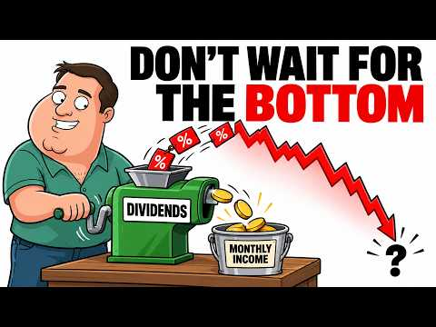
- 설명 앞부분: If dividend stocks fall 20% and the dividend holds, every dollar you invest buys 25% more monthly income than it did before the drop. That is the math behind "keep buying". The problem is that the advice never says where the money comes from, because a crash usually arrives with shorter hours, smal…
- 같은 채널 평소 대비 ×8.1 (채널 최근 롱폼 중앙값 7,598회) · 평소 영상: Before You Buy Another Covered Call ETF, Run This… (7,598회) / I Tested Retiring With $1.5M - Here's What Happen… (8,031회)
- 대본 없음 (설명) — 음성인식이 끝나면 도입부·흐름이 들어감
- 댓글 116/116: 좋은 점 — 영상 0 · 감사·응원 0 · 더 알고 싶은 것 0 · 아쉬운 점 — 영상 0 · 반박·불만 — 의견 다름 0 · 정치·사회 0 · 경험 공유 0 · 구독·다음 기대 0

### 50. A carteira que eu montaria para me aposentar em 10 anos

- https://www.youtube.com/watch?v=tKfew-bHV60 · Matheus Sanchez, CFP® · 구독자 5,220 · 조회수 45,444 (×8.7, 하루 5,354.5) · 좋아요 1,043 (2.3%) · 21.4분 · 2026-10-28 · 주제 묶음 기타 · 형식 정보·해설 (그 밖) · 폴더 `W_tKfew-bHV60` (웹 승인)
- 챕터: 0:00 Uma carteira simples para apo… · 1:08 Os 4 pilares da carteira · 2:08 Como os ETFs simplificam seus… · 3:34 Proteção contra a inflação e … · 4:36 B5P211: inflação com menor vo… · 5:37 XB3511 e o prazo da aposentad… · 7:16 LTBX11: CDI e controle da vol… · 9:16 DIVO11: ações brasileiras na … · 10:52 MUND11: diversificação intern… · 12:44 Carteira conservadora · 13:56 Carteira moderada · 14:35 Carteira agressiva · 15:53 Como rebalancear sua carteira · 17:50 Como usar os rendimentos na a…
- 설명 앞부분: Como montar uma carteira para aposentadoria com apenas 5 ETFs? Neste vídeo, mostro exemplos de carteiras de investimentos para quem pretende se aposentar em 10 a 15 anos, combinando proteção contra a inflação, renda fixa e diversificação no Brasil e no exterior. Você vai conhecer o papel de B5P211,…
- 같은 채널 평소 대비 ×19.7 (채널 최근 롱폼 중앙값 2,312회) · 평소 영상: ETF de Renda Fixa Vale a Pena? Entenda Antes de I… (2,364회) / Guia Definitivo do Imposto de Renda nos ETFs (2,261회)
- 대본 없음 (설명) — 음성인식이 끝나면 도입부·흐름이 들어감
- 댓글 60/60: 좋은 점 — 영상 0 · 감사·응원 0 · 더 알고 싶은 것 0 · 아쉬운 점 — 영상 0 · 반박·불만 — 의견 다름 0 · 정치·사회 0 · 경험 공유 0 · 구독·다음 기대 0

### 51. 직장인이 주식투자로 수백억 자산을 만들 수 있었던 이유ㅣ슈퍼개미 이정윤

- https://www.youtube.com/watch?v=yfMBox78rSE · 이정윤의 다정한주식 · 구독자 2,900 · 조회수 25,628 (×8.8, 하루 2,898.1) · 좋아요 1,009 (3.9%) · 17.2분 · 2026-10-28 · 주제 묶음 11. 투자 일반 · 형식 정보·해설 (그 밖) · 폴더 `W_yfMBox78rSE` (웹 승인)
- 설명 앞부분: “100억 부자보다, 행복한 부자가 되셨으면 좋겠습니다.” 투자가 어렵고 막막한 분들께 조금이라도 든든한 ‘아낌없이 주는 나무’가 되고 싶은 마음으로 새로운 공간 '이정윤의 다정한 주식'을 시작합니다. 조금 더 친절하게, 조금 더 쉽게, 그리고 진심을 다해 다정하게 알려드리겠습니다. 혼자 어렵게 투자하지 마세요. 앞으로 오래오래 함께 다정한 투자 시작해보시죠.
- 대본 없음 (설명) — 음성인식이 끝나면 도입부·흐름이 들어감
- 댓글 596/596: 좋은 점 — 영상 16 · 감사·응원 159 · 더 알고 싶은 것 13 · 아쉬운 점 — 영상 1 · 반박·불만 — 의견 다름 0 · 정치·사회 0 · 경험 공유 16 · 구독·다음 기대 29
  - 좋은 점 — 영상 👍4 “새로운 채널 개설 축하드립니다🎉❤ 다정한 이 세무사님 모습도 기대하겠습니다 항상 좋은 정보 감사합니다”
  - 좋은 점 — 영상 👍1 “존경하는 선생님 좋은말씀 너무 감사합니다”
  - 감사·응원 👍8 “아낌없이 가르침 주시는 이세무사님, 새로운 채널 오픈을 축하드립니다. 많이 배우고 익히고 닮아가겠습니다. 감사합니다. 이정윤의 다정한 주식, 화이팅!”
  - 감사·응원 👍4 “아낌없이 주는 세무사님~ 따뜻한 말씀 감사합니다 ❤ 다정한 주식 채널도 함께하겠습니다😊”
  - 더 알고 싶은 것 👍10 “블로그 이야기를 들으면서 따뜻한 댓글에 감동받아 다시 글을 이어가셨다는 부분이 인상 깊었습니다. 세무사님의 진심과 따뜻한 마음이 고스란히 느껴지는 것 같아요!! 그래서인지 ‘이정윤의 다정한 주식’이라는 채널명이 세무사님과 정말 잘 어울린다는 생각이 듭니다. 단순히 주…”
  - 더 알고 싶은 것 👍1 “감사하다는 말로 저의 마음을 표합니다. .늘 건강하셔서 오래도록 방송해주세요”
  - 아쉬운 점 — 영상 👍0 “이세무사 tv 애청자입니다. 새로운 채널이 보여서 오잉 이거뭐지? 하고 들어왔는데,, 벌써 이렇게 많은 사람들의 댓글이 달려있네요. 혹시 댓글 1등 아니야? 이런 생각했는데 아쉽습니다 ㅎㅎㅎ 아낌 없이 주는 나무 이야기 너무 감동이고,, 늘 진심으로 나눠주심에 감사드…”
  - 경험 공유 👍1 “새로운 채널 오픈을 축하드립니다. 언제나 응원하며 저도 주식잘하는 사람이 되고 싶어요 좋은 조언 말씀감사합니다 슈퍼개미 이세무사 이정윤의 다정한주식 파이팅”
  - 경험 공유 👍1 “안녕하세요 이세무사님 새로운채널을 오픈해주셔서 감사합니다 더욱 친근함이 느껴집니다 감사합니다. 존경스럽고 세무사님한테 많이많이 배우며 저도 부자가 되고 싶습니다 저는 백억부자 꿈을 꾸지도 못할거 같습니다 ㅎㅎ 자신이 없어요 평범하게 살고싶고요 그평범하게 살고 싶기도 …”
  - 구독·다음 기대 👍3 “감사합니다. 바로 구독하고 응원합니다.”
  - 구독·다음 기대 👍1 “따뜻함이 듬뿍 느껴지는 방송!! 감사드리며 다음방송이 기대됩니다~~~”

### 52. Here’s What Happens When You Own $100,000 of SCHD

- https://www.youtube.com/watch?v=S1kkIad_pQ4 · Tom - Lazy Dividend Investor · 구독자 2,730 · 조회수 21,785 (×8.0, 하루 2,624.7) · 좋아요 232 (1.1%) · 33.8분 · 2026-10-29 · 주제 묶음 기타 · 형식 정보·해설 (그 밖) · 폴더 `W_S1kkIad_pQ4` (웹 승인)
- 챕터: 0:00 $100,000 of SCHD on day one · 5:25 Why SCHD pays 3% and not 10% · 11:01 Reinvesting from 55 to 65 and… · 16:29 Collecting the checks, and th… · 22:02 Crashes, lag years and a 2009… · 27:47 Taxes, the scorecard and the …
- 설명 앞부분: $100,000 of SCHD buys about 2,832 shares at the October 26, 2026 close of $35.30. Over the last twelve months those shares paid $2,986 in dividends: about $249 a month, in four uneven quarterly checks, before tax. The internet version of this story ends at $4 million in 30 years. If you are 55, tha…
- 같은 채널 평소 대비 ×2.9 (채널 최근 롱폼 중앙값 7,598회) · 평소 영상: Before You Buy Another Covered Call ETF, Run This… (7,598회) / I Tested Retiring With $1.5M - Here's What Happen… (8,031회)
- 대본 없음 (설명) — 음성인식이 끝나면 도입부·흐름이 들어감
- 댓글 54/54: 좋은 점 — 영상 0 · 감사·응원 0 · 더 알고 싶은 것 0 · 아쉬운 점 — 영상 0 · 반박·불만 — 의견 다름 0 · 정치·사회 0 · 경험 공유 0 · 구독·다음 기대 0

### 53. Warren Buffett’s 4 Cycle Rules & How to Spot Market Bubbles ∣ S Naren

- https://www.youtube.com/watch?v=2yyAXxojnAU · ET Markets · 구독자 10,200 · 조회수 115,752 (×11.3, 하루 9,601.2) · 좋아요 664 (0.6%) · 8.7분 · 2026-10-25 · 주제 묶음 기타 · 형식 정보·해설 (그 밖) · 폴더 `W_2yyAXxojnAU` (웹 승인)
- 설명 앞부분: In this keynote session from the ET Alpha Wealth Summit, S Naren (ED & CIO, ICICI Prudential AMC) breaks down his practical 4-stage market cycle framework: Burst, Best Time, Boring, and Bubble. Discover why the current Indian market landscape fits into the "Boring" phase, how retail investors can s…
- 대본 없음 (설명) — 음성인식이 끝나면 도입부·흐름이 들어감
- 댓글 29/29: 좋은 점 — 영상 0 · 감사·응원 0 · 더 알고 싶은 것 0 · 아쉬운 점 — 영상 0 · 반박·불만 — 의견 다름 0 · 정치·사회 0 · 경험 공유 0 · 구독·다음 기대 0

### 54. I Own 300 Shares of SCHD - Here's My Dividend Payout

- https://www.youtube.com/watch?v=Z_-PJGzUdD4 · Cade Invests · 구독자 1,820 · 조회수 161,878 (×88.9, 하루 1,640.7) · 좋아요 2,045 (1.3%) · 10.5분 · 2026-07-30 · 주제 묶음 2. 장기투자·ETF·지수 · 형식 정보·해설 (그 밖) · 폴더 `W_Z_-PJGzUdD4` (웹 승인)
- 썸네일: 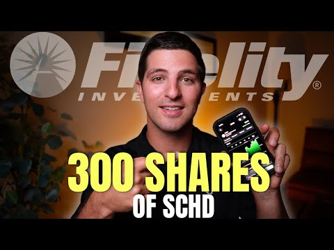
- 챕터: 0:00 Intro · 0:37 SCHD ETF Overview · 2:05 SCHD Holdings · 3:00 My SCHD Position · 4:15 SCHD Dividend Income · 6:38 SCHD vs VOO vs QQQ · 9:10 My SCHD Plan
- 설명 앞부분: I have over $10,000 invested in the dividend ETF SCHD. In today's video I'm breaking down my SCHD dividend payouts from every year and if I plan to continue investing in SCHD in the future. FREE PDF Download: SCHD is one of the most popular dividend ETFs out there today. That is for good reason as …
- 같은 채널 평소 대비 ×355.8 (채널 최근 롱폼 중앙값 455회) · 평소 영상: The BEST Purchases To Make In Your 20s (Tier List) (513회) / 10 Things To Know About ETFs Before Investing (fo… (514회)
- 대본 없음 (설명) — 음성인식이 끝나면 도입부·흐름이 들어감
- 댓글 338/340: 좋은 점 — 영상 0 · 감사·응원 0 · 더 알고 싶은 것 0 · 아쉬운 점 — 영상 0 · 반박·불만 — 의견 다름 0 · 정치·사회 0 · 경험 공유 0 · 구독·다음 기대 0

### 55. The Story Behind India's Biggest Stock Market Scam ∣ Scam 1992 Explain ∣ 2D Animation

- https://www.youtube.com/watch?v=zay8CuiBUQ8 · DOKio · 구독자 8,360 · 조회수 931,029 (×111.4, 하루 7,524.9) · 좋아요 7,748 (0.8%) · 27분 · 2026-07-05 · 주제 묶음 기타 · 형식 정보·해설 (그 밖) · 폴더 `W_zay8CuiBUQ8` (웹 승인)
- 썸네일: 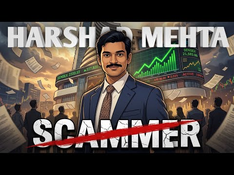
- 설명 앞부분: ₹4,000 Crore ka Scam... Stock Market me record tod tezi... aur phir ek aisa khulasa jisne poore India ki Financial System ko hila diya! 😱 Kya sirf shares ki prices badhakar koi insaan hazaron crore rupaye ka game khel sakta hai? Kaise ek aam Stock Broker "The Big Bull" bana aur phir India ke sabse …
- 같은 채널 평소 대비 ×50.7 (채널 최근 롱폼 중앙값 18,346회) · 평소 영상: How DMart Became One of India’s Biggest Retailers… (20,400회) / How Nirav Modi Stole PNB ₹14,000 Crore ∣ Nirav Mo… (16,293회)
- 대본 없음 (설명) — 음성인식이 끝나면 도입부·흐름이 들어감
- 댓글 194/233: 좋은 점 — 영상 0 · 감사·응원 0 · 더 알고 싶은 것 0 · 아쉬운 점 — 영상 0 · 반박·불만 — 의견 다름 0 · 정치·사회 0 · 경험 공유 0 · 구독·다음 기대 0

### 56. 월배당 500만원 배당파이어족의 현실｜코스피 대폭락 그 후… 10월 배당금 나왔습니다｜실제계좌 공개 (feat. 동탄호수공원)

- https://www.youtube.com/watch?v=AN6Scm7uHVg · 투자여행가 캐넌 [DND LIFE] · 구독자 915 · 조회수 10,794 (×11.8, 하루 773.4) · 좋아요 143 (1.3%) · 13.7분 · 2026-10-23 · 주제 묶음 5. 국내주식 · 형식 인터뷰·강연·대담 · 폴더 `W_AN6Scm7uHVg` (웹 승인)
- 챕터: 0:00 10월 배당금, 이번 달 결과는? · 0:40 차박지 도착(동탄호수공원) 및 장소 소개 · 1:20 10월 월초 배당 흐름 재확인 · 1:55 10월 22일 시장 상황 점검 · 2:40 AI·기술주와 최근 증시 이슈 브리핑 · 3:40 한국은행 금리 동결 관련 브리핑 · 4:20 10월 배당금 실제 계좌 공개 시작 · 4:50 10월 월중 배당 2종목 세부 내역 · 5:40 커버드콜 ETF 분배금 구조 확인 · 7:05 동탄호수공원 산책 · 9:20 10월 전체 배당금 최종 정산 · 9:40 10월 월초+월중 배당금 세부 현황 · 12:15 배당파이어족으로서 느끼는 현금흐름의 의미 · 13:10 클로징
- 설명 앞부분: 코스피 대폭락 이후 계좌는 크게 흔들렸지만, 10월 월배당 정산은 모두 끝났습니다. 이번 영상에서는 실제 계좌를 열어 10월 월중에 받은 배당금부터 종목별 분배금, 과세표준과 세금, 그리고 월초+월중을 모두 합친 10월 전체 배당금까지 직접 확인해봤습니다. 지난 영상에서는 국장 급락으로 “커버드콜을 계속 가져가야 할까?”라는 현실적인 고민을 이야기했는데요. 시장 상황과 계좌 평가금액은 계속 변하지만, 배당파이어족 생활에서 매달 들어오는 현금흐름이 어떤 의미가 있는지도 이번 영상을 통해 함께 이야기해봤습니다. 과연 10월에도 월배당…
- 같은 채널 평소 대비 ×2.1 (채널 최근 롱폼 중앙값 5,255회) · 평소 영상: 배당파이어족의 현실｜월배당 500만원, 절대 고정 아닙니다… 배당 줄어도 버티는 현금쿠션… (5,255회) / 코스피 폭락장에 지쳐 바다를 보러 갔습니다...｜SK하이닉스 역대급 실적 발표일｜월배당 … (4,895회)
- 대본 없음 (설명) — 음성인식이 끝나면 도입부·흐름이 들어감
- 댓글 39/39: 좋은 점 — 영상 0 · 감사·응원 6 · 더 알고 싶은 것 1 · 아쉬운 점 — 영상 0 · 반박·불만 — 의견 다름 0 · 정치·사회 1 · 경험 공유 3 · 구독·다음 기대 0
  - 감사·응원 👍4 “일희일비 하지 않고 분배금 받으면서 장기투자 마음으로 기다리다보면 어느새 다 제자리로 와있고 빨간색도 되어 있고 하더라구요~ 차박 여행지 주변 풍경도 항상 잘보고 있습니다~ 화이팅입니다”
  - 감사·응원 👍3 “주변풍경도 보여주셔서 힐링되고 좋더라구요~저도 커버드콜 투자자라 항상 잘보고 있습니다~하락장에도 힘내자구요~❤❤”
  - 정치·사회 👍1 “잘 봤어요 ㅎㅎ 웰컴투 동탄입니다 ㅎㅎ 동호수공원 넘 좋아요 !! 반도체 섹터가 국내외적으로 다 흔들리면서 제 계좌도 녹고 있네요 ㅠ 11월 중간선거 이후로 좀 안정화 되기를요,, ㅎㅎ”
  - 경험 공유 👍3 “주변풍경도 보여주셔서 힐링되고 좋더라구요~저도 커버드콜 투자자라 항상 잘보고 있습니다~하락장에도 힘내자구요~❤❤”
  - 경험 공유 👍2 “저도 11월 배당이 너무 걱정 됩니다 ㅠㅠ 그 전까지 최대한 많이 계좌 복구 되었으면 좋겠습니다 😢”

### 57. Dividend Stocks vs. Growth Stocks: The Math Most Investors Ignore

- https://www.youtube.com/watch?v=4bg3bjvjCjE · Finance Simplified · 구독자 3,640 · 조회수 205,082 (×56.3, 하루 3,072.4) · 좋아요 1,201 (0.6%) · 20.2분 · 2026-08-31 · 주제 묶음 기타 · 형식 정보·해설 (그 밖) · 폴더 `W_4bg3bjvjCjE` (웹 승인)
- 썸네일: 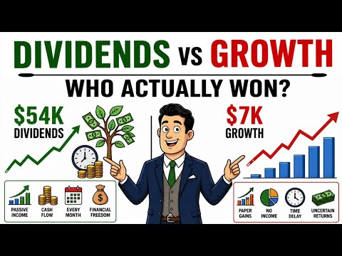
- 챕터: 0:00 The $54,000 Question · 0:13 Yield vs. Appreciation vs. To… · 2:30 Where Every $1 of Profit Actu… · 5:00 The $32,000 Head-to-Head Test · 8:00 The Dividend Reinvestment Eff… · 10:30 The Tax Drag Most Comparisons… · 13:00 The High-Yield Trap · 15:00 The Growth-Stock Trap · 17:00 The Fair Test: Total Return v… · 18:30 Who Each Approach Actually Su… · 19:30 Final Verdict
- 설명 앞부분: Dividend Stocks vs. Growth Stocks: The Math Most Investors Ignore Dividend stocks vs. growth stocks — but compared correctly this time. Most investors argue "4% yield" against "12% growth," and those aren't even the same kind of number. In this breakdown we run both strategies through identical mat…
- 같은 채널 평소 대비 ×45.8 (채널 최근 롱폼 중앙값 4,476회) · 평소 영상: Renting vs. Buying: The 10-Year Math Most America… (4,832회) / High-Dividend ETFs: What Investors Give Up to Get… (4,121회)
- 대본 없음 (설명) — 음성인식이 끝나면 도입부·흐름이 들어감
- 댓글 321/321: 좋은 점 — 영상 0 · 감사·응원 0 · 더 알고 싶은 것 0 · 아쉬운 점 — 영상 0 · 반박·불만 — 의견 다름 0 · 정치·사회 0 · 경험 공유 0 · 구독·다음 기대 0

### 58. AI 거품 경고에 나스닥 -6%… 그런데 S&P500은 왜 -2%만 빠졌을까, 하락장에서 갈리는 진짜 이유

- https://www.youtube.com/watch?v=cN5dIiWD_kQ · 뒤집는경제 · 구독자 916 · 조회수 10,047 (×11.0, 하루 769.9) · 좋아요 39 (0.4%) · 21.9분 · 2026-10-24 · 주제 묶음 2. 장기투자·ETF·지수 · 형식 정보·해설 (그 밖) · 폴더 `W_cN5dIiWD_kQ` (웹 승인)
- 챕터: 0:00 S&P500이냐 나스닥이냐, 같은 날 두 배 갈렸다 · 1:38 메타 현금흐름 마이너스, 시장이 놀란 숫자 · 4:55 같은 미국 시장, 바구니에 담긴 것이 다르다 · 5:46 같은 1,000만 원, 보름 만에 38만 원 차이 · 6:50 떨어진 만큼 오르면 원금일까 · 8:14 2022년과 닷컴버블, 회복에 걸린 15년 · 11:34 S&P500도 예전의 S&P500이 아니다 · 14:35 연금 계좌 비중을 정하는 두 가지 기준 · 18:20 한 장의 비교표로 정리
- 설명 앞부분: AI 거품 경고 하루 만에 나스닥은 2.60%, S&P500은 1.21% 빠졌습니다. 올해는 나스닥이 더 많이 올랐는데, 사상 최고치와 비교하면 나스닥은 약 -5.8%, S&P500은 약 -2.0%로 성적표가 완전히 뒤집혔습니다. 10월 초 S&P500을 팔고 나스닥으로 갈아탔다면, 같은 1,000만 원이 보름 만에 38만 원 더 줄어든 셈입니다. 진짜 차이는 하락 폭이 아니라 다시 올라오는 길에서 벌어집니다. 닷컴버블 때 나스닥은 고점을 되찾는 데 15년, S&P500은 7년이 걸렸습니다. 그런데 지금의 S&P500도 상위 10…
- 같은 채널 평소 대비 ×0.6 (채널 최근 롱폼 중앙값 16,898회) · 평소 영상: S&P500 vs 나스닥100, 20년 뒤 결과가 뒤집히는 진짜 이유 (19,585회) / 코스피 일주일 -20%… 지금 적립식을 멈추면 손해 보는 진짜 이유 (14,211회)
- 대본 없음 (설명) — 음성인식이 끝나면 도입부·흐름이 들어감
- 댓글 7/7: 좋은 점 — 영상 0 · 감사·응원 0 · 더 알고 싶은 것 0 · 아쉬운 점 — 영상 0 · 반박·불만 — 의견 다름 1 · 정치·사회 0 · 경험 공유 0 · 구독·다음 기대 0

### 59. 지난 폭락과는 완전히 다릅니다…코스피가 진짜 위험한 이유 (Feat. 박병창 MP파트너스 대표) [딥플 Deep-ple]

- https://www.youtube.com/watch?v=y_mvodyrXhQ · 핀플 - Finple · 구독자 47,500 · 조회수 193,740 (×4.1, 하루 39,883.8) · 좋아요 2,910 (1.5%) · 60분 · 2026-10-16 · 주제 묶음 5. 국내주식 · 형식 인터뷰·강연·대담 · 폴더 `W_y_mvodyrXhQ` (웹 승인)
- 썸네일: 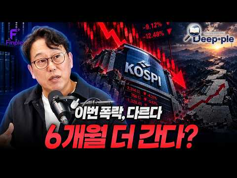
- 설명 앞부분: 딥플 클릭 보기 순서 1Q 코스닥150채권혼합50액티브 ETF (0186S0) 1️⃣ “코스닥 활성화 정책 기대감” 2025.12.19, 금융위원회 ‘코스닥 신뢰+혁신 제고 방안’ 발표 2️⃣ “주식 비중을 높인 2세대 채권혼합형” ‘코스닥150 지수’ 약 50% + ‘단기국공채 지수’ 약 50% 2023.11.16, 퇴직연금감독규정에 따라 주식 편입한도 40% 이내 → 50% 미만으로 상향 성장성과 안정성 둘 다 잡은 ETF 투자도 하나(Hana)면 됩니다. 1Q K반도체TOP2 시리즈 ETF 1Q K반도체TOP2+ ETF (0…
- 같은 채널 평소 대비 ×31.7 (채널 최근 롱폼 중앙값 6,110회) · 평소 영상: 삼성전자에 실망한 외국인? SK하이닉스 6천억 매수한 진짜 이유! [더 파이널 콜 핵심 … (6,441회) / 코스피 3% 급등에도 "찐반 아니다!" 진짜 반등은 이때 시작된다? [더 파이널 콜 핵심… (5,779회)
- 대본 없음 (설명) — 음성인식이 끝나면 도입부·흐름이 들어감
- 댓글 360/360: 좋은 점 — 영상 16 · 감사·응원 26 · 더 알고 싶은 것 1 · 아쉬운 점 — 영상 2 · 반박·불만 — 의견 다름 7 · 정치·사회 28 · 경험 공유 21 · 구독·다음 기대 1
  - 좋은 점 — 영상 👍27 “박병창님의 강의 넘 유익했습니다. 3프로에서 믿을맨중 하나죠”
  - 좋은 점 — 영상 👍20 “와~박병찬 대표님! 제가 가려웠던 부분을 잘 알려주셔서 감사해요~~ 민준님도 핵심을 잘 짚어 질문해주시네요😊”
  - 감사·응원 👍20 “와~박병찬 대표님! 제가 가려웠던 부분을 잘 알려주셔서 감사해요~~ 민준님도 핵심을 잘 짚어 질문해주시네요😊”
  - 감사·응원 👍19 “작년방송에서 올해전망 예측하신대로 흘러감에 경외감을 느낍니다. 상반기 좋고, 하반기 위험, 금리5 돌파시 도망. 경험자의 안목에 큰 도움받았고 감사를 전하고싶습니다.”
  - 더 알고 싶은 것 👍0 “직전에 잘나간주식 장비 두산테스나나 이차전지원통형 신흥 이런거 사면 되나요?”
  - 아쉬운 점 — 영상 👍3 “다시 반복해서 들어봐야겠어요 좋네요”
  - 아쉬운 점 — 영상 👍0 “그러니까 요약좀 해줘요 ㅋ”
  - 반박·불만 — 의견 다름 👍377 “반도체 업계 종사자입니다 중국 반도체 신기술(특히 창신메모리 CXMT의 차세대 D램 '4F²' 연내 출시 발표 등) 정치적·시장적 과장(선동에 가까운 쇼맨십)이 99%, 무시 못 할 기술적 우회 시도가 0.1%' 정도로 보시는 것이 가장 냉정한 팩트입니다. 단순히 '…”
  - 반박·불만 — 의견 다름 👍4 “헛소리를 겁나게 길게하네 말 맨날 바뀌면서ㅋㅋㅋㅋㅋ”
  - 정치·사회 👍16 “내년의 실적을 의심하는 것이 아니라 질적에 관계없이 난 팔겠다는 외국인이 무서운거지 수급”
  - 정치·사회 👍13 “확실히 이번 하락은 좀 다른듯 월요일 쌍바닥도 깨질거같은데 전쟁끝나거나 선거끝날떄까지 관망해야하는 장세인듯”
  - 경험 공유 👍20 “와~박병찬 대표님! 제가 가려웠던 부분을 잘 알려주셔서 감사해요~~ 민준님도 핵심을 잘 짚어 질문해주시네요😊”
  - 경험 공유 👍14 “아저씨 갑자기 이러니까. 세상에 해안이 있는 것처럼 떠들지 마 당신도 언젠가 평탄한 길이 있었을 때 이럴 땐 매수해야 된다고 말했던 사람이잖아. 정답은 없지. 그러나 지금 정답이 있는 것처럼 내가 마치 예언가인 것처럼. 이야기하는 건 너무 창피하지 않아?”
  - 구독·다음 기대 👍0 “이런 채널이 있는줄 물랐는데 박대표님 들으러 들어왔습니다. 일단 구독했습니다.”

### 60. 배당 월 30만원이면 인생 난이도가 낮아진다 (실제 계좌 공개) ∣ 배당으로 경제적 자유 만들기 0화

- https://www.youtube.com/watch?v=9VmQk1uGrPo · 머니노트 · 구독자 1,900 · 조회수 18,528 (×9.8, 하루 1,572.0) · 좋아요 127 (0.7%) · 16.3분 · 2026-10-25 · 주제 묶음 3. 배당 · 형식 브이로그·직접 해본 이야기 · 폴더 `W_9VmQk1uGrPo` (웹 승인)
- 챕터: 0:00 배당 계좌 실제 공개 · 올해 배당 · 0:31 30대 직장인이 배당을 고른 이유 · 1:47 연구: 사고팔수록 수익이 새는 이유 · 3:13 공개 원칙 4가지 · 3:45 계좌 열기 · 과일나무 비유 · 4:45 과일나무 숲 8그루 · 5:15 종목 소개 (JEPQ·SCHD·QDVO·리얼티인컴·K… · 8:05 마이너스인데 배당은 매달 · 8:54 10월 배당 30만 5,494원 · 9:41 배당주 투자 = 인생이 공짜가 되는 일 · 11:35 미국 배당 세금 15% · 12:06 올해 배당 흐름 · 12:45 목표 월 300만원 · 지금 10% · 13:32 금융소득종합과세 언덕 · 14:47 앞으로의 시리즈 · 15:11 숫자 댓글 이벤트
- 설명 앞부분: 제 배당 계좌 하나를 오늘부터 매달 그대로 공개합니다. 평가금 8,461만원, 10월 세후 배당 30만 5,494원으로 목표 월 300만원의 약 10%에서 출발합니다. 여러 계좌 중 배당 위주로 균형을 맞춘 계좌 1개의 실제 투자금과 세후 배당금을 매달 초 결산합니다. 참고: 모닝스타 Mind the Gap 2026 · 자본시장연구원 개인투자자 투자행태 분석 · Shefrin & Statman(1984)
- 같은 채널 평소 대비 ×27.6 (채널 최근 롱폼 중앙값 672회) · 평소 영상: 앞으로 5년, 50대 노후에 이미 확정된 변화 6가지 ∣ 월급 300만원이면 연금 보험료… (672회) / 연금저축·IRP 900만 원 넣으면 얼마 돌려받을까? 연봉별로 직접 계산했습니다 (624회)
- 대본 없음 (설명) — 음성인식이 끝나면 도입부·흐름이 들어감
- 댓글 63/63: 좋은 점 — 영상 4 · 감사·응원 13 · 더 알고 싶은 것 2 · 아쉬운 점 — 영상 0 · 반박·불만 — 의견 다름 0 · 정치·사회 0 · 경험 공유 5 · 구독·다음 기대 3
  - 좋은 점 — 영상 👍2 “7번. 좋은 영상 감사합니다~”
  - 좋은 점 — 영상 👍1 “23 차분한 목소리가 귀에 잘 들어옵니다. 배당투자 응원합니다~~”
  - 감사·응원 👍2 “7번. 좋은 영상 감사합니다~”
  - 감사·응원 👍1 “23 차분한 목소리가 귀에 잘 들어옵니다. 배당투자 응원합니다~~”
  - 더 알고 싶은 것 👍0 “댓글 귀찮아서 잘 안다는는데.. 구독했어요!! 영상도 너무 이쁘게 잘 만드셔서 보는 재미가 있어요 말이나 목소리도 아주 조곤조곤 차분해서 듣기가 너무 편하네요 앞으로 오래오래 자주자주 영상 올려주세요!!”
  - 더 알고 싶은 것 👍0 “국내 커버드콜은 일반계좌, isa, 연저펀 어디에서 사는게 젤 좋을까요?”
  - 경험 공유 👍1 “33. 저도 이제 막 시작했어요. 제 1차 목표는 월100 만입니다. 함께 화이팅!”
  - 경험 공유 👍1 “저도 현재 월배당 30정도 인데 같은 목표를 향해 달리시죠 ! 화이팅 입니다”
  - 구독·다음 기대 👍1 “5번. 저도 배당핥기 채널 애청자입니다. 같이 커가는 모습이 좋아서 이 채널도 구독합니다. 😊”
  - 구독·다음 기대 👍0 “구독하고 갑니다 잘봤어요”

### 61. 코스피, 상상도 못한 재앙이 올 것(삼전닉스 타점)

- https://www.youtube.com/watch?v=i0WD3kljHAo · 차트도령 · 구독자 4,290 · 조회수 34,926 (×8.1, 하루 3,166.3) · 좋아요 152 (0.4%) · 10.7분 · 2026-10-26 · 주제 묶음 5. 국내주식 · 형식 정보·해설 (그 밖) · 폴더 `W_i0WD3kljHAo` (웹 승인)
- 설명 앞부분: 10월26일 코스피, 삼성전자, sk하이닉스, 코스닥 차트분석 및 시황브리핑입니다. 본 채널에서 영상을 통해 소개해드리는 종목은 '정보 공유' 차원일 뿐 '종목 추천'이 아닙니다.
- 같은 채널 평소 대비 ×3.1 (채널 최근 롱폼 중앙값 11,230회) · 평소 영상: 코스피, 가짜반등 속임수에 넘어가지 마세요(삼전닉스) (11,265회) / 현대차, 물타기 잘못하면 목 돌아갑니다 (11,195회)
- 대본 없음 (설명) — 음성인식이 끝나면 도입부·흐름이 들어감
- 댓글 59/59: 좋은 점 — 영상 2 · 감사·응원 9 · 더 알고 싶은 것 5 · 아쉬운 점 — 영상 0 · 반박·불만 — 의견 다름 1 · 정치·사회 3 · 경험 공유 0 · 구독·다음 기대 0
  - 좋은 점 — 영상 👍0 “오늘 10분 영상인데도 내용이 꽉 차서 여러번 반복했어요 미장 잠깐 보고 영상 보고 댓글들 쭈욱 읽고 ~ 차도님 영상이 많은 도움이 됩니다 어려운 장에서 방향 설정에 큰 도움 받고 있습니다.감사합니다. 낼도 성투!아쟈!”
  - 감사·응원 👍6 “찐바닥 나오기전까진 어설프게 물타기 안 하고 있습니다, 물타기보다는 바닥일때 올라갈 주식 매수하여 멘징하는게 좋을 것 같습니다, 오늘도 영상 감사합니다”
  - 감사·응원 👍4 “바닥일때 고지해주시겠다니 넘넘 감사합니다.”
  - 더 알고 싶은 것 👍2 “코스닥 채널 하단부 지지하면 900p 넘길수있을까요? 코스피는 9000찍고 5000인데 코스닥은 오른것디 없이 저점이라 궁금합니다”
  - 더 알고 싶은 것 👍2 “혹시 지금 물려있는 사람들은 물타기도 하지말고 그냥 기다리고 있는게 좋을까요?”
  - 반박·불만 — 의견 다름 👍1 “하닉 주주환원 이야기 추가로 나오는데, 하닉때문이라도 5300은 진짜 마지노선 된것같은데ㅎ 어케보시는지.. (시비거는거 아닙니다ㅎㅎ...)”
  - 정치·사회 👍15 “지금 시점에서 반등을 줄거면 저렇게 개미를 태울 시간조차 주지않고 그냥 급반등할텐데 박스권에서 횡보한다는건 강한 하락이 한번 더 올 가능성이 높다고 생각할 수 있죠 이걸 바닥 다지는거라느니 쌍바닥이라느니 하면서 개미들 저번주 금요일에 단일 종목 레버리지 많이 샀다라더…”
  - 정치·사회 👍0 “외국인들아...... 오늘도 좋은 영상 감사합니다~”

### 62. 환율 1300원 폭락의 진짜 이유..?? 11월 정말 큰거 터집니다..!!

- https://www.youtube.com/watch?v=j9J67JEIsTE · 내일의투자소식 · 구독자 6,980 · 조회수 50,792 (×7.3, 하루 5,139.3) · 좋아요 731 (1.4%) · 17.8분 · 2026-10-27 · 주제 묶음 5. 국내주식 · 형식 정보·해설 (그 밖) · 폴더 `W_j9J67JEIsTE` (웹 승인)
- 챕터: 0:00 환율 2년 만에 최저, 그런데 큰손은 떠난다 · 0:26 아무도 모르는 비밀, 메타 126조 원 · 1:13 넉 달 만에 200원 빠진 환율 · 1:40 정부가 70조 원을 써도 못 잡던 환율 · 2:05 환율을 누른 건 55조 원 · 2:36 그 55조 원이 이번 달 끝났다 · 3:11 2020년 3월에 이미 본 장면 · 3:42 깜짝 퀴즈 · 4:07 종목 진단기 무료 이용 · 5:22 큰손이 떠나는 진짜 이유, 메타 발표 · 5:50 버는 돈보다 쓰는 돈이 많아졌다 · 6:55 칩을 판 회사가 칩값을 대 준다 · 7:17 빚에 붙는 이자, 5% 턱밑 · 7:55 큰손들은 한국 반도체부터 판다 · 8:29 비싼 원화가 등을 떠민다 · 9:04 이제는 달러가 나갈 차례 · 10:49 2년 전 1,319원은 반년 뒤 1,484원 · 11:22 1997년엔 두 달 만에 두 배 · 11:49 사건이 줄을 서 있다 · 12:38 미국 주식, 닷컴 버블 꼭대기 수준
- 설명 앞부분: 원·달러 환율이 1,323원까지 내려와 2년 만에 가장 낮아졌습니다. 그런데 같은 날 외국인은 코스피에서 7,000억 원을 팔았고, 코스피는 5,500이 깨졌습니다. 이 1,320원은 원화가 강해서 나온 숫자가 아닙니다. 삼성전자와 SK하이닉스가 자사주 55조 원을 사면서 달러를 원화로 바꾼 자리에 찍힌 숫자이고, 그 55조는 이번 달에 끝났습니다. 여기에 메타의 126조 원 증자로 드러난 빅테크 AI 투자의 빚까지. 큰손들이 왜 한국을 떠나고 있는지, 이게 왜 경제위기 신호인지, 그리고 중간선거 이후 큰손들이 다시 사러 올 곳은…
- 같은 채널 평소 대비 ×3.5 (채널 최근 롱폼 중앙값 14,486회) · 평소 영상: 큰 손들이 전부 떠났다..?? 美 국채금리 6% 돌파, 경제위기는 이미 터진이유 (14,652회) / 금,달러,채권의 몰락...?? 금융위기보다 더 큰거 터집니다..!! (13,563회)
- 대본 없음 (설명) — 음성인식이 끝나면 도입부·흐름이 들어감
- 댓글 72/72: 좋은 점 — 영상 0 · 감사·응원 0 · 더 알고 싶은 것 0 · 아쉬운 점 — 영상 0 · 반박·불만 — 의견 다름 2 · 정치·사회 9 · 경험 공유 1 · 구독·다음 기대 0
  - 반박·불만 — 의견 다름 👍0 “완전 헛소리하고 있네”
  - 반박·불만 — 의견 다름 👍0 “ㅋㅋ 계속 이렇게 2찍분들을 선동해 주세요. 한쪽이 망해야 정상인들이 돈 벌죠 ㅋ”
  - 정치·사회 👍19 “한국의 악재는 이재명 보유국 이라는 거다. 외국인들이 투자는 안하고 빠져 나가는건 한국은 미래가 없다고 판단한거다.”
  - 정치·사회 👍12 “우리의 국민연금 무려 182조원을 말아먹은 이재명을 반드시 심판합시다! 선무당이 나라를 망칩니다!”
  - 경험 공유 👍0 “주식 내렸다고 ㅈㄹ 환율 올랐다고 ㅈㄹ 환율 내렸다고 ㅈㄹ 그냥 열심히 일하면서 살아 게늠들아 우리 부모들이 그렇게 일으킨 나라다!”

### 63. 【資産公開】S&P500に1000万入れて5年間放置した結果（めちゃ増えた）｜31歳会社員・新NISA

- https://www.youtube.com/watch?v=Lb9ht5PE0vU · ぼんじり【平凡会社員のずぼら投資術】 · 구독자 4,500 · 조회수 362,276 (×80.5, 하루 3,266.7) · 좋아요 2,166 (0.6%) · 13.9분 · 2026-07-18 · 주제 묶음 2. 장기투자·ETF·지수 · 형식 정보·해설 (그 밖) · 폴더 `W_Lb9ht5PE0vU` (웹 승인)
- 썸네일: 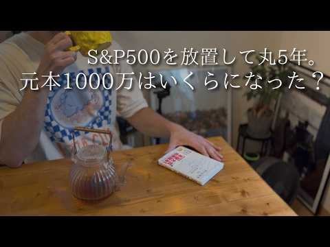
- 챕터: 0:00 今日のテーマ · 1:04 結論:5年でこれだけ増えました · 1:47 5年間の全記録（2021~2026） · 7:23 そもそも最初の元手をどうやって作った？ · 8:33 5年の運用で理解したインデックス投資の3つの本質 · 11:00 S&P500への積立を辞めた理由 · 12:56 まとめ
- 설명 앞부분: ③【新NISA】米国株信者だった僕がS＆P500から日経平均に乗り換えた8つの理由
- 같은 채널 평소 대비 ×38.2 (채널 최근 롱폼 중앙값 9,482회) · 평소 영상: 【驚愕】資産1000万から3000万まで◯年で達成！自分で入金したのこれだけ！？ (9,528회) / 【実録】資産3000万円まで最短で達成させるためにやって良かった7つのこと・後悔している3つのこと… (9,436회)
- 대본 없음 (설명) — 음성인식이 끝나면 도입부·흐름이 들어감
- 댓글 141/141: 좋은 점 — 영상 0 · 감사·응원 0 · 더 알고 싶은 것 0 · 아쉬운 점 — 영상 0 · 반박·불만 — 의견 다름 0 · 정치·사회 0 · 경험 공유 0 · 구독·다음 기대 0

### 64. 오늘부터 오후 8시까지 애프터마켓 오픈!! 주식패턴 ‘이렇게’ 완전히 바뀐다

- https://www.youtube.com/watch?v=wwrCztntACs · 잘되라대한민국 · 구독자 6,350 · 조회수 244,127 (×38.5, 하루 4,602.1) · 좋아요 964 (0.4%) · 8.2분 · 2026-09-14 · 주제 묶음 기타 · 형식 정보·해설 (그 밖) · 폴더 `W_wwrCztntACs` (웹 승인)
- 썸네일: 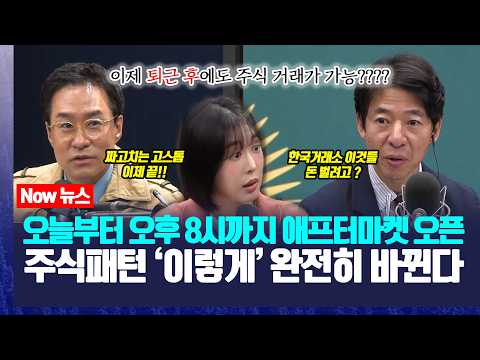
- 챕터: 0:00 오늘부터 열리는 주식 애프터마켓 전격 도입 배경 · 1:00 거래소 애프터마켓 이용 방법 및 주요 거래 규칙 · 2:21 정규장과 애프터마켓의 결정적 차이 (시장가 주문 불가… · 3:00 넥스트레이드와 KRX 애프터마켓의 관계 · 4:47 한국거래소가 애프터마켓을 도입한 진짜 이유와 우려스러… · 6:25 개인 투자자가 꼭 알아야 할 애프터마켓 투자 체크포인트
- 설명 앞부분: [겸공_12시에만나요 260914] 오늘부터 본격적으로 시작된 한국거래소(KRX) 애프터마켓 개시 소식과 투자자 체크포인트를 완벽하게 분석해 드립니다. 오후 4시부터 저녁 8시까지 연장된 거래 시간, 시장가 주문 불가와 자동 승계 미지원 등 기존 정규장과 달라지는 핵심 규칙들을 낱낱이 파헤쳐 봅니다. 새로운 제도 도입에 따른 숨겨진 변동성 위험과 투자 전략을 지금 바로 확인해 보세요! 타임라인
- 같은 채널 평소 대비 ×7.6 (채널 최근 롱폼 중앙값 32,135회) · 평소 영상: 삼성전자, 어디까지 빠질까? ‘이 가격’이면 무조건 매수시그널 (32,135회) / 엔비디아, 자사주 매입 200조 한도↑ 삼성전기 반도체 기판 증설 선수금 비중 大 (31,257회)
- 대본 (음성인식(앞 5분), 5.4 음절/초) — 앞부분만, 흐름은 그 안까지 첫 20초: “그러면 이제 전혀 새로운 패턴이 또 나올 수 있다는 걸 좀 염두에 두셔야 될 것 같아요. 왜냐하면 4시 넘어서 그동안 거래 안 되는 종목이 거래되는 600개고 이제 새로 열리면 한 1500개 이상 이제 새로 될 텐데 그러면 이제 8시까지 거의 본장 이어지는 셈이나 마찬가지거든요. 그럼 우리 본장에서 미국 선물을 그대로 보면서 할 수 있는 상황이 되는 거니까”
- 첫 1분: “그러면 이제 전혀 새로운 패턴이 또 나올 수 있다는 걸 좀 염두에 두셔야 될 것 같아요. 왜냐하면 4시 넘어서 그동안 거래 안 되는 종목이 거래되는 600개고 이제 새로 열리면 한 1500개 이상 이제 새로 될 텐데 그러면 이제 8시까지 거의 본장 이어지는 셈이나 마찬가지거든요. 그럼 우리 본장에서 미국 선물을 그대로 보면서 할 수 있는 상황이 되는 거니까 오늘부터 저녁 8시까지 주식 거래가 가능해진다는 사실 알고 계셨나요? 본장에서 미국 선물을 보면서 투자할 수 있게 되는데요. 이렇게 되면 앞으로는 주식시장의 전혀 새로운 패턴이 시작될 예정입니다. 과연 우리에게 독이 될지 아니면 새로운 기회가 될지 그 숨겨진 이야기가 지금 바로 공개됩니다. 그래서 왜 오늘부터 애프터마켓이 오픈되는 겁니다? 저녁 8시까지”
- 흐름 (90초마다 첫 문장): 0:00 그러면 이제 전혀 새로운 패턴이 또 나올 수 있다는 걸 좀 염두에 두셔… → 1:33 그래서 별도입니다. → 3:00 그래서 얘네들이 아침에 8시에 프리로 한 번 열고 또 저녁에 3시 40분 → 4:33 박시동 대표님 말씀처럼 한국 거래소가 단순히 돈 벌려고 자기네들이
- 댓글 253/253: 좋은 점 — 영상 0 · 감사·응원 0 · 더 알고 싶은 것 4 · 아쉬운 점 — 영상 0 · 반박·불만 — 의견 다름 2 · 정치·사회 45 · 경험 공유 3 · 구독·다음 기대 0
  - 더 알고 싶은 것 👍32 “아니 예수금은 다음날 언제 받는건가요? 대체 거래소 에프터장은 이리쉽게 뚝딱 처리하연서~~~”
  - 더 알고 싶은 것 👍4 “정부에 항의부탁드립니다 정말 답답하고 화가납니다 왜 주식시장 을 개판으로 만드는 나쁜놈들”
  - 반박·불만 — 의견 다름 👍0 “잣됐다 대한민국. 선동질하지마라.”
  - 정치·사회 👍35 “이걸 정책으로 시행하라고 허가를 해준 정부가 문제죠? 국민들 의견은 들어보지 않고, 결국 국민들이 주식판 보는 시간만 늘어나서 일을 못하게 합니다. 진짜 이건 누구 생각인지 그리고 또 누가 허가를 했는지 조사해야 합니다.”
  - 정치·사회 👍24 “이재명은 지지율이 왜그렇게빠지는지 진정 모르나??? 개인자산을 건드려서인걸 모르네”
  - 경험 공유 👍1 “난 얘들보면 선대인하고 밧데리아저씨가 오버렙이 되더라고... 과거에 선대인이 원랜 부동산 전문가 코스프레를 하면서 지금 이광수가 했던 소리와 판박이같은 소릴하면서 폭락 기우제를 지냈는데 그때도 그 소리 믿고 쪽박찬 인간들 엄청나게 양산했어. 그러다니 어느날 갑자기 대…”
  - 경험 공유 👍0 “난 이잼 정부 지지자이고 문조털래유최 까지 계속 까던 사람이다 . 그리고 국장만 2009년 부터 해왔고 근데 이게 먼 개 ㅈㄹ 이냐 이걸 승인한 놈들이나 이잼도 이번에 생각좀 해줬으면 한다 . 1주라도 주식 매수 매도 한 사람들 투표 하던지 이건 뭐 주식투자자들과 아…”

### 65. Should you Buy, Hold or Sell? A ₹70 Crore Investor Explains! ft. Gajendra Kothari

- https://www.youtube.com/watch?v=LKyU01qWfwA · Angel One Podcasts · 구독자 6,160 · 조회수 43,096 (×7.0, 하루 4,439.7) · 좋아요 384 (0.9%) · 25.9분 · 2026-10-27 · 주제 묶음 기타 · 형식 인터뷰·강연·대담 · 폴더 `W_LKyU01qWfwA` (웹 승인)
- 챕터: 0:00 Intro · 1:22 How To Find Undervalued Secto… · 3:35 Why Following The Crowd Can C… · 4:48 Is Index Investing Becoming T… · 6:12 How To Spot The Next Investme… · 8:25 Why Data Matters More Than Ma… · 9:37 Is The AI Boom A Bubble? · 11:20 Index Funds Vs Active Investi… · 12:56 Small Cap Vs Mid Cap Vs Large… · 13:50 Flexi Cap Vs Multicap: Which … · 16:11 How To Build Your First ₹1 Cr… · 17:12 Why The First Crore Is The Ha… · 17:52 Renting Vs Buying: What Makes… · 19:43 Why Most Investors Can't Beat… · 20:43 How Many Mutual Funds Do You … · 22:18 How To Decide Where To Invest… · 23:13 How He Invested During The CO… · 24:47 When Should You Rebalance You…
- 설명 앞부분: How do you build wealth by investing differently from everyone else? In this episode, Gajendra Kothari shares his contrarian investing philosophy, how he identifies opportunities that the market overlooks, and why following the crowd can lead investors to miss out on potential returns. From choosin…
- 같은 채널 평소 대비 ×0.4 (채널 최근 롱폼 중앙값 113,824회) · 평소 영상: How To Make ₹0 to ₹1 Crore Through Mutual Fund SI… (117,202회) / Where Kirtan Shah Is Investing for 2027 (110,447회)
- 대본 없음 (설명) — 음성인식이 끝나면 도입부·흐름이 들어감
- 댓글 16/16: 좋은 점 — 영상 0 · 감사·응원 0 · 더 알고 싶은 것 0 · 아쉬운 점 — 영상 0 · 반박·불만 — 의견 다름 0 · 정치·사회 0 · 경험 공유 0 · 구독·다음 기대 0

### 66. Gold and Silver Investors Are Getting Caught Out by the ATO

- https://www.youtube.com/watch?v=sY77wNqqiLA · Navexa · 구독자 7,610 · 조회수 120,642 (×15.8, 하루 5,387.7) · 좋아요 1,069 (0.9%) · 10.2분 · 2026-10-14 · 주제 묶음 기타 · 형식 정보·해설 (그 밖) · 폴더 `W_sY77wNqqiLA` (웹 승인)
- 썸네일: 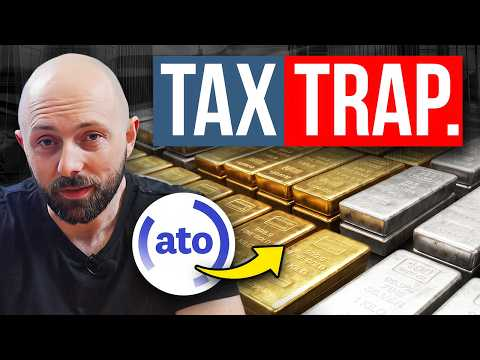
- 설명 앞부분: Gold and silver get taxed the moment you dispose of them, whether you sell, swap, gift or move them into a trust or SMSF, and that's true whether or not the ATO is watching. The bigger risk is substantiation. Without records you can't prove your cost base, your holding period, the premium you paid …
- 같은 채널 평소 대비 ×18.1 (채널 최근 롱폼 중앙값 6,649회) · 평소 영상: The Dollar-Cost Averaging Mistake Costing Austral… (6,967회) / One Hack That Dramatically Lowers Tax on Your ETFs (6,331회)
- 대본 없음 (설명) — 음성인식이 끝나면 도입부·흐름이 들어감
- 댓글 486/583: 좋은 점 — 영상 0 · 감사·응원 0 · 더 알고 싶은 것 0 · 아쉬운 점 — 영상 0 · 반박·불만 — 의견 다름 0 · 정치·사회 0 · 경험 공유 0 · 구독·다음 기대 0

### 67. 내 인생 최대 실수는 한국주식 투자....또 폭락하네

- https://www.youtube.com/watch?v=0hyt_77_Xgw · 엑스세대 우리들의 이야기 · 구독자 11,500 · 조회수 57,326 (×5.0, 하루 7,876.4) · 좋아요 898 (1.6%) · 8.6분 · 2026-10-30 · 주제 묶음 5. 국내주식 · 형식 정보·해설 (그 밖) · 폴더 `W_0hyt_77_Xgw` (웹 승인)
- 같은 채널 평소 대비 ×3.3 (채널 최근 롱폼 중앙값 17,272회) · 평소 영상: 경기안좋다...지금은 무조건 관망하는게... (17,386회) / 아무래도 금년에 탈출 못할거 같아..이거 뭐여 대체 (17,158회)
- 대본 없음 (없음) — 음성인식이 끝나면 도입부·흐름이 들어감
- 댓글 225/225: 좋은 점 — 영상 2 · 감사·응원 8 · 더 알고 싶은 것 2 · 아쉬운 점 — 영상 1 · 반박·불만 — 의견 다름 2 · 정치·사회 40 · 경험 공유 10 · 구독·다음 기대 0
  - 좋은 점 — 영상 👍4 “자본주의의 똥😅😅공감되네요”
  - 감사·응원 👍54 “진짜 할거 없네요 은퇴하고 집에서 소일거리 하는것도 예전 반토막이고 노후 대비용 서울 임대주는 상가3개 다 퍼져서 공실되고 은행이지와 관리비로 돈이 줄줄세고 그 와중에 국가는 알뜰하게 재산세 토지세 받아가고..집한채과 상가 재산이 있으니 국민연금 의료보험은 매달 20…”
  - 감사·응원 👍19 “엑스님방송 하루라도 안보면 서운하고...매일 감사히 봅니다....개국장 언젠가 오를 겁니다...이렇게 말해놓고도 자신없읍니다....그저 엑스님 화이팅....”
  - 더 알고 싶은 것 👍0 “혹시 선생님 연배가 어떻게 되시는지요? 아무리봐도 엑스세대는 아니신거 같은데 ......”
  - 반박·불만 — 의견 다름 👍13 “저랑동갑이신거같은데57세입니다항상재있게봅니다 주식도주식이지만 부동산도 영 아닙니다 상가를샀는데 죽을맛 임차인죽어도안들어와요”
  - 반박·불만 — 의견 다름 👍4 “지선끝났으니 내 알빠 아니죠 정치인들이야 표구걸하는 꾼들이고 거기에 넘어가냐 마냐는 개인몫”
  - 정치·사회 👍82 “대통령이 부동산 매수하지 말고 주식 매수하라고 했어요!! 그리고 대통령이 미장탈출은 지능순이라고 했어요 빨리 국장투자 하라고 했어요 국민들 주식하지 못해서 돈 벌지 않는게 안타깝다고 말했어요 전세계에서 대통령이 주식하라고 한 사람은 이재명 대통령 뿐이예요😢”
  - 정치·사회 👍27 “대통령이 똥이잖어 ㅋ”
  - 경험 공유 👍17 “삼성전자 -40% 잡주도 아니고, 레버리지 쓴것도 아니고, 신용 쓴것도 아니고 휴~ 제가 뭘 그렇게 잘못했나요?”
  - 경험 공유 👍8 “올라도, 내려도, 그냥 가지고 있어도 화남. 그럼 주식을 하지 않으시는게 좋을 거 같아요. 방송용 컨셉이면 다행인데 이렇게 불안하시면 삶이 많이 힘들꺼 같습니다. 저도 주식하고 손실구간입니다. 제가 드리고 싶은 말은 안좋은 얘기만 계속 하시면 그 데미지로 스스로에게 …”

### 68. 삼성·하이닉스 이대로 끝인가?… 지금 시장이 숨기고 있는 진짜 진실

- https://www.youtube.com/watch?v=peJD7gf8MVw · 잘되라대한민국 · 구독자 6,350 · 조회수 106,538 (×16.8, 하루 4,268.8) · 좋아요 692 (0.7%) · 15.1분 · 2026-10-12 · 주제 묶음 기타 · 형식 정보·해설 (그 밖) · 폴더 `W_peJD7gf8MVw` (웹 승인)
- 썸네일: 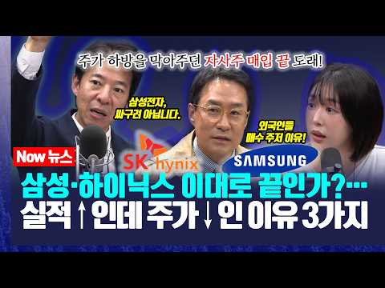
- 챕터: 0:00 오프닝 및 반도체 수출 펀더멘탈과 수급 점검 · 4:36 최태원 SK회장 용인·호남 클러스터 동시 구축 언급 … · 6:14 주요 증권사 반도체 리포트 분석 (삼성전자 '세계 최… · 8:20 펀더멘탈은 좋은데 주가가 역주행하는 답답한 시장 상황 · 10:14 '진실은 언젠가 나타난다' : 불확실성에 가려진 본질… · 11:49 한국 증시가 유독 두들겨 맞는 4가지 이유 (자사주 … · 14:30 매물대와 저평가 구간에 대한 부연 및 마무리
- 설명 앞부분: [겸공_12시에만나요 261012] 실적은 사상 최대라는데, 내 계좌는 왜 이 모양일까요? 펀더멘탈에는 이상이 없다고 외치지만, 유독 한국 증시만 두들겨 맞는 진짜 이유를 파헤칩니다. 자사주 매입 종료와 100조 원대 매물대 장벽, 그리고 외국인이 집을 떠나지 못하는 이유까지! 꼬일 대로 꼬인 수급의 비밀과, 안개가 걷힌 뒤 마주할 반도체 본질의 진실을 확인해 보세요.
- 같은 채널 평소 대비 ×3.3 (채널 최근 롱폼 중앙값 32,135회) · 평소 영상: 삼성전자, 어디까지 빠질까? ‘이 가격’이면 무조건 매수시그널 (32,135회) / 엔비디아, 자사주 매입 200조 한도↑ 삼성전기 반도체 기판 증설 선수금 비중 大 (31,257회)
- 대본 없음 (설명) — 음성인식이 끝나면 도입부·흐름이 들어감
- 댓글 165/165: 좋은 점 — 영상 2 · 감사·응원 1 · 더 알고 싶은 것 0 · 아쉬운 점 — 영상 0 · 반박·불만 — 의견 다름 3 · 정치·사회 30 · 경험 공유 3 · 구독·다음 기대 0
  - 반박·불만 — 의견 다름 👍0 “그냥 데이터로 분석해서 알려줘야는데 마치 모든걸 다 꿰뚫어 보고 있는 사람처럼 msg를 쳐서 말하니 투자자들이 기업에 대해서 분석 따윈 필요없는 것처럼 순간 솔깃하게 말하는 재주가 있음. 싼데 왜 하락함? 싼데 떨어지면 또 정부탓 기업탓 하고 있을꺼임.. 신랑이랑 내…”
  - 반박·불만 — 의견 다름 👍0 “여러분들 여지껏 박시동 이광수의 주장이 맞은 게 있는지 돌아보세요. 제가 가장 경계하는 것이 특정인의 말을 너무 지나치게 매몰되어서 믿는 것입니다. 주식전문가라는 사람들 절대 너무 믿어서는 안됩니다. 자꾸 실적이 사상 최대 역사적으로 최초 이런 수식어들 붙이고 있지만…”
  - 정치·사회 👍13 “명확한 이유가 있는데. 세계 1위 영업이익 삼성전자는 임직원 준다고 자사주 매입만하고 소각은 안하고 주주환원은 배당으로 한다니 굳이 지금 살필요도 없고 배당하기 한달전쯤부터 사다가 배당기준일까지 갖고 있다가 팔면 되는거 아닌가? 빅테크중에 누가 주주환원을 배당으로 하…”
  - 정치·사회 👍11 “여기 3명 보면 무슨 종교 집단 같음. 신념으로 똘똘 뭉쳐있음. 문제는 그 신념이 전문가라는 명목으로 타인한테 강요함. 국장은 실적 따윈 의미 없음.. 수급이 문제 인데 외국인이 던지는 물량을 개인이 받아줘야하는데, 지난 7월에 레버리지에 다 털려서 돈이 없음. 진짜…”
  - 경험 공유 👍2 “이런방송을 할때는 말의 책임과 무게를 알고 해야한다고 생각합니다 주가방송은 맞으면 제가 말했죠 떨어지면 온갖 이유와 앞으로는 괜찮을거다 기다려봅시다 얘기를 반복할뿐입니다 아무도 책임을 안집니다 대통령조차 웃으면서 주식은 귀신도 모른다 강요한적없다고 말하고 ETF하라던…”
  - 경험 공유 👍0 “그냥 데이터로 분석해서 알려줘야는데 마치 모든걸 다 꿰뚫어 보고 있는 사람처럼 msg를 쳐서 말하니 투자자들이 기업에 대해서 분석 따윈 필요없는 것처럼 순간 솔깃하게 말하는 재주가 있음. 싼데 왜 하락함? 싼데 떨어지면 또 정부탓 기업탓 하고 있을꺼임.. 신랑이랑 내…”

### 69. S&P500とNASDAQ100は崩れない。プロ投資家が あの日 まで買わない理由【米国株最新】

- https://www.youtube.com/watch?v=9zV78pvlDJ4 · まなみんの米国株の学校【投資初心者でも10分で学べる】 · 구독자 8,500 · 조회수 117,631 (×13.8, 하루 5,602.5) · 좋아요 651 (0.5%) · 10.3분 · 2026-10-16 · 주제 묶음 2. 장기투자·ETF·지수 · 형식 정보·해설 (그 밖) · 폴더 `W_9zV78pvlDJ4` (웹 승인)
- 썸네일: 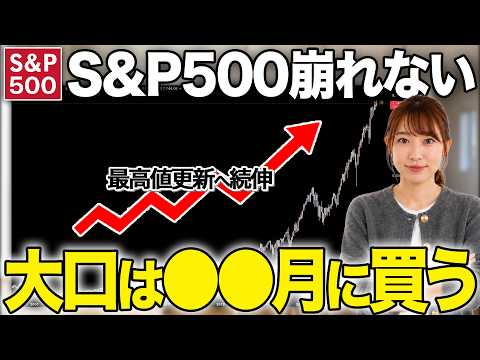
- 설명 앞부분: 私は10月28日のFRBの会議まで、売らず買わずに待ちます🍀 S&P500・NASDAQ100などの米国株と、 ※映像や資料の制作にはAIを活用していますが、相場の分析と「私はこう見る」の見解は、すべて実在する運営者自身のものです🤍
- 같은 채널 평소 대비 ×15.9 (채널 최근 롱폼 중앙값 7,397회) · 평소 영상: 【米国株 最新】今、大口投資家が狙っている銘柄を公開しちゃいます。大口と一緒に大きな波に乗りたい… (7,536회) / 【米国株・オルカン】全世界株式（オール・カントリー）で資産を増やすためには、為替ドル円もしっか… (7,258회)
- 대본 없음 (설명) — 음성인식이 끝나면 도입부·흐름이 들어감
- 댓글 36/40: 좋은 점 — 영상 0 · 감사·응원 0 · 더 알고 싶은 것 0 · 아쉬운 점 — 영상 0 · 반박·불만 — 의견 다름 0 · 정치·사회 0 · 경험 공유 0 · 구독·다음 기대 0

### 70. Can You Retire With $100,000 in 10 Years (SCHD vs VOO)

- https://www.youtube.com/watch?v=ldrMrnOJHlc · Joey @ChartEquity · 구독자 4,640 · 조회수 25,846 (×5.6, 하루 3,019.1) · 좋아요 143 (0.5%) · 13.8분 · 2026-10-28 · 주제 묶음 2. 장기투자·ETF·지수 · 형식 정보·해설 (그 밖) · 폴더 `W_ldrMrnOJHlc` (웹 승인)
- 챕터: 0:00 Can $100,000 retire you in 10… · 0:31 What SCHD and VOO are · 1:32 SCHD: $100,000 and 10 years o… · 3:14 VOO: the same $100,000, a big… · 4:57 Dividends reinvested, and why… · 6:43 The 4% rule explained · 7:45 Inflation and your retirement… · 8:32 Sequence of returns risk · 9:16 What $309,000 and $386,000 wo… · 10:08 How big your portfolio needs … · 11:10 So can $100,000 get you there? · 12:38 My verdict: SCHD or VOO?
- 설명 앞부분: If you have $100,000 invested today, could you retire in 10 years? In this video I put real numbers behind that question by comparing $100,000 in the Schwab U.S. Dividend Equity ETF (SCHD) with $100,000 in the Vanguard S&P 500 ETF (VOO) over the last 10 years: the dividends each one paid, what the …
- 같은 채널 평소 대비 ×32.2 (채널 최근 롱폼 중앙값 802회) · 평소 영상: I Just Sold 2 Tech Stocks! (& Bought 4 More The M… (852회) / The AI Power Crisis OPPORTUNITY is Here! (2 Stock… (751회)
- 대본 없음 (설명) — 음성인식이 끝나면 도입부·흐름이 들어감
- 댓글 10/10: 좋은 점 — 영상 0 · 감사·응원 0 · 더 알고 싶은 것 0 · 아쉬운 점 — 영상 0 · 반박·불만 — 의견 다름 0 · 정치·사회 0 · 경험 공유 0 · 구독·다음 기대 0

### 71. 【nisa おすすめ】オルカン、S＆P500、日本株、NASDAQ100、FANG+ 50代から新NISA 何を買えばいいのか？ 結局これが一番増える【資産運用・FIRE】

- https://www.youtube.com/watch?v=wlcAUXORzEE · 元外資系バンカー | イッセイの超マネーハック · 구독자 8,490 · 조회수 68,940 (×8.1, 하루 5,368.6) · 좋아요 380 (0.5%) · 21.7분 · 2026-10-24 · 주제 묶음 10. 노후·연금 투자 · 형식 정보·해설 (그 밖) · 폴더 `W_wlcAUXORzEE` (웹 승인)
- 설명 앞부분: ＼NISAの「その先」を無料で／ 公式LINE登録で、3大特典をプレゼント🎁 ⇩イッセイの公式LINEはこちら⇩ ▼ 公式LINE登録で受け取れる3大特典 三菱UFJモルガン・スタンレー証券 資産運用課を経て、 ニューヨーク工科大学大学院でMBAを取得。 いつのまにか億り人になれる超マネーハック』（KADOKAWA） Amazon・楽天・Kindle 3部門1位 ・NISA・iDeCoの「使い切り方」 ⇩イッセイの公式LINEはこちら⇩ ◆X（旧Twitter）
- 같은 채널 평소 대비 ×0.5 (채널 최근 롱폼 중앙값 138,940회) · 평소 영상: 【警告】S&P500は11月に市場は激変します。元外資系バンカーが備える「2026年後半のヤバいシ… (213,544회) / 【2027年から激変】新NISAが神改正！知らない人だけ損する3つの変更点と最適戦略!【資産形成・… (260,943회)
- 대본 없음 (설명) — 음성인식이 끝나면 도입부·흐름이 들어감
- 댓글 7/7: 좋은 점 — 영상 0 · 감사·응원 0 · 더 알고 싶은 것 0 · 아쉬운 점 — 영상 0 · 반박·불만 — 의견 다름 0 · 정치·사회 0 · 경험 공유 0 · 구독·다음 기대 0

### 72. 주식투자 5년간 수익이 없던 내가 드디어 깨달은 '이것'

- https://www.youtube.com/watch?v=uqsGXwRgP68 · 리채피 richappy · 구독자 9,060 · 조회수 173,650 (×19.2, 하루 5,727.2) · 좋아요 2,279 (1.3%) · 27.8분 · 2026-09-28 · 주제 묶음 11. 투자 일반 · 형식 정보·해설 (그 밖) · 폴더 `W_uqsGXwRgP68` (웹 승인)
- 썸네일: 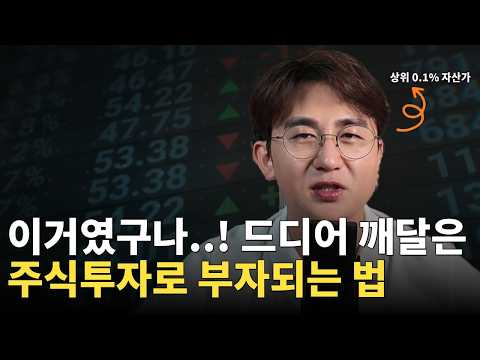
- 챕터: 0:00 인트로 · 1:10 5년 동안 제가 주식으로 번 돈은 0원이었습니다 · 3:01 제일 괴로웠던 건 손실이 아니었습니다 · 5:15 2019년, 제가 모으던 건 정답이었습니다 · 11:59 기준을 배운 직후에 무너졌습니다 · 17:59 코로나 폭락, 계좌가 70~80퍼센트 빠졌습니다 · 24:22 드라마 제작사 투자로 자산이 3배가 됐습니다 · 26:56 2022년 금리 인상기, 마이너스 30퍼센트
- 설명 앞부분: 매주 수요일 오후 9시에 라이브를 진행합니다. 많은 분들이 공부한 만큼 계좌가 따라오지 않는 이유를 아직 공부가 부족해서라고 생각하지만, 실제로는 배운 것을 실제 비중과 행동에 옮기지 못한 데서 오는 경우가 많습니다. 여기에 시장이 오를 때 확인 절차를 건너뛰게 만드는 수익의 착각이 겹치면 같은 자리를 다시 맴돌게 됩니다. 한지우는 2016년에 투자를 시작해 5년 동안 책과 강의, 새벽까지 이어진 기업 분석에 매달렸지만 그 기간 주식으로 번 돈은 없었습니다. 2019년 가치투자 스터디에서 만난 투자자들이 종목이 아니라 기준을 이야…
- 같은 채널 평소 대비 ×10.8 (채널 최근 롱폼 중앙값 16,152회) · 평소 영상: 5년간 죽어라 했던 주식투자, '이렇게' 바꾸고 행복한 부자가 됐습니다 (16,152회) / 주식투자 5년을 헤매던 내가 전문가 전망보다 먼저 알게 된 '이것' (15,647회)
- 대본 (음성인식(앞 5분), 5.2 음절/초) — 앞부분만, 흐름은 그 안까지 첫 20초: “요즘은 투자 공부를 할 수 있는 곳이 정말 많습니다. 책도 많고 강의도 많고 예전과는 비교하기 어려울 정도죠. 그런데 공부한 만큼 계좌가 따라오느냐는 또 다른 이야기일 수 있습니다. 저도 그랬습니다. 무려 5년 동안 주식 공부를 했는데도 계좌는 제 자리였습니다. 주변에서는 그 정도 공부했으면 이제 충분하지 않냐는 말까지 들었죠.”
- 첫 1분: “요즘은 투자 공부를 할 수 있는 곳이 정말 많습니다. 책도 많고 강의도 많고 예전과는 비교하기 어려울 정도죠. 그런데 공부한 만큼 계좌가 따라오느냐는 또 다른 이야기일 수 있습니다. 저도 그랬습니다. 무려 5년 동안 주식 공부를 했는데도 계좌는 제 자리였습니다. 주변에서는 그 정도 공부했으면 이제 충분하지 않냐는 말까지 들었죠. 그런데 정작 저는 5년 동안 뭔가를 놓치고 있었습니다. 열심히 공부했지만 제가 놓치고 있었던 건 따로 있었던 겁니다. 그리고 그걸 이해하고 나서부터는 본격적으로 수익이 나기 시작했습니다. 그리고 지금은 경제적 자유를 이루게 됐습니다. 오늘은 제가 그 5년 동안 무엇을 놓치고 있었는지 그리고 수많은 시행차고 끝에 무엇을 깨달았는지 말씀드리겠습니다. 이 영상을 끝까지 보시면 저처럼 오랜”
- 흐름 (90초마다 첫 문장): 0:00 요즘은 투자 공부를 할 수 있는 곳이 정말 많습니다. → 1:30 벌었다가 잃었다가 또 벌었다가 다시 잃었습니다. → 3:01 그런데 무엇보다 돈을 크게 잃었을 때보다 → 4:31 그걸 몰랐던 거죠 3년 차까지는.
- 댓글 111/118: 좋은 점 — 영상 7 · 감사·응원 15 · 더 알고 싶은 것 3 · 아쉬운 점 — 영상 0 · 반박·불만 — 의견 다름 0 · 정치·사회 0 · 경험 공유 12 · 구독·다음 기대 2
  - 좋은 점 — 영상 👍17 “차분하고 솔직한 설명 공감이 가고 참 감동 입니다”
  - 좋은 점 — 영상 👍6 “목소리가 맑고 깨끗해서 듣기좋아요. 마이크가 너무 섬세해서 스피커에 울림이와서 많이거슬려요!”
  - 감사·응원 👍14 “잘봤습니다. 구독. 감사합니다. 뒤늦게 주식에 뛰어든 70초반 입니다. 우선은 오래 버티고 싶습니다.”
  - 감사·응원 👍6 “궁금해서 구독했어요 응원합니다”
  - 더 알고 싶은 것 👍6 “궁금해서 구독했어요 응원합니다”
  - 더 알고 싶은 것 👍0 “반갑습니다60세후반입니다.종가베팅을알고싶어요.참아어렵고힘들어요배움도짧고알고싶어요배움을주세요.감사합니다.”
  - 경험 공유 👍8 “매우 좋은 메시지입니다. 저도 주식에 전념하기로 한 저에게 많은 방향을 주셨습니다.”
  - 경험 공유 👍6 “철저한 절재!!! 다 내려놓고 그걸 행동으로 옮기자. 그 자그만한 행동이 나을 변화 시킨다 다 내꺼가 아니다~ 3년.5개월차에 느낌입니다 잘 하다 크게맞고 또 잘하다 크게맞고 두번 하고 나니까. 아~내가 이런 행동땜에 큰 던을 잊는구나 느끼고 내려놓고 행동으로 옮기니…”
  - 구독·다음 기대 👍6 “궁금해서 구독했어요 응원합니다”
  - 구독·다음 기대 👍4 “구독하고갑니다 감사합니다”

### 73. 레버리지 ETF 상장폐지 논란🔥도박판 코스피 알고도 레버리지 ETF 상폐 못하는 이유🔥위험 알고도 도장 찍은 사람🔥금리인상 악제🔥역대급 반도체 실적 국민돈증발🔥…

- https://www.youtube.com/watch?v=O4-jY0zyhDo · 리얼경제 · 구독자 1,340 · 조회수 93,668 (×69.9, 하루 836.7) · 좋아요 2,368 (2.5%) · 15분 · 2026-07-17 · 주제 묶음 9. 빚투·레버리지 · 형식 정보·해설 (그 밖) · 폴더 `W_O4-jY0zyhDo` (웹 승인)
- 썸네일: 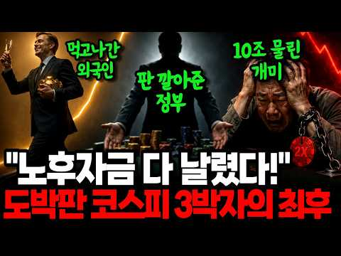
- 챕터: 0:00 인트로 — 89조 잔치인데 국민 돈은 증발 · 0:44 검은 월요일 — 올해만 서킷브레이커 7번 · 2:01 범인의 등장 — 5월 27일 상장된 그 '상품' · 3:35 세 개의 함정 — 왜 도박판이 됐나 · 7:07 대(大)아이러니 — 실적 최대인데 주가 최대 폭락, … · 9:44 앞으로 어떻게 되나 — 상폐 못 하는 이유와 정부의 … · 13:31 착지 — 호황의 나라에서 국민이 죽는다
- 설명 앞부분: 🔎 삼성전자가 2분기 영업이익 89조 4천억 원으로 3분기 연속 최대를 기록하고, 7월 반도체 수출은 193% 폭증해 사상 최대를 찍었습니다. 나라는 반도체로 호황입니다. 그런데 바로 그 삼성전자와 SK하이닉스를 '미끼'로 만든 단일종목 레버리지 ETF에 국민 돈 10조 원이 넘게 묶인 채 녹아내리고, 올해에만 서킷브레이커가 일곱 번 울렸습니다. 실적은 최대인데 주가는 최대 폭락하는 기막힌 아이러니. 세계 1등 실적을 낸 나라에서 어쩌다 국민이 도박판에 앉게 됐는지, 레버리지 ETF의 세 가지 함정(복리손실·지수 착시·리밸런싱 증…
- 같은 채널 평소 대비 ×495.6 (채널 최근 롱폼 중앙값 189회) · 평소 영상: 삼성노조가 800조 호남 반도체 메가프로젝트 막아선 진짜 이유...부메랑 노란봉투법 삼성… (189회) / 엔비디아 손잡은 네이버 집중분석🔎아시아 AI 인프라회사로?🔥14조 유치🔥GPU 6만장🔥1… (147회)
- 대본 (음성인식(앞 5분), 5.5 음절/초) — 앞부분만, 흐름은 그 안까지 첫 20초: “여러분 지금 우리나라는 반도체로 잔치집입니다. 삼성전자가 한분기에 89조를 벌었어요. 3분기 연속, 역대 최대입니다. 그야말로 세계가 우리 반도체 앞에 앞다터 줄을 선 거예요. 그런데 말입니다. 바로 그 삼성을 믿기로 만든 어떤 상품에 지금 국민 돈 10조가 도박판처럼 놓고 있습니다. 올해에만 주식거래를 통째로 멈춰세우는 비상벨이 7번 울렸어요.” — 도입부 유형: 시청자 부르기
- 첫 1분: “여러분 지금 우리나라는 반도체로 잔치집입니다. 삼성전자가 한분기에 89조를 벌었어요. 3분기 연속, 역대 최대입니다. 그야말로 세계가 우리 반도체 앞에 앞다터 줄을 선 거예요. 그런데 말입니다. 바로 그 삼성을 믿기로 만든 어떤 상품에 지금 국민 돈 10조가 도박판처럼 놓고 있습니다. 올해에만 주식거래를 통째로 멈춰세우는 비상벨이 7번 울렸어요. 모두가 외칩니다. 그 상품, 없애버리라고. 그런데 당국은 답합니다. 뾰족한 수가 없다, 두 손을 든 겁니다. 세계 1등 실적을 낸 나라에서 왜 국민만 도박판에 앉았을까요? 그리고 이 판, 앞으로 대체 어떻게 되는 걸까요? 오늘 그 이야기 처음부터 끝까지 아주 속시원이 다 풀어드리겠습니다. 지금 바로 시작합니다. 2026년 7월 13일 사람들이 검은 월요일이라 부르는”
- 흐름 (90초마다 첫 문장): 0:00 여러분 지금 우리나라는 반도체로 잔치집입니다. → 1:31 20분 동안 모든 거래를 강제로 멈춰 세우는 → 3:00 도박의 판 돈이 붙은 셈이죠. → 4:30 그 출렁임 자체가 비용이 돼서
- 댓글 648/648: 좋은 점 — 영상 2 · 감사·응원 10 · 더 알고 싶은 것 1 · 아쉬운 점 — 영상 1 · 반박·불만 — 의견 다름 5 · 정치·사회 150 · 경험 공유 17 · 구독·다음 기대 0
  - 좋은 점 — 영상 👍1 “유익한 정보 감사합니다 ㅎㅎ”
  - 좋은 점 — 영상 👍1 “좋은 설명이네.”
  - 감사·응원 👍4 “자세한 설명 감사합니다 아무리 실적 좋아도 레버리지 2배 때문에 주식시장을 쑥대밭을 만드네요 매일 서커브레이크 카지노 도박판 실적분석 필요없어요 코스닥 돈빼 레버리지 산다고합니다 아휴 답답 한숨 정부지도자들 자기들은 강건너 불구경 힘드네요”
  - 감사·응원 👍1 “감사합니다.”
  - 아쉬운 점 — 영상 👍1 “왜? 이렇게 Ai목소리가 듣기싫지 직접방송하라”
  - 반박·불만 — 의견 다름 👍1 “헛소리 그만하고 오늘 일단 3일 연속 써킷 갑니다.”
  - 반박·불만 — 의견 다름 👍1 “외국주식시장은 레버리지 2배이상짜리도 많은데 어떻게 돌아가냐 미국주식시장 같으면 벌써 망했어야 정상아니냐~ 선전선동질 그만해라 그놈의 남탓 ㅋㅋㅋㅋ”
  - 정치·사회 👍135 “이상품에 직접투자한 사람들만의 손실이 문제가 아니다ㆍ덕분에 수급쏠림으로 인한 코스닥의 붕괴다ㆍ챠트를보면 전쟁터진 나라보다 더 폭락해버렸다ㆍ그리고 정부는 모르쇠로 일관ㆍ배신감이 분노로 바뀌고 결국 정부의 정체성까지 의심하고있다ㆍ머슴이 주인을 물어뜯고 과연 무사할까?”
  - 정치·사회 👍82 “이정부는 결국 주식으로 국민의 신뢰를 얻다가 주식으로 신뢰를 잃어가고 망해가고있네 참 세상이 아이러니하네”
  - 경험 공유 👍19 “도박 좋아하는 놈들이 정책을 해서. 나라 전체를 강원랜드로 만들고 .저평가 가치주까지 다른 종목 다 반토막. 미장은 이렇게 안 망가졌다. 내가 하면 투자.니가 하면 투기”
  - 경험 공유 👍10 “이래서.. 내가 국내주식을 안하는 이유다 미국우량주식만 장기매수하는 거 그 게 그나마 맘편하다”

### 74. 삼성전자 실적 발표 후 급락 이유

- https://www.youtube.com/watch?v=4kZ7AI6mBKI · 와조스키 종목분석 · 구독자 6,680 · 조회수 33,093 (×5.0, 하루 4,114.0) · 좋아요 349 (1.1%) · 6.8분 · 2026-10-29 · 주제 묶음 6. 종목 고르기·분석 · 형식 인터뷰·강연·대담 · 폴더 `W_4kZ7AI6mBKI` (웹 승인)
- 설명 앞부분: 와조스키 종목 분석 채널입니다. 종목 상담 요청을 받지 않고 있습니다. 지금 보시는 채널은 종목 분석 채널입니다. 라이브 방송 주식 강의 시황 분석 등은 아래 채널로 와주세요.
- 같은 채널 평소 대비 ×3.2 (채널 최근 롱폼 중앙값 10,284회) · 평소 영상: 수상한 매집흔적 (10,284회) / 한화에어로스페이스 투자자 주의사항 (10,223회)
- 대본 없음 (설명) — 음성인식이 끝나면 도입부·흐름이 들어감
- 댓글 43/43: 좋은 점 — 영상 0 · 감사·응원 1 · 더 알고 싶은 것 0 · 아쉬운 점 — 영상 0 · 반박·불만 — 의견 다름 2 · 정치·사회 2 · 경험 공유 2 · 구독·다음 기대 0
  - 감사·응원 👍4 “오늘 분석도 정말 저한텐 중요했습니다 정말 감사합니다 ~~❤”
  - 반박·불만 — 의견 다름 👍0 “세계에서 가장 돈 많이 버는 기업이 주주환원계획을 3개월이나 미룬다는것도 참 웃기는 일이긴 함.. 뭐랄까.. 쫌생이 같다고나 할까?”
  - 정치·사회 👍0 “지금 하락은 외국인 이탈인데 이건 딱 하나로만 설명 가능해. 전쟁. 조만간 어떤 사단이 날게다.”
  - 경험 공유 👍2 “개미는 비슷비슷 내가 아직 손절 안했다면 다른 사람들도 손절 안했다 내가 손절한다면 다른사람도 손절하고 내가팔면 오르네=개미들 다털렸네”
  - 경험 공유 👍0 “내가 팔았으면 올랐을거야 ㅋㅋ”

### 75. 퇴직연금 나머지 30%, 예금 말고 다른 선택지는?💰ㅣ원큐로 끝내는 ETF🎯

- https://www.youtube.com/watch?v=FV8Ry9V7IJM · 하나TV [하나자산운용] · 구독자 13,800 · 조회수 75,677 (×5.5, 하루 8,440.0) · 좋아요 35 (0.1%) · 7.9분 · 2026-10-28 · 주제 묶음 2. 장기투자·ETF·지수 · 형식 정보·해설 (그 밖) · 폴더 `W_FV8Ry9V7IJM` (웹 승인)
- 설명 앞부분: 퇴직연금 DC형·IRP 계좌, 나머지 30%는 어떻게 운용하고 계신가요?🤔 주식의 성장성과 채권의 상대적인 안정성을 함께 추구하는 채권혼합형 ETF가 새로운 선택지로 주목받고 있어요👀 여기에 월배당까지 더해진 '1Q 채권혼합형 ETF' 7종의 특징과 연금계좌 활용법을 알아봐요💚 하나자산운용 준법감시인 심사필 2026-197호(2026.10.28~2027.10.27) 1Q ETF 더 알아보기 👀
- 같은 채널 평소 대비 ×1.5 (채널 최근 롱폼 중앙값 51,062회) · 평소 영상: 미국 AI 소프트웨어·플랫폼 핵심 기업을 한번에📱ㅣ1Q 미국AI테크플랫폼 ETF [원박싱… (79,196회) / 코스닥 다시 반등할까?📈ㅣ원큐로 끝내는 ETF🎯 (105,091회)
- 대본 없음 (설명) — 음성인식이 끝나면 도입부·흐름이 들어감
- 댓글 9/9: 좋은 점 — 영상 1 · 감사·응원 2 · 더 알고 싶은 것 1 · 아쉬운 점 — 영상 0 · 반박·불만 — 의견 다름 0 · 정치·사회 0 · 경험 공유 0 · 구독·다음 기대 0
  - 좋은 점 — 영상 👍4 “채권혼합형으로 담으면 주식을 더 담을 수 있네요...??? 많이 배우고 갑니다ㅎㅎ 감사합니다”
  - 감사·응원 👍4 “채권혼합형으로 담으면 주식을 더 담을 수 있네요...??? 많이 배우고 갑니다ㅎㅎ 감사합니다”
  - 감사·응원 👍2 “자주 들을수 있어서 감사합니다~~~~”
  - 더 알고 싶은 것 👍0 “TDF와 채권혼합 무엇을 담을까요?”

### 76. 【NISAおすすめ】オルカン・S＆P500・日本株・FANG＋・NASDAQ100の人気銘柄５つを元銀行員の目線で徹底検証しました！

- https://www.youtube.com/watch?v=EB_-ZGfqX5s · 初心者でも分かる40代50代のための資産形成塾 みく · 구독자 3,590 · 조회수 39,586 (×11.0, 하루 2,081.6) · 좋아요 147 (0.4%) · 37.6분 · 2026-10-18 · 주제 묶음 10. 노후·연금 투자 · 형식 정보·해설 (그 밖) · 폴더 `W_EB_-ZGfqX5s` (웹 승인)
- 썸네일: 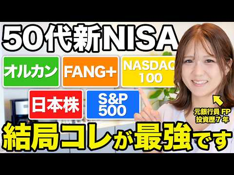
- 챕터: 0:00 オープニング · 2:06 日経平均とTOPIX、何が違う？ · 8:45 オルカンはなぜ人気なの？ · 12:54 S&P500はオルカンと何が違う？ · 15:58 NASDAQ100とFANG+の注意点は？ · 24:10 一番増えた銘柄を選べばいい？ · 27:51 今の組み合わせ、このままでいい？
- 설명 앞부분: ▼公式LINE 公式LINEにご登録後、動画内でお伝えしているキーワードを送っていただくと受け取れます🙆‍♀ 元銀行員でFPの資格を持つ私が 新NISAや老後資金など、お金のことを発信していきます🎙
- 같은 채널 평소 대비 ×1.0 (채널 최근 롱폼 중앙값 40,820회) · 평소 영상: 【50代60代必見！】70歳までにこの資産額さえあれば、もう人生安泰です！ (40,820회) / 【必見】実は資産〇〇万円から、 爆発的に増えはじめる！積立投資の複利効果と絶対に抑えておいてほしい… (45,080회)
- 대본 없음 (설명) — 음성인식이 끝나면 도입부·흐름이 들어감
- 댓글 9/15: 좋은 점 — 영상 0 · 감사·응원 0 · 더 알고 싶은 것 0 · 아쉬운 점 — 영상 0 · 반박·불만 — 의견 다름 0 · 정치·사회 0 · 경험 공유 0 · 구독·다음 기대 0

### 77. I Just Bought 1,000 Shares Of SCHD: Here's The Dividends It Pays Me

- https://www.youtube.com/watch?v=fPU6Gefdad8 · Grounded Life Investments · 구독자 5,940 · 조회수 109,607 (×18.4, 하루 3,366.4) · 좋아요 938 (0.9%) · 10분 · 2026-10-04 · 주제 묶음 기타 · 형식 정보·해설 (그 밖) · 폴더 `W_fPU6Gefdad8` (웹 승인)
- 썸네일: 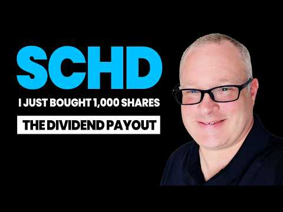
- 설명 앞부분: I just bought 1,000 shares of SCHD for our retirement portfolio. In this video I break down why I bought it and what the resulting dividend payouts will be. Want to go deeper? The GLI Dashboard gives you dividend screeners, portfolio analysis, and deep dives of the companies and ETF's you need to k…
- 같은 채널 평소 대비 ×9.6 (채널 최근 롱폼 중앙값 11,385회) · 평소 영상: SCHD New All-Time High: I've Paused My DCA & What… (11,385회) / Income ETFs Paying 8% to 21% With Zero NAV Erosion (10,709회)
- 대본 없음 (설명) — 음성인식이 끝나면 도입부·흐름이 들어감
- 댓글 141/141: 좋은 점 — 영상 0 · 감사·응원 0 · 더 알고 싶은 것 0 · 아쉬운 점 — 영상 0 · 반박·불만 — 의견 다름 0 · 정치·사회 0 · 경험 공유 0 · 구독·다음 기대 0

### 78. 주식 매매 타이밍보다 중요한 것, 계좌 수익률은 어디서 갈릴까? ∣ 김진의 투자캠프 찐쌤

- https://www.youtube.com/watch?v=_fDJl6p2ZSo · 오르는주식을사는사람들입니다 · 구독자 4,600 · 조회수 20,225 (×4.4, 하루 2,566.8) · 좋아요 554 (2.7%) · 20.4분 · 2026-10-29 · 주제 묶음 7. 매매·전략 · 형식 정보·해설 (그 밖) · 폴더 `W__fDJl6p2ZSo` (웹 승인)
- 설명 앞부분: 안녕하세요, [오르는주식을사는사람들입니다] 채널에서 다시 인사드립니다! 주식 투자를 하다 보면 이런 고민이 꼭 생깁니다. 좋은 종목을 골라 싸게 사면 되는 것 아닐까? 분명 많이 오른 주식을 샀는데, 왜 내 계좌 수익은 작을까? 저희도 그랬습니다. 어떤 종목을 얼마에 살지만 고민했지, 지금 주식을 얼마나 가지고 있어야 할지는 깊이 생각해보지 못했거든요. 이번 수업은 찐쌤의 매크로·주도주반 1강입니다. 주식 비중을 정하는 일이 왜 중요한지, 그리고 찐쌤의 주도주 세추종은 단순히 차트를 보고 사고파는 방법과 어떻게 다른지 함께 배워보…
- 대본 없음 (설명) — 음성인식이 끝나면 도입부·흐름이 들어감
- 댓글 36/36: 좋은 점 — 영상 9 · 감사·응원 16 · 더 알고 싶은 것 0 · 아쉬운 점 — 영상 0 · 반박·불만 — 의견 다름 0 · 정치·사회 0 · 경험 공유 3 · 구독·다음 기대 0
  - 좋은 점 — 영상 👍6 “가슴이 웅장해지는...... 명강의의 시작.. 찐쌤님 열심히 배워서 빠르게 성장하겠습니다! 🙆‍♀”
  - 좋은 점 — 영상 👍5 “응원왔어요찐쌤!!!ㅎㅎ 찐쌤문파 입문하기에 너무 좋은 영상이에요~~ 모두들 커몽”
  - 감사·응원 👍27 “최대한 쉽게 이야기하려고 애를 많이 썼습니다.^^ 앞으로도 함께 공부해 보시죠. 파이팅입니다!”
  - 감사·응원 👍5 “"추세 = 어떤 자산의 펀더멘털이 변하는 방향"이다. 오늘도 또 배우네요. 감사합니다!”
  - 경험 공유 👍6 “"내가 해봐서 아는데" 진짜 존경합니다 ❤”
  - 경험 공유 👍3 “좋은 강의 감사합니다~ 제가 찐쌤 강의 들어봐서 아는데, 피가되고 살이되는 내용이 정말 많습니다~”

### 79. Mutual Fund Manager's Guide To Investing For The Next 10 Years

- https://www.youtube.com/watch?v=_gnrJW4h_lE · Angel One Podcasts · 구독자 6,160 · 조회수 78,816 (×12.8, 하루 3,316.2) · 좋아요 755 (1.0%) · 53.9분 · 2026-10-13 · 주제 묶음 기타 · 형식 정보·해설 (그 밖) · 폴더 `W__gnrJW4h_lE` (웹 승인)
- 썸네일: 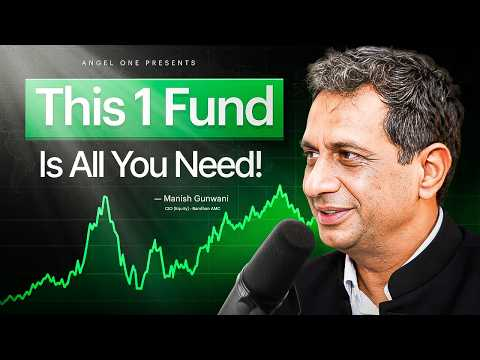
- 챕터: 0:00 Intro · 2:00 Why Are Foreign Investors Sel… · 7:45 Is The Worst Behind Us In The… · 9:04 Is This The Right Time To Inv… · 13:05 How Much Should You Allocate … · 14:49 What Returns Should You Expec… · 15:59 How To Identify A Good Small-… · 18:42 What Makes A Small-Cap Fund O… · 21:06 How Do Fund Managers Pick Win… · 25:14 How To Find Stocks That Can D… · 27:57 When Should You Sell A Stock? · 31:15 When Should You Book Profits … · 32:54 3 Sectors That Could Drive In… · 37:01 Can Indian Manufacturing Beco… · 38:56 Where Is India's Premium Cons… · 40:18 How Should Indian Investors A… · 42:59 Should You Invest In India Or… · 45:16 How To Build Your First ₹1 Cr… · 47:13 Small Caps Vs Large Caps: Whe… · 48:50 The One Investing Question Pe…
- 설명 앞부분: Is the Indian stock market sending mixed signals? Global investors have been cautious, domestic investors are putting in record SIP money, and company earnings are strong. In this podcast, Manish Gunwani, CIO of Bandhan AMC, decodes this contradiction, shares how he thinks about market cycles and r…
- 같은 채널 평소 대비 ×0.7 (채널 최근 롱폼 중앙값 113,824회) · 평소 영상: How To Make ₹0 to ₹1 Crore Through Mutual Fund SI… (117,202회) / Where Kirtan Shah Is Investing for 2027 (110,447회)
- 대본 없음 (설명) — 음성인식이 끝나면 도입부·흐름이 들어감
- 댓글 34/37: 좋은 점 — 영상 0 · 감사·응원 0 · 더 알고 싶은 것 0 · 아쉬운 점 — 영상 0 · 반박·불만 — 의견 다름 0 · 정치·사회 0 · 경험 공유 0 · 구독·다음 기대 0

### 80. POV: Gaji Sama dengan Temanmu, Tapi Kamu Keluar dari Pabrik Lebih Awal Berkat Dividen

- https://www.youtube.com/watch?v=_-rdF2o1v0c · ncek invest · 구독자 7,150 · 조회수 87,776 (×12.3, 하루 3,833.1) · 좋아요 548 (0.6%) · 8.3분 · 2026-10-14 · 주제 묶음 기타 · 형식 정보·해설 (그 밖) · 폴더 `W__-rdF2o1v0c` (웹 승인)
- 썸네일: 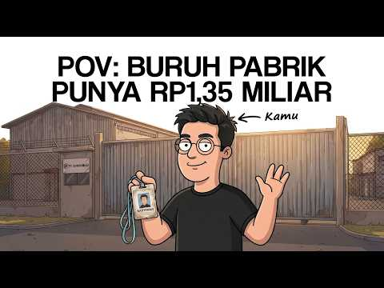
- 챕터: 0:00 Hari terakhir di pabrik · 1:00 Level 1: Gaji dan Dividen · 2:00 Level 2: Dividen Pertama · 3:35 Level 3: Dividen Bisa Turun · 5:05 Level 4: Angka yang Terlalu L… · 6:45 Level 5: Harga Sebuah Bel · 7:45 Penutup
- 설명 앞부분: Teman satu lini bilang, "Pensiun dini dari dividen? Ngimpi lo." Dua puluh satu tahun kemudian, kamu melepas ID card pabrikmu untuk terakhir kali. Di video POV ini, kamu akan menjalani 21 tahun hidup seorang buruh pabrik yang gajinya biasa saja, tapi belajar dari seorang mandor tua bahwa gaji adalah…
- 같은 채널 평소 대비 ×6.2 (채널 최근 롱폼 중앙값 14,048회) · 평소 영상: POV: Temanmu Kreator 80 Ribu Followers Kehabisan … (14,115회) / POV: Berhenti Bilang “Santai Aja” Kalau Teman Pin… (13,980회)
- 대본 없음 (설명) — 음성인식이 끝나면 도입부·흐름이 들어감
- 댓글 36/43: 좋은 점 — 영상 0 · 감사·응원 0 · 더 알고 싶은 것 0 · 아쉬운 점 — 영상 0 · 반박·불만 — 의견 다름 0 · 정치·사회 0 · 경험 공유 0 · 구독·다음 기대 0

