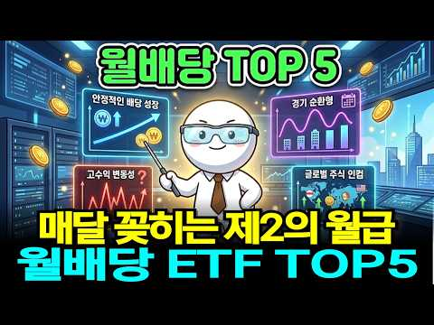
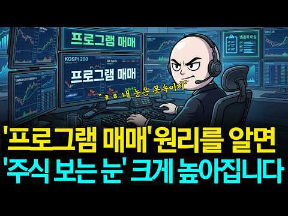

# 주식 — 성공 사례 분석: 사례별 자세히 #41–#80

`analysis.md` 의 9번 (같은 # 번호). 자동 생성 — `tools/success_analysis.py` v1.4.1 (2026-10-17 07:22 UTC). ※ 연구·교육용 — 투자 권유가 아님.

### 41. 단타 천재가 개발한 하이킨아시 스캘핑 매매법, 죽어라 이것만 하세요.

- https://www.youtube.com/watch?v=55hFmXD0lh0 · 알파개미 · 구독자 2,800 · 조회수 53,836 (×19.2, 하루 393.3) · 좋아요 1,762 (3.3%) · 19.6분 · 2026-06-02 · 주제 묶음 7. 매매·전략 · 형식 인터뷰·강연·대담 · 폴더 `W_55hFmXD0lh0` (웹 승인)
- 썸네일: 
- 챕터: 0:00 인트로 · 1:26 하이킨아시 개요 · 3:09 하이킨아시 캔들 3가지 · 3:47 일반 캔들 vs 하이킨아시 · 4:39 추세 전환 기준 3가지 · 6:17 추세 반전 신호 · 7:21 실전 하이킨아시 패턴 5가지 · 8:42 전략 1.지지/저항 및 돌파 매매법 · 9:42 전략 2.돌파 매매법 · 10:15 전략 3.이동평균선(EMA) 결합 매매법 · 11:51 전략 4.추세반전 매매법 · 12:30 전략 5.RSI 지표 결합 매매법 · 13:43 전략 6.알파 하이킨아시 매매법 · 18:45 마무리 정리[지표 신청방법] / 아웃트로
- 설명 앞부분: 단타 천재가 개발한 하이킨아시 스캘핑 매매법, 죽어라 이것만 하세요. 📈 알파 하이킨아시 지표 무료 신청하기 📈 신청 코드: "알파 하이킨아시" 입력 📈 자동 매매 프로그램 무료 사용 신청하기 📈 📼차트 매매법 무료 강의 신청하기📼 📢 중요 안내: 본 방송에서 제공되는 모든 정보는 전문가의 개인적인 의견입니다.
- 같은 채널 평소 대비 ×85.0 (채널 최근 롱폼 중앙값 633회) · 평소 영상: -5억을 잃고 알았습니다. "이 차트 보는 방법" 하나면 충분하다는 걸 (633회) / 이동평균선 3개로 1,400억을 번 천재의 매매법 (단타, 스윙 매매) (678회)
- 대본 없음 (설명) — 음성인식이 끝나면 도입부·흐름이 들어감
- 댓글 1,049/1,049: 좋은 점 — 영상 19 · 감사·응원 81 · 더 알고 싶은 것 26 · 아쉬운 점 — 영상 0 · 반박·불만 — 의견 다름 0 · 정치·사회 0 · 경험 공유 3 · 구독·다음 기대 50
  - 좋은 점 — 영상 👍0 “너무 좋은 영상이네요~ 알파 하이킨아시 신청드립니다!^^”
  - 좋은 점 — 영상 👍0 “좋은정보 감사합니다 하이킨아시 신청합니다”
  - 감사·응원 👍1 “구독 좋아요 완료했어요 알파 하이컨아시 신청합니다 미리 감사합니다”
  - 감사·응원 👍1 “주린인데 차트보기가 너무 좋아요.. 신청합니다.감사합니다.. 스마트폰에도 가능한지도 궁금합니다”
  - 더 알고 싶은 것 👍1 “주린인데 차트보기가 너무 좋아요.. 신청합니다.감사합니다.. 스마트폰에도 가능한지도 궁금합니다”
  - 더 알고 싶은 것 👍0 “훌륭한 정보 대단히 감사합니다. 앞으로도 이런 정보 부탁드립니다 구독과 조아요는 기본 체크입니다❤❤❤”
  - 경험 공유 👍0 “우와. 저도 알파하이킨아시 신청합니다”
  - 경험 공유 👍0 “저도 알파 하이킨아시 신청합니다”
  - 구독·다음 기대 👍1 “알파 하이킨아시 신청했습니다. 영상 내용도 좋고 하이킨아시 차트 지표도 좋아보이네요. 영상 잘 챙겨볼께요~”
  - 구독·다음 기대 👍0 “구독했씁니당 알파하이킨아시”

### 42. "삼성전자 SK하이닉스 2배 레버리지 ETF" 5월 22일 상장 확정인데 증권사 CEO 열 명 중 아홉 명이 올해 최대 폭탄이라고 경고했다

- https://www.youtube.com/watch?v=aTh--_DtGNU · 이코노메이션 · 구독자 14,400 · 조회수 274,428 (×19.1, 하루 1,694.4) · 좋아요 5,237 (1.9%) · 25.6분 · 2026-05-08 · 주제 묶음 9. 빚투·레버리지 · 형식 브이로그·직접 해본 이야기 · 폴더 `W_aTh--_DtGNU` (웹 승인)
- 썸네일: 
- 설명 앞부분: 5월 22일 삼성전자와 SK하이닉스 주가를 두 배로 추종하는 단일종목 레버리지 ETF가 국내 최초로 상장됩니다. 사전교육에만 만 이천 명이 몰렸고 최대 오조 삼천억원이 유입될 것으로 추정되지만, 증권사 CEO 열 명 중 아홉 명은 이 상품을 올해 국내 증시 최대 리스크로 꼽았습니다. 음의 복리 효과와 강제청산 구조, 장 마감 전 리밸런싱 폭탄까지. 알고 들어가는 것과 모르고 들어가는 것은 완전히 다릅니다. 🎨 본 영상의 시각 자료는 Stable Diffusion 등 생성형 AI 기술을 활용하여 제작되었으며, 경제 지식 전달을 위한…
- 같은 채널 평소 대비 ×167.5 (채널 최근 롱폼 중앙값 1,638회) · 평소 영상: SK하이닉스가 돈을 안 쓰자 월가가 움직였다, 100조 환원설까지 나온 이유 (1,734회) / 삼성 D램 기술 유출 뒤 CXMT 700조…10년을 건너뛴 방법 (1,543회)
- 대본 없음 (설명) — 음성인식이 끝나면 도입부·흐름이 들어감
- 댓글 808/808: 좋은 점 — 영상 14 · 감사·응원 29 · 더 알고 싶은 것 6 · 아쉬운 점 — 영상 2 · 반박·불만 — 의견 다름 6 · 정치·사회 22 · 경험 공유 11 · 구독·다음 기대 1
  - 좋은 점 — 영상 👍23 “많이배웠네요”
  - 좋은 점 — 영상 👍19 “아주 좋은 정보 도박판을 만들고있습니다.”
  - 감사·응원 👍23 “어젯밤에 상장 소식을 접하고는 크게 동요되었었는데.. 마음을 추스르게 해주셔서 감사요.”
  - 감사·응원 👍10 “이해하기좋게 설명해줘서. 감사합니다 Etf 나오면 나도 해봐야지 했는데 큰일 날 뻔했네요 빨리 일반 들이 많이 알았으면 하네요.”
  - 더 알고 싶은 것 👍3 “최고.최고. 잘 보고 있습니다. 댁의 이력이 궁금합니다. ❤❤❤”
  - 더 알고 싶은 것 👍2 “하한가 비유하면서 하루 60프로 손실은 좀 억지스럽네요 삼성 닉스가 상하한가 칠일이 있을까요?”
  - 아쉬운 점 — 영상 👍3 “얘는 맨날 삼전 까더라 삼전 못들어가서 열 받나?? ai목소리 듣기 싫어 나갈란다”
  - 반박·불만 — 의견 다름 👍1 “그런데..영상 잘보고 있지만 왜? 숫자얘기? 나올때 발음이 영 아닌데.틀리고? 당신 ai???”
  - 반박·불만 — 의견 다름 👍0 “부족힐 영상 아닙니다 쉽게 풀어서 귀에 쏙쏙 들어오게 하니까요~~^^ ~~ㅇㆍㄴ”
  - 정치·사회 👍71 “투자를 가장한 도박이지! 나라가 적절히 제재를 해야지. 이건 마음에 안든다”
  - 정치·사회 👍13 “정부에서 이런걸 왜 허가해주나요?국민은 도박판에 밀어 넣는거 아닌가요?잘못되면 정권이 흔들리겠네요”
  - 경험 공유 👍88 “내가 작년 11월 부터 미장 개별주 2배 래버러지 1주로 시작해서 떨어질때마다 물타고 또타고 또타고...타다타다 -60프로까지 떨어져 마지막 최저점에서 마지막 현금 올인해서 -30프로까지 만들고나서부터 반등 시작 70프로익절로 마감 했지만 스트레스 장난아님..초보자는…”
  - 경험 공유 👍10 “이해하기좋게 설명해줘서. 감사합니다 Etf 나오면 나도 해봐야지 했는데 큰일 날 뻔했네요 빨리 일반 들이 많이 알았으면 하네요.”
  - 구독·다음 기대 👍1 “5월22일이 기대됩니다!!!!!! 장 시작과 동시에 몰빵 하고 털고 나오면 됩니다!!”

### 43. 불기둥 세운 코스피, 코스닥! 폭등한 이유와 향후 전략

- https://www.youtube.com/watch?v=Pel5gTXKRkQ · K파민 · 구독자 5,560 · 조회수 102,735 (×18.5, 하루 1,317.3) · 좋아요 1,605 (1.6%) · 24.8분 · 2026-07-31 · 주제 묶음 5. 국내주식 · 형식 정보·해설 (그 밖) · 폴더 `W_Pel5gTXKRkQ` (웹 승인)
- 썸네일: 
- 설명 앞부분: 7월 31일인 오늘 역사를 세웠습니다. 코스피가 하루 만에 1000포인트 넘게 상승하는 장세를 보이며 단숨에 6500선을 회복했습니다. 또한, 외국인의 일일 순매수액과 개인의 일일 순매도액 모두 역대 최대 규모를 세웠는데요, 주가 폭등의 이유와 향후 전략까지 영상으로 확인해 보세요.
- 같은 채널 평소 대비 ×6.5 (채널 최근 롱폼 중앙값 15,712회) · 평소 영상: 상승, 하락, 다시 상승 전환한 코스피! 그 이유와 미국 금리 이슈 정리 (박시동, 박근… (15,951회) / 쇼츠 스타 안쌤이 매불쇼에 떴다! 외국인들이 말하는 나라별 언어 표현 (한행운, 파비오,… (16,952회)
- 대본 없음 (설명) — 음성인식이 끝나면 도입부·흐름이 들어감
- 댓글 139/139: 좋은 점 — 영상 2 · 감사·응원 2 · 더 알고 싶은 것 1 · 아쉬운 점 — 영상 0 · 반박·불만 — 의견 다름 3 · 정치·사회 7 · 경험 공유 4 · 구독·다음 기대 0
  - 좋은 점 — 영상 👍21 “진짜 맞는 말씀 두 MC. 배워라”
  - 좋은 점 — 영상 👍0 “그래..우리 평범한 사람들은 확실할 대답을 원하지만, 전문가들이 예언자가 아니고 투자는 시장의 변동에 따라 수시로 바뀌니 정답도 예언도 할 수 없죠. 주식 투자는 화단을 가꾸는 것과 같다는 말 공감되네요.”
  - 감사·응원 👍9 “윤지호선생님 대단히 고맙습니다 ❤”
  - 감사·응원 👍3 “1) 부동산 폭등 대출규제로 국민죽이는 정부 2) 부동산 팔아서 주식사라더니 전문가 들도 위험하다고 반대한 ETF강행으로 2000만 투자자를 거지로 내몬 정부 3) 금감원,금융위,대검,감사원, 국민권익위에 접수된지가 도대체 언젠데 하루 1백만원씩 쓰도 1369년 10…”
  - 더 알고 싶은 것 👍0 “인버스 레버리지 없애면 안되나요?”
  - 반박·불만 — 의견 다름 👍6 “뭘 그리 양다리 걸치는 평론을.. 9월에 9천 년말까지 만천갑니다. 수익이 계속 증명되면 수 많은 가정 다 헛소리이예요”
  - 반박·불만 — 의견 다름 👍2 “과한거 아닙니다 실적 대로 가눈거죠”
  - 정치·사회 👍8 “저기여 정부에서 주식재난특별지원금을 언제 지급 하나요?😅”
  - 정치·사회 👍5 “이재명이 만든 도박장!!”
  - 경험 공유 👍2 “코스피 곧 만 넘게 간다고 했었는데😢 재해처럼 어느날 갑자기 뒤집어질 수 있다는 걸 겪으면서 배우네요. 근데 수업료가 너~무 비싸서 과다 출혈이 문제”
  - 경험 공유 👍2 “경제 주식에 대해 공부하지 않고 남들이 하니 나도 해봐야지,주식이 계속 오르네? 나도 들어가 봐야지 란 인식으로 주식을 접해 피해를 보시는 분들이 없었으면 좋겠습니다. 주식 투자는 본인의 의지고 본인의 책임이 따르기 때문에 어설프게 다가가서 힘들어 하지 마시고 그런분…”

### 44. 삼성전자·하이닉스 왜 급락? 코스피 6000 붕괴, 중국 CXMT 공포가 과도한 이유 3가지

- https://www.youtube.com/watch?v=amgqXbScFMY · 경제야! 놀자~ · 구독자 3,510 · 조회수 62,671 (×17.9, 하루 15,251.6) · 좋아요 612 (1.0%) · 12.9분 · 2026-10-13 · 주제 묶음 5. 국내주식 · 형식 정보·해설 (그 밖) · 폴더 `W_amgqXbScFMY` (웹 승인)
- 썸네일: 
- 챕터: 0:00 하이라이트 — "미국은 4%, 우리는 10% … 과도… · 0:22 [경제야놀자 해설] 오늘 왜 이렇게 빠졌나 · 0:41 코스피 하락 이유는 분명 — 삼성전자 · SK하이닉스… · 1:25 창신메모리(CXMT) 서버용 DDR5 · 미국 메모리… · 2:08 박시동 — AI 하드웨어 섹터를 보는 눈 · 2:40 반도체 부정론 셋 · 중국 추격론에 불을 질렀다 · 4:52 이광수 — 공급은 중국, 수요는 돈 · 해소엔 시간이… · 6:46 [경제야놀자 해설] CXMT · 수요와 공급 · 7:06 "파괴적으로 보지 않는다" — 쇼잉 · 양산 · 수율… · 9:03 [경제야놀자 해설] 쇼잉? 수율? · 9:27 미국은 4%, 우리는 10% · 9:52 두 달 만의 무차별 하락 · 반대매매 악순환 우려 · 11:07 [경제야놀자 해설] 사이드카 · 무차별 하락 · 11:30 "과매도 구간" — 지지선은 지켜질 수 있다 · 12:21 [경제야놀자 해설] 오늘의 세 줄 정리
- 설명 앞부분: "미국에서 어제 하이닉스 ADR은 4%밖에 안 빠졌거든요. 근데 지금 우리가 10% 빼고 있어요." 10월 13일 12시에 만나요에서 박시동 평론가가 한 말이다. 이날 코스피는 장중 6% 넘게 빠지며 6000선 아래로 밀렸고, 매도 사이드카까지 발동됐다. 방아쇠는 중국 창신메모리(CXMT)가 서버용 DDR5를 올해 연말까지 내놓겠다는 소식. 박시동 평론가는 이 뉴스가 "중국 추격론에 불을 당기면서" 반도체 부정론 전체를 태웠다고 진단하면서도, 시제품을 보여 주는 쇼잉일 수 있고 양산 · 수율은 검증할 게 한 트럭이라 오늘 공포는 …
- 대본 없음 (설명) — 음성인식이 끝나면 도입부·흐름이 들어감
- 댓글 230/230: 좋은 점 — 영상 2 · 감사·응원 4 · 더 알고 싶은 것 3 · 아쉬운 점 — 영상 0 · 반박·불만 — 의견 다름 3 · 정치·사회 10 · 경험 공유 5 · 구독·다음 기대 0
  - 좋은 점 — 영상 👍3 “박시동 평론가님, 이광수 대표님. 제가 가장 신뢰하는 두 분을 한자리에서 뵈니 참 든든합니다. 복잡한 국내 증시와 경제를 개인투자자의 눈높이에서 쉽게 풀어주시고, 듣기 좋은 말보다 판단에 필요한 솔직한 이야기를 해주셔서 늘 고맙습니다. 개인투자자에게 오래 남는 것은 …”
  - 좋은 점 — 영상 👍1 “레전드 전문가가 나오셨네요. 광수는 언제나 맞춘다.”
  - 감사·응원 👍3 “박시동 평론가님, 이광수 대표님. 제가 가장 신뢰하는 두 분을 한자리에서 뵈니 참 든든합니다. 복잡한 국내 증시와 경제를 개인투자자의 눈높이에서 쉽게 풀어주시고, 듣기 좋은 말보다 판단에 필요한 솔직한 이야기를 해주셔서 늘 고맙습니다. 개인투자자에게 오래 남는 것은 …”
  - 감사·응원 👍2 “감사합니당.ㅡ😊”
  - 더 알고 싶은 것 👍1 “광수형의 전공이 뭔지 원래 직업이 뭐였는지 궁금하다. 전문가 포스가 약해 보여서.. 누구나 다 알고 다 하는 얘기만 하는데..”
  - 더 알고 싶은 것 👍1 “광수 형 또 무슨 헛소리하나 궁금해서와봄 ㅎ”
  - 반박·불만 — 의견 다름 👍1 “빼는건 10%씩 빼고 오르는건 1%~2%이니 이게 정상적인 주식시장 이냐고? 어이없는 국장”
  - 반박·불만 — 의견 다름 👍1 “근데 이분은 주식 전문가 아닌데요.”
  - 정치·사회 👍8 “외국인이 마음대로 할수있다. 5000지수 4천 3천 마음대로 할수도 있다. 국장 폐지하고 전부 미장 가라”
  - 정치·사회 👍3 “주주에게 줘야 될 배당금을 직원들한테 주니 외국인 주주들이 열받아 창신메모리 핑계로 매도한 것 같은데.”
  - 경험 공유 👍11 “얘네들 얘기 듣다 보면 나도 저기 나가서 얘기할수 있겠다”
  - 경험 공유 👍9 “어제 내가 예상했다 6000선 무너질것이라고...”

### 45. I Own 2,444 Shares of SCHD. Here's What It Actually Pays Me.

- https://www.youtube.com/watch?v=YPkL0BibgL8 · Mikey Moran · 구독자 11,900 · 조회수 201,329 (×16.9, 하루 3,508.1) · 좋아요 1,583 (0.8%) · 9.5분 · 2026-08-20 · 주제 묶음 기타 · 형식 정보·해설 (그 밖) · 폴더 `W_YPkL0BibgL8` (웹 승인)
- 썸네일: 
- 챕터: 0:00 The Reality of My SCHD Portfo… · 1:04 My Total Shares and Cost Basis · 1:30 Understanding the SCHD Stock … · 2:12 Real Dividend Payments (State… · 3:30 Why $207 a Month Is Only 2% o… · 4:08 Businesses are the Real Wealt… · 4:50 Why I Autopilot My SCHD Reinv… · 6:25 The Taxable Account Mistake I… · 7:48 Why I’m Behind My 3,000 Share… · 8:58 My Strategy: Boring Stocks, B…
- 설명 앞부분: How much do you actually make from owning 2,444 shares of SCHD? 📬 My weekly investing email — what I actually bought, most Sundays: In this video, I’m pulling back the curtain on my own portfolio to show you the real numbers, straight from my brokerage statements—no calculators or "what-if" scenari…
- 같은 채널 평소 대비 ×24.6 (채널 최근 롱폼 중앙값 8,196회) · 평소 영상: SCHD Is at an All-Time High. Here’s Why I’m Still… (8,196회) / 10 Dividend ETFs Ranked — I Only Own 5 of Them (8,480회)
- 대본 (자막, 5.2 음절/초) 첫 20초: “저는 매주 금요일 마다 천 달러 어치의 주식을 삽니다. 그 주에 시장이 어떻게 움직 였는지는 중요 하지 않습니다 . 뉴스 헤드 라인이 뭐라고 하든 상관 없습니다. 금요일 이 되면 돈이 투자 됩니다. 그 금액 중 상당 부분을 3 년 반 동안 한 종목에 투자 해 왔습니다. 현재 저는 SCHD 2,444” — 도입부 유형: 내 이야기·사연
- 첫 1분: “저는 매주 금요일 마다 천 달러 어치의 주식을 삽니다. 그 주에 시장이 어떻게 움직 였는지는 중요 하지 않습니다 . 뉴스 헤드 라인이 뭐라고 하든 상관 없습니다. 금요일 이 되면 돈이 투자 됩니다. 그 금액 중 상당 부분을 3 년 반 동안 한 종목에 투자 해 왔습니다. 현재 저는 SCHD 2,444 주를 보유 하고 있고, 그로 인해 얼마를 받는지 정확히 보여 드리겠습니다. 웹 사이트의 계산기가 아닌 실제 계좌 명세서에 찍힌 진짜 숫자 입니다. 미리 말씀 드리지만, 생각 보다 적을 겁니다. 보시면 첫 반응은 ' 겨우 이거 야?' 일 겁니다. 그 반응을 잘 곱 씹어 보시기 바랍니다. 왜 그 숫자가 작은 지, 그런데도 제가 왜 계속 사는지 이해 하는 것이 숫자 자체 보다 여러분”
- 흐름 (90초마다 첫 문장): 0:00 저는 매주 금요일 마다 천 → 1:30 드리 자면, SCHD는 2024 년 10 월 → 3:00 이유가 있습니다. 첫째, 펀드 → 4:30 회사 성장' 에 걸고 있습니다. → 6:00 하고 싶거든요. 매주 금요일 → 7:30 효과가 엄청 났을 거라는 → 9:01 그게 제 전략의 전부 입니다.
- 댓글 193/193: 좋은 점 — 영상 0 · 감사·응원 0 · 더 알고 싶은 것 0 · 아쉬운 점 — 영상 0 · 반박·불만 — 의견 다름 0 · 정치·사회 0 · 경험 공유 0 · 구독·다음 기대 0

### 46. Better Than VOO? 9 ETFs That Beat the Market (34% Returns)

- https://www.youtube.com/watch?v=id4HWsy036I · Fin Wealth Hacks · 구독자 7,670 · 조회수 118,776 (×15.5, 하루 680.8) · 좋아요 2,439 (2.1%) · 17.9분 · 2026-04-25 · 주제 묶음 2. 장기투자·ETF·지수 · 형식 정보·해설 (그 밖) · 폴더 `W_id4HWsy036I` (웹 승인)
- 썸네일: 
- 설명 앞부분: Best ETFs 2026 ∣ ETFs better than VOO ∣ Top performing ETFs ∣ ETF investing strategy Are there ETFs better than VOO? In this video, we break down the best ETFs of the decade, including high growth ETFs, dividend ETFs, and index funds that outperformed the S&P 500. Most investors are told to just bu…
- 같은 채널 평소 대비 ×36.8 (채널 최근 롱폼 중앙값 3,231회) · 평소 영상: Stop Buying the S&P 500? This ETF Could Win the N… (3,231회) / This ETF Just Destroyed the S&P 500 in 2026 (3,219회)
- 대본 (자막, 0.0 음절/초) 첫 20초: “You've probably heard it a hundred times. Just buy VOO and hold. And honestly, that's not bad advice. But here's the problem nobody talks about. While you were sitting in VOO earning a solid 15% per year, someone else was quietly compounding at 34% per year in a single ETF over a full decade. We're”
- 첫 1분: “You've probably heard it a hundred times. Just buy VOO and hold. And honestly, that's not bad advice. But here's the problem nobody talks about. While you were sitting in VOO earning a solid 15% per year, someone else was quietly compounding at 34% per year in a single ETF over a full decade. We're not talking about a lucky crypto bet. We're not talking about picking individual stocks. We're talki”
- 흐름 (90초마다 첫 문장): 0:00 You've probably heard it a hundred → 1:30 return. You end up with roughly $86,000. → 3:01 emerging markets like India and Brazil. → 4:31 one decision. The philosophy behind VT → 6:01 you while you hold it. It targets 100 US → 7:30 Stock Market ETF. VTI doesn't pick → 9:03 ETF. The fan favorite. The benchmark → 10:30 companies, and then filtered it down → 12:02 The trade-off you need to understand, → 13:32 billion → 15:00 cuts through all of that. It holds over → 16:32 US-listed semiconductor companies.
- 댓글 112/112: 좋은 점 — 영상 0 · 감사·응원 0 · 더 알고 싶은 것 0 · 아쉬운 점 — 영상 0 · 반박·불만 — 의견 다름 0 · 정치·사회 0 · 경험 공유 0 · 구독·다음 기대 0

### 47. 나이키 옷 추천하고 Nike 주식도 줍줍

- https://www.youtube.com/watch?v=2T_niqja8Vc · 조탄 · 구독자 6,380 · 조회수 97,440 (×15.3, 하루 597.9) · 좋아요 1,835 (1.9%) · 5분 · 2026-05-07 · 주제 묶음 기타 · 형식 정보·해설 (그 밖) · 폴더 `W_2T_niqja8Vc` (웹 승인)
- 썸네일: 
- 설명 앞부분: 오늘은 직접 입어보고 고른 나이키 운동복 추천과 함께 최근 변동성이 큰 나이키 주가에 대한 제 개인적인 생각을 담아봤습니다. 📈 영상 속 제품 정보는 아래 리스트를 확인해 주세요. 👇 [제품 정보 (Product Info)] 나이키 스트라이드 드라이핏 1/4 집 러닝 탑 사이즈: 아시아 M (HV2181-010) 나이키 드라이핏 파크 3 쇼츠 사이즈: M (BV6855-010) 나이키 코리아 스트라이크 엘리트 드라이핏 니트 드릴 탑 사이즈: 아시아 XXXL (DH5269-010) 나이키 코리아 스트라이크 엘리트 드라이핏 ADV 니…
- 같은 채널 평소 대비 ×5.5 (채널 최근 롱폼 중앙값 17,762회) · 평소 영상: 하트시그널5 패션 리뷰 유경 우열 "우유경" 현커 기념 옷 정보 총정리 (17,762회) / 솔로지옥5 5~7화 여자 출연자 옷 정보 총정리 3편 (20,187회)
- 대본 (자막, 6.7 음절/초) 첫 20초: “오늘은 나이키 주주로서 [음악] 체육복 소개해 드리겠습니다. 먼저 나이키 스트라이드 드라이피칩 러닝탑 제품입니다. 소재는 재생 폴리의 스톤방이며 딴배출이 잘되는 소재이고 얇고 부드러서 착용감이 [음악] 정말 좋습니다. 디테일은 섬매 부분의 서물과 파란쪽 부분도 매쉬로 되어 있으며 리플렉티브가 가슴팔 뒤쪽에 들어가 있습니다. 위쪽 부분은 하프”
- 첫 1분: “오늘은 나이키 주주로서 [음악] 체육복 소개해 드리겠습니다. 먼저 나이키 스트라이드 드라이피칩 러닝탑 제품입니다. 소재는 재생 폴리의 스톤방이며 딴배출이 잘되는 소재이고 얇고 부드러서 착용감이 [음악] 정말 좋습니다. 디테일은 섬매 부분의 서물과 파란쪽 부분도 매쉬로 되어 있으며 리플렉티브가 가슴팔 뒤쪽에 들어가 있습니다. 위쪽 부분은 하프 커터집으로 되어 있으며 [음악] 단풍으로 입거나 내려서 안에 인어를 입고 입으셔도 됩니다. 저는 키 172의 몸무이 70kg M 사이즈를 참여했으며 [음악] 가격은 7만 원대에 구매 가능합니다. 운동은 수용이랑 러닝 맨모 운동만 [노래] 하는 채형이고 [음악] 저랑 비슷한 채형인 분들 중에서 살짝 여유입고 정 사이즈로 입으실 분들은 동일하게 가시면 [음악] 될 거 같습니”
- 흐름 (90초마다 첫 문장): 0:00 오늘은 나이키 주주로서 [음악] → 1:30 참여했으며이 제품도 [음악] 정 → 3:00 바람마귀처럼 바스락거리는 소재보다는 → 4:30 [음악] 기록했다고 합니다. 곧
- 댓글 56/56: 좋은 점 — 영상 0 · 감사·응원 3 · 더 알고 싶은 것 15 · 아쉬운 점 — 영상 0 · 반박·불만 — 의견 다름 0 · 정치·사회 0 · 경험 공유 1 · 구독·다음 기대 0
  - 더 알고 싶은 것 👍2 “첫번째 크림에서 구매할건데요 176에 50 정도면 사이즈 어떤거 입어야하죠?”
  - 더 알고 싶은 것 👍2 “구매는 보통 어디서 많이 하시나요??”

### 48. I Just Bought 1,000 Shares Of SCHD: Here's The Dividends It Pays Me

- https://www.youtube.com/watch?v=fPU6Gefdad8 · Grounded Life Investments · 구독자 5,350 · 조회수 80,316 (×15.0, 하루 6,417.5) · 좋아요 742 (0.9%) · 10분 · 2026-10-04 · 주제 묶음 기타 · 형식 정보·해설 (그 밖) · 폴더 `W_fPU6Gefdad8` (웹 승인)
- 썸네일: 
- 설명 앞부분: I just bought 1,000 shares of SCHD for our retirement portfolio. In this video I break down why I bought it and what the resulting dividend payouts will be. Want to go deeper? The GLI Dashboard gives you dividend screeners, portfolio analysis, and deep dives of the companies and ETF's you need to k…
- 같은 채널 평소 대비 ×11.3 (채널 최근 롱폼 중앙값 7,128회) · 평소 영상: SCHD: Buy, Hold, or Sell? My Honest Verdict (7,128회) / Complete Guide To Investing In VOO The Vanguard S… (6,684회)
- 대본 없음 (설명) — 음성인식이 끝나면 도입부·흐름이 들어감
- 댓글 141/143: 좋은 점 — 영상 0 · 감사·응원 0 · 더 알고 싶은 것 0 · 아쉬운 점 — 영상 0 · 반박·불만 — 의견 다름 0 · 정치·사회 0 · 경험 공유 0 · 구독·다음 기대 0

### 49. The ONLY 5 ETFs You Need for F.I.R.E (Retire Early)

- https://www.youtube.com/watch?v=BRFRMfkGfpM · Jacob Wade (Roadmap Money) · 구독자 25,100 · 조회수 375,463 (×15.0, 하루 2,200.8) · 좋아요 6,925 (1.8%) · 17.6분 · 2026-04-29 · 주제 묶음 2. 장기투자·ETF·지수 · 형식 정보·해설 (그 밖) · 폴더 `W_BRFRMfkGfpM` (웹 승인)
- 썸네일: 
- 챕터: 0:00 Intro · 0:20 Vanguard Total Stock Market I… · 2:26 Vanguard Total International … · 4:08 Invesco QQQ Trust (QQQ) · 7:15 Fidelity Wise Origin Bitcoin … · 10:55 Vanguard Total Bond Market In… · 12:47 Example Portfolio # 1 · 13:26 Example Portfolio # 1 · 14:04 Example Portfolio # 3 · 14:51 How to Use These ETFs for F.I…
- 설명 앞부분: You only need 5 ETFs to reach financial independence. In this video, I break down the exact 5-ETF portfolio I would use to build wealth, reach Coast FIRE, and eventually achieve full financial freedom in 2026 and beyond. It's a simple, powerful portfolio built for long-term compounding. We’ll cover…
- 같은 채널 평소 대비 ×36.0 (채널 최근 롱폼 중앙값 10,422회) · 평소 영상: 3 ETF Portfolio CHANGES at Every Age (Exact Perce… (11,129회) / The 5 BEST Ways To Invest For Your Kids In 2026 (9,715회)
- 대본 없음 (설명) — 음성인식이 끝나면 도입부·흐름이 들어감
- 댓글 434/434: 좋은 점 — 영상 0 · 감사·응원 0 · 더 알고 싶은 것 0 · 아쉬운 점 — 영상 0 · 반박·불만 — 의견 다름 0 · 정치·사회 0 · 경험 공유 0 · 구독·다음 기대 0

### 50. How to Borrow Against Your Stock Portfolio: Buy, Borrow, Die

- https://www.youtube.com/watch?v=NPcgV0dq03Q · Sacco Financial  · 구독자 21,300 · 조회수 308,896 (×14.5, 하루 2,602.3) · 좋아요 5,135 (1.7%) · 9.4분 · 2026-06-20 · 주제 묶음 기타 · 형식 정보·해설 (그 밖) · 폴더 `W_NPcgV0dq03Q` (웹 승인)
- 썸네일: 
- 설명 앞부분: How do you borrow against your stocks without selling them? I recently moved a significant portion of my investment portfolio to Interactive Brokers so I could access cash through a margin loan instead of selling shares and immediately realizing capital gains. This strategy is often called Buy, Bor…
- 같은 채널 평소 대비 ×48.9 (채널 최근 롱폼 중앙값 6,323회) · 평소 영상: The Best Stocks to Buy Right Now (6,697회) / Institutions Are LOADED Up on SpaceX — The 13F Re… (5,949회)
- 대본 (자막, 0.0 음절/초) 첫 20초: “What if I told you there's a way to access cash from your portfolio without selling a single share and without paying a dollar in capital gains tax? This is not a loophole. This is how the ultra-wealthy have been doing it for decades. And recently, I started doing this myself. So, today I'm going to”
- 첫 1분: “What if I told you there's a way to access cash from your portfolio without selling a single share and without paying a dollar in capital gains tax? This is not a loophole. This is how the ultra-wealthy have been doing it for decades. And recently, I started doing this myself. So, today I'm going to break down the full strategy, what it is, how I personally set it up, and the stuff that nobody tel”
- 흐름 (90초마다 첫 문장): 0:00 What if I told you there's a way to → 1:31 And here's the answer. Yes, you do. But → 3:01 some blue-chip positions you plan to → 4:31 dedicated structured credit facility → 6:01 That's why sizing matters enormously. → 7:30 it can go sideways fast if you are not → 9:00 The rates, the loan structure, how I'm
- 댓글 603/603: 좋은 점 — 영상 0 · 감사·응원 0 · 더 알고 싶은 것 0 · 아쉬운 점 — 영상 0 · 반박·불만 — 의견 다름 0 · 정치·사회 0 · 경험 공유 0 · 구독·다음 기대 0

### 51. "역대급 저평가라던 코스피" 하루 만에 620조 추락.. 그 뒤에 숨겨진 코스피의 잔혹한 진실

- https://www.youtube.com/watch?v=6VAsPNYeTRQ · 더 리치 - 돈의 흐름을 읽어라 · 구독자 8,080 · 조회수 116,587 (×14.4, 하루 1,215.3) · 좋아요 3,100 (2.7%) · 21.2분 · 2026-07-13 · 주제 묶음 5. 국내주식 · 형식 정보·해설 (그 밖) · 폴더 `W_6VAsPNYeTRQ` (웹 승인)
- 썸네일: 
- 챕터: 0:00 역대급 저평가와 폭락의 모순 · 2:11 사이드카와 서킷브레이커 발동 · 3:53 개인이 받아낸 3.9조 매물 폭탄 · 5:15 폭락의 방아쇠 SK하이닉스 · 6:50 시장을 무너뜨린 진짜 원인 빚 · 9:02 반대매매와 레버리지의 함정 · 10:51 코스피가 역사상 가장 싼 이유 · 14:17 반도체 펀더멘털과 빚의 청산 · 16:44 향후 증시 향방과 주요 변수 · 18:20 반드시 확인해야 할 두 가지 지표
- 설명 앞부분: "역대급 저평가라던 시장이 밀린, 38조 원의 빚의 모순" 외국인과 기관의 자금 3조 9천억 원이 시장 밖으로 빠져나가고 그 빈자리를 개인이 홀로 채우며 시장의 주인이 바뀌었습니다. 코스피 7,000선이 무너진 무대 위에서 삼성전자와 SK하이닉스를 지탱하던 거대한 자금 축이 시스템에 의해 강제로 해체되는 흐름이 나타났습니다. 이번 폭락은 반도체의 실적 훼손이 아닌 신용 잔고의 청산 과정에서 발생한 기계적 이동입니다. 저평가라는 본질보다 빚의 무게가 가격을 결정하는 국면에서 금리와 물가라는 매크로 환경이 이 자금의 퇴로를 어떻게 열…
- 같은 채널 평소 대비 ×41.7 (채널 최근 롱폼 중앙값 2,795회) · 평소 영상: “480조 호재에도 1% 상승" 삼성·SK도 예외가 아닌 ‘선반영’의 무서운 함정 (2,812회) / "내가 사서 떨어지는 건가?" 개미만 모르는 외국인들의 소름돋는 수법 (2,778회)
- 대본 없음 (설명) — 음성인식이 끝나면 도입부·흐름이 들어감
- 댓글 294/294: 좋은 점 — 영상 4 · 감사·응원 9 · 더 알고 싶은 것 1 · 아쉬운 점 — 영상 2 · 반박·불만 — 의견 다름 3 · 정치·사회 44 · 경험 공유 6 · 구독·다음 기대 0
  - 좋은 점 — 영상 👍7 “잘썼어요.도움이 됩니다”
  - 좋은 점 — 영상 👍1 “좋은 정보를 감사합니다”
  - 감사·응원 👍2 “탁월한분석 입니다..많은 도움 될것 같네요..감사합니다”
  - 감사·응원 👍1 “상세하고 정확한 설명 감사합니다.🎁 최고의 채널입니다.👍🌹”
  - 더 알고 싶은 것 👍0 “근데 언제 빚이청산 되는가요?”
  - 아쉬운 점 — 영상 👍0 “너무길고 속도가 느려요 고령층 ㆍ노인들에겐 좋은 속도일수도 있지만”
  - 아쉬운 점 — 영상 👍0 “정치 리스크가 이런겁니다 다들 이걸 생각 안하시네요 세계금융의 중심이 어딘지 그돈에 돈줄이 어딘지 기억하세요 불안한 지역엔 투자들 하게나요? 연기금 등 기관의 돈으로 끌어올려봐야 기관은 돈이없고 연기금은 더이상 매수여력이 없읍니다 그래서 도박판이 된겁니다 개인이 개인…”
  - 반박·불만 — 의견 다름 👍18 “무능한 정부의 도박판 국민선동”
  - 반박·불만 — 의견 다름 👍15 “*.헛소리 말고 공매도 없애고 *단일 레리지 페지 해야 합니다”
  - 정치·사회 👍142 “국민연금이 제 때 수익실현 안하고 유예한게 가장 큰원인이다. 결국 외국인만 좋은 일 시키고 개인들은 고점에 물린거다 국민연금 특검해야 한다”
  - 정치·사회 👍63 “이제 5000 으로 내려가야지 그런데 국민연금은 팔지도 못하고 갖고있는 주식만 떨어졌는데 국민들 노후비용은 어떻게 할려나 국민연금이 주가를 9000으로 올릴때 외국인들이 신나게 팔아치웠으니 국민연금 돈을 외국인들이 합법적으로 훔쳐간거다”
  - 경험 공유 👍15 “내가 말햇잖아 낙수효과로 관련 중소형주 사라고 코스닥에 주목해 코스피와 갭차이가 너무나서 이젠 차이가 줄어들게되어있다 삼전닉스로 단타치는 단타쟁이들 재미좀 보다가 작살나는 시기다”
  - 경험 공유 👍1 “근본적으로 경제를 정치논리로 밀어 부치는 이재명 정부 주관도 없고 전문성도 없는 김용범정책실장이 단일종목 레버리지ETF 출시로 주식시장을 투기판으로 만들어 개미투자들에게 깡통차게 한 놈! 이게 시장경제 정책이냐!!! 오죽하면 금융감독원장 이찬진이 레버리지ETF 출시를…”

### 52. "안정을 기대한다"더니 하루만에 코스피 -10.84%🔥올해 8번째 서킷브레이커🔥정부, 왜 손놓고 있나🔥증안펀드•리밸런싱•공매도🔥삼성전자 -14% SK하이닉스 -…

- https://www.youtube.com/watch?v=AOs5sAd3hKM · 리얼경제 · 구독자 1,340 · 조회수 19,133 (×14.3, 하루 237.2) · 좋아요 745 (3.9%) · 16.1분 · 2026-07-28 · 주제 묶음 2. 장기투자·ETF·지수 · 형식 정보·해설 (그 밖) · 폴더 `W_AOs5sAd3hKM` (웹 승인)
- 썸네일: 
- 챕터: 0:00 인트로 — 어제는 "안정을 기대한다", 오늘은 서킷브… · 0:52 오늘 벌어진 일 — 코스피 6,023.66 / -10… · 2:41 방아쇠는 밖에서 — 중국 창신메모리 상장과 DUV 노… · 4:21 왜 우리만 이렇게 무너지나 — 레버리지라는 확성기 · 6:03 그럼 누가 벌었나 — 외국인 지분율은 오히려 늘었다 · 8:15 스위치는 이미 있었다 — 국민연금 리밸런싱과 7월 1일 · 10:09 당국은 무엇을 했나 — 7/14부터 7/28까지 날짜… · 11:48 안 쓴 카드 — 증안펀드 10조·공매도 금지·리밸런싱… · 13:37 그래서 지금이라도 — 요구 세 가지
- 설명 앞부분: 🔎2026년 7월 28일 코스피가 10.84% 폭락하며 올해 여덟 번째 서킷브레이커가 발동했습니다. 삼성전자 -14.17%, SK하이닉스 -16.02%, 중국 창신메모리 상장과 DUV 노광장비 소식, 외국인 4조 5,009억 순매도, 국민연금 리밸런싱 7월 1일 재개, 증권시장안정펀드 10조원까지 — 하루에 벌어진 일을 처음부터 끝까지 정리했습니다. 왜 떨어졌는지는 다들 아십니다. 이 영상이 따지는 건 떨어질 때 정부가 무엇을 했고, 무엇을 하지 않았는가입니다. 레버리지 근처도 안 가고 빚 한 푼 안 낸 계좌까지 왜 같이 녹았는지…
- 같은 채널 평소 대비 ×101.2 (채널 최근 롱폼 중앙값 189회) · 평소 영상: 삼성노조가 800조 호남 반도체 메가프로젝트 막아선 진짜 이유...부메랑 노란봉투법 삼성… (189회) / 엔비디아 손잡은 네이버 집중분석🔎아시아 AI 인프라회사로?🔥14조 유치🔥GPU 6만장🔥1… (147회)
- 대본 없음 (설명) — 음성인식이 끝나면 도입부·흐름이 들어감
- 댓글 205/205: 좋은 점 — 영상 0 · 감사·응원 2 · 더 알고 싶은 것 1 · 아쉬운 점 — 영상 2 · 반박·불만 — 의견 다름 3 · 정치·사회 60 · 경험 공유 4 · 구독·다음 기대 0
  - 감사·응원 👍1 “하..한숨이 나네요. 국힘에서 대통령 나오면 꼭꼭숨기다 민주당에서 대통령나오면 터뜨리고 대통령 탓하는거.. 그런다고 개개인의 돈이 돌아오는것도 아니고.. 선거 종이쪼가리 하나로 부자되는것도 아닌데 참으로 멍청들 하네요. 개인들의 돈을 지킬수있는 정보 감사합니다. 지가…”
  - 감사·응원 👍1 “재명이 파이팅! 자알한다~~~”
  - 아쉬운 점 — 영상 👍3 “■미국도 시가총액이 시장의 60%를 차지하는 종목에 단일레버리지ETF상품이 상장되어 있는가? 결론부터 말씀드리면 아닙니다. 미국 증시에도 엔비디아, 테슬라, 애플 등을 기초자산으로 하는 단일 종목 레버리지 ETF가 대거 상장되어 있지만, 단일 종목(또는 2개 종목)이…”
  - 아쉬운 점 — 영상 👍2 “쓸 카드를 쥐고 있는 것 자체가 기술입니다ㆍ 이 카드 이럴때 쓸거야..천명하는 순간 그 카드는 쓰지도 않았지만 힘이빠짐ㆍ 손해보고있다면 욕심에 냅다 지른 사람 책임이고 진짜 고수들은 언제 나머지를 투입할까 ㆍㆍㆍ재고있음ㆍ 뇌동매매자에게서 소신 투자자에게 돈은 그렇게 …”
  - 반박·불만 — 의견 다름 👍16 “역대 권력자 중에 국민을 주식에 도박하라고 판짜고 선동하고 국가돈 처 넣은 자는 짜이밍이 유일함.”
  - 반박·불만 — 의견 다름 👍3 “■미국도 시가총액이 시장의 60%를 차지하는 종목에 단일레버리지ETF상품이 상장되어 있는가? 결론부터 말씀드리면 아닙니다. 미국 증시에도 엔비디아, 테슬라, 애플 등을 기초자산으로 하는 단일 종목 레버리지 ETF가 대거 상장되어 있지만, 단일 종목(또는 2개 종목)이…”
  - 정치·사회 👍72 “역시 이재명 보유국이라니까. 결과 다 체험하는구나.”
  - 정치·사회 👍52 “민주당 지금 선거중이라 이런거 신경쓰는 사람 없어. 브라질에서 휴가중인데 코스피 하락하는게 뭐 뭐. 웃겨.”
  - 경험 공유 👍25 “내가보기에 정말 잘못된건 민주당을 20년 지지했다는 고백 그것이 최악의 선택이었다~무능정권을 넘어 야바위정권! 선무당이 사람잡고 반풍수가 집안거들냈다~그래놓고 헌법개정해서 한번 더해 먹겠단다? 우라질~~”
  - 경험 공유 👍13 “저도 평생민주당 .. 이제 뒤도 안돌어 보고 싶네요 신속 실행해야지 이건 아닌거 같네요”

### 53. "단타" 개미 60%가 모르는 단타의 진짜 함정 (자본시장연구원 충격 보고서)

- https://www.youtube.com/watch?v=ynzKagjNqnc · 경제가머니 · 구독자 22,500 · 조회수 321,052 (×14.3, 하루 2,033.4) · 좋아요 3,761 (1.2%) · 21.4분 · 2026-05-12 · 주제 묶음 7. 매매·전략 · 형식 정보·해설 (그 밖) · 폴더 `W_ynzKagjNqnc` (웹 승인)
- 썸네일: 
- 설명 앞부분: 주식 자주 사고팔수록 빨리 번다고 생각하셨죠? 자본시장연구원이 20만 명을 추적한 결과는 정반대였습니다. 거래를 자주 한 사람일수록 더 많이 잃었어요. 신규 개인투자자 60%가 손실, 자주 살수록 더 빨리 잃는 진짜 이유를 카지노 한 판에 비유해서 풀어드립니다. 그리고 마지막엔 한 달 4만 원으로 시작하는, 단타 안 하고도 살아남는 매수법까지. 코스피 200 ETF 5종(KODEX·TIGER·KBSTAR·HANARO·ARIRANG) 비교와 자동적립 5단계 가이드를 손에 쥐여드립니다. 📖 이 영상에서 다루는 내용 단타로 자꾸 깡통 …
- 같은 채널 평소 대비 ×571.3 (채널 최근 롱폼 중앙값 562회) · 평소 영상: 한국 직장인 절반이 AI를 쓰고도 시간을 못 아끼는 진짜 이유 (562회) / "종목은 맞았는데 계좌는 왜 이래?" 개인이 고른 주식은 102% 올랐는데 12조가 떠난… (570회)
- 대본 없음 (설명) — 음성인식이 끝나면 도입부·흐름이 들어감
- 댓글 592/592: 좋은 점 — 영상 7 · 감사·응원 10 · 더 알고 싶은 것 3 · 아쉬운 점 — 영상 3 · 반박·불만 — 의견 다름 1 · 정치·사회 1 · 경험 공유 37 · 구독·다음 기대 0
  - 좋은 점 — 영상 👍9 “경험상 맞는 말이네요 좋은정보 유익하게 잘 활용할께요😂❤”
  - 좋은 점 — 영상 👍1 “좋은 영상 감사합니다. 그런데 말입니다.....삼성전자나 하이닉스처럼 자기가 매수할 때 마다 올라 있는 겁니다. 그럼 반대의 현상이 나오겠죠. 위의 제가 예시 한것은 어떻게 보면 극단적이라 볼수도 있습니다. 주식투자에 정답은 없습니다.”
  - 감사·응원 👍7 “감사합니다”
  - 감사·응원 👍3 “감사 드려요^-^”
  - 더 알고 싶은 것 👍0 “매월 4만원만 자동설정해도 되나요?예를들자면 앨지전자가 29만원인데 어떻게 4만원으로 사지나요?”
  - 더 알고 싶은 것 👍0 “평생 만원만 있는 사람은 어떻게 해야 할까요? 결혼한 사람입니다.(용돈X) 답은 단타 입니다. 이 핵심은 상승 종목을 눈에 무조건 익혀야 손실이 적습니다. 하루 3% 익절 이면 손실보다 익절이 많게 하면 됩니다. 그게 어려워서 그렇죠.”
  - 아쉬운 점 — 영상 👍2 “마음으로는 저점에 사서 고점에팔고 이걸 한종목으로 계속 반복해서 주식수 따따블 만들겠다고 하는데 이게 하다보면 반대로 하고 있다는거야 오르면 사고 내리면 손절치고 이거 1~2회 반복하면 멘붕와서 완전 도박처럼 돼”
  - 아쉬운 점 — 영상 👍1 “뻔한소리 20분영상 만드는거 대단하다 ..”
  - 반박·불만 — 의견 다름 👍0 “글쎄 단타가 문제가 아니라~ 본인의 종목을 단타로 할껀지 장투로 갈껀지를 선택하고 본인의 현재 가용할수 있는 시간 돈이 더 중요함!! 😂”
  - 정치·사회 👍0 “어제오늘 만해도 많이 털렸을껄?ㅋ 정책실장색히 발언에 외인이 많이 매도했지? 다짜고치는거겠지. 검은머리외국인ㅋ”
  - 경험 공유 👍10 “단타 쉽지 않던데 내가 단타 해서 시드에 70%넘게 날려먹음 미래를 읽고 꾸준히 모았던사람이 크게벌었죠 이번에 삼전 하닉 등등 처럼”
  - 경험 공유 👍9 “경험상 맞는 말이네요 좋은정보 유익하게 잘 활용할께요😂❤”

### 54. 2026년 월배당 ETF 추천 TOP 5 총정리 (커버드콜 단점, ISA 비과세 혜택)

- https://www.youtube.com/watch?v=0obXGGkx7YM · 맛스토리 · 구독자 3,000 · 조회수 40,517 (×13.5, 하루 226.4) · 좋아요 777 (1.9%) · 15.6분 · 2026-04-21 · 주제 묶음 2. 장기투자·ETF·지수 · 형식 정보·해설 (그 밖) · 폴더 `W_0obXGGkx7YM` (웹 승인)
- 썸네일: 
- 챕터: 0:00 매달 월급이 들어온다? 월배당 ETF의 두 가지 얼굴 · 1:32 2026년 월배당 ETF TOP 5 완벽 해부 (장단… · 5:01 연 배당률 20%에 속지 마세요! '총수익률'의 무서… · 6:14 세금 폭탄 피하는 법: 배당소득 분리과세와 ISA 계… · 7:22 나에게 딱 맞는 월배당 ETF 고르는 3가지 핵심 질문 · 8:45 투자의 본질: 황금알 낳는 거위가 굶어 죽지 않으려면?
- 설명 앞부분: 매달 꽂히는 달콤한 배당금, 하지만 당신의 원금은 정말 안전할까요? 💸 2026년 주식 시장을 휩쓸고 있는 '월배당 ETF' TOP 5의 진짜 수익률과 커버드콜의 숨겨진 함정을 낱낱이 파헤칩니다. 단순히 배당률 10%, 20%라는 숫자에 속아 투자하고 계시다면 이 영상을 꼭 끝까지 시청하세요. TIGER, KODEX, RISE, SOL 등 대표적인 월배당 ETF들의 본질적인 차이점부터, 내 원금을 지켜주는 '총수익률'의 비밀, 그리고 세금 폭탄을 피하는 ISA 계좌 활용법까지 모두 담았습니다. 당신의 소중한 돈, 알고 투자해야 지…
- 같은 채널 평소 대비 ×55.5 (채널 최근 롱폼 중앙값 730회) · 평소 영상: 2026년 노후 자산관리 완벽 가이드: 국민연금 수령시기와 배당주 투자법 (821회) / 2026년 삼성전자 SK하이닉스 주가 전망: 100만원으로 시작하는 반도체 투자법 (640회)
- 대본 (자막, 5.8 음절/초) 첫 20초: “여러분, 매달 월급날이 기다려지시나요? 그런데 만약 월급날이 한 달에 한 번이 아니라 매달 한 번씩 [음악] 그것도 투자한 내돈에서 나오는 배당금이라는 형태로 찾아온다면 어떨까요? 상상만 해도 가슴이 두근거리지 않나요? 2016년 지금이 순간 한국 투자자들 사이에서 정말 뜨겁게 달아오르고 있는 키워드가” — 도입부 유형: 질문으로 시작, 시청자 부르기
- 첫 1분: “여러분, 매달 월급날이 기다려지시나요? 그런데 만약 월급날이 한 달에 한 번이 아니라 매달 한 번씩 [음악] 그것도 투자한 내돈에서 나오는 배당금이라는 형태로 찾아온다면 어떨까요? 상상만 해도 가슴이 두근거리지 않나요? 2016년 지금이 순간 한국 투자자들 사이에서 정말 뜨겁게 달아오르고 있는 키워드가 있습니다. [음악] 바로 월배당 ETF입니다. 단순히 분기나 연관으로 배당을 받는게 아니라 정말로 매달 통장의 현금이 들어온다는 개념 자체가 많은 이들의 꿈을 현실로 만들어 주고 있죠. [음악] 하지만 정말 모든 월배당 ETF가 같은 걸까요? 그저 이름에 월배당이 붙었다고 다 같은 상품 일리는 [음악] 없습니다. 오늘은 2026년 현재 실제로 매달 월급처럼 배당을 주는 ETF들 중에서 정말 주목해야 할 깊이”
- 흐름 (90초마다 첫 문장): 0:01 여러분, 매달 월급날이 → 1:30 매달 조금씩 나눠주는 방식이죠. → 3:01 모은 상품이죠. 연간으로 환산하면 → 4:30 2022년 1월 기준 월배당률은 약 → 6:00 파생 전략을 통해 인위적으로 높은 → 7:31 싶다면 SP 500을 기초 자산으로 → 9:00 정부의 [음악] 정책입니다. → 10:31 필요한가요? 아니면 장기적으로 자산을 → 12:00 정확히 이해하고 자신의 투자 목표와 → 13:31 커져 있을 수 있습니다. 반대로 오늘 → 15:02 존재하지 않습니다. 오직 끊임없는
- 댓글 18/18: 좋은 점 — 영상 0 · 감사·응원 4 · 더 알고 싶은 것 0 · 아쉬운 점 — 영상 0 · 반박·불만 — 의견 다름 0 · 정치·사회 0 · 경험 공유 0 · 구독·다음 기대 0
  - 감사·응원 👍4 “감사해요❤❤ 참고할께요”
  - 감사·응원 👍2 “감사합니다😊”

### 55. ETF 2개 + 절세 계좌 3개, 이 순서대로 채우면 매달 100만 원이 들어옵니다!

- https://www.youtube.com/watch?v=PzWL53BrkcQ · 술술 경제학 · 구독자 17,600 · 조회수 230,583 (×13.1, 하루 1,559.3) · 좋아요 3,903 (1.7%) · 18분 · 2026-05-22 · 주제 묶음 2. 장기투자·ETF·지수 · 형식 정보·해설 (그 밖) · 폴더 `W_PzWL53BrkcQ` (웹 승인)
- 썸네일: 
- 설명 앞부분: 국민연금만 믿고 노후를 준비하고 계신가요? 전체 수급자 평균 월 70만 원, 20년 이상 성실하게 납부한 분들도 평균 116만 원입니다. 부부 최소 생활비 248만 원에 비하면 매달 130만 원이라는 '구조적 결손'이 발생합니다. 이 빈칸을 방치하면 노후 내내 통장에 구멍이 뚫린 채 살아가야 합니다. 하지만 답은 생각보다 단순합니다. ETF 수백 개를 비교할 필요 없이 딱 2개만 사면 되고, 진짜 중요한 건 어떤 ETF를 사느냐가 아니라 어느 계좌에 담느냐입니다. 같은 ETF, 같은 수익인데 계좌 하나 차이로 세금이 매년 120만…
- 같은 채널 평소 대비 ×38.1 (채널 최근 롱폼 중앙값 6,050회) · 평소 영상: 10억 모아도 매달 세금 폭탄 맞습니다! 합법적으로 다 피해 가는 4가지 절세 전략 (배… (6,050회) / S&P500 ETF 절세 3대장 2026 ∣ 같은 종목인데 1600만원 차이? (연금·I… (6,319회)
- 대본 없음 (설명) — 음성인식이 끝나면 도입부·흐름이 들어감
- 댓글 262/262: 좋은 점 — 영상 5 · 감사·응원 27 · 더 알고 싶은 것 29 · 아쉬운 점 — 영상 4 · 반박·불만 — 의견 다름 2 · 정치·사회 3 · 경험 공유 19 · 구독·다음 기대 1
  - 좋은 점 — 영상 👍5 “연금저축에서 snp500,나스닥100 이렇게 2 개 isa에서 미국초단기국채3개월 1개 넣고 있어요 단기국채를 그대로 해도 괜찮은지? SCHD미국배당다우존슨 ㅡ 이것도 괜찮을듯한데, 연금저축과 isa 둘 중 어디에 넣는게 좋을까요? 좋은 정보 감사합니다 답변도 기다리…”
  - 좋은 점 — 영상 👍3 “좋은정보 알려주셔서 고맙습니다”
  - 감사·응원 👍12 “선생님~저의 취침asmr입니다. 잠도잘오고 잠들기전까지 공부도 되고 넘 좋아요 늘.감사합니다🙂‍↕️🫶🏻❤️”
  - 감사·응원 👍5 “연금저축에서 snp500,나스닥100 이렇게 2 개 isa에서 미국초단기국채3개월 1개 넣고 있어요 단기국채를 그대로 해도 괜찮은지? SCHD미국배당다우존슨 ㅡ 이것도 괜찮을듯한데, 연금저축과 isa 둘 중 어디에 넣는게 좋을까요? 좋은 정보 감사합니다 답변도 기다리…”
  - 더 알고 싶은 것 👍8 “60~70대에 할수있는거 올려주세요 30~40대위주라서”
  - 더 알고 싶은 것 👍7 “연금저축계좌는 어디가서 만드나요?? Isa계좌는 키움에서 만들었어요 연금저축계좌도 키움에서 만들어야하나요? 아니면 미래에셋에서 만들어도되나요?? IRP계좌도 어디서만드나요?”
  - 아쉬운 점 — 영상 👍3 “마지막이나 중간에 요약 좀 해주세요 넘 어려워!”
  - 아쉬운 점 — 영상 👍1 “광고가 너무길어서 짜증”
  - 반박·불만 — 의견 다름 👍0 “ISA는 비과세가 아닌데요? 9.9% 이연과세 아닌가요?”
  - 경험 공유 👍5 “20년간 넣을 돈이라도 있으면 좋겠네요. 경험상 연금저축, IRP, ISA 변화가 오지않을까 싶어요. 가난한 노후를 원하는게 정부에요. 세금노예를 양성하려면 튼튼하다고 생각되는 구조를 무너뜨리기 위한 움직임을 보이기 시작할거에요.”
  - 경험 공유 👍1 “배당 ETF 는 성장률이 낮지 않나요? 목돈넣고 결국은 배당으로 조금씩 쪼개서 받는원리가 아닌지, 제가 잘못이해하면 교정해주세요”

### 56. '외국인 프로그램 매매' 원리 모르고 주식 투자하면 호갱되는 이유

- https://www.youtube.com/watch?v=EyCVdx8IFyg · 경제학비서 · 구독자 20,000 · 조회수 255,915 (×12.8, 하루 1,422.0) · 좋아요 6,829 (2.7%) · 18.3분 · 2026-04-20 · 주제 묶음 7. 매매·전략 · 형식 정보·해설 (그 밖) · 폴더 `W_EyCVdx8IFyg` (웹 승인)
- 썸네일: 
- 설명 앞부분: 주식 뉴스를 보다 보면 매일같이 등장하는 단골 멘트가 있습니다. "외국인 프로그램 매물 폭탄에 코스피 급락!", "외국인 프로그램 순매수로 지수 방어!" 도대체 '프로그램 매매'가 뭐길래 시장을 이렇게 쥐락펴락하는 걸까요? 진짜로 외국인들이 한국 주식이 안 좋아 보여서 다 내다 팔고 도망가는 걸까요? 결론부터 말씀드리면, 아닙니다. 이 프로그램 매매의 진짜 원리(차익/비차익 거래, 바스켓 매매)를 모르면 외국인의 기계적인 수급 장난에 내 소중한 주식을 바닥에서 털리게 됩니다. 반대로 이 흐름을 읽을 줄 알면 외국인의 글로벌 자금 …
- 같은 채널 평소 대비 ×159.6 (채널 최근 롱폼 중앙값 1,603회) · 평소 영상: "한국, 배밑에 붙은 따개비 한 방에 해결"... 세계 해운사들이 한국을 찾는 진짜 이유 (1,603회) / 팹리스 공룡 브로드컴, 292조원 들고 삼성 찾아왔다 (1,703회)
- 대본 없음 (설명) — 음성인식이 끝나면 도입부·흐름이 들어감
- 댓글 194/194: 좋은 점 — 영상 11 · 감사·응원 11 · 더 알고 싶은 것 3 · 아쉬운 점 — 영상 2 · 반박·불만 — 의견 다름 3 · 정치·사회 20 · 경험 공유 10 · 구독·다음 기대 1
  - 좋은 점 — 영상 👍37 “보통 개미들도 선물에 개념 정도는 꼭 알아야 하지요 일반 개미들이 알수없는 내용을 알려주셔서 많은 도움이됏네요”
  - 좋은 점 — 영상 👍32 “무슨말인지 모르겠다 기초늘 더 다져야겠다 좋은영상 감사합니다”
  - 감사·응원 👍32 “무슨말인지 모르겠다 기초늘 더 다져야겠다 좋은영상 감사합니다”
  - 감사·응원 👍24 “좋은 내용입니다. 감사합니다.”
  - 더 알고 싶은 것 👍5 “좋은 정보 감사드립니다❤ 앞으로도 좋은 영상 만들어 주세요 TV 에 나오는 연애 부 기자랑 목소리가 똑같네요”
  - 더 알고 싶은 것 👍1 “왜 경제 채널의 목소리가 다 똑같은지 나는 그게 더 궁금하다. 일부러 그러는 거냐? 헷갈리게 해서 잘 나가는 채널이라고 착각하게 만드려고?”
  - 아쉬운 점 — 영상 👍3 “내용은 좋은데 ai목소리가 점점 집중도 안되고 듣기 싫어지네요 어딘가 이질감이.......”
  - 반박·불만 — 의견 다름 👍0 “그러니까.... 기업 실적이 좋은데 외부요인도 별게 아닌데 속된말로 껀수도 없는데 갑자기 시장충격 콰쾅! 결국엔 개미들 털어먹는 짓거리다. 프로그램 매매 자체가 문제가 아니라 기관들 쩐의전쟁.....”
  - 정치·사회 👍29 “외국인과 기관의 사고 파는 횟스를 제한해야 한다. 올렸다내렸다 요동치니 개인이 남아나나!”
  - 정치·사회 👍11 “외국인이 유리할 수 밖에 없는 구조인건 IMF때 급한 상황이라 외국인들이 요구하는 조건 거의 들어주면서 선물 시장을 열어주게 되었는데 이걸 수정하지 않은 한, 연기금 리밸런싱할때 징징거리지말고 하게 냅둬야 함. 현물 선물 양방 방어가 안되서 이번에 더 힘들었던 거. …”
  - 경험 공유 👍13 “내가 멍청한가?? 무슨말인지 잘 모르겟어 ㅠㅠ”
  - 경험 공유 👍8 “뭔소린지 모르것네...그냥 내가 하던 방법대로 하는게 ㅋㅋㅋㅋ 저딴거 안봄 ㅋㅋㅋ 그래도 수익남 매일 매일”
  - 구독·다음 기대 👍1 “구독합니다.”

### 57. 32살 부부 동반 퇴사 후, 배당투자로 세계여행 시작합니다

- https://www.youtube.com/watch?v=WXgAtzIynMk · 밍키원 MINKIONE · 구독자 13,200 · 조회수 167,003 (×12.7, 하루 1,689.4) · 좋아요 1,683 (1.0%) · 4.6분 · 2026-07-10 · 주제 묶음 1. 주식 기초·초보 · 형식 정보·해설 (그 밖) · 폴더 `W_WXgAtzIynMk` (웹 승인)
- 썸네일: 
- 설명 앞부분: 안녕하세요 밍키원입니다🫶🏻 22살, 호주 워킹홀리데이를 시작으로 32살, 캐나다를 떠나기까지 저희는 오랫동안 '시간 결정권자'가 되고 싶다는 꿈을 갖고 살아왔습니다. 그리고 정말 많은 준비 끝에, 드디어 그 꿈을 직접 살아보려 합니다. 이번 영상은 그 여정의 첫 번째 이야기입니다 앞으로 세계 곳곳을 여행하며 저희의 일상과 경험, 그리고 배당투자로 여행을 이어가는 과정까지 솔직하게 기록해 보려고 합니다! 사실 새로운 도전이라 설레는 만큼 불안한 마음도 물론 있지만..!! 하지만 늘 그래왔듯 긍정적인 마음으로 모든 순간을 즐기며 기록…
- 같은 채널 평소 대비 ×9.1 (채널 최근 롱폼 중앙값 18,335회) · 평소 영상: 한국인은 전부 사라지고 중국인에게 점령당한 치앙마이 여행 최신근황 (치앙마이 한달살기 3… (18,169회) / 직장 없이 월 250만 원으로 파이어족 가능할까? (17,187회)
- 대본 없음 (설명) — 음성인식이 끝나면 도입부·흐름이 들어감
- 댓글 274/274: 좋은 점 — 영상 3 · 감사·응원 73 · 더 알고 싶은 것 3 · 아쉬운 점 — 영상 3 · 반박·불만 — 의견 다름 1 · 정치·사회 4 · 경험 공유 25 · 구독·다음 기대 17
  - 좋은 점 — 영상 👍4 “멋져요. 건강 챙기시면서 잘 다니시고 재미있고 유익한 영상 기대할께요. 희원씨 단발도 잘 어울리시네요.”
  - 좋은 점 — 영상 👍1 “케언즈병 ㅜㅜ 저랑거의바톤터치하고 들어가셧네요 워홀경험 매우 공감합니다ㅜㅜ 성실히 잘모으신게 정말 대단합니다 본성이 어디가는게 아니니 알고리즘 잘 타시길 응원합니다”
  - 감사·응원 👍65 “젊음이 너무 부럽습니다.. 서른하나, 그때 밴쿠버를 떠나지 않았다면 나는 지금 어떤 삶을 살고 있을까.. 이제와서 후회하는 부질없음을 경험하는 낼모레 50 인생선배인 저는 세상을 향해 떠난 두분을 응원합니다❤”
  - 감사·응원 👍21 “저희 부부 얘기인 줄 알았네요 대단하세요! 저희 부부도 2009년에 호주 워킹 케언즈를 다녀왔어요. 1년 동안 정말 좋은 추억과 경험으로 해외에서 살고 싶다는 꿈만 꾸고 현실은 일 다니면서 휴가로 여행만 다니다가 당시 여자친구이자 지금은 아내와 서울 생활을 접고 11…”
  - 더 알고 싶은 것 👍6 “응원합니다. 과거부터 현재까지 정주행 재생 목록 만들어 주세요. 하루 종일 틀어놓을게요 세계여행 한바퀴 도시고 토론토 말고 여기 벤쿠버로 오세요 요즘 렌트료 엄청싸지고 항공편도 많고 싸졌어요 다른 추운곳에 갈 필요가 없습니다”
  - 더 알고 싶은 것 👍5 “화이팅~~~ 젊음이 멋지다 !! 두분의 뜻이 함께 하니 두려울게 뭐가 있을까요? 응원합니다”
  - 아쉬운 점 — 영상 👍3 “구독하고 시청만 하다 댓글은 처음 남기는 것 같아요~ 토론토 일상 보며 재밌었어요. 한국으로 돌아가셔서 아쉬웠는데 세계여행이라니요! 역시 대단하세요~👍💕 배당투자는 뭔지 잘 모르지만 10년이나 준비하셨다니 존경스럽습니다. 앞으로의 여행도 응원하며 지켜볼게요. 건강 잘…”
  - 아쉬운 점 — 영상 👍2 “안녕하세요 밍키원님! 😊 현재 밴쿠버에 거주 중인 워홀러입니다. 몇 주 전에 우연히 영상을 보게 되었는데, 어느새 밥친구가 되어 거의 모든 영상을 정주행했을 정도로 너무 재밌게 보고 있어요! 반복되는 일상 속에서 '다른 사람들은 해외에서 어떻게 살아갈까?' 하는 궁금…”
  - 반박·불만 — 의견 다름 👍1 “흠 글쎄”
  - 정치·사회 👍1 “시간결정권자라는 말씀이 가슴에 팍 꽃히네요 낼모레 환갑인 제가 느끼고 배움니다 앞으로 응원합니당”
  - 정치·사회 👍0 “저랑 나이대가 비슷해보여서 적습니다. 사실 국가도 이미 이 여행의 정답을 알고 있습니다. 복지가 거의 없는 미국에서도 401k로 노동연령때에 열심히 투자하고 모으는걸 권장하고 도중에 빼면 위약금까지 걸어서 빼지 못하게 유도하고 은퇴 이후 이 영상처럼 자유롭게 여유롭게…”
  - 경험 공유 👍21 “저희 부부 얘기인 줄 알았네요 대단하세요! 저희 부부도 2009년에 호주 워킹 케언즈를 다녀왔어요. 1년 동안 정말 좋은 추억과 경험으로 해외에서 살고 싶다는 꿈만 꾸고 현실은 일 다니면서 휴가로 여행만 다니다가 당시 여자친구이자 지금은 아내와 서울 생활을 접고 11…”
  - 경험 공유 👍16 “이 사람들은 정말 대단하구나 내가 노력했다고 최선을다했다고 여겼던 영주권비자가 이사람들 청춘앞에서는 아무것도 아니구나. 미친듯이 부럽습니다 성공하실거에요”
  - 구독·다음 기대 👍10 “오 제가 바랐던데로 여행 유튜버가 되시는거군요! ㅎㅎ 요즘 부부 여행 유튜버 분들이 많이 없는데 잘 되실거라 생각합니다. 몇 년 동안 부부 세계여행 유튜버들 많이 봤는데 그 길이 생각보다 즐겁기만 하진 않더라구요. 그래도 두 분은 해외 경험도 있고 많이 긍정적이시니 …”
  - 구독·다음 기대 👍6 “응원합니다. 과거부터 현재까지 정주행 재생 목록 만들어 주세요. 하루 종일 틀어놓을게요 세계여행 한바퀴 도시고 토론토 말고 여기 벤쿠버로 오세요 요즘 렌트료 엄청싸지고 항공편도 많고 싸졌어요 다른 추운곳에 갈 필요가 없습니다”

### 58. Buy 1 Share of SCHD Every Week—Here’s the Retirement Math

- https://www.youtube.com/watch?v=qFFwr4zsDKQ · Mikey Moran · 구독자 11,900 · 조회수 150,169 (×12.6, 하루 9,757.5) · 좋아요 1,293 (0.9%) · 9.6분 · 2026-10-01 · 주제 묶음 기타 · 형식 정보·해설 (그 밖) · 폴더 `W_qFFwr4zsDKQ` (웹 승인)
- 썸네일: 
- 설명 앞부분: Starting SCHD at 50? What could buying just 1 share a week mean for your retirement income at 65? I ran the numbers—and the difference between the optimistic and conservative scenarios surprised me. In this video, I explore a hypothetical 15-year investing plan using SCHD, the Schwab U.S. Dividend …
- 같은 채널 평소 대비 ×18.3 (채널 최근 롱폼 중앙값 8,196회) · 평소 영상: SCHD Is at an All-Time High. Here’s Why I’m Still… (8,196회) / 10 Dividend ETFs Ranked — I Only Own 5 of Them (8,480회)
- 대본 없음 (설명) — 음성인식이 끝나면 도입부·흐름이 들어감
- 댓글 162/162: 좋은 점 — 영상 0 · 감사·응원 0 · 더 알고 싶은 것 0 · 아쉬운 점 — 영상 0 · 반박·불만 — 의견 다름 0 · 정치·사회 0 · 경험 공유 0 · 구독·다음 기대 0

### 59. Best Evergreen SIP Mutual Funds 2026 ∣ Multi Asset vs Aggressive Hybrid Fund ∣ Gajendra K…

- https://www.youtube.com/watch?v=jC4eTjpod6E · StocksVerse Studio · 구독자 13,500 · 조회수 165,697 (×12.3, 하루 1,098.9) · 좋아요 2,247 (1.4%) · 9분 · 2026-05-19 · 주제 묶음 기타 · 형식 정보·해설 (그 밖) · 폴더 `W_jC4eTjpod6E` (웹 승인)
- 썸네일: 
- 설명 앞부분: Best Evergreen SIP Mutual Funds 2026 ∣ Multi Asset vs Aggressive Hybrid Fund ∣ Gajendra Kothari 🔥 🔥 Confused between Multi Asset Funds and Aggressive Hybrid Funds for 2026? In this video, market expert Gajendra Kothari explains the best Evergreen SIP Mutual Funds for long-term wealth creation, pass…
- 같은 채널 평소 대비 ×7.0 (채널 최근 롱폼 중앙값 23,837회) · 평소 영상: SIP on DIP Strategy 2026 Explained ∣ Best Mutual … (23,837회) / SIP Compounding Explained ∣ Right Mutual Fund Sel… (24,488회)
- 대본 없음 (설명) — 음성인식이 끝나면 도입부·흐름이 들어감
- 댓글 76/76: 좋은 점 — 영상 0 · 감사·응원 0 · 더 알고 싶은 것 0 · 아쉬운 점 — 영상 0 · 반박·불만 — 의견 다름 0 · 정치·사회 0 · 경험 공유 0 · 구독·다음 기대 0

### 60. 내 주변에 주식으로 돈 번 사람이 '진짜' 단 한 명도 없는 소름 돋는 이유 ∣ 교수 정선용 (3부)

- https://www.youtube.com/watch?v=k9be9TSs41s · 너와 나의 경제학교 · 구독자 30,700 · 조회수 370,968 (×12.1, 하루 4,700.5) · 좋아요 5,568 (1.5%) · 11.9분 · 2026-07-30 · 주제 묶음 11. 투자 일반 · 형식 인터뷰·강연·대담 · 폴더 `W_k9be9TSs41s` (웹 승인)
- 썸네일: 
- 설명 앞부분: 정선용, 달리고 읽고 쓰는 사람의 하이
- 같은 채널 평소 대비 ×16.1 (채널 최근 롱폼 중앙값 23,090회) · 평소 영상: 남들 다 돈 버는 상승장에 '내 계좌만' 반토막 나는 소름 돋는 이유 3가지 ∣ 교수 정… (23,090회) / "우량주 사서 수면제 먹고 푹 자라고요?" 개미들 퇴직금 다 녹아내리는 소름 돋는 이유 … (23,026회)
- 대본 없음 (설명) — 음성인식이 끝나면 도입부·흐름이 들어감
- 댓글 1,286/1,286: 좋은 점 — 영상 17 · 감사·응원 24 · 더 알고 싶은 것 9 · 아쉬운 점 — 영상 8 · 반박·불만 — 의견 다름 19 · 정치·사회 42 · 경험 공유 106 · 구독·다음 기대 0
  - 좋은 점 — 영상 👍10 “오늘 같은 폭락장에 멘탈 유지에 도움이 됐습니다 와이프랑 즐겨 봅니다! 항상 좋은 강의 너무 감사드립니다!”
  - 좋은 점 — 영상 👍8 “주식 처음 올해 1월부터 시작해서 닥 7개월 했는데 교수님 말씀하신 내용 100프로 공감합니다. 운이좋아서 7000~9000포인트에 12% 수익났지만 결국 하락장에 마음 쫄려서 마이너스 21%로 던지고 남은 현금 보존했네요. 지금 반등장에 아쉬움도 있지만 지금 주말 …”
  - 감사·응원 👍17 “여지것 이런 사실 실화같은 이야기를 한 사람이 있었던가 진정진심 돈의 무서움을 알수가 있다 사이버 머니의 무서움 지갑속에 백만원가 사이버머니의 천만원의 비율같은 이야기 감사 합니다”
  - 감사·응원 👍10 “오늘 같은 폭락장에 멘탈 유지에 도움이 됐습니다 와이프랑 즐겨 봅니다! 항상 좋은 강의 너무 감사드립니다!”
  - 더 알고 싶은 것 👍3 “주식으로 번 것은 떠벌리면 날아가요! 그리고 깡통찼다는 사람들 보면 그럴만하다싶어요 너무나 욕심만 따르고 귀동냥으로 매매하고 즉흥적이고 몰빵하고 빚투하고 등등등 그러니 깡통차고도 남죠 저는 주식 5년했지만 한번도 깡통찬적 없어요 그리고 은행이자보다 낫다싶어 하고 있어…”
  - 더 알고 싶은 것 👍1 “주식 안해보신 분 같아요 어떻게 20프로 연간 수익을 계속 안전적으로 내나요? 떼부자 되겠어요”
  - 아쉬운 점 — 영상 👍8 “주식 처음 올해 1월부터 시작해서 닥 7개월 했는데 교수님 말씀하신 내용 100프로 공감합니다. 운이좋아서 7000~9000포인트에 12% 수익났지만 결국 하락장에 마음 쫄려서 마이너스 21%로 던지고 남은 현금 보존했네요. 지금 반등장에 아쉬움도 있지만 지금 주말 …”
  - 아쉬운 점 — 영상 👍2 “나도 삼성 오르기전에 사놓은 것이 올랐지. 그뒤에 정리하고 지금은 많이 떨어진 국내주 위주로 사모았는데 이건 아니올리다. 지금 손해만 보고 있다. 그런데 그냥 낚시질 하듯 기다린다. 어짜피 어디로 가든 지금처럼 주식으로 쉽게 돈 못벌기 때문이다. 주식은 그냥 강태공이…”
  - 반박·불만 — 의견 다름 👍2 “왜 동영상 시청하면서 비교우위로 사람을 재단하는가? 그냥 즐겁게 보면 되는데 말이다 각자에게 원하는 답을 안해준다고 당신은 틀렸어 하네 그냥 즐겁게 보세요”
  - 반박·불만 — 의견 다름 👍1 “돈벌면잔짜부자는말도안합니다”
  - 정치·사회 👍32 “기관과 외국인 장난으로 절대로 못 번다. 정부야 조사해 줘라”
  - 정치·사회 👍5 “상승장의 마법은 외국인 세력들의 작전이죠”
  - 경험 공유 👍167 “AI한테 물어봤더니 요즘 대한민국 장은 그냥 세력들의 장난이 너무 심함으로 들어가지말라고 하데,, 내가 기어코 들어가겠다고 하니까 그럼 차라리 카지노에 가서 게임하는게 더 공평하대 ㅎㅎ똑같은 조건에서 오픈하니까 ,”
  - 경험 공유 👍42 “돈 번 사람도 있어요 단 가족에게도 말을 안할뿐이지 내가 그런경우 삼전 몇년전에 5만원에 사서 아직 들고 있음 지금 팔아도 꽤 큰돈임 근데 아무에게도 말 안함 여기는 나를 모르니까 말한거고 그러니 가만보면 다들 손해보고 잃은것만 떠벌리고 번 건 입 다물고 있음”

### 61. How To Start Investing Even If You’re Broke ft. Aristotle Investments ∣ Cannon's Class TV

- https://www.youtube.com/watch?v=nmwjXlRX8eg · Cannons Class TV · 구독자 19,900 · 조회수 234,455 (×11.8, 하루 1,451.6) · 좋아요 5,633 (2.4%) · 15.3분 · 2026-05-08 · 주제 묶음 2. 장기투자·ETF·지수 · 형식 인터뷰·강연·대담 · 폴더 `W_nmwjXlRX8eg` (웹 승인)
- 썸네일: 
- 챕터: 0:00 Introduction & Aristotle's Jo… · 1:41 Investing 101: Stocks, Shares… · 3:01 How to Analyze Stocks (Fundam… · 4:28 Understanding the Market: SPY… · 6:13 How to Start Investing (Apps,… · 11:17 Market Hierarchy: Brokers, Al… · 13:49 The Road to a Million: Day Tr…
- 설명 앞부분: In this episode of Cannon’s Class TV, Nick Cannon sits down with investor and entrepreneur Aristotle Varner Jr. to break down investing, stocks, options trading, and wealth building in a way beginners can actually understand. Aristotle shares how he went from cutting hair in the Army to becoming a …
- 같은 채널 평소 대비 ×63.6 (채널 최근 롱폼 중앙값 3,684회) · 평소 영상: The Mental Health Crisis Among Black Men in Ameri… (3,727회) / Dr. Umar Johnson Explains Why Politics Has Failed… (3,641회)
- 대본 없음 (설명) — 음성인식이 끝나면 도입부·흐름이 들어감
- 댓글 374/374: 좋은 점 — 영상 0 · 감사·응원 0 · 더 알고 싶은 것 0 · 아쉬운 점 — 영상 0 · 반박·불만 — 의견 다름 0 · 정치·사회 0 · 경험 공유 0 · 구독·다음 기대 0

### 62. ISA 계좌, S&P500 하나로 3년 굴리면 얼마 벌까? (ft. 향후 계획 포함)

- https://www.youtube.com/watch?v=3mIsnHTgylg · 원원 - 파이어 준비생 · 구독자 16,900 · 조회수 195,653 (×11.6, 하루 1,341.6) · 좋아요 2,993 (1.5%) · 15.6분 · 2026-05-24 · 주제 묶음 2. 장기투자·ETF·지수 · 형식 오디오북·낭독 (명언·인생조언) · 폴더 `W_3mIsnHTgylg` (웹 승인)
- 썸네일: 
- 설명 앞부분: 💫 :: won spirit 적립식 ETF 투자 관리 플랫폼 & 커뮤니티 안녕하세요! 금융권 직장인으로서 파이어(FIRE: Financial Independence, Retire Early)를 준비하며, 미국 S&P500 ETF, 단 하나로 목표를 이루는 여정을 기록하고 있습니다. S&P500을 현재 2.4억 정도 투자중이며, 매월 투명한 투자 내역 공개를 하고 그 밖에 투자 마인드, 투자 공부, 그리고 직장인의 삶을 공유합니다. 특히, 단순하면서도 누구나 실천 가능한 투자 전략으로 재정 독립을 목표로 하고 있습니다.💡 ➡️ 이번…
- 같은 채널 평소 대비 ×39.6 (채널 최근 롱폼 중앙값 4,936회) · 평소 영상: [1월결산] S&P500 투자자가 코스피 5,000 돌파를 바라보며! (4,850회) / 직장인이 부자 되려면 반드시 거쳐야 할 단계들! (4,849회)
- 대본 없음 (설명) — 음성인식이 끝나면 도입부·흐름이 들어감
- 댓글 672/672: 좋은 점 — 영상 9 · 감사·응원 38 · 더 알고 싶은 것 54 · 아쉬운 점 — 영상 3 · 반박·불만 — 의견 다름 2 · 정치·사회 6 · 경험 공유 54 · 구독·다음 기대 5
  - 좋은 점 — 영상 👍11 “유익한 영상 감사합니다. 계좌운용에 많은 도움이 됩니다 성투하십시요!”
  - 좋은 점 — 영상 👍10 “잘 배우고갑니다. 저는 Isa에는 수익률이 200만원만 되면 된다고 생각햇는데 이번 영상을 보니 또 생각이 달라지네요”
  - 감사·응원 👍22 “S&P500에 대해 진짜 궁금했던 결과 영상 입니다. 감사합니다!!!”
  - 감사·응원 👍17 “저는 50이 넘어서 이번 상승장에서 주식을 시작습니다. 대부분 반도체, AI 위주 주식과 etf 투자로 큰 수익을 얻고 있었는데. 지난 주 큰 하락장에 충격을 받았습니다. 일상이 무너지더군요! 연금과 isa계좌 모두 미국 지수 etf로 변경했어요! 이제서야 매일 증권…”
  - 더 알고 싶은 것 👍7 “전 내년 5월이 ISA 만기입니다. ISA만기를 목전에 둔 원원님 축하드려요. 제게도 내년이 오겠죠? ISA 만기를 목전에 둔 원원님의 앞으로의 행보가 많은 도움을 주리라 생각합니다. 잘 부탁드려여. . . ^^;;;;”
  - 더 알고 싶은 것 👍6 “5년을 기다리지 않는 이유가 궁금합니다! 5년 1억까지 가능한걸로 알고 있어서요!”
  - 아쉬운 점 — 영상 👍1 “저랑 완전 비슷하시네요 저도 연금저축 2개(세액공제용/비세액공제용), IRP, ISA 모두 최대 납입한도로 매월 접립식으로 납입, S&P500 몰빵 운용중입니다.(전 TIGER) ISA 만기시 3년 만기 후 연금으로 전환할 예정입니다(저도 그동안 사모은걸 모두 현금화…”
  - 정치·사회 👍15 “다들 고유가지원금 신청하셨나요~~ 독재민주당은 오로지 지방선거 의식해서 고유가지원금 뿌리고 표 얻을 생각인 것 같네요.. “국가채무 1400조 넘어서… 선거 의식 재정 남용” 나라가 망할 기세...”
  - 정치·사회 👍3 “건보료국민연금 뜯어가는거 보면 진짜 나라가 업자구나 싶다.”
  - 경험 공유 👍12 “좋은 컨텐츠입니다. 저도 ISA에서 국내상장 S&P500, 나스닥100, 미국배당다우존스 투자하고 있고 3년 기간동안 8천까지 넣고 해지하면 개인연금과 IRP로 이전하고 또 ISA개설해서 매 3년간 풍차돌리기 목돈 적립으로 노후를 준비하는 계획으로 실행하고 있습니다.”
  - 경험 공유 👍11 “항상 영상잘보고있습니다. 원원님!! 저도 내년2월이면 3년 만기인데요 저역시 복리의힘을 믿어서 일단 5년차 1억까지 채워보고 계속 냅둘 생각이에요 물론 세금은 더 높아지겠지만 ㅜㅜ 복리의힘 한번느껴볼려구요 더 벌면 더 내면 된다는 생각으로요! 미국주식 지수투자가 역시…”
  - 구독·다음 기대 👍15 “오늘 영상도 감사합니다 ! 다음 영상도 기다리고 있겠습니다 ! 편안한 밤 되세요 😊”
  - 구독·다음 기대 👍7 “구독하고 가요.. 꾸준함이 큰 힘이 되죠..”

### 63. [주식차트보는법] 슈퍼개미들이 절대 말 안해주는 '실전 최고의 단타기법' 제가 욕먹을 각오로 상한가 차트패턴 시원하게 오픈하겠습니다! (차트분석,주식하는법)

- https://www.youtube.com/watch?v=JGzbftUZPXs · 주식차트연구소 · 구독자 1,270 · 조회수 14,261 (×11.2, 하루 285.8) · 좋아요 337 (2.4%) · 33.2분 · 2026-08-28 · 주제 묶음 6. 종목 고르기·분석 · 형식 정보·해설 (그 밖) · 폴더 `W_JGzbftUZPXs` (웹 승인)
- 썸네일: 
- 설명 앞부분: [주식차트보는법] 슈퍼개미들이 절대 말 안해주는 '실전 최고의 단타기법' 제가 욕먹을 각오로 상한가 차트패턴 시원하게 오픈하겠습니다! (차트분석,주식하는법)
- 같은 채널 평소 대비 ×27.0 (채널 최근 롱폼 중앙값 528회) · 평소 영상: [주식차트보는법] 유료강의고 나발이고 상한가 뜨고 급등했을 때 우리가 매수 할 수 있는 … (528회) / [주식차트보는법] 주식 깡통차고 "이 차트패턴"하나 얻었는데 지금은 10억준다해도 공개안… (528회)
- 대본 없음 (설명) — 음성인식이 끝나면 도입부·흐름이 들어감
- 댓글 8/8: 좋은 점 — 영상 2 · 감사·응원 1 · 더 알고 싶은 것 0 · 아쉬운 점 — 영상 0 · 반박·불만 — 의견 다름 0 · 정치·사회 0 · 경험 공유 0 · 구독·다음 기대 0
  - 좋은 점 — 영상 👍0 “좋은 정보네요 일봉으로하는건가요? 해당 종목 찾기가 매우 어려울것같네요요..”
  - 좋은 점 — 영상 👍0 “매번 감사합니다. 매매에 큰 도움이 될거 같아요.”
  - 감사·응원 👍0 “매번 감사합니다. 매매에 큰 도움이 될거 같아요.”

### 64. 주식 기초 강의 한번 배워서 평생 써먹는 주린이를 위한 주식 투자 방법

- https://www.youtube.com/watch?v=36sFYI8uboE · 마이크로스콥  · 구독자 1,420 · 조회수 15,843 (×11.2, 하루 1,847.1) · 좋아요 269 (1.7%) · 13.7분 · 2026-10-08 · 주제 묶음 1. 주식 기초·초보 · 형식 인터뷰·강연·대담 · 폴더 `W_36sFYI8uboE` (웹 승인)
- 썸네일: 
- 챕터: 0:00 주식 기초 강의를 접하게 된 계기 · 0:55 주식 기초 강의가 중요한 이유의 실제 연구와 그 결과 · 2:40 주식 기초 강의의 3요소 · 4:55 주식 기초 강의의 전설 소개 · 6:20 주식 기초 강의에서 가장 유명한 비유 · 8:45 주식 기초 강의 과열과 바닥 구분하는 방법 · 9:55 주식 기초 강의 추천도서 · 11:35 주식 기초 강의의 대가 앙드레 코스톨라니
- 설명 앞부분: 주식 기초 강의를 처음 접하는 분들도 이해할 수 있도록, 꼭 알아야 할 핵심 개념과 투자 원리를 쉽게 정리했습니다. 이번 주식 기초 강의에서는 복잡한 용어보다 실제 투자에 바로 써먹을 수 있는 기본 원칙과 판단 기준을 중심으로 설명합니다. 주식을 처음 시작했다면 이 주식 기초 강의부터 보세요. 한 번 익혀두면 앞으로 투자할 때 계속 활용할 수 있는 기초 내용을 담았습니다. 앙드레 코스톨라니의 돈 뜨겁게 사랑하고 차갑게 다루어라. 추천드립니다. 성공투자 하시길 바랍니다.
- 같은 채널 평소 대비 ×15.8 (채널 최근 롱폼 중앙값 1,002회) · 평소 영상: 주식 기초_주식이 처음이라면 무조건 이 영상부터 보세요 주식·시가총액·배당·ETF의 의미 (1,161회) / 돈이 스스로 일하게 하는 방법 알려드립니다. 복리 투자법 안내. (843회)
- 대본 없음 (설명) — 음성인식이 끝나면 도입부·흐름이 들어감
- 댓글 21/24: 좋은 점 — 영상 0 · 감사·응원 4 · 더 알고 싶은 것 0 · 아쉬운 점 — 영상 0 · 반박·불만 — 의견 다름 1 · 정치·사회 0 · 경험 공유 0 · 구독·다음 기대 0
  - 감사·응원 👍5 “깨달음의 경험공유 감사합니다. ✨️Microscope King✨️ 👍👍👍👏👏👏💯🙏”
  - 감사·응원 👍4 “쓰라리지만 소중한 경험을 베풀어 주셔서 고맙습니다. 내년 초에 부동자산 정리되면 현금흐름을 위한 기업투자에 입문하려고 공부 중입니다. 차트보고 기업분석하는 그런 공부는 아닙니다. ETF를 주로 할 것이기 때문에 "계좌 종류, 세금, 종목과 분산, 미국직투 등" 개괄적…”
  - 반박·불만 — 의견 다름 👍4 “쓰라리지만 소중한 경험을 베풀어 주셔서 고맙습니다. 내년 초에 부동자산 정리되면 현금흐름을 위한 기업투자에 입문하려고 공부 중입니다. 차트보고 기업분석하는 그런 공부는 아닙니다. ETF를 주로 할 것이기 때문에 "계좌 종류, 세금, 종목과 분산, 미국직투 등" 개괄적…”

### 65. 주식 거래시간 밤 8시까지?☑️KRX 애프터마켓 꼭 알아야 할 변화

- https://www.youtube.com/watch?v=xXBHBu6hnCc · 주식캐스터 여니 · 구독자 42,800 · 조회수 472,385 (×11.0, 하루 13,919.6) · 좋아요 1,956 (0.4%) · 9분 · 2026-09-13 · 주제 묶음 기타 · 형식 정보·해설 (그 밖) · 폴더 `W_xXBHBu6hnCc` (웹 승인)
- 썸네일: 
- 같은 채널 평소 대비 ×146.4 (채널 최근 롱폼 중앙값 3,227회) · 평소 영상: 증권사 목표주가만 보고 투자하면 벌어지는 일 (3,227회) / 경린이 탈출 1화. 경제가 좋아진다는 말, 우리는 어디까지 이해하고 있을까? (3,445회)
- 대본 없음 (없음) — 음성인식이 끝나면 도입부·흐름이 들어감
- 댓글 361/361: 좋은 점 — 영상 6 · 감사·응원 20 · 더 알고 싶은 것 2 · 아쉬운 점 — 영상 0 · 반박·불만 — 의견 다름 4 · 정치·사회 30 · 경험 공유 3 · 구독·다음 기대 0
  - 좋은 점 — 영상 👍31 “정리해 주셔서 감사합니다. 그냥 더 피곤해지는 느낌이 드네요..ㅎ”
  - 좋은 점 — 영상 👍1 “좋은 영상 감사합니다. 100% 남이 돈 버는거 배아파서 따라 만든거.”
  - 감사·응원 👍31 “정리해 주셔서 감사합니다. 그냥 더 피곤해지는 느낌이 드네요..ㅎ”
  - 감사·응원 👍27 “개인투자자들에게 꼭 필요한 정보를 똑 부러지게 잘 설명해 주셨습니다. 감사합니다.”
  - 더 알고 싶은 것 👍1 “SOR이 뭔지 알려주세요. 그동안 NXT이용한다고, 설정해둔것 같은데, KRX거래가 안되네요???”
  - 더 알고 싶은 것 👍1 “오전장몇시부터시작해요?아신분댓글부탁해요”
  - 반박·불만 — 의견 다름 👍8 “국민들 소액주주가 원하는건 거래시간 늘리는게 아닌데.. 그저 재벌들이 자회사, 손자회사, 까지만들면서 0.1% 도 안되는 지주사 지분으로 99.9% 지분의 국민들의 회사를 지배하는 이런 구조를 개선해달라는거다... 자회사 IPO 하는거라면 자회사 주식 지분에 따라 무…”
  - 반박·불만 — 의견 다름 👍6 “금융카르텔들만 좋을일 낫구먼유 삼전닉스 거래대금 빼면 언발에 오줌눟킨데 말도 안되는 이유로 카르텔 배불리기만”
  - 정치·사회 👍21 “재명이정권 지지율 떡락하는소리 들린다”
  - 정치·사회 👍12 “개인 투자자에겐 지옥문이 열린것이다 이재명 아웃 정권 타도”
  - 경험 공유 👍0 “도박쟁이들 왜케 많냐?단타만 맨날 쳐하니까 핸드폰만 8시까지 보란소리냐 이딴 소리 하고있지 사팔사팔해봤자 결국엔 손해임 걍 넣어놓고 분기별로 한번씩만 보면 됨 한국사람 주식보유기간 길어봤자 3달이고 평균 10일이라더니 여기다 모여있네 하긴 S&P500 나스닥100 같…”

### 66. [주식차트보는법] 단타말고 이 '차트패턴' 하나로 꾸준히 수익낸 엄청난 비결 지금 딱 한번만 노출하겠습니다. 주식하는법중 이게 최고입니다 (종가베팅 매매기법 및…

- https://www.youtube.com/watch?v=3h7Di1vQHgY · 주식차트연구소 · 구독자 1,270 · 조회수 12,707 (×10.0, 하루 264.8) · 좋아요 134 (1.1%) · 14.6분 · 2026-08-30 · 주제 묶음 6. 종목 고르기·분석 · 형식 정보·해설 (그 밖) · 폴더 `W_3h7Di1vQHgY` (웹 승인)
- 썸네일: 
- 설명 앞부분: [주식차트보는법] 단타말고 이 '차트패턴' 하나로 꾸준히 수익낸 엄청난 비결 지금 딱 한번만 노출하겠습니다. 주식하는법중 이게 최고입니다 (종가베팅 매매기법 및 종목선별)
- 같은 채널 평소 대비 ×24.1 (채널 최근 롱폼 중앙값 528회) · 평소 영상: [주식차트보는법] 유료강의고 나발이고 상한가 뜨고 급등했을 때 우리가 매수 할 수 있는 … (528회) / [주식차트보는법] 주식 깡통차고 "이 차트패턴"하나 얻었는데 지금은 10억준다해도 공개안… (528회)
- 대본 없음 (설명) — 음성인식이 끝나면 도입부·흐름이 들어감
- 댓글 1/1: 좋은 점 — 영상 0 · 감사·응원 0 · 더 알고 싶은 것 0 · 아쉬운 점 — 영상 0 · 반박·불만 — 의견 다름 0 · 정치·사회 0 · 경험 공유 0 · 구독·다음 기대 0

### 67. 퇴직금 반토막 나고 깨달은 '상위 2%'의 주식투자자 생존법 6가지! ∣ 노후자금사연 ∣ 오디오북

- https://www.youtube.com/watch?v=r-tcC-ZmMBE · 은빛시나리오 · 구독자 29,300 · 조회수 278,713 (×9.5, 하루 1,770.8) · 좋아요 11,860 (4.3%) · 52.8분 · 2026-05-12 · 주제 묶음 11. 투자 일반 · 형식 사연·드라마 · 폴더 `W_r-tcC-ZmMBE` (웹 승인)
- 썸네일: 
- 챕터: 0:00 인트로 · 1:20 Chapter 1. 1억이 사라진 날, 나는 안전화 … · 8:40 Chapter 2. 일기예보와 낡은 우산 (예측 대신… · 16:10 Chapter 3. 추락은 1초, 복구는 3년의 가시… · 23:30 Chapter 4. 잔챙이는 놔주고 대물만 기다렸습니… · 31:00 Chapter 5. 15만 원짜리 패딩과 4만 원짜리… · 38:20 Chapter 6. 남겨둔 현금이 진짜 무기가 된 날… · 45:50 Chapter 7. 냉장고 문에 자물쇠를 채운 날 (… · 53:10 Chapter 8. 10년의 인내가 선물한 노후의 평온
- 설명 앞부분: 여러분은 퇴직 후 노후 자금, 어떻게 지키고 계신가요? 퇴직금 2억 중 1억을 주식으로 날렸습니다. 채 1년도 걸리지 않았습니다.가족들 볼 면목이 없어 예순을 앞둔 나이에 건설 현장 막노동을 나갔습니다. 하루 13만 원짜리 일당으로 버티면서 남은 1억을 지키기 위한 원칙을 하나씩 세워나갔습니다.그렇게 10년이 지났습니다. 제 계좌에는 지금 10억이 넘는 돈이 있습니다.대단한 천재라서가 아닙니다. 운이 좋아서도 아닙니다. 현장에서 땀을 흘리는 동안 단 한 번도 어기지 않은 원칙 6가지를 지켜냈기 때문입니다. 오늘 그 원칙을 남김없이…
- 같은 채널 평소 대비 ×8.6 (채널 최근 롱폼 중앙값 32,414회) · 평소 영상: 60대 이상 노후 파산자 45%? 그 숫자가 제가 될 줄 몰랐습니다. 가난한 노년의 공포! (31,291회) / 코스피 7천의 거대한 배신! 삼전닉스 안 사면 바보인가요? 70대 주식 투자자가 증권앱을… (33,736회)
- 대본 (자막, 4.9 음절/초) 첫 20초: “퇴직금 2억 중 1억을 주식으로 날렸습니다. 그 큰 돈이 사라지는 데는 최 1년도 걸리지 않았습니다. 가족들 볼 면목이 없어 예순을 앞둔 나이에 건설 현장 막노동을 나갔습니다. 먼지 구덩이 속에서 무거운 시멘트 자료를 나르며 하루 13만 원을” — 도입부 유형: 숫자로 시작
- 첫 1분: “퇴직금 2억 중 1억을 주식으로 날렸습니다. 그 큰 돈이 사라지는 데는 최 1년도 걸리지 않았습니다. 가족들 볼 면목이 없어 예순을 앞둔 나이에 건설 현장 막노동을 나갔습니다. 먼지 구덩이 속에서 무거운 시멘트 자료를 나르며 하루 13만 원을 벌었습니다. 그렇게 10년이 지났습니다. 제 주식 계좌에는 지금 10억이 넘는 돈이 있습니다. 대단한 천재라서가 아닙니다. 운이 좋아서도 아닙니다. 현장에서 땀을 흘리는 동안 상위 2%의 절대 원칙 여섯 가지를 지켜냈기 때문입니다. 막노동꾼이었던 제가 기어의 10억을 만든 잔인하고도 확실한 생존의 비밀 오늘 남김없이 털어 놓겠습니다. 사연 시작하기 전에 구독과 좋아요, 알림 설정 부탁드립니다. 여러분의 작은 손길이 영상을 만드는데 큰 힘이 됩니다. 제 이름은 최재길 올”
- 흐름 (90초마다 첫 문장): 0:00 퇴직금 2억 중 1억을 주식으로 → 1:32 직원이 건네 노란 봉투 안에 퇴직금 → 3:00 월급처럼 들어온다는 소리에 눈이 번쩍 → 4:30 1억 5천만 되면 말하자. → 6:01 조용히 설거지를 끝내고 방으로 → 7:30 올스톱입니다. → 9:02 강 반장이 종이컵에든 믹스 커피를 한 → 10:32 내일 주식이 오를지 내릴지 점쟁이처럼 → 12:00 참 신기했습니다. → 13:32 숫자를 해집고 다녔습니다. → 15:01 1년에 꾸준히 20%를 번다면 그건 → 16:32 그리고 50%를 이르면 되찾는데 → 18:01 종목의 차트를 다시 켜보고는 가슴을 → 19:32 걸 샀다가 조금 오르면 팔고 그렇게 → 21:01 나이는 저보다 네다섯 살 위였는데 → 22:30 그런데 5% 먹고 팔았으니 200만 → 24:00 않았습니다. → 25:31 훈련을 하던 2017년 어느 날 → 27:01 하루는 일을 마치고 동대문 시장을 한 → 28:31 사는 것 자체가 가장 훌륭한 안전
- 댓글 439/439: 좋은 점 — 영상 29 · 감사·응원 45 · 더 알고 싶은 것 5 · 아쉬운 점 — 영상 2 · 반박·불만 — 의견 다름 3 · 정치·사회 0 · 경험 공유 26 · 구독·다음 기대 1
  - 좋은 점 — 영상 👍32 “정말 잘들었습니다. 공감도 되고 감동적입니다. 좋은 내용 감사합니다 😊”
  - 좋은 점 — 영상 👍21 “자극적인내용만 보다 담백한내용 도움이많이 됐습니다 감사합니다”
  - 감사·응원 👍51 “깊은 울림을 주는 글~~~ 고맙습니다. 행복한 날들만 가득하시기 바랍니다.”
  - 감사·응원 👍38 “이방송은 진심으로 주식초보자들은 꼭 반드시봐야합니다 다시한번 공부했습니다 감사합니다”
  - 더 알고 싶은 것 👍11 “1년에 3-4번 오는 폭락장만 노리면 되는데 현실에 저는 아직 초보네요. 많은 도움 많은 생각을 해봅니다. 좋은 영상 꾸준히 올려주세요.”
  - 더 알고 싶은 것 👍3 “영상 잘보았습니다.. 현제 제나이70세 가진돈.. 2.000만원인데.. 희망은 있을까요?..”
  - 아쉬운 점 — 영상 👍1 “소설을 넘 미사어귀가 많아 듣기 지루하고 짜증나게 하네요. 인내심이 있어야 듣지 못듣겠네.”
  - 아쉬운 점 — 영상 👍0 “동영상 보려다 길어서 포기. 좀 짧게 만들어주세요”
  - 반박·불만 — 의견 다름 👍2 “그러니 도박하지말고 장투하세요 별 기술이 필요한게 아닙니다”
  - 반박·불만 — 의견 다름 👍0 “계산이 틀렸네요 원금 1백만원으로 10%씩 일곱번 연속 손절치면 첫번째 손절 10만원 잔고 90만원 두번째 손절 9만원 잔고 81만원 세번째 손절 8.1만원 잔고 72만9천원 계속 ~~~~ 일곱번 연속 손절후 세번연속 30%수익이면 겨우 본전보다 많다~~”
  - 경험 공유 👍52 “실전매매 경험담 많은 도움받았습니다. 그리고 역경을 딛고 이겨낸 승리담. 전쟁터에서 살아남아 사모님께 드린 감동의 드라마~~ 저도 따라 해볼랍니다^^”
  - 경험 공유 👍20 “참인상깊게 읽고 갑니다 저도 처음하는 주식 매일아침 부푼가슴으로 앱여는 65세 오늘도 하팅해봅니다~~”
  - 구독·다음 기대 👍0 “너무 감동입니다 ! 고생하셨고 ~ 정말 대단하시네요! 저도 원칙을 지켜 목표를 꼭 이루고 싶습니다 구독하고 갑니다”

### 68. The BEST 3 ETF Portfolio for F.I.R.E. (Hold FOREVER!)

- https://www.youtube.com/watch?v=HQoEjtdRI_0 · Jacob Wade (Roadmap Money) · 구독자 25,100 · 조회수 238,189 (×9.5, 하루 1,667.3) · 좋아요 3,809 (1.6%) · 25분 · 2026-05-27 · 주제 묶음 2. 장기투자·ETF·지수 · 형식 정보·해설 (그 밖) · 폴더 `W_HQoEjtdRI_0` (웹 승인)
- 썸네일: 
- 챕터: 0:00 Why your portfolio choice mat… · 3:34 What is an ETF? · 4:24 ETF #1: Core ETF · 9:34 ETF #2: Growth ETF · 13:26 Coinbase sponsor · 15:26 ETF #3: Quality ETF · 18:22 Portfolio # 1 · 19:26 Portfolio # 2 · 19:56 Portfolio # 3 · 21:17 Bonus ETF for cash holdings · 22:48 How to Start Investing in The…
- 설명 앞부분: In this video, I break down what I believe is one of the best simple ETF portfolios for 2026 using just 3 ETFs. We’ll cover: The best core ETF for long-term wealth building A growth ETF that could boost long-term returns A quality ETF to help smooth out volatility Sample ETF portfolio allocations b…
- 같은 채널 평소 대비 ×22.9 (채널 최근 롱폼 중앙값 10,422회) · 평소 영상: 3 ETF Portfolio CHANGES at Every Age (Exact Perce… (11,129회) / The 5 BEST Ways To Invest For Your Kids In 2026 (9,715회)
- 대본 없음 (설명) — 음성인식이 끝나면 도입부·흐름이 들어감
- 댓글 388/388: 좋은 점 — 영상 0 · 감사·응원 0 · 더 알고 싶은 것 0 · 아쉬운 점 — 영상 0 · 반박·불만 — 의견 다름 1 · 정치·사회 0 · 경험 공유 1 · 구독·다음 기대 0
  - 반박·불만 — 의견 다름 👍0 “혹시 ai 영상은 아니죠 !?”

### 69. 월 100만원 ETF 투자하면, 60대에 "진짜 부자"가 됩니다

- https://www.youtube.com/watch?v=WGkQ7wwHHlQ · 농부의 경제학 · 구독자 8,250 · 조회수 76,749 (×9.3, 하루 1,145.6) · 좋아요 1,370 (1.8%) · 13.4분 · 2026-08-11 · 주제 묶음 2. 장기투자·ETF·지수 · 형식 정보·해설 (그 밖) · 폴더 `W_WGkQ7wwHHlQ` (웹 승인)
- 썸네일: 
- 설명 앞부분: 50세 노후 준비, 결코 늦지 않았습니다. 주변에서 스무 살부터 시작해야 복리가 붙는다고 말하지만, 50세부터 매달 100만 원씩 15년 동안 미국 ETF에 투자하면 65세 은퇴 후 세금을 떼고도 매달 236만 원의 마르지 않는 현금흐름을 만들 수 있습니다. 오늘 영상에서는 미국 대표 ETF인 SCHD(40%), SPYM(40%), QQQM(20%) 포트폴리오를 통해 배당 수익과 자산 성장을 동시에 챙기는 가장 현실적인 노후 자금 설계법을 상세히 풀어드립니다. 은퇴 후 원금을 깎아 먹지 않고 죽을 때까지 통장 잔고가 늘어나는 미국…
- 같은 채널 평소 대비 ×8.9 (채널 최근 롱폼 중앙값 8,648회) · 평소 영상: 상위 1% 투자자들이 주식 창 끄고 매일 하는 '… (8,678회) / 내가 사면 떨어지고 팔면 오르는 '진짜 이유' (8,619회)
- 대본 없음 (설명) — 음성인식이 끝나면 도입부·흐름이 들어감
- 댓글 82/82: 좋은 점 — 영상 4 · 감사·응원 7 · 더 알고 싶은 것 5 · 아쉬운 점 — 영상 1 · 반박·불만 — 의견 다름 0 · 정치·사회 1 · 경험 공유 5 · 구독·다음 기대 0
  - 좋은 점 — 영상 👍15 “개꿀팁!!이렇게 해볼게요”
  - 좋은 점 — 영상 👍4 “어렵네요. PDF로 정리해 주시면 감사하겠습니다”
  - 감사·응원 👍15 “비슷한 관련된 영상 정말 많이 봤는데, 이 영상이 제일 잘 정리가 되어 있고, 이해 하기가 쉬운 것 같아요. 주변에 많이 공유 하겠습니다. 영상 감사드려요.👍”
  - 감사·응원 👍4 “어렵네요. PDF로 정리해 주시면 감사하겠습니다”
  - 더 알고 싶은 것 👍7 “은퇴후(10년후예상)현금흐름이 있어서 하락장 방어 가능하다면 슨피 500, 나스닥 100을 5:5로 가져가도 괜찮을까요?”
  - 더 알고 싶은 것 👍4 “어렵네요. PDF로 정리해 주시면 감사하겠습니다”
  - 아쉬운 점 — 영상 👍6 “Schd가 월배당 이었으면 좋을텐데, 아쉽습니다”
  - 경험 공유 👍10 “51세, 배당적립식 투자 3년차 입니다 약 월50만원 배당금 받습니다 (가족 1인당 65세전 월100목표로) 월 150만원 적립식으로 모아갑니다 미래를 알수는 없으나 긍정론자라서ㆍㆍㆍ”
  - 경험 공유 👍2 “뻥이다ETF엔터테이먼트4년째 마이너스53%부추기지마라 이ㅅ 본전안올것같음”

### 70. 【あの投信は今!?】一歩テック・メガ10・インド株・SOX・S&P10・楽天SCHDは今…S&P500・オルカン・NASDAQ100と比較した結果

- https://www.youtube.com/watch?v=nXvljAM2D_8 · ぎゅうぎゅうマネー日記帳 · 구독자 15,700 · 조회수 144,666 (×9.2, 하루 899.3) · 좋아요 2,837 (2.0%) · 44.6분 · 2026-05-09 · 주제 묶음 2. 장기투자·ETF·지수 · 형식 정보·해설 (그 밖) · 폴더 `W_nXvljAM2D_8` (웹 승인)
- 썸네일: 
- 챕터: 0:00 オープニング · 3:33 メガ10 vs FANG+｜低コスト版FANG+なのか？ · 8:13 Tracers S&P500トップ10 vs FANG+｜… · 15:56 一歩先いくUSテック・トップ20 vs NASDAQ100… · 21:52 インド株 vs オルカン｜インドを単体で持つ意味 · 28:28 楽天SCHD vs S&P500｜分配金の安心感 · 36:02 SOX vs NASDAQ100｜AI時代の本丸、半導体 · 39:28 最終結論｜王道ファンドが強い本当の理由
- 설명 앞부분: 今回は、インド株、楽天SCHD、メガ10、一歩先いくUSテック・トップ20、SOX、Tracers S&P500トップ10この6本を取り上げて、現在どうなっているのかを王道指数と比較しながら解説します。 比較対象は、FANG+、オルカン、S&P500、NASDAQ100。 ・ニッセイ・S米国グロース株式メガ10インデックスファンド・Tracers S&P500トップ10インデックス・一歩先いく US テック・トップ20インデックス・インド株/NIFTY50関連ファンド・楽天・シュワブ・高配当株式・米国ファンド（楽天SCHD）・SOX/半導体関連インデックスファンド・FANG+・オルカン・S&…
- 같은 채널 평소 대비 ×5.5 (채널 최근 롱폼 중앙값 26,332회) · 평소 영상: 【2026年下半期】新NISAサテライト最強ランキング｜インデックス投資ならこれを買え!! (27,410회) / 最強の積立日はあるのか？ボーナス/臨時収入/給料日｜新NISAの最適解 (25,255회)
- 대본 없음 (설명) — 음성인식이 끝나면 도입부·흐름이 들어감
- 댓글 456/456: 좋은 점 — 영상 0 · 감사·응원 0 · 더 알고 싶은 것 0 · 아쉬운 점 — 영상 0 · 반박·불만 — 의견 다름 0 · 정치·사회 0 · 경험 공유 0 · 구독·다음 기대 0

### 71. [차트 강의] 100조 운용역이 신입 펀드매니저에게 가르쳤던 차트 패턴 8가지 (박재훈)

- https://www.youtube.com/watch?v=0JHEax_R7DE · 박재훈의 투자농장 · 구독자 20,900 · 조회수 190,769 (×9.1, 하루 13,444.9) · 좋아요 1,894 (1.0%) · 16.5분 · 2026-10-03 · 주제 묶음 6. 종목 고르기·분석 · 형식 인터뷰·강연·대담 · 폴더 `W_0JHEax_R7DE` (웹 승인)
- 썸네일: 
- 설명 앞부분: 10/24(토) 오전 10시, 합정역 인근에서 진행됩니다. 1부는 하반기 투자전략을 점검하고, 2부는 실전 차트강의를 진행합니다. 안녕하세요 이웃님들, 투자 농장지기 박재훈입니다. 저는 투자를 할 때 '손실을 덜 보는 것'이 가장 중요하다고 생각합니다. 그래서 오늘은 차트에서 하락에서 상승, 상승에서 하락으로 추세가 전환되는 신호를 읽는 방법을 알려드렸습니다. 제가 펀드매니저로 일하던 시절, 신입들에게 가르쳤던 내용이기도 합니다. 이웃님들의 투자에 꼭 도움이 되셨기를 바라며.. 하반기 투자전략을 점검하고, 실전 차트 강의를 듣고 …
- 같은 채널 평소 대비 ×28.2 (채널 최근 롱폼 중앙값 6,774회) · 평소 영상: 100조 펀드매니저가 하락장에서 버틸 수 있었던 이기는 투자 원칙 (박재훈) (6,774회) / 43년 데이터로 본 지금 시장의 진짜 바닥은? (박재훈) (7,881회)
- 대본 없음 (설명) — 음성인식이 끝나면 도입부·흐름이 들어감
- 댓글 76/77: 좋은 점 — 영상 7 · 감사·응원 17 · 더 알고 싶은 것 5 · 아쉬운 점 — 영상 1 · 반박·불만 — 의견 다름 0 · 정치·사회 0 · 경험 공유 3 · 구독·다음 기대 0
  - 좋은 점 — 영상 👍5 “진작에 이런 공부 배웠으면 작전세력들한테 덜 당했을것인데! 지금이라도 공부하고 암기하면서 실제 나타나는 모양들과 비교분석하는 눈 썰미를 키워 보겠습니다. 선생님덕분에 저의 소중한 돈 잘 지키겠습니다.”
  - 좋은 점 — 영상 👍0 “유익하게 감사히 잘 봤습니다”
  - 감사·응원 👍2 “목소리도 시원시원하시고 설명도 깔끔! 감사히 잘 들었습니다. 무료강의 신청했습니다^^”
  - 감사·응원 👍1 “선생님 안녕하세요. 잘 보고 있습니다. 장대양봉에 대해서 어느정도 기준을 알고싶습니다. 말 뜻은 이해하고 있지만 얼마만큼의 길이가 장대양봉이고 장대음봉인지.. 구분하고싶습니다. 감사합니다.”
  - 더 알고 싶은 것 👍1 “선생님 안녕하세요. 잘 보고 있습니다. 장대양봉에 대해서 어느정도 기준을 알고싶습니다. 말 뜻은 이해하고 있지만 얼마만큼의 길이가 장대양봉이고 장대음봉인지.. 구분하고싶습니다. 감사합니다.”
  - 더 알고 싶은 것 👍0 “선생님 이게 개별종목에도 적용이 되는건지 아님 지수 차트에만 해당하는건지 궁금합니다. 영상 잘 봤습니다.”
  - 아쉬운 점 — 영상 👍0 “쏙쏙 이해가 잘되요 반복해서 봐야지 ㄱㅅ”
  - 경험 공유 👍1 “저 엄청 잘해요 추세 전환 찾는거 제가 고수 ㅋ 6월말에 다 던지고 7월말에 샀어요”
  - 경험 공유 👍0 “저희쪽으로 모시고 싶습니다^^ 영상 볼때마다 느낍니다”

### 72. 월급없는 현실, 일하지않고 배당금만 받고 살아가는 미혼남 생존기

- https://www.youtube.com/watch?v=mcd_S953Gno · 배당아저씨 · 구독자 32,400 · 조회수 292,903 (×9.0, 하루 2,783.6) · 좋아요 4,719 (1.6%) · 8.6분 · 2026-07-04 · 주제 묶음 3. 배당 · 형식 정보·해설 (그 밖) · 폴더 `W_mcd_S953Gno` (웹 승인)
- 썸네일: 
- 설명 앞부분: 영상 속 배당아저씨의 미니멀라이프 내돈내산 재료&용품들 (쿠팡 파트너스 및 인플루언서 활동의 일환으로 구매시 일정액의 수수료를 제공 받을 수 있습니다) 이 채널은 저의 투자 경험과 생각을 공유하는 공간입니다. 저의 투자 방식을 그대로 따라 하시는 것은 권장드리지 않으며, 충분한 고민과 공부 후 판단하시길 바랍니다.
- 같은 채널 평소 대비 ×6.0 (채널 최근 롱폼 중앙값 48,471회) · 평소 영상: 배당금으로 혼자사는 미혼남의 현실 (48,471회) / 미국주식 3억, 배당금으로 직장 없이 살고 있어요_배당파이어 장단점 (50,627회)
- 대본 없음 (설명) — 음성인식이 끝나면 도입부·흐름이 들어감
- 댓글 1,076/1,076: 좋은 점 — 영상 9 · 감사·응원 57 · 더 알고 싶은 것 58 · 아쉬운 점 — 영상 3 · 반박·불만 — 의견 다름 11 · 정치·사회 8 · 경험 공유 107 · 구독·다음 기대 12
  - 좋은 점 — 영상 👍5 “제가 준비하고 있는 삶을 일찍 시작하고 계셨네요.. 구독/좋아요 찍고 갑니다. 좋은 정보 공유 하입시다. 응원합니다 👍👍👍👍”
  - 좋은 점 — 영상 👍1 “저와 많이 비슷하신것같아 구독하고 즐겨보는중입니다. 오늘도 좋은 영상 감사합니다”
  - 감사·응원 👍88 “남의 기준은 전혀 중요하지않더라고요, 인생 별것두없고, 내가 필요한 월 생활비를 배당으로 세팅후 소소하게 행복누리며 건강하게사는게 최고인거같아요. 응원합니다.😊”
  - 감사·응원 👍87 “저는 84년생 여자로 미국 시민권자이고 그래서 미국에 계좌가 있고 달러로 투자하는데요. 저는 2021년 11월에 38만불로 (3배 레버리지 etf만 투자) 조기은퇴했다가 2022년 하락장에 1/3 토막나서 잠깐 다시 알바해서 3만 3천불 더 투자해서 2023년 3월에…”
  - 더 알고 싶은 것 👍20 “나의 목표인 삶을 살고 계세요~영상 자주 올려주세요~큰 힘이 되고 있어요. 좋은하루 보내세요!”
  - 더 알고 싶은 것 👍15 “배당이 꾀 나오시는데 금융종합과세랑 건보료 어떤지 알고싶습니다”
  - 아쉬운 점 — 영상 👍1 “이 좋은 걸 님 부모님이 아셨으면 딱이었을 것 같네요~~ 너무나 아쉽네요.”
  - 아쉬운 점 — 영상 👍0 “근로소득 없이 배당금 2,000만 원이며, 집 5천만 원(공시가), 차가 없는 지역가입자의 세금과 건보료 요약입니다. 복사해서 바로 쓰실 수 있게 핵심만 정리했습니다. ​1. 세금: 추가 납부 없음 (종결) ​배당금 받을 때 이미 15.4%(308만 원)를 원천징수로…”
  - 반박·불만 — 의견 다름 👍15 “세금 건보 장난이 아닙니다.배당월300세금 25만원 건보30여만원 거의60만원 몌상.세금신고 안했다면. 나중에 미신고가산세폭탄맞음.3억이면 m7+몇개만 잘굴려도. 500이상 나옵니다.집,직장없으니 건보 3만원데 금융소득 종과세 배당세없이”
  - 반박·불만 — 의견 다름 👍3 “관두고싶은데,공뭔이라 못 관두겠어요 이것또한 욕심이라는걸 저도 압니다.. 부럽습니다..부럽습니다.. 40후반되니 여기저기 아프고 , 6월달 치과포함 , 피부과 등 병원비 백만원정도 들어가네요. 나이들면 병원비 많이 들어간다더니, 딱히 지병이 있는것도 아닌데, 벌써부터…”
  - 정치·사회 👍2 “10살입니다 하이닉스 단타쳐서 한달만에 총 6천억원 벌었습니다 그돈으로 강남. 아파트 5채 사놓고. 파이어족 함. 요즘엔 단타로 하루에 30억정도 벌고 만족함 2ㅇ살 성인이 되면 대통령 출마해서 돈을 더 벌생각임”
  - 정치·사회 👍0 “이렇게 배당금 받아서 다람쥐 루틴으로 사는 것보다는 더 보람있는 일을 하시면서 사시면 좋을 것 같아요.. 그냥 죽을 때까지 루틴을 돌리면 ... 나중에 남는 건 상속인이 없어서 3 억원 모두를 나라가 가져가고 고독사한 자신 밖에 없어요. 저라면, 컨테이너 등 짐 보관…”
  - 경험 공유 👍1,066 “40세 찍으면서 분당인근 자가아파트와 강남역에 오피스텔, 금융자산 5억 정도 갖고 파이어 했습니다. 50세가 조금 넘은 지금 그 자산들이 22억을 찍고 있네요. 엄마와 여행다니고, 내가 좋아하는 취미생활하고 한달에 두어번 봉사활동하면서 내가 하고 싶은 일들만 하고 사…”
  - 경험 공유 👍272 “4억정도 모은 40대 아재입니다 저도 이번달 까지만하고 저한테 휴식을 제공하려고합니다 지친 내몸을 보니 더 일을 하기 힘들더라고요”
  - 구독·다음 기대 👍31 “맞아요. 이거에요 이거.. 제가 원하는 삶. 하루하루 알람맞춰놓고 일찍 일어나 출근해서 하루종일 정신 나가고 욕먹고.. 이런 거에 치이기 싫어요. 돈 많이 버는게 중요한게 아니라 이렇게 하루하루 뭐할지 고민하며 사는 삶이 즐거울 것 같다고 느끼고 있습니다. 직장생활 …”
  - 구독·다음 기대 👍5 “제가추구하는삶이네요~~구독합니다”

### 73. 와..미친.. 캔들 차트 보는 법 핵심을 공개한다고? (주식 강의 추천, 주식 초보 매매 방법)

- https://www.youtube.com/watch?v=KwvGol5A8m4 · 트트남 | 주식 차트 보는법 · 구독자 1,420 · 조회수 12,794 (×9.0, 하루 266.2) · 좋아요 166 (1.3%) · 15.8분 · 2026-08-30 · 주제 묶음 1. 주식 기초·초보 · 형식 인터뷰·강연·대담 · 폴더 `W_KwvGol5A8m4` (웹 승인)
- 썸네일: 
- 설명 앞부분: [수익부터 출금까지 성공시키는 현실적인 방법] [소통방 입장하기] 차트 보는 법, 이 영상 하나로 기준부터 다시 잡아보세요. 주식 공부를 해도 실전 매매가 계속 흔들리는 이유는 기술적 분석을 몰라서만이 아닙니다. 진짜 문제는 이평선, RSI, MACD, 매물대, 지지저항, 피보나치, 추세선, 엘리엇 파동, 하모닉 패턴, 거래량을 따로따로 외우고 실전 차트 앞에서는 무엇을 먼저 봐야 할지 모른다는 것입니다. 이번 영상에서는 차트 보는 법을 기초부터 실전까지 정리합니다. 이평선으로 추세를 보는 법, RSI와 MACD 다이버전스로 반등…
- 같은 채널 평소 대비 ×27.7 (채널 최근 롱폼 중앙값 462회) · 평소 영상: "개미가 망하는 이유" 얘기할 건데 퍼트리면 안된다 ∣ 11년차 현직 트레이더가 알려드립… (462회) / RSI 지표 보는법, 이 영상 하나로 누구나 쉽게 끝냅니다 (사용법, 매매기법, 다이버전… (370회)
- 대본 없음 (설명) — 음성인식이 끝나면 도입부·흐름이 들어감
- 댓글 2/2: 좋은 점 — 영상 0 · 감사·응원 1 · 더 알고 싶은 것 0 · 아쉬운 점 — 영상 0 · 반박·불만 — 의견 다름 0 · 정치·사회 0 · 경험 공유 0 · 구독·다음 기대 0
  - 감사·응원 👍1 “😊감사합니다 열씨미 노력해 보겠습니다 ❤”

### 74. 10 Stocks To Buy Before The Next Bull Run

- https://www.youtube.com/watch?v=9bHb6ccr3Fc · Sana Securities | Investing with Rajat Sharma · 구독자 49,000 · 조회수 372,103 (×7.6, 하루 5,472.0) · 좋아요 7,609 (2.0%) · 32.9분 · 2026-08-10 · 주제 묶음 기타 · 형식 정보·해설 (그 밖) · 폴더 `W_9bHb6ccr3Fc` (웹 승인)
- 썸네일: 
- 설명 앞부분: In this video, I share 10 stocks that I believe investors should be watching closely before the next potential bull run across large caps, mid caps, small caps and micro caps. I have not selected these stocks simply because they are cheap or because they are popular. Each company has been evaluated…
- 같은 채널 평소 대비 ×10.0 (채널 최근 롱폼 중앙값 37,276회) · 평소 영상: If I Could Own ONLY ONE Auto Stock, I'd Pick Tata… (56,199회) / Got 10 Years to Invest? Pick These 4 Funds (66,962회)
- 대본 없음 (설명) — 음성인식이 끝나면 도입부·흐름이 들어감
- 댓글 765/765: 좋은 점 — 영상 0 · 감사·응원 0 · 더 알고 싶은 것 0 · 아쉬운 점 — 영상 0 · 반박·불만 — 의견 다름 0 · 정치·사회 0 · 경험 공유 0 · 구독·다음 기대 0

### 75. 삼성전자 지금 시작인가? 노무라가 목표주가 67만원 제시한 이유가 소름입니다... 여기서 90% 더 오를 수 있다? 상승 전망 전부 분석했습니다 #삼성전자 #삼…

- https://www.youtube.com/watch?v=JJG1mtkTN6g · 코스피 읽는 개미 · 구독자 2,230 · 조회수 16,842 (×7.5, 하루 150.2) · 좋아요 395 (2.4%) · 15.7분 · 2026-06-27 · 주제 묶음 1. 주식 기초·초보 · 형식 정보·해설 (그 밖) · 폴더 `W_JJG1mtkTN6g` (웹 승인)
- 썸네일: 
- 설명 앞부분: 삼성전자, 정말 다시 시작일까요? 노무라가 삼성전자 목표주가를 67만원으로 상향하며 시장의 관심이 집중되고 있습니다. AI 반도체 수요 확대, 메모리 실적 개선, 비용 부담 감소까지. 하지만 비메모리 사업 리스크와 시장 변동성도 함께 체크해야 합니다. 이번 영상에서는 목표주가 상향 이유 90% 상승 전망의 근거 앞으로 주목해야 할 핵심 포인트 투자자가 놓치면 안 되는 위험 요소까지 정리했습니다. 여러분은 삼성전자, 아직 기회라고 보시나요?
- 같은 채널 평소 대비 ×40.1 (채널 최근 롱폼 중앙값 420회) · 평소 영상: 삼성전자 이익 역대 최대인데 아직 27만원... 언제 터질지 알려드리겠습니다 (420회) / 삼성전자 지금 불장 놓치면 정말 후회합니다...외국인이 돌아오고 있는 "이유" (414회)
- 대본 없음 (설명) — 음성인식이 끝나면 도입부·흐름이 들어감
- 댓글 25/25: 좋은 점 — 영상 0 · 감사·응원 1 · 더 알고 싶은 것 0 · 아쉬운 점 — 영상 0 · 반박·불만 — 의견 다름 0 · 정치·사회 0 · 경험 공유 0 · 구독·다음 기대 1
  - 감사·응원 👍1 “감사합니다 정보 🎉❤”
  - 구독·다음 기대 👍1 “구독완료”

### 76. 연금고수들이 연금저축계좌 반드시 담는 ETF 3가지

- https://www.youtube.com/watch?v=iMkvDXx86dE · 경제나침반 · 구독자 14,000 · 조회수 105,121 (×7.5, 하루 1,296.1) · 좋아요 2,048 (1.9%) · 25.2분 · 2026-07-28 · 주제 묶음 2. 장기투자·ETF·지수 · 형식 정보·해설 (그 밖) · 폴더 `W_iMkvDXx86dE` (웹 승인)
- 썸네일: 
- 설명 앞부분: 📈 오늘 시장에서 꼭 알아야 할 경제와 투자 인사이트를 쉽고 명확하게 정리해드립니다. 💡 주식, ETF, 미국주식, 경제 전망, 금리, AI, 반도체, 부동산까지 투자자가 반드시 알아야 할 핵심 정보를 함께 살펴보세요. 이번 영상에서는 최신 경제 뉴스와 금융시장 흐름을 바탕으로 투자에 도움이 되는 핵심 내용을 쉽고 이해하기 편하게 설명해드립니다. 경제나침반은 경제공부, 주식투자, ETF 투자, 미국주식, 한국 증시, 경제 전망, 재테크, 자산관리, 금리와 환율, AI 및 반도체 산업 등 다양한 주제를 객관적인 자료와 시장 흐름을 …
- 같은 채널 평소 대비 ×1,557.3 (채널 최근 롱폼 중앙값 68회) · 평소 영상: 수입이 늘었을 때 이것을 통제하지 못하면 평생 가난해집니다 (70회) / 1억 모은 후 3년 지금 잘못 보내면 평생 후회합니다 (70회)
- 대본 없음 (설명) — 음성인식이 끝나면 도입부·흐름이 들어감
- 댓글 67/67: 좋은 점 — 영상 3 · 감사·응원 5 · 더 알고 싶은 것 2 · 아쉬운 점 — 영상 1 · 반박·불만 — 의견 다름 1 · 정치·사회 0 · 경험 공유 3 · 구독·다음 기대 0
  - 좋은 점 — 영상 👍3 “좋은 정보 감사합니다~^^ 나스닥과 S&P500, 미국배당다우존스, 미국 10년국채랑 단기채권, 국내 고배당, 금, 국내외 리츠 ETF 갖고 있네요. IRP에서 안전자산 30%는 나스닥미국채혼합이랑 미국배당미국채혼합으로 채우고 있고요~”
  - 감사·응원 👍3 “감사합니다”
  - 감사·응원 👍3 “좋은 정보 감사합니다~^^ 나스닥과 S&P500, 미국배당다우존스, 미국 10년국채랑 단기채권, 국내 고배당, 금, 국내외 리츠 ETF 갖고 있네요. IRP에서 안전자산 30%는 나스닥미국채혼합이랑 미국배당미국채혼합으로 채우고 있고요~”
  - 더 알고 싶은 것 👍4 “56세 인데 절세계좌만 만들고 아직 아무것도 못담았어요 일반주식계좌에는 다행히 반도채, 원전쪽 수익률 좋아 100프로 넘다가 지금은 50프로 아래로 내려가는 중이고요.' 각설하고 제 나이때는 연금저축 시작해봐야 늦을까요 아직 안 늦었다면 절세계죄로 담을 종목과 최대한…”
  - 더 알고 싶은 것 👍4 “isa / 퇴직연금 / irp / 주식계좌 etf 뭐 담아야 할지? 궁금합니다.”
  - 아쉬운 점 — 영상 👍1 “화질구지다”
  - 반박·불만 — 의견 다름 👍0 “액티브 국내형 ETF면 손해가 아닙니다.”
  - 경험 공유 👍25 “일단 본인이 주식에 돈을 쓸 여윳돈이 얼마나 되느냐에따라 다름 돈이 많아서 세액공제 받고 또 투자 여력이 있다면 일반계좌에 국내주식 담아도 됨. 그런데 세액공제 받을만큼만 여력이 된다? 세금 신경쓰지말고 국내주식 담아도 됨. 코스피 2500에서 9000 갈때까지 세금…”
  - 경험 공유 👍7 “연금 저축 공부좀 해봤는데 여기 정보가 진짜 정확하고 알차고 핵샘을 다 담고 있네요”

### 77. ETF 이 '2가지'만 사두면 됩니다. '나머지는 필요없어요' 100억 자산 관리자의 꿀팁(백승호 단장 풀버전) #ETF #배당주 #주식 #백승호

- https://www.youtube.com/watch?v=1qlywudP2oY · 자람들 - 자립하는사람들 · 구독자 33,700 · 조회수 251,018 (×7.5, 하루 7,579.0) · 좋아요 2,095 (0.8%) · 69.7분 · 2026-09-14 · 주제 묶음 2. 장기투자·ETF·지수 · 형식 인터뷰·강연·대담 · 폴더 `W_1qlywudP2oY` (웹 승인)
- 썸네일: 
- 설명 앞부분: 👤 오늘의 게스트: 백승호 단장 개인 재무 컨설팅 전문가 & 유튜버·작가로도 활동 20년간 몇백 명의 고객 자산을 관리해온 재무 컨설턴트입니다. 현재 관리하는 총 자산만 100억원이 넘지만, 폭락장에도 노트북에 손 하나 대지 않을 만큼 평온한 태도로 유명합니다. 비결은 단 하나, "투자해도 되는 돈"과 "투자하면 안 되는 돈"을 철저히 구분하는 원칙입니다. 시드머니 없이 매주 조금씩 사 모으는 전략, 차트나 재무제표 대신 "내 지갑"을 믿고 애플·넷플릭스·구글 같은 주식을 고르는 방법, 그리고 레버리지·인버스 상품에 대한 강한 경…
- 같은 채널 평소 대비 ×10.1 (채널 최근 롱폼 중앙값 24,928회) · 평소 영상: 월 500만원 배당 노하우, 시드 5천 '이렇게' 구성하세요. 평범한 직장인이 파이어한 … (24,928회) / 연 2200 배당금받는, 전직 배달 기사.. 3억으로 은퇴했습니다. (또배당 3부) #배… (25,556회)
- 대본 없음 (설명) — 음성인식이 끝나면 도입부·흐름이 들어감
- 댓글 71/72: 좋은 점 — 영상 6 · 감사·응원 11 · 더 알고 싶은 것 3 · 아쉬운 점 — 영상 4 · 반박·불만 — 의견 다름 1 · 정치·사회 1 · 경험 공유 1 · 구독·다음 기대 1
  - 좋은 점 — 영상 👍6 “많이 배웠습니다. 감사합니다.”
  - 좋은 점 — 영상 👍5 “영상 너무 유익해서 메모하면서 보고 돌려 보고 너무 감사했습니다. 주식 입문 2달 조금넘었는데 원칙을 지키면서 잘해보자 합니다.”
  - 감사·응원 👍8 “와..이분 이 영상에서 처음 뵀는데 인상도 정말 좋으시고, 말씀도 편안하고 겸손하신데 무엇보다 내용이 명확하고 깔끔하시네요! 구독과 좋아요 누르고 갑니다. 귀한 영상 감사히 잘 봤습니다^^”
  - 감사·응원 👍7 “영상 감사드립니다🎉 Kodex200커버드콜 같은 것을 지금 사도 될 지 모르갰어오..우리나라가 갑자기 넘 오른 거 같아서요😅”
  - 더 알고 싶은 것 👍3 “오늘 선생님 유튜브 처음 들었는데 저와 투자 철학이 맞네요 좋아요.구독 눌렀습니다. 유선으로 통화하고 싶은데 어떻게 하면 되나요???”
  - 더 알고 싶은 것 👍2 “여기서 추천하는 "2 etf"는 어떤것인가요?”
  - 아쉬운 점 — 영상 👍85 “너무 길어요... AI에 요약을 요청~ 심플이즈 베스트: 일반 투자자에게는 S&P500과 나스닥100 ETF 두 가지만 꾸준히 사 모으는 것을 0순위로 추천합니다 (30:38). 결국 이 2개...ㅋ”
  - 아쉬운 점 — 영상 👍20 “13년전에 별생각없이 가입한 변액연금보험 10년납입 끝나고 2년정도 놔뒀는데 지금 수익률이 250퍼센트 넘어요. 조금더 많이 넣을껄하는 아쉬움이...”
  - 정치·사회 👍7 “영상 감사드립니다🎉 Kodex200커버드콜 같은 것을 지금 사도 될 지 모르갰어오..우리나라가 갑자기 넘 오른 거 같아서요😅”
  - 구독·다음 기대 👍3 “찐 투자의 길라잡이네요. 빽담화TV 구독과 알림 설정 들어갑니다.^^”

### 78. S&P500 하나로 채운 ISA 3년 투자 총정리 ∣ 5년 연장 대신 지금 해지한 이유 ∣ 직접 경험한 이전 절차 포함

- https://www.youtube.com/watch?v=WGCZYnwacuo · 원원 - 파이어 준비생 · 구독자 16,900 · 조회수 120,753 (×7.2, 하루 1,344.1) · 좋아요 2,869 (2.4%) · 22.5분 · 2026-07-19 · 주제 묶음 2. 장기투자·ETF·지수 · 형식 오디오북·낭독 (명언·인생조언) · 폴더 `W_WGCZYnwacuo` (웹 승인)
- 썸네일: 
- 설명 앞부분: 💫 :: won spirit 적립식 ETF 투자 관리 플랫폼 & 커뮤니티 안녕하세요! 금융권 직장인으로서 파이어(FIRE: Financial Independence, Retire Early)를 준비하며, 미국 S&P500 ETF, 단 하나로 목표를 이루는 여정을 기록하고 있습니다. S&P500을 현재 2.4억 정도 투자중이며, 매월 투명한 투자 내역 공개를 하고 그 밖에 투자 마인드, 투자 공부, 그리고 직장인의 삶을 공유합니다. 특히, 단순하면서도 누구나 실천 가능한 투자 전략으로 재정 독립을 목표로 하고 있습니다.💡 ➡️ 이번…
- 같은 채널 평소 대비 ×24.5 (채널 최근 롱폼 중앙값 4,936회) · 평소 영상: [1월결산] S&P500 투자자가 코스피 5,000 돌파를 바라보며! (4,850회) / 직장인이 부자 되려면 반드시 거쳐야 할 단계들! (4,849회)
- 대본 없음 (설명) — 음성인식이 끝나면 도입부·흐름이 들어감
- 댓글 544/544: 좋은 점 — 영상 31 · 감사·응원 66 · 더 알고 싶은 것 49 · 아쉬운 점 — 영상 2 · 반박·불만 — 의견 다름 2 · 정치·사회 0 · 경험 공유 51 · 구독·다음 기대 4
  - 좋은 점 — 영상 👍15 “3:05 꿀팁이네요 목소리 듣기 좋아요 이런 어렵고 복잡한거 듣기 딱좋음”
  - 좋은 점 — 영상 👍15 “ISA 계좌 저도 내년 5월이면 3년 만기입니다. 무척 유익한 내용이었습니다. 궁금한 점도 많이 해소 되었구요. 원원님 혹시 노후에 생활비로 연금계좌 운영은 어떤 방식으로 하실런지요. . . ? 이 내용을 주제로 영상을 한번 찍어 주시던지 아니면 간단한 답변이라도 부…”
  - 감사·응원 👍17 “제가 찾던 영상이에요. 구독하고 저장해서 계속 봐야겠어요. 40대후반 처음 isa와 연금저축계좌를 열고 s&p 500조금씩 사고 있어요. 큰 도움 되었습니당. 감사합니다^^”
  - 감사·응원 👍15 “ISA 계좌 저도 내년 5월이면 3년 만기입니다. 무척 유익한 내용이었습니다. 궁금한 점도 많이 해소 되었구요. 원원님 혹시 노후에 생활비로 연금계좌 운영은 어떤 방식으로 하실런지요. . . ? 이 내용을 주제로 영상을 한번 찍어 주시던지 아니면 간단한 답변이라도 부…”
  - 더 알고 싶은 것 👍15 “ISA 계좌 저도 내년 5월이면 3년 만기입니다. 무척 유익한 내용이었습니다. 궁금한 점도 많이 해소 되었구요. 원원님 혹시 노후에 생활비로 연금계좌 운영은 어떤 방식으로 하실런지요. . . ? 이 내용을 주제로 영상을 한번 찍어 주시던지 아니면 간단한 답변이라도 부…”
  - 더 알고 싶은 것 👍3 “저도 isa가 이번 년도 10월에 만기라서 이전할 예정인데 완전 유익한 정보 감사합니다.. 그리고 절세계좌 운영계획이 저랑 거의 90%이상 똑같네요... ㅎㅎㅎ 원원님의 계획과 달성 내용들을 보면서 참고를 많이 해야겠습니다. 좋은 정보 많이 많이 부탁드립니다. 감사합…”
  - 아쉬운 점 — 영상 👍1 “어쩜. 저랑 생각이 똑같으실가요. 저도 노후준비자금을 단일종목 에센피500에 연금계좌,ISA에 풀매수할려구요 함께 가겠습니다 원원님함께라면 지루한 장기투자 흔들림없이 쭉~갈수 있을 것 같아요 멘토링해주셔서 마음이 든든합니다😊 여직껏 제가 본 중 영상 중에 가장 심플하…”
  - 경험 공유 👍17 “제가 찾던 영상이에요. 구독하고 저장해서 계속 봐야겠어요. 40대후반 처음 isa와 연금저축계좌를 열고 s&p 500조금씩 사고 있어요. 큰 도움 되었습니당. 감사합니다^^”
  - 경험 공유 👍15 “ISA 계좌 저도 내년 5월이면 3년 만기입니다. 무척 유익한 내용이었습니다. 궁금한 점도 많이 해소 되었구요. 원원님 혹시 노후에 생활비로 연금계좌 운영은 어떤 방식으로 하실런지요. . . ? 이 내용을 주제로 영상을 한번 찍어 주시던지 아니면 간단한 답변이라도 부…”
  - 구독·다음 기대 👍17 “제가 찾던 영상이에요. 구독하고 저장해서 계속 봐야겠어요. 40대후반 처음 isa와 연금저축계좌를 열고 s&p 500조금씩 사고 있어요. 큰 도움 되었습니당. 감사합니다^^”
  - 구독·다음 기대 👍3 “나중에 챙겨볼께요!!”

### 79. $1M Portfolio: SCHD or Dividend Aristocrats for Income?

- https://www.youtube.com/watch?v=qj-O6aFzPic · Simply Safe Dividends · 구독자 15,700 · 조회수 111,739 (×7.1, 하루 2,262.4) · 좋아요 1,239 (1.1%) · 12.4분 · 2026-08-28 · 주제 묶음 2. 장기투자·ETF·지수 · 형식 정보·해설 (그 밖) · 폴더 `W_qj-O6aFzPic` (웹 승인)
- 썸네일: 
- 챕터: 0:00 SCHD vs. Aristocrats · 0:42 Dividend Aristocrats Overview · 1:50 Current Income · 3:30 Dividend Safety · 5:00 Dividend Growth · 6:35 Total Returns · 8:17 Downside Risk · 9:58 Winner · 11:11 Another Way
- 설명 앞부분: Dividend aristocrats and SCHD are popular choices in retirement portfolios that prioritize income, growth, and safety. But which strategy is best? In this video, we'll build a $1 million portfolio invested in Schwab's dividend ETF SCHD and another invested in all 69 dividend aristocrats. We'll comp…
- 같은 채널 평소 대비 ×6.5 (채널 최근 롱폼 중앙값 17,224회) · 평소 영상: Safe 5%+ Dividend Stocks Still Raising Their Payo… (17,285회) / 3 Stocks That Deliver Big Dividends and Hold Up i… (17,163회)
- 대본 없음 (설명) — 음성인식이 끝나면 도입부·흐름이 들어감
- 댓글 131/131: 좋은 점 — 영상 0 · 감사·응원 0 · 더 알고 싶은 것 0 · 아쉬운 점 — 영상 0 · 반박·불만 — 의견 다름 0 · 정치·사회 0 · 경험 공유 0 · 구독·다음 기대 0

### 80. 배당금으로 혼자 사는 미혼남, 3억 파이어 미니멀라이프

- https://www.youtube.com/watch?v=iGI_fzwOyoY · 배당아저씨 · 구독자 32,400 · 조회수 226,042 (×7.0, 하루 8,009.0) · 좋아요 2,098 (0.9%) · 8.6분 · 2026-09-19 · 주제 묶음 3. 배당 · 형식 정보·해설 (그 밖) · 폴더 `W_iGI_fzwOyoY` (웹 승인)
- 썸네일: 
- 설명 앞부분: 영상 속 배당아저씨의 미니멀라이프 내돈내산 재료&용품들 (쿠팡 파트너스 및 인플루언서 활동의 일환으로 구매시 일정액의 수수료를 제공 받을 수 있습니다) 이 채널은 저의 투자 경험과 생각을 공유하는 공간입니다. 저의 투자 방식을 그대로 따라 하시는 것은 권장드리지 않으며, 충분한 고민과 공부 후 판단하시길 바랍니다.
- 같은 채널 평소 대비 ×4.7 (채널 최근 롱폼 중앙값 48,471회) · 평소 영상: 배당금으로 혼자사는 미혼남의 현실 (48,471회) / 미국주식 3억, 배당금으로 직장 없이 살고 있어요_배당파이어 장단점 (50,627회)
- 대본 없음 (설명) — 음성인식이 끝나면 도입부·흐름이 들어감
- 댓글 612/620: 좋은 점 — 영상 9 · 감사·응원 57 · 더 알고 싶은 것 26 · 아쉬운 점 — 영상 5 · 반박·불만 — 의견 다름 8 · 정치·사회 0 · 경험 공유 82 · 구독·다음 기대 1
  - 좋은 점 — 영상 👍6 “캥거루로 살며 대충 6억 모았는데 연금계좌+퇴직DC에 에슨피1.5억 나스닥 1.5억이라 55세까지 사용못하는돈이고 1-2년 사이 3 억정도로 배당세팅해야하는 입장으로 도움이 됩니다 저도 40대 이제 좋은거 살만큼 다 사봤기에 지금은 다이소 티 사입네요( 작년에 올만에…”
  - 좋은 점 — 영상 👍2 “기다렸어요~나의 정신 안정제 영상😊 배경음악도 목소리도 잔잔하니 듣기 좋네요.”
  - 감사·응원 👍141 “자기가 만족하는 삶 자체가 행복이죠.항상 응원합니다 배당아저씨🙏🏻”
  - 감사·응원 👍115 “집에만 있어 처량하다고 하시는분들은 아직 크나큰 괴로움이 없었다고(?) 볼수도 있습니다. 행복은 하고싶은걸 할때보다 하기싫은걸 하지않을때 훨씬 크다고 생각합니다. 배당아저씨 응원합니다.”
  - 더 알고 싶은 것 👍7 “댓글이 다양하니재미습니다 궁금해서 다봅니다 시간이 좀 많이 소요되네예^^”
  - 더 알고 싶은 것 👍4 “유튜브 수익은 얼마나 되나요?”
  - 아쉬운 점 — 영상 👍1 “이 형은 목소리가 너무 좋아”
  - 아쉬운 점 — 영상 👍1 “혹시 카메라는 뭐쓰세요? 화질이 좋아서요”
  - 반박·불만 — 의견 다름 👍25 “올해 40살 2억으로 파이어했고 1억은 국내 커버드콜 배당주로 isa계좌로 월 180 받고있고 월세 통신비 보험료 합해서 60만원 식비 월60만원으로 써도 월 60만원이 남습니다. 나머지 1억은 성장주 자율 투자중입니다 . 3억원 결코 작은돈 아니고 쉬운 금액 아닙니…”
  - 반박·불만 — 의견 다름 👍2 “다름을 틀림으로 인식하는 안타까운 사람들이 생각보다 많습니다 자기가 생각하는 삶이 아니라면 불쌍하고 틀렸다라고 정의하는것이죠 삶을 살아보고 배우고 느끼다 보면 개개인의 평범한 삶도 가치가있고 리스펙하게 되더군요 저는 배당아저씨님의 소소하고행복한 일상이 너무 부러워요 …”
  - 경험 공유 👍204 “퇴직했습니다~^^ 저도 3억으로 시작해요~.”
  - 경험 공유 👍49 “다른 사람들이 하는 오해가 <집에 있으면 답답할 것 같다>인데 집수니인 저의 입장에서는 너무나 행복한 일이에요 저도 퇴사 해서 집에만 있는 게 너무너무 좋아요.다른 사람 신경 쓰지 말고 삽시다 우리 ^^”
  - 구독·다음 기대 👍1 “안녕하세요. 구독하고 처음으로 댓글 다네요. ^^ 힘내시고 앞으로도 계속 쭉 성공투자 이어가길 응원합니다. 항상 건강하고 편안한 시간 보내세요. 😊 화이팅입니다~~”

