# 주식 — 성공 사례 분석: 사례별 자세히 #81–#120

`analysis.md` 의 9번 (같은 # 번호). 자동 생성 — `tools/success_analysis.py` v1.5.1 (2026-10-22 06:12 UTC). ※ 연구·교육용 — 투자 권유가 아님.

### 81. How To Start Investing Even If You’re Broke ft. Aristotle Investments ∣ Cannon's Class TV

- https://www.youtube.com/watch?v=nmwjXlRX8eg · Cannons Class TV · 구독자 19,900 · 조회수 234,627 (×11.8, 하루 1,409.5) · 좋아요 5,636 (2.4%) · 15.3분 · 2026-05-08 · 주제 묶음 2. 장기투자·ETF·지수 · 형식 인터뷰·강연·대담 · 폴더 `W_nmwjXlRX8eg` (웹 승인)
- 썸네일: 
- 챕터: 0:00 Introduction & Aristotle's Jo… · 1:41 Investing 101: Stocks, Shares… · 3:01 How to Analyze Stocks (Fundam… · 4:28 Understanding the Market: SPY… · 6:13 How to Start Investing (Apps,… · 11:17 Market Hierarchy: Brokers, Al… · 13:49 The Road to a Million: Day Tr…
- 설명 앞부분: In this episode of Cannon’s Class TV, Nick Cannon sits down with investor and entrepreneur Aristotle Varner Jr. to break down investing, stocks, options trading, and wealth building in a way beginners can actually understand. Aristotle shares how he went from cutting hair in the Army to becoming a …
- 같은 채널 평소 대비 ×63.7 (채널 최근 롱폼 중앙값 3,684회) · 평소 영상: The Mental Health Crisis Among Black Men in Ameri… (3,727회) / Dr. Umar Johnson Explains Why Politics Has Failed… (3,641회)
- 대본 없음 (설명) — 음성인식이 끝나면 도입부·흐름이 들어감
- 댓글 374/374: 좋은 점 — 영상 0 · 감사·응원 0 · 더 알고 싶은 것 0 · 아쉬운 점 — 영상 0 · 반박·불만 — 의견 다름 0 · 정치·사회 0 · 경험 공유 0 · 구독·다음 기대 0

### 82. ISA 계좌, S&P500 하나로 3년 굴리면 얼마 벌까? (ft. 향후 계획 포함)

- https://www.youtube.com/watch?v=3mIsnHTgylg · 원원 - 파이어 준비생 · 구독자 16,900 · 조회수 196,499 (×11.6, 하루 1,303.1) · 좋아요 3,004 (1.5%) · 15.6분 · 2026-05-24 · 주제 묶음 2. 장기투자·ETF·지수 · 형식 오디오북·낭독 (명언·인생조언) · 폴더 `W_3mIsnHTgylg` (웹 승인)
- 썸네일: 
- 설명 앞부분: 💫 :: won spirit 적립식 ETF 투자 관리 플랫폼 & 커뮤니티 안녕하세요! 금융권 직장인으로서 파이어(FIRE: Financial Independence, Retire Early)를 준비하며, 미국 S&P500 ETF, 단 하나로 목표를 이루는 여정을 기록하고 있습니다. S&P500을 현재 2.4억 정도 투자중이며, 매월 투명한 투자 내역 공개를 하고 그 밖에 투자 마인드, 투자 공부, 그리고 직장인의 삶을 공유합니다. 특히, 단순하면서도 누구나 실천 가능한 투자 전략으로 재정 독립을 목표로 하고 있습니다.💡 ➡️ 이번…
- 같은 채널 평소 대비 ×39.8 (채널 최근 롱폼 중앙값 4,936회) · 평소 영상: [1월결산] S&P500 투자자가 코스피 5,000 돌파를 바라보며! (4,850회) / 직장인이 부자 되려면 반드시 거쳐야 할 단계들! (4,849회)
- 대본 없음 (설명) — 음성인식이 끝나면 도입부·흐름이 들어감
- 댓글 672/677: 좋은 점 — 영상 9 · 감사·응원 38 · 더 알고 싶은 것 54 · 아쉬운 점 — 영상 3 · 반박·불만 — 의견 다름 2 · 정치·사회 6 · 경험 공유 54 · 구독·다음 기대 5
  - 좋은 점 — 영상 👍11 “유익한 영상 감사합니다. 계좌운용에 많은 도움이 됩니다 성투하십시요!”
  - 좋은 점 — 영상 👍10 “잘 배우고갑니다. 저는 Isa에는 수익률이 200만원만 되면 된다고 생각햇는데 이번 영상을 보니 또 생각이 달라지네요”
  - 감사·응원 👍22 “S&P500에 대해 진짜 궁금했던 결과 영상 입니다. 감사합니다!!!”
  - 감사·응원 👍17 “저는 50이 넘어서 이번 상승장에서 주식을 시작습니다. 대부분 반도체, AI 위주 주식과 etf 투자로 큰 수익을 얻고 있었는데. 지난 주 큰 하락장에 충격을 받았습니다. 일상이 무너지더군요! 연금과 isa계좌 모두 미국 지수 etf로 변경했어요! 이제서야 매일 증권…”
  - 더 알고 싶은 것 👍7 “전 내년 5월이 ISA 만기입니다. ISA만기를 목전에 둔 원원님 축하드려요. 제게도 내년이 오겠죠? ISA 만기를 목전에 둔 원원님의 앞으로의 행보가 많은 도움을 주리라 생각합니다. 잘 부탁드려여. . . ^^;;;;”
  - 더 알고 싶은 것 👍6 “5년을 기다리지 않는 이유가 궁금합니다! 5년 1억까지 가능한걸로 알고 있어서요!”
  - 아쉬운 점 — 영상 👍1 “저랑 완전 비슷하시네요 저도 연금저축 2개(세액공제용/비세액공제용), IRP, ISA 모두 최대 납입한도로 매월 접립식으로 납입, S&P500 몰빵 운용중입니다.(전 TIGER) ISA 만기시 3년 만기 후 연금으로 전환할 예정입니다(저도 그동안 사모은걸 모두 현금화…”
  - 정치·사회 👍15 “다들 고유가지원금 신청하셨나요~~ 독재민주당은 오로지 지방선거 의식해서 고유가지원금 뿌리고 표 얻을 생각인 것 같네요.. “국가채무 1400조 넘어서… 선거 의식 재정 남용” 나라가 망할 기세...”
  - 정치·사회 👍3 “건보료국민연금 뜯어가는거 보면 진짜 나라가 업자구나 싶다.”
  - 경험 공유 👍12 “좋은 컨텐츠입니다. 저도 ISA에서 국내상장 S&P500, 나스닥100, 미국배당다우존스 투자하고 있고 3년 기간동안 8천까지 넣고 해지하면 개인연금과 IRP로 이전하고 또 ISA개설해서 매 3년간 풍차돌리기 목돈 적립으로 노후를 준비하는 계획으로 실행하고 있습니다.”
  - 경험 공유 👍11 “항상 영상잘보고있습니다. 원원님!! 저도 내년2월이면 3년 만기인데요 저역시 복리의힘을 믿어서 일단 5년차 1억까지 채워보고 계속 냅둘 생각이에요 물론 세금은 더 높아지겠지만 ㅜㅜ 복리의힘 한번느껴볼려구요 더 벌면 더 내면 된다는 생각으로요! 미국주식 지수투자가 역시…”
  - 구독·다음 기대 👍15 “오늘 영상도 감사합니다 ! 다음 영상도 기다리고 있겠습니다 ! 편안한 밤 되세요 😊”
  - 구독·다음 기대 👍7 “구독하고 가요.. 꾸준함이 큰 힘이 되죠..”

### 83. [주식차트보는법] 슈퍼개미들이 절대 말 안해주는 '실전 최고의 단타기법' 제가 욕먹을 각오로 상한가 차트패턴 시원하게 오픈하겠습니다! (차트분석,주식하는법)

- https://www.youtube.com/watch?v=JGzbftUZPXs · 주식차트연구소 · 구독자 1,270 · 조회수 14,298 (×11.3, 하루 260.7) · 좋아요 339 (2.4%) · 33.2분 · 2026-08-28 · 주제 묶음 6. 종목 고르기·분석 · 형식 정보·해설 (그 밖) · 폴더 `W_JGzbftUZPXs` (웹 승인)
- 썸네일: 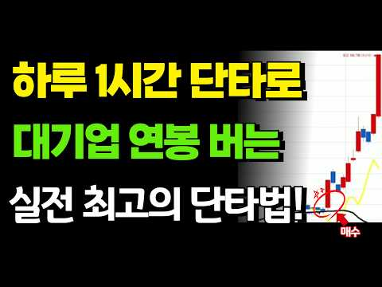
- 설명 앞부분: [주식차트보는법] 슈퍼개미들이 절대 말 안해주는 '실전 최고의 단타기법' 제가 욕먹을 각오로 상한가 차트패턴 시원하게 오픈하겠습니다! (차트분석,주식하는법)
- 같은 채널 평소 대비 ×23.3 (채널 최근 롱폼 중앙값 613회) · 평소 영상: [주식차트보는법] 7년동안 상한가 들어간 종목 전부 차트분석한 결과 발견된 딱 한가지 공… (673회) / [주식차트보는법] 7년동안 상한가 들어간 종목 전부 차트분석한 결과 발견된 딱 한가지 공… (553회)
- 대본 없음 (설명) — 음성인식이 끝나면 도입부·흐름이 들어감
- 댓글 8/8: 좋은 점 — 영상 2 · 감사·응원 1 · 더 알고 싶은 것 0 · 아쉬운 점 — 영상 0 · 반박·불만 — 의견 다름 0 · 정치·사회 0 · 경험 공유 0 · 구독·다음 기대 0
  - 좋은 점 — 영상 👍0 “좋은 정보네요 일봉으로하는건가요? 해당 종목 찾기가 매우 어려울것같네요요..”
  - 좋은 점 — 영상 👍0 “매번 감사합니다. 매매에 큰 도움이 될거 같아요.”
  - 감사·응원 👍0 “매번 감사합니다. 매매에 큰 도움이 될거 같아요.”

### 84. Gold and Silver Investors Are Getting Caught Out by the ATO

- https://www.youtube.com/watch?v=sY77wNqqiLA · Navexa · 구독자 7,610 · 조회수 84,671 (×11.1, 하루 11,598.4) · 좋아요 870 (1.0%) · 10.2분 · 2026-10-14 · 주제 묶음 기타 · 형식 정보·해설 (그 밖) · 폴더 `W_sY77wNqqiLA` (웹 승인)
- 썸네일: 
- 설명 앞부분: Gold and silver get taxed the moment you dispose of them, whether you sell, swap, gift or move them into a trust or SMSF, and that's true whether or not the ATO is watching. The bigger risk is substantiation. Without records you can't prove your cost base, your holding period, the premium you paid …
- 같은 채널 평소 대비 ×12.5 (채널 최근 롱폼 중앙값 6,800회) · 평소 영상: The Dollar-Cost Averaging Mistake Costing Austral… (6,800회) / How the New CGT Rules Will Actually Hit Your ETF … (7,254회)
- 대본 없음 (설명) — 음성인식이 끝나면 도입부·흐름이 들어감
- 댓글 486/486: 좋은 점 — 영상 0 · 감사·응원 0 · 더 알고 싶은 것 0 · 아쉬운 점 — 영상 0 · 반박·불만 — 의견 다름 0 · 정치·사회 0 · 경험 공유 0 · 구독·다음 기대 0

### 85. 주식 거래시간 밤 8시까지?☑️KRX 애프터마켓 꼭 알아야 할 변화

- https://www.youtube.com/watch?v=xXBHBu6hnCc · 주식캐스터 여니 · 구독자 42,800 · 조회수 473,007 (×11.1, 하루 12,163.1) · 좋아요 1,956 (0.4%) · 9분 · 2026-09-13 · 주제 묶음 기타 · 형식 정보·해설 (그 밖) · 폴더 `W_xXBHBu6hnCc` (웹 승인)
- 썸네일: 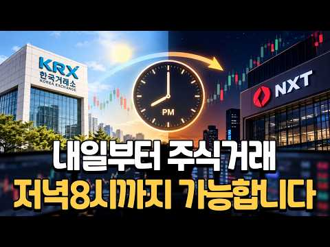
- 같은 채널 평소 대비 ×146.6 (채널 최근 롱폼 중앙값 3,227회) · 평소 영상: 증권사 목표주가만 보고 투자하면 벌어지는 일 (3,227회) / 경린이 탈출 1화. 경제가 좋아진다는 말, 우리는 어디까지 이해하고 있을까? (3,445회)
- 대본 없음 (없음) — 음성인식이 끝나면 도입부·흐름이 들어감
- 댓글 361/361: 좋은 점 — 영상 6 · 감사·응원 20 · 더 알고 싶은 것 2 · 아쉬운 점 — 영상 0 · 반박·불만 — 의견 다름 4 · 정치·사회 30 · 경험 공유 3 · 구독·다음 기대 0
  - 좋은 점 — 영상 👍31 “정리해 주셔서 감사합니다. 그냥 더 피곤해지는 느낌이 드네요..ㅎ”
  - 좋은 점 — 영상 👍1 “좋은 영상 감사합니다. 100% 남이 돈 버는거 배아파서 따라 만든거.”
  - 감사·응원 👍31 “정리해 주셔서 감사합니다. 그냥 더 피곤해지는 느낌이 드네요..ㅎ”
  - 감사·응원 👍27 “개인투자자들에게 꼭 필요한 정보를 똑 부러지게 잘 설명해 주셨습니다. 감사합니다.”
  - 더 알고 싶은 것 👍1 “SOR이 뭔지 알려주세요. 그동안 NXT이용한다고, 설정해둔것 같은데, KRX거래가 안되네요???”
  - 더 알고 싶은 것 👍1 “오전장몇시부터시작해요?아신분댓글부탁해요”
  - 반박·불만 — 의견 다름 👍8 “국민들 소액주주가 원하는건 거래시간 늘리는게 아닌데.. 그저 재벌들이 자회사, 손자회사, 까지만들면서 0.1% 도 안되는 지주사 지분으로 99.9% 지분의 국민들의 회사를 지배하는 이런 구조를 개선해달라는거다... 자회사 IPO 하는거라면 자회사 주식 지분에 따라 무…”
  - 반박·불만 — 의견 다름 👍6 “금융카르텔들만 좋을일 낫구먼유 삼전닉스 거래대금 빼면 언발에 오줌눟킨데 말도 안되는 이유로 카르텔 배불리기만”
  - 정치·사회 👍21 “재명이정권 지지율 떡락하는소리 들린다”
  - 정치·사회 👍12 “개인 투자자에겐 지옥문이 열린것이다 이재명 아웃 정권 타도”
  - 경험 공유 👍0 “도박쟁이들 왜케 많냐?단타만 맨날 쳐하니까 핸드폰만 8시까지 보란소리냐 이딴 소리 하고있지 사팔사팔해봤자 결국엔 손해임 걍 넣어놓고 분기별로 한번씩만 보면 됨 한국사람 주식보유기간 길어봤자 3달이고 평균 10일이라더니 여기다 모여있네 하긴 S&P500 나스닥100 같…”

### 86. 70배당할머니 배당금으로 자동차 샀어요

- https://www.youtube.com/watch?v=yUIcS9aKUzg · 이수남 · 구독자 1,300 · 조회수 13,155 (×10.1, 하루 1,673.4) · 좋아요 111 (0.8%) · 17.6분 · 2026-10-14 · 주제 묶음 3. 배당 · 형식 정보·해설 (그 밖) · 폴더 `W_yUIcS9aKUzg` (웹 승인)
- 썸네일: 
- 같은 채널 평소 대비 ×96.7 (채널 최근 롱폼 중앙값 136회) · 평소 영상: #70할머니배당금으로스펀에서천등날리고 (138회) / #숲속유럽성같은양평 더마구 다녀왔습니다 (134회)
- 대본 없음 (없음) — 음성인식이 끝나면 도입부·흐름이 들어감
- 댓글 27/27: 좋은 점 — 영상 0 · 감사·응원 1 · 더 알고 싶은 것 1 · 아쉬운 점 — 영상 0 · 반박·불만 — 의견 다름 0 · 정치·사회 0 · 경험 공유 3 · 구독·다음 기대 0
  - 감사·응원 👍2 “진솔한 목소리로 삶의 여정을 들려주셔서 감사합니다. 왠지 살아갈 날들이 무섭지 않네요~~”
  - 더 알고 싶은 것 👍2 “리이즈코리아벨리어커버드코드번호알려주세요”
  - 경험 공유 👍3 “저도 57세에 운전을 시작했어요~^^ 더 나이 먹음 못할거 같고, 정년 이후 여행 하려면 운전은 필수 인거 같아요 ㅎ 요즘 동생이랑 각자 자차로 운전해서 여행 다니는데 너무 좋아요😅😊”
  - 경험 공유 👍2 “자동차 일대기 너무 재미 있어요^^ 노동수입은 한계가 있어요. 몸둥이는 한개인데.. 금융수입이 답이라는 결론을 내리고 저도 배당주올인 입니다^^”

### 87. [주식차트보는법] 단타말고 이 '차트패턴' 하나로 꾸준히 수익낸 엄청난 비결 지금 딱 한번만 노출하겠습니다. 주식하는법중 이게 최고입니다 (종가베팅 매매기법 및…

- https://www.youtube.com/watch?v=3h7Di1vQHgY · 주식차트연구소 · 구독자 1,270 · 조회수 12,707 (×10.0, 하루 240.0) · 좋아요 134 (1.1%) · 14.6분 · 2026-08-30 · 주제 묶음 6. 종목 고르기·분석 · 형식 정보·해설 (그 밖) · 폴더 `W_3h7Di1vQHgY` (웹 승인)
- 썸네일: 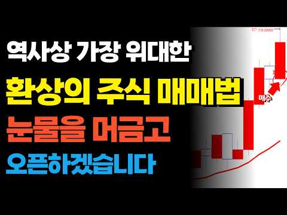
- 설명 앞부분: [주식차트보는법] 단타말고 이 '차트패턴' 하나로 꾸준히 수익낸 엄청난 비결 지금 딱 한번만 노출하겠습니다. 주식하는법중 이게 최고입니다 (종가베팅 매매기법 및 종목선별)
- 같은 채널 평소 대비 ×20.7 (채널 최근 롱폼 중앙값 613회) · 평소 영상: [주식차트보는법] 7년동안 상한가 들어간 종목 전부 차트분석한 결과 발견된 딱 한가지 공… (673회) / [주식차트보는법] 7년동안 상한가 들어간 종목 전부 차트분석한 결과 발견된 딱 한가지 공… (553회)
- 대본 없음 (설명) — 음성인식이 끝나면 도입부·흐름이 들어감
- 댓글 1/1: 좋은 점 — 영상 0 · 감사·응원 0 · 더 알고 싶은 것 0 · 아쉬운 점 — 영상 0 · 반박·불만 — 의견 다름 0 · 정치·사회 0 · 경험 공유 0 · 구독·다음 기대 0

### 88. 퇴직금 반토막 나고 깨달은 '상위 2%'의 주식투자자 생존법 6가지! ∣ 노후자금사연 ∣ 오디오북

- https://www.youtube.com/watch?v=r-tcC-ZmMBE · 은빛시나리오 · 구독자 29,300 · 조회수 281,638 (×9.6, 하루 1,734.8) · 좋아요 11,938 (4.2%) · 52.8분 · 2026-05-12 · 주제 묶음 11. 투자 일반 · 형식 사연·드라마 · 폴더 `W_r-tcC-ZmMBE` (웹 승인)
- 썸네일: 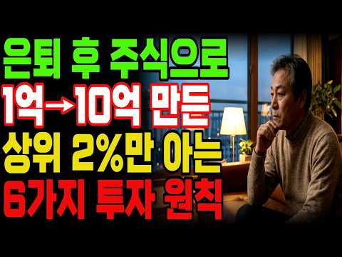
- 챕터: 0:00 인트로 · 1:20 Chapter 1. 1억이 사라진 날, 나는 안전화 … · 8:40 Chapter 2. 일기예보와 낡은 우산 (예측 대신… · 16:10 Chapter 3. 추락은 1초, 복구는 3년의 가시… · 23:30 Chapter 4. 잔챙이는 놔주고 대물만 기다렸습니… · 31:00 Chapter 5. 15만 원짜리 패딩과 4만 원짜리… · 38:20 Chapter 6. 남겨둔 현금이 진짜 무기가 된 날… · 45:50 Chapter 7. 냉장고 문에 자물쇠를 채운 날 (… · 53:10 Chapter 8. 10년의 인내가 선물한 노후의 평온
- 설명 앞부분: 여러분은 퇴직 후 노후 자금, 어떻게 지키고 계신가요? 퇴직금 2억 중 1억을 주식으로 날렸습니다. 채 1년도 걸리지 않았습니다.가족들 볼 면목이 없어 예순을 앞둔 나이에 건설 현장 막노동을 나갔습니다. 하루 13만 원짜리 일당으로 버티면서 남은 1억을 지키기 위한 원칙을 하나씩 세워나갔습니다.그렇게 10년이 지났습니다. 제 계좌에는 지금 10억이 넘는 돈이 있습니다.대단한 천재라서가 아닙니다. 운이 좋아서도 아닙니다. 현장에서 땀을 흘리는 동안 단 한 번도 어기지 않은 원칙 6가지를 지켜냈기 때문입니다. 오늘 그 원칙을 남김없이…
- 같은 채널 평소 대비 ×9.0 (채널 최근 롱폼 중앙값 31,291회) · 평소 영상: 60대 이상 노후 파산자 45%? 그 숫자가 제가 될 줄 몰랐습니다. 가난한 노년의 공포! (31,291회) / 코스피 7천의 거대한 배신! 삼전닉스 안 사면 바보인가요? 70대 주식 투자자가 증권앱을… (33,736회)
- 대본 (자막, 4.9 음절/초) 첫 20초: “퇴직금 2억 중 1억을 주식으로 날렸습니다. 그 큰 돈이 사라지는 데는 최 1년도 걸리지 않았습니다. 가족들 볼 면목이 없어 예순을 앞둔 나이에 건설 현장 막노동을 나갔습니다. 먼지 구덩이 속에서 무거운 시멘트 자료를 나르며 하루 13만 원을” — 도입부 유형: 숫자로 시작
- 첫 1분: “퇴직금 2억 중 1억을 주식으로 날렸습니다. 그 큰 돈이 사라지는 데는 최 1년도 걸리지 않았습니다. 가족들 볼 면목이 없어 예순을 앞둔 나이에 건설 현장 막노동을 나갔습니다. 먼지 구덩이 속에서 무거운 시멘트 자료를 나르며 하루 13만 원을 벌었습니다. 그렇게 10년이 지났습니다. 제 주식 계좌에는 지금 10억이 넘는 돈이 있습니다. 대단한 천재라서가 아닙니다. 운이 좋아서도 아닙니다. 현장에서 땀을 흘리는 동안 상위 2%의 절대 원칙 여섯 가지를 지켜냈기 때문입니다. 막노동꾼이었던 제가 기어의 10억을 만든 잔인하고도 확실한 생존의 비밀 오늘 남김없이 털어 놓겠습니다. 사연 시작하기 전에 구독과 좋아요, 알림 설정 부탁드립니다. 여러분의 작은 손길이 영상을 만드는데 큰 힘이 됩니다. 제 이름은 최재길 올”
- 흐름 (90초마다 첫 문장): 0:00 퇴직금 2억 중 1억을 주식으로 → 1:32 직원이 건네 노란 봉투 안에 퇴직금 → 3:00 월급처럼 들어온다는 소리에 눈이 번쩍 → 4:30 1억 5천만 되면 말하자. → 6:01 조용히 설거지를 끝내고 방으로 → 7:30 올스톱입니다. → 9:02 강 반장이 종이컵에든 믹스 커피를 한 → 10:32 내일 주식이 오를지 내릴지 점쟁이처럼 → 12:00 참 신기했습니다. → 13:32 숫자를 해집고 다녔습니다. → 15:01 1년에 꾸준히 20%를 번다면 그건 → 16:32 그리고 50%를 이르면 되찾는데 → 18:01 종목의 차트를 다시 켜보고는 가슴을 → 19:32 걸 샀다가 조금 오르면 팔고 그렇게 → 21:01 나이는 저보다 네다섯 살 위였는데 → 22:30 그런데 5% 먹고 팔았으니 200만 → 24:00 않았습니다. → 25:31 훈련을 하던 2017년 어느 날 → 27:01 하루는 일을 마치고 동대문 시장을 한 → 28:31 사는 것 자체가 가장 훌륭한 안전
- 댓글 439/461: 좋은 점 — 영상 29 · 감사·응원 45 · 더 알고 싶은 것 5 · 아쉬운 점 — 영상 2 · 반박·불만 — 의견 다름 3 · 정치·사회 0 · 경험 공유 26 · 구독·다음 기대 1
  - 좋은 점 — 영상 👍32 “정말 잘들었습니다. 공감도 되고 감동적입니다. 좋은 내용 감사합니다 😊”
  - 좋은 점 — 영상 👍21 “자극적인내용만 보다 담백한내용 도움이많이 됐습니다 감사합니다”
  - 감사·응원 👍51 “깊은 울림을 주는 글~~~ 고맙습니다. 행복한 날들만 가득하시기 바랍니다.”
  - 감사·응원 👍38 “이방송은 진심으로 주식초보자들은 꼭 반드시봐야합니다 다시한번 공부했습니다 감사합니다”
  - 더 알고 싶은 것 👍11 “1년에 3-4번 오는 폭락장만 노리면 되는데 현실에 저는 아직 초보네요. 많은 도움 많은 생각을 해봅니다. 좋은 영상 꾸준히 올려주세요.”
  - 더 알고 싶은 것 👍3 “영상 잘보았습니다.. 현제 제나이70세 가진돈.. 2.000만원인데.. 희망은 있을까요?..”
  - 아쉬운 점 — 영상 👍1 “소설을 넘 미사어귀가 많아 듣기 지루하고 짜증나게 하네요. 인내심이 있어야 듣지 못듣겠네.”
  - 아쉬운 점 — 영상 👍0 “동영상 보려다 길어서 포기. 좀 짧게 만들어주세요”
  - 반박·불만 — 의견 다름 👍2 “그러니 도박하지말고 장투하세요 별 기술이 필요한게 아닙니다”
  - 반박·불만 — 의견 다름 👍0 “계산이 틀렸네요 원금 1백만원으로 10%씩 일곱번 연속 손절치면 첫번째 손절 10만원 잔고 90만원 두번째 손절 9만원 잔고 81만원 세번째 손절 8.1만원 잔고 72만9천원 계속 ~~~~ 일곱번 연속 손절후 세번연속 30%수익이면 겨우 본전보다 많다~~”
  - 경험 공유 👍52 “실전매매 경험담 많은 도움받았습니다. 그리고 역경을 딛고 이겨낸 승리담. 전쟁터에서 살아남아 사모님께 드린 감동의 드라마~~ 저도 따라 해볼랍니다^^”
  - 경험 공유 👍20 “참인상깊게 읽고 갑니다 저도 처음하는 주식 매일아침 부푼가슴으로 앱여는 65세 오늘도 하팅해봅니다~~”
  - 구독·다음 기대 👍0 “너무 감동입니다 ! 고생하셨고 ~ 정말 대단하시네요! 저도 원칙을 지켜 목표를 꼭 이루고 싶습니다 구독하고 갑니다”

### 89. The BEST 3 ETF Portfolio for F.I.R.E. (Hold FOREVER!)

- https://www.youtube.com/watch?v=HQoEjtdRI_0 · Jacob Wade (Roadmap Money) · 구독자 25,100 · 조회수 240,723 (×9.6, 하루 1,628.6) · 좋아요 3,829 (1.6%) · 25분 · 2026-05-27 · 주제 묶음 2. 장기투자·ETF·지수 · 형식 정보·해설 (그 밖) · 폴더 `W_HQoEjtdRI_0` (웹 승인)
- 썸네일: 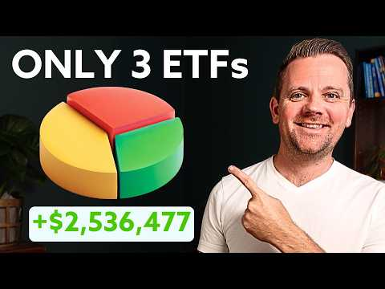
- 챕터: 0:00 Why your portfolio choice mat… · 3:34 What is an ETF? · 4:24 ETF #1: Core ETF · 9:34 ETF #2: Growth ETF · 13:26 Coinbase sponsor · 15:26 ETF #3: Quality ETF · 18:22 Portfolio # 1 · 19:26 Portfolio # 2 · 19:56 Portfolio # 3 · 21:17 Bonus ETF for cash holdings · 22:48 How to Start Investing in The…
- 설명 앞부분: In this video, I break down what I believe is one of the best simple ETF portfolios for 2026 using just 3 ETFs. We’ll cover: The best core ETF for long-term wealth building A growth ETF that could boost long-term returns A quality ETF to help smooth out volatility Sample ETF portfolio allocations b…
- 같은 채널 평소 대비 ×23.1 (채널 최근 롱폼 중앙값 10,422회) · 평소 영상: 3 ETF Portfolio CHANGES at Every Age (Exact Perce… (11,129회) / The 5 BEST Ways To Invest For Your Kids In 2026 (9,715회)
- 대본 없음 (설명) — 음성인식이 끝나면 도입부·흐름이 들어감
- 댓글 388/388: 좋은 점 — 영상 0 · 감사·응원 0 · 더 알고 싶은 것 0 · 아쉬운 점 — 영상 0 · 반박·불만 — 의견 다름 1 · 정치·사회 0 · 경험 공유 1 · 구독·다음 기대 0
  - 반박·불만 — 의견 다름 👍0 “혹시 ai 영상은 아니죠 !?”

### 90. 월 100만원 ETF 투자하면, 60대에 "진짜 부자"가 됩니다

- https://www.youtube.com/watch?v=WGkQ7wwHHlQ · 농부의 경제학 · 구독자 8,250 · 조회수 77,104 (×9.3, 하루 1,071.7) · 좋아요 1,372 (1.8%) · 13.4분 · 2026-08-11 · 주제 묶음 2. 장기투자·ETF·지수 · 형식 정보·해설 (그 밖) · 폴더 `W_WGkQ7wwHHlQ` (웹 승인)
- 썸네일: 
- 설명 앞부분: 50세 노후 준비, 결코 늦지 않았습니다. 주변에서 스무 살부터 시작해야 복리가 붙는다고 말하지만, 50세부터 매달 100만 원씩 15년 동안 미국 ETF에 투자하면 65세 은퇴 후 세금을 떼고도 매달 236만 원의 마르지 않는 현금흐름을 만들 수 있습니다. 오늘 영상에서는 미국 대표 ETF인 SCHD(40%), SPYM(40%), QQQM(20%) 포트폴리오를 통해 배당 수익과 자산 성장을 동시에 챙기는 가장 현실적인 노후 자금 설계법을 상세히 풀어드립니다. 은퇴 후 원금을 깎아 먹지 않고 죽을 때까지 통장 잔고가 늘어나는 미국…
- 같은 채널 평소 대비 ×8.9 (채널 최근 롱폼 중앙값 8,619회) · 평소 영상: 내가 사면 떨어지고 팔면 오르는 '진짜 이유' (8,619회) / 상위 1% 투자자들이 주식 창 끄고 매일 하는 '… (8,678회)
- 대본 없음 (설명) — 음성인식이 끝나면 도입부·흐름이 들어감
- 댓글 82/82: 좋은 점 — 영상 4 · 감사·응원 7 · 더 알고 싶은 것 5 · 아쉬운 점 — 영상 1 · 반박·불만 — 의견 다름 0 · 정치·사회 1 · 경험 공유 5 · 구독·다음 기대 0
  - 좋은 점 — 영상 👍15 “개꿀팁!!이렇게 해볼게요”
  - 좋은 점 — 영상 👍4 “어렵네요. PDF로 정리해 주시면 감사하겠습니다”
  - 감사·응원 👍15 “비슷한 관련된 영상 정말 많이 봤는데, 이 영상이 제일 잘 정리가 되어 있고, 이해 하기가 쉬운 것 같아요. 주변에 많이 공유 하겠습니다. 영상 감사드려요.👍”
  - 감사·응원 👍4 “어렵네요. PDF로 정리해 주시면 감사하겠습니다”
  - 더 알고 싶은 것 👍7 “은퇴후(10년후예상)현금흐름이 있어서 하락장 방어 가능하다면 슨피 500, 나스닥 100을 5:5로 가져가도 괜찮을까요?”
  - 더 알고 싶은 것 👍4 “어렵네요. PDF로 정리해 주시면 감사하겠습니다”
  - 아쉬운 점 — 영상 👍6 “Schd가 월배당 이었으면 좋을텐데, 아쉽습니다”
  - 경험 공유 👍10 “51세, 배당적립식 투자 3년차 입니다 약 월50만원 배당금 받습니다 (가족 1인당 65세전 월100목표로) 월 150만원 적립식으로 모아갑니다 미래를 알수는 없으나 긍정론자라서ㆍㆍㆍ”
  - 경험 공유 👍2 “뻥이다ETF엔터테이먼트4년째 마이너스53%부추기지마라 이ㅅ 본전안올것같음”

### 91. POV: Gaji Sama dengan Temanmu, Tapi Kamu Keluar dari Pabrik Lebih Awal Berkat Dividen

- https://www.youtube.com/watch?v=_-rdF2o1v0c · ncek invest · 구독자 7,150 · 조회수 66,053 (×9.2, 하루 8,460.2) · 좋아요 441 (0.7%) · 8.3분 · 2026-10-14 · 주제 묶음 기타 · 형식 정보·해설 (그 밖) · 폴더 `W__-rdF2o1v0c` (웹 승인)
- 썸네일: 
- 챕터: 0:00 Hari terakhir di pabrik · 1:00 Level 1: Gaji dan Dividen · 2:00 Level 2: Dividen Pertama · 3:35 Level 3: Dividen Bisa Turun · 5:05 Level 4: Angka yang Terlalu L… · 6:45 Level 5: Harga Sebuah Bel · 7:45 Penutup
- 설명 앞부분: Teman satu lini bilang, "Pensiun dini dari dividen? Ngimpi lo." Dua puluh satu tahun kemudian, kamu melepas ID card pabrikmu untuk terakhir kali. Di video POV ini, kamu akan menjalani 21 tahun hidup seorang buruh pabrik yang gajinya biasa saja, tapi belajar dari seorang mandor tua bahwa gaji adalah…
- 같은 채널 평소 대비 ×16.6 (채널 최근 롱폼 중앙값 3,975회) · 평소 영상: Gen-Z Bukan Takut Nikah — Mereka Takut Bangkrut S… (3,975회) / Rahasia Kotor di Balik Golf: Kenapa Deal Miliaran… (3,940회)
- 대본 없음 (설명) — 음성인식이 끝나면 도입부·흐름이 들어감
- 댓글 36/36: 좋은 점 — 영상 0 · 감사·응원 0 · 더 알고 싶은 것 0 · 아쉬운 점 — 영상 0 · 반박·불만 — 의견 다름 0 · 정치·사회 0 · 경험 공유 0 · 구독·다음 기대 0

### 92. 【あの投信は今!?】一歩テック・メガ10・インド株・SOX・S&P10・楽天SCHDは今…S&P500・オルカン・NASDAQ100と比較した結果

- https://www.youtube.com/watch?v=nXvljAM2D_8 · ぎゅうぎゅうマネー日記帳 · 구독자 15,700 · 조회수 144,940 (×9.2, 하루 874.1) · 좋아요 2,837 (2.0%) · 44.6분 · 2026-05-09 · 주제 묶음 2. 장기투자·ETF·지수 · 형식 정보·해설 (그 밖) · 폴더 `W_nXvljAM2D_8` (웹 승인)
- 썸네일: 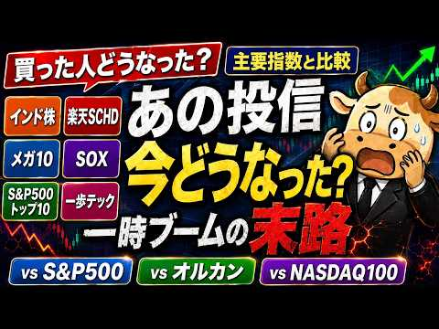
- 챕터: 0:00 オープニング · 3:33 メガ10 vs FANG+｜低コスト版FANG+なのか？ · 8:13 Tracers S&P500トップ10 vs FANG+｜… · 15:56 一歩先いくUSテック・トップ20 vs NASDAQ100… · 21:52 インド株 vs オルカン｜インドを単体で持つ意味 · 28:28 楽天SCHD vs S&P500｜分配金の安心感 · 36:02 SOX vs NASDAQ100｜AI時代の本丸、半導体 · 39:28 最終結論｜王道ファンドが強い本当の理由
- 설명 앞부분: 今回は、インド株、楽天SCHD、メガ10、一歩先いくUSテック・トップ20、SOX、Tracers S&P500トップ10この6本を取り上げて、現在どうなっているのかを王道指数と比較しながら解説します。 比較対象は、FANG+、オルカン、S&P500、NASDAQ100。 ・ニッセイ・S米国グロース株式メガ10インデックスファンド・Tracers S&P500トップ10インデックス・一歩先いく US テック・トップ20インデックス・インド株/NIFTY50関連ファンド・楽天・シュワブ・高配当株式・米国ファンド（楽天SCHD）・SOX/半導体関連インデックスファンド・FANG+・オルカン・S&…
- 같은 채널 평소 대비 ×5.7 (채널 최근 롱폼 중앙값 25,255회) · 평소 영상: 最強の積立日はあるのか？ボーナス/臨時収入/給料日｜新NISAの最適解 (25,255회) / 【流石にこれ買ってるよね？】SpaceX・OpenAI・Anthropic上場で狙う投資信託3選｜… (25,061회)
- 대본 없음 (설명) — 음성인식이 끝나면 도입부·흐름이 들어감
- 댓글 456/457: 좋은 점 — 영상 0 · 감사·응원 0 · 더 알고 싶은 것 0 · 아쉬운 점 — 영상 0 · 반박·불만 — 의견 다름 0 · 정치·사회 0 · 경험 공유 0 · 구독·다음 기대 0

### 93. [차트 강의] 100조 운용역이 신입 펀드매니저에게 가르쳤던 차트 패턴 8가지 (박재훈)

- https://www.youtube.com/watch?v=0JHEax_R7DE · 박재훈의 투자농장 · 구독자 20,900 · 조회수 190,769 (×9.1, 하루 9,966.6) · 좋아요 1,894 (1.0%) · 16.5분 · 2026-10-03 · 주제 묶음 6. 종목 고르기·분석 · 형식 인터뷰·강연·대담 · 폴더 `W_0JHEax_R7DE` (웹 승인)
- 썸네일: 
- 설명 앞부분: 10/24(토) 오전 10시, 합정역 인근에서 진행됩니다. 1부는 하반기 투자전략을 점검하고, 2부는 실전 차트강의를 진행합니다. 안녕하세요 이웃님들, 투자 농장지기 박재훈입니다. 저는 투자를 할 때 '손실을 덜 보는 것'이 가장 중요하다고 생각합니다. 그래서 오늘은 차트에서 하락에서 상승, 상승에서 하락으로 추세가 전환되는 신호를 읽는 방법을 알려드렸습니다. 제가 펀드매니저로 일하던 시절, 신입들에게 가르쳤던 내용이기도 합니다. 이웃님들의 투자에 꼭 도움이 되셨기를 바라며.. 하반기 투자전략을 점검하고, 실전 차트 강의를 듣고 …
- 같은 채널 평소 대비 ×30.6 (채널 최근 롱폼 중앙값 6,235회) · 평소 영상: 100조 펀드매니저가 하락장에서 버틸 수 있었던 이기는 투자 원칙 (박재훈) (6,774회) / 미국 국가 부채 40조 달러, 당장 금 투자해도 될까? '이 숫자'부터 확인하세요 (박재… (5,696회)
- 대본 없음 (설명) — 음성인식이 끝나면 도입부·흐름이 들어감
- 댓글 76/77: 좋은 점 — 영상 7 · 감사·응원 17 · 더 알고 싶은 것 5 · 아쉬운 점 — 영상 1 · 반박·불만 — 의견 다름 0 · 정치·사회 0 · 경험 공유 3 · 구독·다음 기대 0
  - 좋은 점 — 영상 👍5 “진작에 이런 공부 배웠으면 작전세력들한테 덜 당했을것인데! 지금이라도 공부하고 암기하면서 실제 나타나는 모양들과 비교분석하는 눈 썰미를 키워 보겠습니다. 선생님덕분에 저의 소중한 돈 잘 지키겠습니다.”
  - 좋은 점 — 영상 👍0 “유익하게 감사히 잘 봤습니다”
  - 감사·응원 👍2 “목소리도 시원시원하시고 설명도 깔끔! 감사히 잘 들었습니다. 무료강의 신청했습니다^^”
  - 감사·응원 👍1 “선생님 안녕하세요. 잘 보고 있습니다. 장대양봉에 대해서 어느정도 기준을 알고싶습니다. 말 뜻은 이해하고 있지만 얼마만큼의 길이가 장대양봉이고 장대음봉인지.. 구분하고싶습니다. 감사합니다.”
  - 더 알고 싶은 것 👍1 “선생님 안녕하세요. 잘 보고 있습니다. 장대양봉에 대해서 어느정도 기준을 알고싶습니다. 말 뜻은 이해하고 있지만 얼마만큼의 길이가 장대양봉이고 장대음봉인지.. 구분하고싶습니다. 감사합니다.”
  - 더 알고 싶은 것 👍0 “선생님 이게 개별종목에도 적용이 되는건지 아님 지수 차트에만 해당하는건지 궁금합니다. 영상 잘 봤습니다.”
  - 아쉬운 점 — 영상 👍0 “쏙쏙 이해가 잘되요 반복해서 봐야지 ㄱㅅ”
  - 경험 공유 👍1 “저 엄청 잘해요 추세 전환 찾는거 제가 고수 ㅋ 6월말에 다 던지고 7월말에 샀어요”
  - 경험 공유 👍0 “저희쪽으로 모시고 싶습니다^^ 영상 볼때마다 느낍니다”

### 94. 월급없는 현실, 일하지않고 배당금만 받고 살아가는 미혼남 생존기

- https://www.youtube.com/watch?v=mcd_S953Gno · 배당아저씨 · 구독자 32,400 · 조회수 293,361 (×9.1, 하루 2,662.7) · 좋아요 4,719 (1.6%) · 8.6분 · 2026-07-04 · 주제 묶음 3. 배당 · 형식 정보·해설 (그 밖) · 폴더 `W_mcd_S953Gno` (웹 승인)
- 썸네일: 
- 설명 앞부분: 영상 속 배당아저씨의 미니멀라이프 내돈내산 재료&용품들 (쿠팡 파트너스 및 인플루언서 활동의 일환으로 구매시 일정액의 수수료를 제공 받을 수 있습니다) 이 채널은 저의 투자 경험과 생각을 공유하는 공간입니다. 저의 투자 방식을 그대로 따라 하시는 것은 권장드리지 않으며, 충분한 고민과 공부 후 판단하시길 바랍니다.
- 같은 채널 평소 대비 ×6.1 (채널 최근 롱폼 중앙값 48,471회) · 평소 영상: 배당금으로 혼자사는 미혼남의 현실 (48,471회) / 미국주식 3억, 배당금으로 직장 없이 살고 있어요_배당파이어 장단점 (50,627회)
- 대본 없음 (설명) — 음성인식이 끝나면 도입부·흐름이 들어감
- 댓글 1,076/1,076: 좋은 점 — 영상 9 · 감사·응원 57 · 더 알고 싶은 것 58 · 아쉬운 점 — 영상 3 · 반박·불만 — 의견 다름 11 · 정치·사회 8 · 경험 공유 107 · 구독·다음 기대 12
  - 좋은 점 — 영상 👍5 “제가 준비하고 있는 삶을 일찍 시작하고 계셨네요.. 구독/좋아요 찍고 갑니다. 좋은 정보 공유 하입시다. 응원합니다 👍👍👍👍”
  - 좋은 점 — 영상 👍1 “저와 많이 비슷하신것같아 구독하고 즐겨보는중입니다. 오늘도 좋은 영상 감사합니다”
  - 감사·응원 👍88 “남의 기준은 전혀 중요하지않더라고요, 인생 별것두없고, 내가 필요한 월 생활비를 배당으로 세팅후 소소하게 행복누리며 건강하게사는게 최고인거같아요. 응원합니다.😊”
  - 감사·응원 👍87 “저는 84년생 여자로 미국 시민권자이고 그래서 미국에 계좌가 있고 달러로 투자하는데요. 저는 2021년 11월에 38만불로 (3배 레버리지 etf만 투자) 조기은퇴했다가 2022년 하락장에 1/3 토막나서 잠깐 다시 알바해서 3만 3천불 더 투자해서 2023년 3월에…”
  - 더 알고 싶은 것 👍20 “나의 목표인 삶을 살고 계세요~영상 자주 올려주세요~큰 힘이 되고 있어요. 좋은하루 보내세요!”
  - 더 알고 싶은 것 👍15 “배당이 꾀 나오시는데 금융종합과세랑 건보료 어떤지 알고싶습니다”
  - 아쉬운 점 — 영상 👍1 “이 좋은 걸 님 부모님이 아셨으면 딱이었을 것 같네요~~ 너무나 아쉽네요.”
  - 아쉬운 점 — 영상 👍0 “근로소득 없이 배당금 2,000만 원이며, 집 5천만 원(공시가), 차가 없는 지역가입자의 세금과 건보료 요약입니다. 복사해서 바로 쓰실 수 있게 핵심만 정리했습니다. ​1. 세금: 추가 납부 없음 (종결) ​배당금 받을 때 이미 15.4%(308만 원)를 원천징수로…”
  - 반박·불만 — 의견 다름 👍15 “세금 건보 장난이 아닙니다.배당월300세금 25만원 건보30여만원 거의60만원 몌상.세금신고 안했다면. 나중에 미신고가산세폭탄맞음.3억이면 m7+몇개만 잘굴려도. 500이상 나옵니다.집,직장없으니 건보 3만원데 금융소득 종과세 배당세없이”
  - 반박·불만 — 의견 다름 👍3 “관두고싶은데,공뭔이라 못 관두겠어요 이것또한 욕심이라는걸 저도 압니다.. 부럽습니다..부럽습니다.. 40후반되니 여기저기 아프고 , 6월달 치과포함 , 피부과 등 병원비 백만원정도 들어가네요. 나이들면 병원비 많이 들어간다더니, 딱히 지병이 있는것도 아닌데, 벌써부터…”
  - 정치·사회 👍2 “10살입니다 하이닉스 단타쳐서 한달만에 총 6천억원 벌었습니다 그돈으로 강남. 아파트 5채 사놓고. 파이어족 함. 요즘엔 단타로 하루에 30억정도 벌고 만족함 2ㅇ살 성인이 되면 대통령 출마해서 돈을 더 벌생각임”
  - 정치·사회 👍0 “이렇게 배당금 받아서 다람쥐 루틴으로 사는 것보다는 더 보람있는 일을 하시면서 사시면 좋을 것 같아요.. 그냥 죽을 때까지 루틴을 돌리면 ... 나중에 남는 건 상속인이 없어서 3 억원 모두를 나라가 가져가고 고독사한 자신 밖에 없어요. 저라면, 컨테이너 등 짐 보관…”
  - 경험 공유 👍1,066 “40세 찍으면서 분당인근 자가아파트와 강남역에 오피스텔, 금융자산 5억 정도 갖고 파이어 했습니다. 50세가 조금 넘은 지금 그 자산들이 22억을 찍고 있네요. 엄마와 여행다니고, 내가 좋아하는 취미생활하고 한달에 두어번 봉사활동하면서 내가 하고 싶은 일들만 하고 사…”
  - 경험 공유 👍272 “4억정도 모은 40대 아재입니다 저도 이번달 까지만하고 저한테 휴식을 제공하려고합니다 지친 내몸을 보니 더 일을 하기 힘들더라고요”
  - 구독·다음 기대 👍31 “맞아요. 이거에요 이거.. 제가 원하는 삶. 하루하루 알람맞춰놓고 일찍 일어나 출근해서 하루종일 정신 나가고 욕먹고.. 이런 거에 치이기 싫어요. 돈 많이 버는게 중요한게 아니라 이렇게 하루하루 뭐할지 고민하며 사는 삶이 즐거울 것 같다고 느끼고 있습니다. 직장생활 …”
  - 구독·다음 기대 👍5 “제가추구하는삶이네요~~구독합니다”

### 95. 와..미친.. 캔들 차트 보는 법 핵심을 공개한다고? (주식 강의 추천, 주식 초보 매매 방법)

- https://www.youtube.com/watch?v=KwvGol5A8m4 · 트트남 | 주식 차트 보는법 · 구독자 1,420 · 조회수 12,794 (×9.0, 하루 241.3) · 좋아요 166 (1.3%) · 15.8분 · 2026-08-30 · 주제 묶음 1. 주식 기초·초보 · 형식 인터뷰·강연·대담 · 폴더 `W_KwvGol5A8m4` (웹 승인)
- 썸네일: 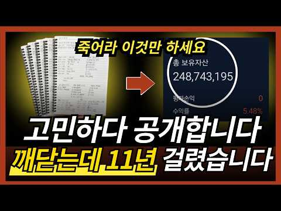
- 설명 앞부분: [수익부터 출금까지 성공시키는 현실적인 방법] [소통방 입장하기] 차트 보는 법, 이 영상 하나로 기준부터 다시 잡아보세요. 주식 공부를 해도 실전 매매가 계속 흔들리는 이유는 기술적 분석을 몰라서만이 아닙니다. 진짜 문제는 이평선, RSI, MACD, 매물대, 지지저항, 피보나치, 추세선, 엘리엇 파동, 하모닉 패턴, 거래량을 따로따로 외우고 실전 차트 앞에서는 무엇을 먼저 봐야 할지 모른다는 것입니다. 이번 영상에서는 차트 보는 법을 기초부터 실전까지 정리합니다. 이평선으로 추세를 보는 법, RSI와 MACD 다이버전스로 반등…
- 같은 채널 평소 대비 ×24.1 (채널 최근 롱폼 중앙값 532회) · 평소 영상: [주식/단타] 평생 써먹는 차트패턴 보는법, 확률 90%의 필수조건입니다 (601회) / 강제 청산 당하고 집문서 날아가는 선물거래, 97% 투자자가 무조건 털리는 이유 (603회)
- 대본 없음 (설명) — 음성인식이 끝나면 도입부·흐름이 들어감
- 댓글 2/2: 좋은 점 — 영상 0 · 감사·응원 1 · 더 알고 싶은 것 0 · 아쉬운 점 — 영상 0 · 반박·불만 — 의견 다름 0 · 정치·사회 0 · 경험 공유 0 · 구독·다음 기대 0
  - 감사·응원 👍1 “😊감사합니다 열씨미 노력해 보겠습니다 ❤”

### 96. 세미파이어 부부가 국내주식 안하는 이유

- https://www.youtube.com/watch?v=DNDC7nT7Hmw · 시골사는 배당부부 · 구독자 1,490 · 조회수 12,743 (×8.6, 하루 3,178.6) · 좋아요 140 (1.1%) · 6.9분 · 2026-10-18 · 주제 묶음 5. 국내주식 · 형식 정보·해설 (그 밖) · 폴더 `W_DNDC7nT7Hmw` (웹 승인)
- 썸네일: 
- 설명 앞부분: 안녕하세요 시골사는 배당부부입니다. 오늘은 저희부부가 국내주식을 하지 않는 이유에 대해 얘기 나눠봤습니다
- 같은 채널 평소 대비 ×0.9 (채널 최근 롱폼 중앙값 14,176회) · 평소 영상: 도시에서 떠나 시골로 귀촌한 이유 (15,439회) / 시골 세미파이어 현실 한달 생활비 (12,914회)
- 대본 없음 (설명) — 음성인식이 끝나면 도입부·흐름이 들어감
- 댓글 35/35: 좋은 점 — 영상 0 · 감사·응원 2 · 더 알고 싶은 것 0 · 아쉬운 점 — 영상 0 · 반박·불만 — 의견 다름 0 · 정치·사회 0 · 경험 공유 2 · 구독·다음 기대 2
  - 감사·응원 👍1 “모두가 다 다른상황이니 각자에 맞는 투자가 옳은투자지요. 응원합니다.”
  - 감사·응원 👍0 “응원과 구독합니다”
  - 경험 공유 👍9 “나도 예전에는 국내주식만하다 미국주식으로 옮겼지만 절세상으로나 분산차원에서 국내투자는 필요하다고 봄. 대신 코스피200같은 대표지수를 일정비중으로 투자하는건 필요하다 봄니다.”
  - 경험 공유 👍0 “똑소리나는 부부시네요 유튜브자주 업로딩해주세요❤ 구독누르고가요 저도 국장에서 크게실망한적있어서ㅜㅜ.. 고배당주에 한번투자해봐야겠습니다”
  - 구독·다음 기대 👍0 “응원과 구독합니다”
  - 구독·다음 기대 👍0 “똑소리나는 부부시네요 유튜브자주 업로딩해주세요❤ 구독누르고가요 저도 국장에서 크게실망한적있어서ㅜㅜ.. 고배당주에 한번투자해봐야겠습니다”

### 97. 【NISAおすすめ】オルカン・S＆P500・日本株・FANG＋・NASDAQ100の人気銘柄５つを元銀行員の目線で徹底検証しました！

- https://www.youtube.com/watch?v=EB_-ZGfqX5s · 初心者でも分かる40代50代のための資産形成塾 みく · 구독자 3,590 · 조회수 28,701 (×8.0, 하루 7,311.5) · 좋아요 100 (0.4%) · 37.6분 · 2026-10-18 · 주제 묶음 10. 노후·연금 투자 · 형식 정보·해설 (그 밖) · 폴더 `W_EB_-ZGfqX5s` (웹 승인)
- 썸네일: 
- 챕터: 0:00 オープニング · 2:06 日経平均とTOPIX、何が違う？ · 8:45 オルカンはなぜ人気なの？ · 12:54 S&P500はオルカンと何が違う？ · 15:58 NASDAQ100とFANG+の注意点は？ · 24:10 一番増えた銘柄を選べばいい？ · 27:51 今の組み合わせ、このままでいい？
- 설명 앞부분: ▼公式LINE 公式LINEにご登録後、動画内でお伝えしているキーワードを送っていただくと受け取れます🙆‍♀ 元銀行員でFPの資格を持つ私が 新NISAや老後資金など、お金のことを発信していきます🎙
- 같은 채널 평소 대비 ×1.2 (채널 최근 롱폼 중앙값 23,191회) · 평소 영상: 【損得は間違い？】知らないと120万円損します！老後に後悔しない正しい年金の受け取り方を元銀行員が… (23,191회) / 【要確認！】50代60代が気付かずに買いがちなNISAの落とし穴銘柄を、元銀行員目線で徹底的に解説… (21,248회)
- 대본 없음 (설명) — 음성인식이 끝나면 도입부·흐름이 들어감
- 댓글 9/9: 좋은 점 — 영상 0 · 감사·응원 0 · 더 알고 싶은 것 0 · 아쉬운 점 — 영상 0 · 반박·불만 — 의견 다름 0 · 정치·사회 0 · 경험 공유 0 · 구독·다음 기대 0

### 98. SCHD ETF Analysis: The Most Complete Schwab US Dividend Equity ETF Breakdown

- https://www.youtube.com/watch?v=ys_pR1yxEgo · Goldman Starch · 구독자 1,390 · 조회수 10,907 (×7.8, 하루 1,320.6) · 좋아요 239 (2.2%) · 32.2분 · 2026-10-14 · 주제 묶음 2. 장기투자·ETF·지수 · 형식 정보·해설 (그 밖) · 폴더 `W_ys_pR1yxEgo` (웹 승인)
- 썸네일: 
- 챕터: 0:00 SCHD ETF analysis: the record… · 1:13 What SCHD owns: the 4 screens · 2:04 The 4% cap and why Texas Inst… · 2:49 March reconstitution: who got… · 3:18 The 2 biggest holdings are ch… · 4:07 Why SCHD beat the S&P in 2026… · 4:53 The last time SCHD out-yielde… · 5:34 The 5% break: down 6.9% while… · 6:30 2022: why SCHD held up · 7:03 2023 to 2025: trailing the S&P · 7:49 Every calendar year since lau… · 8:29 SCHD's yield vs T-bills, the … · 9:04 SCHD vs TIPS and SGOV · 9:38 The record negative yield gap · 10:19 2023: the last time the gap l… · 10:49 Fewer than 4% of S&P stocks o… · 11:18 The seesaw: yields up, income… · 12:08 SPHD, DVY, VYM, DGRW: every d… · 12:34 Does SCHD trade like a bond? · 13:18 The dividend stalled: up 0.6%
- 설명 앞부분: SCHD ETF analysis: the most complete breakdown of the Schwab US Dividend Equity ETF (NYSE Arca: SCHD), with the 10-year Treasury yield above 5%. On October 5 the 10-year Treasury paid 2.09 percentage points more than SCHD's dividend yield, the biggest gap in the fund's 15-year history. A 3-month T-…
- 같은 채널 평소 대비 ×18.3 (채널 최근 롱폼 중앙값 596회) · 평소 영상: RKT Stock Analysis: The Most Complete Rocket Mort… (596회) / UWMC Stock Analysis: The Most Complete United Who… (690회)
- 대본 없음 (설명) — 음성인식이 끝나면 도입부·흐름이 들어감
- 댓글 76/76: 좋은 점 — 영상 0 · 감사·응원 0 · 더 알고 싶은 것 0 · 아쉬운 점 — 영상 0 · 반박·불만 — 의견 다름 0 · 정치·사회 0 · 경험 공유 0 · 구독·다음 기대 0

### 99. 50대에 은퇴하려면 QLD 몇 개 모아야 할까?

- https://www.youtube.com/watch?v=91-r5_pdQUw · 미국회계사 샘돌이 투자연구소 · 구독자 1,660 · 조회수 12,678 (×7.6, 하루 3,036.3) · 좋아요 84 (0.7%) · 8.2분 · 2026-10-18 · 주제 묶음 10. 노후·연금 투자 · 형식 브이로그·직접 해본 이야기 · 폴더 `W_91-r5_pdQUw` (웹 승인)
- 썸네일: 
- 설명 앞부분: 50대에 은퇴하려면 도대체 얼마가 필요할까요? 그리고 그 돈을 만들기 위해 매달 얼마를 투자해야 할까요? 이번 영상에서는 은퇴 후 월 300만 원의 현금흐름을 목표로 잡고, S&P500 1배수 투자와 QLD 60% + 단기채 40% 포트폴리오를 비교해봤습니다. 단순히 "20년 뒤 10억입니다"라고 이야기하는 것이 아니라, 50대 은퇴를 위한 목표자산은 얼마인지 S&P500에 투자한다면 매월 얼마가 필요한지 QLD + 단기채 조합이라면 월 적립액이 얼마나 줄어드는지 10억 원을 만들었을 때 QLD는 몇 주가 필요한지 은퇴가 가까워졌…
- 같은 채널 평소 대비 ×3.6 (채널 최근 롱폼 중앙값 3,512회) · 평소 영상: QQQ vs QLD+현금40%, 회계사가 끝까지 고민한 이유 (3,512회) / QLD 올인 vs SCHD 적립.. 둘 다 틀렸습니다 (회계사 결산) (3,993회)
- 대본 없음 (설명) — 음성인식이 끝나면 도입부·흐름이 들어감
- 댓글 16/16: 좋은 점 — 영상 0 · 감사·응원 0 · 더 알고 싶은 것 1 · 아쉬운 점 — 영상 0 · 반박·불만 — 의견 다름 0 · 정치·사회 0 · 경험 공유 1 · 구독·다음 기대 0
  - 더 알고 싶은 것 👍0 “안녕하세요 AI들은 QLD 완전 극혐하던데.. 60대이후 QLD를 안전하게 관리하는 방법들도 좀 다뤄주시면 좋겠습니다.. 그냥 60대들은 QLD 손 안대는게 좋다고들 하는데.. 방법이 없을까요?”
  - 경험 공유 👍0 “요즘 드는 생각이 제가 대학생에서 사회 초년생 때, 2000년에서 2011 미국 시장 인데요. 이번엔 2000년대 같은 폭락은 피한다 해도…인터넷 붐 및 신기술발전은 망한게 아니라 이 기간 동안 계속 됐잖아요. 근데 미국 주식은 폭락후 약 10년동안 횡보 였거든요. …”

### 100. 10 Stocks To Buy Before The Next Bull Run

- https://www.youtube.com/watch?v=9bHb6ccr3Fc · Sana Securities | Investing with Rajat Sharma · 구독자 49,000 · 조회수 374,291 (×7.6, 하루 5,130.6) · 좋아요 7,639 (2.0%) · 32.9분 · 2026-08-10 · 주제 묶음 기타 · 형식 정보·해설 (그 밖) · 폴더 `W_9bHb6ccr3Fc` (웹 승인)
- 썸네일: 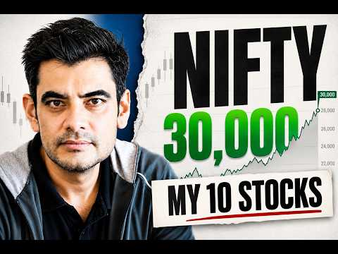
- 설명 앞부분: In this video, I share 10 stocks that I believe investors should be watching closely before the next potential bull run across large caps, mid caps, small caps and micro caps. I have not selected these stocks simply because they are cheap or because they are popular. Each company has been evaluated…
- 같은 채널 평소 대비 ×10.0 (채널 최근 롱폼 중앙값 37,276회) · 평소 영상: If I Could Own ONLY ONE Auto Stock, I'd Pick Tata… (56,199회) / Got 10 Years to Invest? Pick These 4 Funds (66,962회)
- 대본 없음 (설명) — 음성인식이 끝나면 도입부·흐름이 들어감
- 댓글 765/766: 좋은 점 — 영상 0 · 감사·응원 0 · 더 알고 싶은 것 0 · 아쉬운 점 — 영상 0 · 반박·불만 — 의견 다름 0 · 정치·사회 0 · 경험 공유 0 · 구독·다음 기대 0

### 101. ETF 이 '2가지'만 사두면 됩니다. '나머지는 필요없어요' 100억 자산 관리자의 꿀팁(백승호 단장 풀버전) #ETF #배당주 #주식 #백승호

- https://www.youtube.com/watch?v=1qlywudP2oY · 자람들 - 자립하는사람들 · 구독자 33,700 · 조회수 256,034 (×7.6, 하루 6,725.0) · 좋아요 2,189 (0.9%) · 69.7분 · 2026-09-14 · 주제 묶음 2. 장기투자·ETF·지수 · 형식 인터뷰·강연·대담 · 폴더 `W_1qlywudP2oY` (웹 승인)
- 썸네일: 
- 설명 앞부분: 👤 오늘의 게스트: 백승호 단장 개인 재무 컨설팅 전문가 & 유튜버·작가로도 활동 20년간 몇백 명의 고객 자산을 관리해온 재무 컨설턴트입니다. 현재 관리하는 총 자산만 100억원이 넘지만, 폭락장에도 노트북에 손 하나 대지 않을 만큼 평온한 태도로 유명합니다. 비결은 단 하나, "투자해도 되는 돈"과 "투자하면 안 되는 돈"을 철저히 구분하는 원칙입니다. 시드머니 없이 매주 조금씩 사 모으는 전략, 차트나 재무제표 대신 "내 지갑"을 믿고 애플·넷플릭스·구글 같은 주식을 고르는 방법, 그리고 레버리지·인버스 상품에 대한 강한 경…
- 같은 채널 평소 대비 ×10.1 (채널 최근 롱폼 중앙값 25,242회) · 평소 영상: 연 2200 배당금받는, 전직 배달 기사.. 3억으로 은퇴했습니다. (또배당 3부) #배… (25,556회) / 월 500만원 배당 노하우, 시드 5천 '이렇게' 구성하세요. 평범한 직장인이 파이어한 … (24,928회)
- 대본 없음 (설명) — 음성인식이 끝나면 도입부·흐름이 들어감
- 댓글 71/74: 좋은 점 — 영상 6 · 감사·응원 11 · 더 알고 싶은 것 3 · 아쉬운 점 — 영상 4 · 반박·불만 — 의견 다름 1 · 정치·사회 1 · 경험 공유 1 · 구독·다음 기대 1
  - 좋은 점 — 영상 👍6 “많이 배웠습니다. 감사합니다.”
  - 좋은 점 — 영상 👍5 “영상 너무 유익해서 메모하면서 보고 돌려 보고 너무 감사했습니다. 주식 입문 2달 조금넘었는데 원칙을 지키면서 잘해보자 합니다.”
  - 감사·응원 👍8 “와..이분 이 영상에서 처음 뵀는데 인상도 정말 좋으시고, 말씀도 편안하고 겸손하신데 무엇보다 내용이 명확하고 깔끔하시네요! 구독과 좋아요 누르고 갑니다. 귀한 영상 감사히 잘 봤습니다^^”
  - 감사·응원 👍7 “영상 감사드립니다🎉 Kodex200커버드콜 같은 것을 지금 사도 될 지 모르갰어오..우리나라가 갑자기 넘 오른 거 같아서요😅”
  - 더 알고 싶은 것 👍3 “오늘 선생님 유튜브 처음 들었는데 저와 투자 철학이 맞네요 좋아요.구독 눌렀습니다. 유선으로 통화하고 싶은데 어떻게 하면 되나요???”
  - 더 알고 싶은 것 👍2 “여기서 추천하는 "2 etf"는 어떤것인가요?”
  - 아쉬운 점 — 영상 👍85 “너무 길어요... AI에 요약을 요청~ 심플이즈 베스트: 일반 투자자에게는 S&P500과 나스닥100 ETF 두 가지만 꾸준히 사 모으는 것을 0순위로 추천합니다 (30:38). 결국 이 2개...ㅋ”
  - 아쉬운 점 — 영상 👍20 “13년전에 별생각없이 가입한 변액연금보험 10년납입 끝나고 2년정도 놔뒀는데 지금 수익률이 250퍼센트 넘어요. 조금더 많이 넣을껄하는 아쉬움이...”
  - 정치·사회 👍7 “영상 감사드립니다🎉 Kodex200커버드콜 같은 것을 지금 사도 될 지 모르갰어오..우리나라가 갑자기 넘 오른 거 같아서요😅”
  - 구독·다음 기대 👍3 “찐 투자의 길라잡이네요. 빽담화TV 구독과 알림 설정 들어갑니다.^^”

### 102. 삼성전자 지금 시작인가? 노무라가 목표주가 67만원 제시한 이유가 소름입니다... 여기서 90% 더 오를 수 있다? 상승 전망 전부 분석했습니다 #삼성전자 #삼…

- https://www.youtube.com/watch?v=JJG1mtkTN6g · 코스피 읽는 개미 · 구독자 2,230 · 조회수 16,866 (×7.6, 하루 144.0) · 좋아요 395 (2.3%) · 15.7분 · 2026-06-27 · 주제 묶음 1. 주식 기초·초보 · 형식 정보·해설 (그 밖) · 폴더 `W_JJG1mtkTN6g` (웹 승인)
- 썸네일: 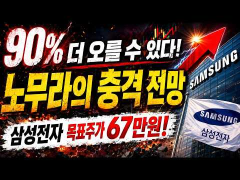
- 설명 앞부분: 삼성전자, 정말 다시 시작일까요? 노무라가 삼성전자 목표주가를 67만원으로 상향하며 시장의 관심이 집중되고 있습니다. AI 반도체 수요 확대, 메모리 실적 개선, 비용 부담 감소까지. 하지만 비메모리 사업 리스크와 시장 변동성도 함께 체크해야 합니다. 이번 영상에서는 목표주가 상향 이유 90% 상승 전망의 근거 앞으로 주목해야 할 핵심 포인트 투자자가 놓치면 안 되는 위험 요소까지 정리했습니다. 여러분은 삼성전자, 아직 기회라고 보시나요?
- 같은 채널 평소 대비 ×37.4 (채널 최근 롱폼 중앙값 451회) · 평소 영상: [ 삼성전자 ] 대폭발 시작되나? 반도체 수출 150% 급증…주가 대반전 "신호" 떴다! (451회) / 삼성전자 26만원 무너졌다...지금 흔들리는 투자자분들 "이것" 확인하세요 (460회)
- 대본 없음 (설명) — 음성인식이 끝나면 도입부·흐름이 들어감
- 댓글 25/25: 좋은 점 — 영상 0 · 감사·응원 1 · 더 알고 싶은 것 0 · 아쉬운 점 — 영상 0 · 반박·불만 — 의견 다름 0 · 정치·사회 0 · 경험 공유 0 · 구독·다음 기대 1
  - 감사·응원 👍1 “감사합니다 정보 🎉❤”
  - 구독·다음 기대 👍1 “구독완료”

### 103. 연금고수들이 연금저축계좌 반드시 담는 ETF 3가지

- https://www.youtube.com/watch?v=iMkvDXx86dE · 경제나침반 · 구독자 14,000 · 조회수 105,121 (×7.5, 하루 1,221.5) · 좋아요 2,048 (1.9%) · 25.2분 · 2026-07-28 · 주제 묶음 2. 장기투자·ETF·지수 · 형식 정보·해설 (그 밖) · 폴더 `W_iMkvDXx86dE` (웹 승인)
- 썸네일: 
- 설명 앞부분: 📈 오늘 시장에서 꼭 알아야 할 경제와 투자 인사이트를 쉽고 명확하게 정리해드립니다. 💡 주식, ETF, 미국주식, 경제 전망, 금리, AI, 반도체, 부동산까지 투자자가 반드시 알아야 할 핵심 정보를 함께 살펴보세요. 이번 영상에서는 최신 경제 뉴스와 금융시장 흐름을 바탕으로 투자에 도움이 되는 핵심 내용을 쉽고 이해하기 편하게 설명해드립니다. 경제나침반은 경제공부, 주식투자, ETF 투자, 미국주식, 한국 증시, 경제 전망, 재테크, 자산관리, 금리와 환율, AI 및 반도체 산업 등 다양한 주제를 객관적인 자료와 시장 흐름을 …
- 같은 채널 평소 대비 ×1,844.2 (채널 최근 롱폼 중앙값 57회) · 평소 영상: 부자들이 물건을 안 사는 진짜 이유가 따로 있습니다 (57회) / 90가 모르는 부자와 일반인을 가르는 네 가지 능력 (57회)
- 대본 없음 (설명) — 음성인식이 끝나면 도입부·흐름이 들어감
- 댓글 67/67: 좋은 점 — 영상 3 · 감사·응원 5 · 더 알고 싶은 것 2 · 아쉬운 점 — 영상 1 · 반박·불만 — 의견 다름 1 · 정치·사회 0 · 경험 공유 3 · 구독·다음 기대 0
  - 좋은 점 — 영상 👍3 “좋은 정보 감사합니다~^^ 나스닥과 S&P500, 미국배당다우존스, 미국 10년국채랑 단기채권, 국내 고배당, 금, 국내외 리츠 ETF 갖고 있네요. IRP에서 안전자산 30%는 나스닥미국채혼합이랑 미국배당미국채혼합으로 채우고 있고요~”
  - 감사·응원 👍3 “감사합니다”
  - 감사·응원 👍3 “좋은 정보 감사합니다~^^ 나스닥과 S&P500, 미국배당다우존스, 미국 10년국채랑 단기채권, 국내 고배당, 금, 국내외 리츠 ETF 갖고 있네요. IRP에서 안전자산 30%는 나스닥미국채혼합이랑 미국배당미국채혼합으로 채우고 있고요~”
  - 더 알고 싶은 것 👍4 “56세 인데 절세계좌만 만들고 아직 아무것도 못담았어요 일반주식계좌에는 다행히 반도채, 원전쪽 수익률 좋아 100프로 넘다가 지금은 50프로 아래로 내려가는 중이고요.' 각설하고 제 나이때는 연금저축 시작해봐야 늦을까요 아직 안 늦었다면 절세계죄로 담을 종목과 최대한…”
  - 더 알고 싶은 것 👍4 “isa / 퇴직연금 / irp / 주식계좌 etf 뭐 담아야 할지? 궁금합니다.”
  - 아쉬운 점 — 영상 👍1 “화질구지다”
  - 반박·불만 — 의견 다름 👍0 “액티브 국내형 ETF면 손해가 아닙니다.”
  - 경험 공유 👍25 “일단 본인이 주식에 돈을 쓸 여윳돈이 얼마나 되느냐에따라 다름 돈이 많아서 세액공제 받고 또 투자 여력이 있다면 일반계좌에 국내주식 담아도 됨. 그런데 세액공제 받을만큼만 여력이 된다? 세금 신경쓰지말고 국내주식 담아도 됨. 코스피 2500에서 9000 갈때까지 세금…”
  - 경험 공유 👍7 “연금 저축 공부좀 해봤는데 여기 정보가 진짜 정확하고 알차고 핵샘을 다 담고 있네요”

### 104. $1M Portfolio: SCHD or Dividend Aristocrats for Income?

- https://www.youtube.com/watch?v=qj-O6aFzPic · Simply Safe Dividends · 구독자 15,700 · 조회수 115,407 (×7.3, 하루 2,123.8) · 좋아요 1,265 (1.1%) · 12.4분 · 2026-08-28 · 주제 묶음 2. 장기투자·ETF·지수 · 형식 정보·해설 (그 밖) · 폴더 `W_qj-O6aFzPic` (웹 승인)
- 썸네일: 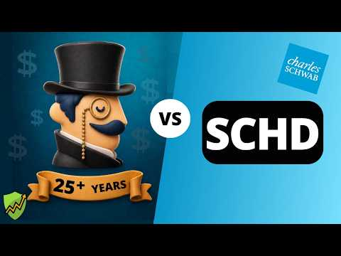
- 챕터: 0:00 SCHD vs. Aristocrats · 0:42 Dividend Aristocrats Overview · 1:50 Current Income · 3:30 Dividend Safety · 5:00 Dividend Growth · 6:35 Total Returns · 8:17 Downside Risk · 9:58 Winner · 11:11 Another Way
- 설명 앞부분: Dividend aristocrats and SCHD are popular choices in retirement portfolios that prioritize income, growth, and safety. But which strategy is best? In this video, we'll build a $1 million portfolio invested in Schwab's dividend ETF SCHD and another invested in all 69 dividend aristocrats. We'll comp…
- 같은 채널 평소 대비 ×6.7 (채널 최근 롱폼 중앙값 17,285회) · 평소 영상: Safe 5%+ Dividend Stocks Still Raising Their Payo… (17,285회) / 3 Stocks That Deliver Big Dividends and Hold Up i… (17,163회)
- 대본 없음 (설명) — 음성인식이 끝나면 도입부·흐름이 들어감
- 댓글 131/141: 좋은 점 — 영상 0 · 감사·응원 0 · 더 알고 싶은 것 0 · 아쉬운 점 — 영상 0 · 반박·불만 — 의견 다름 0 · 정치·사회 0 · 경험 공유 0 · 구독·다음 기대 0

### 105. S&P500 하나로 채운 ISA 3년 투자 총정리 ∣ 5년 연장 대신 지금 해지한 이유 ∣ 직접 경험한 이전 절차 포함

- https://www.youtube.com/watch?v=WGCZYnwacuo · 원원 - 파이어 준비생 · 구독자 16,900 · 조회수 122,658 (×7.3, 하루 1,294.0) · 좋아요 2,914 (2.4%) · 22.5분 · 2026-07-19 · 주제 묶음 2. 장기투자·ETF·지수 · 형식 오디오북·낭독 (명언·인생조언) · 폴더 `W_WGCZYnwacuo` (웹 승인)
- 썸네일: 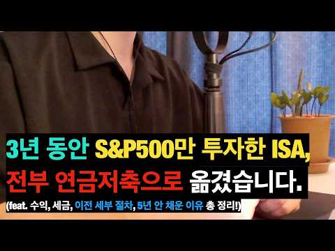
- 설명 앞부분: 💫 :: won spirit 적립식 ETF 투자 관리 플랫폼 & 커뮤니티 안녕하세요! 금융권 직장인으로서 파이어(FIRE: Financial Independence, Retire Early)를 준비하며, 미국 S&P500 ETF, 단 하나로 목표를 이루는 여정을 기록하고 있습니다. S&P500을 현재 2.4억 정도 투자중이며, 매월 투명한 투자 내역 공개를 하고 그 밖에 투자 마인드, 투자 공부, 그리고 직장인의 삶을 공유합니다. 특히, 단순하면서도 누구나 실천 가능한 투자 전략으로 재정 독립을 목표로 하고 있습니다.💡 ➡️ 이번…
- 같은 채널 평소 대비 ×24.8 (채널 최근 롱폼 중앙값 4,936회) · 평소 영상: [1월결산] S&P500 투자자가 코스피 5,000 돌파를 바라보며! (4,850회) / 직장인이 부자 되려면 반드시 거쳐야 할 단계들! (4,849회)
- 대본 없음 (설명) — 음성인식이 끝나면 도입부·흐름이 들어감
- 댓글 544/552: 좋은 점 — 영상 31 · 감사·응원 66 · 더 알고 싶은 것 49 · 아쉬운 점 — 영상 2 · 반박·불만 — 의견 다름 2 · 정치·사회 0 · 경험 공유 51 · 구독·다음 기대 4
  - 좋은 점 — 영상 👍15 “3:05 꿀팁이네요 목소리 듣기 좋아요 이런 어렵고 복잡한거 듣기 딱좋음”
  - 좋은 점 — 영상 👍15 “ISA 계좌 저도 내년 5월이면 3년 만기입니다. 무척 유익한 내용이었습니다. 궁금한 점도 많이 해소 되었구요. 원원님 혹시 노후에 생활비로 연금계좌 운영은 어떤 방식으로 하실런지요. . . ? 이 내용을 주제로 영상을 한번 찍어 주시던지 아니면 간단한 답변이라도 부…”
  - 감사·응원 👍17 “제가 찾던 영상이에요. 구독하고 저장해서 계속 봐야겠어요. 40대후반 처음 isa와 연금저축계좌를 열고 s&p 500조금씩 사고 있어요. 큰 도움 되었습니당. 감사합니다^^”
  - 감사·응원 👍15 “ISA 계좌 저도 내년 5월이면 3년 만기입니다. 무척 유익한 내용이었습니다. 궁금한 점도 많이 해소 되었구요. 원원님 혹시 노후에 생활비로 연금계좌 운영은 어떤 방식으로 하실런지요. . . ? 이 내용을 주제로 영상을 한번 찍어 주시던지 아니면 간단한 답변이라도 부…”
  - 더 알고 싶은 것 👍15 “ISA 계좌 저도 내년 5월이면 3년 만기입니다. 무척 유익한 내용이었습니다. 궁금한 점도 많이 해소 되었구요. 원원님 혹시 노후에 생활비로 연금계좌 운영은 어떤 방식으로 하실런지요. . . ? 이 내용을 주제로 영상을 한번 찍어 주시던지 아니면 간단한 답변이라도 부…”
  - 더 알고 싶은 것 👍3 “저도 isa가 이번 년도 10월에 만기라서 이전할 예정인데 완전 유익한 정보 감사합니다.. 그리고 절세계좌 운영계획이 저랑 거의 90%이상 똑같네요... ㅎㅎㅎ 원원님의 계획과 달성 내용들을 보면서 참고를 많이 해야겠습니다. 좋은 정보 많이 많이 부탁드립니다. 감사합…”
  - 아쉬운 점 — 영상 👍1 “어쩜. 저랑 생각이 똑같으실가요. 저도 노후준비자금을 단일종목 에센피500에 연금계좌,ISA에 풀매수할려구요 함께 가겠습니다 원원님함께라면 지루한 장기투자 흔들림없이 쭉~갈수 있을 것 같아요 멘토링해주셔서 마음이 든든합니다😊 여직껏 제가 본 중 영상 중에 가장 심플하…”
  - 경험 공유 👍17 “제가 찾던 영상이에요. 구독하고 저장해서 계속 봐야겠어요. 40대후반 처음 isa와 연금저축계좌를 열고 s&p 500조금씩 사고 있어요. 큰 도움 되었습니당. 감사합니다^^”
  - 경험 공유 👍15 “ISA 계좌 저도 내년 5월이면 3년 만기입니다. 무척 유익한 내용이었습니다. 궁금한 점도 많이 해소 되었구요. 원원님 혹시 노후에 생활비로 연금계좌 운영은 어떤 방식으로 하실런지요. . . ? 이 내용을 주제로 영상을 한번 찍어 주시던지 아니면 간단한 답변이라도 부…”
  - 구독·다음 기대 👍17 “제가 찾던 영상이에요. 구독하고 저장해서 계속 봐야겠어요. 40대후반 처음 isa와 연금저축계좌를 열고 s&p 500조금씩 사고 있어요. 큰 도움 되었습니당. 감사합니다^^”
  - 구독·다음 기대 👍3 “나중에 챙겨볼께요!!”

### 106. 배당금으로 혼자 사는 미혼남, 3억 파이어 미니멀라이프

- https://www.youtube.com/watch?v=iGI_fzwOyoY · 배당아저씨 · 구독자 32,400 · 조회수 229,388 (×7.1, 하루 6,914.4) · 좋아요 2,118 (0.9%) · 8.6분 · 2026-09-19 · 주제 묶음 3. 배당 · 형식 정보·해설 (그 밖) · 폴더 `W_iGI_fzwOyoY` (웹 승인)
- 썸네일: 
- 설명 앞부분: 영상 속 배당아저씨의 미니멀라이프 내돈내산 재료&용품들 (쿠팡 파트너스 및 인플루언서 활동의 일환으로 구매시 일정액의 수수료를 제공 받을 수 있습니다) 이 채널은 저의 투자 경험과 생각을 공유하는 공간입니다. 저의 투자 방식을 그대로 따라 하시는 것은 권장드리지 않으며, 충분한 고민과 공부 후 판단하시길 바랍니다.
- 같은 채널 평소 대비 ×4.7 (채널 최근 롱폼 중앙값 48,471회) · 평소 영상: 배당금으로 혼자사는 미혼남의 현실 (48,471회) / 미국주식 3억, 배당금으로 직장 없이 살고 있어요_배당파이어 장단점 (50,627회)
- 대본 없음 (설명) — 음성인식이 끝나면 도입부·흐름이 들어감
- 댓글 612/621: 좋은 점 — 영상 9 · 감사·응원 57 · 더 알고 싶은 것 26 · 아쉬운 점 — 영상 5 · 반박·불만 — 의견 다름 8 · 정치·사회 0 · 경험 공유 82 · 구독·다음 기대 1
  - 좋은 점 — 영상 👍6 “캥거루로 살며 대충 6억 모았는데 연금계좌+퇴직DC에 에슨피1.5억 나스닥 1.5억이라 55세까지 사용못하는돈이고 1-2년 사이 3 억정도로 배당세팅해야하는 입장으로 도움이 됩니다 저도 40대 이제 좋은거 살만큼 다 사봤기에 지금은 다이소 티 사입네요( 작년에 올만에…”
  - 좋은 점 — 영상 👍2 “기다렸어요~나의 정신 안정제 영상😊 배경음악도 목소리도 잔잔하니 듣기 좋네요.”
  - 감사·응원 👍141 “자기가 만족하는 삶 자체가 행복이죠.항상 응원합니다 배당아저씨🙏🏻”
  - 감사·응원 👍115 “집에만 있어 처량하다고 하시는분들은 아직 크나큰 괴로움이 없었다고(?) 볼수도 있습니다. 행복은 하고싶은걸 할때보다 하기싫은걸 하지않을때 훨씬 크다고 생각합니다. 배당아저씨 응원합니다.”
  - 더 알고 싶은 것 👍7 “댓글이 다양하니재미습니다 궁금해서 다봅니다 시간이 좀 많이 소요되네예^^”
  - 더 알고 싶은 것 👍4 “유튜브 수익은 얼마나 되나요?”
  - 아쉬운 점 — 영상 👍1 “이 형은 목소리가 너무 좋아”
  - 아쉬운 점 — 영상 👍1 “혹시 카메라는 뭐쓰세요? 화질이 좋아서요”
  - 반박·불만 — 의견 다름 👍25 “올해 40살 2억으로 파이어했고 1억은 국내 커버드콜 배당주로 isa계좌로 월 180 받고있고 월세 통신비 보험료 합해서 60만원 식비 월60만원으로 써도 월 60만원이 남습니다. 나머지 1억은 성장주 자율 투자중입니다 . 3억원 결코 작은돈 아니고 쉬운 금액 아닙니…”
  - 반박·불만 — 의견 다름 👍2 “다름을 틀림으로 인식하는 안타까운 사람들이 생각보다 많습니다 자기가 생각하는 삶이 아니라면 불쌍하고 틀렸다라고 정의하는것이죠 삶을 살아보고 배우고 느끼다 보면 개개인의 평범한 삶도 가치가있고 리스펙하게 되더군요 저는 배당아저씨님의 소소하고행복한 일상이 너무 부러워요 …”
  - 경험 공유 👍204 “퇴직했습니다~^^ 저도 3억으로 시작해요~.”
  - 경험 공유 👍49 “다른 사람들이 하는 오해가 <집에 있으면 답답할 것 같다>인데 집수니인 저의 입장에서는 너무나 행복한 일이에요 저도 퇴사 해서 집에만 있는 게 너무너무 좋아요.다른 사람 신경 쓰지 말고 삽시다 우리 ^^”
  - 구독·다음 기대 👍1 “안녕하세요. 구독하고 처음으로 댓글 다네요. ^^ 힘내시고 앞으로도 계속 쭉 성공투자 이어가길 응원합니다. 항상 건강하고 편안한 시간 보내세요. 😊 화이팅입니다~~”

### 107. 수익 -60%에서 멘탈 관리하는 법..?? 주식 물린 사람들 들어오세요

- https://www.youtube.com/watch?v=BL8sygt6dgw · 룸넘버 ROOM NUMBER · 구독자 9,990 · 조회수 69,370 (×6.9, 하루 678.7) · 좋아요 1,302 (1.9%) · 24.1분 · 2026-07-12 · 주제 묶음 8. 투자 심리·실패 · 형식 사연·드라마 · 폴더 `W_BL8sygt6dgw` (웹 승인)
- 썸네일: 
- 챕터: 0:00 하이라이트 · 0:30 오프닝 · 1:13 사연1 - 대기업 강박증 · 11:51 사연자 선물 골라주기 · 12:24 사연2 - 주식중독 · 22:59 사연자 선물 골라주기 · 22:36 다음 이야기
- 설명 앞부분: 다음 라이브 7/14(화) 밤 7시 영상에 나온 더현대Hi 살펴보기👇
- 같은 채널 평소 대비 ×4.8 (채널 최근 롱폼 중앙값 14,586회) · 평소 영상: [연휴특집] 아빠와 딸 몰아보기 주식 편 (16,448회) / [연휴특집] 아빠와 딸 몰아보기 연애 결혼 편 (12,724회)
- 대본 없음 (설명) — 음성인식이 끝나면 도입부·흐름이 들어감
- 댓글 203/203: 좋은 점 — 영상 1 · 감사·응원 0 · 더 알고 싶은 것 2 · 아쉬운 점 — 영상 0 · 반박·불만 — 의견 다름 1 · 정치·사회 2 · 경험 공유 7 · 구독·다음 기대 1
  - 좋은 점 — 영상 👍2 “유익한 정보 ❤❤❤❤❤”
  - 더 알고 싶은 것 👍0 “뚠뚠이 연애썰 궁금해요~”
  - 더 알고 싶은 것 👍0 “니니는 언제 나가나요?”
  - 반박·불만 — 의견 다름 👍2 “나란히 앉아서 그런가 닮은거같은데 딸 아니죠?ㅎㅎ”
  - 정치·사회 👍2 “레버리지ETF만든 김용범 이재명이 돌맞아야함.”
  - 정치·사회 👍0 “자구나가먼 사장 문재인”
  - 경험 공유 👍53 “근데 루시아가 확실히 생각이 깊긴하다. 3:00 그 때의 나도 나다 이게 진짜 핵심이네”
  - 경험 공유 👍23 “제가 대기업 이직을 많이한 프로이직러? 인데. 사실상. 직장도 섹터별로 주식과 같아요 . 해본 결과로는 , 와 지금 반도체가 좋아서 저 대기업 좋아해서 들어가잖아요? , 그럼 첫 입사 시 성과급 받는 제한 % 걸려서 얼마 못받고 그 기간 끝나면 또 산업의 섹터가 로테…”
  - 구독·다음 기대 👍2 “화요일 기대할게요”

### 108. Before You Buy Covered Call ETFs, You NEED To Watch This

- https://www.youtube.com/watch?v=u83b7LRyQCg · Managing Tech Millions · 구독자 29,700 · 조회수 203,203 (×6.8, 하루 1,149.9) · 좋아요 3,723 (1.8%) · 15.4분 · 2026-04-28 · 주제 묶음 2. 장기투자·ETF·지수 · 형식 정보·해설 (그 밖) · 폴더 `W_u83b7LRyQCg` (웹 승인)
- 썸네일: 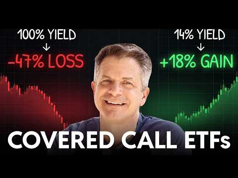
- 설명 앞부분: For the past five years, my portfolio has generated over $200,000 a year in income — and until recently, none of it came from covered call ETFs. That changed. As I went deep into the research — comparing strategies, breaking down tax structures, evaluating funds — I found two things: these are some…
- 같은 채널 평소 대비 ×29.9 (채널 최근 롱폼 중앙값 6,806회) · 평소 영상: Have $1M–$30M? Here's How to Grow, Protect, and P… (6,938회) / How to Start a Micro Family Office FROM SCRATCH (… (6,674회)
- 대본 없음 (설명) — 음성인식이 끝나면 도입부·흐름이 들어감
- 댓글 312/316: 좋은 점 — 영상 0 · 감사·응원 0 · 더 알고 싶은 것 0 · 아쉬운 점 — 영상 0 · 반박·불만 — 의견 다름 0 · 정치·사회 0 · 경험 공유 0 · 구독·다음 기대 0

### 109. 남들이 걱정하는 삶을 선택했습니다 #배당투자 #배당은퇴 #경제적자유 #파이어족 #월배당 #고배당주 #주식투자 #재테크#노후준비#배당금생활 #SCHD #JEPI …

- https://www.youtube.com/watch?v=SiE0NjI7Fu0 · ttobaedang또배당 · 구독자 6,870 · 조회수 45,680 (×6.7, 하루 5,763.8) · 좋아요 434 (0.9%) · 9.1분 · 2026-10-14 · 주제 묶음 11. 투자 일반 · 형식 정보·해설 (그 밖) · 폴더 `W_SiE0NjI7Fu0` (웹 승인)
- 썸네일: 
- 같은 채널 평소 대비 ×5.9 (채널 최근 롱폼 중앙값 7,719회) · 평소 영상: 3억 배당은퇴 6000만원 증발 그래도 행복한이유 #배당투자 #배당은퇴 #경제적자유 #파… (7,719회) / 5000만원 증발 월급없이도 행복한이유 #배당투자 #배당은퇴 #경제적자유 #파이어족 #월… (8,747회)
- 대본 없음 (없음) — 음성인식이 끝나면 도입부·흐름이 들어감
- 댓글 174/174: 좋은 점 — 영상 3 · 감사·응원 20 · 더 알고 싶은 것 6 · 아쉬운 점 — 영상 0 · 반박·불만 — 의견 다름 0 · 정치·사회 0 · 경험 공유 11 · 구독·다음 기대 2
  - 좋은 점 — 영상 👍4 “진정성이 느껴지고 서민형이라 와닿는 영상이라 보면서 위로를 받게 되네요. 좋은 영상 자주 올려주세요. 😊❤”
  - 좋은 점 — 영상 👍1 “울림이 있는 story, 공감이 되고 배우고 갑니다~”
  - 감사·응원 👍22 “당신의 직업은 투자자, 유튜버^^ 늘 응원하겠습니다”
  - 감사·응원 👍8 “현대는 직업이 필요가 없어졌습니다. 단지 생활비를 충당할 수 있는 근원지 배당금, 이자, 월세소득 등 원천을 만드는 것이 중요하죠. 또배당금님은 현재 잘 하고 계신거예요. 직장이 없어도 배당금으로 자유롭게 생활하실 수 있는것이 얼마나 대단한것인지 높이 평가해요. 질투…”
  - 더 알고 싶은 것 👍4 “진정성이 느껴지고 서민형이라 와닿는 영상이라 보면서 위로를 받게 되네요. 좋은 영상 자주 올려주세요. 😊❤”
  - 더 알고 싶은 것 👍3 “안녕하십니까 또배당님! 금일 영상은 원고가 매우 훌륭하고 좋습니다 감동적입니다 자신의선택과 책임을 말씀하는 철학은 울림이 있습니다, 다음에 기회가되면 제가 운영하고 있는 다음카페에 칼럼기고를 부탁드려도 될까요”
  - 경험 공유 👍8 “나도 도배당아저씨처럼 할수있다는 희망으로 삽니다”
  - 경험 공유 👍7 “세상을 보는 안목과 생각이 깊고 넓으시군요. 저도 공감되는 말씀입니다.”
  - 구독·다음 기대 👍1 “호동대표님 유튜브보고 구독하러왔어요 자주영상 올려주세요😊 세미파이어족 화이팅!!”

### 110. 【2chお金スレ】定年後も収入が途切れない人は何をしてる？今からできる備えを挙げてけ

- https://www.youtube.com/watch?v=2tSGWp3yGek · 2chお金シニアチャンネル · 구독자 2,150 · 조회수 14,237 (×6.6, 하루 1,602.6) · 좋아요 38 (0.3%) · 21분 · 2026-10-13 · 주제 묶음 10. 노후·연금 투자 · 형식 정보·해설 (그 밖) · 폴더 `W_2tSGWp3yGek` (웹 승인)
- 썸네일: 
- 챕터: 0:00 はじめに · 0:24 64歳、配当が月3万 · 2:27 きっかけは元上司の一言 · 4:54 順番その1 足りない額を知る · 6:46 順番その2 現金を先に置く · 8:16 順番その3 口座とNISA · 10:38 順番その4 利回りで選ばない · 12:42 順番その5 一度に買わない · 14:38 順番その6 使い始める日 · 17:01 月3万で暮らしは変わるか · 18:45 今からでも間に合うか
- 같은 채널 평소 대비 ×3.0 (채널 최근 롱폼 중앙값 4,769회) · 평소 영상: 【2chお金スレ】45歳でFIREした勝ち組の末路…想像した人生と違う「●●してから狂い始めた」エ… (4,769회) / 【2chお金スレ】資産カーストは●●で決まる。老後2000万を溶かす人の共通点が衝撃すぎる (4,736회)
- 대본 없음 (없음) — 음성인식이 끝나면 도입부·흐름이 들어감
- 댓글 0/0: 좋은 점 — 영상 0 · 감사·응원 0 · 더 알고 싶은 것 0 · 아쉬운 점 — 영상 0 · 반박·불만 — 의견 다름 0 · 정치·사회 0 · 경험 공유 0 · 구독·다음 기대 0

### 111. Is This the Time to Buy Indian Equities? Pankaj Tibrewal on FII Outflow & Investment Oppo…

- https://www.youtube.com/watch?v=jUrGWhhASXU · Wealth By Motilal Oswal · 구독자 14,700 · 조회수 97,281 (×6.6, 하루 19,913.5) · 좋아요 632 (0.7%) · 64.4분 · 2026-10-17 · 주제 묶음 기타 · 형식 정보·해설 (그 밖) · 폴더 `W_jUrGWhhASXU` (웹 승인)
- 썸네일: 
- 챕터: 0:00 Teaser & Highlights · 1:45 Decoding the Current Market P… · 8:25 Cost of Capital, Global Bond … · 12:30 FII Selling vs Domestic Inflo… · 20:30 The "Two Indias" in the Stock… · 23:50 Promoter's Edge: How to Evalu… · 29:40 Gorilla to King Kong Framewor… · 37:45 Valuing New-Age Tech Companie… · 39:25 Big Mega Trends: Manufacturin… · 44:50 Active vs. Passive Investing … · 47:05 Managing Growth vs. Valuation… · 49:15 Asset Allocation Strategy for… · 52:30 Biggest Mistakes Retail Inves… · 55:30 Developing the Right Temperam… · 58:30 Rapid Fire Round
- 설명 앞부분: In this episode of Wealth by Motilal Oswal, we are joined by Pankaj Tibrewal, Founder of Ikigai Asset Manager and one of India’s most respected fund managers with over two decades of market experience. In a volatile market environment where investors' patience is being tested, Pankaj breaks down hi…
- 같은 채널 평소 대비 ×1.3 (채널 최근 롱폼 중앙값 73,098회) · 평소 영상: Forget Blue Chips, Here's Where the REAL Money Is… (73,098회) / Deepak Shenoy on Building Wealth Without Predicti… (57,110회)
- 대본 없음 (설명) — 음성인식이 끝나면 도입부·흐름이 들어감
- 댓글 64/64: 좋은 점 — 영상 0 · 감사·응원 0 · 더 알고 싶은 것 0 · 아쉬운 점 — 영상 0 · 반박·불만 — 의견 다름 0 · 정치·사회 0 · 경험 공유 0 · 구독·다음 기대 0

### 112. 나스닥100 1배수, 2배수, 3배수 20년 어떤 성과 보여주나(거치식, 적립식, 리벨런싱) ㅣ QQQ, QLD, TQQQ,

- https://www.youtube.com/watch?v=dQdACzI6nKE · 레버리지 하는 미국회계사 장기투자 여정 · 구독자 13,100 · 조회수 86,062 (×6.6, 하루 694.1) · 좋아요 2,126 (2.5%) · 16.3분 · 2026-06-20 · 주제 묶음 2. 장기투자·ETF·지수 · 형식 정보·해설 (그 밖) · 폴더 `W_dQdACzI6nKE` (웹 승인)
- 썸네일: 
- 챕터: 0:00 나스닥100 1배수, 2배수, 3배수 백테스트 시작 · 1:56 QQQ, QLD, TQQQ백테스트 조건 공개 (20년… · 2:48 QQQ, QLD, TQQQ 거치식 결과 — 2천만원,… · 7:46 QQQ, QLD, TQQQ 적립식 매수 결과 · 9:42 QQQ, QLD, TQQQ 리밸런싱 전략 결과 · 14:46 QQQ, QLD, TQQQ 3가지 투자방식 결론
- 설명 앞부분: QQQ, QLD, TQQQ — 20년 백테스트로 다 보여드립니다 1배, 2배, 3배 중에 도대체 뭘 모아야 하냐는 질문, 정말 많이 받았어요. 어떤 영상은 "1배가 국밥이다", 어떤 영상은 "3배 아니면 의미 없다" — 의견만 난무하고 진짜 데이터는 본 적이 없으실 거예요. 그래서 이번엔 20년치 실제 데이터로 끝까지 파봤습니다. 저는 미국 공인회계사이자 전직 펀드매니저입니다. 법인 계좌로 QLD를 메인으로 매일 매수하고 있고, 2022년 TQQQ -80% 폭락을 직접 겪고 2025년에 2~3배 수익으로 전량 매도한 경험이 있어요…
- 같은 채널 평소 대비 ×6.0 (채널 최근 롱폼 중앙값 14,329회) · 평소 영상: QLD랑 가장 잘 어울리는 배당주는 무엇인가 I SCHD, VYM, DGRO, VIG, … (14,329회) / 레버리지 투자자가 나스닥 커버드콜에 1억 넣은 이유 ∣ GPIQ·TDAQ 분배금으로 QL… (14,104회)
- 대본 없음 (설명) — 음성인식이 끝나면 도입부·흐름이 들어감
- 댓글 388/389: 좋은 점 — 영상 21 · 감사·응원 51 · 더 알고 싶은 것 42 · 아쉬운 점 — 영상 0 · 반박·불만 — 의견 다름 4 · 정치·사회 1 · 경험 공유 25 · 구독·다음 기대 3
  - 좋은 점 — 영상 👍70 “저도 22년에 tqqq -80% 뚜드려맞아보고 qld를 매월 무지성적립식으로 하고있습니다. 그리고 200일 이평선 아래로 tqqq가 떨어지면 트리거로 생각해서 tqqq도 분할매수하고 있습니다. 좋은 영상 감사합니다.”
  - 좋은 점 — 영상 👍19 “와 많은 유튜버들이 하는 백테스트는 비슷했는데 이렇게하는건 유일하네요 질좋은 영상입니다”
  - 감사·응원 👍70 “저도 22년에 tqqq -80% 뚜드려맞아보고 qld를 매월 무지성적립식으로 하고있습니다. 그리고 200일 이평선 아래로 tqqq가 떨어지면 트리거로 생각해서 tqqq도 분할매수하고 있습니다. 좋은 영상 감사합니다.”
  - 감사·응원 👍29 “저는 얼마전부터 모아오던 QQQ를 QLD로 전환 매수했고 매달 월급날에 추매하는 장기 투자를 목표하고 있구요. 나스닥의 우상향을 믿지만 2배수라서 약간의 두려움도 있었는데 이 방송을 보고 나니 QLD가 더욱 든든해보입니다. 이렇게 좋은 방송을 공유해주셔서 진심으로 감…”
  - 더 알고 싶은 것 👍8 “백데이터는 환율이 상승했던 20년간인데요. 만약 현재 1500원대 환율이 900원대로 20년간 하락할 시의 시뮬레이션도 부탁드려봅니다. 모든 가정은 열어두어야 하니깐요. 앞으로도 환율이 고정 내지는 계속 상승할지는 알 수 없다고 생각해요. 수식을 잘 사용하시는 회계사…”
  - 더 알고 싶은 것 👍4 “추천 및 구독 하였습니다 Tqqq, qld, qqq 매월 적립식이 수익이 좋은데 만약 10년, 15년, 20년 매달 매수시 어느 계좌에 사야하나요? 그리고 미장에 직투 해야하나요? 국내 상장 나스닥을 해야하나요?”
  - 반박·불만 — 의견 다름 👍0 “영상 너무나 감사히 잘 보았습니다. 혹시 어느 일정부분 목표수익률이 났을때 매도 하고 기다렸다가 매도후 일정부분이 빠졌을때 다시 매수하고를 반복하면 어떤 결과가 나오는지도 궁금하네요^^ 22%로 세금등 때문에 말도 안돼는 설정일까요? 주린이라 ^^”
  - 정치·사회 👍2 “이게 맞는게 미국 우상향을 믿는다면 가능함 ㅋ 지금 버블이니 뭐니 하는데 실적도 따라오고 무엇보다 기준 금리가 이미 3.25%임 금리를 올린다해도 선반영이고 11월 트럼프 중간선거 이전이라 주식 부양해야됨 ㅋ 그래서 부랴부랴 이란 이스라엘 협력해라하는데 미국 쪽도 못…”
  - 경험 공유 👍70 “저도 22년에 tqqq -80% 뚜드려맞아보고 qld를 매월 무지성적립식으로 하고있습니다. 그리고 200일 이평선 아래로 tqqq가 떨어지면 트리거로 생각해서 tqqq도 분할매수하고 있습니다. 좋은 영상 감사합니다.”
  - 경험 공유 👍29 “저는 얼마전부터 모아오던 QQQ를 QLD로 전환 매수했고 매달 월급날에 추매하는 장기 투자를 목표하고 있구요. 나스닥의 우상향을 믿지만 2배수라서 약간의 두려움도 있었는데 이 방송을 보고 나니 QLD가 더욱 든든해보입니다. 이렇게 좋은 방송을 공유해주셔서 진심으로 감…”
  - 구독·다음 기대 👍29 “저는 얼마전부터 모아오던 QQQ를 QLD로 전환 매수했고 매달 월급날에 추매하는 장기 투자를 목표하고 있구요. 나스닥의 우상향을 믿지만 2배수라서 약간의 두려움도 있었는데 이 방송을 보고 나니 QLD가 더욱 든든해보입니다. 이렇게 좋은 방송을 공유해주셔서 진심으로 감…”
  - 구독·다음 기대 👍1 “(제가 숫자를 다시 수정하였어요. 예를들지 않고 영상속 나온 돈으로 그대로 계산했을경우로요. 답변 꼭 부탁드리겠습니다. 정말 감사드립니다) 제가 채널을 뒤늦게 알고, 영상 정주행하며 열공중입니다. 정말 절 10번 드리고싶어요. 너무 궁금한 부분을 속시원하게 검증해주시…”

### 113. 코스피, 5,030P까지 큰 거 한방(삼전닉스 타점)

- https://www.youtube.com/watch?v=qSnNyX7IfqY · 차트도령 · 구독자 3,890 · 조회수 25,071 (×6.4, 하루 3,164.5) · 좋아요 126 (0.5%) · 13.6분 · 2026-10-14 · 주제 묶음 5. 국내주식 · 형식 정보·해설 (그 밖) · 폴더 `W_qSnNyX7IfqY` (웹 승인)
- 썸네일: 
- 챕터: 0:00 코스피 · 6:52 코스닥 · 8:49 삼성전자 · 10:01 SK하이닉스
- 설명 앞부분: 안녕하세요 차트도령입니다. 10월14일 코스피, 코스닥, 삼성전자, sk하이닉스 차트분석 및 시황공유입니다. 오늘도 강한 반등에는 실패한 모습입니다. 현재 아슬아슬하게 6,000포인트를 지키고 있기 때문에 추가적인 급락이 발생할 수 있습니다. 본 채널에서 영상을 통해 소개해드리는 종목은 '정보 공유' 차원일 뿐 '종목 추천'이 아닙니다.
- 같은 채널 평소 대비 ×3.1 (채널 최근 롱폼 중앙값 8,214회) · 평소 영상: 코스피, 장난같나요? 8,000P간다니깐요?(삼전닉스 타점) (8,224회) / 코스피 비상, 반도체 상승 이제 끝일까?(삼전닉스 타점) (8,204회)
- 대본 없음 (설명) — 음성인식이 끝나면 도입부·흐름이 들어감
- 댓글 55/55: 좋은 점 — 영상 1 · 감사·응원 7 · 더 알고 싶은 것 2 · 아쉬운 점 — 영상 0 · 반박·불만 — 의견 다름 0 · 정치·사회 0 · 경험 공유 1 · 구독·다음 기대 0
  - 좋은 점 — 영상 👍1 “차도님 감사합니당 회식하고 왔더니 내 미장 나락 가있네욤.. 미장 잠깐 보고😢 다른분들 댓글도 쭈욱 읽고 하루 마무리합니다 낼도 성투성투~!! 방향을 정하는데 많은 도움이 됩니다.감사합니다.”
  - 감사·응원 👍32 “매일 올려줘서 고맙긴한데. 7천일때 박스권이다가 정답이엇다면 그땐 너무 높은자리까지 열어둿엇고.. 이번에는 하락뷰로 바꾼건 좋은데 또 5천까지 열어놓으니.. 태세전환이 너무 과하다는 생각은 들어요. 저처럼 몸사린 사람은 괜찮겟지만.. 높은뷰 보고 많이 들어간사람이 갑…”
  - 감사·응원 👍2 “깊이 깊이 공감 가는 분석.. 매우 매우 감사드립니다. 우려하던일이 현실로...”
  - 더 알고 싶은 것 👍1 “멤버쉽 문의 일주일 넘게 지났는데 아직 연락이 안오네요..ㅜㅜ 그리고 제주반도체 차트도 부탁드려도 될까요??”
  - 더 알고 싶은 것 👍0 “솔직히 5000초반은 오바라고 생각해서 그동안 답글 안달았는데 cpi보고 생각에 잠겨 글 드립니다 주식 창이 차트대로 되지 않을거라 생각하고 5200을 저점으로 황보 추세로 돌아갈 것 같은데 어떻게 보시나요? 마냥 차트만 따라가는게 사실 주식장에 맞지 않지만 현재 국…”

### 114. QLD 직투 vs ISA, 잘 못 선택하면 10년 뒤 수천만 원 손해 봅니다.

- https://www.youtube.com/watch?v=vU5AK1FfCqQ · 돈재이 DONJAY · 구독자 19,800 · 조회수 122,635 (×6.2, 하루 950.9) · 좋아요 2,535 (2.1%) · 20.3분 · 2026-06-15 · 주제 묶음 10. 노후·연금 투자 · 형식 오디오북·낭독 (명언·인생조언) · 폴더 `W_vU5AK1FfCqQ` (웹 승인)
- 썸네일: 
- 설명 앞부분: ⭐안녕하세요, 본 채널은 저의 개인적인 투자 여정과 장기 투자 철학을 기록하는 공간입니다. 제가 겪은 시행착오와 시장을 바라보는 관점이 여러분의 투자 공부에 작은 참고가 되기를 희망합니다. 다만, 채널의 모든 콘텐츠는 정보 전달을 목적으로 제작되었습니다. 여러분의 성공적인 투자 여정을 응원합니다.
- 같은 채널 평소 대비 ×7.1 (채널 최근 롱폼 중앙값 17,324회) · 평소 영상: 환율 계속 떨어지는데 QLD 투자해도 될까? 제 결론입니다 (17,667회) / QLD -12.69%인데도 웃고 있습니다｜월500 적립 7월 투자 계좌 공개 (16,981회)
- 대본 (자막, 5.4 음절/초) 첫 20초: “QLD에 투자해서 10억을 만들었습니다. 하지만이 이후에 정말 걱정되는 거 하나가 있죠. 세금. 세금을 어떻게 낼 것이냐? 만약에 계좌 선택을 잘못하게 되면 세금을 정말 왕창 뜯기게 될 수도 있거든요. 그렇기 때문에 정말 많은 분들이 걱정 고민하시는 거 직하는게 더 낫냐? ISA 계좌에서 시작하는게 더 낫냐? 여러분들이 만들어 놓은 큰 자산을” — 도입부 유형: 숫자로 시작
- 첫 1분: “QLD에 투자해서 10억을 만들었습니다. 하지만이 이후에 정말 걱정되는 거 하나가 있죠. 세금. 세금을 어떻게 낼 것이냐? 만약에 계좌 선택을 잘못하게 되면 세금을 정말 왕창 뜯기게 될 수도 있거든요. 그렇기 때문에 정말 많은 분들이 걱정 고민하시는 거 직하는게 더 낫냐? ISA 계좌에서 시작하는게 더 낫냐? 여러분들이 만들어 놓은 큰 자산을 최고로 많이 지킬 수 있는 계좌 둘 중에 하나 제가 딱 정해 드리도록 하겠습니다. 안녕하세요. 돈제입니다. 정말 많이 물어보십니다. 직에서 사야 돼요. ISA 계좌에서 사야 돼요. QLD 투자하고 싶은데 어느게 더 유리해요? 그냥 제가 바로 정해 드릴게요. 우선 QLD는 해외 ETF입니다. 그렇기 때문에 ISA 계좌에서 QLD는 매매가 불가능하죠. 대신 QLD와 거의”
- 흐름 (90초마다 첫 문장): 0:00 QLD에 투자해서 10억을 → 1:31 비용이 들어갑니다. 그래서 만약에 → 3:01 93.38달러라고 8달러라고 합니다. → 4:30 거기 때문에 사실 QLD던 타이거 → 6:01 아시죠? 횡보장에서도음 복리는 → 7:30 다음에 정말 달러가 필요할 때 어떻게 → 9:01 경우에는 국내상장, 타이거, 미국, → 10:31 나스닥백, 레버리지랑요 → 12:02 250만 원이 초과되면 양도 차익에 → 13:31 30만 원까지는 직가 괜찮습니다. → 15:00 가능합니다. 코덱스 미국 나스닥백 → 16:30 저는 다 하죠. ISA 기자 → 18:01 혜택은 한도가 있습니다. 왜? 한도가 → 19:30 톤을 낮춰서 말씀해 주시면 좋을 것
- 댓글 463/463: 좋은 점 — 영상 11 · 감사·응원 35 · 더 알고 싶은 것 44 · 아쉬운 점 — 영상 5 · 반박·불만 — 의견 다름 3 · 정치·사회 3 · 경험 공유 15 · 구독·다음 기대 3
  - 좋은 점 — 영상 👍9 “아주 좋은 정보네요”
  - 좋은 점 — 영상 👍7 “좋은 정보 감사합니다. 앞으로 원화 하락 계속 될테니 국내 상장 ETF로 나스닥 상승과 환율에서 2배로 먹겠습니다.”
  - 감사·응원 👍23 “감사합니다. 환차손까지 레버리지가 되는지 전혀 생각 못 했습니다.”
  - 감사·응원 👍18 “ISA투자 계속 지피티한테 물어봤는데도 답이 안나왔는데 이영상하나로 머리속이 깔끔해졌습니다 타이거로 가겠습니다 감사합니다”
  - 더 알고 싶은 것 👍5 “안녕하세요. 다름아니라 삼성증권 해외주식 팀에 전화로 문의했을때, tiger미국나스닥100레버리지 종목은 환율 2배 추종이 아닌, 1배 추종이라고 분명히 답변 받았었거든요. 나스닥 지수는 2배 추종이 맞지만, 환율은 1배를 따라간다라고 들었는데 무엇이 사실일까요? 환…”
  - 더 알고 싶은 것 👍4 “도움이 많이 되었습니다. 궁금한 점을 깔끔하게 설명해주시네요^^ ISA 올해 계좌한도가 다 차서 못하고 일단 이번 달부터 직투로 QLD 조금씩 매수 중입니다.^^ 내년에는 ISA 직투 반반씩 적립해 나가야 겠네요^^ 오픈채팉방이 다 찼네요 ㅠ 추가개설 부탁드립니다.”
  - 아쉬운 점 — 영상 👍9 “ISA는 소수점 안되는게 아쉽네요”
  - 아쉬운 점 — 영상 👍5 “장기로보고isa3년마다 해외직투계좌로 옮기고 해지후재가입 최대금액넣고 반복이 베스트라고봅니다 어느정도 지나 덩치가 커지면 현금흐름용 커버드콜을 isa 활용하면 건보료 상승없이 또 qld적립매수가능하구요”
  - 반박·불만 — 의견 다름 👍0 “(타이거 나스닥100 레버리지) h가 붙는건 노출이아닌데 왜? 붙은걸헷지라해?”
  - 정치·사회 👍8 “직투에서 달러 확보 얘기하는 사람은 진짜 나라가 붕괴해서 복구 불능 상태로 간다는 가정으로 하는거임 환 노출 모르는게 아니라”
  - 정치·사회 👍3 “ISA 단점 원금을 1억까지 밖에 못 넣는다. 언제가는 계좌 해지해야 하기때문에 복리가 깨진다. 직투 계좌 직접 매도 하기전까지는 무한정 매수가 가능하다 복리가 계속 불어난다. 결론 양도세 22퍼 내더라도 장기 투자시 수익율이 ISA 보다 직투가 높다 끝 ISA에서 …”
  - 경험 공유 👍47 “사람들이 잘 이해를 못하네... Isa 먼저 년 2천만원 채우고 남으면 직투로 qld하면 됨. 저도 같이 하는데 너무 좋은거 같아요. 빨리 5년에 1억 한국판qld채우는게 목표입니다”
  - 경험 공유 👍5 “신박한 주제라 신규유입(?)이 많아서 그런지 요상한 댓글이 많이 보이네요😂 저도 isa한도 다 채워지고 남으면 직투에 넣어요ㅎㅎ”
  - 구독·다음 기대 👍2 “잘봤어요 감사합니다! 구독했어요😊”
  - 구독·다음 기대 👍1 “구독했습니다 3번방 부탁드립니다”

### 115. $250,000 Invested Once: The Fastest Route to $4,000 a Month in Dividends

- https://www.youtube.com/watch?v=k8G_Z4Do2vg · Tom - Lazy Dividend Investor · 구독자 2,090 · 조회수 12,921 (×6.2, 하루 2,064.4) · 좋아요 120 (0.9%) · 32.3분 · 2026-10-16 · 주제 묶음 기타 · 형식 정보·해설 (그 밖) · 폴더 `W_k8G_Z4Do2vg` (웹 승인)
- 썸네일: 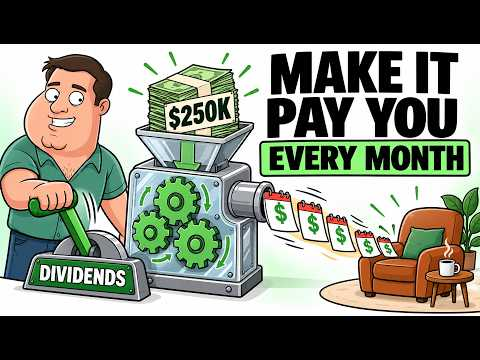
- 설명 앞부분: $250,000 invested once in a quality dividend fund at 3.21% pays about $669 a month. The same $250,000 in an 11% covered call fund pays about $2,292. Reinvest everything and race to $4,000 a month: in our illustration the covered call route arrives in about 6.5 years, the quality fund needs about 22…
- 같은 채널 평소 대비 ×3.4 (채널 최근 롱폼 중앙값 3,812회) · 평소 영상: No Pension? No Problem! Create Your Own with SCHD (3,825회) / Can You Retire With Just SCHD? ∣ SCHD Expert Expl… (3,799회)
- 대본 없음 (설명) — 음성인식이 끝나면 도입부·흐름이 들어감
- 댓글 12/12: 좋은 점 — 영상 0 · 감사·응원 0 · 더 알고 싶은 것 0 · 아쉬운 점 — 영상 0 · 반박·불만 — 의견 다름 0 · 정치·사회 0 · 경험 공유 0 · 구독·다음 기대 0

### 116. "S&P500 ETF, 종목보다 '계좌'가 20년 뒤를 바꾸는 진짜 이유 (연금·ISA)"

- https://www.youtube.com/watch?v=fmQLRfIm28Y · 야무진 경제학 · 구독자 22,500 · 조회수 137,303 (×6.1, 하루 1,291.1) · 좋아요 3,514 (2.6%) · 28.4분 · 2026-07-07 · 주제 묶음 2. 장기투자·ETF·지수 · 형식 정보·해설 (그 밖) · 폴더 `W_fmQLRfIm28Y` (웹 승인)
- 썸네일: 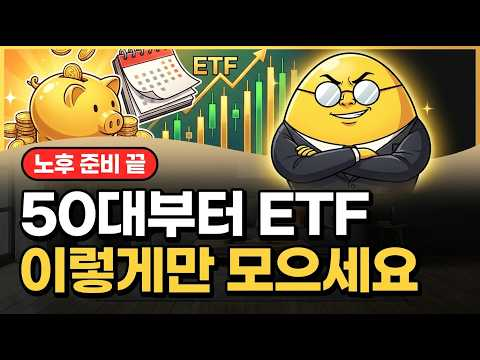
- 챕터: 0:00 종목은 담았는데 왜 내 계좌만 이 모양일까 · 2:19 원칙 ① 짐을 줄여라 — 종목이 많을수록 위험한 이유 · 5:02 원칙 ② 오래 메고 걸어라 — 매달 30만원 20년의… · 8:26 40세 시작 vs 50세 시작, 10년이 만든 격차 · 10:03 목돈 한 번에? 나눠서? 리밸런싱은 언제 · 10:44 우리가 가장 많이 하는 두 가지 오해 · 11:49 달콤한 함정 — 월배당·커버드콜의 진실 (금감원 경보) · 15:25 반전 — 짐이 아니라 '배낭'을 바꾸는 고수들 · 16:42 방수 배낭 ① 연금저축·IRP, 148만원 돌려받는 법 · 19:25 방수 배낭 ② ISA, 3년 유연 + 비과세 · 20:59 같은 상품 김 씨 vs 박 씨, 10년 뒤 잔고 차이 · 22:38 ISA를 연금으로 갈아타 혜택 두 번 챙기는 기술 · 24:04 꼭 알아야 할 주의점 — 중도해지 벌금 & ISA 한… · 25:47 오늘 걸어온 길 정리 — 짐이 아니라 배낭이 결과를 …
- 설명 앞부분: S&P500 ETF, 좋다는 종목만 열심히 담았는데 왜 내 계좌만 안 불어날까요? 문제는 '무엇을 담느냐'가 아니라 '어떤 계좌에 담느냐'입니다. 오늘은 ETF 투자를 배낭여행에 빗대, 20년 뒤 통장을 바꾸는 절세계좌(연금저축·IRP·ISA) 활용법을 한 번에 정리했습니다. 똑같은 미국 지수 ETF를 일반계좌(비닐봉지)에 담은 사람과 절세계좌(방수 배낭)에 담은 사람의 결과가 왜 갈리는지, 그리고 요즘 인기인 월배당·커버드콜의 숨은 함정(금융감독원 소비자경보)까지 짚습니다. 종목 압축, 복리의 시간, 절세계좌라는 세 가지 뼈대만…
- 같은 채널 평소 대비 ×12.9 (채널 최근 롱폼 중앙값 10,622회) · 평소 영상: "50대라면 월 75만원 이렇게 넣어두세요, 65세부터 매달 들어옵니다" (10,622회) / "50대 노후 준비 10년째 못 하는 진짜 이유, 놓친 4가지" (11,242회)
- 대본 없음 (설명) — 음성인식이 끝나면 도입부·흐름이 들어감
- 댓글 115/115: 좋은 점 — 영상 6 · 감사·응원 9 · 더 알고 싶은 것 11 · 아쉬운 점 — 영상 2 · 반박·불만 — 의견 다름 0 · 정치·사회 0 · 경험 공유 4 · 구독·다음 기대 1
  - 좋은 점 — 영상 👍2 “노인초보자가 보기에 아주 핵심적이고 유익해서 구독 했어요❤😅😅 목소리도 좋아요”
  - 좋은 점 — 영상 👍2 “감사합니다 이해가 잘 되네요~~~”
  - 감사·응원 👍9 “감사드립니다 저두 5~6개 담고 있는데 정리하겠습니다”
  - 감사·응원 👍4 “감사합니다”
  - 더 알고 싶은 것 👍9 “연금계좌는 1년에 얼마까지입금(투자)가능한가요?”
  - 더 알고 싶은 것 👍4 “종합과세 때문에 isa 개설이 안되요..ㅜㅜ 비닐봉지에라도 담아야 할까요? 3년뒤 isa개설 가능해지면 그때 담는게 나을까요?”
  - 아쉬운 점 — 영상 👍5 “영상이 깔끔하고 편집이 잘 되어 있어서 보기 편하네요.”
  - 아쉬운 점 — 영상 👍2 “말을 너무 길게 늘림”
  - 경험 공유 👍3 “자식공부시키고 집산다고 그간 세월 다 보낸 60중반인 저희들은 어떻게해야하나요? 😢”
  - 경험 공유 👍1 “내가 들어보니 커버드콜 한번도 투자해 본적없고 주식투자경력10년도 안되었네...좃도 모르네...”
  - 구독·다음 기대 👍2 “구독, 좋아요 ,알림설정 다 눌렀습니다.서운해 하지 마세요~😅”

### 117. I Bought 1,000 Shares of JEPQ. Here’s What It Pays Me Every Month

- https://www.youtube.com/watch?v=gC-_mODu2gI · Grounded Life Investments · 구독자 5,350 · 조회수 31,572 (×5.9, 하루 3,604.6) · 좋아요 386 (1.2%) · 11.3분 · 2026-10-13 · 주제 묶음 기타 · 형식 정보·해설 (그 밖) · 폴더 `W_gC-_mODu2gI` (웹 승인)
- 썸네일: 
- 설명 앞부분: I Bought 1,000 Shares of JEPQ. Here’s What It Pays Me Every Month. I also talk about who this fund is for and why it is in our investment portfolio. Want to go deeper? The GLI Dashboard gives you dividend screeners, portfolio analysis, and deep dives of the companies and ETF's you need to know abou…
- 같은 채널 평소 대비 ×2.8 (채널 최근 롱폼 중앙값 11,317회) · 평소 영상: SCHD New All-Time High: I've Paused My DCA & What… (11,317회) / I Invested $30 Per Day In SCHD - Here What Happen… (12,195회)
- 대본 없음 (설명) — 음성인식이 끝나면 도입부·흐름이 들어감
- 댓글 68/68: 좋은 점 — 영상 0 · 감사·응원 0 · 더 알고 싶은 것 0 · 아쉬운 점 — 영상 0 · 반박·불만 — 의견 다름 0 · 정치·사회 0 · 경험 공유 0 · 구독·다음 기대 0

### 118. 나스닥 2배 QLD 무지성 적립식매수 vs. 공포탐욕지수 활용 매수 I QQQ, QLD, TQQQ, SOXL

- https://www.youtube.com/watch?v=V_RecmLncz4 · 레버리지 하는 미국회계사 장기투자 여정 · 구독자 13,100 · 조회수 74,758 (×5.7, 하루 1,200.3) · 좋아요 1,354 (1.8%) · 16.1분 · 2026-08-20 · 주제 묶음 2. 장기투자·ETF·지수 · 형식 정보·해설 (그 밖) · 폴더 `W_V_RecmLncz4` (웹 승인)
- 썸네일: 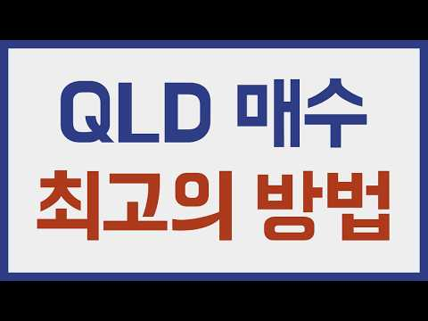
- 챕터: 0:00 공포탐욕지수 활용한 매수 질문 · 1:45 공포탐욕지수란? + 백테스트 가정 · 5:17 공포탐욕지수 활용 전략 결과 · 6:33 레니프 유니백 체어 프로 제품 지원 영상 · 7:10 공포탐욕지수 최대 활용전략? · 10:01 공포탐욕지수 스윙 전략 · 14:08 공포탐욕지수 매수 결론
- 설명 앞부분: 레니프 유니백 체어 프로 10월 큰 할인 행사 · 10월 10일(토) 23:59까지 349,000원 (공식몰 399,000원) · 구매확정 시 2단 발받침대 증정 공포탐욕지수 보면서 비중 조절해서 매수하는 것과, 그냥 무지성으로 매일 적립식 매수하는 것. 둘 중 뭐가 더 나을까요? ⏱ 타임스탬프 이런 분들께 추천드려요 QLD, TQQQ 같은 레버리지 ETF로 적립식 투자 중이신 분 공포탐욕지수 활용법이 궁금하신 분 법인투자, 세금 효율화에 관심 있으신 분 📖 법인투자 무작정따라하기 (전자책) ⚠️ 저는 미국공인회계사(CPA)이며,…
- 같은 채널 평소 대비 ×5.2 (채널 최근 롱폼 중앙값 14,329회) · 평소 영상: QLD랑 가장 잘 어울리는 배당주는 무엇인가 I SCHD, VYM, DGRO, VIG, … (14,329회) / 레버리지 투자자가 나스닥 커버드콜에 1억 넣은 이유 ∣ GPIQ·TDAQ 분배금으로 QL… (14,104회)
- 대본 없음 (설명) — 음성인식이 끝나면 도입부·흐름이 들어감
- 댓글 181/181: 좋은 점 — 영상 6 · 감사·응원 27 · 더 알고 싶은 것 18 · 아쉬운 점 — 영상 0 · 반박·불만 — 의견 다름 0 · 정치·사회 1 · 경험 공유 8 · 구독·다음 기대 1
  - 좋은 점 — 영상 👍6 “정말 궁금했던 부분을 알려주셔서 감사합니다~!! ❤”
  - 좋은 점 — 영상 👍6 “도움이 되는 좋은 영상이네요. 하지만, 안타깝게도 예전부터 세상에 좋은 장기 투자방법은 정말 많았지만, 그것을 실제로 실행해서 지키는 투자자는 세상에 1% 밖에 없음. 좋은 투자방법을 만들거나 찾는 것보다 뚝심과 끈기로 꾸준히 지키는 것이 천배, 만배 더 어렵고 중요…”
  - 감사·응원 👍9 “매주 소수점이라도 시작해 보겠습니다. 훌륭한 데이타 감사합니다.”
  - 감사·응원 👍7 “어떻게 제가 딱 원하는 영상인지 감사합니다 꾸준히 사다가 많이 떨어질 때 더 사야겠어요ㅋㅋㅋㅋㅋㅋ 그냥 제 심신의 안정을 위하여”
  - 더 알고 싶은 것 👍2 “영상 감사히 보았습니다 올려주신 qld+tq스윙과 무지성 tq 매일 적립도 한번 비교해주실 수 있나요?”
  - 더 알고 싶은 것 👍1 “혹시 카메라랑 마이크 어떤거 쓰시는지 알 수 있을까요?”
  - 정치·사회 👍0 “미국회계사시라고 해서 기대했는데... 송팀장 이라는 채널이 있는데 어제 올라온 35년 백테스트 영상 참고해보시면 좋을것 같아요”
  - 경험 공유 👍13 “무지성으로 1년째모으고있는데 환차손 때문에 몇천손해중..”
  - 경험 공유 👍7 “어떻게 제가 딱 원하는 영상인지 감사합니다 꾸준히 사다가 많이 떨어질 때 더 사야겠어요ㅋㅋㅋㅋㅋㅋ 그냥 제 심신의 안정을 위하여”
  - 구독·다음 기대 👍0 “미국 회계사님 유투브 최근에 알게되서 구독하고 열심히 보고 있습니다. 현재 캘리 OC 에 거주하는데 라이브방송 보는데 캘리포니아에서 사셧다고 해서 반가웠습니다 ㅎㅎ 미국에 거주하시면서 투자하는 유투버분 들이 별로 없어서 미국에서 투자할때 절세나 연금관련부분이 한국과 …”

### 119. 삼성전자 투자자분들 주목하셔야합니다 실적은 사상 최대인데 주가는 왜 못 따라갈까? 목표가 48만원·150조 주주환원 총정리했습니다! #삼성전자 #삼성전자주가

- https://www.youtube.com/watch?v=0ftjA5wsqtQ · 코스피 읽는 개미 · 구독자 2,230 · 조회수 12,663 (×5.7, 하루 102.9) · 좋아요 357 (2.8%) · 18.6분 · 2026-06-21 · 주제 묶음 6. 종목 고르기·분석 · 형식 정보·해설 (그 밖) · 폴더 `W_0ftjA5wsqtQ` (웹 승인)
- 썸네일: 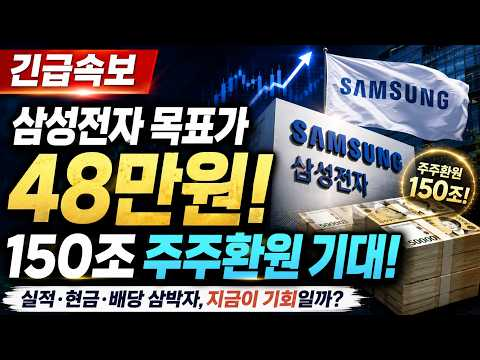
- 설명 앞부분: [영상 요약] 하나증권이 삼성전자 목표주가를 48만 원으로 상향했습니다. 그 이유는 AI 반도체 수요 확대에 따른 D램·LPDDR 가격 강세, 그리고 예상보다 강한 실적 개선 때문입니다. 특히 올해 2분기 영업이익은 시장 기대를 크게 웃도는 수준으로 전망되고 있습니다. 또한 삼성전자의 막대한 현금 창출력을 바탕으로 최대 150조 원 규모의 주주환원(배당·자사주 매입) 가능성이 제기되면서 투자자들의 관심이 집중되고 있습니다. 목표주가 48만 원 상향 배경 AI 메모리 시장 성장과 HBM 전망 150조 원 주주환원의 의미 삼성전자 주…
- 같은 채널 평소 대비 ×28.1 (채널 최근 롱폼 중앙값 451회) · 평소 영상: [ 삼성전자 ] 대폭발 시작되나? 반도체 수출 150% 급증…주가 대반전 "신호" 떴다! (451회) / 삼성전자 26만원 무너졌다...지금 흔들리는 투자자분들 "이것" 확인하세요 (460회)
- 대본 없음 (설명) — 음성인식이 끝나면 도입부·흐름이 들어감
- 댓글 17/17: 좋은 점 — 영상 0 · 감사·응원 0 · 더 알고 싶은 것 0 · 아쉬운 점 — 영상 0 · 반박·불만 — 의견 다름 1 · 정치·사회 0 · 경험 공유 0 · 구독·다음 기대 2
  - 반박·불만 — 의견 다름 👍3 “무슨 헛소리를? 세계 증권사에서 4.3프로 주주환원의 현금배당을 한 적이나 있나요? 연구개발비랑 투자비는 어찌하고 무슨 주주환원이라고 삼성에서는 하지도 않은 말을 자기들 멋대로 헛소리를 하는지 참”
  - 구독·다음 기대 👍2 “구독완료”
  - 구독·다음 기대 👍0 “구독완료”

### 120. These 2 NEW Weekly Dividend ETFs Are Beating Monthly Income

- https://www.youtube.com/watch?v=-K8-ccMcIBE · Jake Wealth Hacks · 구독자 6,700 · 조회수 37,271 (×5.6, 하루 214.9) · 좋아요 863 (2.3%) · 10.6분 · 2026-05-01 · 주제 묶음 2. 장기투자·ETF·지수 · 형식 정보·해설 (그 밖) · 폴더 `W_-K8-ccMcIBE` (웹 승인)
- 썸네일: 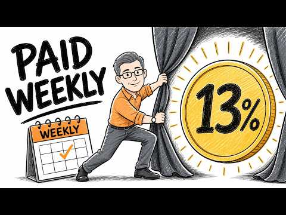
- 설명 앞부분: Two brand-new weekly dividend ETFs from Global X just launched — EDGX and EDGQ — and after 10 weeks of tracking their performance, they're doing something almost no other weekly-paying covered call fund has managed: holding NAV without bleeding your principal. Weekly dividend ETFs are gaining massi…
- 같은 채널 평소 대비 ×10.8 (채널 최근 롱폼 중앙값 3,463회) · 평소 영상: These New ETFs Yield Up to 45% — Should You Buy T… (3,463회) / This New 34% SpaceX ETF Offers Monthly Cash - But… (3,442회)
- 대본 (자막, 0.0 음절/초) 첫 20초: “Picture this. It's a Friday afternoon. Your phone buzzes. A dividend just hit your account. $47.83. Not monthly, not quarterly, weekly. Now, here's the problem most people run into with weekly dividend ETFs. By the time they've collected 6 months of those Friday payouts, their share price has”
- 첫 1분: “Picture this. It's a Friday afternoon. Your phone buzzes. A dividend just hit your account. $47.83. Not monthly, not quarterly, weekly. Now, here's the problem most people run into with weekly dividend ETFs. By the time they've collected 6 months of those Friday payouts, their share price has quietly bled out 18%, 22%, sometimes more. The income looked real, the math didn't add up. I've been watch”
- 흐름 (90초마다 첫 문장): 0:00 Picture this. It's a Friday afternoon. → 1:30 paying you every single Friday. We're → 3:00 door. That's the gap. That's the problem → 4:31 genuinely promising. Now, look, I always → 6:02 invested if you choose the weekly paying → 7:30 steps up to 50 basis points, which is → 9:00 say is that they're credible → 10:31 give this video a like. It tells me
- 댓글 79/79: 좋은 점 — 영상 0 · 감사·응원 0 · 더 알고 싶은 것 0 · 아쉬운 점 — 영상 0 · 반박·불만 — 의견 다름 0 · 정치·사회 0 · 경험 공유 0 · 구독·다음 기대 0

