# 주식 — 성공 사례 분석: 사례별 자세히 #81–#120

`analysis.md` 의 9번 (같은 # 번호). 자동 생성 — `tools/success_analysis.py` v1.6 (2026-11-06 08:46 UTC). ※ 연구·교육용 — 투자 권유가 아님.

### 81. 배당주 20년 vs S&P500 20년, 3억 원이 만든 충격적인 자산과 삶의 격차 [ 재테크/미국주식/ETF/배당주/노후준비 ]

- https://www.youtube.com/watch?v=cqgVNBbMYew · 박대리와 황과장의 경제이야기 · 구독자 1,930 · 조회수 78,763 (×40.8, 하루 1,015.9) · 좋아요 1,113 (1.4%) · 20.5분 · 2026-07-30 · 주제 묶음 4. 미국·해외주식 · 형식 정보·해설 (그 밖) · 폴더 `W_cqgVNBbMYew` (웹 승인)
- 썸네일: 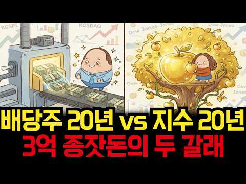
- 설명 앞부분: 같은 3억 원으로 시작해 20년 동안 완전히 다른 길을 걸어간 두 사람. 미국 배당 성장주에 투자해 매달 현금흐름을 굴린 박 대리와, S&P 500 지수 전체에 투자해 자본의 성장을 노린 황 과장. 20년이라는 긴 세월이 흐른 뒤, 두 사람의 계좌에 찍힌 숫자는 어떻게 달라졌을까요? 그리고 더 중요한 것, 은퇴 후 두 사람의 '진짜 삶의 모습'은 어떻게 갈렸을까요? 단순히 "어느 쪽이 더 많이 벌었나"를 넘어, 자산 형성기에서 은퇴기까지 우리가 투자를 바라보는 관점 자체를 바꿔줄 20년의 실측 데이터 서사를 확인해 보세요. [영상…
- 같은 채널 평소 대비 ×34.7 (채널 최근 롱폼 중앙값 2,270회) · 평소 영상: 폭락장에서 파는 것보다 적립을 멈추는 게 더 비쌌다, 6억5천만 원의 청구서 [ 재테크/… (2,274회) / 같은 100만원으로 시작했는데 10억 도착은 단 한 달 차이, 두 사람을 가른 세 개의 … (2,266회)
- 대본 (음성인식(앞 5분), 4.9 음절/초) — 앞부분만, 흐름은 그 안까지 첫 20초: “배당주와 지수 주식, 이 두 가지 자산은 같은 주식시장 안에서 가장 오랜 기간 라이벌 관계로 불려왔습니다. 시장이 폭발적인 성장을 온 몸으로 받아내며 지수의 팽창을 누릴 것인가, 새 된 챈 챈 누릴 것인가. 아니면 기업이 만들어내는 당장의 현금 흐름을 매달 꼬박꼬박 재투자하여 복리의 눈덩이를 굴릴 것인가.”
- 첫 1분: “배당주와 지수 주식, 이 두 가지 자산은 같은 주식시장 안에서 가장 오랜 기간 라이벌 관계로 불려왔습니다. 시장이 폭발적인 성장을 온 몸으로 받아내며 지수의 팽창을 누릴 것인가, 새 된 챈 챈 누릴 것인가. 아니면 기업이 만들어내는 당장의 현금 흐름을 매달 꼬박꼬박 재투자하여 복리의 눈덩이를 굴릴 것인가. 오늘 다룰 이야기는 바로 이 질문에서 출발합니다. 출발서는 똑같았습니다. 두 사람에게는 20년 전 각자 핏땀 흘려 모은 종자똥 3억 원이 손에 쥐어져 있었습니다. 대기업 직장인으로 오랜 기간 함께 근무하며 같은 월급을 받고, 같은 점심을 먹고, 같은 퇴근길을 걸었던 박 대리와 황 과장, 두 사람은 어느 날 점심을 먹고 회사 근처 공원 벤치에 앉아 서로의 통장을 열어보았습니다. 각자의 계좌에는 약속이라도 한”
- 흐름 (90초마다 첫 문장): 0:00 배당주와 지수 주식, 이 두 가지 자산은 같은 주식시장 안에서 가장 오… → 1:32 박 대리가 선택한 것은 미국 시장을 대표하는 배당 성장 자산이었습니다. → 3:07 황 과장은 배당에 목매지 않았습니다. → 4:35 S&P 500 역시 연 1.5% 안팎에 소소한 배당을 지급했지만 황과장…
- 댓글 162/162: 좋은 점 — 영상 3 · 감사·응원 4 · 더 알고 싶은 것 3 · 아쉬운 점 — 영상 1 · 반박·불만 — 의견 다름 3 · 정치·사회 5 · 경험 공유 9 · 구독·다음 기대 0
  - 좋은 점 — 영상 👍4 “좋은정보 감사드립니다”
  - 좋은 점 — 영상 👍1 “오 좋은내용감사합니다”
  - 감사·응원 👍4 “좋은정보 감사드립니다”
  - 감사·응원 👍1 “정말 궁금했는데 감사합니당”
  - 더 알고 싶은 것 👍3 “18:07 더이상 근로소득을 기대할수 없는 시점인데 어떻게 생활비로 한푼도 안쓰고 배당 재투자를 할수가 잇을까요?”
  - 더 알고 싶은 것 👍0 “3억 20년 넣고 기다릴 사람이 얼마나될까요? 시드 금액이 넘 큼..1억이면 몰라도.”
  - 아쉬운 점 — 영상 👍0 “지수 팔아서 배당 사면 되는데 결론이 많이 아쉽네요.”
  - 반박·불만 — 의견 다름 👍0 “주식투자에서 가장중요한게 투자기법 심리? 아닙니다 그냥 가만히 있는겁니다 대부분 폭락장에서 90%가 공포에 다던지죠.ㅋㅋ 인간이 가장 힘들어 하는게 가~만히 있는거죠”
  - 반박·불만 — 의견 다름 👍0 “말도 안되는 소리를 하네. 은퇴싯점에 S&P를 팔아서 배당주로 옮기면 되지. 물론, 22%의 양도소득세를 내야 하는데, 그걸 감안해도 황과장이 무조건 이겼구만.”
  - 정치·사회 👍47 “한국 정부는 개인의 노후도 보장 안해주면서, 세계에서 유일하게 세금을 안내는 사람이 세금을 내는 사람보다 혜택이 더욱 많고, 은퇴하면 세금이 더 늘어나고, 중국인을 위해 한국국민이 세금을 더 내게 만든 유일한 나라…”
  - 정치·사회 👍6 “빚내서 그냥 레버타라 정부에서 빚 탕감해준다”
  - 경험 공유 👍5 “운용하기 나름인듯 다만 지수는 손이좀 가고 배당은 손이 조금 덜간다는 차이가 있을뿐. 그리고 배당을 받는경우는 세금문제도 생각해야하고. 수입이 안끊어졌다는 전제로 하락장때 추매를 하면 안되는거였나? 아니면 3억을 한번에 몰아넣지 말고 적립식으로 했었다면?? 지수에 넣…”
  - 경험 공유 👍0 “저는 모든 수익의 절반을 투자 및 재투자하는 방식을 하고 있습니다. 배당주 위주로 하고 있고요. 월급의 절반도 투자, 배당금의 절반도 재투자. 내가 쓸 수 있는 현금도 매년 늘어나고, 배당금도 재투자가 계속 이루어져서 매년 늘어나는 구조죠. 배당금이 2천만원 넘어가면…”

### 82. "2억 모았다면 이제 '이렇게' 투자하세요" 손실 없이 돈을 불리는 확실한 투자 전략 ∣ 황금별 작가 ∣ 연금받는형

- https://www.youtube.com/watch?v=-ZozYKj6CxU · 연금 받는 형 · 구독자 23,000 · 조회수 104,183 (×4.5, 하루 11,783.5) · 좋아요 450 (0.4%) · 27.8분 · 2026-10-28 · 주제 묶음 7. 매매·전략 · 형식 정보·해설 (그 밖) · 폴더 `W_-ZozYKj6CxU` (웹 승인)
- 설명 앞부분: 은퇴는 다가오는데 주식이 폭락했다면, 회복할 때까지 무조건 버티면 될까요? 같은 하락장이라도 어떤 자산을 가지고 있는지, 생활비로 쓸 돈을 따로 준비했는지에 따라 대응은 달라집니다. 은퇴를 앞뒀다면 얼마나 더 벌 수 있을지만큼, 떨어지는 시장을 얼마나 견딜 수 있을지도 생각해야 합니다. 황금별 작가는 배당주와 지수형 자산, 현금과 달러를 중심에 두고 은퇴 후를 준비하는 방법을 이야기합니다. 시장의 방향을 맞히려 하기보다 생활비와 투자 자금을 구분하고, 하락했을 때 어떻게 대응할지 미리 기준을 세우는 것입니다. 이번 영상에서는 은퇴…
- 같은 채널 평소 대비 ×2.4 (채널 최근 롱폼 중앙값 44,231회) · 평소 영상: 은퇴 후 집 팔기 전 반드시 확인하세요! 양도세·증여세·상속세 폭탄 피하는 법 ∣ 안수남… (46,375회) / "수익률에 속지 마세요" 월배당 ETF, '이 1가지' 모르면 망합니다 ∣ 황금별 작가 … (42,087회)
- 대본 없음 (설명) — 음성인식이 끝나면 도입부·흐름이 들어감
- 댓글 24/24: 좋은 점 — 영상 0 · 감사·응원 1 · 더 알고 싶은 것 2 · 아쉬운 점 — 영상 0 · 반박·불만 — 의견 다름 0 · 정치·사회 3 · 경험 공유 2 · 구독·다음 기대 0
  - 감사·응원 👍7 “직접 해 보시고 경험에서 나오시는 말씀❤감사합니다”
  - 더 알고 싶은 것 👍14 “하이닉스 270만원 물린 사람은 원금으로 몇년기다리면 탈출가능할까요?”
  - 더 알고 싶은 것 👍0 “채권 투자하셨던 분인데 어떻게 됐나요?”
  - 정치·사회 👍0 “한국이 안고 있는 가장 큰 이슈는 항상 정치이슈였음. 현재 외국인이 썰물되는 이유는 판래기 리스크임.”
  - 정치·사회 👍0 “국장은 정권때문에 안됨.”
  - 경험 공유 👍0 “절세계좌에서 1억대etf 모았는데 정년까지 쭉모아서 연금으로 활용하려고 합니다. 시간과 복리를 믿어요~ 3년차입니다~”

### 83. 주식하는 30대의 현실적인 고민들

- https://www.youtube.com/watch?v=FHeTzAEZ6tM · 30대 우영이의 일기 · 구독자 4,990 · 조회수 30,158 (×6.0, 하루 2,549.5) · 좋아요 54 (0.2%) · 10분 · 2026-10-25 · 주제 묶음 6. 종목 고르기·분석 · 형식 정보·해설 (그 밖) · 폴더 `W_FHeTzAEZ6tM` (웹 승인)
- 챕터: 0:00 오프닝 ∣ 주식에 물린 회사 대표와의 만남 · 0:28 연매출 150억 제조업체 대표의 이야기 · 1:40 주식 입문과 7년 동안 물렸던 종목 · 2:51 식사와 함께 시작된 이야기 · 3:22 하이닉스에 물린 투자자의 현실 · 4:51 주식 손실을 혼자 감당한다는 것 · 5:09 더 잘 살고 싶은데 마음처럼 안 될 때 · 5:29 돈을 버는 능력과 행복을 느끼는 능력 · 6:27 우리가 느끼는 불안의 실체 · 6:51 성공한 사람도 자신을 잘 모를 때 · 7:26 돈을 많이 벌면 하고 싶은 일 · 7:55 얼마가 있어야 마음이 편해질까? · 8:38 주식하는 30대의 현실적인 고민 · 9:17 돈과 행복에 대한 생각
- 같은 채널 평소 대비 ×6.2 (채널 최근 롱폼 중앙값 4,894회) · 평소 영상: 23살에 첫 해외여행을 하고 느낀 것들 (5,480회) / 대전 짜장면 가성비 1위 여기 맞나요? (4,309회)
- 대본 없음 (없음) — 음성인식이 끝나면 도입부·흐름이 들어감
- 댓글 16/16: 좋은 점 — 영상 0 · 감사·응원 1 · 더 알고 싶은 것 0 · 아쉬운 점 — 영상 0 · 반박·불만 — 의견 다름 1 · 정치·사회 0 · 경험 공유 0 · 구독·다음 기대 0
  - 감사·응원 👍3 “남들이 말하는 대표적인 욕망의 기준 좋은 차, 명품 등등 관심이 없다고 해서 욕심이 없는 것은 아닙니다. 사람마다 욕구가 투사되는 대상이 다를 뿐입니다.물질적 탐욕이 없다고 해서 욕심이 없는 것이 아니라, 단지 그 사람의 욕심이 다른 형태로 자리 잡고 있을 뿐이라 생…”
  - 반박·불만 — 의견 다름 👍3 “남들이 말하는 대표적인 욕망의 기준 좋은 차, 명품 등등 관심이 없다고 해서 욕심이 없는 것은 아닙니다. 사람마다 욕구가 투사되는 대상이 다를 뿐입니다.물질적 탐욕이 없다고 해서 욕심이 없는 것이 아니라, 단지 그 사람의 욕심이 다른 형태로 자리 잡고 있을 뿐이라 생…”

### 84. 나스닥100 데일리 커버드콜 3종 비교/현존 1등은 누구일까?/TIGER/KODEX/RISE

- https://www.youtube.com/watch?v=CoDrgy4i4DA · 주식아빠 TV · 구독자 2,850 · 조회수 12,622 (×4.4, 하루 1,420.9) · 좋아요 82 (0.7%) · 8.8분 · 2026-10-28 · 주제 묶음 2. 장기투자·ETF·지수 · 형식 정보·해설 (그 밖) · 폴더 `W_CoDrgy4i4DA` (웹 승인)
- 설명 앞부분: 나스닥100 커버드콜 /TIGER.KODEX.RISE 3가지 ETF 차이점과 기본 정보 3가지 ETF의 기간별 수익률 비교 장세별 수익률 및 분배율 매커니즘 최적의 커버드콜 선택 기준(3가지 유형) 투자 시 반드시 주의해야 할 2가지 포인트
- 같은 채널 평소 대비 ×26.6 (채널 최근 롱폼 중앙값 475회) · 평소 영상: "연금저축펀드 915일차 적립식 투자 성과와 솔직한 후기"(수익률 공개),피터 린치의 주… (475회) / 커버드콜 1억 투자하면 매달 배당금 얼마나될까(10월 상반기 배당금) (261회)
- 대본 없음 (설명) — 음성인식이 끝나면 도입부·흐름이 들어감
- 댓글 6/6: 좋은 점 — 영상 0 · 감사·응원 0 · 더 알고 싶은 것 0 · 아쉬운 점 — 영상 0 · 반박·불만 — 의견 다름 0 · 정치·사회 0 · 경험 공유 0 · 구독·다음 기대 0

### 85. 세미파이어 부부가 국내주식 안하는 이유

- https://www.youtube.com/watch?v=DNDC7nT7Hmw · 시골사는 배당부부 · 구독자 1,490 · 조회수 14,153 (×9.5, 하루 741.0) · 좋아요 160 (1.1%) · 6.9분 · 2026-10-18 · 주제 묶음 5. 국내주식 · 형식 정보·해설 (그 밖) · 폴더 `W_DNDC7nT7Hmw` (웹 승인)
- 썸네일: 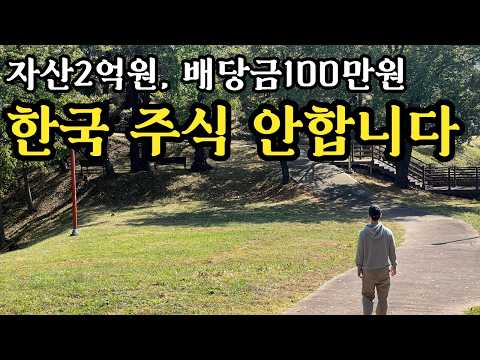
- 설명 앞부분: 안녕하세요 시골사는 배당부부입니다. 오늘은 저희부부가 국내주식을 하지 않는 이유에 대해 얘기 나눠봤습니다
- 같은 채널 평소 대비 ×1.1 (채널 최근 롱폼 중앙값 13,372회) · 평소 영상: 시골 세미파이어 현실 한달 생활비 (13,372회) / 도시에서 떠나 시골로 귀촌한 이유 (16,095회)
- 대본 없음 (설명) — 음성인식이 끝나면 도입부·흐름이 들어감
- 댓글 35/35: 좋은 점 — 영상 0 · 감사·응원 2 · 더 알고 싶은 것 0 · 아쉬운 점 — 영상 0 · 반박·불만 — 의견 다름 0 · 정치·사회 0 · 경험 공유 2 · 구독·다음 기대 2
  - 감사·응원 👍1 “모두가 다 다른상황이니 각자에 맞는 투자가 옳은투자지요. 응원합니다.”
  - 감사·응원 👍0 “응원과 구독합니다”
  - 경험 공유 👍9 “나도 예전에는 국내주식만하다 미국주식으로 옮겼지만 절세상으로나 분산차원에서 국내투자는 필요하다고 봄. 대신 코스피200같은 대표지수를 일정비중으로 투자하는건 필요하다 봄니다.”
  - 경험 공유 👍0 “똑소리나는 부부시네요 유튜브자주 업로딩해주세요❤ 구독누르고가요 저도 국장에서 크게실망한적있어서ㅜㅜ.. 고배당주에 한번투자해봐야겠습니다”
  - 구독·다음 기대 👍0 “응원과 구독합니다”
  - 구독·다음 기대 👍0 “똑소리나는 부부시네요 유튜브자주 업로딩해주세요❤ 구독누르고가요 저도 국장에서 크게실망한적있어서ㅜㅜ.. 고배당주에 한번투자해봐야겠습니다”

### 86. Is This the Time to Buy Indian Equities? Pankaj Tibrewal on FII Outflow & Investment Oppo…

- https://www.youtube.com/watch?v=jUrGWhhASXU · Wealth By Motilal Oswal · 구독자 14,700 · 조회수 141,499 (×9.6, 하루 7,083.1) · 좋아요 836 (0.6%) · 64.4분 · 2026-10-17 · 주제 묶음 기타 · 형식 정보·해설 (그 밖) · 폴더 `W_jUrGWhhASXU` (웹 승인)
- 썸네일: 
- 챕터: 0:00 Teaser & Highlights · 1:45 Decoding the Current Market P… · 8:25 Cost of Capital, Global Bond … · 12:30 FII Selling vs Domestic Inflo… · 20:30 The "Two Indias" in the Stock… · 23:50 Promoter's Edge: How to Evalu… · 29:40 Gorilla to King Kong Framewor… · 37:45 Valuing New-Age Tech Companie… · 39:25 Big Mega Trends: Manufacturin… · 44:50 Active vs. Passive Investing … · 47:05 Managing Growth vs. Valuation… · 49:15 Asset Allocation Strategy for… · 52:30 Biggest Mistakes Retail Inves… · 55:30 Developing the Right Temperam… · 58:30 Rapid Fire Round
- 설명 앞부분: In this episode of Wealth by Motilal Oswal, we are joined by Pankaj Tibrewal, Founder of Ikigai Asset Manager and one of India’s most respected fund managers with over two decades of market experience. In a volatile market environment where investors' patience is being tested, Pankaj breaks down hi…
- 같은 채널 평소 대비 ×2.8 (채널 최근 롱폼 중앙값 49,837회) · 평소 영상: Radhika Gupta Gives Practical Framework on How to… (49,837회) / Deepak Shenoy on Building Wealth Without Predicti… (61,734회)
- 대본 없음 (설명) — 음성인식이 끝나면 도입부·흐름이 들어감
- 댓글 64/94: 좋은 점 — 영상 0 · 감사·응원 0 · 더 알고 싶은 것 0 · 아쉬운 점 — 영상 0 · 반박·불만 — 의견 다름 0 · 정치·사회 0 · 경험 공유 0 · 구독·다음 기대 0

### 87. 물린 주식 10년, 결국 전부 팔았습니다 (feat. 복구 심리의 함정)

- https://www.youtube.com/watch?v=OKHm1gUNyPA · 어쩌다마흔 · 구독자 1,840 · 조회수 85,110 (×46.3, 하루 884.9) · 좋아요 1,806 (2.1%) · 9.9분 · 2026-08-02 · 주제 묶음 8. 투자 심리·실패 · 형식 인터뷰·강연·대담 · 폴더 `W_OKHm1gUNyPA` (웹 승인)
- 썸네일: 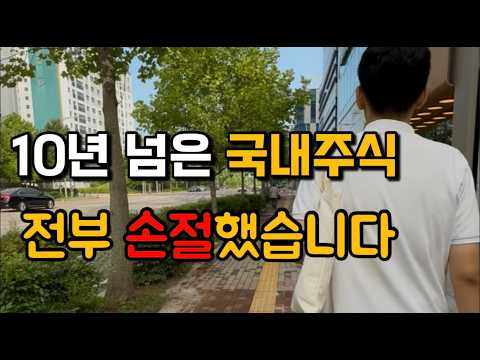
- 설명 앞부분: 10년 넘게 국내 개별주식에 투자했습니다. 수익 난 종목도 있었지만, 물린 종목이 더 많았습니다. 전체로 보면 꽤 큰 손실. 결국 얼마 전, 며칠에 걸쳐 전부 팔았습니다. 이번 영상은 계산이나 시장 분석이 아니라 제 이야기입니다. 왜 손실을 확정하면서까지 전량 매도를 택했는지, 그 이유 세 가지와 매도 이후에도 흔들렸던 '복구 심리'까지 솔직하게 담았습니다. 계좌에 물린 종목을 몇 년째 들고 고민 중이시라면, 오늘 영상이 판단에 참고가 되시길 바랍니다.
- 같은 채널 평소 대비 ×10.4 (채널 최근 롱폼 중앙값 8,192회) · 평소 영상: 부부 식비 40만원, 남은 돈 절반 미국주식 샀습니다 (8,418회) / 환율 1,350원 깨지고 미국주식 올인 했습니다 (7,967회)
- 대본 (음성인식(앞 5분), 4.3 음절/초) — 앞부분만, 흐름은 그 안까지 첫 20초: “10년 넘게 하던 국내 주식을 며칠 전 전부 팔고 정리했습니다. 수익이 나서 판 건 아닙니다. 손실을 확정하면서 팔았습니다. 오늘은 쓰라리게 아팠던 제 최근 이야기입니다.” — 도입부 유형: 숫자로 시작
- 첫 1분: “10년 넘게 하던 국내 주식을 며칠 전 전부 팔고 정리했습니다. 수익이 나서 판 건 아닙니다. 손실을 확정하면서 팔았습니다. 오늘은 쓰라리게 아팠던 제 최근 이야기입니다. 안녕하세요 어쩌다 마흔입니다. 오늘은 계산도 시장 얘기도 아닙니다. 제 얘기를 해볼까 합니다. 이번 주도 금요일을 제외하고는 계속 카락장이 이어져서 멘탈이 힘든 한주였습니다. 그리고 저는 계좌에 일부 있던 국내 개별 주식을 며칠에 걸쳐 전부 정리했습니다. 10년 넘게 개별 주 투자를 해온 사람이 그것도 손실을 확정하면서 왜 마흔이 넘어 전부 팔았는지 그 이후 3가지를 오늘 말씀드려볼까 합니다. 이 결정이 결코 정답이라는 얘기가 아닙니다. 다만 저와 비슷한 시기에 계좌에 물린 종목을 들고 고민 중인 분이라면”
- 흐름 (90초마다 첫 문장): 0:00 10년 넘게 하던 국내 주식을 며칠 전 전부 팔고 정리했습니다. → 1:32 수익이 난 종목도 있었습니다. → 3:05 이러도 복구할 시간이 있었으니까요. → 4:31 시간을 쓰고 어느 정도 벌었어도 다시 생각해볼 문제인데
- 댓글 957/960: 좋은 점 — 영상 13 · 감사·응원 36 · 더 알고 싶은 것 5 · 아쉬운 점 — 영상 11 · 반박·불만 — 의견 다름 14 · 정치·사회 16 · 경험 공유 90 · 구독·다음 기대 4
  - 좋은 점 — 영상 👍3 “너무 아쉬워서 댓글올립니다. 현재재무상황과 현재밸류로 하면 당연히 수익이 어렵더라구요.ㅠ 확실한미래성장과 촉매(주가가 부각될 트리거)감안하여, 투자하시면 분명 성과가 있더라구요. 고전(그레이엄,피터린치,코스톨라니,레이달리오.등의 )책을 좀 읽으시면 ETF 선정하시는대…”
  - 좋은 점 — 영상 👍3 “좋은 이야기도 있는데 말하는 사고방식이 본인은 안다고 생각할수도 있겠지만 워렌 버팟의 본질을 전혀 이해 못하고 있다고 할까나 😅 말이나 설명을 하는 사고방식이 아직도 트레이더에요 . 트레이더의 탐욕에 절여진 전혀 벗어나있지를 않는. 좋게 봐줘도 하워드 막스의 통찰을 …”
  - 감사·응원 👍70 “많은 고민이 묻어 나옵니다. 고생하셨습니다. 저도 심각히 고민중입니다. 국장은 절대 개미가 도전할 시장은 아니라는 생각입니다. 말씀 새겨서 결정에 참고하겠습니다. 감사드립니다.”
  - 감사·응원 👍23 “속은 쓰리시겠지만, 길게 보면 잘하셨습니다^^ 저도 과거 오랫동안 개별주로만 투자를 했고, 괜찮은 수익을 얻었지만, 지금은 ETF 투자로 주로 하고, 개별주는 정말 소액만 투자하고 있습니다. 회계사 생활을 오랫동안 하면서, 기업분석과 투자에 나름 자신도 있었지만, 언…”
  - 더 알고 싶은 것 👍1 “얼마 손해 보셨나요?”
  - 더 알고 싶은 것 👍1 “리스크라쓰고 불확실성이라읽어야되여 그불확실에대해 어떤일을 했나요? 추세판단은했나요? 자금을잃지않으려는노력은 그무엇보다중요해요 .. 그러려면예비비확보 분할매매 9시 12시 오후3시 그리고온갖쏟아지는 착시만주는노이즈에대해선어떻게 대응했는지요? 자금 안 읽고오래 시장에 머…”
  - 아쉬운 점 — 영상 👍13 “주식은 자기가 좋아하는 기업 응원하는 마음으로 사서 고수익은 아니더라도 은행금리만큼정도는 이득 아니면 손해일거라 생각했는데, 결국은 큰손들의 도박장인게 너무 실망스럽니다.”
  - 아쉬운 점 — 영상 👍2 “아...한달만 빨리 정리했어도 어쩌면 수익이 났을지도 모르는데 아쉽네요.”
  - 반박·불만 — 의견 다름 👍63 “하루에 지수가 10프로 등락하는 국장은 정상이 아니죠”
  - 반박·불만 — 의견 다름 👍5 “공부해서 주식하려면 미장가세요.. 여기는 상식적인 시장이 아닙니다”
  - 정치·사회 👍24 “그냥주식은 도박이에요 정부에서 인정한 오르고 내리고 하는거 그냥 짜고치는 고스돕같은거 다연기 공부필요없어요 그냥 정부와 기업이 맘대로 올리고 내리고 전 이걸아는순간 이젠안해요 금은사지”
  - 정치·사회 👍6 “국장은 그냥 수급 사줄 놈이 없으면 안올라가지요. 삼닉이 1000조를 벌어도 사줄 놈이 없어요 이번 금요일 국내 탑5 전부 상한가 갔지요? 전부 환호하지만 실상은 외국인들이 10조만 있어도 모든 종목 상한가 보낼 수 있다는 경고 같았어요. 저도 8년 국장하고 이번에 …”
  - 경험 공유 👍113 “저도 다 팔고 미장으로 옮겼습니다. 돈이 문제가 아니라 널뛰기 국장에서는 일상생활이 안됩니다.”
  - 경험 공유 👍70 “많은 고민이 묻어 나옵니다. 고생하셨습니다. 저도 심각히 고민중입니다. 국장은 절대 개미가 도전할 시장은 아니라는 생각입니다. 말씀 새겨서 결정에 참고하겠습니다. 감사드립니다.”
  - 구독·다음 기대 👍6 “같은나이대라 그런지 공감이 많이 됩니다. 늘 영상 기다려요. 응원합니다.^^”
  - 구독·다음 기대 👍2 “감사합니다 구독하고 볼게요 sk하이닉스 들어갈려고했는데 도저히 자신이 없네요”

### 88. 나스닥 투자하기 전에 이 영상 꼭 보세요 ∣ QLD만 모아가는 이유

- https://www.youtube.com/watch?v=g10Y6ZA7rng · 올레버 · 구독자 1,590 · 조회수 120,076 (×75.5, 하루 764.6) · 좋아요 1,649 (1.4%) · 5.7분 · 2026-06-02 · 주제 묶음 2. 장기투자·ETF·지수 · 형식 정보·해설 (그 밖) · 폴더 `W_g10Y6ZA7rng` (웹 승인)
- 썸네일: 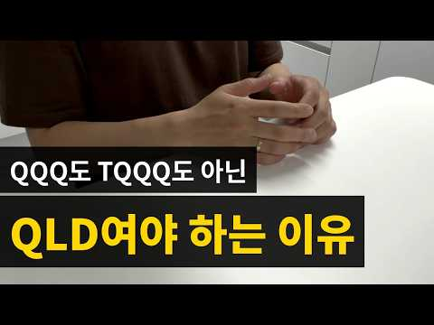
- 챕터: 0:00 도입 — QLD를 추천하는 이유 · 0:12 레버리지의 음의 복리(Volatility Decay)… · 1:31 나스닥에서 음의 복리가 반은 틀린 이유 · 2:02 QQQ / QLD / TQQQ 수익률 비교 (2010… · 3:05 왜 TQQQ보다 QLD인가 — 최적 레버리지 배율 · 4:01 2021년 차트로 보는 변동성 비교 · 4:29 장기 투자자에게 QLD가 적합한 이유 · 4:52 개인 목표 (10년 순자산 30억) 기준으로 본 QLD · 5:18 리스크 안내 및 마무리
- 설명 앞부분: 나스닥 ETF, 어떤 걸 사야 할까요? QQQ, QLD, TQQQ. 다들 나스닥 기반인데 뭐가 다른지, 그리고 왜 저는 QLD를 선택했는지 오늘 얘기해볼게요. 이런 분들께 추천드려요 나스닥 ETF 투자를 고민 중인 분 QQQ, QLD, TQQQ 차이가 궁금한 분 레버리지 ETF가 위험하다고 들었는데 궁금한 분 📊 영상에서 다루는 내용 QQQ / QLD / TQQQ 각각 뭐가 다른가 레버리지는 장기 보유하면 녹는다? 진실은 나스닥 각 배율별 10년 수익률 비교 10년 뒤 30억을 위해 필요한 수익률 🎯 목표 : 순자산 30억 파이어…
- 같은 채널 평소 대비 ×164.9 (채널 최근 롱폼 중앙값 728회) · 평소 영상: 배달 뛰다가 워렌버핏의 말을 이해했습니다 ∣ 투자관을 바꾸게 된 계기 (728회) / 이제 저축 안 늘립니다. 30억 파이어족 계획 (580회)
- 대본 없음 (설명) — 음성인식이 끝나면 도입부·흐름이 들어감
- 댓글 347/347: 좋은 점 — 영상 4 · 감사·응원 18 · 더 알고 싶은 것 24 · 아쉬운 점 — 영상 1 · 반박·불만 — 의견 다름 5 · 정치·사회 0 · 경험 공유 17 · 구독·다음 기대 2
  - 좋은 점 — 영상 👍7 “구독 눌렀어요 좋은정보 앞으로도 부탁드려요😂”
  - 좋은 점 — 영상 👍7 “10~25 년까지는 초저금리 기반 빅테크 대상승장이었죠. 닷컴버블 직후(00~10년)처럼 10년 동안 박스권 횡보장세였다면 진정한 음의 복리 마법을 맛봤을 겁니다.. 그리고 큰 MDD 낙폭은 실제로 겪지 않으면 그게 어떤 느낌인지 피부로 안 와닿아요. 내 투자자산이 …”
  - 감사·응원 👍12 “1.닷컴버블 폭락 기간: 약 2년 6개월 (31개월) 회복 기간: 약 4년 5개월 (53개월) 내 돈이 묶인 총 기간: 약 7년 1개월 2. 리먼 브라더스 사태 폭락 기간: 약 1년 5개월 (17개월) 회복 기간: 약 4년 (48개월) 내 돈이 묶인 총 기간: 약 5…”
  - 감사·응원 👍3 “저도 맘 편해서 QLD 매달 100 좀 넘게 모아갑니다. 최근 하락시 좀 더 사서 모으고 ㅎㅎ 앞으로도 파이팅입니다~😊”
  - 더 알고 싶은 것 👍8 “도움 많이 되었네요! 근데 4:44초에 저런 비교 데이터는 어디에서 볼 수 있을까요?!”
  - 더 알고 싶은 것 👍7 “구독 눌렀어요 좋은정보 앞으로도 부탁드려요😂”
  - 아쉬운 점 — 영상 👍0 “연저펀에 못담는게 아쉽네요.”
  - 반박·불만 — 의견 다름 👍41 “QLD 6년차, 만5년 매도 없이 모아가는 중입니다. 여러분, 레버리지는 하락장 횡보장에 다 녹는 다는 말에 너무 매몰 되지 마세요. 하락후 반드시 찾아오게 되는 긴 상승장에서의 양의 복리는 퍼포먼스가 두배가 아닙니다. 속된말로 존나 오릅니다. 횡보, 하락장에서 추종…”
  - 반박·불만 — 의견 다름 👍13 “하락장 자신없는분은 건드리지도 마세요. 좋다좋다그래도 레버리지는 막 하는거 아닙니다”
  - 경험 공유 👍41 “QLD 6년차, 만5년 매도 없이 모아가는 중입니다. 여러분, 레버리지는 하락장 횡보장에 다 녹는 다는 말에 너무 매몰 되지 마세요. 하락후 반드시 찾아오게 되는 긴 상승장에서의 양의 복리는 퍼포먼스가 두배가 아닙니다. 속된말로 존나 오릅니다. 횡보, 하락장에서 추종…”
  - 경험 공유 👍19 “폭락을 경험해보지도 않은 이런 핏덩이들이 레버리지 좋다고 주절 대는게 너무 귀엽네 ㅋㅋ”
  - 구독·다음 기대 👍3 “구독했습니다~~ 혹시 경상도 이신가요? ㅎㅎ”

### 89. 나스닥 78% 대폭락... 2000 닷컴버블 ∣ 미래를 맞혔는데, 돈을 왜 잃었을까?

- https://www.youtube.com/watch?v=Qn_gTcJTYPk · 경제박사 · 구독자 8,700 · 조회수 41,064 (×4.7, 하루 4,115.8) · 좋아요 834 (2.0%) · 64분 · 2026-10-27 · 주제 묶음 2. 장기투자·ETF·지수 · 형식 인터뷰·강연·대담 · 폴더 `W_Qn_gTcJTYPk` (웹 승인)
- 챕터: 0:00 인터넷은 성공했는데 투자자는 왜 망한거야? · 6:26 넷스케이프와 인터넷의 탄생 · 13:30 공짜돈과 가짜 방문자 수, 거품의 공식 · 21:53 AOL, 타임워너와 팜, 정점의 비합리 · 27:14 시장은 기다려 주지 않지. 닷컴 붕괴 · 35:55 우리나라의 벤처 열풍과 광섬유의 폐허 · 44:19 아마존과 구글, 그리고 살아남은 기업들 · 52:39 거품이 남긴 일상과, 우리의 미래
- 설명 앞부분: 나스닥이 2000년 3월 10일에 5,048로 정점을 찍었어요. 우리 코스닥도 같은 날 똑같이 꼭대기에 올랐고요. 그러나... 2년 6개월후에, 나스닥은 78퍼센트를 잃었고, 아마존 주가는 고점에서 94퍼센트까지 빠졌죠. 땅속에는 빛 한 줄기 지나가지 않는 광섬유들이 잔뜩 남았는데, 몇 년 뒤 그 위로 여러분들이 보시는 유튜브 영상이 흐르게 됩니다. 📺 미래는요, 생각보다 굉장히 늦게, 생각보다 엄청 크게 왔습니다. 경제박사는 세상을 흔든 경제 사건을 다시 읽는 채널입니다. 자료: 세인트루이스 연준 FRED 나스닥 지수, 미국 증…
- 같은 채널 평소 대비 ×2.3 (채널 최근 롱폼 중앙값 17,575회) · 평소 영상: 약속을 깬 미국, 달러는 왜 더 강해지는걸까 ∣ 닉슨 쇼크가 바꿔버린 세계 돈의 질서 (17,575회) / IMF 외환위기의 진짜 이유 ∣ 돌반지까지 내야 했던 1997년 그 겨울 (13,079회)
- 대본 없음 (설명) — 음성인식이 끝나면 도입부·흐름이 들어감
- 댓글 110/110: 좋은 점 — 영상 8 · 감사·응원 11 · 더 알고 싶은 것 4 · 아쉬운 점 — 영상 5 · 반박·불만 — 의견 다름 1 · 정치·사회 0 · 경험 공유 4 · 구독·다음 기대 1
  - 좋은 점 — 영상 👍19 “진짜 이 채널의 모든 영상은 모든 사람들이 봤으면 좋겠다. 너무 알차고 좋은 내용이 많네요”
  - 좋은 점 — 영상 👍4 “정말 좋은 영상입니다. 감사합니다. 지금의 AI 버블도 2000 닷컴 버블과 거의 똑같고 1900년대의 철도버블과도 핵심은 똑 같아서 가슴이 뜨끔합니다.”
  - 감사·응원 👍11 “중간광고없이 양질의 영상 잘 봤습니다! 감사합니다!”
  - 감사·응원 👍5 “최고의 통찰력 주는 영상이었어요 .. ai가 거품이니 , ai가 언제 무슨 일자리를 위협하니 ... 같은 작은 범위의 논란 보다 장기적은 큰 흐름이 어떻게 될지 에 대한 영상 감사합니다.”
  - 더 알고 싶은 것 👍3 “형님 5시방향 마스크끼고 말하는척하는거 시청자입장에서 기만적으로 느껴지고 거부감 들수잇습니다 부탁드립니다 거두어주세요”
  - 더 알고 싶은 것 👍2 “영상 잘 보고 있습니다. 기대했던 주제인데 결국 나왔네요. 투자로 돈 벌려고 이 채널 보는 건데, 망한 얘기 말고도 호주, 노르웨이, 싱가포르 이런 나라들이 왜 이렇게 오늘날 잘 사는지(?) 이런 것도 알고 싶습니다!”
  - 아쉬운 점 — 영상 👍4 “ai 음성 말고 본인 목소리가 더 좋을 것같아요”
  - 아쉬운 점 — 영상 👍1 “당시 버블이후 살아남은 기업 MS 시스코 인텔 IBM 애플 등...현재 나열한 기업들이 대체로 75%폭락했고 당시 고점을 회복하는대 적게는 15년 길게는 아직도 그 고점을 못넘은 기업도 있죠 게다가 국채금리 기준으로 화폐가치 하락을 더해서 계산하면 그 중 실적이 가장…”
  - 반박·불만 — 의견 다름 👍1 “금리가 올라가는 상황에서 현금없는 회사들을 조심해야 하고... 기업들은 주주환원도 중요하지만 현금유보율도 중요하다.. 전닉스에 무임승차?해서 약탈하려는 세력들을 우리는 간과해서는 안되지. 투자강요하는 정부, 과도한 성과를 요구하는 직원들 . ..ㅉㅉ 영원히 돈을 버는…”
  - 경험 공유 👍3 “수준 높은 영상에 감사드립니다.제가 저 당시 컴맹이라 닷컴 대신 실적이 좋은 삼성전자를 15만원에 사서 긴 세월 간직하다 150만원에 판 기억이 납니다.미국에 골든러쉬가 터졌을 때 돈을 번건 청바지 회사라고 인터넷의 발전으로 돈 번건 마이크로 소프트,삼성 같은 기업이…”
  - 경험 공유 👍1 “모뎀을 샀는데 이걸로 화일을 pc서 바로 팩스 보낼 수 있어 신기했었죠. 그리고 그 모뎀에 새롬 이란 글이 써 있었늣데 나중 새롬 폭등하고 아, 그 회사구나 했던 기억이.”
  - 구독·다음 기대 👍0 “목소리가 너무 좋습니다. 구독합니다!”

### 90. Buy 1 Share of SCHD Every Week—Here’s the Retirement Math

- https://www.youtube.com/watch?v=qFFwr4zsDKQ · Mikey Moran · 구독자 12,300 · 조회수 205,433 (×16.7, 하루 5,797.6) · 좋아요 1,727 (0.8%) · 9.6분 · 2026-10-01 · 주제 묶음 기타 · 형식 정보·해설 (그 밖) · 폴더 `W_qFFwr4zsDKQ` (웹 승인)
- 썸네일: 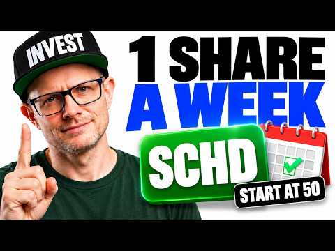
- 설명 앞부분: Starting SCHD at 50? What could buying just 1 share a week mean for your retirement income at 65? I ran the numbers—and the difference between the optimistic and conservative scenarios surprised me. In this video, I explore a hypothetical 15-year investing plan using SCHD, the Schwab U.S. Dividend …
- 같은 채널 평소 대비 ×24.5 (채널 최근 롱폼 중앙값 8,398회) · 평소 영상: 10 Dividend ETFs Ranked — I Only Own 5 of Them (8,558회) / SCHD Is at an All-Time High. Here’s Why I’m Still… (8,238회)
- 대본 없음 (설명) — 음성인식이 끝나면 도입부·흐름이 들어감
- 댓글 162/219: 좋은 점 — 영상 0 · 감사·응원 0 · 더 알고 싶은 것 0 · 아쉬운 점 — 영상 0 · 반박·불만 — 의견 다름 0 · 정치·사회 0 · 경험 공유 0 · 구독·다음 기대 0

### 91. 50대에 은퇴하려면 QLD 몇 개 모아야 할까?

- https://www.youtube.com/watch?v=91-r5_pdQUw · 미국회계사 샘돌이 투자연구소 · 구독자 1,720 · 조회수 14,647 (×8.5, 하루 760.2) · 좋아요 99 (0.7%) · 8.2분 · 2026-10-18 · 주제 묶음 10. 노후·연금 투자 · 형식 브이로그·직접 해본 이야기 · 폴더 `W_91-r5_pdQUw` (웹 승인)
- 썸네일: 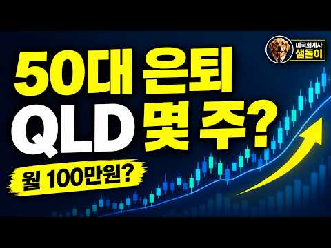
- 설명 앞부분: 50대에 은퇴하려면 도대체 얼마가 필요할까요? 그리고 그 돈을 만들기 위해 매달 얼마를 투자해야 할까요? 이번 영상에서는 은퇴 후 월 300만 원의 현금흐름을 목표로 잡고, S&P500 1배수 투자와 QLD 60% + 단기채 40% 포트폴리오를 비교해봤습니다. 단순히 "20년 뒤 10억입니다"라고 이야기하는 것이 아니라, 50대 은퇴를 위한 목표자산은 얼마인지 S&P500에 투자한다면 매월 얼마가 필요한지 QLD + 단기채 조합이라면 월 적립액이 얼마나 줄어드는지 10억 원을 만들었을 때 QLD는 몇 주가 필요한지 은퇴가 가까워졌…
- 같은 채널 평소 대비 ×3.8 (채널 최근 롱폼 중앙값 3,864회) · 평소 영상: QLD 올인 vs SCHD 적립.. 둘 다 틀렸습니다 (회계사 결산) (4,012회) / SCHD 15년 백테스트로 확인한 장기투자 3가지 맹점 (3,716회)
- 대본 없음 (설명) — 음성인식이 끝나면 도입부·흐름이 들어감
- 댓글 16/17: 좋은 점 — 영상 0 · 감사·응원 0 · 더 알고 싶은 것 1 · 아쉬운 점 — 영상 0 · 반박·불만 — 의견 다름 0 · 정치·사회 0 · 경험 공유 1 · 구독·다음 기대 0
  - 더 알고 싶은 것 👍0 “안녕하세요 AI들은 QLD 완전 극혐하던데.. 60대이후 QLD를 안전하게 관리하는 방법들도 좀 다뤄주시면 좋겠습니다.. 그냥 60대들은 QLD 손 안대는게 좋다고들 하는데.. 방법이 없을까요?”
  - 경험 공유 👍0 “요즘 드는 생각이 제가 대학생에서 사회 초년생 때, 2000년에서 2011 미국 시장 인데요. 이번엔 2000년대 같은 폭락은 피한다 해도…인터넷 붐 및 신기술발전은 망한게 아니라 이 기간 동안 계속 됐잖아요. 근데 미국 주식은 폭락후 약 10년동안 횡보 였거든요. …”

### 92. Can You Retire With Just SCHD? ∣ SCHD Expert Explains

- https://www.youtube.com/watch?v=lRlUmwigNYU · The Mispriced Podcast · 구독자 3,970 · 조회수 136,744 (×34.4, 하루 1,739.0) · 좋아요 1,897 (1.4%) · 36.6분 · 2026-08-19 · 주제 묶음 2. 장기투자·ETF·지수 · 형식 정보·해설 (그 밖) · 폴더 `W_lRlUmwigNYU` (웹 승인)
- 썸네일: 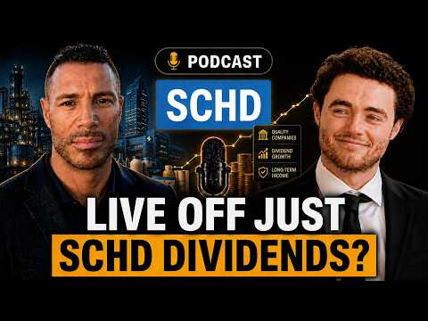
- 챕터: 0:00 Introduction · 1:28 Why Craig started investing i… · 5:15 His $1 million SCHD goal · 6:51 What drives SCHD’s dividend g… · 11:16 SCHD’s long-term performance · 13:18 Can someone retire with only … · 16:58 Pairing SCHD with option-inco… · 21:57 Can SCHD keep outperforming i… · 26:24 SCHD’s expected 2026 dividend… · 30:06 Which stock is currently misp… · 34:29 SCHD and sequence-of-returns …
- 설명 앞부분: In this episode of Mispriced, I sit down with Craig, better known as “SCHD Stan,” to discuss his journey investing in SCHD and his goal of building a $1 million position in the fund. We break down what makes SCHD’s methodology unique, how the ETF has consistently grown its dividend, and whether som…
- 같은 채널 평소 대비 ×7.9 (채널 최근 롱폼 중앙값 17,369회) · 평소 영상: SCHD Just Saw a Massive Change? SCHD Expert Expla… (18,680회) / The Top 5 REITs to Buy Today ∣ REIT Expert Brad T… (16,058회)
- 대본 (자막, 0.0 음절/초) 첫 20초: “Welcome back everyone. Today we are joined by a very special guest. We are joined by Craig aka SCHD Stan. And if you aren't familiar with Craig, he has become one of the leading experts on SCHD and generally speaking his goal is to one day live off SCHD dividends. So Craig, thank you so much for joi”
- 첫 1분: “Welcome back everyone. Today we are joined by a very special guest. We are joined by Craig aka SCHD Stan. And if you aren't familiar with Craig, he has become one of the leading experts on SCHD and generally speaking his goal is to one day live off SCHD dividends. So Craig, thank you so much for joining us. >> Thank you, Eli. I'm honored to be to be invited on your show. I've been following your d”
- 흐름 (90초마다 첫 문장): 0:03 Welcome back everyone. Today we are → 1:30 accounts and back then it was mutual → 3:01 people started kind of dying on it. → 4:31 a new all-time high, trading around → 6:00 So and I'm at right now I'm at over → 7:30 And that's it. And and look how well → 9:01 finding → 10:32 of built-in → 12:02 total stock market index. So again, when → 13:31 Um → 15:00 honestly think that that SCHD over the → 16:30 hold up much better as well. So, it's → 18:01 my idea's been okay, well really if you → 19:30 GPIQ, the GPIX, but again they tend to → 21:01 time if that net asset value continues → 22:30 but in your opinion, does SCHD have the → 24:03 the beginning of the year when we → 25:30 look like. But, if you're wanting to → 27:02 I don't like to always throw out a a → 28:31 could lead to like
- 댓글 343/358: 좋은 점 — 영상 0 · 감사·응원 0 · 더 알고 싶은 것 0 · 아쉬운 점 — 영상 0 · 반박·불만 — 의견 다름 0 · 정치·사회 0 · 경험 공유 0 · 구독·다음 기대 0

### 93. I Reinvested Dividends for 30 Years — Here's What Actually Happened

- https://www.youtube.com/watch?v=oZqWOuMZwdA · BudgetMoney · 구독자 2,550 · 조회수 163,753 (×64.2, 하루 1,110.5) · 좋아요 2,204 (1.4%) · 11.3분 · 2026-06-11 · 주제 묶음 기타 · 형식 정보·해설 (그 밖) · 폴더 `W_oZqWOuMZwdA` (웹 승인)
- 썸네일: 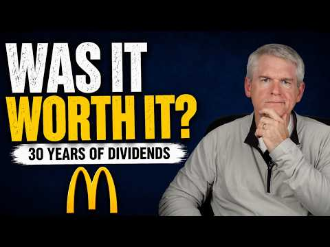
- 챕터: 0:00 What 30 Years Actually Taught… · 1:19 What a Dividend Actually Is · 2:13 The Three Choices: Spend, Rei… · 3:03 30-Year Proof: Dividend Growt… · 6:55 The Tax Reality Nobody Warns … · 8:22 The One Number Nobody Checks:… · 10:07 Rich vs. Wealth — The Real Di…
- 설명 앞부분: I started reinvesting dividends in 1995. For 30 years I watched what compound dividend growth actually does to a portfolio — and it's not what most beginners expect.In this video I break down dividend growth investing from the ground up: what a dividend actually is, the three choices you have every…
- 같은 채널 평소 대비 ×524.8 (채널 최근 롱폼 중앙값 312회) · 평소 영상: Why RobinHood Wants You to Trade More (345회) / The Real Reason You Can't Find a Starter Home (279회)
- 대본 (자막, 0.0 음절/초) 첫 20초: “I started investing in 1995. I was 26 years old. I'd read about compound interest. I'd read about dividend reinvesting. I understood the math. But understanding it on paper and watching it work for 30 years, those are not the same thing. And after three decades, I can tell you there's a difference b” — 도입부 유형: 숫자로 시작
- 첫 1분: “I started investing in 1995. I was 26 years old. I'd read about compound interest. I'd read about dividend reinvesting. I understood the math. But understanding it on paper and watching it work for 30 years, those are not the same thing. And after three decades, I can tell you there's a difference between reading about compounding and watching it happen in your own account. Here's an early McDonal”
- 흐름 (90초마다 첫 문장): 0:00 I started investing in 1995. I was 26 → 1:32 business or pay some of it out to the → 3:00 came from. → 4:32 Let me Let me show you what that → 6:02 roughly around 3%, 3 and 1/2% over the → 7:31 what it is, and then they move on. → 9:01 that dividend is at risk. But here's → 10:30 that's what builds wealth.
- 댓글 336/336: 좋은 점 — 영상 0 · 감사·응원 0 · 더 알고 싶은 것 0 · 아쉬운 점 — 영상 0 · 반박·불만 — 의견 다름 0 · 정치·사회 0 · 경험 공유 0 · 구독·다음 기대 0

### 94. 주식 기초 강의 한번 배워서 평생 써먹는 주린이를 위한 주식 투자 방법

- https://www.youtube.com/watch?v=36sFYI8uboE · 마이크로스콥  · 구독자 2,280 · 조회수 27,711 (×12.2, 하루 968.2) · 좋아요 488 (1.8%) · 13.7분 · 2026-10-08 · 주제 묶음 1. 주식 기초·초보 · 형식 인터뷰·강연·대담 · 폴더 `W_36sFYI8uboE` (웹 승인)
- 썸네일: 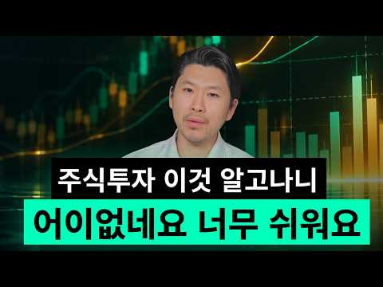
- 챕터: 0:00 주식 기초 강의를 접하게 된 계기 · 0:55 주식 기초 강의가 중요한 이유의 실제 연구와 그 결과 · 2:40 주식 기초 강의의 3요소 · 4:55 주식 기초 강의의 전설 소개 · 6:20 주식 기초 강의에서 가장 유명한 비유 · 8:45 주식 기초 강의 과열과 바닥 구분하는 방법 · 9:55 주식 기초 강의 추천도서 · 11:35 주식 기초 강의의 대가 앙드레 코스톨라니
- 설명 앞부분: 주식 기초 강의를 처음 접하는 분들도 이해할 수 있도록, 꼭 알아야 할 핵심 개념과 투자 원리를 쉽게 정리했습니다. 이번 주식 기초 강의에서는 복잡한 용어보다 실제 투자에 바로 써먹을 수 있는 기본 원칙과 판단 기준을 중심으로 설명합니다. 주식을 처음 시작했다면 이 주식 기초 강의부터 보세요. 한 번 익혀두면 앞으로 투자할 때 계속 활용할 수 있는 기초 내용을 담았습니다. 앙드레 코스톨라니의 돈 뜨겁게 사랑하고 차갑게 다루어라. 추천드립니다. 성공투자 하시길 바랍니다.
- 같은 채널 평소 대비 ×13.1 (채널 최근 롱폼 중앙값 2,119회) · 평소 영상: 대한민국 메가 프로젝트 1,600조 뉴스 보고 이 주식 사면 물립니다 국책기관이 경고한 … (2,119회) / 크게 수익 내자마자 90%가 범하는 치명적 실수! 결국 전재산 날리는 진짜 원인 (2,012회)
- 대본 없음 (설명) — 음성인식이 끝나면 도입부·흐름이 들어감
- 댓글 21/42: 좋은 점 — 영상 0 · 감사·응원 4 · 더 알고 싶은 것 0 · 아쉬운 점 — 영상 0 · 반박·불만 — 의견 다름 1 · 정치·사회 0 · 경험 공유 0 · 구독·다음 기대 0
  - 감사·응원 👍5 “깨달음의 경험공유 감사합니다. ✨️Microscope King✨️ 👍👍👍👏👏👏💯🙏”
  - 감사·응원 👍4 “쓰라리지만 소중한 경험을 베풀어 주셔서 고맙습니다. 내년 초에 부동자산 정리되면 현금흐름을 위한 기업투자에 입문하려고 공부 중입니다. 차트보고 기업분석하는 그런 공부는 아닙니다. ETF를 주로 할 것이기 때문에 "계좌 종류, 세금, 종목과 분산, 미국직투 등" 개괄적…”
  - 반박·불만 — 의견 다름 👍4 “쓰라리지만 소중한 경험을 베풀어 주셔서 고맙습니다. 내년 초에 부동자산 정리되면 현금흐름을 위한 기업투자에 입문하려고 공부 중입니다. 차트보고 기업분석하는 그런 공부는 아닙니다. ETF를 주로 할 것이기 때문에 "계좌 종류, 세금, 종목과 분산, 미국직투 등" 개괄적…”

### 95. 단타만 15년, 큰 수익을 냈지만 이제는 그만두려는 이유

- https://www.youtube.com/watch?v=oV-GWtNyoeg · 노강팔 · 구독자 3,760 · 조회수 15,535 (×4.1, 하루 1,563.7) · 좋아요 210 (1.4%) · 12분 · 2026-10-27 · 주제 묶음 7. 매매·전략 · 형식 정보·해설 (그 밖) · 폴더 `W_oV-GWtNyoeg` (웹 승인)
- 설명 앞부분: 주식, 선물, 코인 15년 단타 외길인생 썰을 푸는 채널입니다. 유튜브는 단순 취미생활이며 이 외의 목적은 1도 없습니다. 노강팔은 본명이 아닙니다. 노: 노 강: 강의 팔: 팔이
- 같은 채널 평소 대비 ×5.9 (채널 최근 롱폼 중앙값 2,648회) · 평소 영상: 역대급 변동성에 휴가가서 매매하는 나는야 매매중독자, 그리고 앞으로의 주가는 어떻게 될까? (2,648회) / 나스닥 폭락, 코스피 야간선물 폭락, 월요일 어떡해야 할까? (2,591회)
- 대본 없음 (설명) — 음성인식이 끝나면 도입부·흐름이 들어감
- 댓글 59/60: 좋은 점 — 영상 5 · 감사·응원 15 · 더 알고 싶은 것 5 · 아쉬운 점 — 영상 0 · 반박·불만 — 의견 다름 1 · 정치·사회 0 · 경험 공유 3 · 구독·다음 기대 0
  - 좋은 점 — 영상 👍3 “잘지내셨나요! 오랜만에 좋은 내용 감사합니다!”
  - 좋은 점 — 영상 👍2 “진짜 강팔 형님 와주셔서 너무감사합니다 이런 인사이트를 보여주는것만으로도 도움이 됩니다 짱구기질있는 시청자만 있는게 아닙니다! 항상 성투하시고 중간중간 댓글때매 회의감 드셔도 한번씩 와주십쇼ㅜㅜ”
  - 감사·응원 👍4 “노강팔님처럼 능력있으면서 솔직한 사람 처음으로 봤습니다. 감사합니다.”
  - 감사·응원 👍3 “피가 되고 살이 되는 말씀입니다. 감사합니다. / 아무리 좋은 것만 해도 악플은 어디든 달리고 이해 불가 댓글도 달리더군요. 그냥 너는 짖어라 하세요~”
  - 더 알고 싶은 것 👍2 “다시 돌아오셨습니다 ㅎㅎ 댓글에 너무 상처받지 말고 간단히 뷰만 올려주세요 ❤”
  - 더 알고 싶은 것 👍2 “시황좀 올려주세요 너무 힘드네요 주변에 깡통찬 사람도 많더라구요”
  - 반박·불만 — 의견 다름 👍2 “진짜 강팔 형님 와주셔서 너무감사합니다 이런 인사이트를 보여주는것만으로도 도움이 됩니다 짱구기질있는 시청자만 있는게 아닙니다! 항상 성투하시고 중간중간 댓글때매 회의감 드셔도 한번씩 와주십쇼ㅜㅜ”
  - 경험 공유 👍19 “강의들으면 해답이 있는것 같이보여 여렷 수강해봤지만 듣는 도중은 그럴싸해보여 기대심에 신나다가도 막상하다보면 ... 그냥 개인들은 시장이 좋을때만 매매하는게 정답이었고 사람들이 제일 관심을 갖는 종목을 가지고 수익볼땐 길게 손실을 짧게 손익비로 승부보는게 현실적인 대…”
  - 경험 공유 👍1 “내가 주식 판에 들어와서. 가장 느끼는 부분 알면서도 못 하는 부분 그리고 가장 도움이 되는 말이네요”

### 96. Jay Hatfield’s Warning to Dividend Investors ∣ What He's Buying Now ∣

- https://www.youtube.com/watch?v=mjIJH1_3UVQ · The Mispriced Podcast · 구독자 3,970 · 조회수 19,112 (×4.8, 하루 1,631.4) · 좋아요 321 (1.7%) · 24.2분 · 2026-10-25 · 주제 묶음 기타 · 형식 정보·해설 (그 밖) · 폴더 `W_mjIJH1_3UVQ` (웹 승인)
- 챕터: 0:00 Introducing Jay Hatfield · 0:14 Record highs, but more stocks… · 2:13 Where Jay sees opportunities · 2:27 Rising Treasury yields and PF… · 4:07 Could the 10-year Treasury yi… · 7:38 How Jay is positioning ICAP · 9:42 Inflation, the Fed, and the o… · 13:11 Preferred shares and bond inc… · 13:55 Why Jay sold STRC and is buyi… · 17:35 ICAP’s increasing options cov… · 18:05 Tech valuations and covered-c… · 20:58 Marvell: Jay’s “idea of the d… · 22:03 Building a barbell portfolio · 23:05 Credit risk versus interest r…
- 설명 앞부분: Jay Hatfield discusses rising Treasury yields, the risks facing dividend investors, and how he’s positioning his portfolios. This video is sponsored by Infrastructure Capital Advisors, LLC. Dividendology received compensation for this interview. FULL DISCLOSURES AND IMPORTANT FUND INFORMATION: Inve…
- 같은 채널 평소 대비 ×1.1 (채널 최근 롱폼 중앙값 17,369회) · 평소 영상: SCHD Just Saw a Massive Change? SCHD Expert Expla… (18,680회) / The Top 5 REITs to Buy Today ∣ REIT Expert Brad T… (16,058회)
- 대본 없음 (설명) — 음성인식이 끝나면 도입부·흐름이 들어감
- 댓글 35/35: 좋은 점 — 영상 0 · 감사·응원 0 · 더 알고 싶은 것 0 · 아쉬운 점 — 영상 0 · 반박·불만 — 의견 다름 0 · 정치·사회 0 · 경험 공유 0 · 구독·다음 기대 0

### 97. 1억이 10억 되는 복리, '딸깍' 이것만 알면 됩니다 [고독한나무]

- https://www.youtube.com/watch?v=8r8ZaImKrm0 · 고독한나무 · 구독자 13,800 · 조회수 67,831 (×4.9, 하루 5,668.5) · 좋아요 640 (0.9%) · 17.4분 · 2026-10-25 · 주제 묶음 11. 투자 일반 · 형식 정보·해설 (그 밖) · 폴더 `W_8r8ZaImKrm0` (웹 승인)
- 챕터: 0:00 최고점에 사도 3배, 그런데 왜 1억에서 멈출까 · 3:08 가격을 두 배로 올렸더니 다 팔렸다 · 7:21 밀림 속 인민사원, 9천피에 사고 바닥에 파는 이유 · 11:11 워뇨띠와 버핏·멍거의 단 하나의 공통점 · 13:47 장기 투자를 지키는 현금 주머니 3개
- 설명 앞부분: 주식을 매년 '최고점'에만 샀어도, 20년 뒤엔 안 한 사람보다 3배 많았습니다. 그런데 왜 우리는 9천피에 사고, 바닥에서 던질까요? 가격을 두 배로 올렸더니 싹 다 팔린 보석 가게, 밀림 속에서 먼저 움직인 몇 명을 따라 줄을 선 사람들. 우리는 스스로 판단한다고 믿지만, 실은 누군가의 '딸깍 버튼'에 판단을 맡기고 있습니다. 크게 잃었어도 괜찮습니다. 방향만 바꾸면 되는 나무님들께 드리는 이야기입니다.
- 같은 채널 평소 대비 ×9.1 (채널 최근 롱폼 중앙값 7,422회) · 평소 영상: 금융 문맹은 이 영상을 끝까지 보기 힘들 겁니다 (8,245회) / 기본을 지키지 않으면 복리고 마법이고 나발이고 아무 의미 없다. (6,599회)
- 대본 없음 (설명) — 음성인식이 끝나면 도입부·흐름이 들어감
- 댓글 105/105: 좋은 점 — 영상 6 · 감사·응원 8 · 더 알고 싶은 것 3 · 아쉬운 점 — 영상 2 · 반박·불만 — 의견 다름 0 · 정치·사회 1 · 경험 공유 3 · 구독·다음 기대 0
  - 좋은 점 — 영상 👍4 “멘탈유지에. 많이 도움이 됩니다 감사해요~ 미국사람 미국투자 말고 한국사람 국내장 투자도 그러했으면 좋겠네요”
  - 좋은 점 — 영상 👍2 “10억 투자자입니다. 다 맞는 말씀이십니다. 감사합니다^^”
  - 감사·응원 👍4 “멘탈유지에. 많이 도움이 됩니다 감사해요~ 미국사람 미국투자 말고 한국사람 국내장 투자도 그러했으면 좋겠네요”
  - 감사·응원 👍2 “10억 투자자입니다. 다 맞는 말씀이십니다. 감사합니다^^”
  - 더 알고 싶은 것 👍1 “영상을 어떻게 이렇게 이쁘고 보기 좋게 잘 만드시는 거죠?”
  - 더 알고 싶은 것 👍0 “이번에도 영상 잘봤습니다!현금주머니 비중은 자산의 몇프로가 적당하다고 보시나요?!”
  - 아쉬운 점 — 영상 👍2 “국장을 하시는 건가요...? 실망이네요...”
  - 정치·사회 👍3 “아이고! 고소해라! 영 포티. 청와대 앞에서 가서 항의해야지! 대통령 만들어 놓으니 주식으로 뒤통수를 가격하네! 투표는 하더라도 경제정책은 반대로 행동하시라. 좌클릭은 경제파국으로 가는 것 이니.”
  - 경험 공유 👍2 “인간이 가진 돈 실력보다 세월이 가진힘이 더 크지 10년이면 강산도 변하는데 🤔🤔🤔🤔 불변은 어쩌다 내가난에만 복리작용을 했나”
  - 경험 공유 👍1 “저는 이 게임을 해봤습니다. 2022년 3월부터 3억 원 달성까지의 마일스톤 기록이 있어요: 2022.3 — 최초투자 8,700만원 (사실상 전재산) 2023.8 (17개월 후) — 1억 원 달성 2024.1 (5개월 후) — 1억5천만 원 2024.11 (10개월 …”

### 98. 10년 넣고 멈췄는데 8.6억? SCHD 임계점의 반전 [ 재테크/미국주식/배당주식/슈드/노후대책 ]

- https://www.youtube.com/watch?v=BV6cSyxnBlo · 경제기상도 · 구독자 4,470 · 조회수 25,452 (×5.7, 하루 1,827.8) · 좋아요 43 (0.2%) · 20.3분 · 2026-10-23 · 주제 묶음 4. 미국·해외주식 · 형식 인터뷰·강연·대담 · 폴더 `W_BV6cSyxnBlo` (웹 승인)
- 설명 앞부분: 매달 100만원씩 SCHD를 사 모으다 멈추면 눈덩이도 멈출까요? 놀랍게도 9년 차라는 '임계점'을 지나면, 넣는 걸 멈춰도 계좌는 스스로 불어납니다. 3년 만에 멈춘 사람과 10년을 채우고 멈춘 사람, 20년 뒤 월 배당은 46만원 vs 207만원. 경제기상도가 검증된 숫자로 임계점의 정체와 그 뒤에 숨은 그림자까지 뜯어봤습니다. 이런 분께 추천합니다 SCHD 적립식 투자를 하고 있는데 중간에 멈춰야 할지 고민인 분 적립 초반 수익이 너무 작아 포기하고 싶어진 분 언제부터 돈이 스스로 일하기 시작하는지 궁금한 분 목돈(퇴직금·성…
- 같은 채널 평소 대비 ×2.8 (채널 최근 롱폼 중앙값 9,093회) · 평소 영상: 통장에 3억이 찍히던 날, 제 인생에서 사라진 한 가지 [ 재테크/미국주식/배당주식/슈드… (9,093회) / 1억 한 번에 vs 매달 50만원, 20년 뒤 누가 더 부자일까? ∣ SCHD 20년 승… (9,015회)
- 대본 없음 (설명) — 음성인식이 끝나면 도입부·흐름이 들어감
- 댓글 5/5: 좋은 점 — 영상 1 · 감사·응원 0 · 더 알고 싶은 것 0 · 아쉬운 점 — 영상 0 · 반박·불만 — 의견 다름 0 · 정치·사회 0 · 경험 공유 0 · 구독·다음 기대 0
  - 좋은 점 — 영상 👍1 “적립식 과정이 궁금했는데 도움됐어요.”

### 99. 단타 5년차가 알려준 ＂잃지 않는 법＂ 딱 3가지 ｜ 코스피 9000시대 생존법

- https://www.youtube.com/watch?v=7o59e01aiOs · 돈사냥꾼-TV · 구독자 2,060 · 조회수 10,076 (×4.9, 하루 827.6) · 좋아요 74 (0.7%) · 13.5분 · 2026-10-25 · 주제 묶음 5. 국내주식 · 형식 정보·해설 (그 밖) · 폴더 `W_7o59e01aiOs` (웹 승인)
- 설명 앞부분: KBS 기자 KBS 디지털 뉴스 본부장 KBS 울산 방송국 본부장, KBS 해설위원, KBS 교통공무원노조 위원장 등을 역임하며 미디어와 저널리즘 분야에서 풍부한 경험을 쌓아 왔습니다. 이러한 실무 경험을 바탕으로, 현재 미디어 환경에 대한 정확한 정보, 심층 분석, 그리고 솔직한 시각을 제공하기 위해 최선을 다하고 있습니다. 여러분의 지지와 협력은 투명하고 신뢰받는 저널리즘을 향한 저희의 지속적인 노력에 원동력이 됩니다.
- 같은 채널 평소 대비 ×3.9 (채널 최근 롱폼 중앙값 2,589회) · 평소 영상: ＂지금 예적금 하지 마세요＂ 현금 안전하게 굴리는 방법 (2,607회) / 100년 데이터가 증명한 부자 공식ㅣ코스피 신고가에 지금 사도 되는 이유 (2,571회)
- 대본 없음 (설명) — 음성인식이 끝나면 도입부·흐름이 들어감
- 댓글 1/1: 좋은 점 — 영상 0 · 감사·응원 0 · 더 알고 싶은 것 0 · 아쉬운 점 — 영상 0 · 반박·불만 — 의견 다름 0 · 정치·사회 0 · 경험 공유 0 · 구독·다음 기대 0

### 100. The Real Reason Stocks Haven't Crashed Yet (VOO ETF Analysis)

- https://www.youtube.com/watch?v=eafYDMU14aM · Goldman Starch · 구독자 6,160 · 조회수 32,424 (×5.3, 하루 2,437.9) · 좋아요 736 (2.3%) · 30분 · 2026-10-24 · 주제 묶음 2. 장기투자·ETF·지수 · 형식 정보·해설 (그 밖) · 폴더 `W_eafYDMU14aM` (웹 승인)
- 챕터: 0:00 The real reason stocks haven'… · 1:10 The pullback nobody counted: … · 2:21 10 stocks are 39% of the inde… · 3:27 The chain: lenders, builders,… · 5:00 How VOO is built: the one rule · 6:21 Earnings yield 3.8% vs 10-yea… · 8:25 Three buyers who don't read t… · 8:35 Buyer 1: $1 trillion of buyba… · 9:52 Buyer 2: you, the 401k payrol… · 11:05 Buyer 3: the AI build-out, fu… · 12:01 Is the levered buyer getting … · 13:07 The circle: Nvidia, OpenAI, C… · 15:07 Credit leads stocks by 7 mont… · 17:21 The concentration bill · 17:44 The bull case: rotation, 2016… · 19:54 Oct 14: bonds became the hedg… · 21:08 2007 vs 2018: which cycle is … · 22:30 The Fed put has a strike pric… · 24:29 Why not sell: midterm base ra… · 25:46 What I'd do: RSP over VOO, he…
- 설명 앞부분: The real reason stocks haven't crashed yet, through VOO, Vanguard's S&P 500 ETF. Stocks did pull back: the S&P 500 fell 2% from its October 6 record to the October 16 low, while the Nasdaq 100 fell 6.6%, the tech sector 9%, small caps 11%, semiconductors 25% from their June high, and the equal-weig…
- 같은 채널 평소 대비 ×12.6 (채널 최근 롱폼 중앙값 2,578회) · 평소 영상: FNMA Stock Analysis: The Most Complete Fannie Mae… (2,704회) / SPY ETF Analysis The Most Complete S&P500 Breakdo… (2,451회)
- 대본 없음 (설명) — 음성인식이 끝나면 도입부·흐름이 들어감
- 댓글 99/99: 좋은 점 — 영상 0 · 감사·응원 0 · 더 알고 싶은 것 0 · 아쉬운 점 — 영상 0 · 반박·불만 — 의견 다름 0 · 정치·사회 0 · 경험 공유 0 · 구독·다음 기대 0

### 101. AI로 주식 자동 매매하면 어떻게 될까?

- https://www.youtube.com/watch?v=9E9OrcoMCjk · 이영배 · 구독자 21,200 · 조회수 1,161,375 (×54.8, 하루 8,364.9) · 좋아요 5,691 (0.5%) · 11.3분 · 2026-06-20 · 주제 묶음 7. 매매·전략 · 형식 정보·해설 (그 밖) · 폴더 `W_9E9OrcoMCjk` (웹 승인)
- 썸네일: 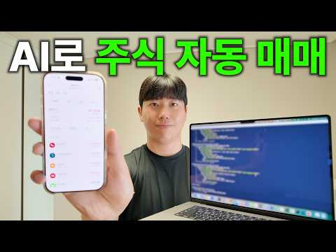
- 같은 채널 평소 대비 ×6.8 (채널 최근 롱폼 중앙값 171,448회) · 평소 영상: AI에게 유튜브 채널을 운영시키면 구독자를 몇 명 모을까? (176,477회) / AI에게 인스타그램 운영을 시키면 팔로워를 몇 명 모을까? (267,671회)
- 대본 (음성인식(앞 5분), 6.8 음절/초) — 앞부분만, 흐름은 그 안까지 첫 20초: “지금부터 AI 두 개로 주식거래 대결 시켜볼 겁니다 누가 더 돈을 많이 벌어올까요? 제가 직접 한번 해보겠습니다 저는 제돈 천만 원을 AI 두 개에게 맡겨봤습니다 하나는 클로드의 오프스 4.8 다른 하나는 오픈 AI의 GPT 5.5인데요 둘 다 현재 최고의 성능을 자랑하는 각 회사의 최신 모델입니다 규칙은 간단합니다 실제 돈 500만 원을 받고 2주, 공일 제외 9 거래일 동안 최대 수익을 내면 됩니다” — 도입부 유형: 질문으로 시작
- 첫 1분: “지금부터 AI 두 개로 주식거래 대결 시켜볼 겁니다 누가 더 돈을 많이 벌어올까요? 제가 직접 한번 해보겠습니다 저는 제돈 천만 원을 AI 두 개에게 맡겨봤습니다 하나는 클로드의 오프스 4.8 다른 하나는 오픈 AI의 GPT 5.5인데요 둘 다 현재 최고의 성능을 자랑하는 각 회사의 최신 모델입니다 규칙은 간단합니다 실제 돈 500만 원을 받고 2주, 공일 제외 9 거래일 동안 최대 수익을 내면 됩니다 가장 먼저 클로드 코드로 거래를 할 수 있는 프로그램을 뚝딱 만들어냈고요 상태를 확인할 수 있는 데시보드도 구현해놨습니다 그래도 2주 동안 함께 하는 녀석들 아닙니까? 그래서 제가 이름도 한번 붙여봤는데 클로드가 짱이냐, 체치 PT가 짱이냐 이걸 정하는 거니까 휠짱이, 체짱이 이렇게 하겠습니다 그렇게 휠짱이와”
- 흐름 (90초마다 첫 문장): 0:00 지금부터 AI 두 개로 주식거래 대결 시켜볼 겁니다 → 1:30 일단 시장을 쭉 관망을 해요 → 3:01 삼성전자를 잇절해서 14만 원을 벌었다고 전 보고를 했단 말이죠 → 4:31 아니 왜 제가 시작하니까 갑자기 이런 일이 생기는 거죠?
- 댓글 578/596: 좋은 점 — 영상 6 · 감사·응원 17 · 더 알고 싶은 것 34 · 아쉬운 점 — 영상 3 · 반박·불만 — 의견 다름 8 · 정치·사회 7 · 경험 공유 34 · 구독·다음 기대 21
  - 좋은 점 — 영상 👍4 “딕션도 좋고 설명이 좋아요 컨텐츠만 좋으면 크게 되실분이다!!화이팅!!”
  - 좋은 점 — 영상 👍2 “영상 잘봤습니다. 앞으로 쭉쭉 좋은 영상 만들어주세요! 응원할게요”
  - 감사·응원 👍4 “딕션도 좋고 설명이 좋아요 컨텐츠만 좋으면 크게 되실분이다!!화이팅!!”
  - 감사·응원 👍3 “형들 마지막에 유튜버분 말들엇지? 현업코딩전문개발자들이 ai사용해서 장기적으로 수익이안나..이말은 전문지식으로 완벽하다 할만큼 만드는데도 지랄발광하면서 디버깅터지고 마이너스맞는거야.. 괜히 난 아이디어가 특별해 하면서 부여잡지마 현업개발자들이 아직 깡깡멀엇다함 미토스…”
  - 더 알고 싶은 것 👍3 “422번째 구독자입니다 올해안에 10만 가실 듯 앞으로도 재밌는 영상부탁드려요!”
  - 더 알고 싶은 것 👍2 “영상 잘봤습니다. 앞으로 쭉쭉 좋은 영상 만들어주세요! 응원할게요”
  - 아쉬운 점 — 영상 👍8 “영상 잘 봤습니다. 우연히 알고리즘 추천에 떠서 봤습니다. 편집이나 말씀 하시는 것도 되게 깔끔하고 보기 좋았습니다.”
  - 아쉬운 점 — 영상 👍4 “영상편집이나 진행. 딕션까지. 우연히 알고리즘에 떠서 봤는데 잼있네요. 구독하고가요”
  - 반박·불만 — 의견 다름 👍200 “재밌어요. 구독자 68명 퀄이아닌데요 머지”
  - 반박·불만 — 의견 다름 👍1 “영상 재밌게 봤습니다. 저도 개인 자동매매 시스템을 직접 개발해서 운영 중인데, 이 영상 보면서 왜 이런 결과가 나왔는지 조금 다른 각도에서 짚어보고 싶어요. **1. "가격을 임의로 예측해서 넣은" 그 버그가 핵심입니다** 영상에서 매도가를 못 불러와서 봇이 알아서…”
  - 정치·사회 👍0 “6월4일이면 선거 끝나고네 선가 전에 주가 올리고 선거끝나고 주가빠지고”
  - 정치·사회 👍0 “대한 외국인이네 딛,ㄹ 곱게 자란 인간들”
  - 경험 공유 👍147 “저도 직접 자동매매 시스템 만들어서 실제 운용 중인데, 느낀 점이 AI한테 판단을 맡기는 게 아니라 내 철학을 코드로 번역하는 게 핵심이더라고요. 언제 사고 언제 파느냐를 AI가 즉흥으로 결정하게 두면 결국 감정매매랑 다를 게 없어요. 시스템이 일관성을 갖추려면 철학…”
  - 경험 공유 👍13 “저도 ai로 코딩하여 자동매매 돌리는중인데 결국은 ai는 프로그램 만드는 툴로만 써야하고 전략은 내가짜야됨..”
  - 구독·다음 기대 👍16 “영상주기만 빨라지만 훨씬 대형채널이 될거같네요 저점매수 구독하고갑니다”
  - 구독·다음 기대 👍9 “이야 ㅋㅋㅋㅋ 주제 ㅅㅌㅊ 돈 잃었으니 바아로 구독합니다”

### 102. S&P500とNASDAQ100、10月最後の1週間はどうなる？11月の前に、プロ投資家は行う準備【米国株】

- https://www.youtube.com/watch?v=ZELGuBkVtuA · まなみんの米国株の学校【投資初心者でも10分で学べる】 · 구독자 8,500 · 조회수 36,780 (×4.3, 하루 3,353.9) · 좋아요 345 (0.9%) · 24.8분 · 2026-10-26 · 주제 묶음 2. 장기투자·ETF·지수 · 형식 정보·해설 (그 밖) · 폴더 `W_ZELGuBkVtuA` (웹 승인)
- 설명 앞부분: S&P500・NASDAQ100などの米国株と、 ※映像や資料の制作にはAIを活用していますが、相場の分析と「私はこう見る」の見解は、すべて実在する運営者自身のものです🤍
- 같은 채널 평소 대비 ×5.0 (채널 최근 롱폼 중앙값 7,397회) · 평소 영상: 【米国株 最新】今、大口投資家が狙っている銘柄を公開しちゃいます。大口と一緒に大きな波に乗りたい… (7,536회) / 【米国株・オルカン】全世界株式（オール・カントリー）で資産を増やすためには、為替ドル円もしっか… (7,258회)
- 대본 없음 (설명) — 음성인식이 끝나면 도입부·흐름이 들어감
- 댓글 38/38: 좋은 점 — 영상 0 · 감사·응원 0 · 더 알고 싶은 것 0 · 아쉬운 점 — 영상 0 · 반박·불만 — 의견 다름 0 · 정치·사회 0 · 경험 공유 0 · 구독·다음 기대 0

### 103. Dividend देने वाली Top 04 कंपनिया 🔴 Dividend paying stocks 2026🔴 Stock market latest news

- https://www.youtube.com/watch?v=UtvM2nhg3OE · Stock Market का Guide · 구독자 2,970 · 조회수 12,427 (×4.2, 하루 1,152.4) · 좋아요 289 (2.3%) · 20.1분 · 2026-10-26 · 주제 묶음 기타 · 형식 정보·해설 (그 밖) · 폴더 `W_UtvM2nhg3OE` (웹 승인)
- 설명 앞부분: DISCLAIMER: This video is intended solely for educational and learning purposes. We have no intention of involving clients in any trading or investing activities it's important to clarify that we are not registered with SEBI (Securities and Exchange Board of India). We Strongly advise you to consul…
- 같은 채널 평소 대비 ×1.3 (채널 최근 롱폼 중앙값 9,814회) · 평소 영상: ₹505 से गिरके ₹5 आया 🔴 प्रमोटर 1% से 70% हुए 🔴 st… (9,814회) / डॉली खन्ना, केडिया का बड़ा दांव 🔴 ₹156 से गिरके ₹… (9,802회)
- 대본 없음 (설명) — 음성인식이 끝나면 도입부·흐름이 들어감
- 댓글 5/5: 좋은 점 — 영상 0 · 감사·응원 0 · 더 알고 싶은 것 0 · 아쉬운 점 — 영상 0 · 반박·불만 — 의견 다름 0 · 정치·사회 0 · 경험 공유 0 · 구독·다음 기대 0

### 104. 4200억 단타 일본 천재가 초간단 매매법, 죽어라 이것만하세요

- https://www.youtube.com/watch?v=UH4UFmdXXo0 · 세력시그널 · 구독자 3,590 · 조회수 113,825 (×31.7, 하루 1,370.4) · 좋아요 2,518 (2.2%) · 20.6분 · 2026-08-15 · 주제 묶음 7. 매매·전략 · 형식 정보·해설 (그 밖) · 폴더 `W_UH4UFmdXXo0` (웹 승인)
- 썸네일: 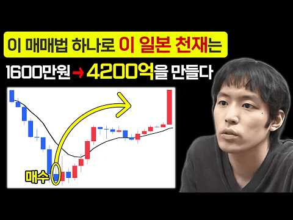
- 챕터: 0:00 BNF 코테카와 타카시 ∣ 1,600만 원으로 시작한… · 2:35 슈퍼 트레이더 자동매매 봇 안내 · 2:46 BNF의 은둔형 투자 생활 ∣ 주식에 인생을 건 전업… · 3:41 제이콤 주식 사건 ∣ BNF가 16분 만에 200억 … · 5:49 독학으로 성공한 BNF ∣ 제시 리버모어와 실전 차트… · 6:30 BNF 투자 원칙 ① 가격 움직임과 시장 심리 · 7:30 BNF 투자 원칙 ② 기계적 손절과 리스크 관리 · 8:12 BNF 투자 원칙 ③ 거래량·캔들로 판단하는 익절 타… · 8:44 BNF 투자 원칙 ④ 공포와 탐욕을 이용한 역발상 매매 · 9:32 BNF 투자 원칙 ⑤ 개장 후 첫 30분 관찰 전략 · 10:17 BNF 투자 원칙 ⑥ 감정을 배제한 확률 기반 매매 · 11:00 BNF 투자 원칙 ⑦ 거래량과 종목 선정 기준 · 12:12 BNF 역추세 매매법 ∣ 급락주 바닥을 찾는 3가지 … · 13:15 25일 이동평균선 이격도 ∣ BNF의 급락주 매수 기준 · 14:21 BNF 차트 세팅 ∣ 25일 지수이동평균선·RSI·M… · 15:25 이격도 측정법 ∣ 25일선 대비 -20~35% 과매도… · 16:12 대형주·중소형주·상승장·하락장 이격도 기준 · 17:31 BNF 매수 타이밍 4단계 ∣ 이격도·RSI·MACD… · 18:25 지지선·저항선 활용 ∣ BNF 역추세 매매법 실전 응용 · 19:35 상승장·하락장별 익절과 손절 전략
- 설명 앞부분: 4200억 단타 일본 천재가 초간단 매매법, 죽어라 이것만하세요 🌟슈퍼트레이더 자동 매매봇 신청하기🌟 🌟 BNF 트레이딩 비법 전자책 신청하기🌟
- 같은 채널 평소 대비 ×45.8 (채널 최근 롱폼 중앙값 2,484회) · 평소 영상: 볼린저밴드 투자기법으로 완벽한 매매 타점 잡는법(차트 보는법 모르는 초보도 가능) (3,081회) / 80억을 잃고 깨달은 126 분할매수법 하나로 220억을 번 매매법 (1,888회)
- 대본 없음 (설명) — 음성인식이 끝나면 도입부·흐름이 들어감
- 댓글 216/250: 좋은 점 — 영상 5 · 감사·응원 28 · 더 알고 싶은 것 0 · 아쉬운 점 — 영상 1 · 반박·불만 — 의견 다름 6 · 정치·사회 0 · 경험 공유 2 · 구독·다음 기대 0
  - 좋은 점 — 영상 👍1 “BNF 정말 유익한 영상이네요. 감사합니다.”
  - 좋은 점 — 영상 👍0 “BNF~ 이걸 이제 봤네요^^; 유익한 내용 공유에 감사드립니다”
  - 감사·응원 👍5 “ㅋㅋㅋㅋㅋㅋㅋㅋㅋㅋ 그냥 ㅈㄴ 웃기네요 BNF 기본 매매법 저대로 시장에 적용해보세요~ 저 진입 조건에 맞는 종목을 찾을 수 있을까요? 화이팅~!!”
  - 감사·응원 👍4 “BNF 정말 잘 봤습니다 감사합니다”
  - 아쉬운 점 — 영상 👍0 “얘들은 한결같네. 낚시질로 펌핑해놓고 걸려들면 전화해서 하루에 얼마씩 거래하는지 시드는 얼마냐는둥 이따구 소리만 해대면서 막상 지표는 안보내고 어떻게든 빨대꽂아서 학원비 받아쳐 먹으려는 공통적인 수법인데...또한가지는 지표신청서 작성을 하면 그이후로 어중이 떠중이로부…”
  - 경험 공유 👍1 “아 나도 할줄알면 이해라도 하는데 무슨말인지조차 모르는 불쌍한1인”

### 105. 배당금으로 먹고 살려면 얼마를 투자해야 할까

- https://www.youtube.com/watch?v=mVeISdo4nPs · 부자의습관 · 구독자 6,080 · 조회수 16,315 (×2.7, 하루 2,291.2) · 좋아요 166 (1.0%) · 36.4분 · 2026-10-30 · 주제 묶음 3. 배당 · 형식 오디오북·낭독 (명언·인생조언) · 폴더 `W_mVeISdo4nPs` (웹 승인)
- 설명 앞부분: 왜 어떤 부자가 되는 데에 이번 영상에서는 일상에서 쉽게 실천할 수 있는 부자의습관, 돈 관리 방법, 저축 습관, 소비 습관과 재테크에 도움이 되는 경제 상식을 알기 쉽게 이야기합니다. 돈을 많이 버는 것만큼 중요한 것은 돈을 어떻게 관리하고 사용하는가입니다. 평소 무심코 반복하는 행동이 자산을 만드는 습관이 될 수도 있고, 반대로 돈이 새어나가는 원인이 될 수도 있습니다. 이 채널에서는 부자들의 사고방식과 생활 습관, 현명한 소비와 저축, 자산 관리, 노후 준비 등 우리의 경제생활에 도움이 되는 다양한 이야기를 꾸준히 전해드립니…
- 대본 없음 (설명) — 음성인식이 끝나면 도입부·흐름이 들어감
- 댓글 2/2: 좋은 점 — 영상 0 · 감사·응원 0 · 더 알고 싶은 것 0 · 아쉬운 점 — 영상 1 · 반박·불만 — 의견 다름 0 · 정치·사회 0 · 경험 공유 0 · 구독·다음 기대 0
  - 아쉬운 점 — 영상 👍0 “받은걸 다시 재투자 -> 반복이 핵심!!”

### 106. "중장기 투자? 삼전닉스 말고 스페이스X 모으세요” (정의훈 선임연구원)

- https://www.youtube.com/watch?v=bMR3jvlYDgo · 투자360 · 구독자 16,600 · 조회수 149,062 (×9.0, 하루 6,201.0) · 좋아요 724 (0.5%) · 16분 · 2026-10-13 · 주제 묶음 11. 투자 일반 · 형식 정보·해설 (그 밖) · 폴더 `W_bMR3jvlYDgo` (웹 승인)
- 썸네일: 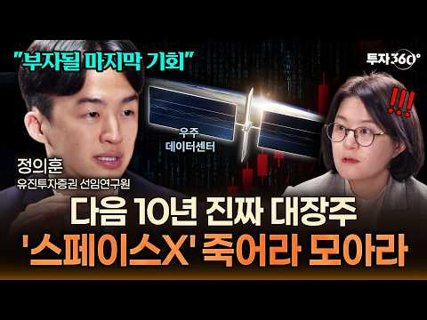
- 챕터: 0:00 🔥 하이라이트 · 0:58 🚀 스페이스X 70% 급등, 무슨 일이 있었나 · 3:52 ⚠️ 삼성전자·하이닉스 중장기 투자를 반대하는 이유! · 4:29 💰 70% 오른 스페이스X 개별주 살까? ETF 살까? · 5:59 💰 🌌 우주 데이터센터, 드디어 돈이 되나? · 8:29 📊 스페이스X, 꼭 봐야 할 4가지 지표 · 11:17 🚨 어떤 신호가 나오면 투자를 멈춰야 하나 · 12:55 🔥 스타십·스타링크·AI, 다음 성장동력은? · 14:15 🎯 지금 주가는 고점? “아직 다 반영 안 됐다”
- 설명 앞부분: "삼전닉스 장투 추천 안 합니다. 잘 모르겠으면 스페이스X 사세요” 저점 대비 약 70% 반등한 스페이스X. 지금 들어가기엔 이미 늦은 걸까요? 정의훈 유진투자증권 연구원과 최근 주가 급등 이유부터 특히 현재 주가에 향후 성장 기대가 얼마나 반영됐는지, 어떤 신호가 나오면 투자를 다시 점검해야 하는지도 확인합니다. 🎥촬영일: 2026년 10월 6일 ⏱️ 골라 보는 핵심 투자 포인트
- 같은 채널 평소 대비 ×4.2 (채널 최근 롱폼 중앙값 35,302회) · 평소 영상: “지금까지 금투자 방법 다 틀렸습니다” 금 투자, 개미는 ‘이렇게’ 사야 돈 법니다 ∣ … (35,302회) / 환율 내린 지금이 기회! 삼전닉스 팔아서 현금 '여기로' 옮기세요 #부자탐사대 #효라클 … (38,548회)
- 대본 없음 (설명) — 음성인식이 끝나면 도입부·흐름이 들어감
- 댓글 62/83: 좋은 점 — 영상 0 · 감사·응원 1 · 더 알고 싶은 것 0 · 아쉬운 점 — 영상 0 · 반박·불만 — 의견 다름 1 · 정치·사회 4 · 경험 공유 0 · 구독·다음 기대 0
  - 감사·응원 👍0 “연구원님 저는 믿고 있었습니다 감사합니다 스엑 날라가즈아🎉🎉🎉”
  - 반박·불만 — 의견 다름 👍4 “헛소리말고 지수투자나 해라...”
  - 정치·사회 👍5 “공화당이 중간선거 이기면 스페이스x대상승각이다”
  - 정치·사회 👍4 “스페이스X는 중간선거 이후 사는 게 맞지 않나요? 질문 한번 해주세요~”

### 107. 1년 간 급등락보인 반도체 기업의 주가...앞으로는 이렇게 투자해야합니다 (f. 빈센트 하나증권 이코노미스트, 문서진 대표, 여도은)

- https://www.youtube.com/watch?v=tcja1V8MjY4 · 따불로 DDABULLO · 구독자 2,900 · 조회수 14,317 (×4.9, 하루 1,073.1) · 좋아요 206 (1.4%) · 56.1분 · 2026-10-23 · 주제 묶음 11. 투자 일반 · 형식 정보·해설 (그 밖) · 폴더 `W_tcja1V8MjY4` (웹 승인)
- 챕터: 0:00 1부 오프닝: 하나증권 빈센트 이코노미스트 소개 및 … · 1:50 씨티증권의 SK하이닉스 3분기 영업이익 81조 전망과… · 3:00 실적 발표조차 두려워하는 극단적인 투심 악화의 실체 · 4:20 비정상적인 시장의 정의: 펀더멘탈과 주가의 괴리가 벌… · 5:35 정상화의 유일한 트리거: 높은 숫자가 아닌 실적의 '… · 6:25 30년 메모리 사이클의 덫 vs LTA(장기공급계약 … · 7:45 호실적이 나올수록 피크아웃을 외치는 비관론자들을 설득… · 9:20 숏 세력의 네러티브 공격과 시간이 지날수록 약화될 카… · 10:55 창신메모리(CXMT) 3년 추격설과 치킨게임 공포는 … · 12:15 피지컬 AI와 로봇이 불러올 메모리 폭증: 우리 기업… · 13:10 주주환원과 설비투자의 황금비율 및 기업 소통(IR)의… · 14:15 최태원 회장의 소통 부재 비판: 솔리다임 상장의 당위… · 16:15 SK하이닉스 프리미엄 축소와 재평가 과정에서 겪는 뼈… · 17:40 2등 기업의 메기 효과: 단일 메모리 전문 기업으로서… · 19:30 투자의 본질: 감내할 수 있는 여유자금으로 시대의 중… · 21:30 고점에서 물린 투자자들을 위한 현실적인 조언과 마인드셋 · 23:30 레버리지 매매의 위험성과 120만 원 붕괴 구간에서의… · 25:40 워런 버핏의 가르침: 10년 보유할 주식이 아니면 1… · 26:50 매크로 분석: 돈의 총량이 아닌 '통화 승수(회전율)… · 27:50 연준의 과거 금리 조정 패턴과 터미널 레이트(최종 금…
- 설명 앞부분: ✨️따불로가 간다✨ "반도체 급등락 1년, 앞으로 어떻게 투자해야 할까?" 하나증권 빈센트가 밝히는 실적 괴리의 진실과 한국형 장기투자 로드맵 총정리 코스피 5,000선 위협과 SK하이닉스 급락 속에서 극심한 혼란에 빠진 투자자분들을 위해 하나증권 빈센트 이코노미스트가 나섰습니다! 씨티증권의 3분기 81조 서프라이즈 전망에도 주가가 역행하는 비정상적인 괴리 국면을 진단하고, 과거 30년 사이클 프레임을 깨뜨릴 실적의 연속성과 LTA(장기공급계약)의 진짜 의미를 분석합니다. 아울러 50년간 하락하던 대한민국 잠재성장률을 반등시킬 피…
- 같은 채널 평소 대비 ×2.8 (채널 최근 롱폼 중앙값 5,040회) · 평소 영상: 금리 올라도 주식 오르는데...왜 내 종목만 안 오르지? 국장 물린사람들 여기 모여라 (… (5,040회) / 잇따른 증시 급락, 두 번의 급락이 끝일까? 코스피 6,000p은 진짜 바닥일까? (f.… (5,031회)
- 대본 없음 (설명) — 음성인식이 끝나면 도입부·흐름이 들어감
- 댓글 40/40: 좋은 점 — 영상 2 · 감사·응원 6 · 더 알고 싶은 것 1 · 아쉬운 점 — 영상 1 · 반박·불만 — 의견 다름 2 · 정치·사회 1 · 경험 공유 1 · 구독·다음 기대 0
  - 좋은 점 — 영상 👍1 “좋은 영상 항상 감사합니다~”
  - 좋은 점 — 영상 👍0 “빈센트님 뷰 신뢰합니다. 주옥같은 분석정보,대응전략,에널리스트로서 최선을 다하는 모습~ 시대의주식을 장기투자하는 입장에서 많은 도움이 됩니다.”
  - 감사·응원 👍1 “좋은 영상 항상 감사합니다~”
  - 감사·응원 👍1 “빈센트님 소신있는 뷰 감사합니다. 작년초부터 공포구간에 집중매수해서 지금도 600%이상 수익구간입니다. 앞으로도 좋은 인싸이트 부탁드립니다!”
  - 더 알고 싶은 것 👍1 “빈센트님 소신있는 뷰 감사합니다. 작년초부터 공포구간에 집중매수해서 지금도 600%이상 수익구간입니다. 앞으로도 좋은 인싸이트 부탁드립니다!”
  - 아쉬운 점 — 영상 👍0 “시장이 이쪽 저쪽 혼란이 가중될때가 위쪽이든 아래쪽이든 움직이겠죠 누구도 정확하게 맞출순 없겠죠 시장에 순응해가야겠죠 뻔한소리지만 모두들 힘내자구요 어째든 매수매도버튼은 자신이 누른다는것”
  - 반박·불만 — 의견 다름 👍3 “오늘게스트꽝니다 여도은님 게스트 kb 여성분 그분은주린이 구조대에 나오셔서 그분 잘못도아닌데 시청자에게 미안하다하시고 힘든마음 위로해주시는 그런분을모셔주세요 시장도못보면서 저만잘났다고 떠드는 사람말구요”
  - 반박·불만 — 의견 다름 👍0 “당연히 절망할때는 아니죠”
  - 정치·사회 👍5 “요즘 주식시장과 이재명 대통령 상황과 똑같이 가는거 같아요 아무리 실적이 좋아도 시장은 깍아 내릴것만 찻는다.대통령이 앉아도 욕하고 누워 있어도 욕하고 서 있어도 욕하는 상황 주식시장과 데칼코마니 같아요.”
  - 경험 공유 👍3 “내가 잘못한 거 올 초여름에 주식을 시작한 것. 더 잘못하 건 하이닉스를 엄청 산 것. 그나마 잘한 것은 정신차리고 하이닉스 전부 다 청산한 것. 그때 안 팔았으면 지금 손실 160%다. 지금 보니까 그나마 -45%일때 빼서 손실을 조금이나마 줄인거네...”

### 108. 배당도 받고 S&P500수익률 압도하는 배당 포트폴리오 ∣ 평온 작가 ∣ 배당투자

- https://www.youtube.com/watch?v=f2mLb2YcC08 · 투자360 · 구독자 16,600 · 조회수 55,129 (×3.3, 하루 6,125.6) · 좋아요 333 (0.6%) · 19분 · 2026-10-28 · 주제 묶음 2. 장기투자·ETF·지수 · 형식 정보·해설 (그 밖) · 폴더 `W_f2mLb2YcC08` (웹 승인)
- 챕터: 0:00 하이라이트 · 0:41 자기소개 ∣ 월 500만원 배당받는 평온 작가 · 1:19 평범한 직장인이 10억 자산을 만든 과정 · 2:54 하락장에 배당 투자자는 웃는 이유 · 3:57 배당주 투자, 망하는 사람들의 공통점 · 5:39 성장주를 반드시 담아야 하는 이유 · 7:37 장기투자할 성장주, 무엇을 봐야 할까? · 9:11 (★) S&P500이기는 배당주 포트폴리오 · 10:34 배당 투자, 최고의 매수 타이밍은? · 11:11 회사= 원화 환전소, 쉽게 퇴사하면 안되는 이유 · 14:23 집 가지고 있다면 한국 주식은 하지 마세요 · 15:55 평생 주식 투자하며 얻은 것들
- 설명 앞부분: (티켓 정가 50만 원) 『헤럴드 월드디지털에셋포럼2026(World Digital Assets Forum)』 여러분의 성원에 힘입어 투자360이 추가 초청 기회를 마련했습니다. 11월 9일 열리는 월드디지털에셋포럼2026에 ■ World Digital Assets Forum 2026 테더, 스탠다드차타드, HSBC, 코인베이스, 서클 등 글로벌 금융·디지털자산 업계의 주요 인사들이 참여해 새로운 금융 구조와 산업의 미래를 논의합니다. 일시 : 11/9(월) 오전 9시~오후5시 장소 : 더 그랜드 롯데 서울 ■ 2차 신청 방법 2…
- 같은 채널 평소 대비 ×1.6 (채널 최근 롱폼 중앙값 35,302회) · 평소 영상: “지금까지 금투자 방법 다 틀렸습니다” 금 투자, 개미는 ‘이렇게’ 사야 돈 법니다 ∣ … (35,302회) / 환율 내린 지금이 기회! 삼전닉스 팔아서 현금 '여기로' 옮기세요 #부자탐사대 #효라클 … (38,548회)
- 대본 없음 (설명) — 음성인식이 끝나면 도입부·흐름이 들어감
- 댓글 15/15: 좋은 점 — 영상 1 · 감사·응원 2 · 더 알고 싶은 것 0 · 아쉬운 점 — 영상 0 · 반박·불만 — 의견 다름 0 · 정치·사회 0 · 경험 공유 0 · 구독·다음 기대 0
  - 좋은 점 — 영상 👍3 “주식은 평생한다는 말에 공감합니다.”
  - 감사·응원 👍1 “감사합니다”
  - 감사·응원 👍1 “감사합니다”

### 109. 남들이 걱정하는 삶을 선택했습니다 #배당투자 #배당은퇴 #경제적자유 #파이어족 #월배당 #고배당주 #주식투자 #재테크#노후준비#배당금생활 #SCHD #JEPI …

- https://www.youtube.com/watch?v=SiE0NjI7Fu0 · ttobaedang또배당 · 구독자 7,400 · 조회수 62,269 (×8.4, 하루 2,705.3) · 좋아요 486 (0.8%) · 9.1분 · 2026-10-14 · 주제 묶음 11. 투자 일반 · 형식 정보·해설 (그 밖) · 폴더 `W_SiE0NjI7Fu0` (웹 승인)
- 썸네일: 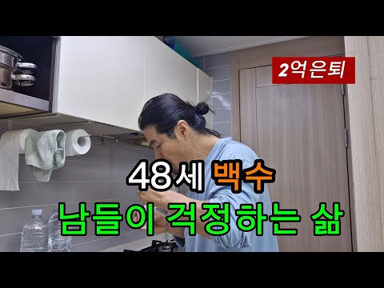
- 같은 채널 평소 대비 ×5.0 (채널 최근 롱폼 중앙값 12,340회) · 평소 영상: 5300만원 증발에도 행복한이유 #배당투자 #배당은퇴 #경제적자유 #파이어족 #월배당 #… (12,458회) / 10만원 아끼다 평생 후회합니다 #배당투자 #배당은퇴 #경제적자유 #파이어족 #월배당 #… (12,223회)
- 대본 없음 (없음) — 음성인식이 끝나면 도입부·흐름이 들어감
- 댓글 174/184: 좋은 점 — 영상 3 · 감사·응원 20 · 더 알고 싶은 것 6 · 아쉬운 점 — 영상 0 · 반박·불만 — 의견 다름 0 · 정치·사회 0 · 경험 공유 11 · 구독·다음 기대 2
  - 좋은 점 — 영상 👍4 “진정성이 느껴지고 서민형이라 와닿는 영상이라 보면서 위로를 받게 되네요. 좋은 영상 자주 올려주세요. 😊❤”
  - 좋은 점 — 영상 👍1 “울림이 있는 story, 공감이 되고 배우고 갑니다~”
  - 감사·응원 👍22 “당신의 직업은 투자자, 유튜버^^ 늘 응원하겠습니다”
  - 감사·응원 👍8 “현대는 직업이 필요가 없어졌습니다. 단지 생활비를 충당할 수 있는 근원지 배당금, 이자, 월세소득 등 원천을 만드는 것이 중요하죠. 또배당금님은 현재 잘 하고 계신거예요. 직장이 없어도 배당금으로 자유롭게 생활하실 수 있는것이 얼마나 대단한것인지 높이 평가해요. 질투…”
  - 더 알고 싶은 것 👍4 “진정성이 느껴지고 서민형이라 와닿는 영상이라 보면서 위로를 받게 되네요. 좋은 영상 자주 올려주세요. 😊❤”
  - 더 알고 싶은 것 👍3 “안녕하십니까 또배당님! 금일 영상은 원고가 매우 훌륭하고 좋습니다 감동적입니다 자신의선택과 책임을 말씀하는 철학은 울림이 있습니다, 다음에 기회가되면 제가 운영하고 있는 다음카페에 칼럼기고를 부탁드려도 될까요”
  - 경험 공유 👍8 “나도 도배당아저씨처럼 할수있다는 희망으로 삽니다”
  - 경험 공유 👍7 “세상을 보는 안목과 생각이 깊고 넓으시군요. 저도 공감되는 말씀입니다.”
  - 구독·다음 기대 👍1 “호동대표님 유튜브보고 구독하러왔어요 자주영상 올려주세요😊 세미파이어족 화이팅!!”

### 110. Land vs Stocks - What's The Better Investment?

- https://www.youtube.com/watch?v=8U0Mdr_8CPo · Real Estate The Ramsey Way · 구독자 36,600 · 조회수 124,846 (×3.4, 하루 12,794.2) · 좋아요 318 (0.2%) · 9.4분 · 2026-10-27 · 주제 묶음 기타 · 형식 정보·해설 (그 밖) · 폴더 `W_8U0Mdr_8CPo` (웹 승인)
- 설명 앞부분: Is buying land a good long-term investment? This call explores what to consider before investing in land and whether it’s a smart place to put your money. Next steps: Explore more from Ramsey Network: Ramsey Solutions Privacy Policy
- 같은 채널 평소 대비 ×5.6 (채널 최근 롱폼 중앙값 22,223회) · 평소 영상: Closing Costs Explained: Where Your Money Actuall… (22,223회) / Don't Upgrade Your Home Until You Watch This (19,296회)
- 대본 없음 (설명) — 음성인식이 끝나면 도입부·흐름이 들어감
- 댓글 67/67: 좋은 점 — 영상 0 · 감사·응원 0 · 더 알고 싶은 것 0 · 아쉬운 점 — 영상 0 · 반박·불만 — 의견 다름 0 · 정치·사회 0 · 경험 공유 0 · 구독·다음 기대 0

### 111. Egyptian Guidelines المستثمر المصري يعمل إيه ؟ عقار ولا ذهب ولا دولار ولا بورصة؟ د. حسن ا…

- https://www.youtube.com/watch?v=F_RSQy0sRtM ·   GroWise |  الاستثمار مع مصطفى خليل  · 구독자 23,700 · 조회수 161,835 (×6.8, 하루 8,273.7) · 좋아요 1,664 (1.0%) · 90.3분 · 2026-10-17 · 주제 묶음 기타 · 형식 정보·해설 (그 밖) · 폴더 `W_F_RSQy0sRtM` (웹 승인)
- 썸네일: 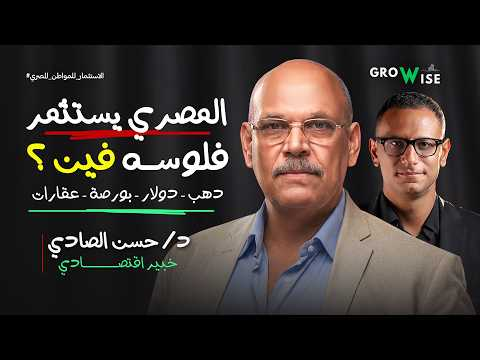
- 챕터: 0:00 ليه المصري بيفضل العقار والذه… · 1:15 رحلة د. حسن الصادي الأكاديمية… · 2:15 إزاي المخاطر الاقتصادية ومخاط… · 4:15 الفرق بين المستثمر والمضارب و… · 5:20 التحليل الأساسي مقابل التحليل… · 6:30 إزاي تقيّم الشركة بدل ما تركز… · 7:30 الأرباح التشغيلية مقابل الأرب… · 8:40 مشاكل هيكل السوق والرقابة وتض… · 10:15 ليه الأرباح التشغيلية مهمة في… · 11:25 دور القواعد التنظيمية في ضبط … · 13:50 الطروحات العامة والطرح الخاص … · 16:40 هل صناديق ضمان خسائر الاكتتاب… · 18:00 تسعير الطروحات: مين بيستفيد م… · 20:40 الاستثمار بالهامش والرافعة ال… · 22:30 التخصيص في الاكتتابات وتأثيره… · 23:30 الحدود السعرية وإيقاف التداول… · 25:00 ليه المستثمر الصغير ممكن يبيع… · 26:15 الاستثمار في الذهب: السبائك و… · 27:30 هل شراء الذهب بيحافظ على الثر… · 29:45 الدولار والذهب والاستثمار الم…
- 설명 앞부분: كيف تختار السهم الصح وتكسب من البورصة؟ Cash Flow, P/E, PEG, Options & Risk Management
- 같은 채널 평소 대비 ×9.5 (채널 최근 롱폼 중앙값 17,082회) · 평소 영상: إزاي تختار أفضل سهم في البورصة المصرية ؟ CIB or T… (22,314회) / ٣٠عامًا في الاستثمار ∣ خالد عقل يكشف أسرار المال … (11,850회)
- 대본 없음 (설명) — 음성인식이 끝나면 도입부·흐름이 들어감
- 댓글 251/352: 좋은 점 — 영상 0 · 감사·응원 0 · 더 알고 싶은 것 0 · 아쉬운 점 — 영상 0 · 반박·불만 — 의견 다름 0 · 정치·사회 0 · 경험 공유 0 · 구독·다음 기대 0

### 112. I Let AI Invest for Me on Trading 212, Here's What Happened

- https://www.youtube.com/watch?v=8zUa4JnCrRw · Financial Interest · 구독자 19,700 · 조회수 521,000 (×26.4, 하루 6,782.3) · 좋아요 4,026 (0.8%) · 11.8분 · 2026-08-21 · 주제 묶음 기타 · 형식 정보·해설 (그 밖) · 폴더 `W_8zUa4JnCrRw` (웹 승인)
- 썸네일: 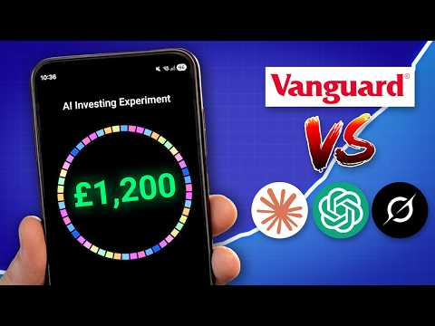
- 챕터: 0:00 The setup · 0:44 Introducing the contestants · 1:23 The initial prompt · 2:45 Building the AI portfolios · 3:30 Making the first investments · 4:03 The results · 5:36 Each AI's portfolio breakdown · 8:48 Who did AI think would win? · 10:56 Who wins long term?
- 설명 앞부분: Honestly we made this to try to show that this is probably a terrible idea long-term. Hope we can prove that long-term! Enjoy. Get free fractional shares worth up to £100 with Trading 212 via this link: This is an affiliate link, we will earn a small commission. If you do not get your free share af…
- 같은 채널 평소 대비 ×87.4 (채널 최근 롱폼 중앙값 5,962회) · 평소 영상: Should You Use InvestEngine in 2026? (5,971회) / The Best Stocks & Shares ISA in 2026 (Lowest Fees… (5,952회)
- 대본 없음 (설명) — 음성인식이 끝나면 도입부·흐름이 들어감
- 댓글 193/209: 좋은 점 — 영상 0 · 감사·응원 0 · 더 알고 싶은 것 0 · 아쉬운 점 — 영상 0 · 반박·불만 — 의견 다름 0 · 정치·사회 0 · 경험 공유 0 · 구독·다음 기대 0

### 113. CONFIRMED: Best High Dividend ETF ($100,000 in SPYI vs QQQI vs SCHD)

- https://www.youtube.com/watch?v=Xqmt0muucZI · Joey @ChartEquity · 구독자 4,640 · 조회수 20,414 (×4.4, 하루 1,594.4) · 좋아요 258 (1.3%) · 14분 · 2026-10-24 · 주제 묶음 2. 장기투자·ETF·지수 · 형식 정보·해설 (그 밖) · 폴더 `W_Xqmt0muucZI` (웹 승인)
- 설명 앞부분: High Dividend ETFs arent the same as High Income ETFs. But - What if you put $100,000 into each of three popular high income ETFs, the Schwab U.S. Dividend Equity ETF (SCHD), the NEOS S&P 500 High Income ETF (SPYI) and the NEOS Nasdaq-100 High Income ETF (QQQI), on the same day? I ran the numbers f…
- 같은 채널 평소 대비 ×25.5 (채널 최근 롱폼 중앙값 802회) · 평소 영상: I Just Sold 2 Tech Stocks! (& Bought 4 More The M… (852회) / The AI Power Crisis OPPORTUNITY is Here! (2 Stock… (751회)
- 대본 없음 (설명) — 음성인식이 끝나면 도입부·흐름이 들어감
- 댓글 13/13: 좋은 점 — 영상 0 · 감사·응원 0 · 더 알고 싶은 것 0 · 아쉬운 점 — 영상 0 · 반박·불만 — 의견 다름 0 · 정치·사회 0 · 경험 공유 0 · 구독·다음 기대 0

### 114. 【Eng Sub】AI泡沫會爆嗎？美股一直升？基金經理教你選ETF與科技股｜US Stocks 101

- https://www.youtube.com/watch?v=fMHfTr51OfM · City Spotlight 傾城計話 · 구독자 30,600 · 조회수 192,802 (×6.3, 하루 10,507.9) · 좋아요 2,827 (1.5%) · 50.3분 · 2026-10-19 · 주제 묶음 2. 장기투자·ETF·지수 · 형식 정보·해설 (그 밖) · 폴더 `W_fMHfTr51OfM` (웹 승인)
- 썸네일: 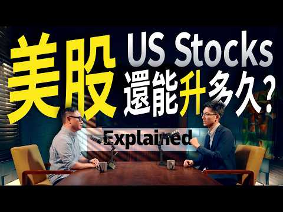
- 챕터: 0:00 精彩內容 ｜ Highlights · 0:52 美股投資入門介紹 ｜ US Stocks 101 · 2:14 買股票如何賺錢？股息與股東權益 ｜ Stock Owner… · 4:09 GOOG與GOOGL有甚麼分別？ ｜ Share Clas… · 5:28 股票成交量與買賣差價怎樣看？ ｜ Volume & Spr… · 6:53 股票價格由誰決定？為甚麼會升跌？ ｜ Stock Pric… · 8:09 公司有好消息，股價為甚麼不升？ ｜ News & Fund… · 9:38 ETF是甚麼？與買個股有甚麼分別？ ｜ ETFs vs. … · 12:04 標普500與納斯達克100怎樣選？ ｜ S&P 500 v… · 13:27 新手買ETF還是個股？先看風險承受能力 ｜ Risk & … · 14:59 退休後怎樣投資？資金用途比年齡更重要？ ｜ Retirem… · 16:56 基金經理為甚麼跑輸大市？ ｜ Active Fund Pe… · 18:16 美股為甚麼長期跑贏港股？ ｜ US vs. Hong Ko… · 22:20 歐洲與亞洲股市表現為何不同？ ｜ Global Marke… · 24:12 美股大跌後會回升，個股也一樣嗎？ ｜ Market Rec… · 25:51 韓國股市為甚麼大升大跌？ ｜ Leverage & Vol… · 27:58 為甚麼美國有這麼多科技公司？ ｜ Tech & Start… · 29:37 投資未上市公司，上市後一定賺錢嗎？ ｜ Private E… · 30:59 為甚麼海外投資者轉買美股？ ｜ Global Capita… · 31:57 AI股票升了很多，現在買是否太遲？ ｜ AI Stock …
- 설명 앞부분: 📈 美股為甚麼長期向上？AI股票已經升了這麼多，現在入市是否太遲？NVIDIA之後，下一個投資機會在哪裏？ 本集《傾城計話 City Spotlight》邀請擁有基金管理經驗的投資專家Wil，深入拆解美股投資、ETF與個股的分別，以及標普500和納斯達克100的投資策略。連專業基金經理都可能跑輸大市，普通人應該如何選擇？ 從退休投資的「錢的年齡」，到AI會否重演科網泡沫、機械人與自動駕駛的未來機會，帶你看懂美股趨勢、投資風險，以及如何更明智地運用自己的資金！ 📈 Why does the US stock market keep rising? Is it too late to inves…
- 같은 채널 평소 대비 ×2.9 (채널 최근 롱폼 중앙값 66,477회) · 평소 영상: 【Eng Sub】老人屋抽中也未必住得入？申請資格、租金補助及輪候真相｜Senior Housin… (66,477회) / 【Eng Sub】父母被騙卻不肯相信？長者網戀、護理員財務剝削、AI詐騙，子女如何保護父母？｜El… (60,519회)
- 대본 없음 (설명) — 음성인식이 끝나면 도입부·흐름이 들어감
- 댓글 120/297: 좋은 점 — 영상 0 · 감사·응원 0 · 더 알고 싶은 것 0 · 아쉬운 점 — 영상 0 · 반박·불만 — 의견 다름 0 · 정치·사회 0 · 경험 공유 0 · 구독·다음 기대 0

### 115. 【徹底比較】FANG+・NASDAQ100・S&P500！100万円を20年投資したらどうなる？

- https://www.youtube.com/watch?v=6EHyihc2ZOA · 米国株式投資家ライス君 · 구독자 3,610 · 조회수 11,529 (×3.2, 하루 1,228.7) · 좋아요 60 (0.5%) · 25.9분 · 2026-10-27 · 주제 묶음 2. 장기투자·ETF·지수 · 형식 정보·해설 (그 밖) · 폴더 `W_6EHyihc2ZOA` (웹 승인)
- 챕터: 0:00 オープニング · 0:02 結論 · 0:47 1章 インデックス投資の乗り換え（S&P500,FANG+… · 5:49 2章 S&P500 VS NASDAQ100 VS FAN… · 22:54 まとめ
- 설명 앞부분: 【FANG+・NASDAQ100・S&P500】結局、どれに投資するべきなのか？ FANG+、NASDAQ100、S&P500は、米国株へのインデックス投資で人気の高い代表的な指数です。 近年では、S&P500やFANG+からNASDAQ100への切り替えを検討する投資家も増えており、「NASDAQ100に投資した方がいいのでは？」と考える方も多いのではないでしょうか。 本動画では、FANG+・NASDAQ100・S&P500について、過去の実績データをもとにリターンとリスクを詳しく比較します。 過去の実績だけを見るのではなく、長期投資を想定したシミュレーションまで行うことで、FANG+・N…
- 같은 채널 평소 대비 ×1.7 (채널 최근 롱폼 중앙값 6,641회) · 평소 영상: 爆売れで購入停止…eMAXIS Neo宇宙開発の実力！？ (6,641회) / 【結論】eMAXIS Slim vs 楽天プラス日経225｜日経平均投資信託の最適解 (6,706회)
- 대본 없음 (설명) — 음성인식이 끝나면 도입부·흐름이 들어감
- 댓글 12/12: 좋은 점 — 영상 0 · 감사·응원 0 · 더 알고 싶은 것 0 · 아쉬운 점 — 영상 0 · 반박·불만 — 의견 다름 0 · 정치·사회 0 · 경험 공유 0 · 구독·다음 기대 0

### 116. 주식 ETF로 전 재산 날린 50대 식당에서 24시간사는 남자

- https://www.youtube.com/watch?v=HzjbzRdr1W8 · 너머니-너의 돈버는 이야기 · 구독자 21,300 · 조회수 85,084 (×4.0, 하루 7,158.1) · 좋아요 864 (1.0%) · 14.3분 · 2026-10-25 · 주제 묶음 2. 장기투자·ETF·지수 · 형식 사연·드라마 · 폴더 `W_HzjbzRdr1W8` (웹 승인)
- 설명 앞부분: 주식·ETF 투자로 전 재산을 잃고, 빚을 갚으며 하루하루를 버티고 있는 50대 남자. 한때는 전 재산을 걸고 미래를 꿈꿨지만, 지금은 손님이 하루 한 팀 정도 찾아오는 식당을 지키며 살아가고 있습니다. 왜 그는 모든 것을 잃게 되었을까요? 그리고 무너진 삶 속에서도 식당 문을 열고 하루를 살아가는 이유는 무엇일까요? 이번 너머니에서는 주식과 ETF 투자로 큰 어려움을 겪은 50대 식당 사장님의 현실적인 이야기를 만나봅니다. 돈을 잃는다는 것, 빚을 갚으며 살아간다는 것, 그리고 모든 것이 무너진 상황에서도 하루를 버텨낸다는 것.…
- 같은 채널 평소 대비 ×26.8 (채널 최근 롱폼 중앙값 3,174회) · 평소 영상: "27살에 사채까지 써서 강아지 지켰더니.. 처음본 노인이 8,500만 원을 빌려줬습니다" (3,233회) / 남들 안하는 휴대폰 5대로 영업해서 하루문의50건 월2,000버는 노가다곰방 (3,114회)
- 대본 없음 (설명) — 음성인식이 끝나면 도입부·흐름이 들어감
- 댓글 335/333: 좋은 점 — 영상 0 · 감사·응원 13 · 더 알고 싶은 것 2 · 아쉬운 점 — 영상 1 · 반박·불만 — 의견 다름 7 · 정치·사회 79 · 경험 공유 25 · 구독·다음 기대 0
  - 감사·응원 👍29 “힘내세요 맘이 아푸네요 꼭 좋으일 있으시길 바랍니다”
  - 감사·응원 👍22 “주식은 철저히 자신의 책임하에 하는 것입니다.. 그래서 힘들고 고달픈 것입니다.. 누구 원망은 단1%도 하면 복구 못 합니다. 40년투자자의 충언입니다. 처절하게 나 자신과의 싸움입니다. 시간될때 한번 갈께요 힘내세요!..”
  - 더 알고 싶은 것 👍7 “ETF는 모으는 자산이인데 어떻게 날리죠?”
  - 더 알고 싶은 것 👍2 “찢재명이가 다 죽여 놨지... 내수경기가 안좋으니 오마카세도 ..하락세... 저 사장님은 잘못없다...사람들 지갑에 돈이 없는거다... 매장주소 알려주세요~~”
  - 반박·불만 — 의견 다름 👍6 “주식을 누굴 믿고 하는 투자는 아닌데...자신을 믿으셔야합니다”
  - 반박·불만 — 의견 다름 👍2 “집 팔아서 주식 사라고 선동한 죄명아 😅 몰빵치랑께 ㅋㅋㅋ”
  - 정치·사회 👍73 “대통령 코스피 1만포인트도 싸다고 ....개미들 패닉 ...현 재 5490 개미들 박살 그런말 말아야지 사라고 꼬시고 외국인만 대박남”
  - 정치·사회 👍22 “이재명 말 믿지 마세요~ 솔직히 거짓말만 하는 자 입니다~ 인생 나락 갈 수 있습니다~”
  - 경험 공유 👍31 “저도 육천 날리고 아침에 눈뜨기 싫습니다”
  - 경험 공유 👍26 “정말 죄송한데 수염에 스탈일 강한 헤어에 강아지와 함께.... 일단 제가 갈 일은 없지만 좀 식당엔 어울리지 않는....”

### 117. 국내ETF로 세후 월100만원 만드는 두 가지 방법

- https://www.youtube.com/watch?v=QoB-zSHUA98 · 수비와 성욱 suvi77 · 구독자 6,600 · 조회수 25,979 (×3.9, 하루 2,198.5) · 좋아요 241 (0.9%) · 12.9분 · 2026-10-25 · 주제 묶음 2. 장기투자·ETF·지수 · 형식 정보·해설 (그 밖) · 폴더 `W_QoB-zSHUA98` (웹 승인)
- 챕터: 0:00 인트로 · 1:46 절세 계좌 활용 시 체크할 점 · 2:47 2세대 vs 3세대 커버드콜 · 4:21 1억 5,500만 원으로 만드는 성장+배당 포트폴리오 · 6:49 9,700만 원으로 만드는 고분배율 중심 포트폴리오 · 7:48 A안 vs B안 비교 · 11:18 포트폴리오를 선택하기 전 체크할 3가지
- 설명 앞부분: 안녕하세요, 수비부부입니다! 국내 상장 해외 ETF로 세후 월 100만 원의 배당 현금흐름을 만드는 2가지 포트폴리오(성장 자산을 함께 남기는 A안 vs 고분배율로 투자금을 줄이는 B안)를 정리해 보았습니다. 동일한 월 현금흐름이라도 자산 구성과 목표에 따라 필요 자본과 리스크가 어떻게 달라지는지 확인해 보세요! ⏱️ 타임라인 (Timestamp) 📖 [수비부부 도서 출간 안내] 『적은 자본으로 가장 빠르게 은퇴하는 법』 "30대 공무원 부부는 어떻게 적은 자본으로 안전하게 파이어를 달성했을까?" 적은 자본으로 배당과 성장을 동시…
- 같은 채널 평소 대비 ×0.7 (채널 최근 롱폼 중앙값 39,886회) · 평소 영상: 나는 왜 평범한 회사생활이 이렇게 힘들까? (39,886회) / 파이어 부부의 건보료·절세 포트폴리오 (45,116회)
- 대본 없음 (설명) — 음성인식이 끝나면 도입부·흐름이 들어감
- 댓글 60/60: 좋은 점 — 영상 2 · 감사·응원 5 · 더 알고 싶은 것 4 · 아쉬운 점 — 영상 1 · 반박·불만 — 의견 다름 0 · 정치·사회 0 · 경험 공유 3 · 구독·다음 기대 1
  - 좋은 점 — 영상 👍0 “도움이 많이 되네요 👍👍”
  - 좋은 점 — 영상 👍0 “도움이 많이 되네요^^”
  - 감사·응원 👍1 “퇴직이 6년정도 남았습니다. 올해부터 본격적으로 나스닥100, s&p500매수 중입니다. 좀더 일찍 연금에 투자를 했어야 하는 아쉬움이 있는데 이제라도 알게되어 긍적적인 생각으로 투자중이에요. 하지만 퇴직시점에 하락장이 오는 최악의 경우도 대비중입니다. 쉽지 않지만 …”
  - 감사·응원 👍0 “콩 이 안녕 😊… 정말 많이 배움니다 감사합니다”
  - 더 알고 싶은 것 👍1 “KODEX를 선호하시는 것 같은데 이유가 있을까요? 저는 국내 KODEX 200타겟위클리CC, 미국 TIGER 나스닥100타겟데일리CC 이렇게 딱 두개합니다만.”
  - 더 알고 싶은 것 👍0 “A안은 어느계좌에 담았나요?연금저축?isa? 현재65세 은퇴를 앞두고 있다면 매월 연금처럼 인출해도 되나요?”
  - 아쉬운 점 — 영상 👍1 “퇴직이 6년정도 남았습니다. 올해부터 본격적으로 나스닥100, s&p500매수 중입니다. 좀더 일찍 연금에 투자를 했어야 하는 아쉬움이 있는데 이제라도 알게되어 긍적적인 생각으로 투자중이에요. 하지만 퇴직시점에 하락장이 오는 최악의 경우도 대비중입니다. 쉽지 않지만 …”
  - 경험 공유 👍0 “'적가은' 책 잘 보고있어요 숫자에 어둡지만 이해하려고 노력중입니다😊 콩이 너무이쁘네요 앞으로 자주보여주세요 어떻게 만나게된건지도.. 궁금한게있는데 부동산을 정리하셨잖아요 앞으로 주거는 어떻게 해결하시려는건지요 계속 이사다닐수는 없을텐데.. 저도 빠른 은퇴를 하고싶은…”
  - 경험 공유 👍0 “안녕하세요. 저는 현재 요즘 주가 시점 매월 세후 110정도 분배금이나오고 있습니다. 커버드콜 보유 종목 4종목 ⬇️⬇️⬇️⬇️⬇️⬇️⬇️ 한국 주식 시장: 약 1개 → KODEX 200 Target Weekly * 미국 AI 성장 산업: 약 1개 → RISE 미국A…”
  - 구독·다음 기대 👍0 “안녕하세요. 저는 현재 요즘 주가 시점 매월 세후 110정도 분배금이나오고 있습니다. 커버드콜 보유 종목 4종목 ⬇️⬇️⬇️⬇️⬇️⬇️⬇️ 한국 주식 시장: 약 1개 → KODEX 200 Target Weekly * 미국 AI 성장 산업: 약 1개 → RISE 미국A…”

### 118. 코스닥 다시 반등할까?📈ㅣ원큐로 끝내는 ETF🎯

- https://www.youtube.com/watch?v=jJu0VhNOH-I · 하나TV [하나자산운용] · 구독자 13,800 · 조회수 105,091 (×7.6, 하루 4,575.8) · 좋아요 46 (0.0%) · 7.5분 · 2026-10-14 · 주제 묶음 2. 장기투자·ETF·지수 · 형식 정보·해설 (그 밖) · 폴더 `W_jJu0VhNOH-I` (웹 승인)
- 썸네일: 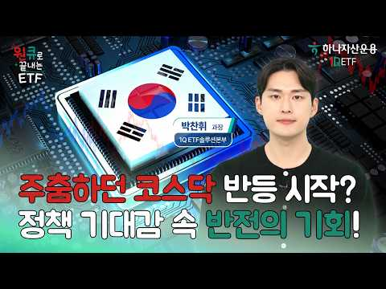
- 설명 앞부분: 코스닥의 향방이 궁금하다면, 지수를 움직일 주요 변수들을 체크해요🔍 과거 사례를 통해 반등에 필요한 조건을 확인하고, 정부의 지원 정책도 함께 살펴봐요📈 코스닥의 높은 변동성이 고민이라면 주식과 채권을 함께 담은 '1Q 코스닥150채권혼합50액티브 ETF' 어때요?💚 하나자산운용 준법감시인 심사필 2026-179(2026.10.14. ~ 2027.10.13.) 1Q ETF 더 알아보기 👀
- 같은 채널 평소 대비 ×2.1 (채널 최근 롱폼 중앙값 49,302회) · 평소 영상: 퇴직연금 나머지 30%, 예금 말고 다른 선택지는?💰ㅣ원큐로 끝내는 ETF🎯 (75,677회) / 미국 AI 소프트웨어·플랫폼 핵심 기업을 한번에📱ㅣ1Q 미국AI테크플랫폼 ETF [원박싱… (79,196회)
- 대본 없음 (설명) — 음성인식이 끝나면 도입부·흐름이 들어감
- 댓글 3/6: 좋은 점 — 영상 0 · 감사·응원 0 · 더 알고 싶은 것 0 · 아쉬운 점 — 영상 0 · 반박·불만 — 의견 다름 0 · 정치·사회 0 · 경험 공유 0 · 구독·다음 기대 0

### 119. SK하이닉스에 울고 웃었던 지난 1년...왜 SK하이닉스였나? 그리고 왜 지금도 SK하이닉스인가? (f. 빈센트 하나증권 이코노미스트, 문서진대표, 여도은)

- https://www.youtube.com/watch?v=S9rhlfvgXBE · 따불로 DDABULLO · 구독자 2,900 · 조회수 13,120 (×4.5, 하루 945.0) · 좋아요 101 (0.8%) · 20.5분 · 2026-10-23 · 주제 묶음 기타 · 형식 정보·해설 (그 밖) · 폴더 `W_S9rhlfvgXBE` (웹 승인)
- 챕터: 0:00 오프닝 및 워런 버핏의 10년 장기 투자 격언과 국장… · 1:05 똑똑한 금융인들이 결국 트레이더로 빠졌던 한국 증시의… · 2:10 한국 경제의 아킬레스건: 50년간 지속된 잠재성장률 … · 2:45 피지컬 AI(로봇)가 여는 신세계: 노동력 부스팅과 … · 3:40 "가라앉지 않는 배": 대한민국 경제의 턴어라운드와 … · 4:30 반도체에 의한 K자 착시 논란과 노동력 한계를 극복하… · 5:30 국내 자본시장의 체질 개선: 주주환원, 중복 상장 방… · 7:15 똑똑해진 개인 투자자들과 조금씩 변화하는 한국 금융 … · 8:08 다음 세대에게 물려줄 주식: '시대의 중심'에 있는 … · 9:12 하루 150분 수면의 비밀: 빈센트 로봇설과 치열한 … · 11:00 15년간 이어진 극단적인 생활 루틴과 생각의 깊이 · 11:55 애널리스트가 명확한 뷰(View)를 내야 하는 이유:… · 13:10 매일 스스로에게 던지는 질문: 5% 급락 속에서도 중… · 14:40 완벽해 보이는 삶의 이면: "나는 계속 실패하며 도전… · 15:45 100억 벌고 은퇴? 돈은 목적이 아닌 수단이며 일과… · 17:15 방송 출연 이후 늘어난 대중적 인지도와 변함없는 일상 · 18:45 빈센트가 남기고 싶은 최종 목표: 한국형 장기투자의 … · 20:00 시장의 풍파에 흔들리지 않는 뚝심과 마무리 응원
- 설명 앞부분: ✨️따불로가 간다✨ "박스피 국장에서 장기 투자가 가능할까?" 하나증권 빈센트 이코노미스트가 밝히는 한국형 장기투자 로드맵과 SK하이닉스 뚝심의 이유 미국 주식만 장기 투자가 가능하고, 국장은 무조건 단타와 트레이딩뿐이라는 오랜 편견! 하나증권 빈센트 이코노미스트가 50년간 하락하던 대한민국의 잠재성장률을 반등시킬 피지컬 AI(로봇 노동력)의 구조적 변화를 짚어보고, 왜 지금 한국 증시에서도 '시대의 주식(SK하이닉스)'을 장기 투자해야 하는지 그 근거를 명쾌하게 제시합니다. 주요 핵심 내용 한국형 장기투자가 가능한 이유 (잠재성…
- 같은 채널 평소 대비 ×2.6 (채널 최근 롱폼 중앙값 5,040회) · 평소 영상: 금리 올라도 주식 오르는데...왜 내 종목만 안 오르지? 국장 물린사람들 여기 모여라 (… (5,040회) / 잇따른 증시 급락, 두 번의 급락이 끝일까? 코스피 6,000p은 진짜 바닥일까? (f.… (5,031회)
- 대본 없음 (설명) — 음성인식이 끝나면 도입부·흐름이 들어감
- 댓글 32/32: 좋은 점 — 영상 1 · 감사·응원 7 · 더 알고 싶은 것 1 · 아쉬운 점 — 영상 0 · 반박·불만 — 의견 다름 0 · 정치·사회 0 · 경험 공유 1 · 구독·다음 기대 0
  - 좋은 점 — 영상 👍0 “좋은 영상 항상 감사합니다~”
  - 감사·응원 👍3 “빈센트님.. 상남자 인정..멋있습니다.. 고맙고 대단합니다”
  - 감사·응원 👍3 “빈센트 멋져요 👍 항상 응원 하겠습니다”
  - 더 알고 싶은 것 👍6 “몇년전 이차전지는 시대의 주식이었죠? 이차전지의 시대가 아니라고 하면 다구리 당했죠? 시대의 주식은 매 시대마다 있어왔고 그걸 산 사람들은 거의 대부분 쪽박찼어요. 시대라는 말 함부로 쓰지 마세요. 자기가 살고 있는 이 동시대에 대해 잘 알지도 못하면서 내일의 시대가…”
  - 경험 공유 👍19 “제가 99년도에 애플 주식 4600주를 사서 지금까지 보유하고 있습니다. 액면 분할등을 거쳐서 51만주가 조금 넘게 되었습니다. 장기투자가 이런것 같습니다”

### 120. 복리가 부를 만드는 진짜 시작점｜언제부터 돈이 스스로 일하기 시작할까

- https://www.youtube.com/watch?v=JExUQaROk40 · 돈의 통찰 · 구독자 3,930 · 조회수 135,850 (×34.6, 하루 1,270.1) · 좋아요 1,555 (1.1%) · 17.8분 · 2026-07-22 · 주제 묶음 1. 주식 기초·초보 · 형식 정보·해설 (그 밖) · 폴더 `W_JExUQaROk40` (웹 승인)
- 썸네일: 
- 설명 앞부분: 복리는 단순히 이자를 더해주는 원리가 아닙니다. 대부분의 사람들은 복리의 힘이 나타나기 전에 포기합니다. 이 영상에서는 복리가 언제부터 눈에 보이는 자산 성장으로 이어지는지, 돈이 스스로 일하기 시작하는 진짜 전환점은 언제인지 실제 숫자와 사례를 통해 쉽게 설명합니다. 장기 투자, 경제적 자유, 자산 증식을 목표로 한다면 꼭 끝까지 시청해 보세요.
- 같은 채널 평소 대비 ×9.6 (채널 최근 롱폼 중앙값 14,152회) · 평소 영상: 나이에 비해 가진 게 없다면… 당신은 정말 뒤처진 걸까? (14,288회) / 돈이 있다고 말하는 순간, 거절의 대가가 커집니다｜자산을 공개하면 생기는 일 (14,017회)
- 대본 없음 (설명) — 음성인식이 끝나면 도입부·흐름이 들어감
- 댓글 103/103: 좋은 점 — 영상 9 · 감사·응원 15 · 더 알고 싶은 것 1 · 아쉬운 점 — 영상 0 · 반박·불만 — 의견 다름 1 · 정치·사회 0 · 경험 공유 12 · 구독·다음 기대 1
  - 좋은 점 — 영상 👍15 “도움되는 영상!구독했어요.기억할께요.복리의 힘.주식시장 떠나지 말고 세월로 돈을 엉덩이로 깔고 않아서 건강만 챙기기.감사합니다.”
  - 좋은 점 — 영상 👍8 “좋은 영상 감사합니다”
  - 감사·응원 👍15 “도움되는 영상!구독했어요.기억할께요.복리의 힘.주식시장 떠나지 말고 세월로 돈을 엉덩이로 깔고 않아서 건강만 챙기기.감사합니다.”
  - 감사·응원 👍8 “좋은 영상 감사합니다”
  - 반박·불만 — 의견 다름 👍7 “늦으면 복리의 마법에 못올라타는게 아니다.. 예를들어 50만원씩 매월 납입을 했다고 가정하면 약 1년 8개월 정도면 1천만원을 달성한다.. 그럼 나는 딱 12개월뒤에 1천만원을 넣었다면? 복리가 답인것 같지만 실제는 원금의 규모다, 개별주로 자금을 불리는 사람도 있다…”
  - 경험 공유 👍96 “제가 4년전 2022년 1~2월달 무렵 그당시 요식업 식당 다니고 있을때 어렵게 모은 종잣돈 8천7백만원이 있었어요...그때 이 돈으로 장사해볼까 정말 고민의 고민을 했어요ㅠ실행 직전까지 갔는데 마지막에 내 자신도 컨트롤 못하는데 내가 요식업 차려서 직원을 잘 컨트롤…”
  - 경험 공유 👍32 “진짜 맞말입니다 이제 고작 3년차 연저펀 에쎈피500 하고있는데요 시간이...와ㅏㅏㅏㅏ 아주 맞는말 😊”
  - 구독·다음 기대 👍15 “도움되는 영상!구독했어요.기억할께요.복리의 힘.주식시장 떠나지 말고 세월로 돈을 엉덩이로 깔고 않아서 건강만 챙기기.감사합니다.”

