# 주식 — 성공 사례 분석: 사례별 자세히 #81–#104

`analysis.md` 의 9번 (같은 # 번호). 자동 생성 — `tools/success_analysis.py` v1.6 (2026-11-18 09:13 UTC). ※ 연구·교육용 — 투자 권유가 아님.

### 81. The Honest Downside of SCHD Nobody Talks About

- https://www.youtube.com/watch?v=BCG0vPE1Ox0 · Drawn Investor · 구독자 2,930 · 조회수 15,458 (×5.3, 하루 476.9) · 좋아요 145 (0.9%) · 12.8분 · 2026-10-16 · 주제 묶음 2. 장기투자·ETF·지수 · 형식 정보·해설 (그 밖) · 폴더 `W_BCG0vPE1Ox0` (웹 승인)
- 썸네일: 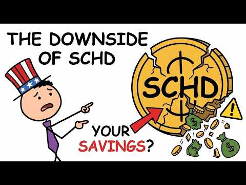
- 챕터: 0:00 The Risk Nobody Puts in a SCH… · 1:05 Why SCHD Owns Just 103 Stocks · 2:30 The Hidden Cost of SCHD's Con… · 3:08 Why SCHD Holds So Little Tech · 4:04 When SCHD Can't Keep Up With … · 5:00 Two Investors, $10,000, One B… · 6:13 The Interest Rate Risk Divide… · 7:30 The 3.22% Yield That Isn't Gu… · 8:47 What Happens If Energy and Ba… · 9:41 The Screen Tax: SCHD's Hidden… · 10:15 Does SCHD's Long-Term Math St… · 11:18 Stress-Test Your Dividend Inc… · 11:44 Three Questions Every SCHD In… · 12:27 The Other Side of SCHD's Story
- 설명 앞부분: SCHD is one of this channel's favorite funds, but liking a fund and being honest about it are two different jobs. This video breaks down the real structural downsides in SCHD's own fact sheet: a tight roster of just 103 holdings, an 8.54% tech weighting that can make it lag during tech-led rallies,…
- 같은 채널 평소 대비 ×3.8 (채널 최근 롱폼 중앙값 4,076회) · 평소 영상: Why SCHD's 3% Yield Beats Every High-Yield ETF Re… (4,175회) / How Many Years Until SCHD Actually Pays You More … (3,978회)
- 대본 없음 (설명) — 음성인식이 끝나면 도입부·흐름이 들어감
- 댓글 16/16: 좋은 점 — 영상 0 · 감사·응원 0 · 더 알고 싶은 것 0 · 아쉬운 점 — 영상 0 · 반박·불만 — 의견 다름 0 · 정치·사회 0 · 경험 공유 0 · 구독·다음 기대 0

### 82. 더이상 배당주는 사지 않아요/40대 워킹맘

- https://www.youtube.com/watch?v=P0j4XK5PaJY · 마스 심플라이프 MasSimpleLife · 구독자 41,800 · 조회수 257,932 (×6.2, 하루 6,724.3) · 좋아요 1,404 (0.5%) · 10.8분 · 2026-10-11 · 주제 묶음 3. 배당 · 형식 브이로그·직접 해본 이야기 · 폴더 `W_P0j4XK5PaJY` (웹 승인)
- 썸네일: 
- 설명 앞부분: ⏰ 연 5천만원 모으는 습관 클럽(연오클) 11기를 모집합니다. ^^ 함께 새벽습관을 잡고, 돈공부와 독서를 하면서 경제마인드를 잡아가고 싶으신분들 함께해요~ ^^ 남과 비교하지 않고 어제의 나와 비교하며, 내 삶의 주도권을 되찾아갈 (연오클 11기)멤버를 모집합니다. (연오클이 궁금하시다면 네이버에 '연오클'을 검색해보세요~ ^^) 전 주로 집에 있는 재료를 이용하는 편이구요~ 요리책의 레시피가 있어도 레시피대로 잘 안하고 있는 재료를 주로 활용하고 있답니다~ 사실.. 저도 요리할때마다 레시피가 바뀌어요~ㅋㅋ *^^ 🍒 돼지고기…
- 같은 채널 평소 대비 ×8.0 (채널 최근 롱폼 중앙값 32,146회) · 평소 영상: 연6천만원 모으는 방법~(Q&A) /40대 워킹맘 돈모으는 루틴(오이지, 황태계란국) (32,745회) / 생활비 90만원으로 돈 모으는 일상/40대 워킹맘 (31,269회)
- 대본 (자막, 5.9 음절/초) 첫 20초: “안녕하세요. 마스입니다. 어느덧 10월입니다. 아침 저녁으로 제법 쌀쌀한 바람이 부는 완연한 가을이 되었어요. 10월부터는 저희 아침 운동 루틴에도 약간의 변화를 주었답니다. 출근을 해야 하는 주 중에는 수영을 하고 조깅은 주말에 하기로 했어요. 가을이 깊어지면서 아침에도 늦게 뜨고”
- 첫 1분: “안녕하세요. 마스입니다. 어느덧 10월입니다. 아침 저녁으로 제법 쌀쌀한 바람이 부는 완연한 가을이 되었어요. 10월부터는 저희 아침 운동 루틴에도 약간의 변화를 주었답니다. 출근을 해야 하는 주 중에는 수영을 하고 조깅은 주말에 하기로 했어요. 가을이 깊어지면서 아침에도 늦게 뜨고 [음악] 새벽 5시에 나가면 아직 깜깜한 데다가 날도 꽤 쌀쌀하더라고요. 무리에서 어둠 속을 달리기보다는 주말에 해가 뜬 후에 따뜻한 햇살 아래 남편과 함께 느긋하게 슬로우 조깅하는 것으로 바꿨습니다. [음악] 이게 저희 중년 부부가 조깅을 포기하지 않고 계속할 수 있는 방법이란 생각이 들더라고요. 영상을 보는 구독자님들도 날은 추워지지만 [음악] 건강을 위해 운동을 멈추지 않으시길 바랍니다. 이제 우린 생존을 위해 운동해야 하”
- 흐름 (90초마다 첫 문장): 0:01 안녕하세요. 마스입니다. 어느덧 → 1:30 하지만 그간 미니벌 라이프로 얻은 → 3:01 주식으로 매월 높은 배당금을 받으면서 → 4:31 현금 흐름이 나올 수 있고 → 6:01 때문입니다. 미국 주식 중에서도 앞서 → 7:32 편안히 쉬면서 매달 나오는 연금만 → 9:01 한시간씩 걸어다니며 극단적으로 → 10:31 바랍니다. 구독과 좋아요는 제가 매주
- 댓글 104/207: 좋은 점 — 영상 1 · 감사·응원 5 · 더 알고 싶은 것 3 · 아쉬운 점 — 영상 0 · 반박·불만 — 의견 다름 2 · 정치·사회 0 · 경험 공유 15 · 구독·다음 기대 0
  - 좋은 점 — 영상 👍2 “매번 좋은 내용을 볼 수 있어서 감사합니다.오늘 특히 정리가 되는 영상이었어요.^^”
  - 감사·응원 👍3 “항상 잘 보고 있어요 채칼 정보 알려주시면 감사하겠습니다😊”
  - 감사·응원 👍2 “매번 좋은 내용을 볼 수 있어서 감사합니다.오늘 특히 정리가 되는 영상이었어요.^^”
  - 더 알고 싶은 것 👍3 “항상 잘 보고 있어요 채칼 정보 알려주시면 감사하겠습니다😊”
  - 더 알고 싶은 것 👍1 “전 1도 몰라요 뭘 어떻게 시작해야할지 모르겠어요 저같은 초짜는 어떻게 시작해야될까요?”
  - 반박·불만 — 의견 다름 👍6 “하락장 아프게 한번 맞아보면 또 생각이 바뀝니다 배당주를 하시던 성장주를 하시던 투자하고 있는 지금 상황에 박수를 드립니다 어느쪽은 중요하지 않습니다 선택한 그 투자를 얼마나 오래 지속 할수있을지만 고민 하시면 됩니다 중요한건 어떤 상품이 아닙니다”
  - 반박·불만 — 의견 다름 👍0 “예전 부모님 세대로서........... "집에서 편안히 쉬면서 연금만으로 살 수 있는 호시절"은 아닌데.......한편, 자녀들의 시대에는 지금 40대 위킹맘의 상황보다 더욱 혹독하겠습니다. 맞아요. 예전에는 돈돈 하면서 살진 않았는데...그렇다고 돈이 중요한 걸 …”
  - 경험 공유 👍49 “난 주식 20년차인데 결국 배당주가 답이라는걸 찾음”
  - 경험 공유 👍14 “남말에 귀닫고 노동소득의 80%는 한국주식을 사고있는 50살 23년차 주식쟁이입니다 에코프로는 10년 이상 3만주 이상을 들고 있으며 에코프로로 노후준비는 다 끝났습니다 개인연금저축펀드 퇴직연금IRP는 20년째 들고 있습니다 주식에는 전문가란게 없고 과학이 아니라서 …”

### 83. QLD는 몇 년 들고 있어야 안전할까? 20년치 모든 매수 시점을 계산해봤습니다.

- https://www.youtube.com/watch?v=PWr2oclRWKs · 여의도 아빠  · 구독자 2,290 · 조회수 13,240 (×5.8, 하루 368.1) · 좋아요 98 (0.7%) · 6.7분 · 2026-10-13 · 주제 묶음 7. 매매·전략 · 형식 브이로그·직접 해본 이야기 · 폴더 `W_PWr2oclRWKs` (웹 승인)
- 썸네일: 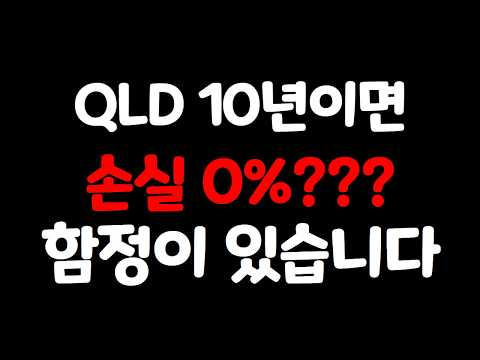
- 설명 앞부분: "QLD, 5년만 버티면 괜찮은 거 아닌가요?" 실제 20년 데이터에선 10년 보유 시 손실 확률 0%. 그런데 OO를 넣자 '5년이면 된다'던 답이 최대 20년으로 늘어났습니다. QLD 보유 기간별 손실 확률 10년 보유 중앙값 13배 금융위기 꼭대기 매수자 닷컴 꼭대기에 2배 나스닥을 샀다면? 같은 최악의 타이밍, 적립을 멈추지 않았다면 본전 20년 → 6년 반 QLD 장기투자가 성립하는 사람 vs 하면 안 되는 사람
- 같은 채널 평소 대비 ×2.1 (채널 최근 롱폼 중앙값 6,421회) · 평소 영상: 아이에게 매달 10만원씩 미국 ETF를 사줬더니… 20년 뒤 계좌에 찍힌 금액 (S&P5… (6,421회) / S&P500에 2배 투자했는데 QQQ 1배보다 수익률이 낮았습니다… 20년 동안 무슨 일… (6,673회)
- 대본 없음 (설명) — 음성인식이 끝나면 도입부·흐름이 들어감
- 댓글 11/16: 좋은 점 — 영상 0 · 감사·응원 1 · 더 알고 싶은 것 1 · 아쉬운 점 — 영상 0 · 반박·불만 — 의견 다름 0 · 정치·사회 0 · 경험 공유 0 · 구독·다음 기대 0
  - 감사·응원 👍1 “영상 정말 잘봤습니다. 감사합니다.”
  - 더 알고 싶은 것 👍3 “이번영상도 시청사수입니다! 지금과 같은 고금리가 유지 혹은 더 올라간다면 QQQ대비 QLD의 매력,효율성은 이자비용으로 인해서라도 이전에 비해 많이 떨어질지 궁금하네요”

### 84. 주식 상위 2%만 아는 10가지 절대 생존 원칙 (돈의 원리)

- https://www.youtube.com/watch?v=fFURFeLTdAg · 준의 경제노트 (jun’s Note) · 구독자 12,500 · 조회수 308,396 (×24.7, 하루 1,922.2) · 좋아요 6,936 (2.2%) · 21.6분 · 2026-06-10 · 주제 묶음 11. 투자 일반 · 형식 오디오북·낭독 (명언·인생조언) · 폴더 `W_fFURFeLTdAg` (웹 승인)
- 썸네일: 
- 챕터: 0:00 주식 시장, 살아남는 자가 강하다 · 1:25 금융 천재 vs 평범한 경비원, 진짜 승자는? · 3:10 주식 투자는 지능이 아닌 '행동'의 영역 · 3:52 원칙 1. 예측하지 말고, 대응하라 · 5:22 원칙 2. 손실의 비대칭성을 이해하라 (바벨 전략) · 7:23 원칙 3. 승률이 아니라, 손익비로 계산하라 · 9:05 원칙 4. 좋은 회사가 아니라, 싼 주식을 사라 · 11:00 원칙 5. 현금은 쓰레기가 아니라, 무기다 · 12:56 원칙 6. 살 때는 신중하게, 팔 때는 과감하게 · 14:00 원칙 7. 공포에 사고, 환희에 팔아라 · 15:35 원칙 8. 좋은 종목만 사라 · 16:45 원칙 9. 본전 심리를 버려라 · 17:50 원칙 10. 감정과 싸우지 말고, 회피하라 · 19:25 실전 적용: 시장의 주인이 되는 법 · 20:20 마무리: 10년 생존을 위한 자가 진단
- 설명 앞부분: 주식 투자자 10명 중 9명은 왜 돈을 잃을까요?** 📉 예측에 의존하는 투자가 아닌, 진짜 부자들만 아는 '10가지 절대 생존 원칙'을 공개합니다. 평생 경비원으로 일하며 95억 원의 유산을 남긴 로널드 리드와, 화려한 경력에도 파산한 금융 천재의 결정적 차이는 무엇이었을까요? 이 영상에서 자산을 수십 배로 불리는 투자의 본질을 확실히 해부해 드립니다. 핵심 요약 주식 투자는 지능의 게임이 아니라 '행동'의 영역입니다. 10년, 20년 동안 시장에서 살아남아 끝까지 승리하는 상위 2%가 되고 싶다면, 영상에서 제시하는 생존 지도…
- 같은 채널 평소 대비 ×388.4 (채널 최근 롱폼 중앙값 794회) · 평소 영상: 1억을 20억, 30억으로 만드는 4가지 전략 ∣ 99%가 모르는 부자의 비밀 (794회) / 유통물량 5%로 나스닥100 편입까지? 스페이스X 일론 머스크가 그리는 우주 AI 제국의… (613회)
- 대본 없음 (설명) — 음성인식이 끝나면 도입부·흐름이 들어감
- 댓글 189/191: 좋은 점 — 영상 8 · 감사·응원 20 · 더 알고 싶은 것 2 · 아쉬운 점 — 영상 4 · 반박·불만 — 의견 다름 3 · 정치·사회 0 · 경험 공유 13 · 구독·다음 기대 0
  - 좋은 점 — 영상 👍20 “백배 공감합니다 꼭 간직하겠습니다. 감사합니다 ❤”
  - 좋은 점 — 영상 👍17 “정말 큰 도움이 되는 영상이였습니다 덕분에 주식으로 이백억을 벌것 같습니다”
  - 감사·응원 👍20 “백배 공감합니다 꼭 간직하겠습니다. 감사합니다 ❤”
  - 감사·응원 👍14 “항상 좋은정보 감사합니다. 투자를 하다보면은 지키기 어려운데 공감가네요.”
  - 더 알고 싶은 것 👍3 “평생마트주차장 관리인 , 경비원, 미련하게 악착같이 주식모아서 결국 어떻게 되었나요? .... 죽었습니다. 끝.”
  - 더 알고 싶은 것 👍1 “좋은 강의 감사합니다. 싼 주식의 기준은, 또는 평가는 무엇인지요? 저Per? 실적? 수주액? 부탁합니다.”
  - 아쉬운 점 — 영상 👍22 “나는 뻔한 예가 나오면 흐름이 끊겨서 거기까지만 듣고 나갑니다.”
  - 아쉬운 점 — 영상 👍4 “ai목소리 질려서 안보게되네요 다 똑같은 목소리라 채널구분도 안되구”
  - 반박·불만 — 의견 다름 👍6 “맞는말인듯😊전 샀다팔았다 하지 않으려고 연금저축펀드 에쎈피500!!!😊 감사합니다!! 그리고 딴분들이 웃기는겤ㅋㅋㅋㅋ아니 영상만들어 주신분한테 목소리가 어떻니 왜 그러심? 물림? ㅋㅋㅋㅋㅋㅋ 그런 댓글 작성할 시간에 영상 올려주신분께 감사하다고 좋아요 한번 눌러욬ㅋㅋ…”
  - 반박·불만 — 의견 다름 👍5 “모두 맞는 이야기 이지만 2번 손해안보는 안전한 자산에 85~90%를 넣어두고 나머지만 위험을 감수한 투자를 한다는 것은 틀렸네요. 현재 안전한 투자는 한국 단기채권은 3% 초반, 미국단기채권은 4% 초반으로 이자율이 나오는데 대한민국의 최근 10년간 연평균 화폐증가…”
  - 경험 공유 👍137 “120만원으로 시작해서 7년만에 1억 4천넘게 벌어보고 느낀점 버핏옹의 투자원칙 첫번째 원칙 돈을 지켜라 두번째 원칙 첫번째 원칙을 지켜라 이말은 진리고 내가 주식시장에서 돈을 벌 수 있던 말이다 저말을 뜻을 깨닫는다면 시장에서 돈을 벌수 있다 이걸 설명하기 어려운건…”
  - 경험 공유 👍4 “저는 초단타 14년차 1억으로 무한 3%”

### 85. 월 배당 100만원, JEPQ는 7년 10개월. SCHD는 15년 해도 못 갔다 (그런데 반전) [ 재테크/미국주식/배당주식/슈드/노후대책 ]

- https://www.youtube.com/watch?v=UlkFX8ai4OI · 경제기상도 · 구독자 4,470 · 조회수 23,326 (×5.2, 하루 676.8) · 좋아요 54 (0.2%) · 20.1분 · 2026-10-14 · 주제 묶음 4. 미국·해외주식 · 형식 인터뷰·강연·대담 · 폴더 `W_UlkFX8ai4OI` (웹 승인)
- 썸네일: 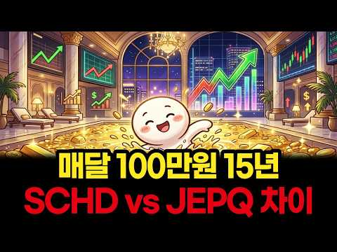
- 설명 앞부분: 같은 날, 같은 돈, 같은 15년. 매달 100만원씩 SCHD와 JEPQ에 나눠 넣은 두 친구의 총자산은 3.7억 vs 3.8억으로 거의 같았습니다. 그런데 세후 월 배당은 86만원 vs 280만원, 3배가 넘게 벌어졌습니다. 월 배당 100만원에 먼저 도착한 쪽이 정말 이긴 걸까요? 네 개의 결승선으로 끝까지 따져봤습니다. 이런 분께 추천합니다 매달 일정 금액을 미국 배당 ETF에 적립하고 있는 직장인 SCHD와 JEPQ 중 무엇을 고를지, 또는 어떤 비율로 섞을지 고민 중인 분 분배율 10%가 넘는 커버드콜 ETF로 갈아타고 …
- 같은 채널 평소 대비 ×2.6 (채널 최근 롱폼 중앙값 9,100회) · 평소 영상: 통장에 3억이 찍히던 날, 제 인생에서 사라진 한 가지 [ 재테크/미국주식/배당주식/슈드… (9,100회) / 1억 한 번에 vs 매달 50만원, 20년 뒤 누가 더 부자일까? ∣ SCHD 20년 승… (9,029회)
- 대본 없음 (설명) — 음성인식이 끝나면 도입부·흐름이 들어감
- 댓글 2/3: 좋은 점 — 영상 0 · 감사·응원 1 · 더 알고 싶은 것 0 · 아쉬운 점 — 영상 0 · 반박·불만 — 의견 다름 0 · 정치·사회 0 · 경험 공유 0 · 구독·다음 기대 0
  - 감사·응원 👍0 “잘 들었습니다~ 감사합니다 ^^”

### 86. 월배당 ETF 10억 투자하면 정말 배당금 얼마? ∣ 종합소득세·건강보험료 계산법 (은퇴 현금흐름 설계)

- https://www.youtube.com/watch?v=yRDpbgaZahc · 은퇴머니 - 은퇴 현금흐름 설계 · 구독자 30,000 · 조회수 761,342 (×25.4, 하루 4,465.3) · 좋아요 10,301 (1.4%) · 11.4분 · 2026-05-31 · 주제 묶음 2. 장기투자·ETF·지수 · 형식 정보·해설 (그 밖) · 폴더 `W_yRDpbgaZahc` (웹 승인)
- 썸네일: 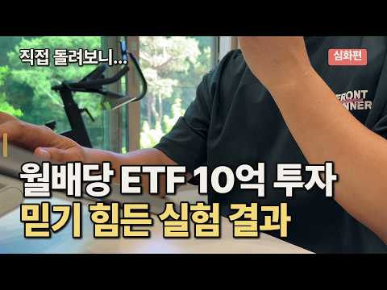
- 챕터: 0:00 평생 모은 10억으로 생활비를 만들어야 한다면 · 1:10 10억을 배당 ETF에 넣고 3년, 직접 따라가 봤습… · 2:00 첫 분배금, 그리고 먼저 떼이는 원천세 · 3:11 예상 못 한 종합소득세 · 4:36 매달 빠져나가는 건강보험료 · 6:25 분배금은 36개월, 세금은 58개월 · 7:04 시뮬레이터 + 커버드콜 ETF 3종 비교 · 8:39 결국 종목이 아니라, 본인의 다섯 변수
- 설명 앞부분: 은퇴 후 10억을 월배당 ETF(JEPQ)에 넣으면 매달 얼마가 들어오고, 세금은 언제 얼마가 빠질까. 2023~2025년 3년 치 통장을 한 화면에 펼쳐 직접 확인해 봤습니다. 타임라인 📑 영상 PPT 자료 영상 내용을 정리한 슬라이드를 웹에서 바로 보고, PDF로도 내려받을 수 있습니다. 🧮 직접 계산해 보기 영상의 사례를 내 조건으로 바꿔 계산할 수 있습니다. 📄 전자책 「은퇴 현금흐름 설계법」 💬 여러분의 은퇴 설계에서 가장 고민되는 부분은? (자산 규모 / 세금 / 건강보험) 댓글로 알려 주세요.
- 같은 채널 평소 대비 ×53.6 (채널 최근 롱폼 중앙값 14,210회) · 평소 영상: ETF 포트폴리오, 은퇴 전에 확인해야 할 또 하나의 기준 (14,321회) / 배당 2천만원 넘으면 더 낼 돈? 계산 과정 전부 공개 (14,100회)
- 대본 없음 (설명) — 음성인식이 끝나면 도입부·흐름이 들어감
- 댓글 967/970: 좋은 점 — 영상 33 · 감사·응원 53 · 더 알고 싶은 것 33 · 아쉬운 점 — 영상 2 · 반박·불만 — 의견 다름 16 · 정치·사회 33 · 경험 공유 47 · 구독·다음 기대 4
  - 좋은 점 — 영상 👍32 “제가 지금 비슷한 처지에 종소세 건보료 때문에 수많은 고민을 하고있읍니다 좋은자료 감사합니다”
  - 좋은 점 — 영상 👍17 “제가 꼭 알고 싶어했던 부분을 영상을 담아주셨습니다. 많은 도움이 되었습니다!! 감사합니다!”
  - 감사·응원 👍32 “제가 지금 비슷한 처지에 종소세 건보료 때문에 수많은 고민을 하고있읍니다 좋은자료 감사합니다”
  - 감사·응원 👍20 “꼭 필요한 내용이네요. 궁금했는데 정말 감사드려요~ 구독, 좋아요 누르고 갑니다.”
  - 더 알고 싶은 것 👍8 “3년후 제피큐에넣은 10억은 얼마가남았나요?”
  - 더 알고 싶은 것 👍6 “좋은 정보 고맙습니다. 능력자 이시네요~ 저도 은퇴후 제일 고민이 건보료입니다. 인별로 나누고 있고 연금저축 IRP ISA 모두 활용중입니다. 국내지수 커버드콜 비중도 점점 커집니다. 은퇴후 투자법인도 고려중입니다. 앞으로도 좋은 컨텐츠 부탁드립니다. 목소리 좋으시네…”
  - 반박·불만 — 의견 다름 👍820 “개인연금 시대에 종합소득 과세 2000은 말도 안되는 시대에 뒤떨어진 정책입니다 최소 4000은 되어야 함”
  - 정치·사회 👍44 “이래서 우리나라가 순자산 100만달러이상 보유한 사람들 유출되는게 전세계 4위인거임ㅋㅋ 부자들이 떠나는 나라...”
  - 정치·사회 👍43 “한국에 사는 한국 국민으로서는 당연한 세금과 의료보험료이고, 외국인보다는 훨씬 낫습니다. 처음 15% 원천 징수는 미국 증시에서 이익을 본거니 미국금융소득에 대한 연방세입니다. 캘리포니아 거주자는 추가로 주 소득세도 꽤 더 냅니다. 미국인의 경우에는 소득의 처분 시점…”
  - 경험 공유 👍499 “저도 은퇴 후 자산정리하고, 분배금으로 살고 있습니다. 님과는 다르게 ETF반 커버드콜반으로 운영중이고, 현재 커버드콜은 전부 국내만 운영중입니다. 커버드콜 자산은 조금더 많은것 같고, 결론적으로 올해 총 수익은 1.2억정도인데 과세기준소득은 약 1천만원, 올해 말은…”
  - 경험 공유 👍74 “건보료 150만원 내도 좋으니 ㅅㅂ 나도 월 분배금 900들어오면 소원이 없겠다😂😂😂😂😂”
  - 구독·다음 기대 👍32 “이제까지 봤던 은퇴관련 배당 컨텐츠중에서 가장 실용적이고 퀄리티높은 !!!! 구독합니다.”
  - 구독·다음 기대 👍19 “제피큐 모으고 있어서 궁금했던 내용인데 영상 잘 봤습니다 ㅎ 구독하고 갑니다”

### 87. 매일 아침 7시, 내 포트폴리오를 관리해주는 AI 주식 비서를 만들어봤습니다

- https://www.youtube.com/watch?v=ITzgH6CeZns · 스티브의 파도타기 | AI 시대 일하는 법 · 구독자 29,600 · 조회수 761,400 (×25.7, 하루 4,381.6) · 좋아요 16,644 (2.2%) · 14.8분 · 2026-05-28 · 주제 묶음 2. 장기투자·ETF·지수 · 형식 정보·해설 (그 밖) · 폴더 `W_ITzgH6CeZns` (웹 승인)
- 썸네일: 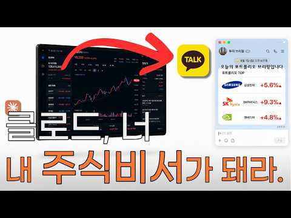
- 챕터: 0:00 Intro · 1:44 시작 전 꼭 알아야 할 것 · 2:37 1단계 - 주식 가격 정확하게 가져오기 · 3:40 2단계 - 관련 뉴스 가져오기 (날짜 문제 해결) · 6:20 3단계 - 브리핑으로 묶기 · 7:54 4단계 - 카카오톡으로 받기 (PlayMCP 연결) · 11:17 5단계 - 매일 아침 7시 자동 실행 (스케줄 등록) · 13:09 다음날 아침, 실제로 작동하는지 확인
- 설명 앞부분: Claude 하나로 매일 아침 7시, 코딩을 모르는 누구나 만들 수 있을만큼 쉽습니다. AI 자동화 콘텐츠가 넘쳐납니다. "주식 자동 매매", "포트폴리오 자동 운영" 같은 것들이요. 저는 개인적으로 추천드리지 않습니다. AI가 주식 판단을 대신할 수 있다면, AI 쓰는 사람들 모두 부자가 됐겠죠. AI는 미래를 알지 못합니다. 반복 노동은 AI에게 넘기고 진짜 중요한 판단은 내가 하는 것. 이게 제가 생각하는 AI 시대의 일하는 방식입니다. 타임라인 ○ 이렇게 AI를 활용하는 법을 직접 배우고 싶다면?
- 같은 채널 평소 대비 ×400.2 (채널 최근 롱폼 중앙값 1,902회) · 평소 영상: 아버지 회사에 AI를 만들어드렸습니다 ep.1 영업비서 (2,147회) / 앞으로 영상은 이걸로 만드세요 ∣ 성능부터 비용까지, AI 영상 모델 9개 전부 모아서 … (1,658회)
- 대본 없음 (설명) — 음성인식이 끝나면 도입부·흐름이 들어감
- 댓글 388/397: 좋은 점 — 영상 23 · 감사·응원 34 · 더 알고 싶은 것 38 · 아쉬운 점 — 영상 2 · 반박·불만 — 의견 다름 0 · 정치·사회 1 · 경험 공유 12 · 구독·다음 기대 5
  - 좋은 점 — 영상 👍11 “클로드 코웤.... 대단한 기능이네요. 꼭 주식이 아니더라도 회사 업무 관련 시장 분석에도 활용해봐야겠습니다. 좋은 정보 감사합니다”
  - 좋은 점 — 영상 👍4 “좋은 정보 입니다 정말 감사드립니다”
  - 감사·응원 👍55 “주식 투자를 하는 사람으로서 정말 감사합니다. 혹시 텔레그램에 팔로우하는 채널들에 수많은 주식 정보가 있는데 그걸 요약해서 브리핑하는 것도 가능할까요? 검토 부탁드립니다.”
  - 감사·응원 👍11 “클로드 코웤.... 대단한 기능이네요. 꼭 주식이 아니더라도 회사 업무 관련 시장 분석에도 활용해봐야겠습니다. 좋은 정보 감사합니다”
  - 더 알고 싶은 것 👍55 “주식 투자를 하는 사람으로서 정말 감사합니다. 혹시 텔레그램에 팔로우하는 채널들에 수많은 주식 정보가 있는데 그걸 요약해서 브리핑하는 것도 가능할까요? 검토 부탁드립니다.”
  - 더 알고 싶은 것 👍4 “내용이 너무 좋아서 저도 해보고 싶은데, 컴퓨터가 켜져 있어야 한다는 부분이 가장 아쉬운 지점이네요... 근데 궁금한게 클로드는 기본적으로 서버에서 작동하는 거 아닌가요? 근데 왜 마치 로컬 프로그램인 것처럼 내 컴퓨터가 켜져 있어야 한다고 하는지 모르겠네요... 대…”
  - 아쉬운 점 — 영상 👍0 “실제로 투자에 사용하기에는 과거데이터를 참고 해서 주거나 잘못된 정보를 주기도 하니 잘 걸러 내야 합니다..”
  - 아쉬운 점 — 영상 👍0 “감사합니다. 주어진 자료 바탕으로 제가 이틀정도 더 씨름하면서 제 스타일로 변동하였습니다. 문제가 되었던 부분들과 제가 수정한 방안 모두 감사한 마음으로 정리해봅니다. 1. 먼저 큰 틀에서 이 영상대로 잘 따라하시면 됩니다 . 전 하루에 3번은 받았으면 해서 8시 1…”
  - 경험 공유 👍4 “컴맹인 제가 해냈어요 . 친절한 설명 감사드립니다.”
  - 경험 공유 👍4 “내용이 너무 좋아서 저도 해보고 싶은데, 컴퓨터가 켜져 있어야 한다는 부분이 가장 아쉬운 지점이네요... 근데 궁금한게 클로드는 기본적으로 서버에서 작동하는 거 아닌가요? 근데 왜 마치 로컬 프로그램인 것처럼 내 컴퓨터가 켜져 있어야 한다고 하는지 모르겠네요... 대…”
  - 구독·다음 기대 👍0 “오~구독했습니다~바로 공유하고~좋아요^^ 이런 유요한 꿀팁이 클로드 써보면서 이런정보가 있는지😅”
  - 구독·다음 기대 👍0 “너무 좋은 정보 감사합니다. 구독하고 갑니다.~”

### 88. 불기둥 세운 코스피, 코스닥! 폭등한 이유와 향후 전략

- https://www.youtube.com/watch?v=Pel5gTXKRkQ · K파민 · 구독자 6,460 · 조회수 102,742 (×15.9, 하루 933.5) · 좋아요 1,605 (1.6%) · 24.8분 · 2026-07-31 · 주제 묶음 5. 국내주식 · 형식 정보·해설 (그 밖) · 폴더 `W_Pel5gTXKRkQ` (웹 승인)
- 썸네일: 
- 설명 앞부분: 7월 31일인 오늘 역사를 세웠습니다. 코스피가 하루 만에 1000포인트 넘게 상승하는 장세를 보이며 단숨에 6500선을 회복했습니다. 또한, 외국인의 일일 순매수액과 개인의 일일 순매도액 모두 역대 최대 규모를 세웠는데요, 주가 폭등의 이유와 향후 전략까지 영상으로 확인해 보세요.
- 같은 채널 평소 대비 ×3.5 (채널 최근 롱폼 중앙값 29,556회) · 평소 영상: (대만 반응) "한국 지하철 불편해" 프랑스 패널의 불평에 한 마디로 받아친 카이랑 (29,556회) / (대만 반응) "한국엔 애국 유전자가 있어요" 한국 얘기만 나오면 똘똘 뭉쳐 감탄 쏟아낸… (20,846회)
- 대본 없음 (설명) — 음성인식이 끝나면 도입부·흐름이 들어감
- 댓글 139/139: 좋은 점 — 영상 2 · 감사·응원 2 · 더 알고 싶은 것 1 · 아쉬운 점 — 영상 0 · 반박·불만 — 의견 다름 3 · 정치·사회 7 · 경험 공유 4 · 구독·다음 기대 0
  - 좋은 점 — 영상 👍21 “진짜 맞는 말씀 두 MC. 배워라”
  - 좋은 점 — 영상 👍0 “그래..우리 평범한 사람들은 확실할 대답을 원하지만, 전문가들이 예언자가 아니고 투자는 시장의 변동에 따라 수시로 바뀌니 정답도 예언도 할 수 없죠. 주식 투자는 화단을 가꾸는 것과 같다는 말 공감되네요.”
  - 감사·응원 👍9 “윤지호선생님 대단히 고맙습니다 ❤”
  - 감사·응원 👍3 “1) 부동산 폭등 대출규제로 국민죽이는 정부 2) 부동산 팔아서 주식사라더니 전문가 들도 위험하다고 반대한 ETF강행으로 2000만 투자자를 거지로 내몬 정부 3) 금감원,금융위,대검,감사원, 국민권익위에 접수된지가 도대체 언젠데 하루 1백만원씩 쓰도 1369년 10…”
  - 더 알고 싶은 것 👍0 “인버스 레버리지 없애면 안되나요?”
  - 반박·불만 — 의견 다름 👍6 “뭘 그리 양다리 걸치는 평론을.. 9월에 9천 년말까지 만천갑니다. 수익이 계속 증명되면 수 많은 가정 다 헛소리이예요”
  - 반박·불만 — 의견 다름 👍2 “과한거 아닙니다 실적 대로 가눈거죠”
  - 정치·사회 👍8 “저기여 정부에서 주식재난특별지원금을 언제 지급 하나요?😅”
  - 정치·사회 👍5 “이재명이 만든 도박장!!”
  - 경험 공유 👍2 “코스피 곧 만 넘게 간다고 했었는데😢 재해처럼 어느날 갑자기 뒤집어질 수 있다는 걸 겪으면서 배우네요. 근데 수업료가 너~무 비싸서 과다 출혈이 문제”
  - 경험 공유 👍2 “경제 주식에 대해 공부하지 않고 남들이 하니 나도 해봐야지,주식이 계속 오르네? 나도 들어가 봐야지 란 인식으로 주식을 접해 피해를 보시는 분들이 없었으면 좋겠습니다. 주식 투자는 본인의 의지고 본인의 책임이 따르기 때문에 어설프게 다가가서 힘들어 하지 마시고 그런분…”

### 89. [슬기로운 금융생활] 국장 복귀하면 양도세 감면?! – RIA계좌 혜택도, 유의점도 슬기롭게

- https://www.youtube.com/watch?v=O4jq0bK4MbI · 예금보험공사 예보TV · 구독자 7,840 · 조회수 142,713 (×18.2, 하루 1,019.6) · 좋아요 32 (0.0%) · 5.6분 · 2026-05-29 · 주제 묶음 5. 국내주식 · 형식 정보·해설 (그 밖) · 폴더 `W_O4jq0bK4MbI` (웹 승인)
- 썸네일: 
- 설명 앞부분: 세제 혜택은 물론, 꼭 알아야 할 유의사항과 예금자보호 여부까지! 국내시장 복귀계좌(RIA)의 주요 내용과 함께 투자 시 꼭 확인해야 할 사항들을 알기 쉽게 설명해드립니다.
- 같은 채널 평소 대비 ×3.1 (채널 최근 롱폼 중앙값 46,483회) · 평소 영상: [예보광장] 예금보험공사 창립 30주년 기념식 (46,483회) / 30년 사이에 인류는 어디까지 바뀌었을까? (피 튀기는 토론배틀..) ∣ 예금보험공사 x… (35,419회)
- 대본 없음 (설명) — 음성인식이 끝나면 도입부·흐름이 들어감
- 댓글 7/8: 좋은 점 — 영상 3 · 감사·응원 2 · 더 알고 싶은 것 0 · 아쉬운 점 — 영상 0 · 반박·불만 — 의견 다름 0 · 정치·사회 0 · 경험 공유 0 · 구독·다음 기대 0
  - 좋은 점 — 영상 👍1 “유익한 정보 감사합니다”
  - 좋은 점 — 영상 👍1 “정말 좋은 정보네요..”
  - 감사·응원 👍1 “유익한 정보 감사합니다”
  - 감사·응원 👍0 “옥상형수 잘 보았읍니다. 좋은 정보 감사합니다.”

### 90. "안정을 기대한다"더니 하루만에 코스피 -10.84%🔥올해 8번째 서킷브레이커🔥정부, 왜 손놓고 있나🔥증안펀드•리밸런싱•공매도🔥삼성전자 -14% SK하이닉스 -…

- https://www.youtube.com/watch?v=AOs5sAd3hKM · 리얼경제 · 구독자 1,340 · 조회수 19,146 (×14.3, 하루 169.8) · 좋아요 745 (3.9%) · 16.1분 · 2026-07-28 · 주제 묶음 2. 장기투자·ETF·지수 · 형식 정보·해설 (그 밖) · 폴더 `W_AOs5sAd3hKM` (웹 승인)
- 썸네일: 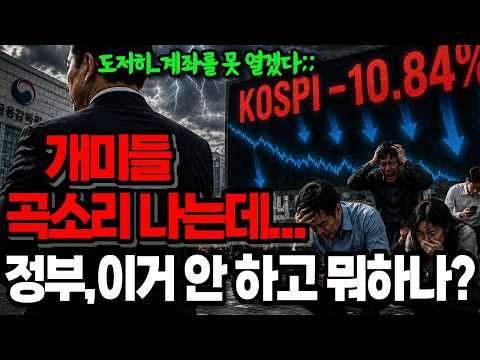
- 챕터: 0:00 인트로 — 어제는 "안정을 기대한다", 오늘은 서킷브… · 0:52 오늘 벌어진 일 — 코스피 6,023.66 / -10… · 2:41 방아쇠는 밖에서 — 중국 창신메모리 상장과 DUV 노… · 4:21 왜 우리만 이렇게 무너지나 — 레버리지라는 확성기 · 6:03 그럼 누가 벌었나 — 외국인 지분율은 오히려 늘었다 · 8:15 스위치는 이미 있었다 — 국민연금 리밸런싱과 7월 1일 · 10:09 당국은 무엇을 했나 — 7/14부터 7/28까지 날짜… · 11:48 안 쓴 카드 — 증안펀드 10조·공매도 금지·리밸런싱… · 13:37 그래서 지금이라도 — 요구 세 가지
- 설명 앞부분: 🔎2026년 7월 28일 코스피가 10.84% 폭락하며 올해 여덟 번째 서킷브레이커가 발동했습니다. 삼성전자 -14.17%, SK하이닉스 -16.02%, 중국 창신메모리 상장과 DUV 노광장비 소식, 외국인 4조 5,009억 순매도, 국민연금 리밸런싱 7월 1일 재개, 증권시장안정펀드 10조원까지 — 하루에 벌어진 일을 처음부터 끝까지 정리했습니다. 왜 떨어졌는지는 다들 아십니다. 이 영상이 따지는 건 떨어질 때 정부가 무엇을 했고, 무엇을 하지 않았는가입니다. 레버리지 근처도 안 가고 빚 한 푼 안 낸 계좌까지 왜 같이 녹았는지…
- 같은 채널 평소 대비 ×101.3 (채널 최근 롱폼 중앙값 189회) · 평소 영상: 삼성노조가 800조 호남 반도체 메가프로젝트 막아선 진짜 이유...부메랑 노란봉투법 삼성… (189회) / 엔비디아 손잡은 네이버 집중분석🔎아시아 AI 인프라회사로?🔥14조 유치🔥GPU 6만장🔥1… (147회)
- 대본 없음 (설명) — 음성인식이 끝나면 도입부·흐름이 들어감
- 댓글 205/205: 좋은 점 — 영상 0 · 감사·응원 2 · 더 알고 싶은 것 1 · 아쉬운 점 — 영상 2 · 반박·불만 — 의견 다름 3 · 정치·사회 60 · 경험 공유 4 · 구독·다음 기대 0
  - 감사·응원 👍1 “하..한숨이 나네요. 국힘에서 대통령 나오면 꼭꼭숨기다 민주당에서 대통령나오면 터뜨리고 대통령 탓하는거.. 그런다고 개개인의 돈이 돌아오는것도 아니고.. 선거 종이쪼가리 하나로 부자되는것도 아닌데 참으로 멍청들 하네요. 개인들의 돈을 지킬수있는 정보 감사합니다. 지가…”
  - 감사·응원 👍1 “재명이 파이팅! 자알한다~~~”
  - 아쉬운 점 — 영상 👍3 “■미국도 시가총액이 시장의 60%를 차지하는 종목에 단일레버리지ETF상품이 상장되어 있는가? 결론부터 말씀드리면 아닙니다. 미국 증시에도 엔비디아, 테슬라, 애플 등을 기초자산으로 하는 단일 종목 레버리지 ETF가 대거 상장되어 있지만, 단일 종목(또는 2개 종목)이…”
  - 아쉬운 점 — 영상 👍2 “쓸 카드를 쥐고 있는 것 자체가 기술입니다ㆍ 이 카드 이럴때 쓸거야..천명하는 순간 그 카드는 쓰지도 않았지만 힘이빠짐ㆍ 손해보고있다면 욕심에 냅다 지른 사람 책임이고 진짜 고수들은 언제 나머지를 투입할까 ㆍㆍㆍ재고있음ㆍ 뇌동매매자에게서 소신 투자자에게 돈은 그렇게 …”
  - 반박·불만 — 의견 다름 👍16 “역대 권력자 중에 국민을 주식에 도박하라고 판짜고 선동하고 국가돈 처 넣은 자는 짜이밍이 유일함.”
  - 반박·불만 — 의견 다름 👍3 “■미국도 시가총액이 시장의 60%를 차지하는 종목에 단일레버리지ETF상품이 상장되어 있는가? 결론부터 말씀드리면 아닙니다. 미국 증시에도 엔비디아, 테슬라, 애플 등을 기초자산으로 하는 단일 종목 레버리지 ETF가 대거 상장되어 있지만, 단일 종목(또는 2개 종목)이…”
  - 정치·사회 👍72 “역시 이재명 보유국이라니까. 결과 다 체험하는구나.”
  - 정치·사회 👍52 “민주당 지금 선거중이라 이런거 신경쓰는 사람 없어. 브라질에서 휴가중인데 코스피 하락하는게 뭐 뭐. 웃겨.”
  - 경험 공유 👍25 “내가보기에 정말 잘못된건 민주당을 20년 지지했다는 고백 그것이 최악의 선택이었다~무능정권을 넘어 야바위정권! 선무당이 사람잡고 반풍수가 집안거들냈다~그래놓고 헌법개정해서 한번 더해 먹겠단다? 우라질~~”
  - 경험 공유 👍13 “저도 평생민주당 .. 이제 뒤도 안돌어 보고 싶네요 신속 실행해야지 이건 아닌거 같네요”

### 91. This New Fidelity ETF Has CRUSHED Every Dividend ETF

- https://www.youtube.com/watch?v=LgszhYR0rFQ · Jake Wealth Hacks · 구독자 6,790 · 조회수 28,240 (×4.2, 하루 841.2) · 좋아요 323 (1.1%) · 10.1분 · 2026-10-15 · 주제 묶음 2. 장기투자·ETF·지수 · 형식 정보·해설 (그 밖) · 폴더 `W_LgszhYR0rFQ` (웹 승인)
- 썸네일: 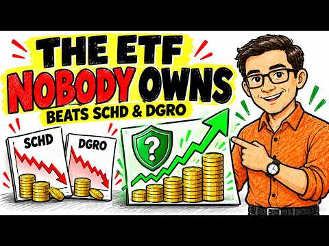
- 설명 앞부분: FELV ETF review: Is Fidelity Enhanced Large Cap Value ETF a better investment than popular dividend ETFs like SCHD, DGRO, and VYM? Discover this hidden Fidelity ETF’s strategy, performance, holdings, expense ratio, dividend yield, and risks for long-term investors and retirees. Most dividend invest…
- 같은 채널 평소 대비 ×6.5 (채널 최근 롱폼 중앙값 4,357회) · 평소 영상: This 150% S&P 500 ETF Pays Nearly 17% — Should Re… (4,357회) / This 8% Dividend ETF is #1 High Income ETF (Incom… (4,417회)
- 대본 없음 (설명) — 음성인식이 끝나면 도입부·흐름이 들어감
- 댓글 13/16: 좋은 점 — 영상 0 · 감사·응원 0 · 더 알고 싶은 것 0 · 아쉬운 점 — 영상 0 · 반박·불만 — 의견 다름 0 · 정치·사회 0 · 경험 공유 0 · 구독·다음 기대 0

### 92. [주식차트보는법] 슈퍼개미들이 절대 말 안해주는 '실전 최고의 단타기법' 제가 욕먹을 각오로 상한가 차트패턴 시원하게 오픈하겠습니다! (차트분석,주식하는법)

- https://www.youtube.com/watch?v=JGzbftUZPXs · 주식차트연구소 · 구독자 1,440 · 조회수 14,420 (×10.0, 하루 175.9) · 좋아요 342 (2.4%) · 33.2분 · 2026-08-28 · 주제 묶음 6. 종목 고르기·분석 · 형식 정보·해설 (그 밖) · 폴더 `W_JGzbftUZPXs` (웹 승인)
- 썸네일: 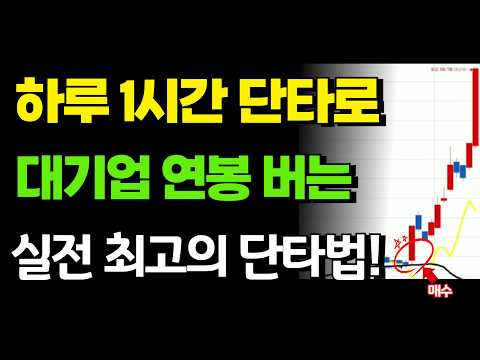
- 설명 앞부분: [주식차트보는법] 슈퍼개미들이 절대 말 안해주는 '실전 최고의 단타기법' 제가 욕먹을 각오로 상한가 차트패턴 시원하게 오픈하겠습니다! (차트분석,주식하는법)
- 같은 채널 평소 대비 ×22.7 (채널 최근 롱폼 중앙값 635회) · 평소 영상: [주식차트보는법] 국장에서 특히 단타가 잘 통하는 이유 오늘 적나라하게 다 밝혀 드립니다… (640회) / [주식차트보는법] 단타를 못해도 '이것' 하나로 수익낼 수 있습니다! 이 차트패턴으로 1… (630회)
- 대본 없음 (설명) — 음성인식이 끝나면 도입부·흐름이 들어감
- 댓글 8/8: 좋은 점 — 영상 2 · 감사·응원 1 · 더 알고 싶은 것 0 · 아쉬운 점 — 영상 0 · 반박·불만 — 의견 다름 0 · 정치·사회 0 · 경험 공유 0 · 구독·다음 기대 0
  - 좋은 점 — 영상 👍0 “좋은 정보네요 일봉으로하는건가요? 해당 종목 찾기가 매우 어려울것같네요요..”
  - 좋은 점 — 영상 👍0 “매번 감사합니다. 매매에 큰 도움이 될거 같아요.”
  - 감사·응원 👍0 “매번 감사합니다. 매매에 큰 도움이 될거 같아요.”

### 93. 단타 천재가 개발한 하이킨아시 스캘핑 매매법, 죽어라 이것만 하세요.

- https://www.youtube.com/watch?v=55hFmXD0lh0 · 알파개미 · 구독자 2,780 · 조회수 54,854 (×19.7, 하루 324.7) · 좋아요 1,776 (3.2%) · 19.6분 · 2026-06-02 · 주제 묶음 7. 매매·전략 · 형식 인터뷰·강연·대담 · 폴더 `W_55hFmXD0lh0` (웹 승인)
- 썸네일: 
- 챕터: 0:00 인트로 · 1:26 하이킨아시 개요 · 3:09 하이킨아시 캔들 3가지 · 3:47 일반 캔들 vs 하이킨아시 · 4:39 추세 전환 기준 3가지 · 6:17 추세 반전 신호 · 7:21 실전 하이킨아시 패턴 5가지 · 8:42 전략 1.지지/저항 및 돌파 매매법 · 9:42 전략 2.돌파 매매법 · 10:15 전략 3.이동평균선(EMA) 결합 매매법 · 11:51 전략 4.추세반전 매매법 · 12:30 전략 5.RSI 지표 결합 매매법 · 13:43 전략 6.알파 하이킨아시 매매법 · 18:45 마무리 정리[지표 신청방법] / 아웃트로
- 설명 앞부분: 단타 천재가 개발한 하이킨아시 스캘핑 매매법, 죽어라 이것만 하세요. 📈 알파 하이킨아시 지표 무료 신청하기 📈 신청 코드: "알파 하이킨아시" 입력 📈 자동 매매 프로그램 무료 사용 신청하기 📈 📼차트 매매법 무료 강의 신청하기📼 📢 중요 안내: 본 방송에서 제공되는 모든 정보는 전문가의 개인적인 의견입니다.
- 같은 채널 평소 대비 ×80.9 (채널 최근 롱폼 중앙값 678회) · 평소 영상: 이동평균선 3개로 1,400억을 번 천재의 매매법 (단타, 스윙 매매) (678회) / -5억을 잃고 알았습니다. "이 차트 보는 방법" 하나면 충분하다는 걸 (637회)
- 대본 없음 (설명) — 음성인식이 끝나면 도입부·흐름이 들어감
- 댓글 1,049/1,055: 좋은 점 — 영상 19 · 감사·응원 81 · 더 알고 싶은 것 26 · 아쉬운 점 — 영상 0 · 반박·불만 — 의견 다름 0 · 정치·사회 0 · 경험 공유 3 · 구독·다음 기대 50
  - 좋은 점 — 영상 👍0 “너무 좋은 영상이네요~ 알파 하이킨아시 신청드립니다!^^”
  - 좋은 점 — 영상 👍0 “좋은정보 감사합니다 하이킨아시 신청합니다”
  - 감사·응원 👍1 “구독 좋아요 완료했어요 알파 하이컨아시 신청합니다 미리 감사합니다”
  - 감사·응원 👍1 “주린인데 차트보기가 너무 좋아요.. 신청합니다.감사합니다.. 스마트폰에도 가능한지도 궁금합니다”
  - 더 알고 싶은 것 👍1 “주린인데 차트보기가 너무 좋아요.. 신청합니다.감사합니다.. 스마트폰에도 가능한지도 궁금합니다”
  - 더 알고 싶은 것 👍0 “훌륭한 정보 대단히 감사합니다. 앞으로도 이런 정보 부탁드립니다 구독과 조아요는 기본 체크입니다❤❤❤”
  - 경험 공유 👍0 “우와. 저도 알파하이킨아시 신청합니다”
  - 경험 공유 👍0 “저도 알파 하이킨아시 신청합니다”
  - 구독·다음 기대 👍1 “알파 하이킨아시 신청했습니다. 영상 내용도 좋고 하이킨아시 차트 지표도 좋아보이네요. 영상 잘 챙겨볼께요~”
  - 구독·다음 기대 👍0 “구독했씁니당 알파하이킨아시”

### 94. How to Borrow Against Your Stock Portfolio: Buy, Borrow, Die

- https://www.youtube.com/watch?v=NPcgV0dq03Q · Sacco Financial  · 구독자 21,500 · 조회수 321,391 (×14.9, 하루 2,477.8) · 좋아요 5,220 (1.6%) · 9.4분 · 2026-06-20 · 주제 묶음 기타 · 형식 정보·해설 (그 밖) · 폴더 `W_NPcgV0dq03Q` (웹 승인)
- 썸네일: 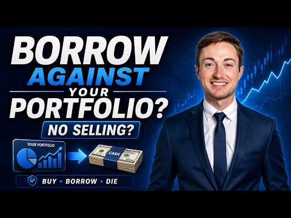
- 설명 앞부분: How do you borrow against your stocks without selling them? I recently moved a significant portion of my investment portfolio to Interactive Brokers so I could access cash through a margin loan instead of selling shares and immediately realizing capital gains. This strategy is often called Buy, Bor…
- 같은 채널 평소 대비 ×146.7 (채널 최근 롱폼 중앙값 2,191회) · 평소 영상: Stock Market Sell-Off: Why I’m Not Buying the AI … (3,426회) / AI Will Change Your Life by 2035 — Here's Who Pro… (3,504회)
- 대본 (자막, 0.0 음절/초) 첫 20초: “What if I told you there's a way to access cash from your portfolio without selling a single share and without paying a dollar in capital gains tax? This is not a loophole. This is how the ultra-wealthy have been doing it for decades. And recently, I started doing this myself. So, today I'm going to”
- 첫 1분: “What if I told you there's a way to access cash from your portfolio without selling a single share and without paying a dollar in capital gains tax? This is not a loophole. This is how the ultra-wealthy have been doing it for decades. And recently, I started doing this myself. So, today I'm going to break down the full strategy, what it is, how I personally set it up, and the stuff that nobody tel”
- 흐름 (90초마다 첫 문장): 0:00 What if I told you there's a way to → 1:31 And here's the answer. Yes, you do. But → 3:01 some blue-chip positions you plan to → 4:31 dedicated structured credit facility → 6:01 That's why sizing matters enormously. → 7:30 it can go sideways fast if you are not → 9:00 The rates, the loan structure, how I'm
- 댓글 603/622: 좋은 점 — 영상 0 · 감사·응원 0 · 더 알고 싶은 것 0 · 아쉬운 점 — 영상 0 · 반박·불만 — 의견 다름 0 · 정치·사회 0 · 경험 공유 0 · 구독·다음 기대 0

### 95. 배당금으로 혼자 사는 미혼남, 3억 파이어 미니멀라이프

- https://www.youtube.com/watch?v=iGI_fzwOyoY · 배당아저씨 · 구독자 33,700 · 조회수 233,471 (×6.9, 하루 3,872.1) · 좋아요 2,140 (0.9%) · 8.6분 · 2026-09-19 · 주제 묶음 3. 배당 · 형식 정보·해설 (그 밖) · 폴더 `W_iGI_fzwOyoY` (웹 승인)
- 썸네일: 
- 설명 앞부분: 영상 속 배당아저씨의 미니멀라이프 내돈내산 재료&용품들 (쿠팡 파트너스 및 인플루언서 활동의 일환으로 구매시 일정액의 수수료를 제공 받을 수 있습니다) 이 채널은 저의 투자 경험과 생각을 공유하는 공간입니다. 저의 투자 방식을 그대로 따라 하시는 것은 권장드리지 않으며, 충분한 고민과 공부 후 판단하시길 바랍니다.
- 같은 채널 평소 대비 ×4.6 (채널 최근 롱폼 중앙값 51,148회) · 평소 영상: 일하지 않고 배당금 받아 살면 나라가 망한다, 3억으로 시작한 파이어 미니멀라이프 (51,148회) / 미국주식 3억, 배당금으로 직장 없이 살고 있어요_배당파이어 장단점 (52,438회)
- 대본 없음 (설명) — 음성인식이 끝나면 도입부·흐름이 들어감
- 댓글 612/624: 좋은 점 — 영상 9 · 감사·응원 57 · 더 알고 싶은 것 26 · 아쉬운 점 — 영상 5 · 반박·불만 — 의견 다름 8 · 정치·사회 0 · 경험 공유 82 · 구독·다음 기대 1
  - 좋은 점 — 영상 👍6 “캥거루로 살며 대충 6억 모았는데 연금계좌+퇴직DC에 에슨피1.5억 나스닥 1.5억이라 55세까지 사용못하는돈이고 1-2년 사이 3 억정도로 배당세팅해야하는 입장으로 도움이 됩니다 저도 40대 이제 좋은거 살만큼 다 사봤기에 지금은 다이소 티 사입네요( 작년에 올만에…”
  - 좋은 점 — 영상 👍2 “기다렸어요~나의 정신 안정제 영상😊 배경음악도 목소리도 잔잔하니 듣기 좋네요.”
  - 감사·응원 👍141 “자기가 만족하는 삶 자체가 행복이죠.항상 응원합니다 배당아저씨🙏🏻”
  - 감사·응원 👍115 “집에만 있어 처량하다고 하시는분들은 아직 크나큰 괴로움이 없었다고(?) 볼수도 있습니다. 행복은 하고싶은걸 할때보다 하기싫은걸 하지않을때 훨씬 크다고 생각합니다. 배당아저씨 응원합니다.”
  - 더 알고 싶은 것 👍7 “댓글이 다양하니재미습니다 궁금해서 다봅니다 시간이 좀 많이 소요되네예^^”
  - 더 알고 싶은 것 👍4 “유튜브 수익은 얼마나 되나요?”
  - 아쉬운 점 — 영상 👍1 “이 형은 목소리가 너무 좋아”
  - 아쉬운 점 — 영상 👍1 “혹시 카메라는 뭐쓰세요? 화질이 좋아서요”
  - 반박·불만 — 의견 다름 👍25 “올해 40살 2억으로 파이어했고 1억은 국내 커버드콜 배당주로 isa계좌로 월 180 받고있고 월세 통신비 보험료 합해서 60만원 식비 월60만원으로 써도 월 60만원이 남습니다. 나머지 1억은 성장주 자율 투자중입니다 . 3억원 결코 작은돈 아니고 쉬운 금액 아닙니…”
  - 반박·불만 — 의견 다름 👍2 “다름을 틀림으로 인식하는 안타까운 사람들이 생각보다 많습니다 자기가 생각하는 삶이 아니라면 불쌍하고 틀렸다라고 정의하는것이죠 삶을 살아보고 배우고 느끼다 보면 개개인의 평범한 삶도 가치가있고 리스펙하게 되더군요 저는 배당아저씨님의 소소하고행복한 일상이 너무 부러워요 …”
  - 경험 공유 👍204 “퇴직했습니다~^^ 저도 3억으로 시작해요~.”
  - 경험 공유 👍49 “다른 사람들이 하는 오해가 <집에 있으면 답답할 것 같다>인데 집수니인 저의 입장에서는 너무나 행복한 일이에요 저도 퇴사 해서 집에만 있는 게 너무너무 좋아요.다른 사람 신경 쓰지 말고 삽시다 우리 ^^”
  - 구독·다음 기대 👍1 “안녕하세요. 구독하고 처음으로 댓글 다네요. ^^ 힘내시고 앞으로도 계속 쭉 성공투자 이어가길 응원합니다. 항상 건강하고 편안한 시간 보내세요. 😊 화이팅입니다~~”

### 96. "역대급 저평가라던 코스피" 하루 만에 620조 추락.. 그 뒤에 숨겨진 코스피의 잔혹한 진실

- https://www.youtube.com/watch?v=6VAsPNYeTRQ · 더 리치 - 돈의 흐름을 읽어라 · 구독자 8,020 · 조회수 116,610 (×14.5, 하루 911.0) · 좋아요 3,100 (2.7%) · 21.2분 · 2026-07-13 · 주제 묶음 5. 국내주식 · 형식 정보·해설 (그 밖) · 폴더 `W_6VAsPNYeTRQ` (웹 승인)
- 썸네일: 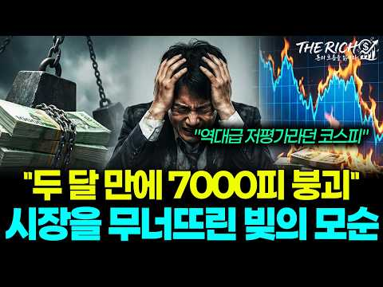
- 챕터: 0:00 역대급 저평가와 폭락의 모순 · 2:11 사이드카와 서킷브레이커 발동 · 3:53 개인이 받아낸 3.9조 매물 폭탄 · 5:15 폭락의 방아쇠 SK하이닉스 · 6:50 시장을 무너뜨린 진짜 원인 빚 · 9:02 반대매매와 레버리지의 함정 · 10:51 코스피가 역사상 가장 싼 이유 · 14:17 반도체 펀더멘털과 빚의 청산 · 16:44 향후 증시 향방과 주요 변수 · 18:20 반드시 확인해야 할 두 가지 지표
- 설명 앞부분: "역대급 저평가라던 시장이 밀린, 38조 원의 빚의 모순" 외국인과 기관의 자금 3조 9천억 원이 시장 밖으로 빠져나가고 그 빈자리를 개인이 홀로 채우며 시장의 주인이 바뀌었습니다. 코스피 7,000선이 무너진 무대 위에서 삼성전자와 SK하이닉스를 지탱하던 거대한 자금 축이 시스템에 의해 강제로 해체되는 흐름이 나타났습니다. 이번 폭락은 반도체의 실적 훼손이 아닌 신용 잔고의 청산 과정에서 발생한 기계적 이동입니다. 저평가라는 본질보다 빚의 무게가 가격을 결정하는 국면에서 금리와 물가라는 매크로 환경이 이 자금의 퇴로를 어떻게 열…
- 같은 채널 평소 대비 ×41.7 (채널 최근 롱폼 중앙값 2,795회) · 평소 영상: “480조 호재에도 1% 상승" 삼성·SK도 예외가 아닌 ‘선반영’의 무서운 함정 (2,812회) / "내가 사서 떨어지는 건가?" 개미만 모르는 외국인들의 소름돋는 수법 (2,778회)
- 대본 없음 (설명) — 음성인식이 끝나면 도입부·흐름이 들어감
- 댓글 294/294: 좋은 점 — 영상 4 · 감사·응원 9 · 더 알고 싶은 것 1 · 아쉬운 점 — 영상 2 · 반박·불만 — 의견 다름 3 · 정치·사회 44 · 경험 공유 6 · 구독·다음 기대 0
  - 좋은 점 — 영상 👍7 “잘썼어요.도움이 됩니다”
  - 좋은 점 — 영상 👍1 “좋은 정보를 감사합니다”
  - 감사·응원 👍2 “탁월한분석 입니다..많은 도움 될것 같네요..감사합니다”
  - 감사·응원 👍1 “상세하고 정확한 설명 감사합니다.🎁 최고의 채널입니다.👍🌹”
  - 더 알고 싶은 것 👍0 “근데 언제 빚이청산 되는가요?”
  - 아쉬운 점 — 영상 👍0 “너무길고 속도가 느려요 고령층 ㆍ노인들에겐 좋은 속도일수도 있지만”
  - 아쉬운 점 — 영상 👍0 “정치 리스크가 이런겁니다 다들 이걸 생각 안하시네요 세계금융의 중심이 어딘지 그돈에 돈줄이 어딘지 기억하세요 불안한 지역엔 투자들 하게나요? 연기금 등 기관의 돈으로 끌어올려봐야 기관은 돈이없고 연기금은 더이상 매수여력이 없읍니다 그래서 도박판이 된겁니다 개인이 개인…”
  - 반박·불만 — 의견 다름 👍18 “무능한 정부의 도박판 국민선동”
  - 반박·불만 — 의견 다름 👍15 “*.헛소리 말고 공매도 없애고 *단일 레리지 페지 해야 합니다”
  - 정치·사회 👍142 “국민연금이 제 때 수익실현 안하고 유예한게 가장 큰원인이다. 결국 외국인만 좋은 일 시키고 개인들은 고점에 물린거다 국민연금 특검해야 한다”
  - 정치·사회 👍63 “이제 5000 으로 내려가야지 그런데 국민연금은 팔지도 못하고 갖고있는 주식만 떨어졌는데 국민들 노후비용은 어떻게 할려나 국민연금이 주가를 9000으로 올릴때 외국인들이 신나게 팔아치웠으니 국민연금 돈을 외국인들이 합법적으로 훔쳐간거다”
  - 경험 공유 👍15 “내가 말햇잖아 낙수효과로 관련 중소형주 사라고 코스닥에 주목해 코스피와 갭차이가 너무나서 이젠 차이가 줄어들게되어있다 삼전닉스로 단타치는 단타쟁이들 재미좀 보다가 작살나는 시기다”
  - 경험 공유 👍1 “근본적으로 경제를 정치논리로 밀어 부치는 이재명 정부 주관도 없고 전문성도 없는 김용범정책실장이 단일종목 레버리지ETF 출시로 주식시장을 투기판으로 만들어 개미투자들에게 깡통차게 한 놈! 이게 시장경제 정책이냐!!! 오죽하면 금융감독원장 이찬진이 레버리지ETF 출시를…”

### 97. 와..미친.. 캔들 차트 보는 법 핵심을 공개한다고? (주식 강의 추천, 주식 초보 매매 방법)

- https://www.youtube.com/watch?v=KwvGol5A8m4 · 트트남 | 주식 차트 보는법 · 구독자 1,420 · 조회수 12,858 (×9.1, 하루 160.4) · 좋아요 167 (1.3%) · 15.8분 · 2026-08-30 · 주제 묶음 1. 주식 기초·초보 · 형식 인터뷰·강연·대담 · 폴더 `W_KwvGol5A8m4` (웹 승인)
- 썸네일: 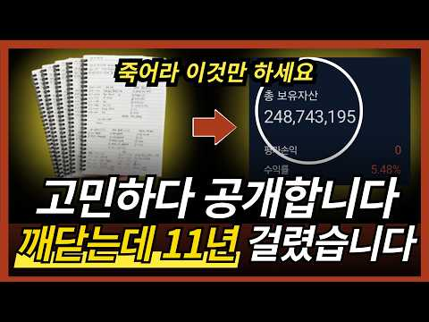
- 설명 앞부분: [수익부터 출금까지 성공시키는 현실적인 방법] [소통방 입장하기] 차트 보는 법, 이 영상 하나로 기준부터 다시 잡아보세요. 주식 공부를 해도 실전 매매가 계속 흔들리는 이유는 기술적 분석을 몰라서만이 아닙니다. 진짜 문제는 이평선, RSI, MACD, 매물대, 지지저항, 피보나치, 추세선, 엘리엇 파동, 하모닉 패턴, 거래량을 따로따로 외우고 실전 차트 앞에서는 무엇을 먼저 봐야 할지 모른다는 것입니다. 이번 영상에서는 차트 보는 법을 기초부터 실전까지 정리합니다. 이평선으로 추세를 보는 법, RSI와 MACD 다이버전스로 반등…
- 같은 채널 평소 대비 ×21.0 (채널 최근 롱폼 중앙값 613회) · 평소 영상: [주식/단타] 평생 써먹는 차트패턴 보는법, 확률 90%의 필수조건입니다 (613회) / 강제 청산 당하고 집문서 날아가는 선물거래, 97% 투자자가 무조건 털리는 이유 (626회)
- 대본 없음 (설명) — 음성인식이 끝나면 도입부·흐름이 들어감
- 댓글 2/2: 좋은 점 — 영상 0 · 감사·응원 1 · 더 알고 싶은 것 0 · 아쉬운 점 — 영상 0 · 반박·불만 — 의견 다름 0 · 정치·사회 0 · 경험 공유 0 · 구독·다음 기대 0
  - 감사·응원 👍1 “😊감사합니다 열씨미 노력해 보겠습니다 ❤”

### 98. Chip Stocks Selling Off: When I Switch From Buying Dips to Shorting (NVDA, AMD, AVGO, TSL…

- https://www.youtube.com/watch?v=JVzvv_YZD7Y · Danielle Shay · 구독자 6,830 · 조회수 25,037 (×3.7, 하루 769.4) · 좋아요 135 (0.5%) · 8.3분 · 2026-10-16 · 주제 묶음 기타 · 형식 정보·해설 (그 밖) · 폴더 `W_JVzvv_YZD7Y` (웹 승인)
- 썸네일: 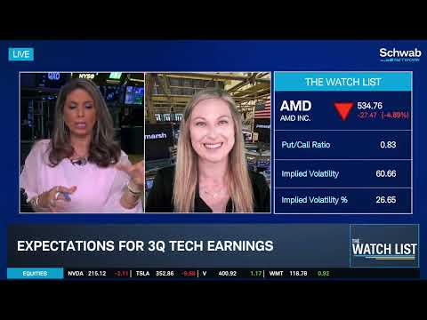
- 설명 앞부분: Why are semiconductor stocks selling off so hard, and when does a dip buy turn into a short? On Schwab Network's The Watch List, I explain the exact chart levels I watch, plus my plan for NVIDIA, AMD, and Broadcom heading into earnings. What we covered: Why this year's moves have been so exaggerate…
- 같은 채널 평소 대비 ×11.0 (채널 최근 롱폼 중앙값 2,279회) · 평소 영상: Danielle Shay on Fox Business: Space Stocks, Phot… (2,279회) / Spotlight on Semiconductors: AVGO, MU, STX, AMD &… (3,006회)
- 대본 없음 (설명) — 음성인식이 끝나면 도입부·흐름이 들어감
- 댓글 61/61: 좋은 점 — 영상 0 · 감사·응원 0 · 더 알고 싶은 것 0 · 아쉬운 점 — 영상 0 · 반박·불만 — 의견 다름 0 · 정치·사회 0 · 경험 공유 0 · 구독·다음 기대 0

### 99. ETF 이 '2가지'만 사두면 됩니다. '나머지는 필요없어요' 100억 자산 관리자의 꿀팁(백승호 단장 풀버전) #ETF #배당주 #주식 #백승호

- https://www.youtube.com/watch?v=1qlywudP2oY · 자람들 - 자립하는사람들 · 구독자 35,900 · 조회수 262,222 (×7.3, 하루 4,022.3) · 좋아요 2,269 (0.9%) · 69.7분 · 2026-09-14 · 주제 묶음 2. 장기투자·ETF·지수 · 형식 인터뷰·강연·대담 · 폴더 `W_1qlywudP2oY` (웹 승인)
- 썸네일: 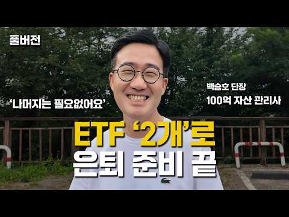
- 설명 앞부분: 👤 오늘의 게스트: 백승호 단장 개인 재무 컨설팅 전문가 & 유튜버·작가로도 활동 20년간 몇백 명의 고객 자산을 관리해온 재무 컨설턴트입니다. 현재 관리하는 총 자산만 100억원이 넘지만, 폭락장에도 노트북에 손 하나 대지 않을 만큼 평온한 태도로 유명합니다. 비결은 단 하나, "투자해도 되는 돈"과 "투자하면 안 되는 돈"을 철저히 구분하는 원칙입니다. 시드머니 없이 매주 조금씩 사 모으는 전략, 차트나 재무제표 대신 "내 지갑"을 믿고 애플·넷플릭스·구글 같은 주식을 고르는 방법, 그리고 레버리지·인버스 상품에 대한 강한 경…
- 같은 채널 평소 대비 ×9.9 (채널 최근 롱폼 중앙값 26,478회) · 평소 영상: 연 2200 배당금받는, 전직 배달 기사.. 3억으로 은퇴했습니다. (또배당 3부) #배… (26,478회) / 월 500만원 배당 노하우, 시드 5천 '이렇게' 구성하세요. 평범한 직장인이 파이어한 … (25,484회)
- 대본 없음 (설명) — 음성인식이 끝나면 도입부·흐름이 들어감
- 댓글 71/77: 좋은 점 — 영상 6 · 감사·응원 11 · 더 알고 싶은 것 3 · 아쉬운 점 — 영상 4 · 반박·불만 — 의견 다름 1 · 정치·사회 1 · 경험 공유 1 · 구독·다음 기대 1
  - 좋은 점 — 영상 👍6 “많이 배웠습니다. 감사합니다.”
  - 좋은 점 — 영상 👍5 “영상 너무 유익해서 메모하면서 보고 돌려 보고 너무 감사했습니다. 주식 입문 2달 조금넘었는데 원칙을 지키면서 잘해보자 합니다.”
  - 감사·응원 👍8 “와..이분 이 영상에서 처음 뵀는데 인상도 정말 좋으시고, 말씀도 편안하고 겸손하신데 무엇보다 내용이 명확하고 깔끔하시네요! 구독과 좋아요 누르고 갑니다. 귀한 영상 감사히 잘 봤습니다^^”
  - 감사·응원 👍7 “영상 감사드립니다🎉 Kodex200커버드콜 같은 것을 지금 사도 될 지 모르갰어오..우리나라가 갑자기 넘 오른 거 같아서요😅”
  - 더 알고 싶은 것 👍3 “오늘 선생님 유튜브 처음 들었는데 저와 투자 철학이 맞네요 좋아요.구독 눌렀습니다. 유선으로 통화하고 싶은데 어떻게 하면 되나요???”
  - 더 알고 싶은 것 👍2 “여기서 추천하는 "2 etf"는 어떤것인가요?”
  - 아쉬운 점 — 영상 👍85 “너무 길어요... AI에 요약을 요청~ 심플이즈 베스트: 일반 투자자에게는 S&P500과 나스닥100 ETF 두 가지만 꾸준히 사 모으는 것을 0순위로 추천합니다 (30:38). 결국 이 2개...ㅋ”
  - 아쉬운 점 — 영상 👍20 “13년전에 별생각없이 가입한 변액연금보험 10년납입 끝나고 2년정도 놔뒀는데 지금 수익률이 250퍼센트 넘어요. 조금더 많이 넣을껄하는 아쉬움이...”
  - 정치·사회 👍7 “영상 감사드립니다🎉 Kodex200커버드콜 같은 것을 지금 사도 될 지 모르갰어오..우리나라가 갑자기 넘 오른 거 같아서요😅”
  - 구독·다음 기대 👍3 “찐 투자의 길라잡이네요. 빽담화TV 구독과 알림 설정 들어갑니다.^^”

### 100. “아이렌 긴급 ,30달러 깨질듯한 상황.. 손절각인가??(ft.코어위브/CPI)아이렌맨.

- https://www.youtube.com/watch?v=cTlVY95Qzlk · 아이렌맨 : IREN을 사랑하는 남자 · 구독자 7,940 · 조회수 30,242 (×3.8, 하루 885.1) · 좋아요 342 (1.1%) · 8.8분 · 2026-10-15 · 주제 묶음 8. 투자 심리·실패 · 형식 인터뷰·강연·대담 · 폴더 `W_cTlVY95Qzlk` (웹 승인)
- 썸네일: 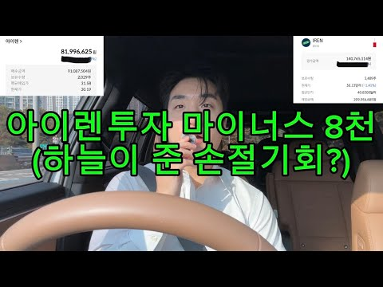
- 설명 앞부분: 오늘은 급하게 차에서 영상올립니다. 준비해둔 자료가있는데.. 그냥 그게 중요치않기에 아이렌의 운명은 ..?
- 같은 채널 평소 대비 ×1.4 (채널 최근 롱폼 중앙값 21,525회) · 평소 영상: "아이렌 매도시기를 공개합니다! , (저는 얼마에 ,언제 팔꺼냐면요!)ft.아이렌맨" (21,525회) / “아이렌, 머스크가 아이렌 살리나? 스페이스X 1등 사업이 'GPU 임대'였다”ft.아이… (21,664회)
- 대본 (음성인식(앞 5분), 5.6 음절/초) — 앞부분만, 흐름은 그 안까지 첫 20초: “여러분 지금 아이렌 비상이라 급하게 영상을 켜봤습니다 제 아이렌 계좌는 하나는 1억 4천만원 하나는 8천백만원입니다 마이너스가 거의 8천만원에 다다랐습니다 안녕하세요 아이렌을 사랑하는 아이렌남입니다 제가 영상을 지금 급하게 켰습니다” — 도입부 유형: 숫자로 시작, 내 이야기·사연, 시청자 부르기
- 첫 1분: “여러분 지금 아이렌 비상이라 급하게 영상을 켜봤습니다 제 아이렌 계좌는 하나는 1억 4천만원 하나는 8천백만원입니다 마이너스가 거의 8천만원에 다다랐습니다 안녕하세요 아이렌을 사랑하는 아이렌남입니다 제가 영상을 지금 급하게 켰습니다 오전에 영상 찍을 거를 좀 준비해두고 일 좀 끝나고 오후에 영상을 찍어보려고 했는데 댓글로도 그렇고 급하게 영상을 올리는 게 좋을 것 같아서 그냥 생각나는 대로 좀 올려보도록 하겠습니다 좀 원래 내용을 좀 보면서 말씀을 드리는 게 그래도 내용을 조금 더 이해하기 편하실 것 같긴 한데 뭐 지금 사실 내용이 크게 중요한 건 아니겠죠 그냥 어쨌든 지금 이러한 상황이 중요한 거다 보니까 일단은 지금 CPI 이 물가지수가 좀 많이 올라갔습니다 생각보다 지금 예상치보다 많이 올라갔기 때문에”
- 흐름 (90초마다 첫 문장): 0:00 여러분 지금 아이렌 비상이라 급하게 영상을 켜봤습니다 → 1:32 수요는 정말 폭발적이다 하지만 → 3:01 어쨌든 외부 환경에 외부의 어떤 금리나 → 4:30 지금 금리도 더 올라갈 거라는 확률이 확 올라가 버리고
- 댓글 395/441: 좋은 점 — 영상 1 · 감사·응원 40 · 더 알고 싶은 것 7 · 아쉬운 점 — 영상 1 · 반박·불만 — 의견 다름 7 · 정치·사회 1 · 경험 공유 23 · 구독·다음 기대 1
  - 감사·응원 👍231 “이 형 인정해 주자, 매일같이 떨어져도 멘탈 지키면서 주식 가격올리고, 가오가 있는 사람이다. 응원합니다.”
  - 감사·응원 👍56 “아이렌이 의외로 이번장이후로 코어. 네비보다 더많이 올라갈수있어요~ 항상응원하니다 힘내고 힘내세요! 장투의길은 원래 힘든법이죠!! 화이팅!”
  - 더 알고 싶은 것 👍16 “주가가 얼마나 떨어지던 물타고 버티고 하는 종목은 대형주에나 해당되는 말이고요.. 아이렌같은 부도날 가능성도 있는 중소형주는 그렇게 하다가 골로간 사람들 한둘이 아닙니다. 아이렌은 절대 부도 안난다구요?? 지금 cds 폭등하는게 안보이시나요? 코로나때 저금리로 유동성…”
  - 더 알고 싶은 것 👍4 “손절좀부탁드려요형님ㅜㅜ 그래야오를듯합니다”
  - 아쉬운 점 — 영상 👍5 “29불에 1억정도 시드 박았네요 장기계좌에 8불 3000만원 있는데 늘 아쉬웠는데 자리 좋은거 같아요”
  - 반박·불만 — 의견 다름 👍16 “주가가 얼마나 떨어지던 물타고 버티고 하는 종목은 대형주에나 해당되는 말이고요.. 아이렌같은 부도날 가능성도 있는 중소형주는 그렇게 하다가 골로간 사람들 한둘이 아닙니다. 아이렌은 절대 부도 안난다구요?? 지금 cds 폭등하는게 안보이시나요? 코로나때 저금리로 유동성…”
  - 반박·불만 — 의견 다름 👍10 “오를수도 있고 떨어질수도 있다. 응원하지도 말고 조롱하지도 말자고 말했더니 선동하지말라고 한다. 지켜보자고 했더니 응원할것도 아니면서 왜 지켜보냐고 시비를 건다. 도대체 어떤것이 선동인것인가?? 이 채널은 아이렌을 응원하는 사람들만 댓글을 달수 밖에 없는 것인가? 합…”
  - 정치·사회 👍2 “데이터 센터 반대의 목소리가 높아지고 있지만 중간선거 끝나면 불확실성이 제거돼서 이유 없이 오를겁니다”
  - 경험 공유 👍18 “이런분이 찐이지 떨어지던 오르던 자기 신념 자기주관 아이렌 저도 이번에 떨어져서 조금식 담아봅니다 올라가길 응원합니다 화이팅!”
  - 경험 공유 👍16 “주가가 얼마나 떨어지던 물타고 버티고 하는 종목은 대형주에나 해당되는 말이고요.. 아이렌같은 부도날 가능성도 있는 중소형주는 그렇게 하다가 골로간 사람들 한둘이 아닙니다. 아이렌은 절대 부도 안난다구요?? 지금 cds 폭등하는게 안보이시나요? 코로나때 저금리로 유동성…”
  - 구독·다음 기대 👍2 “항상 볼때마다 잘생겼어ㅎㅎ아이렌 떨어져도 아이렌남 보면서 버티는 중 하루에 1영상이면 좋겠네요. 기다려집니다”

### 101. 연금저축 IRP 계좌에서 사모을 ETF 3대장 추천! 결국 국내상장 나스닥 S&P500 다우존스 ETF 적립식으로 사모으는 방법이 추천 됩니다

- https://www.youtube.com/watch?v=yITsxwpiFOw · 소금달 - 소액 금 달러 투자 · 구독자 2,800 · 조회수 10,305 (×3.7, 하루 302.3) · 좋아요 35 (0.3%) · 20분 · 2026-10-15 · 주제 묶음 2. 장기투자·ETF·지수 · 형식 정보·해설 (그 밖) · 폴더 `W_yITsxwpiFOw` (웹 승인)
- 썸네일: 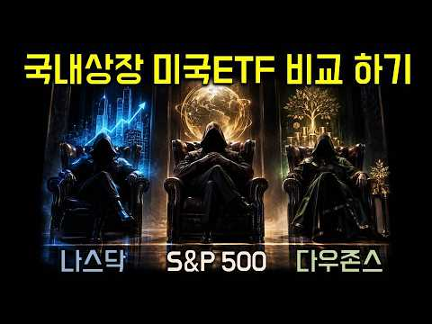
- 챕터: 0:00 국내상장 미국 ETF 3대장 · 0:29 나스닥 100 ETF 추천 · 5:12 S&P 500 ETF 추천 · 11:08 미국배당 다우존스 ETF 비교 · 19:24 연금저축 IRP ISA 절세계좌 장기투자
- 설명 앞부분: 국내상장 미국주식은 3대장 모두 적립식 투자 하시는걸 추천 드립니다. IRP, ISA, 연금저축 계좌에서 절세 비교하고, 국내상장 상품별로 수수료 비교하면 그 다음은 꾸준히 사모으면서 장기투자하는게 정답인것 같습니다.
- 같은 채널 평소 대비 ×26.2 (채널 최근 롱폼 중앙값 394회) · 평소 영상: ㅇㅇㅇ지수보다 수익률 높이는 방법 추천드립니다. 저는 ETF로 분산투자 하고 있습니다. (429회) / ETF 투자방법 기준 4가지 추천 드립니다! 2026년 최신ver (359회)
- 대본 (음성인식(앞 5분), 6.5 음절/초) — 앞부분만, 흐름은 그 안까지 첫 20초: “미국에는 S&P 500, 다우존스 지수 이렇게 3대장이 있는데 이 지수들을 추정하는 ETF를 정립식으로 꾸준히 사모오면서 장기 투자하는 게 안정적인 투자의 정석이라는데 이번 영상은 각 지수 추정 ETF를 연금계좌에서 각각 어떤 종목을 어떻게 비교해서 선정하는지 총정리하는 영상입니다. 수수료와 세금을 내면 뭔가 아깝다는 생각이 드는데 많은 ETF들 중에서 손해를 최소화하는 종목들을 딱 하나씩 추천해 드릴 겁니다.” — 도입부 유형: 숫자로 시작
- 첫 1분: “미국에는 S&P 500, 다우존스 지수 이렇게 3대장이 있는데 이 지수들을 추정하는 ETF를 정립식으로 꾸준히 사모오면서 장기 투자하는 게 안정적인 투자의 정석이라는데 이번 영상은 각 지수 추정 ETF를 연금계좌에서 각각 어떤 종목을 어떻게 비교해서 선정하는지 총정리하는 영상입니다. 수수료와 세금을 내면 뭔가 아깝다는 생각이 드는데 많은 ETF들 중에서 손해를 최소화하는 종목들을 딱 하나씩 추천해 드릴 겁니다. 어떤 논리로 종목이 선정되는지 기준을 잡아 드리겠습니다. 현재 국내에는 타이거 코덱스, 에이스, 라이즈, 원큐, 쏠 이렇게 6개의 나스따기 ETF가 상장되어 있습니다. 저는 지금까지 이 중 하나를 골라 매월 조금씩 사모오고 있습니다. 앞으로도 55세까지 연금계좌에서 꾸준히 사모올 건데 나스따기 ETF”
- 흐름 (90초마다 첫 문장): 0:00 미국에는 S&P 500, 다우존스 지수 이렇게 3대장이 있는데 이 지수… → 1:36 상품 설명에는 대부분 표면 총보소까지만 나와 있는데 실질 부담 비용까지… → 3:01 수익률만 보면 나스닥 100 액티브 ETF가 더 좋을 수도 있습니다. … → 4:39 매달 루틴을 만들어 투자하실 계획이라면 매달 월급날 25만 원씩 투자하…
- 댓글 2/2: 좋은 점 — 영상 0 · 감사·응원 0 · 더 알고 싶은 것 0 · 아쉬운 점 — 영상 0 · 반박·불만 — 의견 다름 0 · 정치·사회 0 · 경험 공유 0 · 구독·다음 기대 0

### 102. QLD 거치식 투자, 2배까지 얼마나 걸릴까? QQQ와 비교했더니,, 충격!

- https://www.youtube.com/watch?v=dbQ_xk3IiPg · 두배럭 2XLuck · 구독자 3,120 · 조회수 11,677 (×3.7, 하루 333.7) · 좋아요 162 (1.4%) · 16분 · 2026-10-14 · 주제 묶음 11. 투자 일반 · 형식 브이로그·직접 해본 이야기 · 폴더 `W_dbQ_xk3IiPg` (웹 승인)
- 썸네일: 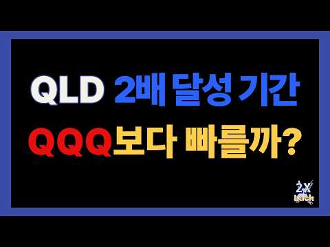
- 설명 앞부분: QLD 거치식 투자하면 언제 2배가 될까? QQQ와 비교하면 결과는 어땠을까요? 이번 영상에서는 QLD와 QQQ에 거치식으로 투자했을 때 투자금이 2배가 되기까지 걸리는 시간을 실제 과거 데이터를 통해 비교해봤습니다. QLD 투자금 2배 달성 기간 2배 달성 과정에서의 최대 낙폭과 회복 기간 QLD와 QQQ의 2배 달성 기간 비교 레버리지 ETF의 수익과 하락 위험 투자 기간과 꾸준한 투자의 중요성 QLD는 과연 QQQ보다 빠르게 2배가 될 수 있었을까요? 실제 과거 데이터를 통해 그 차이와 투자 과정에서 주의해야 할 점까지 확인…
- 같은 채널 평소 대비 ×1.1 (채널 최근 롱폼 중앙값 10,505회) · 평소 영상: QLD 10년 vs 15년 투자 비교! 5년 늘리면 투자금은 얼마나 줄어들까? (10,505회) / QLD 월 200만 원 적립식 충격 결과! 월 100만 원 결과보다 얼마나? 금액과 시간… (10,343회)
- 대본 (음성인식(앞 5분), 5.5 음절/초) — 앞부분만, 흐름은 그 안까지 첫 20초: “투자를 하다 보면 이런 공금증이 생길 때가 있습니다 내가 투자한 돈은 도대체 언제 2배가 될까? 예를 들어 QLD에 1억원을 투자했다라고 가정한다면 과연 2억원이 되기까지에는 몇 년이나 걸릴까요? 특히 QLD는 나스닥백의 일간 수익률을 2배로 추정하는 레버리지 ETF이기 때문에 일반적인 나스닥백 ETF인 QQQ보다 훨씬 빠르게 2배가 되지 않을까라는 생각을 할 수 있는데요” — 도입부 유형: 질문으로 시작, 숫자로 시작
- 첫 1분: “투자를 하다 보면 이런 공금증이 생길 때가 있습니다 내가 투자한 돈은 도대체 언제 2배가 될까? 예를 들어 QLD에 1억원을 투자했다라고 가정한다면 과연 2억원이 되기까지에는 몇 년이나 걸릴까요? 특히 QLD는 나스닥백의 일간 수익률을 2배로 추정하는 레버리지 ETF이기 때문에 일반적인 나스닥백 ETF인 QQQ보다 훨씬 빠르게 2배가 되지 않을까라는 생각을 할 수 있는데요 그렇다면 실제 과거 데이터를 보면 정말 그랬을지 오늘 영상에서는 다음과 같은 주제들에 대해서 알아보도록 하겠습니다 먼저 QLD 종목에 거치식으로 투자를 했다면 과연 2배를 달성하는 데까지는 얼마나 걸렸는지 실제 과거 데이터를 통해서 시뮬레이션을 진행해 보았습니다 그 과정에서 2배가 되기까지 어떤 하락을 겪었고 그 하락을 회복하는데 얼마나”
- 흐름 (90초마다 첫 문장): 0:00 투자를 하다 보면 이런 공금증이 생길 때가 있습니다 → 1:35 시뮬레이션의 조건은 크게 담과 같은 3가지입니다 → 3:00 실제 데이터를 봐도 상당히 빠른 시기에 2배가 된 경우가 → 4:30 왜 이렇게까지 큰 차이가 발생하였을까요?
- 댓글 21/21: 좋은 점 — 영상 2 · 감사·응원 6 · 더 알고 싶은 것 1 · 아쉬운 점 — 영상 0 · 반박·불만 — 의견 다름 0 · 정치·사회 0 · 경험 공유 1 · 구독·다음 기대 0
  - 좋은 점 — 영상 👍2 “좋은영상 감사합니다”
  - 좋은 점 — 영상 👍1 “너무 좋은 정보네요. 감사합니다.”
  - 감사·응원 👍7 “저는 직투에서는 QLD와 USD를 메인으로 매월 적립중이며 TQQQ는 MDD기준 마이너스 60,70,80으로 떨어졌을때 폭이 더 떨어질수록 현금을 더 투입하는 3분할 진입이며 SOXL은 마이너스 70,80,90일때 분할매수 하고 있는데 기회가 자주 오지는 않습니다 영…”
  - 감사·응원 👍3 “와. Qld. 대박이네요. 앞으로도. 이랫음하는 바램. ㅎㅎ. 감사합니당”
  - 더 알고 싶은 것 👍4 “Tqqq도 궁금합니다~”
  - 경험 공유 👍3 “수고 많으셨습니다. '3배 되는 시기' 좀 해주시면 감사하겠습니다. 제가 3배씩 이익실현 하는 플랜을 짜고 있어서 그렇습니다. 감사합니다 ~”

### 103. Jeden Monat Miete ohne eigene Immobilie - warum ich jetzt Realty Income kaufe

- https://www.youtube.com/watch?v=jeVV2buqJ_k · Aktienhai · 구독자 2,910 · 조회수 10,444 (×3.6, 하루 309.4) · 좋아요 129 (1.2%) · 11분 · 2026-10-15 · 주제 묶음 2. 장기투자·ETF·지수 · 형식 정보·해설 (그 밖) · 폴더 `W_jeVV2buqJ_k` (웹 승인)
- 썸네일: 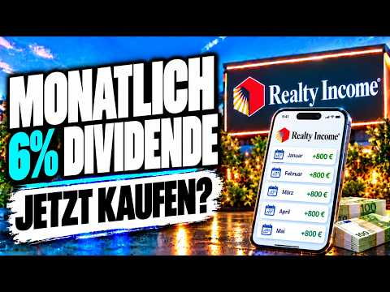
- 챕터: 0:00 Jeden Monat Miete, trotzdem b… · 0:52 Realty Income (ISIN: US756109… · 1:53 Warum die Aktie seit Jahren f… · 3:22 Umsatz, FFO und AFFO · 5:06 Bewertung, Dividende, Schulden · 7:10 Was bei Realty Income wirklic… · 8:35 NNN REIT und Agree Realty im … · 8:58 Der Haken · 9:57 Score und Fazit · 10:25 Würde ich kaufen?
- 설명 앞부분: Realty Income zahlt über 670 Monatsdividenden in Folge und hat ein Geschäft, das jedes Jahr wächst: Trotzdem steht die Aktie von Realty Income rund ein Viertel unter Ende 2021. Für alle, die sich eine monatliche Miete ins Depot holen wollen, ist das die spannende Frage: Schnäppchen oder Falle? 🎁 Si…
- 같은 채널 평소 대비 ×3.1 (채널 최근 롱폼 중앙값 3,368회) · 평소 영상: Größer als der KI-BOOM?! Diese 5 Aktien könnten d… (3,429회) / Rechenzentren statt Nvidia? So kassierst du Divid… (3,306회)
- 대본 없음 (설명) — 음성인식이 끝나면 도입부·흐름이 들어감
- 댓글 38/38: 좋은 점 — 영상 0 · 감사·응원 0 · 더 알고 싶은 것 0 · 아쉬운 점 — 영상 0 · 반박·불만 — 의견 다름 0 · 정치·사회 0 · 경험 공유 0 · 구독·다음 기대 0

### 104. 다음주 코스피 심상치 않습니다 '이때' 팔고 바로 현금 챙기세요 (이승조 대표 / 통합본 1부)

- https://www.youtube.com/watch?v=EkR5dj-diWw · 웅달책방_투자 · 구독자 3,260 · 조회수 14,673 (×4.5, 하루 343.3) · 좋아요 262 (1.8%) · 31.7분 · 2026-09-03 · 주제 묶음 5. 국내주식 · 형식 인터뷰·강연·대담 · 폴더 `W_EkR5dj-diWw` (웹 승인)
- 썸네일: 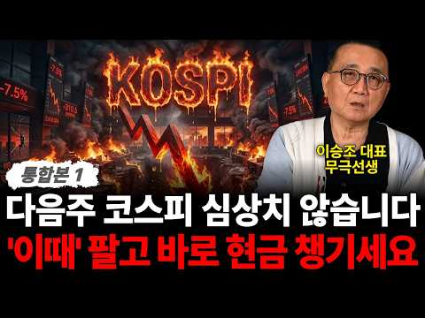
- 설명 앞부분: 🌕 삼전닉스 '이 가격' 아래라면 그냥 겁없이 많이 사세요 (이승조 대표 / 통합본 1부) 본 영상은 9월 3일에 촬영되었습니다 (시청에 참고해 주세요) ※ 출연자에 대한 비난, 욕설, 비속어 등을 포함한 댓글은 무통보 삭제될 수 있습니다. 성숙한 소통 문화 형성에 동참해주시길 바라겠습니다. 감사합니다.
- 같은 채널 평소 대비 ×1.8 (채널 최근 롱폼 중앙값 8,350회) · 평소 영상: 중국이 결국 배터리 패배 인정 한국 2차전지 대박 터지나 (전태룡 대표 / 통합본 2부) (8,350회) / 다음주 월 코스피 대폭락 온다? 곧 무시무시한 일 터질 겁니다 (하창봉 대표 / 통합본 … (7,873회)
- 대본 없음 (설명) — 음성인식이 끝나면 도입부·흐름이 들어감
- 댓글 8/8: 좋은 점 — 영상 1 · 감사·응원 1 · 더 알고 싶은 것 0 · 아쉬운 점 — 영상 1 · 반박·불만 — 의견 다름 1 · 정치·사회 0 · 경험 공유 0 · 구독·다음 기대 0
  - 좋은 점 — 영상 👍1 “썸네일과 내용이 일치하지 않습니다 운영자께서는 낚시에만 치중하지 마시고 독자들이 한눈에 내용을 이해하기 쉽게 썸네일을 작성해 주세요”
  - 감사·응원 👍1 “고맙습니다 날마다 여러번씩 선생님방송보고 주식조금하는거 도움받고있습니다”
  - 아쉬운 점 — 영상 👍1 “썸네일과 내용이 일치하지 않습니다 운영자께서는 낚시에만 치중하지 마시고 독자들이 한눈에 내용을 이해하기 쉽게 썸네일을 작성해 주세요”
  - 반박·불만 — 의견 다름 👍1 “이자식은헛소리만니나팔어라”

