# 주식 — 성공 사례 분석: 사례별 자세히 #81–#110

`analysis.md` 의 9번 (같은 # 번호). 자동 생성 — `tools/success_analysis.py` v1.6.1 (2026-11-28 11:24 UTC). ※ 연구·교육용 — 투자 권유가 아님.

### 81. 물린 주식 10년, 결국 전부 팔았습니다 (feat. 복구 심리의 함정)

- https://www.youtube.com/watch?v=OKHm1gUNyPA · 어쩌다마흔 · 구독자 2,470 · 조회수 89,505 (×36.2, 하루 756.9) · 좋아요 1,815 (2.0%) · 9.9분 · 2026-08-02 · 주제 묶음 8. 투자 심리·실패 · 형식 인터뷰·강연·대담 · 폴더 `W_OKHm1gUNyPA` (웹 승인)
- 썸네일: 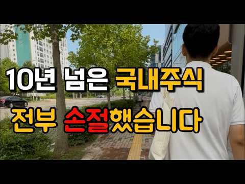
- 설명 앞부분: 10년 넘게 국내 개별주식에 투자했습니다. 수익 난 종목도 있었지만, 물린 종목이 더 많았습니다. 전체로 보면 꽤 큰 손실. 결국 얼마 전, 며칠에 걸쳐 전부 팔았습니다. 이번 영상은 계산이나 시장 분석이 아니라 제 이야기입니다. 왜 손실을 확정하면서까지 전량 매도를 택했는지, 그 이유 세 가지와 매도 이후에도 흔들렸던 '복구 심리'까지 솔직하게 담았습니다. 계좌에 물린 종목을 몇 년째 들고 고민 중이시라면, 오늘 영상이 판단에 참고가 되시길 바랍니다.
- 같은 채널 평소 대비 ×11.0 (채널 최근 롱폼 중앙값 8,113회) · 평소 영상: 환율 1,350원 깨지고 미국주식 올인 했습니다 (8,113회) / 부부 식비 40만원, 남은 돈 절반 미국주식 샀습니다 (8,465회)
- 대본 (음성인식(앞 5분), 4.3 음절/초) — 앞부분만, 흐름은 그 안까지 첫 20초: “10년 넘게 하던 국내 주식을 며칠 전 전부 팔고 정리했습니다. 수익이 나서 판 건 아닙니다. 손실을 확정하면서 팔았습니다. 오늘은 쓰라리게 아팠던 제 최근 이야기입니다.” — 도입부 유형: 숫자로 시작
- 첫 1분: “10년 넘게 하던 국내 주식을 며칠 전 전부 팔고 정리했습니다. 수익이 나서 판 건 아닙니다. 손실을 확정하면서 팔았습니다. 오늘은 쓰라리게 아팠던 제 최근 이야기입니다. 안녕하세요 어쩌다 마흔입니다. 오늘은 계산도 시장 얘기도 아닙니다. 제 얘기를 해볼까 합니다. 이번 주도 금요일을 제외하고는 계속 카락장이 이어져서 멘탈이 힘든 한주였습니다. 그리고 저는 계좌에 일부 있던 국내 개별 주식을 며칠에 걸쳐 전부 정리했습니다. 10년 넘게 개별 주 투자를 해온 사람이 그것도 손실을 확정하면서 왜 마흔이 넘어 전부 팔았는지 그 이후 3가지를 오늘 말씀드려볼까 합니다. 이 결정이 결코 정답이라는 얘기가 아닙니다. 다만 저와 비슷한 시기에 계좌에 물린 종목을 들고 고민 중인 분이라면”
- 흐름 (90초마다 첫 문장): 0:00 10년 넘게 하던 국내 주식을 며칠 전 전부 팔고 정리했습니다. → 1:32 수익이 난 종목도 있었습니다. → 3:05 이러도 복구할 시간이 있었으니까요. → 4:31 시간을 쓰고 어느 정도 벌었어도 다시 생각해볼 문제인데
- 댓글 957/970: 좋은 점 — 영상 13 · 감사·응원 36 · 더 알고 싶은 것 5 · 아쉬운 점 — 영상 11 · 반박·불만 — 의견 다름 14 · 정치·사회 16 · 경험 공유 90 · 구독·다음 기대 4
  - 좋은 점 — 영상 👍3 “너무 아쉬워서 댓글올립니다. 현재재무상황과 현재밸류로 하면 당연히 수익이 어렵더라구요.ㅠ 확실한미래성장과 촉매(주가가 부각될 트리거)감안하여, 투자하시면 분명 성과가 있더라구요. 고전(그레이엄,피터린치,코스톨라니,레이달리오.등의 )책을 좀 읽으시면 ETF 선정하시는대…”
  - 좋은 점 — 영상 👍3 “좋은 이야기도 있는데 말하는 사고방식이 본인은 안다고 생각할수도 있겠지만 워렌 버팟의 본질을 전혀 이해 못하고 있다고 할까나 😅 말이나 설명을 하는 사고방식이 아직도 트레이더에요 . 트레이더의 탐욕에 절여진 전혀 벗어나있지를 않는. 좋게 봐줘도 하워드 막스의 통찰을 …”
  - 감사·응원 👍70 “많은 고민이 묻어 나옵니다. 고생하셨습니다. 저도 심각히 고민중입니다. 국장은 절대 개미가 도전할 시장은 아니라는 생각입니다. 말씀 새겨서 결정에 참고하겠습니다. 감사드립니다.”
  - 감사·응원 👍23 “속은 쓰리시겠지만, 길게 보면 잘하셨습니다^^ 저도 과거 오랫동안 개별주로만 투자를 했고, 괜찮은 수익을 얻었지만, 지금은 ETF 투자로 주로 하고, 개별주는 정말 소액만 투자하고 있습니다. 회계사 생활을 오랫동안 하면서, 기업분석과 투자에 나름 자신도 있었지만, 언…”
  - 더 알고 싶은 것 👍1 “얼마 손해 보셨나요?”
  - 더 알고 싶은 것 👍1 “리스크라쓰고 불확실성이라읽어야되여 그불확실에대해 어떤일을 했나요? 추세판단은했나요? 자금을잃지않으려는노력은 그무엇보다중요해요 .. 그러려면예비비확보 분할매매 9시 12시 오후3시 그리고온갖쏟아지는 착시만주는노이즈에대해선어떻게 대응했는지요? 자금 안 읽고오래 시장에 머…”
  - 아쉬운 점 — 영상 👍13 “주식은 자기가 좋아하는 기업 응원하는 마음으로 사서 고수익은 아니더라도 은행금리만큼정도는 이득 아니면 손해일거라 생각했는데, 결국은 큰손들의 도박장인게 너무 실망스럽니다.”
  - 아쉬운 점 — 영상 👍2 “아...한달만 빨리 정리했어도 어쩌면 수익이 났을지도 모르는데 아쉽네요.”
  - 반박·불만 — 의견 다름 👍63 “하루에 지수가 10프로 등락하는 국장은 정상이 아니죠”
  - 반박·불만 — 의견 다름 👍5 “공부해서 주식하려면 미장가세요.. 여기는 상식적인 시장이 아닙니다”
  - 정치·사회 👍24 “그냥주식은 도박이에요 정부에서 인정한 오르고 내리고 하는거 그냥 짜고치는 고스돕같은거 다연기 공부필요없어요 그냥 정부와 기업이 맘대로 올리고 내리고 전 이걸아는순간 이젠안해요 금은사지”
  - 정치·사회 👍6 “국장은 그냥 수급 사줄 놈이 없으면 안올라가지요. 삼닉이 1000조를 벌어도 사줄 놈이 없어요 이번 금요일 국내 탑5 전부 상한가 갔지요? 전부 환호하지만 실상은 외국인들이 10조만 있어도 모든 종목 상한가 보낼 수 있다는 경고 같았어요. 저도 8년 국장하고 이번에 …”
  - 경험 공유 👍113 “저도 다 팔고 미장으로 옮겼습니다. 돈이 문제가 아니라 널뛰기 국장에서는 일상생활이 안됩니다.”
  - 경험 공유 👍70 “많은 고민이 묻어 나옵니다. 고생하셨습니다. 저도 심각히 고민중입니다. 국장은 절대 개미가 도전할 시장은 아니라는 생각입니다. 말씀 새겨서 결정에 참고하겠습니다. 감사드립니다.”
  - 구독·다음 기대 👍6 “같은나이대라 그런지 공감이 많이 됩니다. 늘 영상 기다려요. 응원합니다.^^”
  - 구독·다음 기대 👍2 “감사합니다 구독하고 볼게요 sk하이닉스 들어갈려고했는데 도저히 자신이 없네요”

### 82. 4200억 단타 일본 천재가 초간단 매매법, 죽어라 이것만하세요

- https://www.youtube.com/watch?v=UH4UFmdXXo0 · 세력시그널 · 구독자 3,940 · 조회수 120,540 (×30.6, 하루 1,146.7) · 좋아요 2,588 (2.1%) · 20.6분 · 2026-08-15 · 주제 묶음 7. 매매·전략 · 형식 정보·해설 (그 밖) · 폴더 `W_UH4UFmdXXo0` (웹 승인)
- 썸네일: 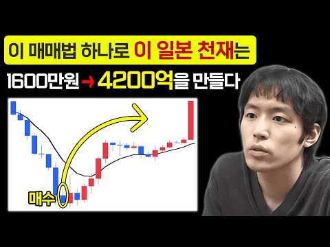
- 챕터: 0:00 BNF 코테카와 타카시 ∣ 1,600만 원으로 시작한… · 2:35 슈퍼 트레이더 자동매매 봇 안내 · 2:46 BNF의 은둔형 투자 생활 ∣ 주식에 인생을 건 전업… · 3:41 제이콤 주식 사건 ∣ BNF가 16분 만에 200억 … · 5:49 독학으로 성공한 BNF ∣ 제시 리버모어와 실전 차트… · 6:30 BNF 투자 원칙 ① 가격 움직임과 시장 심리 · 7:30 BNF 투자 원칙 ② 기계적 손절과 리스크 관리 · 8:12 BNF 투자 원칙 ③ 거래량·캔들로 판단하는 익절 타… · 8:44 BNF 투자 원칙 ④ 공포와 탐욕을 이용한 역발상 매매 · 9:32 BNF 투자 원칙 ⑤ 개장 후 첫 30분 관찰 전략 · 10:17 BNF 투자 원칙 ⑥ 감정을 배제한 확률 기반 매매 · 11:00 BNF 투자 원칙 ⑦ 거래량과 종목 선정 기준 · 12:12 BNF 역추세 매매법 ∣ 급락주 바닥을 찾는 3가지 … · 13:15 25일 이동평균선 이격도 ∣ BNF의 급락주 매수 기준 · 14:21 BNF 차트 세팅 ∣ 25일 지수이동평균선·RSI·M… · 15:25 이격도 측정법 ∣ 25일선 대비 -20~35% 과매도… · 16:12 대형주·중소형주·상승장·하락장 이격도 기준 · 17:31 BNF 매수 타이밍 4단계 ∣ 이격도·RSI·MACD… · 18:25 지지선·저항선 활용 ∣ BNF 역추세 매매법 실전 응용 · 19:35 상승장·하락장별 익절과 손절 전략
- 설명 앞부분: 4200억 단타 일본 천재가 초간단 매매법, 죽어라 이것만하세요 🌟슈퍼트레이더 자동 매매봇 신청하기🌟 🌟 BNF 트레이딩 비법 전자책 신청하기🌟
- 같은 채널 평소 대비 ×60.0 (채널 최근 롱폼 중앙값 2,010회) · 평소 영상: 80억을 잃고 깨달은 126 분할매수법 하나로 220억을 번 매매법 (2,010회) / 볼린저 밴드에 RSI를 결합해 수백억 자산가가 된 월가 천재의 매매법 (1,577회)
- 대본 없음 (설명) — 음성인식이 끝나면 도입부·흐름이 들어감
- 댓글 216/249: 좋은 점 — 영상 5 · 감사·응원 28 · 더 알고 싶은 것 0 · 아쉬운 점 — 영상 1 · 반박·불만 — 의견 다름 6 · 정치·사회 0 · 경험 공유 2 · 구독·다음 기대 0
  - 좋은 점 — 영상 👍1 “BNF 정말 유익한 영상이네요. 감사합니다.”
  - 좋은 점 — 영상 👍0 “BNF~ 이걸 이제 봤네요^^; 유익한 내용 공유에 감사드립니다”
  - 감사·응원 👍5 “ㅋㅋㅋㅋㅋㅋㅋㅋㅋㅋ 그냥 ㅈㄴ 웃기네요 BNF 기본 매매법 저대로 시장에 적용해보세요~ 저 진입 조건에 맞는 종목을 찾을 수 있을까요? 화이팅~!!”
  - 감사·응원 👍4 “BNF 정말 잘 봤습니다 감사합니다”
  - 아쉬운 점 — 영상 👍0 “얘들은 한결같네. 낚시질로 펌핑해놓고 걸려들면 전화해서 하루에 얼마씩 거래하는지 시드는 얼마냐는둥 이따구 소리만 해대면서 막상 지표는 안보내고 어떻게든 빨대꽂아서 학원비 받아쳐 먹으려는 공통적인 수법인데...또한가지는 지표신청서 작성을 하면 그이후로 어중이 떠중이로부…”
  - 경험 공유 👍1 “아 나도 할줄알면 이해라도 하는데 무슨말인지조차 모르는 불쌍한1인”

### 83. "내가 팔자마자 귀신같이 날아가는 이유" 개미 99%의 피를 빨아먹는 세력의 잔인한 함정 ∣ 교수 정선용 (3부)

- https://www.youtube.com/watch?v=0qwlXd_gnuQ · 너와 나의 경제학교 · 구독자 40,900 · 조회수 247,709 (×6.1, 하루 11,779.2) · 좋아요 1,624 (0.7%) · 10.7분 · 2026-11-07 · 주제 묶음 8. 투자 심리·실패 · 형식 인터뷰·강연·대담 · 폴더 `W_0qwlXd_gnuQ` (웹 승인)
- 썸네일: 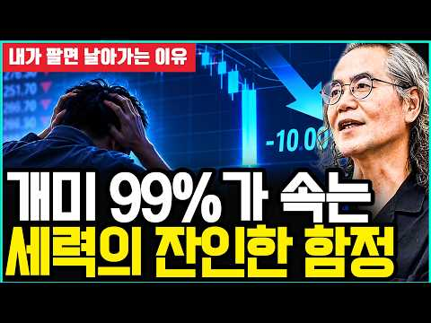
- 설명 앞부분: 정선용, 달리고 읽고 쓰는 사람의 하이
- 같은 채널 평소 대비 ×12.4 (채널 최근 롱폼 중앙값 19,917회) · 평소 영상: 2030은 빚 갚고 도망치는데 6070만 카드론·외상으로 5조 원 끌어다 주식 사는 소름… (19,917회) / "단 1원이라도 당장 빼세요" 벼락거지 안 되려다 노후 자금 다 털리는 한국 주식의 잔인… (19,115회)
- 대본 없음 (설명) — 음성인식이 끝나면 도입부·흐름이 들어감
- 댓글 148/149: 좋은 점 — 영상 3 · 감사·응원 10 · 더 알고 싶은 것 0 · 아쉬운 점 — 영상 4 · 반박·불만 — 의견 다름 4 · 정치·사회 11 · 경험 공유 7 · 구독·다음 기대 2
  - 좋은 점 — 영상 👍4 “정말 좋은 영상 감사합니다”
  - 좋은 점 — 영상 👍0 “좋은 말씀 많이 반성하고 많은. 도움 감사. 드립니다”
  - 감사·응원 👍34 “당신이 영웅 입니다 난 당신의 말씀을 공부 했습니다 당산이 옳았어요 당신이 고맙습니다 난 묵묵히 당신의 의견을 믿었습니다 힝상 감사합니다 고맙습니다”
  - 감사·응원 👍4 “정말 좋은 영상 감사합니다”
  - 아쉬운 점 — 영상 👍10 “한국 주식시장은 구조적으로 불리하며 법적·제도적 보호막은 개인이 기대하는 만큼 단단하지 않습니다. 기업의 성장이 주가로 직결되지 않고, 파생 수급과 세력의 머니게임에 지수가 휘둘리는 일이 반복되는 한, 이곳은 '건전한 투자처'라기보다는 '고도의 생존 전략과 리스크 관…”
  - 아쉬운 점 — 영상 👍0 “뻔한”
  - 반박·불만 — 의견 다름 👍1 “웃기는 소리 개미털기? 탐욕이 스스로를 망하게 하는거지 무슨 털기야. 원칙만고수해봐 해마다 돈번다.”
  - 반박·불만 — 의견 다름 👍0 “저 분 주식투자하는 분 아닌데”
  - 정치·사회 👍25 “국민주 역시 국민 피눈물. 흘리게하는 외국인.기관. 공매도 세력! 공매도 금지!”
  - 정치·사회 👍7 “ㅋㅋㅋ 우리는 리죄명정부가 세력이네 그람”
  - 경험 공유 👍12 “이런 시팍 내가 그렇게 당한거구나 ㅜㅜ”
  - 경험 공유 👍5 “"내가 팔자마자 귀신같이 날아가는 이유" 개미 99%의 피를 빨아먹는 세력의 잔인한 함정 ∣ 교수 정선용 (3부)”
  - 구독·다음 기대 👍4 “주식으로 돈 벌 생각하는 것 자체가... 내가 타이슨과 링 위에 올라가서 싸우겠다는 의지임. 겠냐?! 왜 너 님이 주식을 사면 주식이 올라야 하는거라고 생각하냐는거지. 주식 시장이 그렇게 만만하다 생각하는 것 인가. <체크포인트> - 내가 가진 컴퓨터는 수퍼컴퓨터인가…”
  - 구독·다음 기대 👍0 “❤.팬입니다요즘잠을못이루고있습니다삼성 하닉 20 20만간다는데 저는불안합니다 이논리에어떻게생각하십니까? 건강하세요”

### 84. "원금 안 깎여요" 진화형 커버드콜 ETF 황금 포트폴리오 공개

- https://www.youtube.com/watch?v=yGuybuoroRI · 투자360 · 구독자 16,800 · 조회수 703,371 (×41.9, 하루 4,719.6) · 좋아요 6,467 (0.9%) · 22.2분 · 2026-07-02 · 주제 묶음 2. 장기투자·ETF·지수 · 형식 브이로그·직접 해본 이야기 · 폴더 `W_yGuybuoroRI` (웹 승인)
- 썸네일: 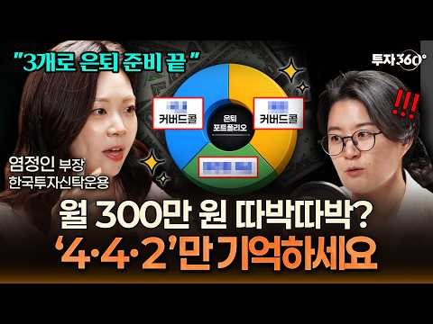
- 설명 앞부분: 커버드콜 ETF는 정말 원금을 깎아먹는 상품일까요? 한국투자신탁운용 염정인 부장과 함께 커버드콜 ETF의 오해와 진실, 활용법까지 알아봤습니다. 국내 주식형 커버드콜이 절세에 유리한 이유는 무엇인지, 미국 주식형 커버드콜은 왜 연금저축·IRP 계좌에서 활용하는 것이 좋은지도 함께 짚어봅니다. 또한 국내 커버드콜, 해외 커버드콜, 파킹형 ETF 또는 채권형 ETF으로 구성하는 포트폴리오 전략과 계좌별 인출 순서까지 정리했습니다. 노후자금을 지키면서 매달 현금흐름을 만들고 싶은 분들이라면 끝까지 시청해 주세요. 핵심만 골라보기
- 같은 채널 평소 대비 ×26.4 (채널 최근 롱폼 중앙값 26,669회) · 평소 영상: 연금계좌 무엇을 얼마나 담아야할까? 은퇴 시기별 황금 포트폴리오 공개! (16,268회) / 코스피 폭락, 월배당이 답이다? 고금리 시대 커버드콜·단기채·배당주 비중 전략 ∣ 이동후… (11,726회)
- 대본 (음성인식(앞 5분), 5.7 음절/초) — 앞부분만, 흐름은 그 안까지 첫 20초: “그러니까 한마디로 원금 깎아 먹지 않고 오히려 원금을 늘려가면서 꾸준한 분배율도 제공하고 있다 예를 들어 산 5억원 정도 은퇴자금이 있고 여기서 매달 300만 원씩 꺼냈으면 이제 20년이 최안되는 사이에 원금이 다 없어지거든요 제가 보통 추천을 드리는 거는 40, 40, 20씩 이제 말씀을 드려요 커버드 콜 매달 높은 배당금을 준다고 하니” — 도입부 유형: 숫자로 시작
- 첫 1분: “그러니까 한마디로 원금 깎아 먹지 않고 오히려 원금을 늘려가면서 꾸준한 분배율도 제공하고 있다 예를 들어 산 5억원 정도 은퇴자금이 있고 여기서 매달 300만 원씩 꺼냈으면 이제 20년이 최안되는 사이에 원금이 다 없어지거든요 제가 보통 추천을 드리는 거는 40, 40, 20씩 이제 말씀을 드려요 커버드 콜 매달 높은 배당금을 준다고 하니 눈길이 가지만 이러다 이거 결국 내 원금 까먹으면서 쓴 돈 아닌가 하는 생각도 듭니다 오늘은 한국 투자신탁 운용 염정인 부장님과 함께 커버드 콜의 오해와 진실을 명쾌하게 풀어드리고 또 소득 공백기 동안 원금 손실 없이 안전하게 월급을 꺼냈을 수 있는 실전 연금 세팅법까지 상세하게 알아보겠습니다 부장님 안녕하세요 안녕하세요 반갑습니다 부장님과 함께 저희가 이제 소중한 노후”
- 흐름 (90초마다 첫 문장): 0:00 그러니까 한마디로 원금 깎아 먹지 않고 → 1:33 내가 운 좋게 정년까지 갔다 하더라도 → 3:03 커버드콜 말은 좀 어렵지만 → 4:32 나는 그냥 배당만 받고
- 댓글 577/591: 좋은 점 — 영상 4 · 감사·응원 19 · 더 알고 싶은 것 29 · 아쉬운 점 — 영상 8 · 반박·불만 — 의견 다름 7 · 정치·사회 1 · 경험 공유 24 · 구독·다음 기대 0
  - 좋은 점 — 영상 👍10 “그렇게 노다지 좋으면 혼자만 알고있지 왜 동네방네 소문 내고 다니는지 이해가 잘 안가네요..”
  - 감사·응원 👍41 “3:37 거위가 어느 정도 이상으로 홀쭉해지고 나면, 다시는 이전 상태만큼 살이 오르지 "않을지도 모른다는" 위험성을 알려주시는게 맞지 않을까요? 4:40 옛날 커버드콜 상품들은 그러했지만, 최근 출시된 상품들은 이제 그러한 문제점을 개선했다 라고 주장하기엔, 닷컴버…”
  - 감사·응원 👍35 “댓글로도 배웁니다 감사합니다 😊”
  - 더 알고 싶은 것 👍7 “상품을 예시로 설명해주셨으면 좋을거같은데요”
  - 더 알고 싶은 것 👍6 “커버드콜 상품은 기본적으로 주가가올라도 상승에 제한이 있는상품입니다. 지금은 주가 상승기이니 커버콜 상품이 판을치는듯 합니다. 하락시기에는 어떨까요? 판단은 개인몫 2022년 같은 장기 하락기에도 커버콜 상품 권하는분 있을까요? 약장사들 많습니다. 차라리 S&P500…”
  - 아쉬운 점 — 영상 👍1 “본주가 하락하먼 원금도 떨어지는데 제목 어그로가 좀 있네요. 정확히는 배당 준다고 원금 까먹지 않은 커버드콜이 있는거겠지요.”
  - 아쉬운 점 — 영상 👍0 “커버드콜은 누가 돈을 법니까? 옵션장사로 수익내서 분배하는것이기 때문에 옵션장사를 하는 증권사가 수수료를 가져갑니다. 주식이나 주식100% ETF는요? 수수료 경쟁때문에 증권사 수수료가 거의 없다시피 합니다. 누가 돈을버는지 핵심만 이해하면 뭘 해야하는지 뭘 안해야하…”
  - 반박·불만 — 의견 다름 👍28 “지금 시장이 상승하고 있으니까 원금 보장 된다고 떠드는데 하락장 들어가면 바로 원금 박살나고 원금에서 배당 나간다. 위험없이 연15% 배당 나오는 상품이 있는데 세계적인 투자자들이 멍청해서 투자 안하고 있을거라 생각하는지 정말 웃기는 인생들 많구나...ㅉㅉㅉ”
  - 반박·불만 — 의견 다름 👍12 “원금 깎이는게 나쁜게 아닙니다. 세금전략 짤때 배당과 양도, 종합소득 사이의 간격 맞출때 사용함 그리고 사회초년생이면 배당주는 사지마세요 가장 비싼 시간가치를 배당이란 헐값에 파는거임”
  - 경험 공유 👍30 “커버드콜 3년째 하고 있는데ᆢ 좋습니다 ^^ 하락장이오든ᆢ 상승장이 오든 신경끄고 있을수 있어서ᆢ 짱입니다^^”
  - 경험 공유 👍5 “커버드콜 2년째 하고 있는데 개별주보다 훨씬 좋습니다 당연히 분산투자가 되어야 하고 국내지수, 미국지수, 반도체, 미배당, 금 etf 등등 성장도 하고 하락장에는 어느정도 방어되는 섹터도 있어야 되는겁니다 커버드콜의 최고의 매력은 하락장에도 꾸준히 나오는 분배금으로 …”

### 85. 복리가 부를 만드는 진짜 시작점｜언제부터 돈이 스스로 일하기 시작할까

- https://www.youtube.com/watch?v=JExUQaROk40 · 돈의 통찰 · 구독자 3,980 · 조회수 138,144 (×34.7, 하루 1,070.7) · 좋아요 1,562 (1.1%) · 17.8분 · 2026-07-22 · 주제 묶음 1. 주식 기초·초보 · 형식 정보·해설 (그 밖) · 폴더 `W_JExUQaROk40` (웹 승인)
- 썸네일: 
- 설명 앞부분: 복리는 단순히 이자를 더해주는 원리가 아닙니다. 대부분의 사람들은 복리의 힘이 나타나기 전에 포기합니다. 이 영상에서는 복리가 언제부터 눈에 보이는 자산 성장으로 이어지는지, 돈이 스스로 일하기 시작하는 진짜 전환점은 언제인지 실제 숫자와 사례를 통해 쉽게 설명합니다. 장기 투자, 경제적 자유, 자산 증식을 목표로 한다면 꼭 끝까지 시청해 보세요.
- 같은 채널 평소 대비 ×9.9 (채널 최근 롱폼 중앙값 13,920회) · 평소 영상: 돈이 있다고 말하는 순간, 거절의 대가가 커집니다｜자산을 공개하면 생기는 일 (14,035회) / 부자처럼 보이는 사람과 진짜 부자의 결정적 차이｜이 신호를 보세요 (13,804회)
- 대본 없음 (설명) — 음성인식이 끝나면 도입부·흐름이 들어감
- 댓글 103/104: 좋은 점 — 영상 9 · 감사·응원 15 · 더 알고 싶은 것 1 · 아쉬운 점 — 영상 0 · 반박·불만 — 의견 다름 1 · 정치·사회 0 · 경험 공유 12 · 구독·다음 기대 1
  - 좋은 점 — 영상 👍15 “도움되는 영상!구독했어요.기억할께요.복리의 힘.주식시장 떠나지 말고 세월로 돈을 엉덩이로 깔고 않아서 건강만 챙기기.감사합니다.”
  - 좋은 점 — 영상 👍8 “좋은 영상 감사합니다”
  - 감사·응원 👍15 “도움되는 영상!구독했어요.기억할께요.복리의 힘.주식시장 떠나지 말고 세월로 돈을 엉덩이로 깔고 않아서 건강만 챙기기.감사합니다.”
  - 감사·응원 👍8 “좋은 영상 감사합니다”
  - 반박·불만 — 의견 다름 👍7 “늦으면 복리의 마법에 못올라타는게 아니다.. 예를들어 50만원씩 매월 납입을 했다고 가정하면 약 1년 8개월 정도면 1천만원을 달성한다.. 그럼 나는 딱 12개월뒤에 1천만원을 넣었다면? 복리가 답인것 같지만 실제는 원금의 규모다, 개별주로 자금을 불리는 사람도 있다…”
  - 경험 공유 👍96 “제가 4년전 2022년 1~2월달 무렵 그당시 요식업 식당 다니고 있을때 어렵게 모은 종잣돈 8천7백만원이 있었어요...그때 이 돈으로 장사해볼까 정말 고민의 고민을 했어요ㅠ실행 직전까지 갔는데 마지막에 내 자신도 컨트롤 못하는데 내가 요식업 차려서 직원을 잘 컨트롤…”
  - 경험 공유 👍32 “진짜 맞말입니다 이제 고작 3년차 연저펀 에쎈피500 하고있는데요 시간이...와ㅏㅏㅏㅏ 아주 맞는말 😊”
  - 구독·다음 기대 👍15 “도움되는 영상!구독했어요.기억할께요.복리의 힘.주식시장 떠나지 말고 세월로 돈을 엉덩이로 깔고 않아서 건강만 챙기기.감사합니다.”

### 86. 현대차 반토막에 숨겨진 진실… 엔비디아 합작 발표 전 무조건 모아야 할 이유 [이권희 대표]

- https://www.youtube.com/watch?v=m3ZRHahRGHU · 경제시그널 · 구독자 28,800 · 조회수 408,924 (×14.2, 하루 7,711.2) · 좋아요 1,839 (0.4%) · 33분 · 2026-10-06 · 주제 묶음 기타 · 형식 인터뷰·강연·대담 · 폴더 `W_m3ZRHahRGHU` (웹 승인)
- 썸네일: 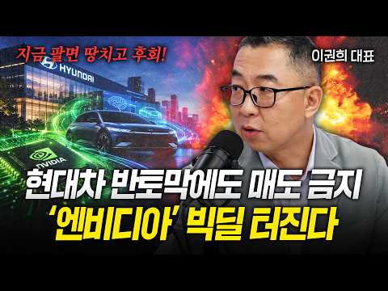
- 챕터: 0:00 오프닝 · 0:15 요즘 주식시장 · 13:25 삼성전자 3분기 잠정실적 · 15:40 수급으로 인한 리스크는? · 20:10 반도체 소부장 접근법 · 22:30 전력기기·전선주 투자 포인트 · 24:25 현대차 언제 전고점가나? · 28:45 3분기 어닝시즌 진입... 투자 전략은?
- 설명 앞부분: 🔎올초 피지컬 AI와 로봇 기대감으로 치솟았던 현대차 주가 고점 대비 반토막 난 상황! 새만금 데이터센터 건립과 복정동 연구센터에 '엔비디아' 엔지니어들이 들어온다? 연내 발표될 엔비디아와의 합작법인 모멘텀부터 2035년까지 이어질 메모리·로봇 대폭발 사이클까지! 지금 현대차를 팔면 안 되는 이유와 반등 타이밍을 공개합니다. 뿐만 아니라 삼성전자 3분기 실적발표를 앞두고 반도체 소부장주 급등랠리 중입니다. 50개가 넘는 소부장 종목 속에서 가장 스마트하게 수익률을 챙기는 전략도 전격 공개합니다. 🕥 타임스탬프 🕥 녹화일: 2026…
- 같은 채널 평소 대비 ×302.7 (채널 최근 롱폼 중앙값 1,351회) · 평소 영상: 흙에서 금, 은을 캐는 고려아연의 비밀? (1,351회) / 한강에 사는 수달 27마리의 DNA를 분석해 보니 벌어진 일?! 한강이 야생동물의 천국이… (870회)
- 대본 없음 (설명) — 음성인식이 끝나면 도입부·흐름이 들어감
- 댓글 213/213: 좋은 점 — 영상 1 · 감사·응원 3 · 더 알고 싶은 것 1 · 아쉬운 점 — 영상 0 · 반박·불만 — 의견 다름 5 · 정치·사회 7 · 경험 공유 8 · 구독·다음 기대 0
  - 좋은 점 — 영상 👍6 “갓권희대표님~ 좋은 말씀 감사합니다~ 👍👍👍”
  - 감사·응원 👍6 “갓권희대표님~ 좋은 말씀 감사합니다~ 👍👍👍”
  - 감사·응원 👍0 “감사해요. 절대 주식하면 안되는다는 진실을 몸소 배우고 있어요. ㅎㅎㅎㅎㅎ”
  - 더 알고 싶은 것 👍4 “현대차 Ai에 물어 보니까 33만에 50프로 물타고 30만원 깨지면 나머지 다 사라던대 어떤걸 믿을까요?”
  - 반박·불만 — 의견 다름 👍1 “저,*때문에(100만원간다고) 신세ㅗ진사람 천지..왜방송에 나와 헛소리하고 저런8을 방송에서 ,,,”
  - 반박·불만 — 의견 다름 👍0 “70만원대안팔고로봇으로사기친자들 공매도중 조선 로봇 바이오 자동차 헛소리하지마라 얼마전까지사라고난리치더니”
  - 정치·사회 👍4 “미국 중간선거 끝나면 난리난다”
  - 정치·사회 👍2 “● 삼성전자: 3분기 서프라이즈 실적 발표(D-2): 선매수 유리 영업이익 110조원: 전년대비 802% 폭증 ○ 자사주 15조원 매수중 주주환원 110조원 발표 ● 싱가폴 국부펀드 테마섹 : 삼성전자 51조원 매수 시작 : 외국인+기관 최근 3000만주 대량 매수 …”
  - 경험 공유 👍32 “냉정하게 보면 저 사람이 현대차 주가를 떨어트린것도 아니고 왜 저사람에게 화풀이지? 올랐으면 저사람에게 수익의 반은 줄건가?? 나도 현대차 물려있지만 선택은 개인이 한것이니 개인이 감내해야한다고 본다.”
  - 경험 공유 👍8 “내가 "밧데리아저씨2" 가 될상인가”

### 87. 코스피 단기반등 어렵다 ∣ 굳이 사고 싶다면 이때 사라 ∣ 남석관 베스트인컴 회장

- https://www.youtube.com/watch?v=Bh7U-uOaunQ · 투벤저스 주간동아 · 구독자 32,700 · 조회수 190,166 (×5.8, 하루 8,588.8) · 좋아요 0 (0.0%) · 17.6분 · 2026-11-06 · 주제 묶음 5. 국내주식 · 형식 인터뷰·강연·대담 · 폴더 `W_Bh7U-uOaunQ` (웹 승인)
- 썸네일: 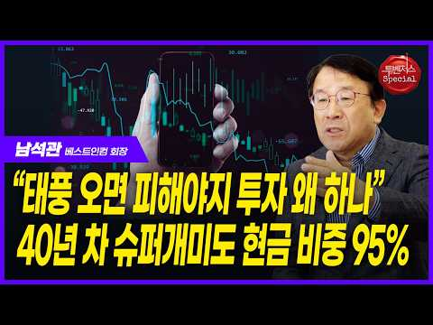
- 챕터: 0:00 하이라이트 · 0:57 코스피 단기 반등 기대할 상황인가 · 3:28 하락장 저점매수 전략은? · 7:05 중간선거 끝난 후 단기반등은? · 8:20 사라진 시대중심주? · 10:05 새로운 시대중심주 등장 시기 · 10:39 삼전닉스 저가 매수 전략은? · 12:58 앤트로픽과 오픈AI IPO는 호재? · 14:02 현재 포트폴리오 현금 비중 · 14:38 슈퍼개미의 상승장 판단법 · 16:27 11, 12월 조심해야 할 포인트
- 설명 앞부분: 남석관 베스트인컴 회장 인터뷰 영상 촬영 일자 : 11/3
- 대본 없음 (설명) — 음성인식이 끝나면 도입부·흐름이 들어감
- 댓글 303/303: 좋은 점 — 영상 8 · 감사·응원 21 · 더 알고 싶은 것 6 · 아쉬운 점 — 영상 3 · 반박·불만 — 의견 다름 3 · 정치·사회 12 · 경험 공유 17 · 구독·다음 기대 0
  - 좋은 점 — 영상 👍11 “32년 동안 주식해본 경험을 볼때 이분 의견 100% 공감합니다”
  - 좋은 점 — 영상 👍8 “남석관님 진심으로 감사드립니다 도움이 많이 되었습니다 항상 건강하시고 좋은 일만 가득하세요”
  - 감사·응원 👍52 “4달 전부터 7월초에 현금 90% 유지 중, 고견 감사합니다.”
  - 감사·응원 👍41 “유명한 사람들 얘기 종합해보면 이분 말이 늘 맞았던것 같아요. 감사합니다.”
  - 더 알고 싶은 것 👍11 “이거 예전 봤던 영상인데 ^^;;녹화날짜를 올려주세요.”
  - 더 알고 싶은 것 👍9 “그럼 7천포인트 부터 자주 나와서 강조 강조 해주시지? 이렇게 대 폭락에 그런말씀 하심 손절시기 지난 개미들은 어떻게 버티나요? ㅠ ㅠ”
  - 아쉬운 점 — 영상 👍9 “815에서 말씀하시는 것 듣고 참 지혜로우시다 생각했어요. 오늘 인터뷰 들으니 한국주식시장의 현인이십니다. 몇번씩 반복해서 듣고 있어요. 감사합니다”
  - 아쉬운 점 — 영상 👍5 “잘들었습니다. 떨어지면 또 올라가면... 그때그때 분위기 따라서 다르니 전문가분들이 누구하나 맞던 틀리던 미리 소신껏 말을해 주는 분이 없는듯 싶은게 아쉽네요. 각자 알아서”
  - 반박·불만 — 의견 다름 👍38 “올해수익률 200% 20년차 입니다...이분말 들으세요...저가매수 기술적반등 나올수있는데 소용없습니다..많이 떨어졌다고 바닥이 아닙니다.나스닥 일본 대만은 하락초입...코스피멱살잡힐 확률 높습니다.”
  - 반박·불만 — 의견 다름 👍27 “최소한 한달전에 얘기하지 다 끝나고 잘난체는 어이없네”
  - 정치·사회 👍10 “난 6월달에 주변 지인들한테 고점이라고 팔아라고 했다 외국인들이 하루에 10조 넘게 매일 던지는거 보고”
  - 정치·사회 👍4 “이번 한국만의 거품은 현정부가 지방선거용으로 펌프질 한 영향이 크다.시장개입한 현정부 주가조작질 한거지.”
  - 경험 공유 👍64 “떨어지기 시작할때쯤 말해야지 지금 많이떨어진후 말하는건 나도할수있어요. 주린이들 대부분 엄청 물려있을덴데 누가 지금 손절하고 기다릴까요?”
  - 경험 공유 👍38 “올해수익률 200% 20년차 입니다...이분말 들으세요...저가매수 기술적반등 나올수있는데 소용없습니다..많이 떨어졌다고 바닥이 아닙니다.나스닥 일본 대만은 하락초입...코스피멱살잡힐 확률 높습니다.”

### 88. "외국인이 비웃고 있습니다" 지금 개미들은 모르고 있다 다음주 더 무서울 겁니다 (유신익 박사 / 통합본 1부)

- https://www.youtube.com/watch?v=gGcjHeY9SnQ · 웅달책방_투자 · 구독자 3,780 · 조회수 55,520 (×14.7, 하루 972.5) · 좋아요 403 (0.7%) · 31.9분 · 2026-10-02 · 주제 묶음 8. 투자 심리·실패 · 형식 인터뷰·강연·대담 · 폴더 `W_gGcjHeY9SnQ` (웹 승인)
- 썸네일: 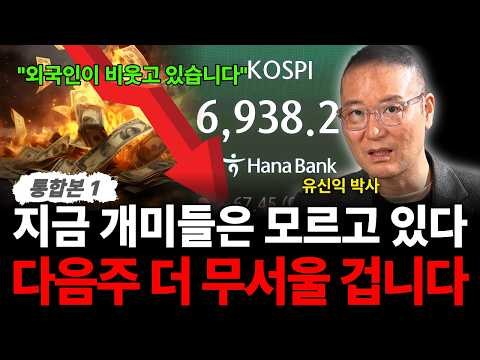
- 설명 앞부분: 🌕 "삼전닉스 들고 있다면 꼭 보세요" 국내증시 분위기 심상치 않다 '이때' 8000을 넘깁니다 (유신익 박사 / 통합본 1부) 본 영상은 9월 29일에 촬영되었습니다 (시청에 참고해 주세요) ※ 출연자에 대한 비난, 욕설, 비속어 등을 포함한 댓글은 무통보 삭제될 수 있습니다. 성숙한 소통 문화 형성에 동참해주시길 바라겠습니다. 감사합니다.
- 같은 채널 평소 대비 ×8.3 (채널 최근 롱폼 중앙값 6,664회) · 평소 영상: 삼성 판 개미들 잠 다 잤다 월요일 아침 '이렇게' 될 겁니다 (차영주 소장 / 통합본 … (6,704회) / 한국 증시 왜 이렇게 망가졌나 솔직히 싹다 말씀드립니다 (주식장인 이창대 대표 / 통합본… (6,625회)
- 대본 없음 (설명) — 음성인식이 끝나면 도입부·흐름이 들어감
- 댓글 43/43: 좋은 점 — 영상 0 · 감사·응원 3 · 더 알고 싶은 것 1 · 아쉬운 점 — 영상 2 · 반박·불만 — 의견 다름 2 · 정치·사회 0 · 경험 공유 5 · 구독·다음 기대 0
  - 감사·응원 👍2 “질서있는 후퇴~~ 한마디로 현재 시장상황을 정의해주네요. 감사합니다.”
  - 감사·응원 👍2 “감사합니다❤”
  - 더 알고 싶은 것 👍0 “자산 배분에서 미 채권은 빠지게 되나요?”
  - 아쉬운 점 — 영상 👍4 “어느정도는 알고 있는 뻔한 소리군요. 모두가 그렇듯.. 썸네일만 자극적 문구로 달아놨네요.”
  - 아쉬운 점 — 영상 👍0 “뻔한 말! 더 깊이 있는 견해라면 더 좋을듯~”
  - 경험 공유 👍1 “유신익 박사님의 분석은 현시점의 증시 현황에 대해 내가 궁금했던 점을 속시원히 풀어주셔서 정말 감사합니다.”

### 89. 라오어 무한매수법, 정말 계속 해도 될까? TQQQ·QLD로 12년 돌려보고 알게 된 의외의 결과

- https://www.youtube.com/watch?v=nCBMBYmFjOU · 여의도 아빠  · 구독자 2,570 · 조회수 68,884 (×26.8, 하루 643.8) · 좋아요 767 (1.1%) · 7.5분 · 2026-08-13 · 주제 묶음 7. 매매·전략 · 형식 정보·해설 (그 밖) · 폴더 `W_nCBMBYmFjOU` (웹 승인)
- 썸네일: 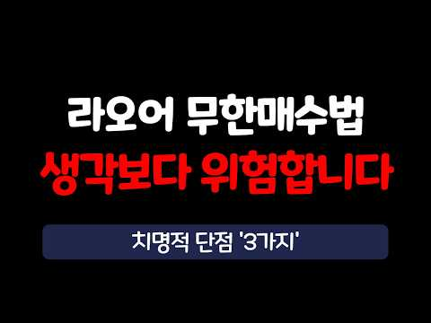
- 설명 앞부분: 라오어의 무한매수법, 12년을 그대로 돌려봤습니다. 그런데 가장 놀란 건 수익률이 아니었어요. 돈이 놀고 있는 시간과 현금이 바닥나는 순간이었습니다. QLD 무한매수 19배 vs 그냥 거치 30배 TQQQ 무한매수 19배 vs 그냥 거치 59배 12년 내내 현금의 3분의 1이 놀고 있었다 최악의 타이밍 2021년 꼭지 진입 QLD vs TQQQ 무한매수 평소엔 QLD, 찐 폭락엔 TQQQ 시작
- 같은 채널 평소 대비 ×10.5 (채널 최근 롱폼 중앙값 6,578회) · 평소 영상: S&P500에 2배 투자했는데 QQQ 1배보다 수익률이 낮았습니다… 20년 동안 무슨 일… (6,709회) / 아이에게 매달 10만원씩 미국 ETF를 사줬더니… 20년 뒤 계좌에 찍힌 금액 (S&P5… (6,448회)
- 대본 없음 (설명) — 음성인식이 끝나면 도입부·흐름이 들어감
- 댓글 186/215: 좋은 점 — 영상 5 · 감사·응원 7 · 더 알고 싶은 것 12 · 아쉬운 점 — 영상 1 · 반박·불만 — 의견 다름 6 · 정치·사회 0 · 경험 공유 13 · 구독·다음 기대 0
  - 좋은 점 — 영상 👍4 “좋은 영상 감사합니다! 멘탈 유지에 도움이 많이 돼요!”
  - 좋은 점 — 영상 👍3 “평소엔 qld 폭락엔 TQQQ무한매수.. 공감합니다만 '진짜 폭락' 이라는걸 어찌 알 수 있는지가 관건이네요ㅎㅎ.. 대부분은 그걸 못맞추니 이런 규칙이 나오는건데”
  - 감사·응원 👍21 “부지런히 할필요없이 무한매수법 공개api로 프로그램만들어서 자동으로 돌리고 있습니다 .qld도 같이 하고 있고요 . 결과 흥미롭게 잘봤습니다 감사합니다 .”
  - 감사·응원 👍7 “다른의미로 감사합니다 😘”
  - 더 알고 싶은 것 👍13 “더 좋은 방법을 알려주세요”
  - 더 알고 싶은 것 👍5 “무한매수법 저자가 서울대 자퇴, 경력 10년차 소아개원의 치과의사 맞나요? 검색해도 저자의 실명도 없고 최소한 어느 치대를 졸업했는지 최소한의 정보조차 검색이 안되고 모두 비공개라, 늘 마스크 쓰고 다니니 😢 주식관련 멤버십 비용도 월 12만원 받는다는데 저자에 대한…”
  - 아쉬운 점 — 영상 👍3 “제목으로 어그로 끄는건 여전하네”
  - 반박·불만 — 의견 다름 👍30 “무한매수법의 가장 큰 장점은 수익률이 아닙니다. 정해진 규칙을 따라서 상승장, 횡보장, 하락장에도 맨탈이 흔들리지 않으면서 꾸준히 수익을 내는 방법이지. 다양한 시나리오를 가정한 12년치 백테스트는 이 투자방법이 실전에서 쓸수 있는지 확인하는 좋은 방법이긴 하지만 수…”
  - 반박·불만 — 의견 다름 👍28 “웃고 갑니다. 직접 몇년간 하는 입장에서 라오어님 입장도 모르고 그냥 방법만 겉핥기 식으로만 평가하는 느낌이네요. 무한매수법은 리스크를 줄이기 위한 "단투"지 장투에 적합한 방법은 아닙니다. 무슨 qld 장기보유랑 비교를 해요.. 라오어님도 그냥 이것저것 귀찮으면 q…”
  - 경험 공유 👍41 “무한매수의 단점은 1. 상방이 막혀있고 하방은 열려 있으며, 2. 복리를 스스로 끊고 리셋하며, 3. 계속해서 수익을 확정하면서 텍스를 내야하는 텍스 이펙트를 고려하지 않았고, 4. 항상 이용할 수 있는 자금의 일부분만 사용하기에 수익률은 좋을수 있으니 수익금 측면에…”
  - 경험 공유 👍40 “2022년에 라오어 카페에 가입해서 꾸준히 글씀. 그때 세상이 참 재미있었음. 하수들이 세상이 망한다고 고래고래 소리지르고 거기서 유일하게 비껴간게 라오어 카페였음. 거기도 순탄하진 않았지만 적어도 tq가 80프로 떨어진 그 순간에도 tq를 믿는 사람들이 모였단 말임…”

### 90. 단타 천재가 개발한 초간단 매매법(기본 차트 분석법)

- https://www.youtube.com/watch?v=knblsnwXsfg · 차트9단 · 구독자 492 · 조회수 19,082 (×38.8, 하루 123.1) · 좋아요 426 (2.2%) · 20분 · 2026-06-26 · 주제 묶음 6. 종목 고르기·분석 · 형식 인터뷰·강연·대담 · 폴더 `W_knblsnwXsfg` (웹 승인)
- 썸네일: 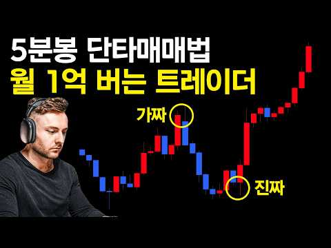
- 챕터: 0:00 시작 · 0:28 이평선 하나면 된다 · 2:21 이평선 사용법 · 5:04 탑다운 매매법 · 8:50 이평선 단타매매법
- 설명 앞부분: 단타 천재가 개발한 초간단 매매법(기본 차트 분석법) 거래량 델타 지표 무료 신청하기 트레이딩 매매법 강의 무료 신청하기 100억 트레이더의 비법서 신청하기 편리한 자동 거래봇 이용 신청하기
- 같은 채널 평소 대비 ×37.8 (채널 최근 롱폼 중앙값 504회) · 평소 영상: 단타 매매법은 딱 두가지만 알면 끝입니다. (이동평균선 거래량 차트보는법) (690회) / 일목균형표 단타 매매법, 이 영상 하나로 종결합니다. (차트 설정법) (319회)
- 대본 없음 (설명) — 음성인식이 끝나면 도입부·흐름이 들어감
- 댓글 7/7: 좋은 점 — 영상 1 · 감사·응원 5 · 더 알고 싶은 것 1 · 아쉬운 점 — 영상 0 · 반박·불만 — 의견 다름 0 · 정치·사회 0 · 경험 공유 0 · 구독·다음 기대 0
  - 좋은 점 — 영상 👍0 “좋은 정보 감사합니다”
  - 감사·응원 👍0 “좋은지표입니다 수고많아요 감사합니다”
  - 감사·응원 👍0 “많이 배웁니다.감사합니다.”
  - 더 알고 싶은 것 👍0 “안녕하십니까 차트9단님 델타거래량지표을 신청합니다 부탁드립니다 감사합니다”

### 91. “아이렌, 비상비상.. 20달러도 붕괴직전..”ft.아이렌맨

- https://www.youtube.com/watch?v=ZqZXiUzdQRE · 아이렌맨 : IREN을 사랑하는 남자 · 구독자 9,490 · 조회수 53,620 (×5.7, 하루 2,329.2) · 좋아요 415 (0.8%) · 5.9분 · 2026-11-05 · 주제 묶음 기타 · 형식 인터뷰·강연·대담 · 폴더 `W_ZqZXiUzdQRE` (웹 승인)
- 썸네일: 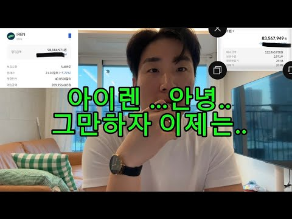
- 같은 채널 평소 대비 ×2.3 (채널 최근 롱폼 중앙값 23,126회) · 평소 영상: "아이렌,머스크 "AI로는 부족해" 'SpaceXAI → SpaceXSI(초지능)이름까지… (23,126회) / "앤트로픽이 아이렌을?! 프리장 +9% 폭등 → 하루 만에 전부 반납한 진짜 이유" ft… (23,346회)
- 대본 없음 (없음) — 음성인식이 끝나면 도입부·흐름이 들어감
- 댓글 709/709: 좋은 점 — 영상 1 · 감사·응원 45 · 더 알고 싶은 것 5 · 아쉬운 점 — 영상 1 · 반박·불만 — 의견 다름 1 · 정치·사회 13 · 경험 공유 42 · 구독·다음 기대 0
  - 감사·응원 👍27 “힘든 상황임에도 오늘 영상올려주셨어 나름 힘이 됩니다. 힘내시고 이 힘든시기 같이 견디시죠. 화이팅~”
  - 감사·응원 👍21 “장기투자가 이렇게나 힘듭니다~~ 결국 클수밖에 없는 섹터라 생각합니다. 좋은 결과 있으실겁니다 아이렌 화이팅”
  - 더 알고 싶은 것 👍7 “궁금한게 있는데 데이터센터 관련주중에 아이렌보다 훨씬 더 잘나가고 더 전망이 좋고 망할 가능성이 1도 없고 님이 존경하는 워렌버핏이 투자한 구글이라는 회사가 있는데 왜 굳이 아이렌에 투자하시는지 궁금합니다. 구글 아마존 같이 데이터센터 사업에서 살아남을가능성이 가장큰…”
  - 더 알고 싶은 것 👍2 “기다렸습니다! 정말 걱정되네요 ㅠ 아이렌님은 어떻게 하실건지 궁금하네요 ㅠ”
  - 아쉬운 점 — 영상 👍2 “좋은경험하고있다고 생각합니다. 이렇게 됐을때 무엇이 부족했나. 투자복기 생각해보고 리스크관리랑 비중조절하면서 현금을 못가져가 좋은 포지션에서 사지 못한게 너무 아쉽습니다..ㅠㅠ 평단이 너무 높아서 힘듭니다 아이렌 괜찮은회사라고 생각하지만 부채부담도 크고해서 갑작스레 …”
  - 반박·불만 — 의견 다름 👍2 “혼자뒤지지 왜 사람들 선동해서 다그지만들지”
  - 정치·사회 👍18 “스트레스 받았는지 피부에 뭐가 나셧내요 걱정마세요. 저도 아이렌 투자중이고 민주당이 되도 ai 를 버릴수도 없고 텍사스 역시 아이렌은 이미 지역친화적으로 텍사스 지역주민들 직원으로 채용한지 오래고 이미 허가가 다 된상태라 오히려 호재일겁니다. 미국인은 퇴직금을 주식으…”
  - 정치·사회 👍8 “아이렌을 그렇게 공부많이 했다는분이 민주당 공화당 성향 아셨을텐데 민주당이 여론조사에서도 우이리는것도 그냥 그렇게 아무생각없이 물타기를 하시는것도.... 적어도 선거결과와 시장반응 본뒤 들어가실 생각도 안하시구 참...주식한지 얼마안된티가 많이납니다”
  - 경험 공유 👍24 “아이렌멘이 아니고 아이언맨이시네요ㅋㅋ 저도 아이렌 홀더인데 계속 줘터지고 있네요ㅠㅠ 이또한 다 지나가겠죠”
  - 경험 공유 👍18 “스트레스 받았는지 피부에 뭐가 나셧내요 걱정마세요. 저도 아이렌 투자중이고 민주당이 되도 ai 를 버릴수도 없고 텍사스 역시 아이렌은 이미 지역친화적으로 텍사스 지역주민들 직원으로 채용한지 오래고 이미 허가가 다 된상태라 오히려 호재일겁니다. 미국인은 퇴직금을 주식으…”

### 92. 퇴직연금 전문가들이 말아주는 포트폴리오 꿀조합!🍯ㅣ원큐로 끝내는 ETF🎯

- https://www.youtube.com/watch?v=LwkpHtapiJY · 하나TV [하나자산운용] · 구독자 29,500 · 조회수 114,591 (×3.9, 하루 6,708.1) · 좋아요 1,689 (1.5%) · 6.9분 · 2026-11-11 · 주제 묶음 2. 장기투자·ETF·지수 · 형식 정보·해설 (그 밖) · 폴더 `W_LwkpHtapiJY` (웹 승인)
- 썸네일: 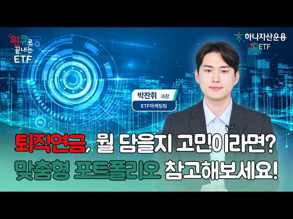
- 설명 앞부분: 퇴직연금, 어떤 ETF를 얼마나 담아야 할지 고민되시나요?🤔 전문가가 제안하는 MP 서비스를 활용하면 내 연금의 투자 방향을 정하는 데 도움을 받을 수 있어요📊 투자성향별 ETF 포트폴리오부터 1Q ETF 활용법까지 영상에서 확인해 보세요💚 하나자산운용 준법감시인 심사필 2026-218(2026.11.11. ~ 2027.11.10.). 1Q ETF 더 알아보기 👀
- 같은 채널 평소 대비 ×1.1 (채널 최근 롱폼 중앙값 107,062회) · 평소 영상: 미국 AI 소프트웨어·플랫폼 핵심 기업을 한번에📱ㅣ1Q 미국AI테크플랫폼 ETF [원박싱… (108,529회) / 코스닥 다시 반등할까?📈ㅣ원큐로 끝내는 ETF🎯 (105,595회)
- 대본 없음 (설명) — 음성인식이 끝나면 도입부·흐름이 들어감
- 댓글 6/6: 좋은 점 — 영상 0 · 감사·응원 1 · 더 알고 싶은 것 0 · 아쉬운 점 — 영상 0 · 반박·불만 — 의견 다름 0 · 정치·사회 0 · 경험 공유 0 · 구독·다음 기대 0
  - 감사·응원 👍5 “투자를 고민중인데 많은도움됩니다. 감사합니다~~~^^”

### 93. "중장기 투자? 삼전닉스 말고 스페이스X 모으세요” (정의훈 선임연구원)

- https://www.youtube.com/watch?v=bMR3jvlYDgo · 투자360 · 구독자 16,800 · 조회수 171,781 (×10.2, 하루 3,726.1) · 좋아요 799 (0.5%) · 16분 · 2026-10-13 · 주제 묶음 11. 투자 일반 · 형식 정보·해설 (그 밖) · 폴더 `W_bMR3jvlYDgo` (웹 승인)
- 썸네일: 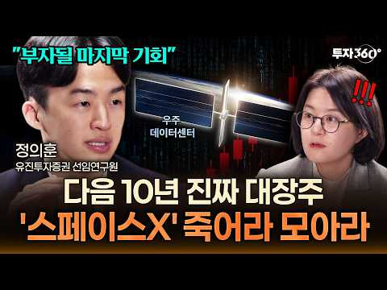
- 챕터: 0:00 🔥 하이라이트 · 0:58 🚀 스페이스X 70% 급등, 무슨 일이 있었나 · 3:52 ⚠️ 삼성전자·하이닉스 중장기 투자를 반대하는 이유! · 4:29 💰 70% 오른 스페이스X 개별주 살까? ETF 살까? · 5:59 💰 🌌 우주 데이터센터, 드디어 돈이 되나? · 8:29 📊 스페이스X, 꼭 봐야 할 4가지 지표 · 11:17 🚨 어떤 신호가 나오면 투자를 멈춰야 하나 · 12:55 🔥 스타십·스타링크·AI, 다음 성장동력은? · 14:15 🎯 지금 주가는 고점? “아직 다 반영 안 됐다”
- 설명 앞부분: "삼전닉스 장투 추천 안 합니다. 잘 모르겠으면 스페이스X 사세요” 저점 대비 약 70% 반등한 스페이스X. 지금 들어가기엔 이미 늦은 걸까요? 정의훈 유진투자증권 연구원과 최근 주가 급등 이유부터 특히 현재 주가에 향후 성장 기대가 얼마나 반영됐는지, 어떤 신호가 나오면 투자를 다시 점검해야 하는지도 확인합니다. 🎥촬영일: 2026년 10월 6일 ⏱️ 골라 보는 핵심 투자 포인트
- 같은 채널 평소 대비 ×8.0 (채널 최근 롱폼 중앙값 21,468회) · 평소 영상: 연금계좌 무엇을 얼마나 담아야할까? 은퇴 시기별 황금 포트폴리오 공개! (16,268회) / 코스피 폭락, 월배당이 답이다? 고금리 시대 커버드콜·단기채·배당주 비중 전략 ∣ 이동후… (11,726회)
- 대본 (음성인식(앞 5분), 6.4 음절/초) — 앞부분만, 흐름은 그 안까지 첫 20초: “녹화의 기준으로 거의 170달러까지 거의 저점 대비 한 70%가 오른 상황인데 현대 주가의 반영이 다 됐다고 보세요? 이런 기대치가? 아니요 지금 당장에 클라우드나 이런 부분들이 매출이 올라온 부분만 좀 반영되어 있다고 보거든요 내년도나 내 훈련도의 실적이나 이런 부분들이 훨씬 더 잘 붙을 거라고 보고 있는데 그렇기 때문에 스페이스 X를 사도 괜찮다고 말씀드리지만” — 도입부 유형: 질문으로 시작, 숫자로 시작
- 첫 1분: “녹화의 기준으로 거의 170달러까지 거의 저점 대비 한 70%가 오른 상황인데 현대 주가의 반영이 다 됐다고 보세요? 이런 기대치가? 아니요 지금 당장에 클라우드나 이런 부분들이 매출이 올라온 부분만 좀 반영되어 있다고 보거든요 내년도나 내 훈련도의 실적이나 이런 부분들이 훨씬 더 잘 붙을 거라고 보고 있는데 그렇기 때문에 스페이스 X를 사도 괜찮다고 말씀드리지만 다른 같은 경우에는 잘 모르겠으면 ETF 사세요라고 하잖아요 잘 모르겠으면 그냥 스페이슥들을 사시라 하하하하 라고 말씀 드리고 있어요 지난 회차에서는 누리호 5차 발사의 의미를 중심으로 국내 우주산업의 현재 그리고 투자 기회를 한번 짚어봤습니다 이번에는 글로벌 시장으로 한 번 더 시선을 넓혀서 우주산업의 대표 주자 스페이스 X를 한 번 살펴보려고”
- 흐름 (90초마다 첫 문장): 0:00 녹화의 기준으로 거의 170달러까지 → 1:30 조금 더 공부를 하셨으면 좋겠는 게 → 3:02 그러면 패시브 자금 → 4:30 이런 분들이 계세요
- 댓글 62/89: 좋은 점 — 영상 0 · 감사·응원 1 · 더 알고 싶은 것 0 · 아쉬운 점 — 영상 0 · 반박·불만 — 의견 다름 1 · 정치·사회 4 · 경험 공유 0 · 구독·다음 기대 0
  - 감사·응원 👍0 “연구원님 저는 믿고 있었습니다 감사합니다 스엑 날라가즈아🎉🎉🎉”
  - 반박·불만 — 의견 다름 👍4 “헛소리말고 지수투자나 해라...”
  - 정치·사회 👍5 “공화당이 중간선거 이기면 스페이스x대상승각이다”
  - 정치·사회 👍4 “스페이스X는 중간선거 이후 사는 게 맞지 않나요? 질문 한번 해주세요~”

### 94. 폭락장에 혼자사는 40대 남자의 조용한 일상 이야기

- https://www.youtube.com/watch?v=ujYBYg4yBH4 · 배당아저씨 · 구독자 33,900 · 조회수 100,640 (×3.0, 하루 7,022.3) · 좋아요 1,359 (1.4%) · 9.5분 · 2026-11-14 · 주제 묶음 11. 투자 일반 · 형식 브이로그·직접 해본 이야기 · 폴더 `W_ujYBYg4yBH4` (웹 승인)
- 썸네일: 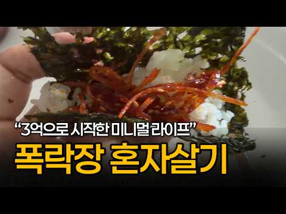
- 설명 앞부분: 영상 속 배당아저씨의 미니멀라이프 내돈내산 재료&용품들 (쿠팡 파트너스 및 인플루언서 활동의 일환으로 구매시 일정액의 수수료를 제공 받을 수 있습니다) 이 채널은 저의 투자 경험과 생각을 공유하는 공간입니다. 저의 투자 방식을 그대로 따라 하시는 것은 권장드리지 않으며, 충분한 고민과 공부 후 판단하시길 바랍니다.
- 같은 채널 평소 대비 ×1.9 (채널 최근 롱폼 중앙값 52,769회) · 평소 영상: 미국주식 3억, 배당금으로 직장 없이 살고 있어요_배당파이어 장단점 (52,769회) / 일하지 않고 배당금 받아 살면 나라가 망한다, 3억으로 시작한 파이어 미니멀라이프 (51,635회)
- 대본 없음 (설명) — 음성인식이 끝나면 도입부·흐름이 들어감
- 댓글 279/279: 좋은 점 — 영상 3 · 감사·응원 26 · 더 알고 싶은 것 12 · 아쉬운 점 — 영상 2 · 반박·불만 — 의견 다름 6 · 정치·사회 1 · 경험 공유 19 · 구독·다음 기대 2
  - 좋은 점 — 영상 👍0 “아무런 제안도 수락하지 않으셨다는 말씀에 구독 ^^ 지금처럼 꾸밈없이 보여주는 배당 아저씨의 일상 이야기가 더 와닿아요😊”
  - 감사·응원 👍82 “아자씨 신발은 하나 삽시다ㅜㅜ 애끼는것도 좋은데 심허다~~ ㅜㅜ 그치만 응원하고 매주 잘봅니다 화이팅!”
  - 감사·응원 👍23 “충분히 행복하고 좋아 보입니다. 풍요로운 삶 누려 가시길 응원합니다^^”
  - 더 알고 싶은 것 👍35 “욕심 부리지 않는 배당아저씨의 마음에서 진심이 느껴집니다 영상 계속 올려주세요~”
  - 더 알고 싶은 것 👍13 “앞으로도 영상 계속 올려주세요. 이런 일상 너무 좋습니다~”
  - 아쉬운 점 — 영상 👍2 “배당아저씨에게 많은 기회가 오고 있는것 같은데 아쉽네요~ 제가 지인이라면 꼭 해보라고 해주고 싶지만 ~~근데 인생이 앞으로 어찌 되려는지 아무도 모르니까 요즘 스카프 아저씨가 핫하던데 열심히 살던 분에게 갑자기 찾아온 행운 저는 삶의 인과라고 봅니다 ^^ 배당아저씨에…”
  - 아쉬운 점 — 영상 👍1 “본인목소리 녹음인가요?ai음성 활용하셨나요 궁금합니다.”
  - 반박·불만 — 의견 다름 👍13 “현금 3억 모으신게 대단합니다 절대 쉬운 금액은 아닌데요 👍 저는 1억5천에서 소비욕구가 터져서 자제가 안되더라고요”
  - 반박·불만 — 의견 다름 👍9 “부러워요 이런폭락장에 배당주들고있으면 진짜든든하죠~ 내주변에 잡주에 개물려서 몇달혹 몇년 기회비용날리고 돈한푼못건지고있는 인간들이 배당으로 생활비버는사람들 그런건돈버는게 아니라는 그런말도 안되는자기위안 삼으면서 욕하던데 진짜더초라해보이더라구요ㅎ”
  - 정치·사회 👍1 “미국회계사 샘돌이 채널보고 놀러왔습니다. 화이팅입니다~”
  - 경험 공유 👍102 “정말 진정한 파이어족입니다. 내가 본 채널 중 진짜 파이어를 하는 목적에 충실한 분입니다. 건투하세요.”
  - 경험 공유 👍21 “제가 꿈꾸는 삶을 살고 계십니다”
  - 구독·다음 기대 👍2 “배당아저씨 너무 기다려져요 목소리 듣고싶었어요 할머니가 ❤”
  - 구독·다음 기대 👍0 “구독하고 갑니다.”

### 95. "내가 사자마자 파란불 뜨는 이유" 개미 99%의 피를 빨아먹는 세력들의 '악마의 시간' 3가지 ∣ 교수 정선용 (5부)

- https://www.youtube.com/watch?v=LZ7FXZ8dJRY · 너와 나의 경제학교 · 구독자 40,900 · 조회수 139,435 (×3.4, 하루 7,327.3) · 좋아요 1,248 (0.9%) · 10.4분 · 2026-11-09 · 주제 묶음 8. 투자 심리·실패 · 형식 인터뷰·강연·대담 · 폴더 `W_LZ7FXZ8dJRY` (웹 승인)
- 썸네일: 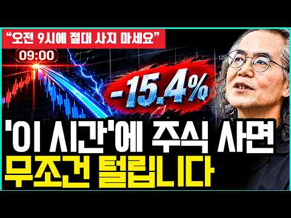
- 설명 앞부분: 정선용, 달리고 읽고 쓰는 사람의 하이
- 같은 채널 평소 대비 ×7.0 (채널 최근 롱폼 중앙값 19,917회) · 평소 영상: 2030은 빚 갚고 도망치는데 6070만 카드론·외상으로 5조 원 끌어다 주식 사는 소름… (19,917회) / "단 1원이라도 당장 빼세요" 벼락거지 안 되려다 노후 자금 다 털리는 한국 주식의 잔인… (19,115회)
- 대본 없음 (설명) — 음성인식이 끝나면 도입부·흐름이 들어감
- 댓글 43/43: 좋은 점 — 영상 5 · 감사·응원 6 · 더 알고 싶은 것 1 · 아쉬운 점 — 영상 0 · 반박·불만 — 의견 다름 0 · 정치·사회 2 · 경험 공유 2 · 구독·다음 기대 0
  - 좋은 점 — 영상 👍9 “좋은 정보 고맙습니다.반대로 하는것도 고려할만 한것 같습니다.~~”
  - 좋은 점 — 영상 👍3 “좋은 말씀 감사합니다. 다시 새겨야겠어요.”
  - 감사·응원 👍9 “좋은 정보 고맙습니다.반대로 하는것도 고려할만 한것 같습니다.~~”
  - 감사·응원 👍3 “좋은 말씀 감사합니다. 다시 새겨야겠어요.”
  - 더 알고 싶은 것 👍5 “쵝오 ❤❤❤❤❤❤😂😂😂😂😂🎉🎉🎉🎉🎉🎉🎉🎉🎉🎉🎉😂😂😂😂😂ㆍ😂😂 나스닥도 보고있으니 절제돈 통제된 하락 같은데 왜 그럴까요 먼져팔고 나가는게 쪈많이버는데 왜 통제된 하락일꺼요 그게 궁금합니다 선생님”
  - 경험 공유 👍16 “이건 세력의 뒷통수는 못쳐도(99.9%) 내가 뒷통수 안맞을 수 있는 확률은 조금이라도 높이는 귀한 조언이네요😊🎉”
  - 경험 공유 👍1 “경험해보니 거대세력이 당신을 지옥까지 따라와 파산시킨다...그런시장임..왜냐면 운좋게 살아남은자만 있으니..주식으로 돈번다고하는거임..죽은자는 말을 못함..그러고보면 재명이도 악마임”

### 96. [차트 강의] 100조 운용역이 신입 펀드매니저에게 가르쳤던 차트 패턴 8가지 (박재훈)

- https://www.youtube.com/watch?v=0JHEax_R7DE · 박재훈의 투자농장 · 구독자 22,500 · 조회수 223,197 (×9.9, 하루 3,964.6) · 좋아요 2,134 (1.0%) · 16.5분 · 2026-10-03 · 주제 묶음 6. 종목 고르기·분석 · 형식 인터뷰·강연·대담 · 폴더 `W_0JHEax_R7DE` (웹 승인)
- 썸네일: 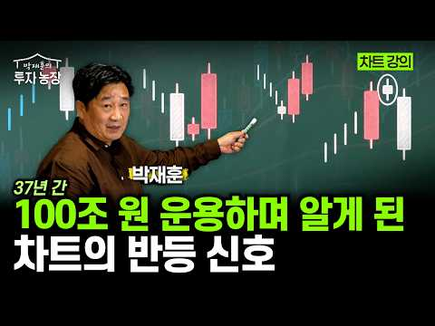
- 설명 앞부분: 10/24(토) 오전 10시, 합정역 인근에서 진행됩니다. 1부는 하반기 투자전략을 점검하고, 2부는 실전 차트강의를 진행합니다. 안녕하세요 이웃님들, 투자 농장지기 박재훈입니다. 저는 투자를 할 때 '손실을 덜 보는 것'이 가장 중요하다고 생각합니다. 그래서 오늘은 차트에서 하락에서 상승, 상승에서 하락으로 추세가 전환되는 신호를 읽는 방법을 알려드렸습니다. 제가 펀드매니저로 일하던 시절, 신입들에게 가르쳤던 내용이기도 합니다. 이웃님들의 투자에 꼭 도움이 되셨기를 바라며.. 하반기 투자전략을 점검하고, 실전 차트 강의를 듣고 …
- 같은 채널 평소 대비 ×18.0 (채널 최근 롱폼 중앙값 12,418회) · 평소 영상: 급락 후 반등한 나스닥, 200일 이동평균선을 꼭 확인해야 하는 이유 ∣ 100조 운용역… (12,418회) / 금리인상 계속된다? 앞으로의 투자 전략 '이렇게' 가져가세요 (박재훈) (11,878회)
- 대본 없음 (설명) — 음성인식이 끝나면 도입부·흐름이 들어감
- 댓글 76/80: 좋은 점 — 영상 7 · 감사·응원 17 · 더 알고 싶은 것 5 · 아쉬운 점 — 영상 1 · 반박·불만 — 의견 다름 0 · 정치·사회 0 · 경험 공유 3 · 구독·다음 기대 0
  - 좋은 점 — 영상 👍5 “진작에 이런 공부 배웠으면 작전세력들한테 덜 당했을것인데! 지금이라도 공부하고 암기하면서 실제 나타나는 모양들과 비교분석하는 눈 썰미를 키워 보겠습니다. 선생님덕분에 저의 소중한 돈 잘 지키겠습니다.”
  - 좋은 점 — 영상 👍0 “유익하게 감사히 잘 봤습니다”
  - 감사·응원 👍2 “목소리도 시원시원하시고 설명도 깔끔! 감사히 잘 들었습니다. 무료강의 신청했습니다^^”
  - 감사·응원 👍1 “선생님 안녕하세요. 잘 보고 있습니다. 장대양봉에 대해서 어느정도 기준을 알고싶습니다. 말 뜻은 이해하고 있지만 얼마만큼의 길이가 장대양봉이고 장대음봉인지.. 구분하고싶습니다. 감사합니다.”
  - 더 알고 싶은 것 👍1 “선생님 안녕하세요. 잘 보고 있습니다. 장대양봉에 대해서 어느정도 기준을 알고싶습니다. 말 뜻은 이해하고 있지만 얼마만큼의 길이가 장대양봉이고 장대음봉인지.. 구분하고싶습니다. 감사합니다.”
  - 더 알고 싶은 것 👍0 “선생님 이게 개별종목에도 적용이 되는건지 아님 지수 차트에만 해당하는건지 궁금합니다. 영상 잘 봤습니다.”
  - 아쉬운 점 — 영상 👍0 “쏙쏙 이해가 잘되요 반복해서 봐야지 ㄱㅅ”
  - 경험 공유 👍1 “저 엄청 잘해요 추세 전환 찾는거 제가 고수 ㅋ 6월말에 다 던지고 7월말에 샀어요”
  - 경험 공유 👍0 “저희쪽으로 모시고 싶습니다^^ 영상 볼때마다 느낍니다”

### 97. 생활비 한 달 5만원..10년 만에 배당금 월 300만원 받는 이유 (조윤진 1부) #세미파이어 #배당투자

- https://www.youtube.com/watch?v=Wc52vsC6q4U · 자람들 - 자립하는사람들 · 구독자 36,100 · 조회수 828,737 (×23.0, 하루 6,189.2) · 좋아요 6,932 (0.8%) · 29.3분 · 2026-07-17 · 주제 묶음 3. 배당 · 형식 브이로그·직접 해본 이야기 · 폴더 `W_Wc52vsC6q4U` (웹 승인)
- 썸네일: 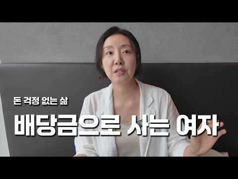
- 설명 앞부분: 👤 오늘의 게스트: 조윤진 작가 '6억으로 시작한 세미파이어' 저자 & 배당으로 부자되기 유튜브 채널 운영 평범한 중소기업 직장인이었던 그녀는 이혼 후 경제적으로 큰 타격을 입고, "목숨 걸고 노후를 준비해야겠다"는 마음으로 10년간 악착같이 아끼고 모았습니다. 5천만 원으로 시작한 시드는 10년 만에 6억 원으로 불어났고, 지금은 매달 통장에 꽂히는 배당금만으로도 마음 편한 노후 시스템을 만들었습니다. 매도 없이 배당만 쌓아가는 그녀만의 투자 철학과, 특별할 것 없는 월급으로도 가능했던 절약과 시드 마련의 여정을 담아 첫 책 '…
- 같은 채널 평소 대비 ×42.2 (채널 최근 롱폼 중앙값 19,630회) · 평소 영상: '40억 파이어족' 이렇게 10년 살면 부자 안 되기가 더 어렵습니다. 진짜 부자 되는 … (19,630회) / '월 500 배당으로 파이어 달성' 6년 만에 5억 만든 스토리 공개 (박차장 3부) #… (16,634회)
- 대본 없음 (설명) — 음성인식이 끝나면 도입부·흐름이 들어감
- 댓글 613/613: 좋은 점 — 영상 30 · 감사·응원 43 · 더 알고 싶은 것 33 · 아쉬운 점 — 영상 3 · 반박·불만 — 의견 다름 7 · 정치·사회 8 · 경험 공유 43 · 구독·다음 기대 2
  - 좋은 점 — 영상 👍755 “돈 모으려면 거지소리 들어가면서 미친듯이 모아도 될까 말까입니다. 그렇게까지 해야하냐는 말하는 사람들하고는 인간관계를 끊는게 내 인생발전에 훨씬 도움이 됩니다.”
  - 좋은 점 — 영상 👍32 “이 영상 첨 보는 데 정말 가슴에 와닿는 이야기네요 보통 사람들이 공감하고 같이 느낄 수 있는 이야기네요 유익한 영상 잘 보았습니다”
  - 감사·응원 👍416 “안녕하세요 인터뷰했던 '6억으로 시작한 세미파이어' 저자 배당으로 부자되기입니다. 비 오는데 진행 잘 이끌어주셔서 즐겁게 촬영했습니다. 이런 다큐 인터뷰 기회 주셔서 감사합니다. 하필 요즘 코스피가 더 내려서 장이 롤러코스터이긴 한데 끝까지 살아남는 배당투자로 노후를…”
  - 감사·응원 👍30 “귀한 영상 감사합니다.♡ 솔직하신 투자 경험 이야기 유익했습니다.♡ 감사합니다.^^ 성투하세요.❤”
  - 더 알고 싶은 것 👍10 “배당주하다가 귀가앏아 삼성 sk 물렸네요 ㅠ내 자신이 한탄스럽네요 ㅠ50대인데 앞이 깜깜해요~~미국배당다우존스는 sol tiger ace중 어느게 나을까요?공부해도 ㅠ”
  - 더 알고 싶은 것 👍3 “세금. 건보료는 어떻게 하시나요?”
  - 아쉬운 점 — 영상 👍27 “내용은 상당히 좋은데요 촬영을 할 때, 카메라를 고정시켜놓고 찍으셔야겠어요. 화면이 흔들거려요. 이건 아주 기본적인 것인데 많이 아쉽네요.”
  - 반박·불만 — 의견 다름 👍0 “커버드콜 하락장 오면 개박살나는구조다.알고투자해야한다.지금까지 미국장이 폭락장이 없어서 커버드콜 할만하지 하락하면 손실 그대로 다때려맞고 수익은 콜옵션매도 권리행사가로 막혀있으니 이런 말도안되는 상품이없다”
  - 반박·불만 — 의견 다름 👍0 “배당률이 영원한게 아닌데...”
  - 정치·사회 👍2 “이런 영상좀 올리지 마라 정부에서 이러니까 배당투자자들 정조준에서 건보료 개편하자나 시바”
  - 정치·사회 👍2 “이젠 코스피마저 나락가네 요즘 전과4범 범죄자 지지율 계속 뚝뚝 떨어지고있는데 부동산 꼼수거래로 본격적으로 나락 가고있는중..무능하고 부패한 전과4범의 범죄자..경제,주식,부동산, 환율, 물가 어느하나 제대로 하고있는게 없다 환율은 Imf때보다 더 미친듯 치솟고 원화…”
  - 경험 공유 👍37 “저도 배당금 500 이상 받고있어요 노후에는 필요한것같아요 매도 안하니까 일상생활에 집중할 수 있고 마음이 편해요~ etf도 모아가고있어요^^”
  - 경험 공유 👍32 “내가 주식29년차인데 깡통4번차고..겨우 살아만있는데 커버드콜로 계속바꾸고있다.현재는80만정도받고있다.목표는달500..😅😅😅”
  - 구독·다음 기대 👍8 “매일 듣기만했는데 이번엔 정말 시도를 해보고 싶네요. 늦은 감이 있지만 시작해보고 싶네요. 말씀 감사합니다.”
  - 구독·다음 기대 👍0 “좋은 영상 감사합니다~ 작가님 구독했어요^^”

### 98. 남들이 걱정하는 삶을 선택했습니다 #배당투자 #배당은퇴 #경제적자유 #파이어족 #월배당 #고배당주 #주식투자 #재테크#노후준비#배당금생활 #SCHD #JEPI …

- https://www.youtube.com/watch?v=SiE0NjI7Fu0 · ttobaedang또배당 · 구독자 8,380 · 조회수 64,379 (×7.7, 하루 1,428.1) · 좋아요 498 (0.8%) · 9.1분 · 2026-10-14 · 주제 묶음 11. 투자 일반 · 형식 정보·해설 (그 밖) · 폴더 `W_SiE0NjI7Fu0` (웹 승인)
- 썸네일: 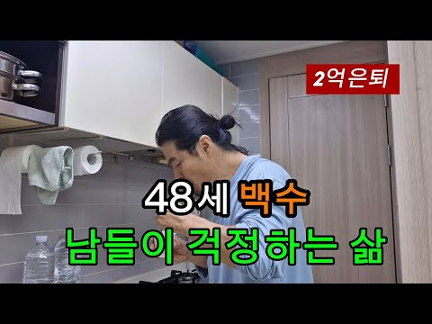
- 같은 채널 평소 대비 ×4.2 (채널 최근 롱폼 중앙값 15,357회) · 평소 영상: 100만원으로 은퇴해도 행복한이유 #배당투자 #배당은퇴 #경제적자유 #파이어족 #월배당 … (15,357회) / 48세백수 10월배당금 유투브 첫수익 #배당투자 #배당은퇴 #경제적자유 #파이어족 #월배… (15,220회)
- 대본 (음성인식(앞 5분), 4.8 음절/초) — 앞부분만, 흐름은 그 안까지 첫 20초: “저는 올해 48세입니다. 직정도 없고 매달 들어오는 월급도 없습니다. 흔히 말하는 백수입니다. 48세에 직장이 없다고 하면 사람들은 걱정을 합니다. 하지만 돈이 많아서 일을 하지 않는다고 하면 사람들은 부러워합니다.” — 도입부 유형: 숫자로 시작, 내 이야기·사연
- 첫 1분: “저는 올해 48세입니다. 직정도 없고 매달 들어오는 월급도 없습니다. 흔히 말하는 백수입니다. 48세에 직장이 없다고 하면 사람들은 걱정을 합니다. 하지만 돈이 많아서 일을 하지 않는다고 하면 사람들은 부러워합니다. 똑같이 아침에 일어나 밥을 먹고 동네를 산책하며 하루를 보내는데 누군가는 성공한 대자가 되고 누군가는 한심한 백수가 됩니다. 그렇다면 우리가 평가하는 것은 그 사람의 인생일까요? 아니면 그 사람의 가진 돈일까요? 저는 직장을 그만두고 나서 이런 생각을 자주 하게 됐습니다. 사람은 언제부터 살아가는 것만으로는 부족해서 끊임없이 자신의 가치를 증명해야 하는 존재가 되었을까? 오늘은 48세에 백수가 되고 나서 비로소 알게 된 이야기를 해보려고 합니다. 우리는 처음 만난 사람에게 흔히 이렇게 웃습니다.”
- 흐름 (90초마다 첫 문장): 0:00 저는 올해 48세입니다. 직정도 없고 매달 들어오는 월급도 없습니다. … → 1:39 그 사람이 얼마나 많은 실패를 견뎌는지, 누구를 위해 자신의 목수를 포… → 3:12 월요일 아침이면 어딘가로 가야 할 것 같고 하루 종일 집에 있으면 괜히… → 4:38 하지만 그런 걱정을 들으며 한 가지 생각을 하게 됐습니다. 사람은 누구…
- 댓글 174/186: 좋은 점 — 영상 3 · 감사·응원 20 · 더 알고 싶은 것 6 · 아쉬운 점 — 영상 0 · 반박·불만 — 의견 다름 0 · 정치·사회 0 · 경험 공유 11 · 구독·다음 기대 2
  - 좋은 점 — 영상 👍4 “진정성이 느껴지고 서민형이라 와닿는 영상이라 보면서 위로를 받게 되네요. 좋은 영상 자주 올려주세요. 😊❤”
  - 좋은 점 — 영상 👍1 “울림이 있는 story, 공감이 되고 배우고 갑니다~”
  - 감사·응원 👍22 “당신의 직업은 투자자, 유튜버^^ 늘 응원하겠습니다”
  - 감사·응원 👍8 “현대는 직업이 필요가 없어졌습니다. 단지 생활비를 충당할 수 있는 근원지 배당금, 이자, 월세소득 등 원천을 만드는 것이 중요하죠. 또배당금님은 현재 잘 하고 계신거예요. 직장이 없어도 배당금으로 자유롭게 생활하실 수 있는것이 얼마나 대단한것인지 높이 평가해요. 질투…”
  - 더 알고 싶은 것 👍4 “진정성이 느껴지고 서민형이라 와닿는 영상이라 보면서 위로를 받게 되네요. 좋은 영상 자주 올려주세요. 😊❤”
  - 더 알고 싶은 것 👍3 “안녕하십니까 또배당님! 금일 영상은 원고가 매우 훌륭하고 좋습니다 감동적입니다 자신의선택과 책임을 말씀하는 철학은 울림이 있습니다, 다음에 기회가되면 제가 운영하고 있는 다음카페에 칼럼기고를 부탁드려도 될까요”
  - 경험 공유 👍8 “나도 도배당아저씨처럼 할수있다는 희망으로 삽니다”
  - 경험 공유 👍7 “세상을 보는 안목과 생각이 깊고 넓으시군요. 저도 공감되는 말씀입니다.”
  - 구독·다음 기대 👍1 “호동대표님 유튜브보고 구독하러왔어요 자주영상 올려주세요😊 세미파이어족 화이팅!!”

### 99. "2억 모았다면 이제 '이렇게' 투자하세요" 손실 없이 돈을 불리는 확실한 투자 전략 ∣ 황금별 작가 ∣ 연금받는형

- https://www.youtube.com/watch?v=-ZozYKj6CxU · 연금 받는 형 · 구독자 25,700 · 조회수 135,424 (×5.3, 하루 4,375.6) · 좋아요 558 (0.4%) · 27.8분 · 2026-10-28 · 주제 묶음 7. 매매·전략 · 형식 정보·해설 (그 밖) · 폴더 `W_-ZozYKj6CxU` (웹 승인)
- 썸네일: 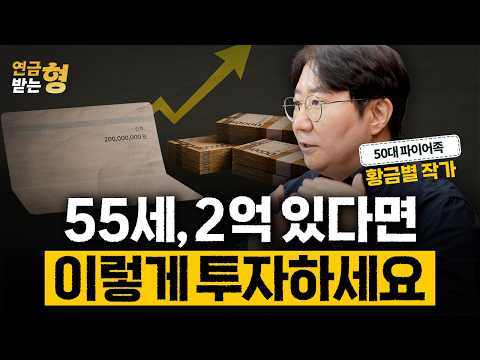
- 설명 앞부분: 은퇴는 다가오는데 주식이 폭락했다면, 회복할 때까지 무조건 버티면 될까요? 같은 하락장이라도 어떤 자산을 가지고 있는지, 생활비로 쓸 돈을 따로 준비했는지에 따라 대응은 달라집니다. 은퇴를 앞뒀다면 얼마나 더 벌 수 있을지만큼, 떨어지는 시장을 얼마나 견딜 수 있을지도 생각해야 합니다. 황금별 작가는 배당주와 지수형 자산, 현금과 달러를 중심에 두고 은퇴 후를 준비하는 방법을 이야기합니다. 시장의 방향을 맞히려 하기보다 생활비와 투자 자금을 구분하고, 하락했을 때 어떻게 대응할지 미리 기준을 세우는 것입니다. 이번 영상에서는 은퇴…
- 같은 채널 평소 대비 ×2.9 (채널 최근 롱폼 중앙값 47,157회) · 평소 영상: 건보료·기초연금 아끼려다 노후 망칩니다. 국민연금 줄이면 안 되는 이유 ∣ 김윤로 대표 … (47,157회) / “일찍 받으면 손해, 늦게 받으면 이득?” 국민연금 계산에서 빠진 한 가지 ∣ 김윤로 대… (47,796회)
- 대본 없음 (설명) — 음성인식이 끝나면 도입부·흐름이 들어감
- 댓글 31/31: 좋은 점 — 영상 1 · 감사·응원 2 · 더 알고 싶은 것 2 · 아쉬운 점 — 영상 0 · 반박·불만 — 의견 다름 0 · 정치·사회 3 · 경험 공유 3 · 구독·다음 기대 0
  - 좋은 점 — 영상 👍1 “항상 좋은 영상을 제공해 주셔서 감사드립니다 ^^”
  - 감사·응원 👍9 “직접 해 보시고 경험에서 나오시는 말씀❤감사합니다”
  - 감사·응원 👍1 “항상 좋은 영상을 제공해 주셔서 감사드립니다 ^^”
  - 더 알고 싶은 것 👍17 “하이닉스 270만원 물린 사람은 원금으로 몇년기다리면 탈출가능할까요?”
  - 더 알고 싶은 것 👍0 “채권 투자하셨던 분인데 어떻게 됐나요?”
  - 정치·사회 👍1 “한국이 안고 있는 가장 큰 이슈는 항상 정치이슈였음. 현재 외국인이 썰물되는 이유는 판래기 리스크임.”
  - 정치·사회 👍1 “국장은 정권때문에 안됨.”
  - 경험 공유 👍6 “절세계좌에서 1억대etf 모았는데 정년까지 쭉모아서 연금으로 활용하려고 합니다. 시간과 복리를 믿어요~ 3년차입니다~”
  - 경험 공유 👍0 “금투자에 대한 포지션이 저와 동일하네요^^ 저도 전체 자산에서 5~10%만 담고 포트에서 제외시켜 놓고 길~~게 가져가고 있습니다 조언이 아주 현명하십니다”

### 100. [초보자필수시청] 10년을 해도 제자리인 사람들의 공통점 外 l 60분 연속 재생

- https://www.youtube.com/watch?v=dC3jWGeJ3E0 · 직장인 차트매매 - 추세추종 · 구독자 6,210 · 조회수 59,035 (×9.5, 하루 918.7) · 좋아요 2,353 (4.0%) · 63.6분 · 2026-09-25 · 주제 묶음 1. 주식 기초·초보 · 형식 인터뷰·강연·대담 · 폴더 `W_dC3jWGeJ3E0` (웹 승인)
- 썸네일: 
- 설명 앞부분: [돈 걱정 없이 행복하게!!] 주식 초보 시절 미리 깨달았다면 좋았을 내용만 모아 영상 만들었습니다. 저는 맨땅에 헤딩하듯 주식을 배웠지만 여러분들은 그러실 필요 없습니다. 정상까지 최단거리로 갈수있게 길을 안내해드리겠습니다.
- 같은 채널 평소 대비 ×17.9 (채널 최근 롱폼 중앙값 3,300회) · 평소 영상: [제1강] 주식으로 돈 벌고 싶다면 꼭 알아야할 공식 (3,441회) / 9년 시행착오 끝에 찾은 투자 전략 (손절·익절의 비밀) (3,160회)
- 대본 없음 (설명) — 음성인식이 끝나면 도입부·흐름이 들어감
- 댓글 244/244: 좋은 점 — 영상 18 · 감사·응원 37 · 더 알고 싶은 것 9 · 아쉬운 점 — 영상 3 · 반박·불만 — 의견 다름 3 · 정치·사회 2 · 경험 공유 13 · 구독·다음 기대 9
  - 좋은 점 — 영상 👍27 “저는 6단계 입니다. 5단계 전략 2개 보유중이고요. 첫번째는 굳이 장르를 정하면 퀀트 모멘텀 전략으로 월 최대 1회만 매매합니다. (이번 상승장에 11번 매매해서 복리로 15배 수익났습나다.) 두번째는 당일 단타로 일 최대 1회만 매매합니다. 조건 안맞아서 매매 안…”
  - 좋은 점 — 영상 👍11 “듣보잡...이라 생각했는데 영상보니 아니네요...ㅎㅎ 지루해지는 시기라는 단어가 굉장히 와닿습니다.. 저는2년동안 1,2단계를 지나 3단계 초입에 와있는데 아무리 좋은 강의라도 몇년 시장에서 맞아보고 울어봐야 이해가 되는 영상이네요 앞으로도 영상 잘 보겠습니다”
  - 감사·응원 👍7 “구독을 누르지 않을수가없네요 영상 감사합니다 주식 4단 입니다 9단 되고싶어요 😂”
  - 감사·응원 👍4 “감사합니다 5년을 고3처럼 공부한 내용이 하나로 완벽하게 정리되고 챠트가 말한다는 말이 공감됩니다 단단한 매매를 할거 같습니다 늘 평안하시고 행복한 주식인생을 누리시길 바랍니다^^ 저장해놓고 자주 봐야 겠습니다”
  - 더 알고 싶은 것 👍2 “영상 잘 보고 있습니다. 차트를 보다 보니 일봉인지 분봉인지 구분이 안되는 부분이 있습니다 단타와 장기가 섞여 있을까요?”
  - 더 알고 싶은 것 👍2 “감사합니다 3단계입니다 미장 급성장하고 돈1000만 날아갔어요. 지금 삼성 닉스 보유중 단타. 해야되나요? 미치겠네요”
  - 아쉬운 점 — 영상 👍11 “듣보잡...이라 생각했는데 영상보니 아니네요...ㅎㅎ 지루해지는 시기라는 단어가 굉장히 와닿습니다.. 저는2년동안 1,2단계를 지나 3단계 초입에 와있는데 아무리 좋은 강의라도 몇년 시장에서 맞아보고 울어봐야 이해가 되는 영상이네요 앞으로도 영상 잘 보겠습니다”
  - 아쉬운 점 — 영상 👍3 “주식을 전체적으로 정리해주는 느낌이네요. 여러번 반복해서 보아도 좋을 듯 합니다.”
  - 반박·불만 — 의견 다름 👍6 “요즘 매매가 잘 안돼서 심리적으로 많이 흔들리다 우연히 방송을 봤는데 제가 아직 2단계에 머물러 있었다는 걸 알게 됐고,많은 위안이 되네요. 저는 이동평균선과 일목균형표,거래량을 보고 돌파,눌림 스윙매매를 하는데요. 5년간 매년 전체자산의 10% 정도 꾸준한 누적수익…”
  - 반박·불만 — 의견 다름 👍1 “이런거 듣는다고 내생각 내습관이 안바뀜 ㅋ 주식이 다같이 부자되는 구조가 아닌데 모르는군요 ㅎ 잡소리만 너무 많아요”
  - 정치·사회 👍0 “SFA반도체는 지금 고점인가요? 외국인이 계속매수중인데요. 궁금합니다,,”
  - 경험 공유 👍6 “요즘 매매가 잘 안돼서 심리적으로 많이 흔들리다 우연히 방송을 봤는데 제가 아직 2단계에 머물러 있었다는 걸 알게 됐고,많은 위안이 되네요. 저는 이동평균선과 일목균형표,거래량을 보고 돌파,눌림 스윙매매를 하는데요. 5년간 매년 전체자산의 10% 정도 꾸준한 누적수익…”
  - 경험 공유 👍5 “이건찐임 내가 느끼는 부분이다 녹아있음”
  - 구독·다음 기대 👍3 “구독했어요..”
  - 구독·다음 기대 👍2 “큰 수익내고 자아도취 되고 한방에 날아가고 후회하고 반성하고 다시 거래해 수익 나면 다시 잃고 😢 구독하고 6단계까지 가보겠습니다”

### 101. 주식 거래시간 밤 8시까지?☑️KRX 애프터마켓 꼭 알아야 할 변화

- https://www.youtube.com/watch?v=xXBHBu6hnCc · 주식캐스터 여니 · 구독자 42,900 · 조회수 476,913 (×11.1, 하루 6,271.5) · 좋아요 1,962 (0.4%) · 9분 · 2026-09-13 · 주제 묶음 기타 · 형식 정보·해설 (그 밖) · 폴더 `W_xXBHBu6hnCc` (웹 승인)
- 썸네일: 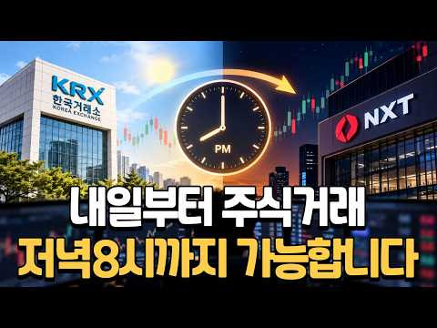
- 같은 채널 평소 대비 ×118.8 (채널 최근 롱폼 중앙값 4,014회) · 평소 영상: 주린이, 경제초보 필수 경제용어 19탄❤️인적분할과 물적분할이란? 인적분할하면 주가는? (4,014회) / 삼전닉스 자사주 매입도 끝자락! 외국인 대량 매도 속 홀로 웃고 있는 업종은? (4,507회)
- 대본 없음 (없음) — 음성인식이 끝나면 도입부·흐름이 들어감
- 댓글 361/361: 좋은 점 — 영상 6 · 감사·응원 20 · 더 알고 싶은 것 2 · 아쉬운 점 — 영상 0 · 반박·불만 — 의견 다름 4 · 정치·사회 30 · 경험 공유 3 · 구독·다음 기대 0
  - 좋은 점 — 영상 👍31 “정리해 주셔서 감사합니다. 그냥 더 피곤해지는 느낌이 드네요..ㅎ”
  - 좋은 점 — 영상 👍1 “좋은 영상 감사합니다. 100% 남이 돈 버는거 배아파서 따라 만든거.”
  - 감사·응원 👍31 “정리해 주셔서 감사합니다. 그냥 더 피곤해지는 느낌이 드네요..ㅎ”
  - 감사·응원 👍27 “개인투자자들에게 꼭 필요한 정보를 똑 부러지게 잘 설명해 주셨습니다. 감사합니다.”
  - 더 알고 싶은 것 👍1 “SOR이 뭔지 알려주세요. 그동안 NXT이용한다고, 설정해둔것 같은데, KRX거래가 안되네요???”
  - 더 알고 싶은 것 👍1 “오전장몇시부터시작해요?아신분댓글부탁해요”
  - 반박·불만 — 의견 다름 👍8 “국민들 소액주주가 원하는건 거래시간 늘리는게 아닌데.. 그저 재벌들이 자회사, 손자회사, 까지만들면서 0.1% 도 안되는 지주사 지분으로 99.9% 지분의 국민들의 회사를 지배하는 이런 구조를 개선해달라는거다... 자회사 IPO 하는거라면 자회사 주식 지분에 따라 무…”
  - 반박·불만 — 의견 다름 👍6 “금융카르텔들만 좋을일 낫구먼유 삼전닉스 거래대금 빼면 언발에 오줌눟킨데 말도 안되는 이유로 카르텔 배불리기만”
  - 정치·사회 👍21 “재명이정권 지지율 떡락하는소리 들린다”
  - 정치·사회 👍12 “개인 투자자에겐 지옥문이 열린것이다 이재명 아웃 정권 타도”
  - 경험 공유 👍0 “도박쟁이들 왜케 많냐?단타만 맨날 쳐하니까 핸드폰만 8시까지 보란소리냐 이딴 소리 하고있지 사팔사팔해봤자 결국엔 손해임 걍 넣어놓고 분기별로 한번씩만 보면 됨 한국사람 주식보유기간 길어봤자 3달이고 평균 10일이라더니 여기다 모여있네 하긴 S&P500 나스닥100 같…”

### 102. 주식 상위 2%만 아는 10가지 절대 생존 원칙 (돈의 원리)

- https://www.youtube.com/watch?v=fFURFeLTdAg · 준의 경제노트 (jun’s Note) · 구독자 12,500 · 조회수 308,747 (×24.7, 하루 1,810.5) · 좋아요 6,938 (2.2%) · 21.6분 · 2026-06-10 · 주제 묶음 11. 투자 일반 · 형식 오디오북·낭독 (명언·인생조언) · 폴더 `W_fFURFeLTdAg` (웹 승인)
- 썸네일: 
- 챕터: 0:00 주식 시장, 살아남는 자가 강하다 · 1:25 금융 천재 vs 평범한 경비원, 진짜 승자는? · 3:10 주식 투자는 지능이 아닌 '행동'의 영역 · 3:52 원칙 1. 예측하지 말고, 대응하라 · 5:22 원칙 2. 손실의 비대칭성을 이해하라 (바벨 전략) · 7:23 원칙 3. 승률이 아니라, 손익비로 계산하라 · 9:05 원칙 4. 좋은 회사가 아니라, 싼 주식을 사라 · 11:00 원칙 5. 현금은 쓰레기가 아니라, 무기다 · 12:56 원칙 6. 살 때는 신중하게, 팔 때는 과감하게 · 14:00 원칙 7. 공포에 사고, 환희에 팔아라 · 15:35 원칙 8. 좋은 종목만 사라 · 16:45 원칙 9. 본전 심리를 버려라 · 17:50 원칙 10. 감정과 싸우지 말고, 회피하라 · 19:25 실전 적용: 시장의 주인이 되는 법 · 20:20 마무리: 10년 생존을 위한 자가 진단
- 설명 앞부분: 주식 투자자 10명 중 9명은 왜 돈을 잃을까요?** 📉 예측에 의존하는 투자가 아닌, 진짜 부자들만 아는 '10가지 절대 생존 원칙'을 공개합니다. 평생 경비원으로 일하며 95억 원의 유산을 남긴 로널드 리드와, 화려한 경력에도 파산한 금융 천재의 결정적 차이는 무엇이었을까요? 이 영상에서 자산을 수십 배로 불리는 투자의 본질을 확실히 해부해 드립니다. 핵심 요약 주식 투자는 지능의 게임이 아니라 '행동'의 영역입니다. 10년, 20년 동안 시장에서 살아남아 끝까지 승리하는 상위 2%가 되고 싶다면, 영상에서 제시하는 생존 지도…
- 같은 채널 평소 대비 ×387.9 (채널 최근 롱폼 중앙값 796회) · 평소 영상: 1억을 20억, 30억으로 만드는 4가지 전략 ∣ 99%가 모르는 부자의 비밀 (796회) / 유통물량 5%로 나스닥100 편입까지? 스페이스X 일론 머스크가 그리는 우주 AI 제국의… (613회)
- 대본 없음 (설명) — 음성인식이 끝나면 도입부·흐름이 들어감
- 댓글 189/191: 좋은 점 — 영상 8 · 감사·응원 20 · 더 알고 싶은 것 2 · 아쉬운 점 — 영상 4 · 반박·불만 — 의견 다름 3 · 정치·사회 0 · 경험 공유 13 · 구독·다음 기대 0
  - 좋은 점 — 영상 👍20 “백배 공감합니다 꼭 간직하겠습니다. 감사합니다 ❤”
  - 좋은 점 — 영상 👍17 “정말 큰 도움이 되는 영상이였습니다 덕분에 주식으로 이백억을 벌것 같습니다”
  - 감사·응원 👍20 “백배 공감합니다 꼭 간직하겠습니다. 감사합니다 ❤”
  - 감사·응원 👍14 “항상 좋은정보 감사합니다. 투자를 하다보면은 지키기 어려운데 공감가네요.”
  - 더 알고 싶은 것 👍3 “평생마트주차장 관리인 , 경비원, 미련하게 악착같이 주식모아서 결국 어떻게 되었나요? .... 죽었습니다. 끝.”
  - 더 알고 싶은 것 👍1 “좋은 강의 감사합니다. 싼 주식의 기준은, 또는 평가는 무엇인지요? 저Per? 실적? 수주액? 부탁합니다.”
  - 아쉬운 점 — 영상 👍22 “나는 뻔한 예가 나오면 흐름이 끊겨서 거기까지만 듣고 나갑니다.”
  - 아쉬운 점 — 영상 👍4 “ai목소리 질려서 안보게되네요 다 똑같은 목소리라 채널구분도 안되구”
  - 반박·불만 — 의견 다름 👍6 “맞는말인듯😊전 샀다팔았다 하지 않으려고 연금저축펀드 에쎈피500!!!😊 감사합니다!! 그리고 딴분들이 웃기는겤ㅋㅋㅋㅋ아니 영상만들어 주신분한테 목소리가 어떻니 왜 그러심? 물림? ㅋㅋㅋㅋㅋㅋ 그런 댓글 작성할 시간에 영상 올려주신분께 감사하다고 좋아요 한번 눌러욬ㅋㅋ…”
  - 반박·불만 — 의견 다름 👍5 “모두 맞는 이야기 이지만 2번 손해안보는 안전한 자산에 85~90%를 넣어두고 나머지만 위험을 감수한 투자를 한다는 것은 틀렸네요. 현재 안전한 투자는 한국 단기채권은 3% 초반, 미국단기채권은 4% 초반으로 이자율이 나오는데 대한민국의 최근 10년간 연평균 화폐증가…”
  - 경험 공유 👍137 “120만원으로 시작해서 7년만에 1억 4천넘게 벌어보고 느낀점 버핏옹의 투자원칙 첫번째 원칙 돈을 지켜라 두번째 원칙 첫번째 원칙을 지켜라 이말은 진리고 내가 주식시장에서 돈을 벌 수 있던 말이다 저말을 뜻을 깨닫는다면 시장에서 돈을 벌수 있다 이걸 설명하기 어려운건…”
  - 경험 공유 👍4 “저는 초단타 14년차 1억으로 무한 3%”

### 103. 더이상 배당주는 사지 않아요/40대 워킹맘

- https://www.youtube.com/watch?v=P0j4XK5PaJY · 마스 심플라이프 MasSimpleLife · 구독자 41,900 · 조회수 282,996 (×6.8, 하루 5,847.8) · 좋아요 1,480 (0.5%) · 10.8분 · 2026-10-11 · 주제 묶음 3. 배당 · 형식 브이로그·직접 해본 이야기 · 폴더 `W_P0j4XK5PaJY` (웹 승인)
- 썸네일: 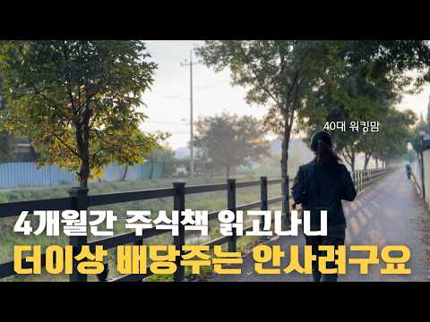
- 설명 앞부분: ⏰ 연 5천만원 모으는 습관 클럽(연오클) 11기를 모집합니다. ^^ 함께 새벽습관을 잡고, 돈공부와 독서를 하면서 경제마인드를 잡아가고 싶으신분들 함께해요~ ^^ 남과 비교하지 않고 어제의 나와 비교하며, 내 삶의 주도권을 되찾아갈 (연오클 11기)멤버를 모집합니다. (연오클이 궁금하시다면 네이버에 '연오클'을 검색해보세요~ ^^) 전 주로 집에 있는 재료를 이용하는 편이구요~ 요리책의 레시피가 있어도 레시피대로 잘 안하고 있는 재료를 주로 활용하고 있답니다~ 사실.. 저도 요리할때마다 레시피가 바뀌어요~ㅋㅋ *^^ 🍒 돼지고기…
- 같은 채널 평소 대비 ×8.9 (채널 최근 롱폼 중앙값 31,756회) · 평소 영상: 생활비 90만원으로 돈 모으는 일상/40대 워킹맘 (31,852회) / 40대 워킹맘의 집밥하며 절약하는 루틴/사실.. 매일이 똑같아요. (30,365회)
- 대본 (자막, 5.9 음절/초) 첫 20초: “안녕하세요. 마스입니다. 어느덧 10월입니다. 아침 저녁으로 제법 쌀쌀한 바람이 부는 완연한 가을이 되었어요. 10월부터는 저희 아침 운동 루틴에도 약간의 변화를 주었답니다. 출근을 해야 하는 주 중에는 수영을 하고 조깅은 주말에 하기로 했어요. 가을이 깊어지면서 아침에도 늦게 뜨고”
- 첫 1분: “안녕하세요. 마스입니다. 어느덧 10월입니다. 아침 저녁으로 제법 쌀쌀한 바람이 부는 완연한 가을이 되었어요. 10월부터는 저희 아침 운동 루틴에도 약간의 변화를 주었답니다. 출근을 해야 하는 주 중에는 수영을 하고 조깅은 주말에 하기로 했어요. 가을이 깊어지면서 아침에도 늦게 뜨고 [음악] 새벽 5시에 나가면 아직 깜깜한 데다가 날도 꽤 쌀쌀하더라고요. 무리에서 어둠 속을 달리기보다는 주말에 해가 뜬 후에 따뜻한 햇살 아래 남편과 함께 느긋하게 슬로우 조깅하는 것으로 바꿨습니다. [음악] 이게 저희 중년 부부가 조깅을 포기하지 않고 계속할 수 있는 방법이란 생각이 들더라고요. 영상을 보는 구독자님들도 날은 추워지지만 [음악] 건강을 위해 운동을 멈추지 않으시길 바랍니다. 이제 우린 생존을 위해 운동해야 하”
- 흐름 (90초마다 첫 문장): 0:01 안녕하세요. 마스입니다. 어느덧 → 1:30 하지만 그간 미니벌 라이프로 얻은 → 3:01 주식으로 매월 높은 배당금을 받으면서 → 4:31 현금 흐름이 나올 수 있고 → 6:01 때문입니다. 미국 주식 중에서도 앞서 → 7:32 편안히 쉬면서 매달 나오는 연금만 → 9:01 한시간씩 걸어다니며 극단적으로 → 10:31 바랍니다. 구독과 좋아요는 제가 매주
- 댓글 104/232: 좋은 점 — 영상 1 · 감사·응원 5 · 더 알고 싶은 것 3 · 아쉬운 점 — 영상 0 · 반박·불만 — 의견 다름 2 · 정치·사회 0 · 경험 공유 15 · 구독·다음 기대 0
  - 좋은 점 — 영상 👍2 “매번 좋은 내용을 볼 수 있어서 감사합니다.오늘 특히 정리가 되는 영상이었어요.^^”
  - 감사·응원 👍3 “항상 잘 보고 있어요 채칼 정보 알려주시면 감사하겠습니다😊”
  - 감사·응원 👍2 “매번 좋은 내용을 볼 수 있어서 감사합니다.오늘 특히 정리가 되는 영상이었어요.^^”
  - 더 알고 싶은 것 👍3 “항상 잘 보고 있어요 채칼 정보 알려주시면 감사하겠습니다😊”
  - 더 알고 싶은 것 👍1 “전 1도 몰라요 뭘 어떻게 시작해야할지 모르겠어요 저같은 초짜는 어떻게 시작해야될까요?”
  - 반박·불만 — 의견 다름 👍6 “하락장 아프게 한번 맞아보면 또 생각이 바뀝니다 배당주를 하시던 성장주를 하시던 투자하고 있는 지금 상황에 박수를 드립니다 어느쪽은 중요하지 않습니다 선택한 그 투자를 얼마나 오래 지속 할수있을지만 고민 하시면 됩니다 중요한건 어떤 상품이 아닙니다”
  - 반박·불만 — 의견 다름 👍0 “예전 부모님 세대로서........... "집에서 편안히 쉬면서 연금만으로 살 수 있는 호시절"은 아닌데.......한편, 자녀들의 시대에는 지금 40대 위킹맘의 상황보다 더욱 혹독하겠습니다. 맞아요. 예전에는 돈돈 하면서 살진 않았는데...그렇다고 돈이 중요한 걸 …”
  - 경험 공유 👍49 “난 주식 20년차인데 결국 배당주가 답이라는걸 찾음”
  - 경험 공유 👍14 “남말에 귀닫고 노동소득의 80%는 한국주식을 사고있는 50살 23년차 주식쟁이입니다 에코프로는 10년 이상 3만주 이상을 들고 있으며 에코프로로 노후준비는 다 끝났습니다 개인연금저축펀드 퇴직연금IRP는 20년째 들고 있습니다 주식에는 전문가란게 없고 과학이 아니라서 …”

### 104. 내가 일하지 않는 진짜 이유, 배당금으로 생존하기 ⏰[1시간 몰아보기] 2편

- https://www.youtube.com/watch?v=lwrrJv3Af0c · 배당아저씨 · 구독자 33,900 · 조회수 229,688 (×6.8, 하루 4,389.1) · 좋아요 1,225 (0.5%) · 61.9분 · 2026-10-07 · 주제 묶음 3. 배당 · 형식 정보·해설 (그 밖) · 폴더 `W_lwrrJv3Af0c` (웹 승인)
- 썸네일: 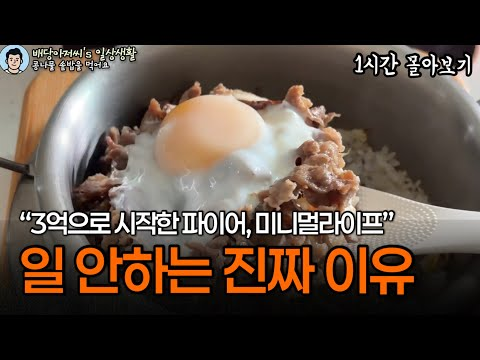
- 챕터: 0:00 내가 일하지 않는 진짜 이유 · 8:27 친구가 없어도 잘 살아요 · 17:32 출근없는 현실 · 26:02 배당금으로 혼자 사는 현실 · 35:02 배당금으로 혼자 사는 미혼남 · 43:34 미혼남의 혼자 초라한 연휴 · 52:42 소박한 낭만
- 설명 앞부분: 영상 속 배당아저씨의 미니멀라이프 내돈내산 재료&용품들 (쿠팡 파트너스 및 인플루언서 활동의 일환으로 구매시 일정액의 수수료를 제공 받을 수 있습니다) 이 채널은 저의 투자 경험과 생각을 공유하는 공간입니다. 저의 투자 방식을 그대로 따라 하시는 것은 권장드리지 않으며, 충분한 고민과 공부 후 판단하시길 바랍니다.
- 같은 채널 평소 대비 ×4.4 (채널 최근 롱폼 중앙값 52,769회) · 평소 영상: 미국주식 3억, 배당금으로 직장 없이 살고 있어요_배당파이어 장단점 (52,769회) / 일하지 않고 배당금 받아 살면 나라가 망한다, 3억으로 시작한 파이어 미니멀라이프 (51,635회)
- 대본 없음 (설명) — 음성인식이 끝나면 도입부·흐름이 들어감
- 댓글 201/201: 좋은 점 — 영상 8 · 감사·응원 20 · 더 알고 싶은 것 16 · 아쉬운 점 — 영상 0 · 반박·불만 — 의견 다름 3 · 정치·사회 0 · 경험 공유 37 · 구독·다음 기대 6
  - 좋은 점 — 영상 👍32 “전 아버지가 사업을 하셔서 잠시 경리를 봐드렸는데 그때가 제 인생 제일 힘들었습니다...^^:::::그냥 편히 대학다니고 살아온 제가 부모님께 효도해야겠다고 느낀 순간이였죠....그래서 힘드셨던 이야기들이 너무 와닿습니다....늘 응원합니다..”
  - 좋은 점 — 영상 👍17 “일자리도 치열하고 자영업도 치열합니다. 일 안하시는게 다른 사람에게도 도움이 되니 좋은 일입니다.”
  - 감사·응원 👍39 “성향 차인거 같아요 미니멀을 추구하는 사람들은 돈을 떠나 많은 물건들이 힘겹게 다가옵니다 반대로 맥시멀을 추구하거나 쇼핑을 좋아하는 사람들은 파이어에 맞지 않을 수 있습니다 저는 배저씨님이 넘 잘 하고 계시고 멋지게 본인은 삶을 살아가시는거 같습니다 응원합니다❤😊”
  - 감사·응원 👍32 “전 아버지가 사업을 하셔서 잠시 경리를 봐드렸는데 그때가 제 인생 제일 힘들었습니다...^^:::::그냥 편히 대학다니고 살아온 제가 부모님께 효도해야겠다고 느낀 순간이였죠....그래서 힘드셨던 이야기들이 너무 와닿습니다....늘 응원합니다..”
  - 더 알고 싶은 것 👍31 “배당으로 파이어한다는게 궁금해서 보다보니 참 많은 생각이 드는 영상이였네요 인생을 사는데 있어서 정답은 없는듯합니다 나스스로가 남한테 피해안주고 어떤식으로든 내밥벌이하고 행복하면되지않을까요 전에는 미쳐생각하지 못했던건데 세상의 기준데로 살아야되는것처럼 그냥 그렇게 살…”
  - 더 알고 싶은 것 👍31 “저는 영상보면서 용기를 내서 투자를 했어요. 배당금이 한달에 20만원 정도 나오고 있어요 환율땜에 원금은 깎였지만 걍 안보고 있어요 영상과 나래이션이 편안하고 진짜 소소해서 편하게 보게 됩니다 요리솜씨도 점점 나아지는것도 신기하고 궁금합니다 잘 지내시고 또 다음 영상…”
  - 반박·불만 — 의견 다름 👍6 “오늘 토요일 아닌데요 ㅎㅎ”
  - 반박·불만 — 의견 다름 👍5 “주식은 팔지 않으면 손해가 아니죠, 어차피 배당이 매월 나오니까 급하게 큰돈 써야 할일 아니면 팔 이유도 없으니, 그냥 배당 받으면서 일부분 재투자 하고 몇년 지나면 우상향 되니까. 배당투자 하면서 주가 떨어지는거 딱히 신경 안써도 될듯요. 저도 국내 및 해외 커버드…”
  - 경험 공유 👍32 “전 아버지가 사업을 하셔서 잠시 경리를 봐드렸는데 그때가 제 인생 제일 힘들었습니다...^^:::::그냥 편히 대학다니고 살아온 제가 부모님께 효도해야겠다고 느낀 순간이였죠....그래서 힘드셨던 이야기들이 너무 와닿습니다....늘 응원합니다..”
  - 경험 공유 👍32 “저는 50대고 전업주부입니다 국내주식미국주식 다 하고있는데요 하다보니 금액이 커져서 최근엔 배당주에 관심이 많아져서 배당아저씨를 알게되었습니다 우선 목소리가 듣기가 편안해서 너무 좋아서 즐겨듣습니다 주식은 많이 물린상태라 본전이 오면 빼서 배당주로 옮길 생각입니다 아…”
  - 구독·다음 기대 👍32 “저는 50대고 전업주부입니다 국내주식미국주식 다 하고있는데요 하다보니 금액이 커져서 최근엔 배당주에 관심이 많아져서 배당아저씨를 알게되었습니다 우선 목소리가 듣기가 편안해서 너무 좋아서 즐겨듣습니다 주식은 많이 물린상태라 본전이 오면 빼서 배당주로 옮길 생각입니다 아…”
  - 구독·다음 기대 👍31 “저는 영상보면서 용기를 내서 투자를 했어요. 배당금이 한달에 20만원 정도 나오고 있어요 환율땜에 원금은 깎였지만 걍 안보고 있어요 영상과 나래이션이 편안하고 진짜 소소해서 편하게 보게 됩니다 요리솜씨도 점점 나아지는것도 신기하고 궁금합니다 잘 지내시고 또 다음 영상…”

### 105. 퇴직연금 나머지 30%, 예금 말고 다른 선택지는?💰ㅣ원큐로 끝내는 ETF🎯

- https://www.youtube.com/watch?v=FV8Ry9V7IJM · 하나TV [하나자산운용] · 구독자 29,500 · 조회수 118,138 (×4.0, 하루 3,800.8) · 좋아요 150 (0.1%) · 7.9분 · 2026-10-28 · 주제 묶음 2. 장기투자·ETF·지수 · 형식 정보·해설 (그 밖) · 폴더 `W_FV8Ry9V7IJM` (웹 승인)
- 썸네일: 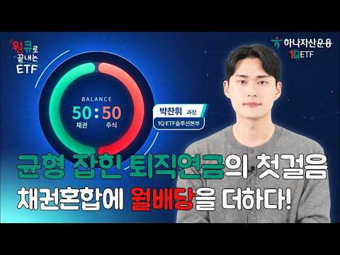
- 설명 앞부분: 퇴직연금 DC형·IRP 계좌, 나머지 30%는 어떻게 운용하고 계신가요?🤔 주식의 성장성과 채권의 상대적인 안정성을 함께 추구하는 채권혼합형 ETF가 새로운 선택지로 주목받고 있어요👀 여기에 월배당까지 더해진 '1Q 채권혼합형 ETF' 7종의 특징과 연금계좌 활용법을 알아봐요💚 하나자산운용 준법감시인 심사필 2026-197호(2026.10.28~2027.10.27) 1Q ETF 더 알아보기 👀
- 같은 채널 평소 대비 ×1.1 (채널 최근 롱폼 중앙값 107,062회) · 평소 영상: 미국 AI 소프트웨어·플랫폼 핵심 기업을 한번에📱ㅣ1Q 미국AI테크플랫폼 ETF [원박싱… (108,529회) / 코스닥 다시 반등할까?📈ㅣ원큐로 끝내는 ETF🎯 (105,595회)
- 대본 없음 (설명) — 음성인식이 끝나면 도입부·흐름이 들어감
- 댓글 14/14: 좋은 점 — 영상 1 · 감사·응원 2 · 더 알고 싶은 것 1 · 아쉬운 점 — 영상 0 · 반박·불만 — 의견 다름 0 · 정치·사회 0 · 경험 공유 0 · 구독·다음 기대 0
  - 좋은 점 — 영상 👍6 “채권혼합형으로 담으면 주식을 더 담을 수 있네요...??? 많이 배우고 갑니다ㅎㅎ 감사합니다”
  - 감사·응원 👍6 “채권혼합형으로 담으면 주식을 더 담을 수 있네요...??? 많이 배우고 갑니다ㅎㅎ 감사합니다”
  - 감사·응원 👍4 “자주 들을수 있어서 감사합니다~~~~”
  - 더 알고 싶은 것 👍2 “TDF와 채권혼합 무엇을 담을까요?”

### 106. 불기둥 세운 코스피, 코스닥! 폭등한 이유와 향후 전략

- https://www.youtube.com/watch?v=Pel5gTXKRkQ · K파민 · 구독자 6,760 · 조회수 102,744 (×15.2, 하루 855.1) · 좋아요 1,605 (1.6%) · 24.8분 · 2026-07-31 · 주제 묶음 5. 국내주식 · 형식 정보·해설 (그 밖) · 폴더 `W_Pel5gTXKRkQ` (웹 승인)
- 썸네일: 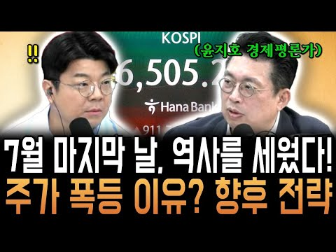
- 설명 앞부분: 7월 31일인 오늘 역사를 세웠습니다. 코스피가 하루 만에 1000포인트 넘게 상승하는 장세를 보이며 단숨에 6500선을 회복했습니다. 또한, 외국인의 일일 순매수액과 개인의 일일 순매도액 모두 역대 최대 규모를 세웠는데요, 주가 폭등의 이유와 향후 전략까지 영상으로 확인해 보세요.
- 같은 채널 평소 대비 ×4.6 (채널 최근 롱폼 중앙값 22,552회) · 평소 영상: (대만 반응) "한국엔 애국 유전자가 있어요" 한국 얘기만 나오면 똘똘 뭉쳐 감탄 쏟아낸… (23,037회) / (대만 반응) "지갑으로 자리를 맡아요!" 귀중품으로 자리 맡는 한국에 깜짝 놀란 외국 … (22,068회)
- 대본 없음 (설명) — 음성인식이 끝나면 도입부·흐름이 들어감
- 댓글 139/139: 좋은 점 — 영상 2 · 감사·응원 2 · 더 알고 싶은 것 1 · 아쉬운 점 — 영상 0 · 반박·불만 — 의견 다름 3 · 정치·사회 7 · 경험 공유 4 · 구독·다음 기대 0
  - 좋은 점 — 영상 👍21 “진짜 맞는 말씀 두 MC. 배워라”
  - 좋은 점 — 영상 👍0 “그래..우리 평범한 사람들은 확실할 대답을 원하지만, 전문가들이 예언자가 아니고 투자는 시장의 변동에 따라 수시로 바뀌니 정답도 예언도 할 수 없죠. 주식 투자는 화단을 가꾸는 것과 같다는 말 공감되네요.”
  - 감사·응원 👍9 “윤지호선생님 대단히 고맙습니다 ❤”
  - 감사·응원 👍3 “1) 부동산 폭등 대출규제로 국민죽이는 정부 2) 부동산 팔아서 주식사라더니 전문가 들도 위험하다고 반대한 ETF강행으로 2000만 투자자를 거지로 내몬 정부 3) 금감원,금융위,대검,감사원, 국민권익위에 접수된지가 도대체 언젠데 하루 1백만원씩 쓰도 1369년 10…”
  - 더 알고 싶은 것 👍0 “인버스 레버리지 없애면 안되나요?”
  - 반박·불만 — 의견 다름 👍6 “뭘 그리 양다리 걸치는 평론을.. 9월에 9천 년말까지 만천갑니다. 수익이 계속 증명되면 수 많은 가정 다 헛소리이예요”
  - 반박·불만 — 의견 다름 👍2 “과한거 아닙니다 실적 대로 가눈거죠”
  - 정치·사회 👍8 “저기여 정부에서 주식재난특별지원금을 언제 지급 하나요?😅”
  - 정치·사회 👍5 “이재명이 만든 도박장!!”
  - 경험 공유 👍2 “코스피 곧 만 넘게 간다고 했었는데😢 재해처럼 어느날 갑자기 뒤집어질 수 있다는 걸 겪으면서 배우네요. 근데 수업료가 너~무 비싸서 과다 출혈이 문제”
  - 경험 공유 👍2 “경제 주식에 대해 공부하지 않고 남들이 하니 나도 해봐야지,주식이 계속 오르네? 나도 들어가 봐야지 란 인식으로 주식을 접해 피해를 보시는 분들이 없었으면 좋겠습니다. 주식 투자는 본인의 의지고 본인의 책임이 따르기 때문에 어설프게 다가가서 힘들어 하지 마시고 그런분…”

### 107. "월가에 이미 소문 다 퍼졌다" 월요일 아침 삼성전자 주가 '이렇게' 될 겁니다

- https://www.youtube.com/watch?v=jtSxA5pzBuI · 알기쉬운 경제스쿨 · 구독자 47,600 · 조회수 108,963 (×2.3, 하루 5,410.5) · 좋아요 1,087 (1.0%) · 29.5분 · 2026-11-08 · 주제 묶음 5. 국내주식 · 형식 정보·해설 (그 밖) · 폴더 `W_jtSxA5pzBuI` (웹 승인)
- 썸네일: 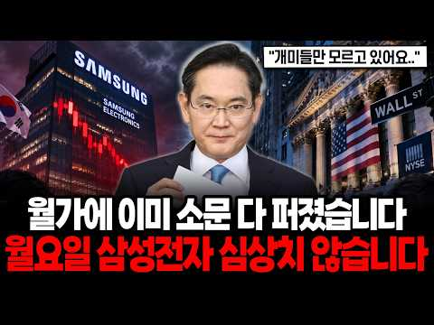
- 설명 앞부분: 미국 중간선거에서 민주당이 상원과 하원을 모두 가져간 뒤, 삼성전자는 11월 6일 18만 8,700원에 마감하며 이틀 만에 15퍼센트 가까이 빠졌습니다. 그런데 한국 장이 닫힌 뒤 미국 필라델피아 반도체지수가 4.2퍼센트 반등했고, 이 반등은 아직 삼성전자 주가에 하나도 들어가 있지 않습니다. 삼성전자는 3분기에 107조 원의 영업이익을 냈고, 내년 1월 말 이사회에서 쓰임새가 정해질 주주 환원 재원이 최소 55조 원 남아 있습니다. 월요일 아침 삼성전자의 출발 그림과, 그 뒤를 가를 외국인 매매·미국 금리·이란 협상까지 정리했습…
- 같은 채널 평소 대비 ×4.8 (채널 최근 롱폼 중앙값 22,890회) · 평소 영상: 삼전닉스 주가 예사롭지 않다, 내일 아침은 더 무서울 겁니다 ∣ 하창봉 대표 1부 (25,166회) / 심상치 않은 삼전닉스 분위기, 12월 어마무시한 일 터집니다 ∣ 하창봉 대표 3부 (20,615회)
- 대본 없음 (설명) — 음성인식이 끝나면 도입부·흐름이 들어감
- 댓글 107/107: 좋은 점 — 영상 3 · 감사·응원 2 · 더 알고 싶은 것 0 · 아쉬운 점 — 영상 2 · 반박·불만 — 의견 다름 2 · 정치·사회 8 · 경험 공유 7 · 구독·다음 기대 0
  - 좋은 점 — 영상 👍1 “좋은 내용 감사합니다.”
  - 좋은 점 — 영상 👍1 “합리적이고 사실적 분석같습니다. 설명이 좋습니다.”
  - 감사·응원 👍1 “좋은 내용 감사합니다.”
  - 감사·응원 👍1 “유용한 정보네요 감사합니다. 지식도 쌓이겠어요. 공부가 됩니다. 감사합니다. 목소리가 AI겠지만 편안 하네요. 듣기 편해서 구독 까지 하고 갑니다.”
  - 아쉬운 점 — 영상 👍3 “이런 놈을 사기꾼이라합니다~ 낚시질”
  - 아쉬운 점 — 영상 👍0 “착각인지. .메인 사운드외에 다른 소리가 작게 들려요. ?”
  - 반박·불만 — 의견 다름 👍0 “말도안되는분석이고 쓸데없는 소리다.!! 삼전닉스 단일종목 ETF가 이있는한 반등은 제한적이다 빠질때는 4배 넘게 빠진다......계속 추세적으로 빠진다.. 당장 삼전닉스 ETF 상폐해야 한다...어떤 대책도 무용지물이다.....삼전닉스 단일종목 ET 상폐만이 해답이다…”
  - 반박·불만 — 의견 다름 👍0 “앞부분 잠시 보다가 헛소리 하길래 더이상 안 봄. 미장 하락 후 마감 -> 국장 그 영향으로 하락, 이후 반등 후 마감 -> 국장이 반등한 영향으로 미장도 반등 이렇게 간 건데 뭔... ㅋ 미장이 반등하다가 힘이 떨어지면서 마감했으니 월요일에 국장도 아침에 잠시 반등…”
  - 정치·사회 👍2 “진짜였네..삼성공장 모라토리움 들어갈거란게... 오르든가 내리든가 하나 마나한 개소리지만 .. 이 시국에 오르겠냐??? 엔트로픽도 당초 2조달러에서 1조몇천으로 줄였다가 이제는 11월 상장은 힘들거라는데.. 이건 최악의 악재임 거기에 금리인상이 솔솔 터져나오고 있음 …”
  - 정치·사회 👍1 “외국인만 몰라. 이게 맞지 ㅋㅋ”
  - 경험 공유 👍32 “그말은 나도하겄다😊 둘중하나지”
  - 경험 공유 👍7 “나도 그소리는 하겠다 쯧쯧”

### 108. 긴급진단📢 '검은 목요일' 생존법은? 급락장 '줍줍' 기회일까? [염승환 이사]

- https://www.youtube.com/watch?v=lXqkrXt2uNs · 경제시그널 · 구독자 28,800 · 조회수 141,325 (×4.9, 하루 3,191.0) · 좋아요 1,011 (0.7%) · 16.5분 · 2026-10-15 · 주제 묶음 기타 · 형식 인터뷰·강연·대담 · 폴더 `W_lXqkrXt2uNs` (웹 승인)
- 썸네일: 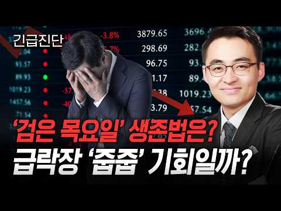
- 설명 앞부분: 📉 코스피·코스닥 매도 사이드카에 서킷브레이커까지 발동된 '검은 목요일'. 증시는 왜 급락했을까요? 염승환 이사와 함께 외국인 매도 배경부터 AI 투자 축소 우려, 창신메모리의 위협까지 짚어봤습니다. 삼성전자·SK하이닉스, 지금이 저가 매수 기회일까요? 아니면 조금 더 기다려야 할까요? 급락장 속 투자 전략을 함께 확인해 보겠습니다. 경제를 깊이 있게, 경제시그널 토크, 익스플레인 컨텐츠를 제작하는 경제시그널 콘텐츠 제작 역량을 바탕으로 기업·브랜드의 스토리를 디지털 콘텐츠에 맞는 방식으로 기획합니다. [브랜드가 찾는 콘텐츠 파트…
- 같은 채널 평소 대비 ×104.6 (채널 최근 롱폼 중앙값 1,351회) · 평소 영상: 흙에서 금, 은을 캐는 고려아연의 비밀? (1,351회) / 한강에 사는 수달 27마리의 DNA를 분석해 보니 벌어진 일?! 한강이 야생동물의 천국이… (870회)
- 대본 없음 (설명) — 음성인식이 끝나면 도입부·흐름이 들어감
- 댓글 127/127: 좋은 점 — 영상 0 · 감사·응원 4 · 더 알고 싶은 것 0 · 아쉬운 점 — 영상 0 · 반박·불만 — 의견 다름 3 · 정치·사회 5 · 경험 공유 2 · 구독·다음 기대 0
  - 감사·응원 👍1 “염이사님감사합니다 ~”
  - 감사·응원 👍0 “매도는 본인 몫인것같습니다 염블리님 열심히 해주셔서 감사드리고 3년 기다리니 수익이 좋았습니다”
  - 반박·불만 — 의견 다름 👍32 “이 사람 말 믿고 매수했다가 수년 고생했습니다 자신만 믿고 해야지 전문가들이 전문가가 아닙니다 아무도 주식 떨어질 때는 못 믿습니다”
  - 반박·불만 — 의견 다름 👍2 “국민들 선동하는 염이사 그만하세요”
  - 정치·사회 👍9 “이 모든게 이정권의 주식시장 개입으로 인한 국민연금과 레버리지etf 의 정책 실패임. 외국인들만 좋은일 시키고 개인들과 국민연금은 어마어마한 손실을 기록할 듯.... 다신 볼 수 없는 코스피 9000...”
  - 정치·사회 👍1 “국장은 정치판 63선거위한 🚀 로켓!!! 28년 총선때 무조건 upup!!!😅😅😅😅”
  - 경험 공유 👍1 “증권사 전문가는 없음.,,,,,,,오직 이들은 매수 부추키는, 자기들 장사에 기여하기 위해, 매수 부추기는 사기꾼들임.....개인들은 스스로의 생각과 등락과 외국인따라, 그들이 사면 나도 사고, 그들이 팔면 나도 팔고....이렇게만 해야함.......증권사 전문가들은…”
  - 경험 공유 👍0 “비온후에 비가왜왔는지 나도안다 개지랄 그만해라”

### 109. 단타 천재가 개발한 하이킨아시 스캘핑 매매법, 죽어라 이것만 하세요.

- https://www.youtube.com/watch?v=55hFmXD0lh0 · 알파개미 · 구독자 2,780 · 조회수 55,089 (×19.8, 하루 307.8) · 좋아요 1,779 (3.2%) · 19.6분 · 2026-06-02 · 주제 묶음 7. 매매·전략 · 형식 인터뷰·강연·대담 · 폴더 `W_55hFmXD0lh0` (웹 승인)
- 썸네일: 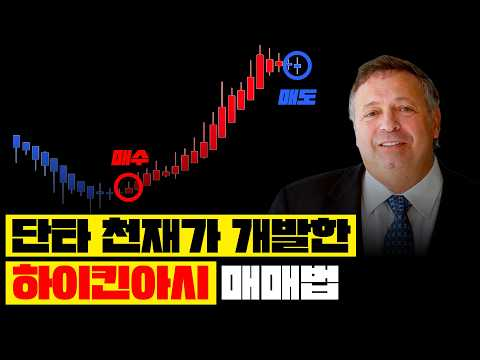
- 챕터: 0:00 인트로 · 1:26 하이킨아시 개요 · 3:09 하이킨아시 캔들 3가지 · 3:47 일반 캔들 vs 하이킨아시 · 4:39 추세 전환 기준 3가지 · 6:17 추세 반전 신호 · 7:21 실전 하이킨아시 패턴 5가지 · 8:42 전략 1.지지/저항 및 돌파 매매법 · 9:42 전략 2.돌파 매매법 · 10:15 전략 3.이동평균선(EMA) 결합 매매법 · 11:51 전략 4.추세반전 매매법 · 12:30 전략 5.RSI 지표 결합 매매법 · 13:43 전략 6.알파 하이킨아시 매매법 · 18:45 마무리 정리[지표 신청방법] / 아웃트로
- 설명 앞부분: 단타 천재가 개발한 하이킨아시 스캘핑 매매법, 죽어라 이것만 하세요. 📈 알파 하이킨아시 지표 무료 신청하기 📈 신청 코드: "알파 하이킨아시" 입력 📈 자동 매매 프로그램 무료 사용 신청하기 📈 📼차트 매매법 무료 강의 신청하기📼 📢 중요 안내: 본 방송에서 제공되는 모든 정보는 전문가의 개인적인 의견입니다.
- 같은 채널 평소 대비 ×81.0 (채널 최근 롱폼 중앙값 680회) · 평소 영상: 이동평균선 3개로 1,400억을 번 천재의 매매법 (단타, 스윙 매매) (680회) / -5억을 잃고 알았습니다. "이 차트 보는 방법" 하나면 충분하다는 걸 (638회)
- 대본 없음 (설명) — 음성인식이 끝나면 도입부·흐름이 들어감
- 댓글 1,049/1,055: 좋은 점 — 영상 19 · 감사·응원 81 · 더 알고 싶은 것 26 · 아쉬운 점 — 영상 0 · 반박·불만 — 의견 다름 0 · 정치·사회 0 · 경험 공유 3 · 구독·다음 기대 50
  - 좋은 점 — 영상 👍0 “너무 좋은 영상이네요~ 알파 하이킨아시 신청드립니다!^^”
  - 좋은 점 — 영상 👍0 “좋은정보 감사합니다 하이킨아시 신청합니다”
  - 감사·응원 👍1 “구독 좋아요 완료했어요 알파 하이컨아시 신청합니다 미리 감사합니다”
  - 감사·응원 👍1 “주린인데 차트보기가 너무 좋아요.. 신청합니다.감사합니다.. 스마트폰에도 가능한지도 궁금합니다”
  - 더 알고 싶은 것 👍1 “주린인데 차트보기가 너무 좋아요.. 신청합니다.감사합니다.. 스마트폰에도 가능한지도 궁금합니다”
  - 더 알고 싶은 것 👍0 “훌륭한 정보 대단히 감사합니다. 앞으로도 이런 정보 부탁드립니다 구독과 조아요는 기본 체크입니다❤❤❤”
  - 경험 공유 👍0 “우와. 저도 알파하이킨아시 신청합니다”
  - 경험 공유 👍0 “저도 알파 하이킨아시 신청합니다”
  - 구독·다음 기대 👍1 “알파 하이킨아시 신청했습니다. 영상 내용도 좋고 하이킨아시 차트 지표도 좋아보이네요. 영상 잘 챙겨볼께요~”
  - 구독·다음 기대 👍0 “구독했씁니당 알파하이킨아시”

### 110. "역대급 저평가라던 코스피" 하루 만에 620조 추락.. 그 뒤에 숨겨진 코스피의 잔혹한 진실

- https://www.youtube.com/watch?v=6VAsPNYeTRQ · 더 리치 - 돈의 흐름을 읽어라 · 구독자 8,000 · 조회수 116,615 (×14.6, 하루 844.5) · 좋아요 3,100 (2.7%) · 21.2분 · 2026-07-13 · 주제 묶음 5. 국내주식 · 형식 정보·해설 (그 밖) · 폴더 `W_6VAsPNYeTRQ` (웹 승인)
- 썸네일: 
- 챕터: 0:00 역대급 저평가와 폭락의 모순 · 2:11 사이드카와 서킷브레이커 발동 · 3:53 개인이 받아낸 3.9조 매물 폭탄 · 5:15 폭락의 방아쇠 SK하이닉스 · 6:50 시장을 무너뜨린 진짜 원인 빚 · 9:02 반대매매와 레버리지의 함정 · 10:51 코스피가 역사상 가장 싼 이유 · 14:17 반도체 펀더멘털과 빚의 청산 · 16:44 향후 증시 향방과 주요 변수 · 18:20 반드시 확인해야 할 두 가지 지표
- 설명 앞부분: "역대급 저평가라던 시장이 밀린, 38조 원의 빚의 모순" 외국인과 기관의 자금 3조 9천억 원이 시장 밖으로 빠져나가고 그 빈자리를 개인이 홀로 채우며 시장의 주인이 바뀌었습니다. 코스피 7,000선이 무너진 무대 위에서 삼성전자와 SK하이닉스를 지탱하던 거대한 자금 축이 시스템에 의해 강제로 해체되는 흐름이 나타났습니다. 이번 폭락은 반도체의 실적 훼손이 아닌 신용 잔고의 청산 과정에서 발생한 기계적 이동입니다. 저평가라는 본질보다 빚의 무게가 가격을 결정하는 국면에서 금리와 물가라는 매크로 환경이 이 자금의 퇴로를 어떻게 열…
- 같은 채널 평소 대비 ×41.7 (채널 최근 롱폼 중앙값 2,796회) · 평소 영상: “480조 호재에도 1% 상승" 삼성·SK도 예외가 아닌 ‘선반영’의 무서운 함정 (2,813회) / "내가 사서 떨어지는 건가?" 개미만 모르는 외국인들의 소름돋는 수법 (2,778회)
- 대본 없음 (설명) — 음성인식이 끝나면 도입부·흐름이 들어감
- 댓글 294/294: 좋은 점 — 영상 4 · 감사·응원 9 · 더 알고 싶은 것 1 · 아쉬운 점 — 영상 2 · 반박·불만 — 의견 다름 3 · 정치·사회 44 · 경험 공유 6 · 구독·다음 기대 0
  - 좋은 점 — 영상 👍7 “잘썼어요.도움이 됩니다”
  - 좋은 점 — 영상 👍1 “좋은 정보를 감사합니다”
  - 감사·응원 👍2 “탁월한분석 입니다..많은 도움 될것 같네요..감사합니다”
  - 감사·응원 👍1 “상세하고 정확한 설명 감사합니다.🎁 최고의 채널입니다.👍🌹”
  - 더 알고 싶은 것 👍0 “근데 언제 빚이청산 되는가요?”
  - 아쉬운 점 — 영상 👍0 “너무길고 속도가 느려요 고령층 ㆍ노인들에겐 좋은 속도일수도 있지만”
  - 아쉬운 점 — 영상 👍0 “정치 리스크가 이런겁니다 다들 이걸 생각 안하시네요 세계금융의 중심이 어딘지 그돈에 돈줄이 어딘지 기억하세요 불안한 지역엔 투자들 하게나요? 연기금 등 기관의 돈으로 끌어올려봐야 기관은 돈이없고 연기금은 더이상 매수여력이 없읍니다 그래서 도박판이 된겁니다 개인이 개인…”
  - 반박·불만 — 의견 다름 👍18 “무능한 정부의 도박판 국민선동”
  - 반박·불만 — 의견 다름 👍15 “*.헛소리 말고 공매도 없애고 *단일 레리지 페지 해야 합니다”
  - 정치·사회 👍142 “국민연금이 제 때 수익실현 안하고 유예한게 가장 큰원인이다. 결국 외국인만 좋은 일 시키고 개인들은 고점에 물린거다 국민연금 특검해야 한다”
  - 정치·사회 👍63 “이제 5000 으로 내려가야지 그런데 국민연금은 팔지도 못하고 갖고있는 주식만 떨어졌는데 국민들 노후비용은 어떻게 할려나 국민연금이 주가를 9000으로 올릴때 외국인들이 신나게 팔아치웠으니 국민연금 돈을 외국인들이 합법적으로 훔쳐간거다”
  - 경험 공유 👍15 “내가 말햇잖아 낙수효과로 관련 중소형주 사라고 코스닥에 주목해 코스피와 갭차이가 너무나서 이젠 차이가 줄어들게되어있다 삼전닉스로 단타치는 단타쟁이들 재미좀 보다가 작살나는 시기다”
  - 경험 공유 👍1 “근본적으로 경제를 정치논리로 밀어 부치는 이재명 정부 주관도 없고 전문성도 없는 김용범정책실장이 단일종목 레버리지ETF 출시로 주식시장을 투기판으로 만들어 개미투자들에게 깡통차게 한 놈! 이게 시장경제 정책이냐!!! 오죽하면 금융감독원장 이찬진이 레버리지ETF 출시를…”

