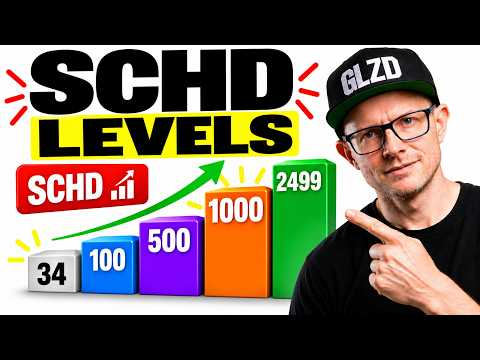
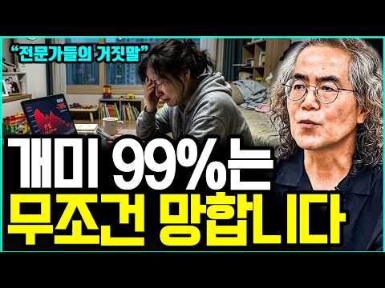
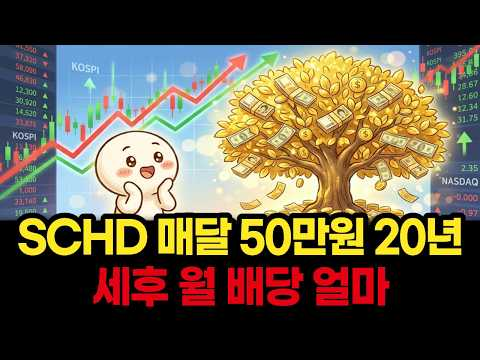

# 주식 — 성공 사례 분석: 사례별 자세히 #81–#114

`analysis.md` 의 9번 (같은 # 번호). 자동 생성 — `tools/success_analysis.py` v1.6 (2026-10-28 07:56 UTC). ※ 연구·교육용 — 투자 권유가 아님.

### 81. QLD는 몇 년 들고 있어야 안전할까? 20년치 모든 매수 시점을 계산해봤습니다.

- https://www.youtube.com/watch?v=PWr2oclRWKs · 여의도 아빠  · 구독자 2,290 · 조회수 11,665 (×5.1, 하루 782.7) · 좋아요 86 (0.7%) · 6.7분 · 2026-10-13 · 주제 묶음 7. 매매·전략 · 형식 브이로그·직접 해본 이야기 · 폴더 `W_PWr2oclRWKs` (웹 승인)
- 썸네일: 
- 설명 앞부분: "QLD, 5년만 버티면 괜찮은 거 아닌가요?" 실제 20년 데이터에선 10년 보유 시 손실 확률 0%. 그런데 OO를 넣자 '5년이면 된다'던 답이 최대 20년으로 늘어났습니다. QLD 보유 기간별 손실 확률 10년 보유 중앙값 13배 금융위기 꼭대기 매수자 닷컴 꼭대기에 2배 나스닥을 샀다면? 같은 최악의 타이밍, 적립을 멈추지 않았다면 본전 20년 → 6년 반 QLD 장기투자가 성립하는 사람 vs 하면 안 되는 사람
- 같은 채널 평소 대비 ×1.9 (채널 최근 롱폼 중앙값 6,287회) · 평소 영상: 아이에게 매달 10만원씩 미국 ETF를 사줬더니… 20년 뒤 계좌에 찍힌 금액 (S&P5… (6,287회) / QLD 투자자 대부분이 모르는 사실. 아무리 잘 모아도 '이 순서'를 모르면 무너집니다. (5,587회)
- 대본 없음 (설명) — 음성인식이 끝나면 도입부·흐름이 들어감
- 댓글 11/14: 좋은 점 — 영상 0 · 감사·응원 1 · 더 알고 싶은 것 1 · 아쉬운 점 — 영상 0 · 반박·불만 — 의견 다름 0 · 정치·사회 0 · 경험 공유 0 · 구독·다음 기대 0
  - 감사·응원 👍1 “영상 정말 잘봤습니다. 감사합니다.”
  - 더 알고 싶은 것 👍3 “이번영상도 시청사수입니다! 지금과 같은 고금리가 유지 혹은 더 올라간다면 QQQ대비 QLD의 매력,효율성은 이자비용으로 인해서라도 이전에 비해 많이 떨어질지 궁금하네요”

### 82. 라오어 무한매수법, 정말 계속 해도 될까? TQQQ·QLD로 12년 돌려보고 알게 된 의외의 결과

- https://www.youtube.com/watch?v=nCBMBYmFjOU · 여의도 아빠  · 구독자 2,290 · 조회수 58,285 (×25.4, 하루 767.9) · 좋아요 711 (1.2%) · 7.5분 · 2026-08-13 · 주제 묶음 7. 매매·전략 · 형식 정보·해설 (그 밖) · 폴더 `W_nCBMBYmFjOU` (웹 승인)
- 썸네일: 
- 설명 앞부분: 라오어의 무한매수법, 12년을 그대로 돌려봤습니다. 그런데 가장 놀란 건 수익률이 아니었어요. 돈이 놀고 있는 시간과 현금이 바닥나는 순간이었습니다. QLD 무한매수 19배 vs 그냥 거치 30배 TQQQ 무한매수 19배 vs 그냥 거치 59배 12년 내내 현금의 3분의 1이 놀고 있었다 최악의 타이밍 2021년 꼭지 진입 QLD vs TQQQ 무한매수 평소엔 QLD, 찐 폭락엔 TQQQ 시작
- 같은 채널 평소 대비 ×9.3 (채널 최근 롱폼 중앙값 6,287회) · 평소 영상: 아이에게 매달 10만원씩 미국 ETF를 사줬더니… 20년 뒤 계좌에 찍힌 금액 (S&P5… (6,287회) / QLD 투자자 대부분이 모르는 사실. 아무리 잘 모아도 '이 순서'를 모르면 무너집니다. (5,587회)
- 대본 없음 (설명) — 음성인식이 끝나면 도입부·흐름이 들어감
- 댓글 186/192: 좋은 점 — 영상 5 · 감사·응원 7 · 더 알고 싶은 것 12 · 아쉬운 점 — 영상 1 · 반박·불만 — 의견 다름 6 · 정치·사회 0 · 경험 공유 13 · 구독·다음 기대 0
  - 좋은 점 — 영상 👍4 “좋은 영상 감사합니다! 멘탈 유지에 도움이 많이 돼요!”
  - 좋은 점 — 영상 👍3 “평소엔 qld 폭락엔 TQQQ무한매수.. 공감합니다만 '진짜 폭락' 이라는걸 어찌 알 수 있는지가 관건이네요ㅎㅎ.. 대부분은 그걸 못맞추니 이런 규칙이 나오는건데”
  - 감사·응원 👍21 “부지런히 할필요없이 무한매수법 공개api로 프로그램만들어서 자동으로 돌리고 있습니다 .qld도 같이 하고 있고요 . 결과 흥미롭게 잘봤습니다 감사합니다 .”
  - 감사·응원 👍7 “다른의미로 감사합니다 😘”
  - 더 알고 싶은 것 👍13 “더 좋은 방법을 알려주세요”
  - 더 알고 싶은 것 👍5 “무한매수법 저자가 서울대 자퇴, 경력 10년차 소아개원의 치과의사 맞나요? 검색해도 저자의 실명도 없고 최소한 어느 치대를 졸업했는지 최소한의 정보조차 검색이 안되고 모두 비공개라, 늘 마스크 쓰고 다니니 😢 주식관련 멤버십 비용도 월 12만원 받는다는데 저자에 대한…”
  - 아쉬운 점 — 영상 👍3 “제목으로 어그로 끄는건 여전하네”
  - 반박·불만 — 의견 다름 👍30 “무한매수법의 가장 큰 장점은 수익률이 아닙니다. 정해진 규칙을 따라서 상승장, 횡보장, 하락장에도 맨탈이 흔들리지 않으면서 꾸준히 수익을 내는 방법이지. 다양한 시나리오를 가정한 12년치 백테스트는 이 투자방법이 실전에서 쓸수 있는지 확인하는 좋은 방법이긴 하지만 수…”
  - 반박·불만 — 의견 다름 👍28 “웃고 갑니다. 직접 몇년간 하는 입장에서 라오어님 입장도 모르고 그냥 방법만 겉핥기 식으로만 평가하는 느낌이네요. 무한매수법은 리스크를 줄이기 위한 "단투"지 장투에 적합한 방법은 아닙니다. 무슨 qld 장기보유랑 비교를 해요.. 라오어님도 그냥 이것저것 귀찮으면 q…”
  - 경험 공유 👍41 “무한매수의 단점은 1. 상방이 막혀있고 하방은 열려 있으며, 2. 복리를 스스로 끊고 리셋하며, 3. 계속해서 수익을 확정하면서 텍스를 내야하는 텍스 이펙트를 고려하지 않았고, 4. 항상 이용할 수 있는 자금의 일부분만 사용하기에 수익률은 좋을수 있으니 수익금 측면에…”
  - 경험 공유 👍40 “2022년에 라오어 카페에 가입해서 꾸준히 글씀. 그때 세상이 참 재미있었음. 하수들이 세상이 망한다고 고래고래 소리지르고 거기서 유일하게 비껴간게 라오어 카페였음. 거기도 순탄하진 않았지만 적어도 tq가 80프로 떨어진 그 순간에도 tq를 믿는 사람들이 모였단 말임…”

### 83. 더이상 배당주는 사지 않아요/40대 워킹맘

- https://www.youtube.com/watch?v=P0j4XK5PaJY · 마스 심플라이프 MasSimpleLife · 구독자 41,200 · 조회수 210,522 (×5.1, 하루 12,173.9) · 좋아요 1,237 (0.6%) · 10.8분 · 2026-10-11 · 주제 묶음 3. 배당 · 형식 브이로그·직접 해본 이야기 · 폴더 `W_P0j4XK5PaJY` (웹 승인)
- 썸네일: 
- 설명 앞부분: ⏰ 연 5천만원 모으는 습관 클럽(연오클) 11기를 모집합니다. ^^ 함께 새벽습관을 잡고, 돈공부와 독서를 하면서 경제마인드를 잡아가고 싶으신분들 함께해요~ ^^ 남과 비교하지 않고 어제의 나와 비교하며, 내 삶의 주도권을 되찾아갈 (연오클 11기)멤버를 모집합니다. (연오클이 궁금하시다면 네이버에 '연오클'을 검색해보세요~ ^^) 전 주로 집에 있는 재료를 이용하는 편이구요~ 요리책의 레시피가 있어도 레시피대로 잘 안하고 있는 재료를 주로 활용하고 있답니다~ 사실.. 저도 요리할때마다 레시피가 바뀌어요~ㅋㅋ *^^ 🍒 돼지고기…
- 같은 채널 평소 대비 ×6.7 (채널 최근 롱폼 중앙값 31,421회) · 평소 영상: 연6천만원 모으는 방법~(Q&A) /40대 워킹맘 돈모으는 루틴(오이지, 황태계란국) (31,430회) / 무섭게 돈 모으는 40대 워킹맘의 노후준비 라이프(생활비 90만원)(몰아보기영상) (31,412회)
- 대본 (자막, 5.9 음절/초) 첫 20초: “안녕하세요. 마스입니다. 어느덧 10월입니다. 아침 저녁으로 제법 쌀쌀한 바람이 부는 완연한 가을이 되었어요. 10월부터는 저희 아침 운동 루틴에도 약간의 변화를 주었답니다. 출근을 해야 하는 주 중에는 수영을 하고 조깅은 주말에 하기로 했어요. 가을이 깊어지면서 아침에도 늦게 뜨고”
- 첫 1분: “안녕하세요. 마스입니다. 어느덧 10월입니다. 아침 저녁으로 제법 쌀쌀한 바람이 부는 완연한 가을이 되었어요. 10월부터는 저희 아침 운동 루틴에도 약간의 변화를 주었답니다. 출근을 해야 하는 주 중에는 수영을 하고 조깅은 주말에 하기로 했어요. 가을이 깊어지면서 아침에도 늦게 뜨고 [음악] 새벽 5시에 나가면 아직 깜깜한 데다가 날도 꽤 쌀쌀하더라고요. 무리에서 어둠 속을 달리기보다는 주말에 해가 뜬 후에 따뜻한 햇살 아래 남편과 함께 느긋하게 슬로우 조깅하는 것으로 바꿨습니다. [음악] 이게 저희 중년 부부가 조깅을 포기하지 않고 계속할 수 있는 방법이란 생각이 들더라고요. 영상을 보는 구독자님들도 날은 추워지지만 [음악] 건강을 위해 운동을 멈추지 않으시길 바랍니다. 이제 우린 생존을 위해 운동해야 하”
- 흐름 (90초마다 첫 문장): 0:01 안녕하세요. 마스입니다. 어느덧 → 1:30 하지만 그간 미니벌 라이프로 얻은 → 3:01 주식으로 매월 높은 배당금을 받으면서 → 4:31 현금 흐름이 나올 수 있고 → 6:01 때문입니다. 미국 주식 중에서도 앞서 → 7:32 편안히 쉬면서 매달 나오는 연금만 → 9:01 한시간씩 걸어다니며 극단적으로 → 10:31 바랍니다. 구독과 좋아요는 제가 매주
- 댓글 104/180: 좋은 점 — 영상 1 · 감사·응원 5 · 더 알고 싶은 것 3 · 아쉬운 점 — 영상 0 · 반박·불만 — 의견 다름 2 · 정치·사회 0 · 경험 공유 15 · 구독·다음 기대 0
  - 좋은 점 — 영상 👍2 “매번 좋은 내용을 볼 수 있어서 감사합니다.오늘 특히 정리가 되는 영상이었어요.^^”
  - 감사·응원 👍3 “항상 잘 보고 있어요 채칼 정보 알려주시면 감사하겠습니다😊”
  - 감사·응원 👍2 “매번 좋은 내용을 볼 수 있어서 감사합니다.오늘 특히 정리가 되는 영상이었어요.^^”
  - 더 알고 싶은 것 👍3 “항상 잘 보고 있어요 채칼 정보 알려주시면 감사하겠습니다😊”
  - 더 알고 싶은 것 👍1 “전 1도 몰라요 뭘 어떻게 시작해야할지 모르겠어요 저같은 초짜는 어떻게 시작해야될까요?”
  - 반박·불만 — 의견 다름 👍6 “하락장 아프게 한번 맞아보면 또 생각이 바뀝니다 배당주를 하시던 성장주를 하시던 투자하고 있는 지금 상황에 박수를 드립니다 어느쪽은 중요하지 않습니다 선택한 그 투자를 얼마나 오래 지속 할수있을지만 고민 하시면 됩니다 중요한건 어떤 상품이 아닙니다”
  - 반박·불만 — 의견 다름 👍0 “예전 부모님 세대로서........... "집에서 편안히 쉬면서 연금만으로 살 수 있는 호시절"은 아닌데.......한편, 자녀들의 시대에는 지금 40대 위킹맘의 상황보다 더욱 혹독하겠습니다. 맞아요. 예전에는 돈돈 하면서 살진 않았는데...그렇다고 돈이 중요한 걸 …”
  - 경험 공유 👍49 “난 주식 20년차인데 결국 배당주가 답이라는걸 찾음”
  - 경험 공유 👍14 “남말에 귀닫고 노동소득의 80%는 한국주식을 사고있는 50살 23년차 주식쟁이입니다 에코프로는 10년 이상 3만주 이상을 들고 있으며 에코프로로 노후준비는 다 끝났습니다 개인연금저축펀드 퇴직연금IRP는 20년째 들고 있습니다 주식에는 전문가란게 없고 과학이 아니라서 …”

### 84. This New Fidelity ETF Has CRUSHED Every Dividend ETF

- https://www.youtube.com/watch?v=LgszhYR0rFQ · Jake Wealth Hacks · 구독자 6,790 · 조회수 25,007 (×3.7, 하루 1,999.3) · 좋아요 296 (1.2%) · 10.1분 · 2026-10-15 · 주제 묶음 2. 장기투자·ETF·지수 · 형식 정보·해설 (그 밖) · 폴더 `W_LgszhYR0rFQ` (웹 승인)
- 썸네일: 
- 설명 앞부분: FELV ETF review: Is Fidelity Enhanced Large Cap Value ETF a better investment than popular dividend ETFs like SCHD, DGRO, and VYM? Discover this hidden Fidelity ETF’s strategy, performance, holdings, expense ratio, dividend yield, and risks for long-term investors and retirees. Most dividend invest…
- 같은 채널 평소 대비 ×6.7 (채널 최근 롱폼 중앙값 3,728회) · 평소 영상: These 5 ETFs Are Destroying the S&P 500 in 2026 (3,957회) / The 23% Total Return ETF No One Is Talking About … (3,965회)
- 대본 없음 (설명) — 음성인식이 끝나면 도입부·흐름이 들어감
- 댓글 13/14: 좋은 점 — 영상 0 · 감사·응원 0 · 더 알고 싶은 것 0 · 아쉬운 점 — 영상 0 · 반박·불만 — 의견 다름 0 · 정치·사회 0 · 경험 공유 0 · 구독·다음 기대 0

### 85. 단타 천재가 개발한 초간단 매매법(기본 차트 분석법)

- https://www.youtube.com/watch?v=knblsnwXsfg · 차트9단 · 구독자 469 · 조회수 17,030 (×36.3, 하루 137.4) · 좋아요 419 (2.5%) · 20분 · 2026-06-26 · 주제 묶음 6. 종목 고르기·분석 · 형식 인터뷰·강연·대담 · 폴더 `W_knblsnwXsfg` (웹 승인)
- 썸네일: 
- 챕터: 0:00 시작 · 0:28 이평선 하나면 된다 · 2:21 이평선 사용법 · 5:04 탑다운 매매법 · 8:50 이평선 단타매매법
- 설명 앞부분: 단타 천재가 개발한 초간단 매매법(기본 차트 분석법) 거래량 델타 지표 무료 신청하기 트레이딩 매매법 강의 무료 신청하기 100억 트레이더의 비법서 신청하기 편리한 자동 거래봇 이용 신청하기
- 같은 채널 평소 대비 ×25.5 (채널 최근 롱폼 중앙값 669회) · 평소 영상: 단타 매매법은 딱 두가지만 알면 끝입니다. (이동평균선 거래량 차트보는법) (669회) / 5년동안 단타로 200억 벌어들인 트레이더의 개쉬운 매매법 (251회)
- 대본 없음 (설명) — 음성인식이 끝나면 도입부·흐름이 들어감
- 댓글 7/7: 좋은 점 — 영상 1 · 감사·응원 5 · 더 알고 싶은 것 1 · 아쉬운 점 — 영상 0 · 반박·불만 — 의견 다름 0 · 정치·사회 0 · 경험 공유 0 · 구독·다음 기대 0
  - 좋은 점 — 영상 👍0 “좋은 정보 감사합니다”
  - 감사·응원 👍0 “좋은지표입니다 수고많아요 감사합니다”
  - 감사·응원 👍0 “많이 배웁니다.감사합니다.”
  - 더 알고 싶은 것 👍0 “안녕하십니까 차트9단님 델타거래량지표을 신청합니다 부탁드립니다 감사합니다”

### 86. 트럼프의 폭탄 선언으로 삼성전자와 한국 주식시장, 조정 올 수 있는 이유! #박시동 #매불쇼

- https://www.youtube.com/watch?v=3tIO_BBDMMo · 스타판 · 구독자 3,960 · 조회수 190,465 (×48.1, 하루 1,154.0) · 좋아요 3,010 (1.6%) · 22분 · 2026-05-16 · 주제 묶음 8. 투자 심리·실패 · 형식 오디오북·낭독 (명언·인생조언) · 폴더 `W_3tIO_BBDMMo` (웹 승인)
- 썸네일: 
- 설명 앞부분: 따뜻한 위로와 냉철한 조언으로 힘을 주는 명언을 모았습니다 모두의 성공적인 미래가 되도록 응원합니다.
- 대본 없음 (설명) — 음성인식이 끝나면 도입부·흐름이 들어감
- 댓글 133/133: 좋은 점 — 영상 1 · 감사·응원 0 · 더 알고 싶은 것 1 · 아쉬운 점 — 영상 1 · 반박·불만 — 의견 다름 5 · 정치·사회 6 · 경험 공유 2 · 구독·다음 기대 0
  - 좋은 점 — 영상 👍2 “이분은 참 이해하기 쉽게 말씀을 해주시는것 같음”
  - 더 알고 싶은 것 👍12 “역사 그걸 알고 하는 말씀이신지 어디서 읽고 그냥 하는 얘기인지 자료를 좀 보여주면서 얘기해 주세요.”
  - 아쉬운 점 — 영상 👍1 “썸네일 제목이 너무 자극적이네요. 무슨 큰일난줄.”
  - 반박·불만 — 의견 다름 👍16 “최진봉교수는 왜 아직도 프로답지 못하게 최욱한테 너는 어쩌구 개인방송도 아닌데 주의하세요!”
  - 반박·불만 — 의견 다름 👍6 “발음도 애매하고 틀렸다고 지적하는데도 생까는 최진봉 아웃. 제발.”
  - 정치·사회 👍7 “중국이 따라잡고 있는데 한국은 노조가 돈더달라고 이난리 ..민주당아 노봉법개정해라 지선이문제야지금?”
  - 정치·사회 👍6 “민주당이 만든 노란봉투법 반드시 폐지해야합니다”
  - 경험 공유 👍70 “삼성노조중 삼성전자 주식으로 지들회사 투자하는놈들이 몇명인 묻고싶다.코로나이후로 삼전투자해온 투자자로 노저것들 정도껏해야지.나도 처음으로 노조욕하게되네”

### 87. The 5 Levels of SCHD — What Level Are You?

- https://www.youtube.com/watch?v=hasms3By6pA · Mikey Moran · 구독자 12,300 · 조회수 115,864 (×9.4, 하루 3,273.3) · 좋아요 1,518 (1.3%) · 9.6분 · 2026-09-22 · 주제 묶음 기타 · 형식 정보·해설 (그 밖) · 폴더 `W_hasms3By6pA` (웹 승인)
- 썸네일: 
- 챕터: 0:00 The First Goal in SCHD Isn't … · 1:08 The Dividend Math Formula Exp… · 2:04 Level 1: 34 Shares (The Self-… · 2:48 Level 2: 100 Shares (Building… · 3:24 Level 3: 500 Shares (Paying R… · 4:14 Level 4: 1,000 Shares (4-Figu… · 4:55 How SCHD Price Run-Ups & Yiel… · 6:17 SCHD Dividend Growth Rate Rea… · 6:58 Level 5: My Current SCHD Mile… · 7:52 How Many SCHD Shares for $1,0… · 8:26 The 2 Simple Rules to Level U… · 9:04 Which SCHD Level Are You On?
- 설명 앞부분: How many shares of SCHD do you actually need before the dividend starts making a meaningful difference? In this video, I break down what I call the "5 Levels of SCHD", starting with one of the most interesting milestones: the point where your SCHD dividends can generate enough income to effectively…
- 같은 채널 평소 대비 ×14.9 (채널 최근 롱폼 중앙값 7,784회) · 평소 영상: SCHD Is at an All-Time High. Here’s Why I’m Still… (8,214회) / I Had QQQI and SCHD in the Wrong Accounts — Here’… (7,355회)
- 대본 없음 (설명) — 음성인식이 끝나면 도입부·흐름이 들어감
- 댓글 484/499: 좋은 점 — 영상 0 · 감사·응원 0 · 더 알고 싶은 것 0 · 아쉬운 점 — 영상 0 · 반박·불만 — 의견 다름 0 · 정치·사회 0 · 경험 공유 0 · 구독·다음 기대 0

### 88. 주식 거래시간 밤 8시까지?☑️KRX 애프터마켓 꼭 알아야 할 변화

- https://www.youtube.com/watch?v=xXBHBu6hnCc · 주식캐스터 여니 · 구독자 42,800 · 조회수 473,641 (×11.1, 하루 10,538.6) · 좋아요 1,958 (0.4%) · 9분 · 2026-09-13 · 주제 묶음 기타 · 형식 정보·해설 (그 밖) · 폴더 `W_xXBHBu6hnCc` (웹 승인)
- 썸네일: 
- 같은 채널 평소 대비 ×141.7 (채널 최근 롱폼 중앙값 3,343회) · 평소 영상: 경린이 탈출 1화. 경제가 좋아진다는 말, 우리는 어디까지 이해하고 있을까? (3,449회) / 증권사 목표주가만 보고 투자하면 벌어지는 일 (3,237회)
- 대본 없음 (없음) — 음성인식이 끝나면 도입부·흐름이 들어감
- 댓글 361/361: 좋은 점 — 영상 6 · 감사·응원 20 · 더 알고 싶은 것 2 · 아쉬운 점 — 영상 0 · 반박·불만 — 의견 다름 4 · 정치·사회 30 · 경험 공유 3 · 구독·다음 기대 0
  - 좋은 점 — 영상 👍31 “정리해 주셔서 감사합니다. 그냥 더 피곤해지는 느낌이 드네요..ㅎ”
  - 좋은 점 — 영상 👍1 “좋은 영상 감사합니다. 100% 남이 돈 버는거 배아파서 따라 만든거.”
  - 감사·응원 👍31 “정리해 주셔서 감사합니다. 그냥 더 피곤해지는 느낌이 드네요..ㅎ”
  - 감사·응원 👍27 “개인투자자들에게 꼭 필요한 정보를 똑 부러지게 잘 설명해 주셨습니다. 감사합니다.”
  - 더 알고 싶은 것 👍1 “SOR이 뭔지 알려주세요. 그동안 NXT이용한다고, 설정해둔것 같은데, KRX거래가 안되네요???”
  - 더 알고 싶은 것 👍1 “오전장몇시부터시작해요?아신분댓글부탁해요”
  - 반박·불만 — 의견 다름 👍8 “국민들 소액주주가 원하는건 거래시간 늘리는게 아닌데.. 그저 재벌들이 자회사, 손자회사, 까지만들면서 0.1% 도 안되는 지주사 지분으로 99.9% 지분의 국민들의 회사를 지배하는 이런 구조를 개선해달라는거다... 자회사 IPO 하는거라면 자회사 주식 지분에 따라 무…”
  - 반박·불만 — 의견 다름 👍6 “금융카르텔들만 좋을일 낫구먼유 삼전닉스 거래대금 빼면 언발에 오줌눟킨데 말도 안되는 이유로 카르텔 배불리기만”
  - 정치·사회 👍21 “재명이정권 지지율 떡락하는소리 들린다”
  - 정치·사회 👍12 “개인 투자자에겐 지옥문이 열린것이다 이재명 아웃 정권 타도”
  - 경험 공유 👍0 “도박쟁이들 왜케 많냐?단타만 맨날 쳐하니까 핸드폰만 8시까지 보란소리냐 이딴 소리 하고있지 사팔사팔해봤자 결국엔 손해임 걍 넣어놓고 분기별로 한번씩만 보면 됨 한국사람 주식보유기간 길어봤자 3달이고 평균 10일이라더니 여기다 모여있네 하긴 S&P500 나스닥100 같…”

### 89. 내 주변에 주식으로 돈 번 사람이 '진짜' 단 1명도 없는 소름 돋는 이유 ∣ 교수 정선용 (통합본)

- https://www.youtube.com/watch?v=SwW4n0ERlS8 · 너와 나의 경제학교 · 구독자 35,200 · 조회수 617,641 (×17.6, 하루 8,243.1) · 좋아요 11,591 (1.9%) · 52.7분 · 2026-08-14 · 주제 묶음 11. 투자 일반 · 형식 인터뷰·강연·대담 · 폴더 `W_SwW4n0ERlS8` (웹 승인)
- 썸네일: 
- 설명 앞부분: 정선용, 달리고 읽고 쓰는 사람의 하이
- 같은 채널 평소 대비 ×17.7 (채널 최근 롱폼 중앙값 34,943회) · 평소 영상: 증권사 앱에 '이 버튼' 켜져 있다면 당장 끄세요. 평생 모은 노후자금 다 털어가는 거대… (35,884회) / 주식으로 2천만 원 벌었다면 당장 '이곳'으로 돈을 빼세요 (99%가 개미들이 파산하는 … (34,002회)
- 대본 없음 (설명) — 음성인식이 끝나면 도입부·흐름이 들어감
- 댓글 1,622/1,622: 좋은 점 — 영상 54 · 감사·응원 77 · 더 알고 싶은 것 15 · 아쉬운 점 — 영상 15 · 반박·불만 — 의견 다름 53 · 정치·사회 45 · 경험 공유 131 · 구독·다음 기대 3
  - 좋은 점 — 영상 👍332 “이분이 최고의 주식 전문가 입니다 인정합니다 허황된 꿈을 부추기지 않고 현실적인 필요하고 도움되는 얘기만 하시네요”
  - 좋은 점 — 영상 👍196 “구구절절 맞는말입니다 사람 좋아 보이는거랑 그들의 속마음은 다르다는걸 알았습니다”
  - 감사·응원 👍242 “귀한말씀 너무 늦게 들어서 안타까울 따름입니다 삼전 65만 하닉 400간다고 하면서 정작 자신들은 팔고 있었다는것을 나중에 알게됐습니다. 그렇게 보고서를 낸 증권사나 그걸 유튜브에서 전파한 사람들은 앞으로 다신 보지않을것입니다 귀한말씀 다시한번 감사드립니다”
  - 감사·응원 👍221 “안그래도 느꼈어요 요즘은 증권방송 보기도 싷더라구요 소위 주식 전문가들 증권사 직원들 에널리스트들 전부 자기밥그릇 챙기느라 혈안ᆢ 한통속 이예요 ᆢ 그들의 만행을 속시원히 알려주니 감사하네요 ᆢ”
  - 더 알고 싶은 것 👍3 “어떻게 사셨길래 99%가 잃는 주변인만 뒀나요? 교수님 과장도 적당히 하셔요”
  - 더 알고 싶은 것 👍3 “때가어느때인데유투버보고피같은돈을투자할까요?”
  - 아쉬운 점 — 영상 👍6 “어머니 돈을 불려 주겠다고 600만원을 받아서 투자를 하는데 많이 버는것 보다 잃으면 절대 안되겠다 생각이 먼저 들었습니다. 종목을 결정하는데 얼마나 벌지 모르지만 안 잃을거 같은 종목만 매수 해서 시장의 관심을 받으면 매도하고 다시 반복해서 현재 연복리65% 수익에…”
  - 아쉬운 점 — 영상 👍3 “이 사람도 결국에는 공포 마케팅으로 구독자 어그로 끄는 거임”
  - 반박·불만 — 의견 다름 👍31 “누구 믿고 투자한다는 인간들은 절대 투자하지 말아야 될 사람이에요. 결국 그 의존성 때문에 손실납니다. 그냥 저축하는 편이 안 망하는 길입니다. 주식은 원금 지키며 쌓는 저축이 아닙니다. 손실 볼 수 있는 투자에요.”
  - 반박·불만 — 의견 다름 👍24 “대가들의 책만 몇권 읽어봐도 알게됩니다. 전문가,교수,애널리스트들은 당신들의 편이 아닙니다. 그들은 당신들을 이용해서 돈을 버는것이지, 당신들을 부자로 만들어즐 이유가 1도 없어요.”
  - 정치·사회 👍189 “개미들 돈 누가 다 먹었을까요? 다 외국인 기관들한테 갔습니다 증권사는 수수료로 돈 잔치 했겠죠. 그동안 주식해서 번돈 다시 재투자하면서 이제 원금입니다 ㅠ 그나마 다행이지요. ㅠㅠ 그동안 무료 봉사 했어요 주식에~~~~”
  - 정치·사회 👍88 “딱 맞아요... 애널리스트 증권회사 삐끼들입니다. 개미들은 털리게 돼 있어요. 주식은 전문가가 없어요. 나스닥 하세요. 코스피는 증권회사 외국인들 땜에 절대 돈 벌기 힘든 구조예요. 어느정도 이익오면 우선 반은 빼고 시작하세요”
  - 경험 공유 👍314 “진짜 맞습니다 이번에 처음으로 주식하는 분들 많이 당했을꺼에요 저도 그중 한명이네요 ~~~”
  - 경험 공유 👍302 “피같은 돈 주식으로 다 날리고 몇년째 투잡하고 있습니다... 주식으로 3억잃으니 인생이 골로 가는 듯 합니다 무주식이 상팔자입니다”
  - 구독·다음 기대 👍29 “매일매일 듣고 보고 있습니다교수님 감사해요”
  - 구독·다음 기대 👍12 “미국Etf투자 6년째 평균 70프로. 이익중. 노후자금으로 기대됩니다”

### 90. 생활비 한 달 5만원..10년 만에 배당금 월 300만원 받는 이유 (조윤진 1부) #세미파이어 #배당투자

- https://www.youtube.com/watch?v=Wc52vsC6q4U · 자람들 - 자립하는사람들 · 구독자 35,200 · 조회수 826,883 (×23.5, 하루 8,043.0) · 좋아요 6,932 (0.8%) · 29.3분 · 2026-07-17 · 주제 묶음 3. 배당 · 형식 브이로그·직접 해본 이야기 · 폴더 `W_Wc52vsC6q4U` (웹 승인)
- 썸네일: 
- 설명 앞부분: 👤 오늘의 게스트: 조윤진 작가 '6억으로 시작한 세미파이어' 저자 & 배당으로 부자되기 유튜브 채널 운영 평범한 중소기업 직장인이었던 그녀는 이혼 후 경제적으로 큰 타격을 입고, "목숨 걸고 노후를 준비해야겠다"는 마음으로 10년간 악착같이 아끼고 모았습니다. 5천만 원으로 시작한 시드는 10년 만에 6억 원으로 불어났고, 지금은 매달 통장에 꽂히는 배당금만으로도 마음 편한 노후 시스템을 만들었습니다. 매도 없이 배당만 쌓아가는 그녀만의 투자 철학과, 특별할 것 없는 월급으로도 가능했던 절약과 시드 마련의 여정을 담아 첫 책 '…
- 같은 채널 평소 대비 ×28.0 (채널 최근 롱폼 중앙값 29,490회) · 평소 영상: '코스피 1만 포인트 간다' 80%는 무조건 '여기'에 넣으세요 (여운봉 대표 풀버전) … (30,274회) / 무조건 골드바로 사세요. 부자들은 이걸 삽니다. (G1 김봉준 1부) #골드바 #골드 #… (28,706회)
- 대본 없음 (설명) — 음성인식이 끝나면 도입부·흐름이 들어감
- 댓글 613/613: 좋은 점 — 영상 30 · 감사·응원 43 · 더 알고 싶은 것 33 · 아쉬운 점 — 영상 3 · 반박·불만 — 의견 다름 7 · 정치·사회 8 · 경험 공유 43 · 구독·다음 기대 2
  - 좋은 점 — 영상 👍755 “돈 모으려면 거지소리 들어가면서 미친듯이 모아도 될까 말까입니다. 그렇게까지 해야하냐는 말하는 사람들하고는 인간관계를 끊는게 내 인생발전에 훨씬 도움이 됩니다.”
  - 좋은 점 — 영상 👍32 “이 영상 첨 보는 데 정말 가슴에 와닿는 이야기네요 보통 사람들이 공감하고 같이 느낄 수 있는 이야기네요 유익한 영상 잘 보았습니다”
  - 감사·응원 👍416 “안녕하세요 인터뷰했던 '6억으로 시작한 세미파이어' 저자 배당으로 부자되기입니다. 비 오는데 진행 잘 이끌어주셔서 즐겁게 촬영했습니다. 이런 다큐 인터뷰 기회 주셔서 감사합니다. 하필 요즘 코스피가 더 내려서 장이 롤러코스터이긴 한데 끝까지 살아남는 배당투자로 노후를…”
  - 감사·응원 👍30 “귀한 영상 감사합니다.♡ 솔직하신 투자 경험 이야기 유익했습니다.♡ 감사합니다.^^ 성투하세요.❤”
  - 더 알고 싶은 것 👍10 “배당주하다가 귀가앏아 삼성 sk 물렸네요 ㅠ내 자신이 한탄스럽네요 ㅠ50대인데 앞이 깜깜해요~~미국배당다우존스는 sol tiger ace중 어느게 나을까요?공부해도 ㅠ”
  - 더 알고 싶은 것 👍3 “세금. 건보료는 어떻게 하시나요?”
  - 아쉬운 점 — 영상 👍27 “내용은 상당히 좋은데요 촬영을 할 때, 카메라를 고정시켜놓고 찍으셔야겠어요. 화면이 흔들거려요. 이건 아주 기본적인 것인데 많이 아쉽네요.”
  - 반박·불만 — 의견 다름 👍0 “커버드콜 하락장 오면 개박살나는구조다.알고투자해야한다.지금까지 미국장이 폭락장이 없어서 커버드콜 할만하지 하락하면 손실 그대로 다때려맞고 수익은 콜옵션매도 권리행사가로 막혀있으니 이런 말도안되는 상품이없다”
  - 반박·불만 — 의견 다름 👍0 “배당률이 영원한게 아닌데...”
  - 정치·사회 👍2 “이런 영상좀 올리지 마라 정부에서 이러니까 배당투자자들 정조준에서 건보료 개편하자나 시바”
  - 정치·사회 👍2 “이젠 코스피마저 나락가네 요즘 전과4범 범죄자 지지율 계속 뚝뚝 떨어지고있는데 부동산 꼼수거래로 본격적으로 나락 가고있는중..무능하고 부패한 전과4범의 범죄자..경제,주식,부동산, 환율, 물가 어느하나 제대로 하고있는게 없다 환율은 Imf때보다 더 미친듯 치솟고 원화…”
  - 경험 공유 👍37 “저도 배당금 500 이상 받고있어요 노후에는 필요한것같아요 매도 안하니까 일상생활에 집중할 수 있고 마음이 편해요~ etf도 모아가고있어요^^”
  - 경험 공유 👍32 “내가 주식29년차인데 깡통4번차고..겨우 살아만있는데 커버드콜로 계속바꾸고있다.현재는80만정도받고있다.목표는달500..😅😅😅”
  - 구독·다음 기대 👍8 “매일 듣기만했는데 이번엔 정말 시도를 해보고 싶네요. 늦은 감이 있지만 시작해보고 싶네요. 말씀 감사합니다.”
  - 구독·다음 기대 👍0 “좋은 영상 감사합니다~ 작가님 구독했어요^^”

### 91. "당신이 주식으로 망할 수밖에 없던 이유" 개미 99%의 피를 빨아먹는 잔인한 진짜 구조 ∣ 교수 정선용 (통합본)

- https://www.youtube.com/watch?v=-5NhPWk2zF0 · 너와 나의 경제학교 · 구독자 35,200 · 조회수 378,388 (×10.8, 하루 7,893.7) · 좋아요 2,960 (0.8%) · 117분 · 2026-09-10 · 주제 묶음 8. 투자 심리·실패 · 형식 인터뷰·강연·대담 · 폴더 `W_-5NhPWk2zF0` (웹 승인)
- 썸네일: 
- 설명 앞부분: 정선용, 달리고 읽고 쓰는 사람의 하이
- 같은 채널 평소 대비 ×11.1 (채널 최근 롱폼 중앙값 34,002회) · 평소 영상: 주식으로 2천만 원 벌었다면 당장 '이곳'으로 돈을 빼세요 (99%가 개미들이 파산하는 … (34,002회) / 증권사 앱에 '이 버튼' 켜져 있다면 당장 끄세요. 평생 모은 노후자금 다 털어가는 거대… (35,884회)
- 대본 없음 (설명) — 음성인식이 끝나면 도입부·흐름이 들어감
- 댓글 214/238: 좋은 점 — 영상 9 · 감사·응원 24 · 더 알고 싶은 것 1 · 아쉬운 점 — 영상 4 · 반박·불만 — 의견 다름 5 · 정치·사회 5 · 경험 공유 11 · 구독·다음 기대 1
  - 좋은 점 — 영상 👍30 “교수님 수고 많으세요 항상 맞는말씀만 해주셔서 감사합니다”
  - 좋은 점 — 영상 👍18 “딱ᆢ내이야기 ㅠ 좋은말씀”
  - 감사·응원 👍50 “개미들에게 진심언린 조언 정말 감사합니다ᆢ주식이라는 마귀에홀려서 악어늑대들이 득실거리는 정글에들어간게 후회스럽네요ᆢ돈잃고 건강잃고 집안 잣되고 선생님을 진즉 만나지 못한것이 아쉽네요ᆢ날마다눈물로보내고이슴니다ᆢ마음의 위로가 됩니다ᆢ”
  - 감사·응원 👍49 “1.큰돈 벌생각하면 안됨 2.욕심을 버려야함 3.작은수익도 감사한마음”
  - 더 알고 싶은 것 👍5 “주식잘하는사람이 어떤사람인가요? 이론을 잘아는사람? 매매를 잘하는사람이죠”
  - 아쉬운 점 — 영상 👍50 “개미들에게 진심언린 조언 정말 감사합니다ᆢ주식이라는 마귀에홀려서 악어늑대들이 득실거리는 정글에들어간게 후회스럽네요ᆢ돈잃고 건강잃고 집안 잣되고 선생님을 진즉 만나지 못한것이 아쉽네요ᆢ날마다눈물로보내고이슴니다ᆢ마음의 위로가 됩니다ᆢ”
  - 아쉬운 점 — 영상 👍5 “같은 말만 끊임없이 반복만 하네요”
  - 반박·불만 — 의견 다름 👍3 “그넘어 워렌버픽~~~!! 우리나라 장이 미국장과 같나요??? 절대 같지 않아요 미국장이 기침만해도 우리장은 몸살 걸리는데 이 미친장에서는 오로지 눈치께임~~~!! 그리고 주식 전문가??? 10년전에 주식 시작하면서 의문이 들었던게 저눔들이 추천하는 종목으로 큰돈을번다…”
  - 반박·불만 — 의견 다름 👍2 “주식은 매수시점이 중요하다. 주식은 아무때나 투자 할수 있다는 헛소리 하는 전문가도 있다는게 슬프다. 매도타임 또한 중요하다. 하지만 주식은 익절 손절이 얼마나 힘든지 해보면 안다. 세력에 의해 떨어지는 칼날을 받으면 망하는게 대부분이다.”
  - 정치·사회 👍1 “한국주식,단일종목 흡헐귀 집단● 1.미래에셋 박현주회장:단일종목 상장시키라 김용범 유혹 ㅡ그리하면 김용범과 이찬진 아들 미래에셋 취업시키고,곱버스투자세력 (정권실세50명) 계좌 와 투자관리해서 떼돈 수시로 벌게하겠다 2.국민연금 김성주 이사장:정권 실세들과 짜고 미래…”
  - 정치·사회 👍0 “정지하느놈들이나 대통령 부터 사기치는데 개인들이 벌수 잇겟습니까?”
  - 경험 공유 👍11 “내가 사면 떨어트리고 내가 팔고 나오면 올려데는게 주식입니다 사고 팔고 사고 팔고 해보니 조작이라는걸 알았습니다”
  - 경험 공유 👍7 “처음에 막 벌리길래 놀람. 근데 또 다 털림. 어차피 내돈 아니었어~ 오히려 좋은 경험했다 치고, 자기 합리화~ㅋㅋㅋ”
  - 구독·다음 기대 👍4 “거 희한하다 모두가 정의의 사도라고 자칭하는 사람들은 누구를 위해서 얘기한다는거 .정선용씨는 그러지 않기를 기대합니다 갈수록 태산인라더니 으이그 제발 기관의 나팔수가 아니시길”

### 92. SCHD 매달 50만원 20년, 세후 월 배당 얼마? 진짜 반전은 20년 '이후'였다 [ 재테크/미국주식/배당주식/슈드/노후대책 ]

- https://www.youtube.com/watch?v=6Xg8Bk1nkto · 경제기상도 · 구독자 4,470 · 조회수 15,276 (×3.4, 하루 991.7) · 좋아요 17 (0.1%) · 20.3분 · 2026-10-12 · 주제 묶음 4. 미국·해외주식 · 형식 인터뷰·강연·대담 · 폴더 `W_6Xg8Bk1nkto` (웹 승인)
- 썸네일: 
- 설명 앞부분: 매달 50만원, 커피 몇 잔 참으면 만들 수 있는 돈입니다. 이 돈을 SCHD에 20년 넣으면 세금 떼고 매달 얼마가 통장에 들어올까요? 현재 가격·배당률(약 3.2%)을 기준으로 240개월을 직접 시뮬레이션했습니다. 결론은 기대보다 작습니다. 하지만 진짜 반전은 20년이 끝난 다음 날부터 시작됩니다. 이런 분께 추천합니다 매달 50만원 안팎으로 미국 배당 ETF 적립을 시작하려는 분 "월 200만원 배당" 같은 썸네일 숫자가 진짜인지 궁금했던 분 SCHD 배당 재투자를 할지 그냥 받아 쓸지 고민 중인 분 국민연금 전 소득 공백기…
- 같은 채널 평소 대비 ×1.7 (채널 최근 롱폼 중앙값 8,988회) · 평소 영상: 1억 한 번에 vs 매달 50만원, 20년 뒤 누가 더 부자일까? ∣ SCHD 20년 승… (8,998회) / 첫 3억은 14년, 다음 3억은 7년? 시드머니 3억에서 복리가 눈을 뜬다 [ 재테크/미… (8,977회)
- 대본 없음 (설명) — 음성인식이 끝나면 도입부·흐름이 들어감
- 댓글 2/2: 좋은 점 — 영상 0 · 감사·응원 0 · 더 알고 싶은 것 0 · 아쉬운 점 — 영상 0 · 반박·불만 — 의견 다름 0 · 정치·사회 0 · 경험 공유 0 · 구독·다음 기대 0

### 93. I've Invested in Dividends for 30 Years. Here's What Most People Get Wrong

- https://www.youtube.com/watch?v=M7l-A6Mk9zQ · BudgetMoney · 구독자 2,550 · 조회수 52,799 (×20.7, 하루 531.7) · 좋아요 1,044 (2.0%) · 27.4분 · 2026-07-21 · 주제 묶음 기타 · 형식 정보·해설 (그 밖) · 폴더 `W_M7l-A6Mk9zQ` (웹 승인)
- 썸네일: 
- 챕터: 0:00 Why yield alone can fool you · 1:45 The investor-first approach: … · 1:43 Free tools I use (Value Line … · 3:00 Case study: sorting six Dow s… · 3:59 Dividend growth rates: what t… · 9:32 case study · 11:35 McDonald's case study · 13:06 Home Depot case study · 16:35 Chevron case study · 18:46 Microsoft case study · 20:43 Nvidia case study · 23:01 Earnings predictability
- 설명 앞부분: Not financial advice. For educational purposes only. Most people sort dividend stocks by yield and call it research. That's not analysis — that's sorting a list.After 30 years of dividend investing, I've learned that the question isn't "what's the yield?" It's "does this dividend actually fit my li…
- 같은 채널 평소 대비 ×169.5 (채널 최근 롱폼 중앙값 312회) · 평소 영상: Why RobinHood Wants You to Trade More (344회) / The Real Reason You Can't Find a Starter Home (279회)
- 대본 (자막, 0.0 음절/초) 첫 20초: “Chevron pays 3.9% dividend. Microsoft pays under 1%. Most people would call Chevron the better dividend play. Its own earnings history though says otherwise. I've been investing in dividend stocks for over 30 years and yield alone still doesn't tell you if the company can keep paying it or if that d” — 도입부 유형: 숫자로 시작
- 첫 1분: “Chevron pays 3.9% dividend. Microsoft pays under 1%. Most people would call Chevron the better dividend play. Its own earnings history though says otherwise. I've been investing in dividend stocks for over 30 years and yield alone still doesn't tell you if the company can keep paying it or if that dividend even fits your life. And here's what I mean by fits. My son is 28 and I'm 57. When he mentio”
- 흐름 (90초마다 첫 문장): 0:00 Chevron pays 3.9% dividend. Microsoft → 1:30 30-year-old and a 60-year-old can both → 3:00 On these Value Line sheets, Chevron → 4:30 McDonald's is 7 and 1/2%. Coca-Cola, 4 → 6:00 out um from these growth rates. → 7:30 out as dividends. If a company earns $2 → 9:00 Home Depot is different again. It has → 10:31 But because the business is so → 12:00 period shown here on the sheet. → 13:31 interest rates are high and people → 15:00 another. → 16:30 large-ticket spending. → 18:00 The page shows A++ financial strength → 19:30 all dividends to net profit around the → 21:01 The dividend grew dramatically after the → 22:32 The questions here are different. Can → 24:01 different industries, but they may all → 25:31 Now, in this video, I'm focused on → 27:01 dividend stock?" Ask, "What am I trying
- 댓글 233/233: 좋은 점 — 영상 0 · 감사·응원 0 · 더 알고 싶은 것 0 · 아쉬운 점 — 영상 0 · 반박·불만 — 의견 다름 0 · 정치·사회 0 · 경험 공유 0 · 구독·다음 기대 0

### 94. [주식차트보는법] 단타말고 이 '차트패턴' 하나로 꾸준히 수익낸 엄청난 비결 지금 딱 한번만 노출하겠습니다. 주식하는법중 이게 최고입니다 (종가베팅 매매기법 및…

- https://www.youtube.com/watch?v=3h7Di1vQHgY · 주식차트연구소 · 구독자 1,350 · 조회수 12,707 (×9.4, 하루 270.4) · 좋아요 134 (1.1%) · 14.6분 · 2026-08-30 · 주제 묶음 6. 종목 고르기·분석 · 형식 정보·해설 (그 밖) · 폴더 `W_3h7Di1vQHgY` (웹 승인)
- 썸네일: 
- 설명 앞부분: [주식차트보는법] 단타말고 이 '차트패턴' 하나로 꾸준히 수익낸 엄청난 비결 지금 딱 한번만 노출하겠습니다. 주식하는법중 이게 최고입니다 (종가베팅 매매기법 및 종목선별)
- 같은 채널 평소 대비 ×23.6 (채널 최근 롱폼 중앙값 538회) · 평소 영상: [주식차트보는법] 실전투자대회 1위 수상자의 '매일 돈 버는 스윙 매매법' 그대로 따라해… (538회) / [주식차트보는법] 유료강의고 나발이고 상한가 뜨고 급등했을 때 우리가 매수 할 수 있는 … (533회)
- 대본 없음 (설명) — 음성인식이 끝나면 도입부·흐름이 들어감
- 댓글 1/1: 좋은 점 — 영상 0 · 감사·응원 0 · 더 알고 싶은 것 0 · 아쉬운 점 — 영상 0 · 반박·불만 — 의견 다름 0 · 정치·사회 0 · 경험 공유 0 · 구독·다음 기대 0

### 95. 불기둥 세운 코스피, 코스닥! 폭등한 이유와 향후 전략

- https://www.youtube.com/watch?v=Pel5gTXKRkQ · K파민 · 구독자 5,780 · 조회수 102,739 (×17.8, 하루 1,154.4) · 좋아요 1,605 (1.6%) · 24.8분 · 2026-07-31 · 주제 묶음 5. 국내주식 · 형식 정보·해설 (그 밖) · 폴더 `W_Pel5gTXKRkQ` (웹 승인)
- 썸네일: 
- 설명 앞부분: 7월 31일인 오늘 역사를 세웠습니다. 코스피가 하루 만에 1000포인트 넘게 상승하는 장세를 보이며 단숨에 6500선을 회복했습니다. 또한, 외국인의 일일 순매수액과 개인의 일일 순매도액 모두 역대 최대 규모를 세웠는데요, 주가 폭등의 이유와 향후 전략까지 영상으로 확인해 보세요.
- 대본 없음 (설명) — 음성인식이 끝나면 도입부·흐름이 들어감
- 댓글 139/139: 좋은 점 — 영상 2 · 감사·응원 2 · 더 알고 싶은 것 1 · 아쉬운 점 — 영상 0 · 반박·불만 — 의견 다름 3 · 정치·사회 7 · 경험 공유 4 · 구독·다음 기대 0
  - 좋은 점 — 영상 👍21 “진짜 맞는 말씀 두 MC. 배워라”
  - 좋은 점 — 영상 👍0 “그래..우리 평범한 사람들은 확실할 대답을 원하지만, 전문가들이 예언자가 아니고 투자는 시장의 변동에 따라 수시로 바뀌니 정답도 예언도 할 수 없죠. 주식 투자는 화단을 가꾸는 것과 같다는 말 공감되네요.”
  - 감사·응원 👍9 “윤지호선생님 대단히 고맙습니다 ❤”
  - 감사·응원 👍3 “1) 부동산 폭등 대출규제로 국민죽이는 정부 2) 부동산 팔아서 주식사라더니 전문가 들도 위험하다고 반대한 ETF강행으로 2000만 투자자를 거지로 내몬 정부 3) 금감원,금융위,대검,감사원, 국민권익위에 접수된지가 도대체 언젠데 하루 1백만원씩 쓰도 1369년 10…”
  - 더 알고 싶은 것 👍0 “인버스 레버리지 없애면 안되나요?”
  - 반박·불만 — 의견 다름 👍6 “뭘 그리 양다리 걸치는 평론을.. 9월에 9천 년말까지 만천갑니다. 수익이 계속 증명되면 수 많은 가정 다 헛소리이예요”
  - 반박·불만 — 의견 다름 👍2 “과한거 아닙니다 실적 대로 가눈거죠”
  - 정치·사회 👍8 “저기여 정부에서 주식재난특별지원금을 언제 지급 하나요?😅”
  - 정치·사회 👍5 “이재명이 만든 도박장!!”
  - 경험 공유 👍2 “코스피 곧 만 넘게 간다고 했었는데😢 재해처럼 어느날 갑자기 뒤집어질 수 있다는 걸 겪으면서 배우네요. 근데 수업료가 너~무 비싸서 과다 출혈이 문제”
  - 경험 공유 👍2 “경제 주식에 대해 공부하지 않고 남들이 하니 나도 해봐야지,주식이 계속 오르네? 나도 들어가 봐야지 란 인식으로 주식을 접해 피해를 보시는 분들이 없었으면 좋겠습니다. 주식 투자는 본인의 의지고 본인의 책임이 따르기 때문에 어설프게 다가가서 힘들어 하지 마시고 그런분…”

### 96. 배당금으로 혼자 사는 미혼남, 3억 파이어 미니멀라이프

- https://www.youtube.com/watch?v=iGI_fzwOyoY · 배당아저씨 · 구독자 33,000 · 조회수 231,538 (×7.0, 하루 5,902.0) · 좋아요 2,127 (0.9%) · 8.6분 · 2026-09-19 · 주제 묶음 3. 배당 · 형식 정보·해설 (그 밖) · 폴더 `W_iGI_fzwOyoY` (웹 승인)
- 썸네일: 
- 설명 앞부분: 영상 속 배당아저씨의 미니멀라이프 내돈내산 재료&용품들 (쿠팡 파트너스 및 인플루언서 활동의 일환으로 구매시 일정액의 수수료를 제공 받을 수 있습니다) 이 채널은 저의 투자 경험과 생각을 공유하는 공간입니다. 저의 투자 방식을 그대로 따라 하시는 것은 권장드리지 않으며, 충분한 고민과 공부 후 판단하시길 바랍니다.
- 같은 채널 평소 대비 ×4.8 (채널 최근 롱폼 중앙값 48,631회) · 평소 영상: 배당금으로 혼자사는 미혼남의 현실 (48,828회) / 일하지 않고 배당금 받아 살면 나라가 망한다, 3억으로 시작한 파이어 미니멀라이프 (48,434회)
- 대본 없음 (설명) — 음성인식이 끝나면 도입부·흐름이 들어감
- 댓글 612/628: 좋은 점 — 영상 9 · 감사·응원 57 · 더 알고 싶은 것 26 · 아쉬운 점 — 영상 5 · 반박·불만 — 의견 다름 8 · 정치·사회 0 · 경험 공유 82 · 구독·다음 기대 1
  - 좋은 점 — 영상 👍6 “캥거루로 살며 대충 6억 모았는데 연금계좌+퇴직DC에 에슨피1.5억 나스닥 1.5억이라 55세까지 사용못하는돈이고 1-2년 사이 3 억정도로 배당세팅해야하는 입장으로 도움이 됩니다 저도 40대 이제 좋은거 살만큼 다 사봤기에 지금은 다이소 티 사입네요( 작년에 올만에…”
  - 좋은 점 — 영상 👍2 “기다렸어요~나의 정신 안정제 영상😊 배경음악도 목소리도 잔잔하니 듣기 좋네요.”
  - 감사·응원 👍141 “자기가 만족하는 삶 자체가 행복이죠.항상 응원합니다 배당아저씨🙏🏻”
  - 감사·응원 👍115 “집에만 있어 처량하다고 하시는분들은 아직 크나큰 괴로움이 없었다고(?) 볼수도 있습니다. 행복은 하고싶은걸 할때보다 하기싫은걸 하지않을때 훨씬 크다고 생각합니다. 배당아저씨 응원합니다.”
  - 더 알고 싶은 것 👍7 “댓글이 다양하니재미습니다 궁금해서 다봅니다 시간이 좀 많이 소요되네예^^”
  - 더 알고 싶은 것 👍4 “유튜브 수익은 얼마나 되나요?”
  - 아쉬운 점 — 영상 👍1 “이 형은 목소리가 너무 좋아”
  - 아쉬운 점 — 영상 👍1 “혹시 카메라는 뭐쓰세요? 화질이 좋아서요”
  - 반박·불만 — 의견 다름 👍25 “올해 40살 2억으로 파이어했고 1억은 국내 커버드콜 배당주로 isa계좌로 월 180 받고있고 월세 통신비 보험료 합해서 60만원 식비 월60만원으로 써도 월 60만원이 남습니다. 나머지 1억은 성장주 자율 투자중입니다 . 3억원 결코 작은돈 아니고 쉬운 금액 아닙니…”
  - 반박·불만 — 의견 다름 👍2 “다름을 틀림으로 인식하는 안타까운 사람들이 생각보다 많습니다 자기가 생각하는 삶이 아니라면 불쌍하고 틀렸다라고 정의하는것이죠 삶을 살아보고 배우고 느끼다 보면 개개인의 평범한 삶도 가치가있고 리스펙하게 되더군요 저는 배당아저씨님의 소소하고행복한 일상이 너무 부러워요 …”
  - 경험 공유 👍204 “퇴직했습니다~^^ 저도 3억으로 시작해요~.”
  - 경험 공유 👍49 “다른 사람들이 하는 오해가 <집에 있으면 답답할 것 같다>인데 집수니인 저의 입장에서는 너무나 행복한 일이에요 저도 퇴사 해서 집에만 있는 게 너무너무 좋아요.다른 사람 신경 쓰지 말고 삽시다 우리 ^^”
  - 구독·다음 기대 👍1 “안녕하세요. 구독하고 처음으로 댓글 다네요. ^^ 힘내시고 앞으로도 계속 쭉 성공투자 이어가길 응원합니다. 항상 건강하고 편안한 시간 보내세요. 😊 화이팅입니다~~”

### 97. 주식 상위 2%만 아는 10가지 절대 생존 원칙 (돈의 원리)

- https://www.youtube.com/watch?v=fFURFeLTdAg · 준의 경제노트 (jun’s Note) · 구독자 12,500 · 조회수 306,775 (×24.5, 하루 2,201.1) · 좋아요 6,918 (2.3%) · 21.6분 · 2026-06-10 · 주제 묶음 11. 투자 일반 · 형식 오디오북·낭독 (명언·인생조언) · 폴더 `W_fFURFeLTdAg` (웹 승인)
- 썸네일: 
- 챕터: 0:00 주식 시장, 살아남는 자가 강하다 · 1:25 금융 천재 vs 평범한 경비원, 진짜 승자는? · 3:10 주식 투자는 지능이 아닌 '행동'의 영역 · 3:52 원칙 1. 예측하지 말고, 대응하라 · 5:22 원칙 2. 손실의 비대칭성을 이해하라 (바벨 전략) · 7:23 원칙 3. 승률이 아니라, 손익비로 계산하라 · 9:05 원칙 4. 좋은 회사가 아니라, 싼 주식을 사라 · 11:00 원칙 5. 현금은 쓰레기가 아니라, 무기다 · 12:56 원칙 6. 살 때는 신중하게, 팔 때는 과감하게 · 14:00 원칙 7. 공포에 사고, 환희에 팔아라 · 15:35 원칙 8. 좋은 종목만 사라 · 16:45 원칙 9. 본전 심리를 버려라 · 17:50 원칙 10. 감정과 싸우지 말고, 회피하라 · 19:25 실전 적용: 시장의 주인이 되는 법 · 20:20 마무리: 10년 생존을 위한 자가 진단
- 설명 앞부분: 주식 투자자 10명 중 9명은 왜 돈을 잃을까요?** 📉 예측에 의존하는 투자가 아닌, 진짜 부자들만 아는 '10가지 절대 생존 원칙'을 공개합니다. 평생 경비원으로 일하며 95억 원의 유산을 남긴 로널드 리드와, 화려한 경력에도 파산한 금융 천재의 결정적 차이는 무엇이었을까요? 이 영상에서 자산을 수십 배로 불리는 투자의 본질을 확실히 해부해 드립니다. 핵심 요약 주식 투자는 지능의 게임이 아니라 '행동'의 영역입니다. 10년, 20년 동안 시장에서 살아남아 끝까지 승리하는 상위 2%가 되고 싶다면, 영상에서 제시하는 생존 지도…
- 같은 채널 평소 대비 ×389.8 (채널 최근 롱폼 중앙값 787회) · 평소 영상: 1억을 20억, 30억으로 만드는 4가지 전략 ∣ 99%가 모르는 부자의 비밀 (787회) / 유통물량 5%로 나스닥100 편입까지? 스페이스X 일론 머스크가 그리는 우주 AI 제국의… (612회)
- 대본 없음 (설명) — 음성인식이 끝나면 도입부·흐름이 들어감
- 댓글 189/190: 좋은 점 — 영상 8 · 감사·응원 20 · 더 알고 싶은 것 2 · 아쉬운 점 — 영상 4 · 반박·불만 — 의견 다름 3 · 정치·사회 0 · 경험 공유 13 · 구독·다음 기대 0
  - 좋은 점 — 영상 👍20 “백배 공감합니다 꼭 간직하겠습니다. 감사합니다 ❤”
  - 좋은 점 — 영상 👍17 “정말 큰 도움이 되는 영상이였습니다 덕분에 주식으로 이백억을 벌것 같습니다”
  - 감사·응원 👍20 “백배 공감합니다 꼭 간직하겠습니다. 감사합니다 ❤”
  - 감사·응원 👍14 “항상 좋은정보 감사합니다. 투자를 하다보면은 지키기 어려운데 공감가네요.”
  - 더 알고 싶은 것 👍3 “평생마트주차장 관리인 , 경비원, 미련하게 악착같이 주식모아서 결국 어떻게 되었나요? .... 죽었습니다. 끝.”
  - 더 알고 싶은 것 👍1 “좋은 강의 감사합니다. 싼 주식의 기준은, 또는 평가는 무엇인지요? 저Per? 실적? 수주액? 부탁합니다.”
  - 아쉬운 점 — 영상 👍22 “나는 뻔한 예가 나오면 흐름이 끊겨서 거기까지만 듣고 나갑니다.”
  - 아쉬운 점 — 영상 👍4 “ai목소리 질려서 안보게되네요 다 똑같은 목소리라 채널구분도 안되구”
  - 반박·불만 — 의견 다름 👍6 “맞는말인듯😊전 샀다팔았다 하지 않으려고 연금저축펀드 에쎈피500!!!😊 감사합니다!! 그리고 딴분들이 웃기는겤ㅋㅋㅋㅋ아니 영상만들어 주신분한테 목소리가 어떻니 왜 그러심? 물림? ㅋㅋㅋㅋㅋㅋ 그런 댓글 작성할 시간에 영상 올려주신분께 감사하다고 좋아요 한번 눌러욬ㅋㅋ…”
  - 반박·불만 — 의견 다름 👍5 “모두 맞는 이야기 이지만 2번 손해안보는 안전한 자산에 85~90%를 넣어두고 나머지만 위험을 감수한 투자를 한다는 것은 틀렸네요. 현재 안전한 투자는 한국 단기채권은 3% 초반, 미국단기채권은 4% 초반으로 이자율이 나오는데 대한민국의 최근 10년간 연평균 화폐증가…”
  - 경험 공유 👍137 “120만원으로 시작해서 7년만에 1억 4천넘게 벌어보고 느낀점 버핏옹의 투자원칙 첫번째 원칙 돈을 지켜라 두번째 원칙 첫번째 원칙을 지켜라 이말은 진리고 내가 주식시장에서 돈을 벌 수 있던 말이다 저말을 뜻을 깨닫는다면 시장에서 돈을 벌수 있다 이걸 설명하기 어려운건…”
  - 경험 공유 👍4 “저는 초단타 14년차 1억으로 무한 3%”

### 98. [주식차트보는법] 슈퍼개미들이 절대 말 안해주는 '실전 최고의 단타기법' 제가 욕먹을 각오로 상한가 차트패턴 시원하게 오픈하겠습니다! (차트분석,주식하는법)

- https://www.youtube.com/watch?v=JGzbftUZPXs · 주식차트연구소 · 구독자 1,350 · 조회수 14,324 (×10.6, 하루 235.2) · 좋아요 341 (2.4%) · 33.2분 · 2026-08-28 · 주제 묶음 6. 종목 고르기·분석 · 형식 정보·해설 (그 밖) · 폴더 `W_JGzbftUZPXs` (웹 승인)
- 썸네일: 
- 설명 앞부분: [주식차트보는법] 슈퍼개미들이 절대 말 안해주는 '실전 최고의 단타기법' 제가 욕먹을 각오로 상한가 차트패턴 시원하게 오픈하겠습니다! (차트분석,주식하는법)
- 같은 채널 평소 대비 ×26.6 (채널 최근 롱폼 중앙값 538회) · 평소 영상: [주식차트보는법] 실전투자대회 1위 수상자의 '매일 돈 버는 스윙 매매법' 그대로 따라해… (538회) / [주식차트보는법] 유료강의고 나발이고 상한가 뜨고 급등했을 때 우리가 매수 할 수 있는 … (533회)
- 대본 없음 (설명) — 음성인식이 끝나면 도입부·흐름이 들어감
- 댓글 8/8: 좋은 점 — 영상 2 · 감사·응원 1 · 더 알고 싶은 것 0 · 아쉬운 점 — 영상 0 · 반박·불만 — 의견 다름 0 · 정치·사회 0 · 경험 공유 0 · 구독·다음 기대 0
  - 좋은 점 — 영상 👍0 “좋은 정보네요 일봉으로하는건가요? 해당 종목 찾기가 매우 어려울것같네요요..”
  - 좋은 점 — 영상 👍0 “매번 감사합니다. 매매에 큰 도움이 될거 같아요.”
  - 감사·응원 👍0 “매번 감사합니다. 매매에 큰 도움이 될거 같아요.”

### 99. 매일 아침 7시, 내 포트폴리오를 관리해주는 AI 주식 비서를 만들어봤습니다

- https://www.youtube.com/watch?v=ITzgH6CeZns · 스티브의 파도타기 | AI 시대 일하는 법 · 구독자 27,300 · 조회수 713,272 (×26.1, 하루 4,670.9) · 좋아요 16,376 (2.3%) · 14.8분 · 2026-05-28 · 주제 묶음 2. 장기투자·ETF·지수 · 형식 정보·해설 (그 밖) · 폴더 `W_ITzgH6CeZns` (웹 승인)
- 썸네일: 
- 챕터: 0:00 Intro · 1:44 시작 전 꼭 알아야 할 것 · 2:37 1단계 - 주식 가격 정확하게 가져오기 · 3:40 2단계 - 관련 뉴스 가져오기 (날짜 문제 해결) · 6:20 3단계 - 브리핑으로 묶기 · 7:54 4단계 - 카카오톡으로 받기 (PlayMCP 연결) · 11:17 5단계 - 매일 아침 7시 자동 실행 (스케줄 등록) · 13:09 다음날 아침, 실제로 작동하는지 확인
- 설명 앞부분: Claude 하나로 매일 아침 7시, 코딩을 모르는 누구나 만들 수 있을만큼 쉽습니다. AI 자동화 콘텐츠가 넘쳐납니다. "주식 자동 매매", "포트폴리오 자동 운영" 같은 것들이요. 저는 개인적으로 추천드리지 않습니다. AI가 주식 판단을 대신할 수 있다면, AI 쓰는 사람들 모두 부자가 됐겠죠. AI는 미래를 알지 못합니다. 반복 노동은 AI에게 넘기고 진짜 중요한 판단은 내가 하는 것. 이게 제가 생각하는 AI 시대의 일하는 방식입니다. 타임라인 ○ 이렇게 AI를 활용하는 법을 직접 배우고 싶다면?
- 같은 채널 평소 대비 ×609.1 (채널 최근 롱폼 중앙값 1,171회) · 평소 영상: 신입사원이 아닌, AI에게 인수인계합니다 ∣ 업무를 회사에 남기는 법 (1,195회) / 기존 업무 AI로 대체하기 전에, 꼭 정리해야 할 게 있었습니다 (1,147회)
- 대본 없음 (설명) — 음성인식이 끝나면 도입부·흐름이 들어감
- 댓글 388/393: 좋은 점 — 영상 23 · 감사·응원 34 · 더 알고 싶은 것 38 · 아쉬운 점 — 영상 2 · 반박·불만 — 의견 다름 0 · 정치·사회 1 · 경험 공유 12 · 구독·다음 기대 5
  - 좋은 점 — 영상 👍11 “클로드 코웤.... 대단한 기능이네요. 꼭 주식이 아니더라도 회사 업무 관련 시장 분석에도 활용해봐야겠습니다. 좋은 정보 감사합니다”
  - 좋은 점 — 영상 👍4 “좋은 정보 입니다 정말 감사드립니다”
  - 감사·응원 👍55 “주식 투자를 하는 사람으로서 정말 감사합니다. 혹시 텔레그램에 팔로우하는 채널들에 수많은 주식 정보가 있는데 그걸 요약해서 브리핑하는 것도 가능할까요? 검토 부탁드립니다.”
  - 감사·응원 👍11 “클로드 코웤.... 대단한 기능이네요. 꼭 주식이 아니더라도 회사 업무 관련 시장 분석에도 활용해봐야겠습니다. 좋은 정보 감사합니다”
  - 더 알고 싶은 것 👍55 “주식 투자를 하는 사람으로서 정말 감사합니다. 혹시 텔레그램에 팔로우하는 채널들에 수많은 주식 정보가 있는데 그걸 요약해서 브리핑하는 것도 가능할까요? 검토 부탁드립니다.”
  - 더 알고 싶은 것 👍4 “내용이 너무 좋아서 저도 해보고 싶은데, 컴퓨터가 켜져 있어야 한다는 부분이 가장 아쉬운 지점이네요... 근데 궁금한게 클로드는 기본적으로 서버에서 작동하는 거 아닌가요? 근데 왜 마치 로컬 프로그램인 것처럼 내 컴퓨터가 켜져 있어야 한다고 하는지 모르겠네요... 대…”
  - 아쉬운 점 — 영상 👍0 “실제로 투자에 사용하기에는 과거데이터를 참고 해서 주거나 잘못된 정보를 주기도 하니 잘 걸러 내야 합니다..”
  - 아쉬운 점 — 영상 👍0 “감사합니다. 주어진 자료 바탕으로 제가 이틀정도 더 씨름하면서 제 스타일로 변동하였습니다. 문제가 되었던 부분들과 제가 수정한 방안 모두 감사한 마음으로 정리해봅니다. 1. 먼저 큰 틀에서 이 영상대로 잘 따라하시면 됩니다 . 전 하루에 3번은 받았으면 해서 8시 1…”
  - 경험 공유 👍4 “컴맹인 제가 해냈어요 . 친절한 설명 감사드립니다.”
  - 경험 공유 👍4 “내용이 너무 좋아서 저도 해보고 싶은데, 컴퓨터가 켜져 있어야 한다는 부분이 가장 아쉬운 지점이네요... 근데 궁금한게 클로드는 기본적으로 서버에서 작동하는 거 아닌가요? 근데 왜 마치 로컬 프로그램인 것처럼 내 컴퓨터가 켜져 있어야 한다고 하는지 모르겠네요... 대…”
  - 구독·다음 기대 👍0 “오~구독했습니다~바로 공유하고~좋아요^^ 이런 유요한 꿀팁이 클로드 써보면서 이런정보가 있는지😅”
  - 구독·다음 기대 👍0 “너무 좋은 정보 감사합니다. 구독하고 갑니다.~”

### 100. 월배당 ETF 10억 투자하면 정말 배당금 얼마? ∣ 종합소득세·건강보험료 계산법 (은퇴 현금흐름 설계)

- https://www.youtube.com/watch?v=yRDpbgaZahc · 은퇴머니 - 은퇴 현금흐름 설계 · 구독자 30,000 · 조회수 757,977 (×25.3, 하루 5,072.2) · 좋아요 10,287 (1.4%) · 11.4분 · 2026-05-31 · 주제 묶음 2. 장기투자·ETF·지수 · 형식 정보·해설 (그 밖) · 폴더 `W_yRDpbgaZahc` (웹 승인)
- 썸네일: 
- 챕터: 0:00 평생 모은 10억으로 생활비를 만들어야 한다면 · 1:10 10억을 배당 ETF에 넣고 3년, 직접 따라가 봤습… · 2:00 첫 분배금, 그리고 먼저 떼이는 원천세 · 3:11 예상 못 한 종합소득세 · 4:36 매달 빠져나가는 건강보험료 · 6:25 분배금은 36개월, 세금은 58개월 · 7:04 시뮬레이터 + 커버드콜 ETF 3종 비교 · 8:39 결국 종목이 아니라, 본인의 다섯 변수
- 설명 앞부분: 은퇴 후 10억을 월배당 ETF(JEPQ)에 넣으면 매달 얼마가 들어오고, 세금은 언제 얼마가 빠질까. 2023~2025년 3년 치 통장을 한 화면에 펼쳐 직접 확인해 봤습니다. 타임라인 📑 영상 PPT 자료 영상 내용을 정리한 슬라이드를 웹에서 바로 보고, PDF로도 내려받을 수 있습니다. 🧮 직접 계산해 보기 영상의 사례를 내 조건으로 바꿔 계산할 수 있습니다. 📄 전자책 「은퇴 현금흐름 설계법」 💬 여러분의 은퇴 설계에서 가장 고민되는 부분은? (자산 규모 / 세금 / 건강보험) 댓글로 알려 주세요.
- 같은 채널 평소 대비 ×54.6 (채널 최근 롱폼 중앙값 13,894회) · 평소 영상: ETF 포트폴리오, 은퇴 전에 확인해야 할 또 하나의 기준 (14,290회) / 배당 2천만원 넘으면 더 낼 돈? 계산 과정 전부 공개 (13,497회)
- 대본 없음 (설명) — 음성인식이 끝나면 도입부·흐름이 들어감
- 댓글 967/968: 좋은 점 — 영상 33 · 감사·응원 53 · 더 알고 싶은 것 33 · 아쉬운 점 — 영상 2 · 반박·불만 — 의견 다름 16 · 정치·사회 33 · 경험 공유 47 · 구독·다음 기대 4
  - 좋은 점 — 영상 👍32 “제가 지금 비슷한 처지에 종소세 건보료 때문에 수많은 고민을 하고있읍니다 좋은자료 감사합니다”
  - 좋은 점 — 영상 👍17 “제가 꼭 알고 싶어했던 부분을 영상을 담아주셨습니다. 많은 도움이 되었습니다!! 감사합니다!”
  - 감사·응원 👍32 “제가 지금 비슷한 처지에 종소세 건보료 때문에 수많은 고민을 하고있읍니다 좋은자료 감사합니다”
  - 감사·응원 👍20 “꼭 필요한 내용이네요. 궁금했는데 정말 감사드려요~ 구독, 좋아요 누르고 갑니다.”
  - 더 알고 싶은 것 👍8 “3년후 제피큐에넣은 10억은 얼마가남았나요?”
  - 더 알고 싶은 것 👍6 “좋은 정보 고맙습니다. 능력자 이시네요~ 저도 은퇴후 제일 고민이 건보료입니다. 인별로 나누고 있고 연금저축 IRP ISA 모두 활용중입니다. 국내지수 커버드콜 비중도 점점 커집니다. 은퇴후 투자법인도 고려중입니다. 앞으로도 좋은 컨텐츠 부탁드립니다. 목소리 좋으시네…”
  - 반박·불만 — 의견 다름 👍820 “개인연금 시대에 종합소득 과세 2000은 말도 안되는 시대에 뒤떨어진 정책입니다 최소 4000은 되어야 함”
  - 정치·사회 👍44 “이래서 우리나라가 순자산 100만달러이상 보유한 사람들 유출되는게 전세계 4위인거임ㅋㅋ 부자들이 떠나는 나라...”
  - 정치·사회 👍43 “한국에 사는 한국 국민으로서는 당연한 세금과 의료보험료이고, 외국인보다는 훨씬 낫습니다. 처음 15% 원천 징수는 미국 증시에서 이익을 본거니 미국금융소득에 대한 연방세입니다. 캘리포니아 거주자는 추가로 주 소득세도 꽤 더 냅니다. 미국인의 경우에는 소득의 처분 시점…”
  - 경험 공유 👍499 “저도 은퇴 후 자산정리하고, 분배금으로 살고 있습니다. 님과는 다르게 ETF반 커버드콜반으로 운영중이고, 현재 커버드콜은 전부 국내만 운영중입니다. 커버드콜 자산은 조금더 많은것 같고, 결론적으로 올해 총 수익은 1.2억정도인데 과세기준소득은 약 1천만원, 올해 말은…”
  - 경험 공유 👍74 “건보료 150만원 내도 좋으니 ㅅㅂ 나도 월 분배금 900들어오면 소원이 없겠다😂😂😂😂😂”
  - 구독·다음 기대 👍32 “이제까지 봤던 은퇴관련 배당 컨텐츠중에서 가장 실용적이고 퀄리티높은 !!!! 구독합니다.”
  - 구독·다음 기대 👍19 “제피큐 모으고 있어서 궁금했던 내용인데 영상 잘 봤습니다 ㅎ 구독하고 갑니다”

### 101. ETF 이 '2가지'만 사두면 됩니다. '나머지는 필요없어요' 100억 자산 관리자의 꿀팁(백승호 단장 풀버전) #ETF #배당주 #주식 #백승호

- https://www.youtube.com/watch?v=1qlywudP2oY · 자람들 - 자립하는사람들 · 구독자 35,200 · 조회수 259,582 (×7.4, 하루 5,882.6) · 좋아요 2,240 (0.9%) · 69.7분 · 2026-09-14 · 주제 묶음 2. 장기투자·ETF·지수 · 형식 인터뷰·강연·대담 · 폴더 `W_1qlywudP2oY` (웹 승인)
- 썸네일: 
- 설명 앞부분: 👤 오늘의 게스트: 백승호 단장 개인 재무 컨설팅 전문가 & 유튜버·작가로도 활동 20년간 몇백 명의 고객 자산을 관리해온 재무 컨설턴트입니다. 현재 관리하는 총 자산만 100억원이 넘지만, 폭락장에도 노트북에 손 하나 대지 않을 만큼 평온한 태도로 유명합니다. 비결은 단 하나, "투자해도 되는 돈"과 "투자하면 안 되는 돈"을 철저히 구분하는 원칙입니다. 시드머니 없이 매주 조금씩 사 모으는 전략, 차트나 재무제표 대신 "내 지갑"을 믿고 애플·넷플릭스·구글 같은 주식을 고르는 방법, 그리고 레버리지·인버스 상품에 대한 강한 경…
- 같은 채널 평소 대비 ×9.0 (채널 최근 롱폼 중앙값 28,706회) · 평소 영상: 무조건 골드바로 사세요. 부자들은 이걸 삽니다. (G1 김봉준 1부) #골드바 #골드 #… (28,706회) / '코스피 1만 포인트 간다' 80%는 무조건 '여기'에 넣으세요 (여운봉 대표 풀버전) … (30,274회)
- 대본 없음 (설명) — 음성인식이 끝나면 도입부·흐름이 들어감
- 댓글 71/77: 좋은 점 — 영상 6 · 감사·응원 11 · 더 알고 싶은 것 3 · 아쉬운 점 — 영상 4 · 반박·불만 — 의견 다름 1 · 정치·사회 1 · 경험 공유 1 · 구독·다음 기대 1
  - 좋은 점 — 영상 👍6 “많이 배웠습니다. 감사합니다.”
  - 좋은 점 — 영상 👍5 “영상 너무 유익해서 메모하면서 보고 돌려 보고 너무 감사했습니다. 주식 입문 2달 조금넘었는데 원칙을 지키면서 잘해보자 합니다.”
  - 감사·응원 👍8 “와..이분 이 영상에서 처음 뵀는데 인상도 정말 좋으시고, 말씀도 편안하고 겸손하신데 무엇보다 내용이 명확하고 깔끔하시네요! 구독과 좋아요 누르고 갑니다. 귀한 영상 감사히 잘 봤습니다^^”
  - 감사·응원 👍7 “영상 감사드립니다🎉 Kodex200커버드콜 같은 것을 지금 사도 될 지 모르갰어오..우리나라가 갑자기 넘 오른 거 같아서요😅”
  - 더 알고 싶은 것 👍3 “오늘 선생님 유튜브 처음 들었는데 저와 투자 철학이 맞네요 좋아요.구독 눌렀습니다. 유선으로 통화하고 싶은데 어떻게 하면 되나요???”
  - 더 알고 싶은 것 👍2 “여기서 추천하는 "2 etf"는 어떤것인가요?”
  - 아쉬운 점 — 영상 👍85 “너무 길어요... AI에 요약을 요청~ 심플이즈 베스트: 일반 투자자에게는 S&P500과 나스닥100 ETF 두 가지만 꾸준히 사 모으는 것을 0순위로 추천합니다 (30:38). 결국 이 2개...ㅋ”
  - 아쉬운 점 — 영상 👍20 “13년전에 별생각없이 가입한 변액연금보험 10년납입 끝나고 2년정도 놔뒀는데 지금 수익률이 250퍼센트 넘어요. 조금더 많이 넣을껄하는 아쉬움이...”
  - 정치·사회 👍7 “영상 감사드립니다🎉 Kodex200커버드콜 같은 것을 지금 사도 될 지 모르갰어오..우리나라가 갑자기 넘 오른 거 같아서요😅”
  - 구독·다음 기대 👍3 “찐 투자의 길라잡이네요. 빽담화TV 구독과 알림 설정 들어갑니다.^^”

### 102. "안정을 기대한다"더니 하루만에 코스피 -10.84%🔥올해 8번째 서킷브레이커🔥정부, 왜 손놓고 있나🔥증안펀드•리밸런싱•공매도🔥삼성전자 -14% SK하이닉스 -…

- https://www.youtube.com/watch?v=AOs5sAd3hKM · 리얼경제 · 구독자 1,340 · 조회수 19,139 (×14.3, 하루 208.8) · 좋아요 745 (3.9%) · 16.1분 · 2026-07-28 · 주제 묶음 2. 장기투자·ETF·지수 · 형식 정보·해설 (그 밖) · 폴더 `W_AOs5sAd3hKM` (웹 승인)
- 썸네일: 
- 챕터: 0:00 인트로 — 어제는 "안정을 기대한다", 오늘은 서킷브… · 0:52 오늘 벌어진 일 — 코스피 6,023.66 / -10… · 2:41 방아쇠는 밖에서 — 중국 창신메모리 상장과 DUV 노… · 4:21 왜 우리만 이렇게 무너지나 — 레버리지라는 확성기 · 6:03 그럼 누가 벌었나 — 외국인 지분율은 오히려 늘었다 · 8:15 스위치는 이미 있었다 — 국민연금 리밸런싱과 7월 1일 · 10:09 당국은 무엇을 했나 — 7/14부터 7/28까지 날짜… · 11:48 안 쓴 카드 — 증안펀드 10조·공매도 금지·리밸런싱… · 13:37 그래서 지금이라도 — 요구 세 가지
- 설명 앞부분: 🔎2026년 7월 28일 코스피가 10.84% 폭락하며 올해 여덟 번째 서킷브레이커가 발동했습니다. 삼성전자 -14.17%, SK하이닉스 -16.02%, 중국 창신메모리 상장과 DUV 노광장비 소식, 외국인 4조 5,009억 순매도, 국민연금 리밸런싱 7월 1일 재개, 증권시장안정펀드 10조원까지 — 하루에 벌어진 일을 처음부터 끝까지 정리했습니다. 왜 떨어졌는지는 다들 아십니다. 이 영상이 따지는 건 떨어질 때 정부가 무엇을 했고, 무엇을 하지 않았는가입니다. 레버리지 근처도 안 가고 빚 한 푼 안 낸 계좌까지 왜 같이 녹았는지…
- 같은 채널 평소 대비 ×101.3 (채널 최근 롱폼 중앙값 189회) · 평소 영상: 삼성노조가 800조 호남 반도체 메가프로젝트 막아선 진짜 이유...부메랑 노란봉투법 삼성… (189회) / 엔비디아 손잡은 네이버 집중분석🔎아시아 AI 인프라회사로?🔥14조 유치🔥GPU 6만장🔥1… (147회)
- 대본 없음 (설명) — 음성인식이 끝나면 도입부·흐름이 들어감
- 댓글 205/205: 좋은 점 — 영상 0 · 감사·응원 2 · 더 알고 싶은 것 1 · 아쉬운 점 — 영상 2 · 반박·불만 — 의견 다름 3 · 정치·사회 60 · 경험 공유 4 · 구독·다음 기대 0
  - 감사·응원 👍1 “하..한숨이 나네요. 국힘에서 대통령 나오면 꼭꼭숨기다 민주당에서 대통령나오면 터뜨리고 대통령 탓하는거.. 그런다고 개개인의 돈이 돌아오는것도 아니고.. 선거 종이쪼가리 하나로 부자되는것도 아닌데 참으로 멍청들 하네요. 개인들의 돈을 지킬수있는 정보 감사합니다. 지가…”
  - 감사·응원 👍1 “재명이 파이팅! 자알한다~~~”
  - 아쉬운 점 — 영상 👍3 “■미국도 시가총액이 시장의 60%를 차지하는 종목에 단일레버리지ETF상품이 상장되어 있는가? 결론부터 말씀드리면 아닙니다. 미국 증시에도 엔비디아, 테슬라, 애플 등을 기초자산으로 하는 단일 종목 레버리지 ETF가 대거 상장되어 있지만, 단일 종목(또는 2개 종목)이…”
  - 아쉬운 점 — 영상 👍2 “쓸 카드를 쥐고 있는 것 자체가 기술입니다ㆍ 이 카드 이럴때 쓸거야..천명하는 순간 그 카드는 쓰지도 않았지만 힘이빠짐ㆍ 손해보고있다면 욕심에 냅다 지른 사람 책임이고 진짜 고수들은 언제 나머지를 투입할까 ㆍㆍㆍ재고있음ㆍ 뇌동매매자에게서 소신 투자자에게 돈은 그렇게 …”
  - 반박·불만 — 의견 다름 👍16 “역대 권력자 중에 국민을 주식에 도박하라고 판짜고 선동하고 국가돈 처 넣은 자는 짜이밍이 유일함.”
  - 반박·불만 — 의견 다름 👍3 “■미국도 시가총액이 시장의 60%를 차지하는 종목에 단일레버리지ETF상품이 상장되어 있는가? 결론부터 말씀드리면 아닙니다. 미국 증시에도 엔비디아, 테슬라, 애플 등을 기초자산으로 하는 단일 종목 레버리지 ETF가 대거 상장되어 있지만, 단일 종목(또는 2개 종목)이…”
  - 정치·사회 👍72 “역시 이재명 보유국이라니까. 결과 다 체험하는구나.”
  - 정치·사회 👍52 “민주당 지금 선거중이라 이런거 신경쓰는 사람 없어. 브라질에서 휴가중인데 코스피 하락하는게 뭐 뭐. 웃겨.”
  - 경험 공유 👍25 “내가보기에 정말 잘못된건 민주당을 20년 지지했다는 고백 그것이 최악의 선택이었다~무능정권을 넘어 야바위정권! 선무당이 사람잡고 반풍수가 집안거들냈다~그래놓고 헌법개정해서 한번 더해 먹겠단다? 우라질~~”
  - 경험 공유 👍13 “저도 평생민주당 .. 이제 뒤도 안돌어 보고 싶네요 신속 실행해야지 이건 아닌거 같네요”

### 103. 와..미친.. 캔들 차트 보는 법 핵심을 공개한다고? (주식 강의 추천, 주식 초보 매매 방법)

- https://www.youtube.com/watch?v=KwvGol5A8m4 · 트트남 | 주식 차트 보는법 · 구독자 1,420 · 조회수 12,832 (×9.0, 하루 217.2) · 좋아요 166 (1.3%) · 15.8분 · 2026-08-30 · 주제 묶음 1. 주식 기초·초보 · 형식 인터뷰·강연·대담 · 폴더 `W_KwvGol5A8m4` (웹 승인)
- 썸네일: 
- 설명 앞부분: [수익부터 출금까지 성공시키는 현실적인 방법] [소통방 입장하기] 차트 보는 법, 이 영상 하나로 기준부터 다시 잡아보세요. 주식 공부를 해도 실전 매매가 계속 흔들리는 이유는 기술적 분석을 몰라서만이 아닙니다. 진짜 문제는 이평선, RSI, MACD, 매물대, 지지저항, 피보나치, 추세선, 엘리엇 파동, 하모닉 패턴, 거래량을 따로따로 외우고 실전 차트 앞에서는 무엇을 먼저 봐야 할지 모른다는 것입니다. 이번 영상에서는 차트 보는 법을 기초부터 실전까지 정리합니다. 이평선으로 추세를 보는 법, RSI와 MACD 다이버전스로 반등…
- 같은 채널 평소 대비 ×21.1 (채널 최근 롱폼 중앙값 607회) · 평소 영상: 강제 청산 당하고 집문서 날아가는 선물거래, 97% 투자자가 무조건 털리는 이유 (607회) / [주식/단타] 평생 써먹는 차트패턴 보는법, 확률 90%의 필수조건입니다 (612회)
- 대본 없음 (설명) — 음성인식이 끝나면 도입부·흐름이 들어감
- 댓글 2/2: 좋은 점 — 영상 0 · 감사·응원 1 · 더 알고 싶은 것 0 · 아쉬운 점 — 영상 0 · 반박·불만 — 의견 다름 0 · 정치·사회 0 · 경험 공유 0 · 구독·다음 기대 0
  - 감사·응원 👍1 “😊감사합니다 열씨미 노력해 보겠습니다 ❤”

### 104. 주식 AI 비서 4명 만들었더니 공부가 쉬워졌어요 (제미나이 활용법)

- https://www.youtube.com/watch?v=02hqxRMURPs · 공부하는 주린이 · 구독자 1,300 · 조회수 31,323 (×24.1, 하루 184.3) · 좋아요 1,002 (3.2%) · 7.1분 · 2026-05-11 · 주제 묶음 1. 주식 기초·초보 · 형식 인터뷰·강연·대담 · 폴더 `W_02hqxRMURPs` (웹 승인)
- 썸네일: 
- 챕터: 0:00 예고 · 0:11 영끌 실패한 썰 · 0:25 AI 비서 4인방 공개 · 1:02 AI에게 역할 부여하기 · 1:30 AI 비서1. 단어 의미 설명가 / AI 비서 만드는… · 3:26 AI 비서2. 20년 경력의 수석 애널리스트 · 5:05 AI 비서 3,4 및 고정하기 · 5:58 마무리 · 6:24 주린이 투자 한 주 브리핑
- 설명 앞부분: 타임라인 템플릿 공유해 드립니다 :) 비서1은 "세컨드브레인연구소", 나머지 2,3,4는 "제미나이 주식투자"의 템플릿을 참고하여, 주린이의 필요에 맞게 변형해 사용했습니다. ㅡAI 비서1ㅡ 이름 : 단어 의미 설명가 설명 : 너는 복잡한 개념을 가장 쉽고 명쾌하게 설명하는 '지식 큐레이터'이자 '비유의 대가'이다. 생소한 용어나 최신 기술 단어를 해부하고, 뇌에 박히는 비유를 통해 완벽한 이해를 돕는 역할을 수행한다. 요청 사항 내가 단어를 제시하면 [사전적 정의/등장 배경/직관적 비유/주식 시장과의 연관성]을 포함한 '개념 요…
- 같은 채널 평소 대비 ×32.3 (채널 최근 롱폼 중앙값 969회) · 평소 영상: 다들 ETF부터 사라길래... 2천 넣으려다 쫄보라 결국 1천만 샀어요 (987회) / 시드 1억으로 늘렸는데... 이제 주식이 무서워졌어요 (951회)
- 대본 (자막, 6.4 음절/초) 첫 20초: “저 집 결국 못 썼어요. 이제 주식 진짜 더 열심히 할 거예요. 오늘은 저희 투자 전담 AI네 명 세팅했거든요. 그 꿀팁을 아낌없이 공개할게요. 저는 부동산 때문에 폭풍 같은 한 주를 보냈는데요. 저희 집 한 여섯 일곱 번 보여줬나? 그러고 팔려고 하는데 제가 사려던 금매가 갑자기 먼저 팔려 버려서 다 무선됐어요. 갈아타기 실패해서 좀 속상한데 주식”
- 첫 1분: “저 집 결국 못 썼어요. 이제 주식 진짜 더 열심히 할 거예요. 오늘은 저희 투자 전담 AI네 명 세팅했거든요. 그 꿀팁을 아낌없이 공개할게요. 저는 부동산 때문에 폭풍 같은 한 주를 보냈는데요. 저희 집 한 여섯 일곱 번 보여줬나? 그러고 팔려고 하는데 제가 사려던 금매가 갑자기 먼저 팔려 버려서 다 무선됐어요. 갈아타기 실패해서 좀 속상한데 주식 공부 더 열심히 하라는 신호 같기도 하더라고요. 그래서 앞으로 진짜 열심히 공부하는 모습 보여 드릴게요. 오늘은 본격적으로 저희 투자를 위해서 AI 비서네 명을 만들었거든요. 그럼 제가 엄한 비서 사인을 공개할게요. [음악] 짜잔. 단어 임의 설명과 20년 경력의 소석 주식 애널리스트, 리스크 관리 [음악] 전문가 그리고 뉴스 분석가입니다. 뭔지 모르시겠죠? 저”
- 흐름 (90초마다 첫 문장): 0:00 저 집 결국 못 썼어요. 이제 주식 → 1:30 템플릿까지 말씀드릴게요. 먼저 단어 → 3:02 맞게 정리를 해줬어요. 한줄 정의 → 4:30 투자에 좀 적합한 방식인데 이거 둘 → 6:01 같아요. 이제 공부만 하면 되는데
- 댓글 36/36: 좋은 점 — 영상 3 · 감사·응원 8 · 더 알고 싶은 것 1 · 아쉬운 점 — 영상 0 · 반박·불만 — 의견 다름 0 · 정치·사회 0 · 경험 공유 5 · 구독·다음 기대 0
  - 좋은 점 — 영상 👍3 “저도 재작년부터 AI를 활용해서 주식을 하는데 1번 단어 설명해주는 AI를 저도 만들어서 사용했어요 정확히는 주식에서 쓰는 용어를 하루에 3단어씩 골라서 설명 해 달라는 식으로 자동 메크로를 달았었는데 이게 도움이 많이 되었네용 지금은 안쓰기는 합니다 그래도 지금 경…”
  - 좋은 점 — 영상 👍2 “좋은정보 감사합니다 올해 주식을 시작했는데 공부를 해야할것 같은데 이런 좋은정보가 있다니... 빨리 집에가서 따라해봐야겠네요”
  - 감사·응원 👍2 “좋은정보 감사합니다 올해 주식을 시작했는데 공부를 해야할것 같은데 이런 좋은정보가 있다니... 빨리 집에가서 따라해봐야겠네요”
  - 감사·응원 👍2 “정말 필요한 정보 였는데.. 더 보기란에 템플릿까지.. 너무 감사합니다^^”
  - 더 알고 싶은 것 👍0 “Ai오프라인 강의는 어디서 어떻게 듣나요?”
  - 경험 공유 👍3 “저도 재작년부터 AI를 활용해서 주식을 하는데 1번 단어 설명해주는 AI를 저도 만들어서 사용했어요 정확히는 주식에서 쓰는 용어를 하루에 3단어씩 골라서 설명 해 달라는 식으로 자동 메크로를 달았었는데 이게 도움이 많이 되었네용 지금은 안쓰기는 합니다 그래도 지금 경…”
  - 경험 공유 👍2 “나도 따라해볼께요~”

### 105. "역대급 저평가라던 코스피" 하루 만에 620조 추락.. 그 뒤에 숨겨진 코스피의 잔혹한 진실

- https://www.youtube.com/watch?v=6VAsPNYeTRQ · 더 리치 - 돈의 흐름을 읽어라 · 구독자 8,050 · 조회수 116,596 (×14.5, 하루 1,090.3) · 좋아요 3,100 (2.7%) · 21.2분 · 2026-07-13 · 주제 묶음 5. 국내주식 · 형식 정보·해설 (그 밖) · 폴더 `W_6VAsPNYeTRQ` (웹 승인)
- 썸네일: 
- 챕터: 0:00 역대급 저평가와 폭락의 모순 · 2:11 사이드카와 서킷브레이커 발동 · 3:53 개인이 받아낸 3.9조 매물 폭탄 · 5:15 폭락의 방아쇠 SK하이닉스 · 6:50 시장을 무너뜨린 진짜 원인 빚 · 9:02 반대매매와 레버리지의 함정 · 10:51 코스피가 역사상 가장 싼 이유 · 14:17 반도체 펀더멘털과 빚의 청산 · 16:44 향후 증시 향방과 주요 변수 · 18:20 반드시 확인해야 할 두 가지 지표
- 설명 앞부분: "역대급 저평가라던 시장이 밀린, 38조 원의 빚의 모순" 외국인과 기관의 자금 3조 9천억 원이 시장 밖으로 빠져나가고 그 빈자리를 개인이 홀로 채우며 시장의 주인이 바뀌었습니다. 코스피 7,000선이 무너진 무대 위에서 삼성전자와 SK하이닉스를 지탱하던 거대한 자금 축이 시스템에 의해 강제로 해체되는 흐름이 나타났습니다. 이번 폭락은 반도체의 실적 훼손이 아닌 신용 잔고의 청산 과정에서 발생한 기계적 이동입니다. 저평가라는 본질보다 빚의 무게가 가격을 결정하는 국면에서 금리와 물가라는 매크로 환경이 이 자금의 퇴로를 어떻게 열…
- 같은 채널 평소 대비 ×41.7 (채널 최근 롱폼 중앙값 2,795회) · 평소 영상: “480조 호재에도 1% 상승" 삼성·SK도 예외가 아닌 ‘선반영’의 무서운 함정 (2,812회) / "내가 사서 떨어지는 건가?" 개미만 모르는 외국인들의 소름돋는 수법 (2,778회)
- 대본 없음 (설명) — 음성인식이 끝나면 도입부·흐름이 들어감
- 댓글 294/294: 좋은 점 — 영상 4 · 감사·응원 9 · 더 알고 싶은 것 1 · 아쉬운 점 — 영상 2 · 반박·불만 — 의견 다름 3 · 정치·사회 44 · 경험 공유 6 · 구독·다음 기대 0
  - 좋은 점 — 영상 👍7 “잘썼어요.도움이 됩니다”
  - 좋은 점 — 영상 👍1 “좋은 정보를 감사합니다”
  - 감사·응원 👍2 “탁월한분석 입니다..많은 도움 될것 같네요..감사합니다”
  - 감사·응원 👍1 “상세하고 정확한 설명 감사합니다.🎁 최고의 채널입니다.👍🌹”
  - 더 알고 싶은 것 👍0 “근데 언제 빚이청산 되는가요?”
  - 아쉬운 점 — 영상 👍0 “너무길고 속도가 느려요 고령층 ㆍ노인들에겐 좋은 속도일수도 있지만”
  - 아쉬운 점 — 영상 👍0 “정치 리스크가 이런겁니다 다들 이걸 생각 안하시네요 세계금융의 중심이 어딘지 그돈에 돈줄이 어딘지 기억하세요 불안한 지역엔 투자들 하게나요? 연기금 등 기관의 돈으로 끌어올려봐야 기관은 돈이없고 연기금은 더이상 매수여력이 없읍니다 그래서 도박판이 된겁니다 개인이 개인…”
  - 반박·불만 — 의견 다름 👍18 “무능한 정부의 도박판 국민선동”
  - 반박·불만 — 의견 다름 👍15 “*.헛소리 말고 공매도 없애고 *단일 레리지 페지 해야 합니다”
  - 정치·사회 👍142 “국민연금이 제 때 수익실현 안하고 유예한게 가장 큰원인이다. 결국 외국인만 좋은 일 시키고 개인들은 고점에 물린거다 국민연금 특검해야 한다”
  - 정치·사회 👍63 “이제 5000 으로 내려가야지 그런데 국민연금은 팔지도 못하고 갖고있는 주식만 떨어졌는데 국민들 노후비용은 어떻게 할려나 국민연금이 주가를 9000으로 올릴때 외국인들이 신나게 팔아치웠으니 국민연금 돈을 외국인들이 합법적으로 훔쳐간거다”
  - 경험 공유 👍15 “내가 말햇잖아 낙수효과로 관련 중소형주 사라고 코스닥에 주목해 코스피와 갭차이가 너무나서 이젠 차이가 줄어들게되어있다 삼전닉스로 단타치는 단타쟁이들 재미좀 보다가 작살나는 시기다”
  - 경험 공유 👍1 “근본적으로 경제를 정치논리로 밀어 부치는 이재명 정부 주관도 없고 전문성도 없는 김용범정책실장이 단일종목 레버리지ETF 출시로 주식시장을 투기판으로 만들어 개미투자들에게 깡통차게 한 놈! 이게 시장경제 정책이냐!!! 오죽하면 금융감독원장 이찬진이 레버리지ETF 출시를…”

### 106. 단타 천재가 개발한 하이킨아시 스캘핑 매매법, 죽어라 이것만 하세요.

- https://www.youtube.com/watch?v=55hFmXD0lh0 · 알파개미 · 구독자 2,790 · 조회수 54,300 (×19.5, 하루 367.1) · 좋아요 1,769 (3.3%) · 19.6분 · 2026-06-02 · 주제 묶음 7. 매매·전략 · 형식 인터뷰·강연·대담 · 폴더 `W_55hFmXD0lh0` (웹 승인)
- 썸네일: 
- 챕터: 0:00 인트로 · 1:26 하이킨아시 개요 · 3:09 하이킨아시 캔들 3가지 · 3:47 일반 캔들 vs 하이킨아시 · 4:39 추세 전환 기준 3가지 · 6:17 추세 반전 신호 · 7:21 실전 하이킨아시 패턴 5가지 · 8:42 전략 1.지지/저항 및 돌파 매매법 · 9:42 전략 2.돌파 매매법 · 10:15 전략 3.이동평균선(EMA) 결합 매매법 · 11:51 전략 4.추세반전 매매법 · 12:30 전략 5.RSI 지표 결합 매매법 · 13:43 전략 6.알파 하이킨아시 매매법 · 18:45 마무리 정리[지표 신청방법] / 아웃트로
- 설명 앞부분: 단타 천재가 개발한 하이킨아시 스캘핑 매매법, 죽어라 이것만 하세요. 📈 알파 하이킨아시 지표 무료 신청하기 📈 신청 코드: "알파 하이킨아시" 입력 📈 자동 매매 프로그램 무료 사용 신청하기 📈 📼차트 매매법 무료 강의 신청하기📼 📢 중요 안내: 본 방송에서 제공되는 모든 정보는 전문가의 개인적인 의견입니다.
- 같은 채널 평소 대비 ×85.5 (채널 최근 롱폼 중앙값 635회) · 평소 영상: -5억을 잃고 알았습니다. "이 차트 보는 방법" 하나면 충분하다는 걸 (635회) / 이동평균선 3개로 1,400억을 번 천재의 매매법 (단타, 스윙 매매) (678회)
- 대본 없음 (설명) — 음성인식이 끝나면 도입부·흐름이 들어감
- 댓글 1,049/1,051: 좋은 점 — 영상 19 · 감사·응원 81 · 더 알고 싶은 것 26 · 아쉬운 점 — 영상 0 · 반박·불만 — 의견 다름 0 · 정치·사회 0 · 경험 공유 3 · 구독·다음 기대 50
  - 좋은 점 — 영상 👍0 “너무 좋은 영상이네요~ 알파 하이킨아시 신청드립니다!^^”
  - 좋은 점 — 영상 👍0 “좋은정보 감사합니다 하이킨아시 신청합니다”
  - 감사·응원 👍1 “구독 좋아요 완료했어요 알파 하이컨아시 신청합니다 미리 감사합니다”
  - 감사·응원 👍1 “주린인데 차트보기가 너무 좋아요.. 신청합니다.감사합니다.. 스마트폰에도 가능한지도 궁금합니다”
  - 더 알고 싶은 것 👍1 “주린인데 차트보기가 너무 좋아요.. 신청합니다.감사합니다.. 스마트폰에도 가능한지도 궁금합니다”
  - 더 알고 싶은 것 👍0 “훌륭한 정보 대단히 감사합니다. 앞으로도 이런 정보 부탁드립니다 구독과 조아요는 기본 체크입니다❤❤❤”
  - 경험 공유 👍0 “우와. 저도 알파하이킨아시 신청합니다”
  - 경험 공유 👍0 “저도 알파 하이킨아시 신청합니다”
  - 구독·다음 기대 👍1 “알파 하이킨아시 신청했습니다. 영상 내용도 좋고 하이킨아시 차트 지표도 좋아보이네요. 영상 잘 챙겨볼께요~”
  - 구독·다음 기대 👍0 “구독했씁니당 알파하이킨아시”

### 107. [슬기로운 금융생활] 국장 복귀하면 양도세 감면?! – RIA계좌 혜택도, 유의점도 슬기롭게

- https://www.youtube.com/watch?v=O4jq0bK4MbI · 예금보험공사 예보TV · 구독자 7,840 · 조회수 142,713 (×18.2, 하루 1,019.6) · 좋아요 32 (0.0%) · 5.6분 · 2026-05-29 · 주제 묶음 5. 국내주식 · 형식 정보·해설 (그 밖) · 폴더 `W_O4jq0bK4MbI` (웹 승인)
- 썸네일: 
- 설명 앞부분: 세제 혜택은 물론, 꼭 알아야 할 유의사항과 예금자보호 여부까지! 국내시장 복귀계좌(RIA)의 주요 내용과 함께 투자 시 꼭 확인해야 할 사항들을 알기 쉽게 설명해드립니다.
- 같은 채널 평소 대비 ×5.9 (채널 최근 롱폼 중앙값 24,276회) · 평소 영상: 🙌'상생의 손길'을 내미는 따뜻한 역할 희망드림(Dream) 프로젝트를 소개합니다. (24,461회) / [예보광장]🎤 카메라 울렁증 극복?! 크리에이터 스피치 교육 현장 (24,091회)
- 대본 없음 (설명) — 음성인식이 끝나면 도입부·흐름이 들어감
- 댓글 7/8: 좋은 점 — 영상 3 · 감사·응원 2 · 더 알고 싶은 것 0 · 아쉬운 점 — 영상 0 · 반박·불만 — 의견 다름 0 · 정치·사회 0 · 경험 공유 0 · 구독·다음 기대 0
  - 좋은 점 — 영상 👍1 “유익한 정보 감사합니다”
  - 좋은 점 — 영상 👍1 “정말 좋은 정보네요..”
  - 감사·응원 👍1 “유익한 정보 감사합니다”
  - 감사·응원 👍0 “옥상형수 잘 보았읍니다. 좋은 정보 감사합니다.”

### 108. $1M Portfolio: SCHD or Dividend Aristocrats for Income?

- https://www.youtube.com/watch?v=qj-O6aFzPic · Simply Safe Dividends · 구독자 15,800 · 조회수 118,391 (×7.5, 하루 1,960.2) · 좋아요 1,280 (1.1%) · 12.4분 · 2026-08-28 · 주제 묶음 2. 장기투자·ETF·지수 · 형식 정보·해설 (그 밖) · 폴더 `W_qj-O6aFzPic` (웹 승인)
- 썸네일: 
- 챕터: 0:00 SCHD vs. Aristocrats · 0:42 Dividend Aristocrats Overview · 1:50 Current Income · 3:30 Dividend Safety · 5:00 Dividend Growth · 6:35 Total Returns · 8:17 Downside Risk · 9:58 Winner · 11:11 Another Way
- 설명 앞부분: Dividend aristocrats and SCHD are popular choices in retirement portfolios that prioritize income, growth, and safety. But which strategy is best? In this video, we'll build a $1 million portfolio invested in Schwab's dividend ETF SCHD and another invested in all 69 dividend aristocrats. We'll comp…
- 같은 채널 평소 대비 ×6.7 (채널 최근 롱폼 중앙값 17,666회) · 평소 영상: Safe 5%+ Dividend Stocks Still Raising Their Payo… (17,679회) / I Built a Portfolio of All 44 BDCs: Here's What H… (17,653회)
- 대본 없음 (설명) — 음성인식이 끝나면 도입부·흐름이 들어감
- 댓글 131/136: 좋은 점 — 영상 0 · 감사·응원 0 · 더 알고 싶은 것 0 · 아쉬운 점 — 영상 0 · 반박·불만 — 의견 다름 0 · 정치·사회 0 · 경험 공유 0 · 구독·다음 기대 0

### 109. 월 100만원 ETF 투자하면, 60대에 "진짜 부자"가 됩니다

- https://www.youtube.com/watch?v=WGkQ7wwHHlQ · 농부의 경제학 · 구독자 8,340 · 조회수 78,141 (×9.4, 하루 1,001.8) · 좋아요 1,376 (1.8%) · 13.4분 · 2026-08-11 · 주제 묶음 2. 장기투자·ETF·지수 · 형식 정보·해설 (그 밖) · 폴더 `W_WGkQ7wwHHlQ` (웹 승인)
- 썸네일: 
- 설명 앞부분: 50세 노후 준비, 결코 늦지 않았습니다. 주변에서 스무 살부터 시작해야 복리가 붙는다고 말하지만, 50세부터 매달 100만 원씩 15년 동안 미국 ETF에 투자하면 65세 은퇴 후 세금을 떼고도 매달 236만 원의 마르지 않는 현금흐름을 만들 수 있습니다. 오늘 영상에서는 미국 대표 ETF인 SCHD(40%), SPYM(40%), QQQM(20%) 포트폴리오를 통해 배당 수익과 자산 성장을 동시에 챙기는 가장 현실적인 노후 자금 설계법을 상세히 풀어드립니다. 은퇴 후 원금을 깎아 먹지 않고 죽을 때까지 통장 잔고가 늘어나는 미국…
- 같은 채널 평소 대비 ×8.9 (채널 최근 롱폼 중앙값 8,759회) · 평소 영상: 상위 1% 투자자들이 주식 창 끄고 매일 하는 '… (8,759회) / 월급은 똑같은데 3년 뒤 잔고가 '10배' 차이… (8,795회)
- 대본 없음 (설명) — 음성인식이 끝나면 도입부·흐름이 들어감
- 댓글 82/83: 좋은 점 — 영상 4 · 감사·응원 7 · 더 알고 싶은 것 5 · 아쉬운 점 — 영상 1 · 반박·불만 — 의견 다름 0 · 정치·사회 1 · 경험 공유 5 · 구독·다음 기대 0
  - 좋은 점 — 영상 👍15 “개꿀팁!!이렇게 해볼게요”
  - 좋은 점 — 영상 👍4 “어렵네요. PDF로 정리해 주시면 감사하겠습니다”
  - 감사·응원 👍15 “비슷한 관련된 영상 정말 많이 봤는데, 이 영상이 제일 잘 정리가 되어 있고, 이해 하기가 쉬운 것 같아요. 주변에 많이 공유 하겠습니다. 영상 감사드려요.👍”
  - 감사·응원 👍4 “어렵네요. PDF로 정리해 주시면 감사하겠습니다”
  - 더 알고 싶은 것 👍7 “은퇴후(10년후예상)현금흐름이 있어서 하락장 방어 가능하다면 슨피 500, 나스닥 100을 5:5로 가져가도 괜찮을까요?”
  - 더 알고 싶은 것 👍4 “어렵네요. PDF로 정리해 주시면 감사하겠습니다”
  - 아쉬운 점 — 영상 👍6 “Schd가 월배당 이었으면 좋을텐데, 아쉽습니다”
  - 경험 공유 👍10 “51세, 배당적립식 투자 3년차 입니다 약 월50만원 배당금 받습니다 (가족 1인당 65세전 월100목표로) 월 150만원 적립식으로 모아갑니다 미래를 알수는 없으나 긍정론자라서ㆍㆍㆍ”
  - 경험 공유 👍2 “뻥이다ETF엔터테이먼트4년째 마이너스53%부추기지마라 이ㅅ 본전안올것같음”

### 110. How to Borrow Against Your Stock Portfolio: Buy, Borrow, Die

- https://www.youtube.com/watch?v=NPcgV0dq03Q · Sacco Financial  · 구독자 21,500 · 조회수 321,391 (×14.9, 하루 2,477.8) · 좋아요 5,220 (1.6%) · 9.4분 · 2026-06-20 · 주제 묶음 기타 · 형식 정보·해설 (그 밖) · 폴더 `W_NPcgV0dq03Q` (웹 승인)
- 썸네일: 
- 설명 앞부분: How do you borrow against your stocks without selling them? I recently moved a significant portion of my investment portfolio to Interactive Brokers so I could access cash through a margin loan instead of selling shares and immediately realizing capital gains. This strategy is often called Buy, Bor…
- 같은 채널 평소 대비 ×62.4 (채널 최근 롱폼 중앙값 5,149회) · 평소 영상: CoreWeave Stock Crashed 30%: Here's Why (5,149회) / I Bought This Stock Before the Breakout (5,122회)
- 대본 (자막, 0.0 음절/초) 첫 20초: “What if I told you there's a way to access cash from your portfolio without selling a single share and without paying a dollar in capital gains tax? This is not a loophole. This is how the ultra-wealthy have been doing it for decades. And recently, I started doing this myself. So, today I'm going to”
- 첫 1분: “What if I told you there's a way to access cash from your portfolio without selling a single share and without paying a dollar in capital gains tax? This is not a loophole. This is how the ultra-wealthy have been doing it for decades. And recently, I started doing this myself. So, today I'm going to break down the full strategy, what it is, how I personally set it up, and the stuff that nobody tel”
- 흐름 (90초마다 첫 문장): 0:00 What if I told you there's a way to → 1:31 And here's the answer. Yes, you do. But → 3:01 some blue-chip positions you plan to → 4:31 dedicated structured credit facility → 6:01 That's why sizing matters enormously. → 7:30 it can go sideways fast if you are not → 9:00 The rates, the loan structure, how I'm
- 댓글 603/622: 좋은 점 — 영상 0 · 감사·응원 0 · 더 알고 싶은 것 0 · 아쉬운 점 — 영상 0 · 반박·불만 — 의견 다름 0 · 정치·사회 0 · 경험 공유 0 · 구독·다음 기대 0

### 111. 32살 부부 동반 퇴사 후, 배당투자로 세계여행 시작합니다

- https://www.youtube.com/watch?v=WXgAtzIynMk · 밍키원 MINKIONE · 구독자 13,800 · 조회수 168,980 (×12.2, 하루 1,538.1) · 좋아요 1,694 (1.0%) · 4.6분 · 2026-07-10 · 주제 묶음 1. 주식 기초·초보 · 형식 정보·해설 (그 밖) · 폴더 `W_WXgAtzIynMk` (웹 승인)
- 썸네일: 
- 설명 앞부분: 안녕하세요 밍키원입니다🫶🏻 22살, 호주 워킹홀리데이를 시작으로 32살, 캐나다를 떠나기까지 저희는 오랫동안 '시간 결정권자'가 되고 싶다는 꿈을 갖고 살아왔습니다. 그리고 정말 많은 준비 끝에, 드디어 그 꿈을 직접 살아보려 합니다. 이번 영상은 그 여정의 첫 번째 이야기입니다 앞으로 세계 곳곳을 여행하며 저희의 일상과 경험, 그리고 배당투자로 여행을 이어가는 과정까지 솔직하게 기록해 보려고 합니다! 사실 새로운 도전이라 설레는 만큼 불안한 마음도 물론 있지만..!! 하지만 늘 그래왔듯 긍정적인 마음으로 모든 순간을 즐기며 기록…
- 같은 채널 평소 대비 ×6.7 (채널 최근 롱폼 중앙값 25,182회) · 평소 영상: 파이어족이 현실적으로 한 달 살기 할 수 있는 가성비 역대급 도시 (25,182회) / 한국인이 먹여 살린다는 이 곳, 베트남 나트랑 여행 한국인 필수코스 (25,509회)
- 대본 없음 (설명) — 음성인식이 끝나면 도입부·흐름이 들어감
- 댓글 274/275: 좋은 점 — 영상 3 · 감사·응원 73 · 더 알고 싶은 것 3 · 아쉬운 점 — 영상 3 · 반박·불만 — 의견 다름 1 · 정치·사회 4 · 경험 공유 25 · 구독·다음 기대 17
  - 좋은 점 — 영상 👍4 “멋져요. 건강 챙기시면서 잘 다니시고 재미있고 유익한 영상 기대할께요. 희원씨 단발도 잘 어울리시네요.”
  - 좋은 점 — 영상 👍1 “케언즈병 ㅜㅜ 저랑거의바톤터치하고 들어가셧네요 워홀경험 매우 공감합니다ㅜㅜ 성실히 잘모으신게 정말 대단합니다 본성이 어디가는게 아니니 알고리즘 잘 타시길 응원합니다”
  - 감사·응원 👍65 “젊음이 너무 부럽습니다.. 서른하나, 그때 밴쿠버를 떠나지 않았다면 나는 지금 어떤 삶을 살고 있을까.. 이제와서 후회하는 부질없음을 경험하는 낼모레 50 인생선배인 저는 세상을 향해 떠난 두분을 응원합니다❤”
  - 감사·응원 👍21 “저희 부부 얘기인 줄 알았네요 대단하세요! 저희 부부도 2009년에 호주 워킹 케언즈를 다녀왔어요. 1년 동안 정말 좋은 추억과 경험으로 해외에서 살고 싶다는 꿈만 꾸고 현실은 일 다니면서 휴가로 여행만 다니다가 당시 여자친구이자 지금은 아내와 서울 생활을 접고 11…”
  - 더 알고 싶은 것 👍6 “응원합니다. 과거부터 현재까지 정주행 재생 목록 만들어 주세요. 하루 종일 틀어놓을게요 세계여행 한바퀴 도시고 토론토 말고 여기 벤쿠버로 오세요 요즘 렌트료 엄청싸지고 항공편도 많고 싸졌어요 다른 추운곳에 갈 필요가 없습니다”
  - 더 알고 싶은 것 👍5 “화이팅~~~ 젊음이 멋지다 !! 두분의 뜻이 함께 하니 두려울게 뭐가 있을까요? 응원합니다”
  - 아쉬운 점 — 영상 👍3 “구독하고 시청만 하다 댓글은 처음 남기는 것 같아요~ 토론토 일상 보며 재밌었어요. 한국으로 돌아가셔서 아쉬웠는데 세계여행이라니요! 역시 대단하세요~👍💕 배당투자는 뭔지 잘 모르지만 10년이나 준비하셨다니 존경스럽습니다. 앞으로의 여행도 응원하며 지켜볼게요. 건강 잘…”
  - 아쉬운 점 — 영상 👍2 “안녕하세요 밍키원님! 😊 현재 밴쿠버에 거주 중인 워홀러입니다. 몇 주 전에 우연히 영상을 보게 되었는데, 어느새 밥친구가 되어 거의 모든 영상을 정주행했을 정도로 너무 재밌게 보고 있어요! 반복되는 일상 속에서 '다른 사람들은 해외에서 어떻게 살아갈까?' 하는 궁금…”
  - 반박·불만 — 의견 다름 👍1 “흠 글쎄”
  - 정치·사회 👍1 “시간결정권자라는 말씀이 가슴에 팍 꽃히네요 낼모레 환갑인 제가 느끼고 배움니다 앞으로 응원합니당”
  - 정치·사회 👍0 “저랑 나이대가 비슷해보여서 적습니다. 사실 국가도 이미 이 여행의 정답을 알고 있습니다. 복지가 거의 없는 미국에서도 401k로 노동연령때에 열심히 투자하고 모으는걸 권장하고 도중에 빼면 위약금까지 걸어서 빼지 못하게 유도하고 은퇴 이후 이 영상처럼 자유롭게 여유롭게…”
  - 경험 공유 👍21 “저희 부부 얘기인 줄 알았네요 대단하세요! 저희 부부도 2009년에 호주 워킹 케언즈를 다녀왔어요. 1년 동안 정말 좋은 추억과 경험으로 해외에서 살고 싶다는 꿈만 꾸고 현실은 일 다니면서 휴가로 여행만 다니다가 당시 여자친구이자 지금은 아내와 서울 생활을 접고 11…”
  - 경험 공유 👍16 “이 사람들은 정말 대단하구나 내가 노력했다고 최선을다했다고 여겼던 영주권비자가 이사람들 청춘앞에서는 아무것도 아니구나. 미친듯이 부럽습니다 성공하실거에요”
  - 구독·다음 기대 👍10 “오 제가 바랐던데로 여행 유튜버가 되시는거군요! ㅎㅎ 요즘 부부 여행 유튜버 분들이 많이 없는데 잘 되실거라 생각합니다. 몇 년 동안 부부 세계여행 유튜버들 많이 봤는데 그 길이 생각보다 즐겁기만 하진 않더라구요. 그래도 두 분은 해외 경험도 있고 많이 긍정적이시니 …”
  - 구독·다음 기대 👍6 “응원합니다. 과거부터 현재까지 정주행 재생 목록 만들어 주세요. 하루 종일 틀어놓을게요 세계여행 한바퀴 도시고 토론토 말고 여기 벤쿠버로 오세요 요즘 렌트료 엄청싸지고 항공편도 많고 싸졌어요 다른 추운곳에 갈 필요가 없습니다”

### 112. "삼성전자 SK하이닉스 2배 레버리지 ETF" 5월 22일 상장 확정인데 증권사 CEO 열 명 중 아홉 명이 올해 최대 폭탄이라고 경고했다

- https://www.youtube.com/watch?v=aTh--_DtGNU · 이코노메이션 · 구독자 14,300 · 조회수 274,431 (×19.2, 하루 1,586.6) · 좋아요 5,237 (1.9%) · 25.6분 · 2026-05-08 · 주제 묶음 9. 빚투·레버리지 · 형식 브이로그·직접 해본 이야기 · 폴더 `W_aTh--_DtGNU` (웹 승인)
- 썸네일: 
- 설명 앞부분: 5월 22일 삼성전자와 SK하이닉스 주가를 두 배로 추종하는 단일종목 레버리지 ETF가 국내 최초로 상장됩니다. 사전교육에만 만 이천 명이 몰렸고 최대 오조 삼천억원이 유입될 것으로 추정되지만, 증권사 CEO 열 명 중 아홉 명은 이 상품을 올해 국내 증시 최대 리스크로 꼽았습니다. 음의 복리 효과와 강제청산 구조, 장 마감 전 리밸런싱 폭탄까지. 알고 들어가는 것과 모르고 들어가는 것은 완전히 다릅니다. 🎨 본 영상의 시각 자료는 Stable Diffusion 등 생성형 AI 기술을 활용하여 제작되었으며, 경제 지식 전달을 위한…
- 같은 채널 평소 대비 ×158.1 (채널 최근 롱폼 중앙값 1,736회) · 평소 영상: SK하이닉스가 돈을 안 쓰자 월가가 움직였다, 100조 환원설까지 나온 이유 (1,736회) / 정부가 막지 못한 레버리지 ETF 급락의 진짜 통로, 전부 뜯어왔습니다 (1,789회)
- 대본 없음 (설명) — 음성인식이 끝나면 도입부·흐름이 들어감
- 댓글 808/808: 좋은 점 — 영상 14 · 감사·응원 29 · 더 알고 싶은 것 6 · 아쉬운 점 — 영상 2 · 반박·불만 — 의견 다름 6 · 정치·사회 22 · 경험 공유 11 · 구독·다음 기대 1
  - 좋은 점 — 영상 👍23 “많이배웠네요”
  - 좋은 점 — 영상 👍19 “아주 좋은 정보 도박판을 만들고있습니다.”
  - 감사·응원 👍23 “어젯밤에 상장 소식을 접하고는 크게 동요되었었는데.. 마음을 추스르게 해주셔서 감사요.”
  - 감사·응원 👍10 “이해하기좋게 설명해줘서. 감사합니다 Etf 나오면 나도 해봐야지 했는데 큰일 날 뻔했네요 빨리 일반 들이 많이 알았으면 하네요.”
  - 더 알고 싶은 것 👍3 “최고.최고. 잘 보고 있습니다. 댁의 이력이 궁금합니다. ❤❤❤”
  - 더 알고 싶은 것 👍2 “하한가 비유하면서 하루 60프로 손실은 좀 억지스럽네요 삼성 닉스가 상하한가 칠일이 있을까요?”
  - 아쉬운 점 — 영상 👍3 “얘는 맨날 삼전 까더라 삼전 못들어가서 열 받나?? ai목소리 듣기 싫어 나갈란다”
  - 반박·불만 — 의견 다름 👍1 “그런데..영상 잘보고 있지만 왜? 숫자얘기? 나올때 발음이 영 아닌데.틀리고? 당신 ai???”
  - 반박·불만 — 의견 다름 👍0 “부족힐 영상 아닙니다 쉽게 풀어서 귀에 쏙쏙 들어오게 하니까요~~^^ ~~ㅇㆍㄴ”
  - 정치·사회 👍71 “투자를 가장한 도박이지! 나라가 적절히 제재를 해야지. 이건 마음에 안든다”
  - 정치·사회 👍13 “정부에서 이런걸 왜 허가해주나요?국민은 도박판에 밀어 넣는거 아닌가요?잘못되면 정권이 흔들리겠네요”
  - 경험 공유 👍88 “내가 작년 11월 부터 미장 개별주 2배 래버러지 1주로 시작해서 떨어질때마다 물타고 또타고 또타고...타다타다 -60프로까지 떨어져 마지막 최저점에서 마지막 현금 올인해서 -30프로까지 만들고나서부터 반등 시작 70프로익절로 마감 했지만 스트레스 장난아님..초보자는…”
  - 경험 공유 👍10 “이해하기좋게 설명해줘서. 감사합니다 Etf 나오면 나도 해봐야지 했는데 큰일 날 뻔했네요 빨리 일반 들이 많이 알았으면 하네요.”
  - 구독·다음 기대 👍1 “5월22일이 기대됩니다!!!!!! 장 시작과 동시에 몰빵 하고 털고 나오면 됩니다!!”

### 113. 주식 공부부터 하면 지칩니다. 6년 투자 후 깨달은 것) #50대투자 #월배당etf #레버리지etf

- https://www.youtube.com/watch?v=0cS1EHLkDiQ · 50대 투자 라이프 · 구독자 2,560 · 조회수 14,128 (×5.5, 하루 283.1) · 좋아요 151 (1.1%) · 6.9분 · 2026-09-08 · 주제 묶음 9. 빚투·레버리지 · 형식 정보·해설 (그 밖) · 폴더 `W_0cS1EHLkDiQ` (웹 승인)
- 썸네일: 
- 설명 앞부분: 주린입니다.
- 같은 채널 평소 대비 ×5.6 (채널 최근 롱폼 중앙값 2,518회) · 평소 영상: 자산 7억 모으고 바뀐 2가지와 이번주 SOXL 수익률 900%로 일부 매도 이야기 #S… (2,565회) / 1년 만에 금융자산 4억에서 7억이 된 이유(50대 직장인 투자 습관) #레버리지etf … (2,470회)
- 대본 없음 (설명) — 음성인식이 끝나면 도입부·흐름이 들어감
- 댓글 20/20: 좋은 점 — 영상 2 · 감사·응원 2 · 더 알고 싶은 것 0 · 아쉬운 점 — 영상 0 · 반박·불만 — 의견 다름 0 · 정치·사회 0 · 경험 공유 0 · 구독·다음 기대 1
  - 좋은 점 — 영상 👍0 “초보에게 맘에 와닿는 얘기네요.”
  - 좋은 점 — 영상 👍0 “옳은 말씀이네요.”
  - 감사·응원 👍0 “항상 부지런 하시네요~ 화이팅~^#♡♡”
  - 감사·응원 👍0 “주식 고수이십니다 화이팅!!!!!”
  - 구독·다음 기대 👍1 “일부이겠지만 보유하신 종목 보니 야수의 심장을 가지셨네요 투자 스타일이 저랑 비슷하신 거 같아 구독합니다^^”

### 114. 다음주 코스피 심상치 않습니다 '이때' 팔고 바로 현금 챙기세요 (이승조 대표 / 통합본 1부)

- https://www.youtube.com/watch?v=EkR5dj-diWw · 웅달책방_투자 · 구독자 3,260 · 조회수 14,673 (×4.5, 하루 343.3) · 좋아요 262 (1.8%) · 31.7분 · 2026-09-03 · 주제 묶음 5. 국내주식 · 형식 인터뷰·강연·대담 · 폴더 `W_EkR5dj-diWw` (웹 승인)
- 썸네일: 
- 설명 앞부분: 🌕 삼전닉스 '이 가격' 아래라면 그냥 겁없이 많이 사세요 (이승조 대표 / 통합본 1부) 본 영상은 9월 3일에 촬영되었습니다 (시청에 참고해 주세요) ※ 출연자에 대한 비난, 욕설, 비속어 등을 포함한 댓글은 무통보 삭제될 수 있습니다. 성숙한 소통 문화 형성에 동참해주시길 바라겠습니다. 감사합니다.
- 같은 채널 평소 대비 ×1.4 (채널 최근 롱폼 중앙값 10,846회) · 평소 영상: "이런 기회 흔치 않습니다" 삼성전자 완전 미쳤습니다 내일이 절호의 매수 기회입니다 (김… (10,846회) / "현대차 이렇게 대처하세요" 현대차 33만원 붕괴된 이유 '이거' 놓치면 계좌 박살난다 … (11,111회)
- 대본 없음 (설명) — 음성인식이 끝나면 도입부·흐름이 들어감
- 댓글 8/8: 좋은 점 — 영상 1 · 감사·응원 1 · 더 알고 싶은 것 0 · 아쉬운 점 — 영상 1 · 반박·불만 — 의견 다름 1 · 정치·사회 0 · 경험 공유 0 · 구독·다음 기대 0
  - 좋은 점 — 영상 👍1 “썸네일과 내용이 일치하지 않습니다 운영자께서는 낚시에만 치중하지 마시고 독자들이 한눈에 내용을 이해하기 쉽게 썸네일을 작성해 주세요”
  - 감사·응원 👍1 “고맙습니다 날마다 여러번씩 선생님방송보고 주식조금하는거 도움받고있습니다”
  - 아쉬운 점 — 영상 👍1 “썸네일과 내용이 일치하지 않습니다 운영자께서는 낚시에만 치중하지 마시고 독자들이 한눈에 내용을 이해하기 쉽게 썸네일을 작성해 주세요”
  - 반박·불만 — 의견 다름 👍1 “이자식은헛소리만니나팔어라”

