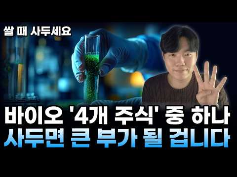

# 주식 — 성공 사례 분석: 사례별 자세히 #81–#111

`analysis.md` 의 9번 (같은 # 번호). 자동 생성 — `tools/success_analysis.py` v1.4.1 (2026-10-16 07:19 UTC). ※ 연구·교육용 — 투자 권유가 아님.

### 81. 나스닥100 1배수, 2배수, 3배수 20년 어떤 성과 보여주나(거치식, 적립식, 리벨런싱) ㅣ QQQ, QLD, TQQQ,

- https://www.youtube.com/watch?v=dQdACzI6nKE · 레버리지 하는 미국회계사 장기투자 여정 · 구독자 13,100 · 조회수 85,211 (×6.5, 하루 721.9) · 좋아요 2,117 (2.5%) · 16.3분 · 2026-06-20 · 주제 묶음 2. 장기투자·ETF·지수 · 형식 정보·해설 (그 밖) · 폴더 `W_dQdACzI6nKE` (웹 승인)
- 썸네일: 
- 챕터: 0:00 나스닥100 1배수, 2배수, 3배수 백테스트 시작 · 1:56 QQQ, QLD, TQQQ백테스트 조건 공개 (20년… · 2:48 QQQ, QLD, TQQQ 거치식 결과 — 2천만원,… · 7:46 QQQ, QLD, TQQQ 적립식 매수 결과 · 9:42 QQQ, QLD, TQQQ 리밸런싱 전략 결과 · 14:46 QQQ, QLD, TQQQ 3가지 투자방식 결론
- 설명 앞부분: QQQ, QLD, TQQQ — 20년 백테스트로 다 보여드립니다 1배, 2배, 3배 중에 도대체 뭘 모아야 하냐는 질문, 정말 많이 받았어요. 어떤 영상은 "1배가 국밥이다", 어떤 영상은 "3배 아니면 의미 없다" — 의견만 난무하고 진짜 데이터는 본 적이 없으실 거예요. 그래서 이번엔 20년치 실제 데이터로 끝까지 파봤습니다. 저는 미국 공인회계사이자 전직 펀드매니저입니다. 법인 계좌로 QLD를 메인으로 매일 매수하고 있고, 2022년 TQQQ -80% 폭락을 직접 겪고 2025년에 2~3배 수익으로 전량 매도한 경험이 있어요…
- 같은 채널 평소 대비 ×5.9 (채널 최근 롱폼 중앙값 14,492회) · 평소 영상: QLD 매일 매월 매수? 타이밍 보다 더 중요한 건 '언제 사서 언제 파느냐'다(QQQ,… (14,655회) / QLD랑 가장 잘 어울리는 배당주는 무엇인가 I SCHD, VYM, DGRO, VIG, … (14,329회)
- 대본 없음 (설명) — 음성인식이 끝나면 도입부·흐름이 들어감
- 댓글 388/388: 좋은 점 — 영상 21 · 감사·응원 51 · 더 알고 싶은 것 42 · 아쉬운 점 — 영상 0 · 반박·불만 — 의견 다름 4 · 정치·사회 1 · 경험 공유 25 · 구독·다음 기대 3
  - 좋은 점 — 영상 👍70 “저도 22년에 tqqq -80% 뚜드려맞아보고 qld를 매월 무지성적립식으로 하고있습니다. 그리고 200일 이평선 아래로 tqqq가 떨어지면 트리거로 생각해서 tqqq도 분할매수하고 있습니다. 좋은 영상 감사합니다.”
  - 좋은 점 — 영상 👍19 “와 많은 유튜버들이 하는 백테스트는 비슷했는데 이렇게하는건 유일하네요 질좋은 영상입니다”
  - 감사·응원 👍70 “저도 22년에 tqqq -80% 뚜드려맞아보고 qld를 매월 무지성적립식으로 하고있습니다. 그리고 200일 이평선 아래로 tqqq가 떨어지면 트리거로 생각해서 tqqq도 분할매수하고 있습니다. 좋은 영상 감사합니다.”
  - 감사·응원 👍29 “저는 얼마전부터 모아오던 QQQ를 QLD로 전환 매수했고 매달 월급날에 추매하는 장기 투자를 목표하고 있구요. 나스닥의 우상향을 믿지만 2배수라서 약간의 두려움도 있었는데 이 방송을 보고 나니 QLD가 더욱 든든해보입니다. 이렇게 좋은 방송을 공유해주셔서 진심으로 감…”
  - 더 알고 싶은 것 👍8 “백데이터는 환율이 상승했던 20년간인데요. 만약 현재 1500원대 환율이 900원대로 20년간 하락할 시의 시뮬레이션도 부탁드려봅니다. 모든 가정은 열어두어야 하니깐요. 앞으로도 환율이 고정 내지는 계속 상승할지는 알 수 없다고 생각해요. 수식을 잘 사용하시는 회계사…”
  - 더 알고 싶은 것 👍4 “추천 및 구독 하였습니다 Tqqq, qld, qqq 매월 적립식이 수익이 좋은데 만약 10년, 15년, 20년 매달 매수시 어느 계좌에 사야하나요? 그리고 미장에 직투 해야하나요? 국내 상장 나스닥을 해야하나요?”
  - 반박·불만 — 의견 다름 👍0 “영상 너무나 감사히 잘 보았습니다. 혹시 어느 일정부분 목표수익률이 났을때 매도 하고 기다렸다가 매도후 일정부분이 빠졌을때 다시 매수하고를 반복하면 어떤 결과가 나오는지도 궁금하네요^^ 22%로 세금등 때문에 말도 안돼는 설정일까요? 주린이라 ^^”
  - 정치·사회 👍2 “이게 맞는게 미국 우상향을 믿는다면 가능함 ㅋ 지금 버블이니 뭐니 하는데 실적도 따라오고 무엇보다 기준 금리가 이미 3.25%임 금리를 올린다해도 선반영이고 11월 트럼프 중간선거 이전이라 주식 부양해야됨 ㅋ 그래서 부랴부랴 이란 이스라엘 협력해라하는데 미국 쪽도 못…”
  - 경험 공유 👍70 “저도 22년에 tqqq -80% 뚜드려맞아보고 qld를 매월 무지성적립식으로 하고있습니다. 그리고 200일 이평선 아래로 tqqq가 떨어지면 트리거로 생각해서 tqqq도 분할매수하고 있습니다. 좋은 영상 감사합니다.”
  - 경험 공유 👍29 “저는 얼마전부터 모아오던 QQQ를 QLD로 전환 매수했고 매달 월급날에 추매하는 장기 투자를 목표하고 있구요. 나스닥의 우상향을 믿지만 2배수라서 약간의 두려움도 있었는데 이 방송을 보고 나니 QLD가 더욱 든든해보입니다. 이렇게 좋은 방송을 공유해주셔서 진심으로 감…”
  - 구독·다음 기대 👍29 “저는 얼마전부터 모아오던 QQQ를 QLD로 전환 매수했고 매달 월급날에 추매하는 장기 투자를 목표하고 있구요. 나스닥의 우상향을 믿지만 2배수라서 약간의 두려움도 있었는데 이 방송을 보고 나니 QLD가 더욱 든든해보입니다. 이렇게 좋은 방송을 공유해주셔서 진심으로 감…”
  - 구독·다음 기대 👍1 “(제가 숫자를 다시 수정하였어요. 예를들지 않고 영상속 나온 돈으로 그대로 계산했을경우로요. 답변 꼭 부탁드리겠습니다. 정말 감사드립니다) 제가 채널을 뒤늦게 알고, 영상 정주행하며 열공중입니다. 정말 절 10번 드리고싶어요. 너무 궁금한 부분을 속시원하게 검증해주시…”

### 82. 50대 노후준비 1억을 20억으로 만드는 가장 현실적인 3가지 전략 ∣ (ISA 계좌, S&P500)

- https://www.youtube.com/watch?v=hbBABRmu93Q · 만약에 머니 · 구독자 33,900 · 조회수 217,754 (×6.4, 하루 1,224.1) · 좋아요 2,956 (1.4%) · 21.2분 · 2026-04-21 · 주제 묶음 2. 장기투자·ETF·지수 · 형식 정보·해설 (그 밖) · 폴더 `W_hbBABRmu93Q` (웹 승인)
- 썸네일: 
- 챕터: 0:00 50대에 1억 모으신 분들이 가장 많이 하는 실수 · 1:45 전문가 10명 중 8명이 시장에 패배하는 이유 · 3:20 [전략 1] 시간을 아군으로: S&P 500의 마법 · 5:10 20년 뒤 1억이 20억으로 변하는 실제 시뮬레이션 · 7:30 [전략 2] 양동이 대신 파이프라인: 배당 ETF 세… · 10:15 [전략 3] 가장 확실한 수익: 연금저축/IRP/IS… · 13:40 지금 당장 실행해야 할 2가지 체크리스트
- 설명 앞부분: 50대에 어렵게 모은 1억, 그런데 왜 공부를 할수록 통장 잔고는 줄어들까요? 수십 명의 전문가를 거느린 펀드매니저조차 80% 이상이 시장 지수를 이기지 못한다는 사실을 알고 계셨나요? 열심히 종목을 분석하고 사고팔기를 반복하는 행위가 오히려 여러분의 노후를 망치고 있을지도 모릅니다. 오늘 영상에서는 뇌과학과 행동경제학적 관점에서 우리가 왜 투자를 망치는지 분석하고, 자산가들만 아는 '세금이 새지 않는 20억 파이프라인' 구축법을 공개합니다. 50대는 결코 늦지 않았습니다. 지금 바로 시작하세요. [타임라인]
- 대본 (자막, 4.3 음절/초) 첫 20초: “50대에 어렵게 1억 모으시고 지금도 매일 종목 분석하고 계시다면 오늘만큼은 그 손 멈추세요. 수십명의 애널리스트를 두고 하루 종일 시장만 보는 전문 펀드 매니저조차 10명 중 8명 이상이 SNP 500을 못 이깁니다. 열심히 공부할수록 오히려” — 도입부 유형: 숫자로 시작
- 첫 1분: “50대에 어렵게 1억 모으시고 지금도 매일 종목 분석하고 계시다면 오늘만큼은 그 손 멈추세요. 수십명의 애널리스트를 두고 하루 종일 시장만 보는 전문 펀드 매니저조차 10명 중 8명 이상이 SNP 500을 못 이깁니다. 열심히 공부할수록 오히려 더 빨리 읽는 구조거든요. 오늘이 세 가지 전략만 기억하시면 20년 뒤 1억이 20억으로 보이실 겁니다. 충격받으셨죠? 저도이 데이터를 처음 봤을 때 같은 기분이었어요. 겁들이려고 하는 말이 아닙니다. 지금이라도 아신게 다행인 거고 50대는 절대 늦은 나이가 아니거든요. 오늘 제가 확실하게 정리해 드릴게요. 안녕하세요. 어른들의 돈부 파트너 마약의 머니입니다. 오늘 크게 세 가지를 알려 드릴 거예요. 첫 번째 왜 50대에 1억 모으신 분들 중 대부분이 그 1억을 오히”
- 흐름 (90초마다 첫 문장): 0:00 50대에 어렵게 1억 모으시고 지금도 → 1:31 있도록 계좌 하나까지 구체적으로 알려 → 3:00 어떤 분들은 오픈 채팅방에도 → 4:32 내려가세요. 훨씬 편하게 훨씬 멀리 → 6:01 부를게요.이 이 지수의 장기 수익률이 → 7:31 물론이 전략도 쉽지만은 않습니다. → 9:00 자체를 굴려서 시세 차익만 노리세요. → 10:31 배당받고 이게 복리의 진짜 → 12:02 수령 시기가 계속 뒤로 밀리고 → 13:30 세금이랑 수수료를 다 떼고 나면 실제 → 15:02 받으시는 겁니다. 여기서 끝이 → 16:32 있습니다. 이게 왜 중요하냐면 사실상 → 18:01 먼저 보세요. 5년 안에 자녀 결혼 → 19:31 돈 걱정이 사라집니다. → 21:02 다음 영상 주제에 직접
- 댓글 139/139: 좋은 점 — 영상 4 · 감사·응원 11 · 더 알고 싶은 것 7 · 아쉬운 점 — 영상 3 · 반박·불만 — 의견 다름 1 · 정치·사회 0 · 경험 공유 3 · 구독·다음 기대 0
  - 좋은 점 — 영상 👍2 “손실 회피 편향을 비롯한 투자 심리의 함정을 아주 정확하게 짚어주셨네요. 단순히 종목 추천을 넘어 S&P 500 ETF 장기 투자와 ISA, IRP 계좌를 활용한 현실적인 절세 파이프라인 구축까지, 과장 없이 핵심만 깔끔하게 정리된 훌륭한 영상입니다. 좋은 인사이트 …”
  - 좋은 점 — 영상 👍1 “좋은 영상”
  - 감사·응원 👍10 “영상 넘 좋아요 수고하셨습니다 감사합니다”
  - 감사·응원 👍3 “감사합니다 😊”
  - 더 알고 싶은 것 👍31 “ISA계좌 개설후 ETF 투자하면 3년뒤 해지할때 ETF도 모두 매도하고 끝내야 되나요?”
  - 더 알고 싶은 것 👍1 “안녕하세요 저는 올해 59세 퇴직을 앞두고 있는 상황에 회사 사정으로 아버지가 딸에게 사업승계하면서 아버지 사업장의 퇴직금을 일반계좌로 1차로 3월 31일에 나머지를 4월 23일 오늘 33,60만원을 받았습니다 IRP계좌로 받으려고 생각했지만 사장이 물어보지도 않고 …”
  - 아쉬운 점 — 영상 👍3 “지수투자에 대한 믿음과 마인드 컨트롤이 힘든거죠..텐버거 종목 보고 있자면 그걸 못버팁니다..개인적으론 90%지수투자 엣지투자(재미용)10%정도하면 덜 지루하더군요~”
  - 아쉬운 점 — 영상 👍2 “손실 회피 편향을 비롯한 투자 심리의 함정을 아주 정확하게 짚어주셨네요. 단순히 종목 추천을 넘어 S&P 500 ETF 장기 투자와 ISA, IRP 계좌를 활용한 현실적인 절세 파이프라인 구축까지, 과장 없이 핵심만 깔끔하게 정리된 훌륭한 영상입니다. 좋은 인사이트 …”
  - 반박·불만 — 의견 다름 👍0 “어이없네 ㅋㅋ 대한민국에 거지없겠네 ㅋ”
  - 경험 공유 👍1 “안녕하세요 저는 올해 59세 퇴직을 앞두고 있는 상황에 회사 사정으로 아버지가 딸에게 사업승계하면서 아버지 사업장의 퇴직금을 일반계좌로 1차로 3월 31일에 나머지를 4월 23일 오늘 33,60만원을 받았습니다 IRP계좌로 받으려고 생각했지만 사장이 물어보지도 않고 …”
  - 경험 공유 👍0 “주식은 모른다....... 내 지인이 증권회사에서 30년 넘게 일한 사람이다.... 에코프로 5만원대.. 청주공장에서 불이 났었다... 그날 주가가 폭락해서 -30이었다. 그다음날 전화 상담하니 전부매도 하라 하더라..... 정확히 1년뒤 주당 150만원이 되더라..…”

### 83. QLD 직투 vs ISA, 잘 못 선택하면 10년 뒤 수천만 원 손해 봅니다.

- https://www.youtube.com/watch?v=vU5AK1FfCqQ · 돈재이 DONJAY · 구독자 19,800 · 조회수 121,465 (×6.1, 하루 987.4) · 좋아요 2,524 (2.1%) · 20.3분 · 2026-06-15 · 주제 묶음 10. 노후·연금 투자 · 형식 오디오북·낭독 (명언·인생조언) · 폴더 `W_vU5AK1FfCqQ` (웹 승인)
- 썸네일: 
- 설명 앞부분: ⭐안녕하세요, 본 채널은 저의 개인적인 투자 여정과 장기 투자 철학을 기록하는 공간입니다. 제가 겪은 시행착오와 시장을 바라보는 관점이 여러분의 투자 공부에 작은 참고가 되기를 희망합니다. 다만, 채널의 모든 콘텐츠는 정보 전달을 목적으로 제작되었습니다. 여러분의 성공적인 투자 여정을 응원합니다.
- 같은 채널 평소 대비 ×6.8 (채널 최근 롱폼 중앙값 17,757회) · 평소 영상: 수익률 200%차이? 적립식 투자 수익률 어떤 것이 더 높을까? 매일 사기 vs 매주 사… (17,847회) / 환율 계속 떨어지는데 QLD 투자해도 될까? 제 결론입니다 (17,667회)
- 대본 (자막, 5.4 음절/초) 첫 20초: “QLD에 투자해서 10억을 만들었습니다. 하지만이 이후에 정말 걱정되는 거 하나가 있죠. 세금. 세금을 어떻게 낼 것이냐? 만약에 계좌 선택을 잘못하게 되면 세금을 정말 왕창 뜯기게 될 수도 있거든요. 그렇기 때문에 정말 많은 분들이 걱정 고민하시는 거 직하는게 더 낫냐? ISA 계좌에서 시작하는게 더 낫냐? 여러분들이 만들어 놓은 큰 자산을” — 도입부 유형: 숫자로 시작
- 첫 1분: “QLD에 투자해서 10억을 만들었습니다. 하지만이 이후에 정말 걱정되는 거 하나가 있죠. 세금. 세금을 어떻게 낼 것이냐? 만약에 계좌 선택을 잘못하게 되면 세금을 정말 왕창 뜯기게 될 수도 있거든요. 그렇기 때문에 정말 많은 분들이 걱정 고민하시는 거 직하는게 더 낫냐? ISA 계좌에서 시작하는게 더 낫냐? 여러분들이 만들어 놓은 큰 자산을 최고로 많이 지킬 수 있는 계좌 둘 중에 하나 제가 딱 정해 드리도록 하겠습니다. 안녕하세요. 돈제입니다. 정말 많이 물어보십니다. 직에서 사야 돼요. ISA 계좌에서 사야 돼요. QLD 투자하고 싶은데 어느게 더 유리해요? 그냥 제가 바로 정해 드릴게요. 우선 QLD는 해외 ETF입니다. 그렇기 때문에 ISA 계좌에서 QLD는 매매가 불가능하죠. 대신 QLD와 거의”
- 흐름 (90초마다 첫 문장): 0:00 QLD에 투자해서 10억을 → 1:31 비용이 들어갑니다. 그래서 만약에 → 3:01 93.38달러라고 8달러라고 합니다. → 4:30 거기 때문에 사실 QLD던 타이거 → 6:01 아시죠? 횡보장에서도음 복리는 → 7:30 다음에 정말 달러가 필요할 때 어떻게 → 9:01 경우에는 국내상장, 타이거, 미국, → 10:31 나스닥백, 레버리지랑요 → 12:02 250만 원이 초과되면 양도 차익에 → 13:31 30만 원까지는 직가 괜찮습니다. → 15:00 가능합니다. 코덱스 미국 나스닥백 → 16:30 저는 다 하죠. ISA 기자 → 18:01 혜택은 한도가 있습니다. 왜? 한도가 → 19:30 톤을 낮춰서 말씀해 주시면 좋을 것
- 댓글 463/463: 좋은 점 — 영상 11 · 감사·응원 35 · 더 알고 싶은 것 44 · 아쉬운 점 — 영상 5 · 반박·불만 — 의견 다름 3 · 정치·사회 3 · 경험 공유 15 · 구독·다음 기대 3
  - 좋은 점 — 영상 👍9 “아주 좋은 정보네요”
  - 좋은 점 — 영상 👍7 “좋은 정보 감사합니다. 앞으로 원화 하락 계속 될테니 국내 상장 ETF로 나스닥 상승과 환율에서 2배로 먹겠습니다.”
  - 감사·응원 👍23 “감사합니다. 환차손까지 레버리지가 되는지 전혀 생각 못 했습니다.”
  - 감사·응원 👍18 “ISA투자 계속 지피티한테 물어봤는데도 답이 안나왔는데 이영상하나로 머리속이 깔끔해졌습니다 타이거로 가겠습니다 감사합니다”
  - 더 알고 싶은 것 👍5 “안녕하세요. 다름아니라 삼성증권 해외주식 팀에 전화로 문의했을때, tiger미국나스닥100레버리지 종목은 환율 2배 추종이 아닌, 1배 추종이라고 분명히 답변 받았었거든요. 나스닥 지수는 2배 추종이 맞지만, 환율은 1배를 따라간다라고 들었는데 무엇이 사실일까요? 환…”
  - 더 알고 싶은 것 👍4 “도움이 많이 되었습니다. 궁금한 점을 깔끔하게 설명해주시네요^^ ISA 올해 계좌한도가 다 차서 못하고 일단 이번 달부터 직투로 QLD 조금씩 매수 중입니다.^^ 내년에는 ISA 직투 반반씩 적립해 나가야 겠네요^^ 오픈채팉방이 다 찼네요 ㅠ 추가개설 부탁드립니다.”
  - 아쉬운 점 — 영상 👍9 “ISA는 소수점 안되는게 아쉽네요”
  - 아쉬운 점 — 영상 👍5 “장기로보고isa3년마다 해외직투계좌로 옮기고 해지후재가입 최대금액넣고 반복이 베스트라고봅니다 어느정도 지나 덩치가 커지면 현금흐름용 커버드콜을 isa 활용하면 건보료 상승없이 또 qld적립매수가능하구요”
  - 반박·불만 — 의견 다름 👍0 “(타이거 나스닥100 레버리지) h가 붙는건 노출이아닌데 왜? 붙은걸헷지라해?”
  - 정치·사회 👍8 “직투에서 달러 확보 얘기하는 사람은 진짜 나라가 붕괴해서 복구 불능 상태로 간다는 가정으로 하는거임 환 노출 모르는게 아니라”
  - 정치·사회 👍3 “ISA 단점 원금을 1억까지 밖에 못 넣는다. 언제가는 계좌 해지해야 하기때문에 복리가 깨진다. 직투 계좌 직접 매도 하기전까지는 무한정 매수가 가능하다 복리가 계속 불어난다. 결론 양도세 22퍼 내더라도 장기 투자시 수익율이 ISA 보다 직투가 높다 끝 ISA에서 …”
  - 경험 공유 👍47 “사람들이 잘 이해를 못하네... Isa 먼저 년 2천만원 채우고 남으면 직투로 qld하면 됨. 저도 같이 하는데 너무 좋은거 같아요. 빨리 5년에 1억 한국판qld채우는게 목표입니다”
  - 경험 공유 👍5 “신박한 주제라 신규유입(?)이 많아서 그런지 요상한 댓글이 많이 보이네요😂 저도 isa한도 다 채워지고 남으면 직투에 넣어요ㅎㅎ”
  - 구독·다음 기대 👍2 “잘봤어요 감사합니다! 구독했어요😊”
  - 구독·다음 기대 👍1 “구독했습니다 3번방 부탁드립니다”

### 84. "S&P500 ETF, 종목보다 '계좌'가 20년 뒤를 바꾸는 진짜 이유 (연금·ISA)"

- https://www.youtube.com/watch?v=fmQLRfIm28Y · 야무진 경제학 · 구독자 22,500 · 조회수 137,220 (×6.1, 하루 1,366.9) · 좋아요 3,514 (2.6%) · 28.4분 · 2026-07-07 · 주제 묶음 2. 장기투자·ETF·지수 · 형식 정보·해설 (그 밖) · 폴더 `W_fmQLRfIm28Y` (웹 승인)
- 썸네일: 
- 챕터: 0:00 종목은 담았는데 왜 내 계좌만 이 모양일까 · 2:19 원칙 ① 짐을 줄여라 — 종목이 많을수록 위험한 이유 · 5:02 원칙 ② 오래 메고 걸어라 — 매달 30만원 20년의… · 8:26 40세 시작 vs 50세 시작, 10년이 만든 격차 · 10:03 목돈 한 번에? 나눠서? 리밸런싱은 언제 · 10:44 우리가 가장 많이 하는 두 가지 오해 · 11:49 달콤한 함정 — 월배당·커버드콜의 진실 (금감원 경보) · 15:25 반전 — 짐이 아니라 '배낭'을 바꾸는 고수들 · 16:42 방수 배낭 ① 연금저축·IRP, 148만원 돌려받는 법 · 19:25 방수 배낭 ② ISA, 3년 유연 + 비과세 · 20:59 같은 상품 김 씨 vs 박 씨, 10년 뒤 잔고 차이 · 22:38 ISA를 연금으로 갈아타 혜택 두 번 챙기는 기술 · 24:04 꼭 알아야 할 주의점 — 중도해지 벌금 & ISA 한… · 25:47 오늘 걸어온 길 정리 — 짐이 아니라 배낭이 결과를 …
- 설명 앞부분: S&P500 ETF, 좋다는 종목만 열심히 담았는데 왜 내 계좌만 안 불어날까요? 문제는 '무엇을 담느냐'가 아니라 '어떤 계좌에 담느냐'입니다. 오늘은 ETF 투자를 배낭여행에 빗대, 20년 뒤 통장을 바꾸는 절세계좌(연금저축·IRP·ISA) 활용법을 한 번에 정리했습니다. 똑같은 미국 지수 ETF를 일반계좌(비닐봉지)에 담은 사람과 절세계좌(방수 배낭)에 담은 사람의 결과가 왜 갈리는지, 그리고 요즘 인기인 월배당·커버드콜의 숨은 함정(금융감독원 소비자경보)까지 짚습니다. 종목 압축, 복리의 시간, 절세계좌라는 세 가지 뼈대만…
- 같은 채널 평소 대비 ×12.2 (채널 최근 롱폼 중앙값 11,264회) · 평소 영상: "미국 ETF, 2026년엔 이 순서로 담으세요 (연금·IRP·ISA)" (11,287회) / "50대 노후 준비 10년째 못 하는 진짜 이유, 놓친 4가지" (11,242회)
- 대본 없음 (설명) — 음성인식이 끝나면 도입부·흐름이 들어감
- 댓글 115/115: 좋은 점 — 영상 6 · 감사·응원 9 · 더 알고 싶은 것 11 · 아쉬운 점 — 영상 2 · 반박·불만 — 의견 다름 0 · 정치·사회 0 · 경험 공유 4 · 구독·다음 기대 1
  - 좋은 점 — 영상 👍2 “노인초보자가 보기에 아주 핵심적이고 유익해서 구독 했어요❤😅😅 목소리도 좋아요”
  - 좋은 점 — 영상 👍2 “감사합니다 이해가 잘 되네요~~~”
  - 감사·응원 👍9 “감사드립니다 저두 5~6개 담고 있는데 정리하겠습니다”
  - 감사·응원 👍4 “감사합니다”
  - 더 알고 싶은 것 👍9 “연금계좌는 1년에 얼마까지입금(투자)가능한가요?”
  - 더 알고 싶은 것 👍4 “종합과세 때문에 isa 개설이 안되요..ㅜㅜ 비닐봉지에라도 담아야 할까요? 3년뒤 isa개설 가능해지면 그때 담는게 나을까요?”
  - 아쉬운 점 — 영상 👍5 “영상이 깔끔하고 편집이 잘 되어 있어서 보기 편하네요.”
  - 아쉬운 점 — 영상 👍2 “말을 너무 길게 늘림”
  - 경험 공유 👍3 “자식공부시키고 집산다고 그간 세월 다 보낸 60중반인 저희들은 어떻게해야하나요? 😢”
  - 경험 공유 👍1 “내가 들어보니 커버드콜 한번도 투자해 본적없고 주식투자경력10년도 안되었네...좃도 모르네...”
  - 구독·다음 기대 👍2 “구독, 좋아요 ,알림설정 다 눌렀습니다.서운해 하지 마세요~😅”

### 85. 나스닥 2배 QLD 무지성 적립식매수 vs. 공포탐욕지수 활용 매수 I QQQ, QLD, TQQQ, SOXL

- https://www.youtube.com/watch?v=V_RecmLncz4 · 레버리지 하는 미국회계사 장기투자 여정 · 구독자 13,100 · 조회수 74,758 (×5.7, 하루 1,327.2) · 좋아요 1,354 (1.8%) · 16.1분 · 2026-08-20 · 주제 묶음 2. 장기투자·ETF·지수 · 형식 정보·해설 (그 밖) · 폴더 `W_V_RecmLncz4` (웹 승인)
- 썸네일: 
- 챕터: 0:00 공포탐욕지수 활용한 매수 질문 · 1:45 공포탐욕지수란? + 백테스트 가정 · 5:17 공포탐욕지수 활용 전략 결과 · 6:33 레니프 유니백 체어 프로 제품 지원 영상 · 7:10 공포탐욕지수 최대 활용전략? · 10:01 공포탐욕지수 스윙 전략 · 14:08 공포탐욕지수 매수 결론
- 설명 앞부분: 레니프 유니백 체어 프로 10월 큰 할인 행사 · 10월 10일(토) 23:59까지 349,000원 (공식몰 399,000원) · 구매확정 시 2단 발받침대 증정 공포탐욕지수 보면서 비중 조절해서 매수하는 것과, 그냥 무지성으로 매일 적립식 매수하는 것. 둘 중 뭐가 더 나을까요? ⏱ 타임스탬프 이런 분들께 추천드려요 QLD, TQQQ 같은 레버리지 ETF로 적립식 투자 중이신 분 공포탐욕지수 활용법이 궁금하신 분 법인투자, 세금 효율화에 관심 있으신 분 📖 법인투자 무작정따라하기 (전자책) ⚠️ 저는 미국공인회계사(CPA)이며,…
- 같은 채널 평소 대비 ×5.2 (채널 최근 롱폼 중앙값 14,492회) · 평소 영상: QLD 매일 매월 매수? 타이밍 보다 더 중요한 건 '언제 사서 언제 파느냐'다(QQQ,… (14,655회) / QLD랑 가장 잘 어울리는 배당주는 무엇인가 I SCHD, VYM, DGRO, VIG, … (14,329회)
- 대본 없음 (설명) — 음성인식이 끝나면 도입부·흐름이 들어감
- 댓글 181/181: 좋은 점 — 영상 6 · 감사·응원 27 · 더 알고 싶은 것 18 · 아쉬운 점 — 영상 0 · 반박·불만 — 의견 다름 0 · 정치·사회 1 · 경험 공유 8 · 구독·다음 기대 1
  - 좋은 점 — 영상 👍6 “정말 궁금했던 부분을 알려주셔서 감사합니다~!! ❤”
  - 좋은 점 — 영상 👍6 “도움이 되는 좋은 영상이네요. 하지만, 안타깝게도 예전부터 세상에 좋은 장기 투자방법은 정말 많았지만, 그것을 실제로 실행해서 지키는 투자자는 세상에 1% 밖에 없음. 좋은 투자방법을 만들거나 찾는 것보다 뚝심과 끈기로 꾸준히 지키는 것이 천배, 만배 더 어렵고 중요…”
  - 감사·응원 👍9 “매주 소수점이라도 시작해 보겠습니다. 훌륭한 데이타 감사합니다.”
  - 감사·응원 👍7 “어떻게 제가 딱 원하는 영상인지 감사합니다 꾸준히 사다가 많이 떨어질 때 더 사야겠어요ㅋㅋㅋㅋㅋㅋ 그냥 제 심신의 안정을 위하여”
  - 더 알고 싶은 것 👍2 “영상 감사히 보았습니다 올려주신 qld+tq스윙과 무지성 tq 매일 적립도 한번 비교해주실 수 있나요?”
  - 더 알고 싶은 것 👍1 “혹시 카메라랑 마이크 어떤거 쓰시는지 알 수 있을까요?”
  - 정치·사회 👍0 “미국회계사시라고 해서 기대했는데... 송팀장 이라는 채널이 있는데 어제 올라온 35년 백테스트 영상 참고해보시면 좋을것 같아요”
  - 경험 공유 👍13 “무지성으로 1년째모으고있는데 환차손 때문에 몇천손해중..”
  - 경험 공유 👍7 “어떻게 제가 딱 원하는 영상인지 감사합니다 꾸준히 사다가 많이 떨어질 때 더 사야겠어요ㅋㅋㅋㅋㅋㅋ 그냥 제 심신의 안정을 위하여”
  - 구독·다음 기대 👍0 “미국 회계사님 유투브 최근에 알게되서 구독하고 열심히 보고 있습니다. 현재 캘리 OC 에 거주하는데 라이브방송 보는데 캘리포니아에서 사셧다고 해서 반가웠습니다 ㅎㅎ 미국에 거주하시면서 투자하는 유투버분 들이 별로 없어서 미국에서 투자할때 절세나 연금관련부분이 한국과 …”

### 86. 삼성전자 투자자분들 주목하셔야합니다 실적은 사상 최대인데 주가는 왜 못 따라갈까? 목표가 48만원·150조 주주환원 총정리했습니다! #삼성전자 #삼성전자주가

- https://www.youtube.com/watch?v=0ftjA5wsqtQ · 코스피 읽는 개미 · 구독자 2,230 · 조회수 12,661 (×5.7, 하루 108.1) · 좋아요 357 (2.8%) · 18.6분 · 2026-06-21 · 주제 묶음 6. 종목 고르기·분석 · 형식 정보·해설 (그 밖) · 폴더 `W_0ftjA5wsqtQ` (웹 승인)
- 썸네일: 
- 설명 앞부분: [영상 요약] 하나증권이 삼성전자 목표주가를 48만 원으로 상향했습니다. 그 이유는 AI 반도체 수요 확대에 따른 D램·LPDDR 가격 강세, 그리고 예상보다 강한 실적 개선 때문입니다. 특히 올해 2분기 영업이익은 시장 기대를 크게 웃도는 수준으로 전망되고 있습니다. 또한 삼성전자의 막대한 현금 창출력을 바탕으로 최대 150조 원 규모의 주주환원(배당·자사주 매입) 가능성이 제기되면서 투자자들의 관심이 집중되고 있습니다. 목표주가 48만 원 상향 배경 AI 메모리 시장 성장과 HBM 전망 150조 원 주주환원의 의미 삼성전자 주…
- 같은 채널 평소 대비 ×29.1 (채널 최근 롱폼 중앙값 436회) · 평소 영상: [ 삼성전자 ] 대폭발 시작되나? 반도체 수출 150% 급증…주가 대반전 "신호" 떴다! (451회) / 삼성전자 이익 역대 최대인데 아직 27만원... 언제 터질지 알려드리겠습니다 (420회)
- 대본 없음 (설명) — 음성인식이 끝나면 도입부·흐름이 들어감
- 댓글 17/17: 좋은 점 — 영상 0 · 감사·응원 0 · 더 알고 싶은 것 0 · 아쉬운 점 — 영상 0 · 반박·불만 — 의견 다름 1 · 정치·사회 0 · 경험 공유 0 · 구독·다음 기대 2
  - 반박·불만 — 의견 다름 👍3 “무슨 헛소리를? 세계 증권사에서 4.3프로 주주환원의 현금배당을 한 적이나 있나요? 연구개발비랑 투자비는 어찌하고 무슨 주주환원이라고 삼성에서는 하지도 않은 말을 자기들 멋대로 헛소리를 하는지 참”
  - 구독·다음 기대 👍2 “구독완료”
  - 구독·다음 기대 👍0 “구독완료”

### 87. These 2 NEW Weekly Dividend ETFs Are Beating Monthly Income

- https://www.youtube.com/watch?v=-K8-ccMcIBE · Jake Wealth Hacks · 구독자 6,700 · 조회수 37,249 (×5.6, 하루 222.4) · 좋아요 863 (2.3%) · 10.6분 · 2026-05-01 · 주제 묶음 2. 장기투자·ETF·지수 · 형식 정보·해설 (그 밖) · 폴더 `W_-K8-ccMcIBE` (웹 승인)
- 썸네일: 
- 설명 앞부분: Two brand-new weekly dividend ETFs from Global X just launched — EDGX and EDGQ — and after 10 weeks of tracking their performance, they're doing something almost no other weekly-paying covered call fund has managed: holding NAV without bleeding your principal. Weekly dividend ETFs are gaining massi…
- 대본 (자막, 0.0 음절/초) 첫 20초: “Picture this. It's a Friday afternoon. Your phone buzzes. A dividend just hit your account. $47.83. Not monthly, not quarterly, weekly. Now, here's the problem most people run into with weekly dividend ETFs. By the time they've collected 6 months of those Friday payouts, their share price has”
- 첫 1분: “Picture this. It's a Friday afternoon. Your phone buzzes. A dividend just hit your account. $47.83. Not monthly, not quarterly, weekly. Now, here's the problem most people run into with weekly dividend ETFs. By the time they've collected 6 months of those Friday payouts, their share price has quietly bled out 18%, 22%, sometimes more. The income looked real, the math didn't add up. I've been watch”
- 흐름 (90초마다 첫 문장): 0:00 Picture this. It's a Friday afternoon. → 1:30 paying you every single Friday. We're → 3:00 door. That's the gap. That's the problem → 4:31 genuinely promising. Now, look, I always → 6:02 invested if you choose the weekly paying → 7:30 steps up to 50 basis points, which is → 9:00 say is that they're credible → 10:31 give this video a like. It tells me
- 댓글 79/79: 좋은 점 — 영상 0 · 감사·응원 0 · 더 알고 싶은 것 0 · 아쉬운 점 — 영상 0 · 반박·불만 — 의견 다름 0 · 정치·사회 0 · 경험 공유 0 · 구독·다음 기대 0

### 88. 주식 공부부터 하면 지칩니다. 6년 투자 후 깨달은 것) #50대투자 #월배당etf #레버리지etf

- https://www.youtube.com/watch?v=0cS1EHLkDiQ · 50대 투자 라이프 · 구독자 2,560 · 조회수 14,106 (×5.5, 하루 372.3) · 좋아요 151 (1.1%) · 6.9분 · 2026-09-08 · 주제 묶음 9. 빚투·레버리지 · 형식 정보·해설 (그 밖) · 폴더 `W_0cS1EHLkDiQ` (웹 승인)
- 썸네일: 
- 설명 앞부분: 주린입니다.
- 같은 채널 평소 대비 ×5.5 (채널 최근 롱폼 중앙값 2,559회) · 평소 영상: 자산 7억 모으고 바뀐 2가지와 이번주 SOXL 수익률 900%로 일부 매도 이야기 #S… (2,559회) / 1년 만에 금융자산 4억에서 7억이 된 이유(50대 직장인 투자 습관) #레버리지etf … (2,461회)
- 대본 없음 (설명) — 음성인식이 끝나면 도입부·흐름이 들어감
- 댓글 20/20: 좋은 점 — 영상 2 · 감사·응원 2 · 더 알고 싶은 것 0 · 아쉬운 점 — 영상 0 · 반박·불만 — 의견 다름 0 · 정치·사회 0 · 경험 공유 0 · 구독·다음 기대 1
  - 좋은 점 — 영상 👍0 “초보에게 맘에 와닿는 얘기네요.”
  - 좋은 점 — 영상 👍0 “옳은 말씀이네요.”
  - 감사·응원 👍0 “항상 부지런 하시네요~ 화이팅~^#♡♡”
  - 감사·응원 👍0 “주식 고수이십니다 화이팅!!!!!”
  - 구독·다음 기대 👍1 “일부이겠지만 보유하신 종목 보니 야수의 심장을 가지셨네요 투자 스타일이 저랑 비슷하신 거 같아 구독합니다^^”

### 89. Dividen Rp1 Juta Sebulan: Modal Berapa dan Mulainya dari Mana?

- https://www.youtube.com/watch?v=PBRF4yYyjx4 · STRATEGI FINANSIAL · 구독자 20,500 · 조회수 99,744 (×4.9, 하루 578.9) · 좋아요 1,158 (1.2%) · 22.1분 · 2026-04-27 · 주제 묶음 기타 · 형식 정보·해설 (그 밖) · 폴더 `W_PBRF4yYyjx4` (웹 승인)
- 썸네일: 
- 설명 앞부분: Disclaimer : Video ini dibuat hanya untuk tujuan edukasi dan literasi keuangan, bukan ajakan membeli atau menjual saham tertentu. Semua contoh perhitungan dividen bersifat simulasi dan dapat berubah sesuai kondisi pasar, kinerja emiten, kebijakan dividen, serta profil risiko masing-masing investor.…
- 대본 없음 (설명) — 음성인식이 끝나면 도입부·흐름이 들어감
- 댓글 212/212: 좋은 점 — 영상 0 · 감사·응원 0 · 더 알고 싶은 것 0 · 아쉬운 점 — 영상 0 · 반박·불만 — 의견 다름 0 · 정치·사회 0 · 경험 공유 0 · 구독·다음 기대 0

### 90. 경제공부 시작하는 법 ∣ 하루 10분이면 됩니다! (해야하는 이유) 🗞️ 📊 💸

- https://www.youtube.com/watch?v=z7fHe2Og-zE · 찌니ZZINI · 구독자 30,600 · 조회수 144,168 (×4.7, 하루 867.6) · 좋아요 0 (0.0%) · 17.5분 · 2026-05-03 · 주제 묶음 1. 주식 기초·초보 · 형식 정보·해설 (그 밖) · 폴더 `W_z7fHe2Og-zE` (웹 승인)
- 썸네일: 
- 챕터: 0:00 영상시작 · 0:12 경제공부 하는 이유? · 2:56 어피니 머니레터 · 5:24 매일경제신문 · 13:42 유튜브/팟캐스트 · 14:18 경제책 · 16:10 디그 · 16:44 마무리
- 설명 앞부분: 다이어리는 meeplus에서 제공받아 촬영되었습니다. 🔻다이어리 + 속지 어느덧 매일경제신문을 읽은지 1년이 다되어가네요 ! 꾸준히 10분씩만 하자였는데 1년을 하게 되었어요 경제공부를 해야하는 이유 투자, 부동산매매가 아니더라도 제가 느낀 이유가 있었어요. 하루 10분만 투자하기 초보자도 누구나 가능 ! 누구나 쉽게 할수있게 제가 정리를 했어요. 영상으로 만들었으니 재미있게 봐주세요 🙂
- 같은 채널 평소 대비 ×9.1 (채널 최근 롱폼 중앙값 15,906회) · 평소 영상: 📓 요즘 내가 좋아하는 다이어리, 모텀 ∣ 프로퍼빌롱잉즈 단테 1달 써봤다! (15,906회) / Vlog ∣ 다이어리 그만좀 사 ∣ 한정선 맛있나..❓∣ 모닝페이지, 경제공부 ∣ 양귀자… (14,843회)
- 대본 없음 (설명) — 음성인식이 끝나면 도입부·흐름이 들어감
- 댓글 147/147: 좋은 점 — 영상 11 · 감사·응원 22 · 더 알고 싶은 것 14 · 아쉬운 점 — 영상 1 · 반박·불만 — 의견 다름 0 · 정치·사회 1 · 경험 공유 6 · 구독·다음 기대 3
  - 좋은 점 — 영상 👍311 “신문사에서 가장 중요하게 생각하는 페이지의 순서는 1> 3면이라고 합니다. 그래서 1면의 심층기사가 3면에 계속되는게 보통이라고 들었습니다. 저는 1,3,world,market 섹션은 꼭 읽고 나머지는 시간이 되면 읽는 편입니다. 못읽는날도 스트레스 없이 그냥 넘기고…”
  - 좋은 점 — 영상 👍111 “안녕하세요 늘 영상 잘 보고 있습니다^^ 하나 꿀팁 드리면 press reader 앱 사용하면 매일경제신문 무료로 읽는거 가능합니다 다른 신문도 볼 수 있어요 저는 제가 졸업한 대학교 이메일 계정으로 이용 중이에요^^ 저도 경제공부 열심히 해봐야겠어요 큰 도움 되는 …”
  - 감사·응원 👍111 “안녕하세요 늘 영상 잘 보고 있습니다^^ 하나 꿀팁 드리면 press reader 앱 사용하면 매일경제신문 무료로 읽는거 가능합니다 다른 신문도 볼 수 있어요 저는 제가 졸업한 대학교 이메일 계정으로 이용 중이에요^^ 저도 경제공부 열심히 해봐야겠어요 큰 도움 되는 …”
  - 감사·응원 👍69 “경제 공부 시작하려고 했는데 이렇게 좋은 타이밍에 좋은 영상을 발견했네요! 귀한 정보 알려주셔서 너무 감사하고 참고해서 열심히 공부해보겠습니다!!”
  - 더 알고 싶은 것 👍5 “정말 세세하네요 신문 보기 시작하는데 어떻게 봐야하는지 몰라서 매번 중간 포기했는데 너무 좋은거같아요! 궁금한점은 하루 몇시간 투자해서 공부하시나요? 저는 아침에유튜브로 한경을 보고 머니레터만 보고있는데 확 공부가 된다는 느낌이 없네요😢”
  - 더 알고 싶은 것 👍3 “저는 해외에 살아서 추천해주신 신문들은 못봐서 여기신문으로 시작할려고 하는데 질문있어요. 모르는 경제용어같은건 어떤식으로 배우시나요? 경제에 대해서 1도 몰라서 처음에는 가볍게 시작하고 싶은데 처음부터 너무 깊이 들어갈까하는 고민이있어요. 그리고 읽어도 뉴스의 흐름을…”
  - 아쉬운 점 — 영상 👍311 “신문사에서 가장 중요하게 생각하는 페이지의 순서는 1> 3면이라고 합니다. 그래서 1면의 심층기사가 3면에 계속되는게 보통이라고 들었습니다. 저는 1,3,world,market 섹션은 꼭 읽고 나머지는 시간이 되면 읽는 편입니다. 못읽는날도 스트레스 없이 그냥 넘기고…”
  - 경험 공유 👍311 “신문사에서 가장 중요하게 생각하는 페이지의 순서는 1> 3면이라고 합니다. 그래서 1면의 심층기사가 3면에 계속되는게 보통이라고 들었습니다. 저는 1,3,world,market 섹션은 꼭 읽고 나머지는 시간이 되면 읽는 편입니다. 못읽는날도 스트레스 없이 그냥 넘기고…”
  - 경험 공유 👍111 “안녕하세요 늘 영상 잘 보고 있습니다^^ 하나 꿀팁 드리면 press reader 앱 사용하면 매일경제신문 무료로 읽는거 가능합니다 다른 신문도 볼 수 있어요 저는 제가 졸업한 대학교 이메일 계정으로 이용 중이에요^^ 저도 경제공부 열심히 해봐야겠어요 큰 도움 되는 …”
  - 구독·다음 기대 👍2 “경제 공부 시작하는 법이라니 어떻게 해야 하는지 궁금하네요 입술에 피어싱을 하셧다니...놀랍네요 주변에 입술 피어싱 한분을 한분도 못봤다 보니 더 신기하고 놀라워요 경제 공부를 시작하신 이유가 더 현실적으로 와 닿네요 내 월급은 조금뿐이 안 올렸는데 계란값만 3배라니…”
  - 구독·다음 기대 👍1 “이 영상으로 처음 뵙는데 구독하고 갈게요! 이북리더기 탐나네요,ㅎㅎㅋㅋㅋ 원래 쓰던게 고장나서 새로 사야하나싶었는데,,,, 어디꺼쓰시나요?! 이뻐서 따라사고싶어용 ㅎㅎ”

### 91. 206. 사지말아야 할 커버드콜 ETF가 있습니다

- https://www.youtube.com/watch?v=wJWVgIVC7RI · 배당머니 : 숫자로 증명하는 ETF · 구독자 23,800 · 조회수 111,906 (×4.7, 하루 2,314.6) · 좋아요 1,452 (1.3%) · 19.2분 · 2026-08-28 · 주제 묶음 2. 장기투자·ETF·지수 · 형식 정보·해설 (그 밖) · 폴더 `W_wJWVgIVC7RI` (웹 승인)
- 썸네일: 
- 챕터: 0:00 인트로 · 2:58 피해야 할 커버드콜 2개 · 4:15 미스매칭 커버드콜 사례 · 7:27 커버드콜의 옵션 자산 · 11:52 KODEX 미국나스닥100데일리커버드콜OTM · 12:54 TIGER vs KODEX 커버드콜 비교 · 17:34 결론
- 설명 앞부분: 커버드콜 ETF는 최근 투자자들 사이에서 필수 선택지 중 하나로 자리잡혔습니다. 특히 은퇴자분들께 큰 인기를 끌고 있는 상품들인데요. 주로 추천하는 커버드콜 ETF들을 말씀드려왔지만 오늘 영상에서는 제가 생각하기에 확률적으로 좋지 못한 구조인 상품들을 두가지 말씀드려봅니다.
- 같은 채널 평소 대비 ×6.4 (채널 최근 롱폼 중앙값 17,412회) · 평소 영상: 174. 나스닥 커버드콜 논란 종결, 숫자로 보여드립니다 (17,537회) / 192. 특별배당하고 있는 5개의 ETF, 지금이 기회입니다 (17,288회)
- 대본 없음 (설명) — 음성인식이 끝나면 도입부·흐름이 들어감
- 댓글 140/142: 좋은 점 — 영상 12 · 감사·응원 25 · 더 알고 싶은 것 9 · 아쉬운 점 — 영상 0 · 반박·불만 — 의견 다름 1 · 정치·사회 0 · 경험 공유 7 · 구독·다음 기대 0
  - 좋은 점 — 영상 👍7 “ETF를 설명하는 유튜브 채널중에 이 채널이 ETF에 대해 가장 심층적으로 분석해서 실제 투자에 도움이 많이 될것라고 추천을 자주 하고 다니는데, 조회수와 좋아요가 많이 증가하는 것 같아서 좋네요^^ 오늘도 좋은 영상 고맙습니다.”
  - 좋은 점 — 영상 👍4 “정말로 유익한 내용이었습니다 감사합니다”
  - 감사·응원 👍7 “ETF를 설명하는 유튜브 채널중에 이 채널이 ETF에 대해 가장 심층적으로 분석해서 실제 투자에 도움이 많이 될것라고 추천을 자주 하고 다니는데, 조회수와 좋아요가 많이 증가하는 것 같아서 좋네요^^ 오늘도 좋은 영상 고맙습니다.”
  - 감사·응원 👍6 “단순히 그냥 본주 추종 커버드콜이라 생각했는데 진짜 제대로 알고 갑니다 ㄷㄷ;; 슈드는 진짜 생각도 못했어요.. 잘보고 갑니다 많이 배워요 감사합니다”
  - 더 알고 싶은 것 👍5 “잘 들었는데요. kodex 미국나스닥100데일리커버드콜OTM에 대하여, 배당머니께서 2026.1.30. '방어력 치중이나 조만간 나스닥이 조정/횡보를 예상한다면 좋은선택지'가 될 수 있다고 하셨는데, 현재는 위 조건 예상을 벗어나서 사지말아야 한다고 하신건가요? 궁금…”
  - 더 알고 싶은 것 👍4 “좀 더 간략하고 핵심위주로 설명해주셨으면 해요. 살짝 장황한 느낌이 그래서 스킵하면서 보게 된다는”
  - 반박·불만 — 의견 다름 👍1 “커버드콜도 하나의 주식입니다. 사고 파는 거에요. 무조건 평단 낮게 관리하는게 최선이고. 사놓고 방치하면 알아서 되는게 아닙니다. 사팔사팔하지 마라는데 좋게 얘기하면 리벨런싱 (사팔,비중조절) 해야해요”
  - 경험 공유 👍10 “제가 보유 중인 종목이 나올까봐 영상 보기 전부터 두근두근.... 😂 다행이 둘 다 아니네요. 😊”
  - 경험 공유 👍3 “저도 TIGER 미국배당다우존스 타겟데일리커버드콜이 숨은 꿀 ETF라고 생각했는데 소개되어서 반갑네요 ㅎㅎ 차트보니 심지어 일반 미국배당다우존스보다 상승률도 좋고 배당도 월등하더라구요~”

### 92. QLD로 10억 만들고 싶다면, 적어도 이 영상 정도는 보세요.

- https://www.youtube.com/watch?v=5vLF2oLQZ_c · 돈재이 DONJAY · 구독자 19,800 · 조회수 91,850 (×4.6, 하루 646.8) · 좋아요 2,160 (2.4%) · 53.2분 · 2026-05-27 · 주제 묶음 2. 장기투자·ETF·지수 · 형식 오디오북·낭독 (명언·인생조언) · 폴더 `W_5vLF2oLQZ_c` (웹 승인)
- 썸네일: 
- 설명 앞부분: ⭐안녕하세요, 본 채널은 저의 개인적인 투자 여정과 장기 투자 철학을 기록하는 공간입니다. 제가 겪은 시행착오와 시장을 바라보는 관점이 여러분의 투자 공부에 작은 참고가 되기를 희망합니다. 다만, 채널의 모든 콘텐츠는 정보 전달을 목적으로 제작되었습니다. 여러분의 성공적인 투자 여정을 응원합니다.
- 같은 채널 평소 대비 ×5.1 (채널 최근 롱폼 중앙값 17,847회) · 평소 영상: 수익률 200%차이? 적립식 투자 수익률 어떤 것이 더 높을까? 매일 사기 vs 매주 사… (17,847회) / 환율 계속 떨어지는데 QLD 투자해도 될까? 제 결론입니다 (17,667회)
- 대본 (자막, 5.7 음절/초) 첫 20초: “QLD를 투자하시려는 정말 많은 분들이 계십니다. 심지어 제 영상을 보고 나도 이제 QLD 투자해야 되겠다고 생각하신 분들도 많으시죠. 하지만 저는 QLD 투자를 권장하지 않습니다. 권하지도 않고요. 추천하지도 않습니다. 이유는 단순합니다. 레버리지이기 때문이죠. 변동성이 굉장히 크기 때문에 마음을 다잡고 들어가지 않으면 손해만 보고”
- 첫 1분: “QLD를 투자하시려는 정말 많은 분들이 계십니다. 심지어 제 영상을 보고 나도 이제 QLD 투자해야 되겠다고 생각하신 분들도 많으시죠. 하지만 저는 QLD 투자를 권장하지 않습니다. 권하지도 않고요. 추천하지도 않습니다. 이유는 단순합니다. 레버리지이기 때문이죠. 변동성이 굉장히 크기 때문에 마음을 다잡고 들어가지 않으면 손해만 보고 시작해서 떠날 확률이 굉장히 높습니다. 그래서 저는 추천드리지 않습니다. 하지만 그럼에도 불구하고 나는 QLD를 투자하고 싶다라고 생각하시는 분들이 있을 것 같아서 그렇다면 추천도 하지 않는 제가 어째서 QLD를 투자하기로 결심했는지 특히나 미국 나스닥 100백에 투자하기로 결정했는지 그 이유를 자세하게 알려 드리도록 하겠습니다. 아마이 영상을 끝까지 보시면 확실해질 가능성이”
- 흐름 (90초마다 첫 문장): 0:00 QLD를 투자하시려는 정말 많은 → 1:30 계산한 값들을 전달해 드린다면 혹시나 → 3:00 만들어 내지 못하기 때문에 재개 → 4:32 그런데 20년 중에 최고의 날 딱 → 6:00 수익률뿐만 아니라 안정성 측면에서도 → 7:31 주력으로 하는 그리고 세계 최고 → 9:00 모르겠습니다.이 주식에 10년 동안 → 10:30 끝까지 버티실 수 있을까요? 물론이 → 12:01 그걸 이어간다면 결국에 우리는 높은 → 13:30 이게 가능하려면 내가 투자한 종목 → 15:00 있는 곳은 한국과 미국밖에 없거든요. → 16:30 버블면 어떻게 할 건데 의문을 → 18:02 2.66% 대략 더하면 50%에서 → 19:31 앞으로 한 10년간은 나스닥보다도 → 21:00 있는게 한국 주식이기 때문에 저는 좀 → 22:30 있습니다. 하지만 정말 좋은 건 → 24:01 영어권 문화 아니면은 K화거든요. → 25:30 GTP로 했거든요. 여기 한번 → 27:00 시가 총액의 차이도 크고요. 훈익 → 28:31 그리고 데이터 센터가 있을 거고요.
- 댓글 333/333: 좋은 점 — 영상 17 · 감사·응원 51 · 더 알고 싶은 것 13 · 아쉬운 점 — 영상 6 · 반박·불만 — 의견 다름 1 · 정치·사회 0 · 경험 공유 24 · 구독·다음 기대 5
  - 좋은 점 — 영상 👍11 “긴 영상 감사합니다. 전 tq가 주력이지만 같은 나스닥이라 도움이 많이 되었습니다.😊😊”
  - 좋은 점 — 영상 👍8 “많은 노력이 들어간 정말 좋은 영상입니다. 전혀 지겹지 않았습니다. 귀한 정보 나눠주셔서 감사합니다.”
  - 감사·응원 👍18 “지루하지 않게 정말 잘 시청했습니다 감사합니다”
  - 감사·응원 👍18 “진작 QLD생각 많이 하고 조금 씩 사모으고 있는중 영상알게되어 넘 기쁨니다 감사합니다~^^”
  - 더 알고 싶은 것 👍3 “isa에서 tiger미국나스닥100레버리지 하는건 어떤가요?”
  - 더 알고 싶은 것 👍3 “혹시 매일못살경우 한달에한번은 어떤가요? 아님 일주일에한번정도”
  - 아쉬운 점 — 영상 👍18 “지루하지 않게 정말 잘 시청했습니다 감사합니다”
  - 아쉬운 점 — 영상 👍3 “1. 장기투자 이유 2. 개별주 안하고 지수투자 하는 이유 3. 미국 주식 하는 이유 4. 개별주보단 지수추종 하는 이유 5. 슨피500이랑 나스닥 100중에 뭘 선택했는가 내용 요약하면 이런데 뭐랄까 사실 걍 간단하게 말할 수 있는 것을 너무 길게 말했다 느낌..?…”
  - 경험 공유 👍8 “제가 한 생각과 거의 완벽히 일치하네요.. 저도 돌고돌아 QLD로 정착했는데 그 과정에서 느낀점이 똑같네요”
  - 경험 공유 👍7 “잘들었습니다. 길다 느껴지지않았습니다. TQqq, 6년차, QLD4개월차인데 너무 빨리 많이 올라가서 주춤하고 있습니다.”
  - 구독·다음 기대 👍5 “정주행 했습니다❤️”
  - 구독·다음 기대 👍2 “저도 젊음을 잃기 전 10억을 모으는 것이 목표인데, QQQM으로 만족이 안 돼서 QLD를 힐끗거리다가 이 영상을 접하게 됐어요. 치열하게 고민하신 과정을 공유해 주셔서 감사합니다. 50분 영상이 짧게 느껴지네요. 구독하고 갑니다!”

### 93. 5 High Dividend Stocks That Could Pay Your Monthly Rent By 2030

- https://www.youtube.com/watch?v=Y78TMfV12ic · Invest Like Baniya  · 구독자 15,900 · 조회수 73,207 (×4.6, 하루 547.1) · 좋아요 1,845 (2.5%) · 12.5분 · 2026-06-04 · 주제 묶음 기타 · 형식 정보·해설 (그 밖) · 폴더 `W_Y78TMfV12ic` (웹 승인)
- 썸네일: 
- 설명 앞부분: 5 High Dividend Stocks That Could Pay Your Monthly Rent By 2030 Invest Like Baniya Every month without fail. Salary arrives. Rent leaves. The biggest drain on every Indian urban professional happening automatically before you can do anything about it. But what if five stocks paid that rent instead …
- 대본 없음 (설명) — 음성인식이 끝나면 도입부·흐름이 들어감
- 댓글 103/103: 좋은 점 — 영상 0 · 감사·응원 0 · 더 알고 싶은 것 0 · 아쉬운 점 — 영상 0 · 반박·불만 — 의견 다름 0 · 정치·사회 0 · 경험 공유 0 · 구독·다음 기대 0

### 94. 배당으로 사는 은퇴자가 법인을 만든 이유 5가지

- https://www.youtube.com/watch?v=kidc-Cza18s · 은퇴머니 - 은퇴 현금흐름 설계 · 구독자 30,000 · 조회수 137,307 (×4.6, 하루 2,049.8) · 좋아요 1,524 (1.1%) · 10.7분 · 2026-08-10 · 주제 묶음 3. 배당 · 형식 정보·해설 (그 밖) · 폴더 `W_kidc-Cza18s` (웹 승인)
- 썸네일: 
- 챕터: 0:00 은퇴 전에 법인을 만든 이유 · 2:06 금융소득 2,000만원 기준 · 3:27 건강보험료 차이 · 4:40 받는 시점을 정하는 방법 · 5:39 손실 이월 · 6:25 비용 인정 · 7:58 법인 투자에 대한 반론 · 9:11 다섯 가지 정리와 다음 편 예고
- 설명 앞부분: 배당으로 은퇴 현금흐름을 만들면 세금과 건강보험료를 함께 고민하게 됩니다. 제가 은퇴 전에 1인 법인을 만든 이유를 다섯 가지로 정리했습니다. 금융소득 종합과세, 건강보험료, 받는 시점, 손실 이월과 비용 인정까지 살펴봅니다. 법인 투자가 누구에게나 유리한 것은 아닙니다. 실제 결정 전에는 본인 상황을 세무 전문가와 확인하시기 바랍니다. 영상 타임라인 📑 영상 PPT 자료 영상 내용을 정리한 슬라이드를 웹에서 바로 보고, PDF로도 내려받을 수 있습니다.
- 같은 채널 평소 대비 ×9.6 (채널 최근 롱폼 중앙값 14,261회) · 평소 영상: ETF 포트폴리오, 은퇴 전에 확인해야 할 또 하나의 기준 (14,261회) / 은퇴 포트폴리오가 사람마다 다른 이유 (12,966회)
- 대본 없음 (설명) — 음성인식이 끝나면 도입부·흐름이 들어감
- 댓글 70/70: 좋은 점 — 영상 5 · 감사·응원 9 · 더 알고 싶은 것 4 · 아쉬운 점 — 영상 1 · 반박·불만 — 의견 다름 2 · 정치·사회 1 · 경험 공유 8 · 구독·다음 기대 2
  - 좋은 점 — 영상 👍15 “법인 운용을 고민 하는 가장 큰 이유는 건강보험료 아닌가요? 어지간한 자산가가 아니고선 법인 운영을 할 필요는 없어요. 그리고 투자를 위한 자금을 법인에 넣었다면 다시 빼오는것도 가능해요. 법인에 돈을 넣고 투자를 해서 수익을 본 자금이 법인소득이라면 그 금액을 따지…”
  - 좋은 점 — 영상 👍9 “영상 정보 고맙습니다. 저도 은퇴후 건보료 문제로 투자법인을 해야할지 고민입니다. 도움이 많이 되었습니다. 후속편 기대됩니다.”
  - 감사·응원 👍15 “법인 운용을 고민 하는 가장 큰 이유는 건강보험료 아닌가요? 어지간한 자산가가 아니고선 법인 운영을 할 필요는 없어요. 그리고 투자를 위한 자금을 법인에 넣었다면 다시 빼오는것도 가능해요. 법인에 돈을 넣고 투자를 해서 수익을 본 자금이 법인소득이라면 그 금액을 따지…”
  - 감사·응원 👍9 “영상 정보 고맙습니다. 저도 은퇴후 건보료 문제로 투자법인을 해야할지 고민입니다. 도움이 많이 되었습니다. 후속편 기대됩니다.”
  - 더 알고 싶은 것 👍0 “법인을 어떻게 만들고 주식은 어떻게 옮기는지? 그게 중요하지 않나요”
  - 더 알고 싶은 것 👍0 “기타금융투자법인으로 만들어야 하나요? 법인 설립시 비용 절감 노하우가 궁금합니다.”
  - 아쉬운 점 — 영상 👍0 “좋은정보 감사합니다. 예전 유료 컨텐츠도 구매 했었는데 늘 좋네요. 괜찮으시다면 영상을 노트북 lm으로 요약해서 제 유튜브에 출처를 밝히고 올려도 될까 여쭙습니다.^^”
  - 반박·불만 — 의견 다름 👍0 “절댜 법인으로 주투하지 마세요, 그돈 법인돈 갸인돈 아닙니다 말씀하신 장점 다 본인 이익 관점인데 완전 잘못 생각함 ㅡ 번인돈 챙기면 횡령 . 댓글이 필요한가”
  - 정치·사회 👍22 “나라가 그렇게 호락호락하지 않아요.법인이 유리해보이지만 왜 많은 사람들이 개인으로 돌아거는지 사업해본 사람들은 이해하죠”
  - 경험 공유 👍15 “법인 운용을 고민 하는 가장 큰 이유는 건강보험료 아닌가요? 어지간한 자산가가 아니고선 법인 운영을 할 필요는 없어요. 그리고 투자를 위한 자금을 법인에 넣었다면 다시 빼오는것도 가능해요. 법인에 돈을 넣고 투자를 해서 수익을 본 자금이 법인소득이라면 그 금액을 따지…”
  - 경험 공유 👍9 “영상 정보 고맙습니다. 저도 은퇴후 건보료 문제로 투자법인을 해야할지 고민입니다. 도움이 많이 되었습니다. 후속편 기대됩니다.”
  - 구독·다음 기대 👍9 “영상 정보 고맙습니다. 저도 은퇴후 건보료 문제로 투자법인을 해야할지 고민입니다. 도움이 많이 되었습니다. 후속편 기대됩니다.”
  - 구독·다음 기대 👍2 “은퇴 싯점이 점점 다가 오고 있어 꼬마빌딩을 법인으로 구입하여 법인 급여와 일부를 사적연금과공적연금으로 구성할려고 생각중입니다 어느것이 더 세금과 건강보험, 비용등에 유리할지 고민하고 있는데 너무 좋은 영상 감사합니다 그리고 다음편 기다려 집니다”

### 95. 다음주 코스피 심상치 않습니다 '이때' 팔고 바로 현금 챙기세요 (이승조 대표 / 통합본 1부)

- https://www.youtube.com/watch?v=EkR5dj-diWw · 웅달책방_투자 · 구독자 3,210 · 조회수 14,673 (×4.6, 하루 339.8) · 좋아요 262 (1.8%) · 31.7분 · 2026-09-03 · 주제 묶음 5. 국내주식 · 형식 인터뷰·강연·대담 · 폴더 `W_EkR5dj-diWw` (웹 승인)
- 썸네일: 
- 설명 앞부분: 🌕 삼전닉스 '이 가격' 아래라면 그냥 겁없이 많이 사세요 (이승조 대표 / 통합본 1부) 본 영상은 9월 3일에 촬영되었습니다 (시청에 참고해 주세요) ※ 출연자에 대한 비난, 욕설, 비속어 등을 포함한 댓글은 무통보 삭제될 수 있습니다. 성숙한 소통 문화 형성에 동참해주시길 바라겠습니다. 감사합니다.
- 같은 채널 평소 대비 ×2.0 (채널 최근 롱폼 중앙값 7,436회) · 평소 영상: "소신발언 하겠습니다" 지금 당장 삼전닉스 사야 한다 '이때' 주가 폭발할 겁니다 (이재… (7,708회) / 삼성전자 50만원 이제 끝인가? 진짜 솔직하게 말씀드립니다 (이화진 차장 / 2부) (7,165회)
- 대본 없음 (설명) — 음성인식이 끝나면 도입부·흐름이 들어감
- 댓글 8/8: 좋은 점 — 영상 1 · 감사·응원 1 · 더 알고 싶은 것 0 · 아쉬운 점 — 영상 1 · 반박·불만 — 의견 다름 1 · 정치·사회 0 · 경험 공유 0 · 구독·다음 기대 0
  - 좋은 점 — 영상 👍1 “썸네일과 내용이 일치하지 않습니다 운영자께서는 낚시에만 치중하지 마시고 독자들이 한눈에 내용을 이해하기 쉽게 썸네일을 작성해 주세요”
  - 감사·응원 👍1 “고맙습니다 날마다 여러번씩 선생님방송보고 주식조금하는거 도움받고있습니다”
  - 아쉬운 점 — 영상 👍1 “썸네일과 내용이 일치하지 않습니다 운영자께서는 낚시에만 치중하지 마시고 독자들이 한눈에 내용을 이해하기 쉽게 썸네일을 작성해 주세요”
  - 반박·불만 — 의견 다름 👍1 “이자식은헛소리만니나팔어라”

### 96. Kriz Dinlemeyen Liste: Her Ay Dolar Ödeyen Temettü Kralları (Dividend Kings)

- https://www.youtube.com/watch?v=Qu38GuSvadg · Finansal Özgürlük Yolcusu · 구독자 37,500 · 조회수 169,497 (×4.5, 하루 2,078.4) · 좋아요 4,936 (2.9%) · 18.8분 · 2026-07-26 · 주제 묶음 기타 · 형식 정보·해설 (그 밖) · 폴더 `W_Qu38GuSvadg` (웹 승인)
- 썸네일: 
- 설명 앞부분: Dividend Kings Nedir? 50+ Yıldır Temettüsünü Artıran 58 Şirket! ∣ En Kaliteli Temettü Hisseleri Midas'ın Destekleri ile. Midas'ta ABD Borsaları, BIST, Avrupa Borsaları, Tefaş Fonları ve Altın Sertifikası yatırımlarınızı tek bir uygulamadan kolayca yönetebilirsiniz Dividend yatırımcılarının yakından…
- 대본 없음 (설명) — 음성인식이 끝나면 도입부·흐름이 들어감
- 댓글 363/363: 좋은 점 — 영상 0 · 감사·응원 0 · 더 알고 싶은 것 0 · 아쉬운 점 — 영상 0 · 반박·불만 — 의견 다름 0 · 정치·사회 0 · 경험 공유 0 · 구독·다음 기대 0

### 97. 경제신문 무료로 보는법 📰 (경제공부 초보 읽는 방법 👀)

- https://www.youtube.com/watch?v=PIiGnsoTl7I · 찌니ZZINI · 구독자 30,600 · 조회수 131,373 (×4.3, 하루 825.1) · 좋아요 0 (0.0%) · 10.2분 · 2026-05-10 · 주제 묶음 1. 주식 기초·초보 · 형식 정보·해설 (그 밖) · 폴더 `W_PIiGnsoTl7I` (웹 승인)
- 썸네일: 
- 챕터: 0:00 영상시작 · 0:19 첫주식투자 도전 · 1:22 경제신문 무료 방법 · 5:10 경제공부방법 질문 · 9:36 책추천 · 10:00 마무리
- 설명 앞부분: 🔻아래 사이트로 들어가서 국립중앙도서관과 연동하기 오늘은 경제신문 무료로 보는법을 가지고 왔어요 ! 어느덧 1년이 지났더라구요 🙂 연락을 주셨을때 내심 뿌듯하기도 하고 1년전 저의 모습이 보이더라구요 ✨ 많은 분들이 도움 되셨음 좋겠습니다! ⏰ 타임라인
- 같은 채널 평소 대비 ×8.3 (채널 최근 롱폼 중앙값 15,906회) · 평소 영상: 📓 요즘 내가 좋아하는 다이어리, 모텀 ∣ 프로퍼빌롱잉즈 단테 1달 써봤다! (15,906회) / Vlog ∣ 다이어리 그만좀 사 ∣ 한정선 맛있나..❓∣ 모닝페이지, 경제공부 ∣ 양귀자… (14,843회)
- 대본 없음 (설명) — 음성인식이 끝나면 도입부·흐름이 들어감
- 댓글 334/334: 좋은 점 — 영상 37 · 감사·응원 86 · 더 알고 싶은 것 14 · 아쉬운 점 — 영상 1 · 반박·불만 — 의견 다름 0 · 정치·사회 2 · 경험 공유 10 · 구독·다음 기대 2
  - 좋은 점 — 영상 👍26 “경제신문을 굳이 돈 주고 볼 필요는 없다고 생각하는 편입니다. 다만 솔직히 말씀드리면, 복잡한 절차를 거쳐 무료로 보는 방식은 오래 유지하기 쉽지 않더라고요. 물론 잘 활용하시는 분들도 계시겠지만 때마다 로그인하고 도서관 연동하고 매번 들어가는 과정 자체가 생각보다 …”
  - 좋은 점 — 영상 👍17 “와... 경제지 뿐만 아니라 여러나라의 신문도 한번 쯤 보고 싶었는데.. 이런 서비스가 있었는 지 몰랐네요. 정말 감사합니다. 큰 도움이 되었습니다.”
  - 감사·응원 👍74 “헐 이렇게 쉽게 성공하다니..!! 예전에 저도 국립중앙도서관으로 하면 프레스리더로 무료 읽기 된다구 해서 시도했다가 실패했었는데 알려주신대로 시도했더니 바로 인증됐어요ㅠㅠ 정말 감사해요~~!!”
  - 감사·응원 👍17 “와... 경제지 뿐만 아니라 여러나라의 신문도 한번 쯤 보고 싶었는데.. 이런 서비스가 있었는 지 몰랐네요. 정말 감사합니다. 큰 도움이 되었습니다.”
  - 더 알고 싶은 것 👍4 “이런 정보 몰랐다면 덜컥 돈 주고 구독했을 것 같은데… 너무 감사해요!! 🥹 그리고 혹시 1:22 이 기기는 이름이 뭔지 알 수 있을까요?”
  - 더 알고 싶은 것 👍3 “몇일이 지난후에는 무료로 안되네요 로그아웃하고 다시 로긴해도 프리미엄 가입 안내가 나오면서 볼수 없게 되네요 맞나요?”
  - 정치·사회 👍1 “매일경제 경향신문 한겨레 다 좌파 성향 신문이네요ㅠ 그건 좀 아쉽 좌파 우파 둘 다 보고싶은데”
  - 정치·사회 👍0 “나라가 넘어가도 ㅈㅍ언론사 신문을 읽네”
  - 경험 공유 👍74 “헐 이렇게 쉽게 성공하다니..!! 예전에 저도 국립중앙도서관으로 하면 프레스리더로 무료 읽기 된다구 해서 시도했다가 실패했었는데 알려주신대로 시도했더니 바로 인증됐어요ㅠㅠ 정말 감사해요~~!!”
  - 경험 공유 👍26 “경제신문을 굳이 돈 주고 볼 필요는 없다고 생각하는 편입니다. 다만 솔직히 말씀드리면, 복잡한 절차를 거쳐 무료로 보는 방식은 오래 유지하기 쉽지 않더라고요. 물론 잘 활용하시는 분들도 계시겠지만 때마다 로그인하고 도서관 연동하고 매번 들어가는 과정 자체가 생각보다 …”
  - 구독·다음 기대 👍4 “이런 정보 몰랐다면 덜컥 돈 주고 구독했을 것 같은데… 너무 감사해요!! 🥹 그리고 혹시 1:22 이 기기는 이름이 뭔지 알 수 있을까요?”
  - 구독·다음 기대 👍1 “우와 좋은 정보 감사해요 ! 만드시는 컨텐츠 결이 제 관심사랑 맞아서 쭉 보고 싶어지네요 ㅎㅎ 다음 영상도 기다릴게욤💚”

### 98. 한국 투자자 실전 가이드 한국에서 SpaceX 주식 사는 법 [스페이스X / 일론머스크]

- https://www.youtube.com/watch?v=Jm6PdCecKJQ · 경제기상도 · 구독자 4,320 · 조회수 18,014 (×4.2, 하루 120.1) · 좋아요 406 (2.2%) · 21.9분 · 2026-05-19 · 주제 묶음 11. 투자 일반 · 형식 정보·해설 (그 밖) · 폴더 `W_Jm6PdCecKJQ` (웹 승인)
- 썸네일: 
- 설명 앞부분: 역대 최대 IPO가 코앞입니다. 스페이스X가 2026년 6월, 나스닥에 상장합니다. 공모 규모 750억 달러(약 113조 원). 기업가치 최대 2조 달러(약 3,000조 원). 사우디 아람코 기록을 두 배 넘게 깨는, 인류 역사상 가장 거대한 상장입니다. 그런데 이번엔 한국 개인 투자자도 참여할 수 있는 길이 열리고 있습니다. 미래에셋증권이 글로벌 주관사단에 선정되면서, 국내 일반 투자자 청약까지 추진 중이거든요. 이 영상 하나로 전부 정리했습니다. 스페이스X가 3,000조 원 가치를 인정받는 진짜 이유 IPO 직접 청약, 현실적…
- 대본 없음 (설명) — 음성인식이 끝나면 도입부·흐름이 들어감
- 댓글 2/2: 좋은 점 — 영상 0 · 감사·응원 1 · 더 알고 싶은 것 0 · 아쉬운 점 — 영상 0 · 반박·불만 — 의견 다름 0 · 정치·사회 0 · 경험 공유 0 · 구독·다음 기대 0
  - 감사·응원 👍2 “감사히잘듣고갑니다”

### 99. [🚨긴급진단] 코스피 7000 붕괴...충격의 오늘 시장 왜 이러나?ㅣ이권희 대표 전화연결ㅣ경제시그널

- https://www.youtube.com/watch?v=g5v83RNywMQ · 경제시그널 · 구독자 27,800 · 조회수 115,135 (×4.1, 하루 1,209.6) · 좋아요 1,770 (1.5%) · 9분 · 2026-07-13 · 주제 묶음 5. 국내주식 · 형식 정보·해설 (그 밖) · 폴더 `W_g5v83RNywMQ` (웹 승인)
- 썸네일: 
- 챕터: 0:00 Q. 오늘 주식시장 왜이러나? · 2:05 Q. SK하이닉스 미국 상장, 국내 시장 영향은? · 2:37 Q. SK하이닉스 아직도 매수 기회? · 3:33 Q. 상장 조달금, 원화 달러 낮추는 역할하나? · 4:20 Q. 반도체 ETF 투자 이대로 괜찮나? · 5:37 Q. 지정학 충돌, 시장 여파는? · 6:36 Q. 이번 주 투자 전략은?
- 설명 앞부분: 🚨 이권희 대표와 함께 오늘 시장을 긴급 진단했습니다. 이번 급락은 일시적인 조정일까요, 아니면 더 큰 하락의 시작일까요? [속보] 코스피 7000선 붕괴…반도체주 급락 [속보] SK하이닉스 200만 원선 이탈…199만8000원 [속보] 코스피 낙폭 8% 돌파…서킷브레이커 발동 🕥타임스탬프🕥 본 영상에서 제공되는 정보는 참고사항일 뿐, 투자에 대한 모든 결정은 투자자의 몫입니다. 경제를 깊이 있게, 경제시그널 토크, 익스플레인 컨텐츠를 제작하는 경제시그널 콘텐츠 제작 역량을 바탕으로 기업·브랜드의 스토리를 디지털 콘텐츠에 맞는 방…
- 대본 (자막, 6.1 음절/초) 첫 20초: “그런 이유는 없는데 일단 지금 일단 뭐 SK하이닉스가 ADR 상장은 잘 됐는데 그래서 미국 시장에서 급등을 했는데 오히려 이제 우리 시장에서 이제 급락이 나오고 있잖아요. 일단 예전에 UPBS 보고서에서 국내 주식보다는 ADR를 집중해야 된다. 이런 얘기들이 좀 있었죠. 예. 그런 부분들이 일부 좀 이제 과하게 반영되는 거 같고 그리고 지금”
- 첫 1분: “그런 이유는 없는데 일단 지금 일단 뭐 SK하이닉스가 ADR 상장은 잘 됐는데 그래서 미국 시장에서 급등을 했는데 오히려 이제 우리 시장에서 이제 급락이 나오고 있잖아요. 일단 예전에 UPBS 보고서에서 국내 주식보다는 ADR를 집중해야 된다. 이런 얘기들이 좀 있었죠. 예. 그런 부분들이 일부 좀 이제 과하게 반영되는 거 같고 그리고 지금 에스케하닉스 관련돼서 한국 투자 증권에서 보고서가 나왔는데 보고서 내용을 보면 일단 2분기 실적 추정치가 어 생각보다 이제 가이던스보다 좀 적게 나올 거다. 한 60조 후반대를 예상하고 있었는데 어 한 60조 초반대가 나오지 않겠냐라는 이제 얘기가 좀 나오면서 그 부분 좀 작을 좀 시킨 걸로 보이고요. 그리고 또 이제 글로벌리 보면은 이제 그 우리 MSC 관련된 신흥국”
- 흐름 (90초마다 첫 문장): 0:00 그런 이유는 없는데 일단 지금 일단 → 1:30 영향일 걸로 보입니다. 그래서 지금 → 3:01 하면 지금 그 투자가 어 다른 → 4:31 이제 빠졌다가 제자리 간 이제 주가는 → 6:00 되고 있는 상황인데 → 7:31 이내에서 움직여야
- 댓글 409/409: 좋은 점 — 영상 0 · 감사·응원 0 · 더 알고 싶은 것 2 · 아쉬운 점 — 영상 1 · 반박·불만 — 의견 다름 10 · 정치·사회 33 · 경험 공유 9 · 구독·다음 기대 0
  - 더 알고 싶은 것 👍0 “우리들돈 다 누가 가져갔나? 언제 정상적인 시장이 올까 누가 좀 알려주세요ㅜㅜ”
  - 더 알고 싶은 것 👍0 “아니주식하랄땐언제고지금은말이없나요??”
  - 아쉬운 점 — 영상 👍1 “주식에 전문가가 어딨나 ㅋㅋㅋ 주식용어만 무한반복 씨부리는 좃문가들 뿐이지 ㅋㅋㅋ 주식은 도박이다. 회사 실적?그딴거 하나도 안중요함. 그냥 운빨임 실적 구대기여도 천프로오르는것 허다하다 삼천당제약 봐라 ㅋㅋㅋ 그냥 운좋게 폭등하는 주식 고르면 대박나는거고 ㅋㅋㅋ아니…”
  - 반박·불만 — 의견 다름 👍33 “주식장오늘왜이럽니까?정상아닙니다 좀 제발정상으로돌려주세요”
  - 반박·불만 — 의견 다름 👍12 “또 헛소리”
  - 정치·사회 👍18 “1. 이재명 정부는 차라리 주식시장 문 닫아라. 누구를 위한 시장이냐? 국민들 주머니 다 털리는 데 나 몰라라 대책도 없고, 당에서는 서푼 짜리 정권 잡고 권력 놀음에 빠져 경제는 안중에도 없구나. 2. 단일종목 레버리지 etf의 폐해가 막심하다고 지적하는 전문가들의…”
  - 정치·사회 👍18 “다시는 현 정부가 정권 못잡게 잊지말고 2년뒤 투표 똑바로 합시다 나도 지금 파란거 찍은게 후회 막심 !!!!!!!!!!!!!!!”
  - 경험 공유 👍77 “무조건 사라고 하더니.. 믿은 내가 잘못이긴하지만. 손실 어마어마하네”
  - 경험 공유 👍26 “유튜버들 얘기 참고만하세요 저도 이들이야기들만 듣다가 7천만원 날라갔어요 울화통!!!!!터지기 일보직전”

### 100. 배당 10%를 주면서 동시에 주가도 20% 오른 단 6개의 ETF [1,099개 ETF 모두 뒤져봤습니다.]

- https://www.youtube.com/watch?v=4Gy4lBNuebE · 우아한짠테크 TV · 구독자 37,200 · 조회수 150,728 (×4.0, 하루 982.9) · 좋아요 4,481 (3.0%) · 12.7분 · 2026-05-15 · 주제 묶음 2. 장기투자·ETF·지수 · 형식 정보·해설 (그 밖) · 폴더 `W_4Gy4lBNuebE` (웹 승인)
- 썸네일: 
- 설명 앞부분: 안녕하세요, 우아한짠테크 '우짠'입니다! "배당 많이 받으면 주가는 안 오른다?" 이 상식을 완벽하게 깨부쉈습니다. 국내 상장 ETF 1,099개를 일일이 전수조사해 [배당 10% + 주가 상승 20% + 순자산 3,000억 이상]이라는 미친 조건을 통과한 ETF만 걸러냈습니다. 심지어 이 중에는 수익률 무려 103%를 찍어버린 전설적인 종목도 숨어있는데요! 월배당 투자자라면 무조건 계좌에 담아야 할 상위 0.55%의 기적 같은 ETF, 오늘 영상에서 확인하세요!
- 같은 채널 평소 대비 ×13.8 (채널 최근 롱폼 중앙값 10,926회) · 평소 영상: 매월 100만원으로 시작해 '월 배당 300만원' 연금처럼 받으세요. (11,105회) / ISA, 연금계좌 S&P500만 샀다고요? 10년 뒤 땅을 치고 후회합니다. (10,746회)
- 대본 없음 (설명) — 음성인식이 끝나면 도입부·흐름이 들어감
- 댓글 316/316: 좋은 점 — 영상 22 · 감사·응원 61 · 더 알고 싶은 것 16 · 아쉬운 점 — 영상 1 · 반박·불만 — 의견 다름 0 · 정치·사회 1 · 경험 공유 10 · 구독·다음 기대 3
  - 좋은 점 — 영상 👍7 “도움이 됩니다.감사합니다.”
  - 좋은 점 — 영상 👍7 “은퇴한지 오래된 주린이. 고정구독자입니다. 아직은 고정현금 흐름이 있기에, 절세계좌 (isa,연금저축, 비과세종합저축계좌) 에서 , 성장주와 고배당주에 투자중입니다. 항상 커버드콜에 관심이 있었는데, 커버드콜에 대한 공부가 아직은 확실히 덜되어 있었는데, 오늘 영상이…”
  - 감사·응원 👍14 “깔끔한 정리 감사합니다.”
  - 감사·응원 👍7 “도움이 됩니다.감사합니다.”
  - 더 알고 싶은 것 👍3 “저기 중에서 1-2개는 담아가야 겠어요:) 없어서 아쉬웠는데! 이렇게 분석해주셔서 감사합니다. 우짠님 어찌 생각하시나요?~ 요즘 장신없어 자주 못왔는데! 우짠님 현재 포트폴리오도 궁금하네요~~~”
  - 더 알고 싶은 것 👍3 “비교분석 감사합니다. 반은 있고 반은 없네요.^^ 다행히 아직까진 수익률도 빨간블이고~ 최근 상장한 ETF들 국내 몇개 있던데요. 비교.예측 부탁드립다. 구독.❤하고 갑니다.”
  - 아쉬운 점 — 영상 👍3 “저기 중에서 1-2개는 담아가야 겠어요:) 없어서 아쉬웠는데! 이렇게 분석해주셔서 감사합니다. 우짠님 어찌 생각하시나요?~ 요즘 장신없어 자주 못왔는데! 우짠님 현재 포트폴리오도 궁금하네요~~~”
  - 경험 공유 👍66 “분석 하시느라 수고 많으셨습니다 언급 하신 여섯개 종목 중에 저희 포트폴리오 안에는 총 4개 종목이 포함되어 있네요 그래서인지 현재 손실 중인 종목은 단 한개도 없고 전체 계좌 총 수익률은 어제 기준 16% 입니다”
  - 경험 공유 👍6 “감사합니다. 제가 기존에 갖고있던 3가지 etf 와 이 6개 모두 총 9가지 etf만 매수해야겠습니다. 유익한 정보 정말 감사드립니다 ~~~~!”
  - 구독·다음 기대 👍12 “깔끔한 정리 아주 좋네요~~ 구독갑니다”
  - 구독·다음 기대 👍2 “왕왕 주린이인대 너무 잘봤어요 매일봐도 모르겟었는데 도움받고가요 근데 커버드콜도 장투하는 개념인지 안전한지 궁금합니다 감사합니다”

### 101. 주식으로 전재산 날리는 사람들이 공통적으로 하는 착각 4가지

- https://www.youtube.com/watch?v=3fmFpSlxHIc · 마르지 않는 투자 · 구독자 19,600 · 조회수 76,276 (×3.9, 하루 573.1) · 좋아요 1,360 (1.8%) · 12분 · 2026-06-05 · 주제 묶음 11. 투자 일반 · 형식 사연·드라마 · 폴더 `W_3fmFpSlxHIc` (웹 승인)
- 썸네일: 
- 챕터: 0:00 전 재산 날린 사람들의 4가지 공통점 · 0:50 단타 매매가 실패하는 구조적 이유 · 3:39 과거 차트 패턴 맹신의 치명적 함정 · 6:14 호재 뉴스 맹신이 부르는 투자 실패 · 7:58 물타기가 계좌를 망치는 치명적 원리 · 9:47 물타기와 추가 매수의 결정적 차이점 · 10:59 계좌를 지켜내는 확실한 투자 원칙
- 설명 앞부분: 주식으로 전 재산을 날렸다는 이야기가 생각보다 자주 벌어지는 진짜 이유는 무엇일까요? 평범하게 직장을 다니며 투자하는 사람들도 빠질 수밖에 없는 4가지 치명적인 착각과 함정이 무엇인지 영상에서 명확히 확인해 보세요. [마르지 않는 투자 ATM] 잠자는 동안에도 돈이 들어오는 방법을 찾아내지 못한다면, 당신은 죽을 때까지 일을 해야만 할 것이다 - 워런 버핏 훌륭한 기업 3개만 찾아낼 수 있다면, 당신은 엄청난 부자가 될 수 있습니다 - 찰리 멍거 저희는 바로 그 '잠자는 동안에도 돈을 버는 방법'을 이야기하고자 합니다. 복잡한 이…
- 대본 없음 (설명) — 음성인식이 끝나면 도입부·흐름이 들어감
- 댓글 122/122: 좋은 점 — 영상 6 · 감사·응원 4 · 더 알고 싶은 것 0 · 아쉬운 점 — 영상 1 · 반박·불만 — 의견 다름 2 · 정치·사회 2 · 경험 공유 7 · 구독·다음 기대 0
  - 좋은 점 — 영상 👍30 “단타 하다가 20년 연속 깡통 찼습니다 공감합니다”
  - 좋은 점 — 영상 👍5 “짧고 정확하게 정리해주시네요”
  - 감사·응원 👍7 “고맙습니다.”
  - 감사·응원 👍3 “극소수에 분들이 그 어려운걸 해내더라구요.. ㅠ 보면 포모 겁나게 옵니다.. 월천 월억 일천 일억.. 유투부 보면 어마무시합니다.. ㅠ 항상 좋은 영상 감사합니다.”
  - 아쉬운 점 — 영상 👍0 “과거에서 패턴을 찾고 그걸로 미래를 예측한다. 여기서 격하게 공감합니다. 주식 방송임. 심지어 티비에서 하는 방송인데 소위 전문가라는 사람이 나와서 그래프를 가지고 그림 그리고 앉았음. 과거에 여기서 이렇게 됐으니 지금 이 모양에서도 이렇게 될 것이다. ㅋㅋ 이게 무…”
  - 반박·불만 — 의견 다름 👍12 “단타로 돈번사람 많던데요 고수들 장난아닙니다!”
  - 반박·불만 — 의견 다름 👍2 “*단타로 돈 버는 사람 많아요 ㅋㅋㅋㅋ 뭔 헛소리이신지 ㅋㅋㅋ 본인이 못하니까 합리화해버리노 ㄷㄷㄷ 유튜브만 봐도 차고 넘치는데... 본인 주제 파악 못하고 대출끌어다가 단타하니까 망하는거지... 자기 실력대로 적당하게 매매하고하면서 실력키워서 몇십억씩 버는 사람 많…”
  - 정치·사회 👍2 “좋은영상입니다 대폭등장에 집팔고 대출끌어다가 올린 삼성전자.하이닉스 외국인인 진작부터 개인한테 계속 팔아재꼈고 기관들 버리기 시작하면 반토막 한달도 안걸립니다. 농담같죠? 한번당해보시고 몸소깨우치십쇼. 아무리말해줘도 본인이 겪은것만큼 뼈져리게 느끼는건 없으니까요. 폭…”
  - 정치·사회 👍2 “1번+2번 단타에 대한 이야기는 공감합니다. 이전에는 대부분의 주식이 9:30분부터 안정적으로 상승했지만, 이젠 9:30~10:30사이에 오르기도 하고, 더 늦은 시간에 오르기도합니다. 혹은 9:00~9:30까지만 상승하고 직후에 탈출시간 없이 곧바로 내리쳐박히는 주…”
  - 경험 공유 👍12 “단타로 버는 사람도 있고 잃는 사람도 있고 장투로 버는 사람도 있고 몆년째 물려서 삼전닉스 비중적은 사람도 있지 주식은 답이 없어 답을 정할려고 하지마”
  - 경험 공유 👍4 “젠슨황도 만나는 페이커가 1대4로 프로선수 이기는거 보고 나도 할 수 있다는 것과 같다 단타는”

### 102. THIS New 20% Dividend ETF Just Changed Passive Income FOREVER!

- https://www.youtube.com/watch?v=WYnRRC18FIk · Viktoriya M Finance · 구독자 19,500 · 조회수 75,648 (×3.9, 하루 1,155.4) · 좋아요 2,241 (3.0%) · 11.5분 · 2026-08-11 · 주제 묶음 2. 장기투자·ETF·지수 · 형식 정보·해설 (그 밖) · 폴더 `W_WYnRRC18FIk` (웹 승인)
- 썸네일: 
- 설명 앞부분: In this video, I break down a new dividend ETF that has completely changed passive income generation. This fund provides a massive 20% dividend yield (TTM) and uses a unique mix of covered calls and options strategies and aims to provide more growth & income potential than peers like QQQI. But the …
- 대본 (자막, 5.9 음절/초) 첫 20초: “고수익 분야에서 가장 저명한 ETF 제공 업체 중 하나 이자 SPYI 나 QQQI 같은 인기 펀드를 운용 하는 팀이 새로운 ETF 시리즈를 출시 했는데, 특정”
- 첫 1분: “고수익 분야에서 가장 저명한 ETF 제공 업체 중 하나 이자 SPYI 나 QQQI 같은 인기 펀드를 운용 하는 팀이 새로운 ETF 시리즈를 출시 했는데, 특정 펀드의 경우 배당 수익률이 20 %를 넘어서고 있습니다. 이 ETF 는 6 개월도 채 되지 않아 3 억 달러에 가까운 운용 자산을 모으며 큰 주목을 받고 있는데, 제가 본 적 없는 완전히 새로운 방식의 고수익 전략을 도입 했습니다. 그들 에게 박수를 보냅니다. 그들은 매우 창의적인 일을 해냈 습니다. 하지만 문제는 이것이 좋은 투자 수단 인가 하는 점 입니다. 그리고 여러분의 포트폴리오에 고려해 볼 만한 가치가 있을까요? 이제이 새로운 ETF 를 이해 하기 위해 꼭 알아야 할 중요한 세부 사항이 하나 있습니다. 그러니”
- 흐름 (90초마다 첫 문장): 0:10 고수익 분야에서 가장 저명한 → 1:31 하나만 매도 할 수 있습니다. → 3:02 하면 43%의 수익을 내야 → 4:30 노출과 NDX 커버 드 콜 전략을 → 6:00 주식 100 주를 사는 것 보다 → 7:30 드 콜 매도에 대해 알아 → 9:00 필요 합니다. 손실이 지수 → 10:31 구독을 눌러 주시고, 유튜브
- 댓글 182/182: 좋은 점 — 영상 0 · 감사·응원 0 · 더 알고 싶은 것 0 · 아쉬운 점 — 영상 0 · 반박·불만 — 의견 다름 0 · 정치·사회 0 · 경험 공유 0 · 구독·다음 기대 0

### 103. 【オルカンvsS&P500】2026年どっちが正解？｜乗り換えた人、50年ぶりの罠にハマってます

- https://www.youtube.com/watch?v=61yzienNygE · シンガポール投資家KAZ · 구독자 36,900 · 조회수 140,225 (×3.8, 하루 960.9) · 좋아요 1,288 (0.9%) · 16.9분 · 2026-05-23 · 주제 묶음 2. 장기투자·ETF·지수 · 형식 정보·해설 (그 밖) · 폴더 `W_61yzienNygE` (웹 승인)
- 썸네일: 
- 챕터: 0:00 ハイライト · 0:10 本日のテーマ · 1:13 背景にある構造的変化 · 4:14 2つの理由について · 6:01 2025年は統計的に異常な年だった · 6:59 ドル安が終わったらどうなる？ · 8:35 今後の考え方 · 11:30 世界の株式市場200年の覇権推移 · 13:10 オルカンの7割はアメリカという事実 · 15:00 本日のまとめ
- 설명 앞부분: 2025年、オルカンがS&P500に初めて明確に勝ちました。 みなさんはオルカンとS&P500、どちらを選んでいますか？ 🔵シンガポール投資家KAZの公式LINEはこちら YouTubeでいえない話をこっそり内緒で共有中👀 🟢シンガポール投資家KAZ（幣原和寿） 英国の大学を卒業後、コカ・コーラやGEでデータサイエンティストとしてデータ分析・モデル構築を担当。 その後、運用額1,500億円規模のファミリーオフィスや日本株ファンドにてCIO / COOを歴任し、約9年間にわたり資産運用の意思決定とファンド運営に携わる。
- 대본 없음 (설명) — 음성인식이 끝나면 도입부·흐름이 들어감
- 댓글 44/44: 좋은 점 — 영상 0 · 감사·응원 0 · 더 알고 싶은 것 0 · 아쉬운 점 — 영상 0 · 반박·불만 — 의견 다름 0 · 정치·사회 0 · 경험 공유 0 · 구독·다음 기대 0

### 104. 삼전·하이닉스 '2배 레버리지 ETF', 5월 22일 상장 사기 전에 꼭 알아야 할 모든 것

- https://www.youtube.com/watch?v=ZG8e0hzaFY0 · 경제가머니 · 구독자 22,500 · 조회수 84,781 (×3.8, 하루 523.7) · 좋아요 1,347 (1.6%) · 28.4분 · 2026-05-07 · 주제 묶음 9. 빚투·레버리지 · 형식 정보·해설 (그 밖) · 폴더 `W_ZG8e0hzaFY0` (웹 승인)
- 썸네일: 
- 설명 앞부분: 5월 22일이면 우리나라 증시에 한 번도 본 적 없는 '단일 종목 2배 레버리지 ETF'가 처음 상장됩니다. 작년에 미국에서 비슷한 상품에 1조 5천억 원을 넣었던 한국 투자자분들 절반 가까이가 반토막 났는데, 같은 구조가 그대로 우리 시장에 들어옵니다. 이번 영상에서는 두 부분으로 나눠서 짚어드려요. 앞부분은 새로 나오는 단일 종목 2배 레버리지 ETF가 정확히 어떤 구조로 작동하고, 어떤 위험이 숨어 있는지를 사례·시뮬레이션·정부 안전장치까지 처음부터 끝까지 풀어드립니다. 뒷부분은 같은 삼성전자·SK하이닉스에 투자하는 본주, …
- 대본 없음 (설명) — 음성인식이 끝나면 도입부·흐름이 들어감
- 댓글 148/148: 좋은 점 — 영상 6 · 감사·응원 11 · 더 알고 싶은 것 0 · 아쉬운 점 — 영상 2 · 반박·불만 — 의견 다름 2 · 정치·사회 3 · 경험 공유 2 · 구독·다음 기대 0
  - 좋은 점 — 영상 👍10 “너무좋은 정보네요 ~”
  - 좋은 점 — 영상 👍5 “도움이 많이되었습니다~ 감사합니다”
  - 감사·응원 👍5 “도움이 많이되었습니다~ 감사합니다”
  - 감사·응원 👍4 “유익한 정보 감사합니다!!!”
  - 아쉬운 점 — 영상 👍2 “AI 음성 첸 백만원..”
  - 아쉬운 점 — 영상 👍1 “AI목소리인듯”
  - 반박·불만 — 의견 다름 👍6 “주린이들 참고용으로 제작해 주셨네요. 에쎈피500도 레버리지는 사는거 아닙니다.”
  - 반박·불만 — 의견 다름 👍2 “인버스,레버리지 이런거 하는거 아닙니다! 궁금하면 한번 당해보시던지 ㅋ”
  - 정치·사회 👍11 “이것은 아마도 말하는 사람이 중국인이거나 중국인이 쓴글이거나 중국인이 운영하는 채널같은데 저는 그렇게 예상되네요. 혹시 국적이 어떻게 되나요? 정직하게 국적을 밝혀줄수 없나요?”
  - 정치·사회 👍0 “나라의 대통령이 국민을 도박판으로 끌어들이네,,ㅋㅋ이게 나라냐”

### 105. '4개 주식' 꼭 보세요. "지금이 제일 저렴합니다" 기술이전 터질 바이오 종목들

- https://www.youtube.com/watch?v=0mTAjI7LL4Y · 장대표의 주식다방 · 구독자 5,840 · 조회수 21,151 (×3.6, 하루 119.5) · 좋아요 777 (3.7%) · 17.4분 · 2026-04-22 · 주제 묶음 6. 종목 고르기·분석 · 형식 정보·해설 (그 밖) · 폴더 `W_0mTAjI7LL4Y` (웹 승인)
- 썸네일: 
- 설명 앞부분: 한국 바이오만 소외 받는 이유? 에이비엘바이오, 리가켐바이오, 디앤디파마텍, 알지노믹스, 펩트론, 올릭스, 한미약품 7개 중 '이 종목' 꼭 보세요! 장대표 공식 정보방 (무료 입장) ⛔본 영상은 종목 추천 영상이 아닙니다.
- 대본 없음 (설명) — 음성인식이 끝나면 도입부·흐름이 들어감
- 댓글 17/17: 좋은 점 — 영상 1 · 감사·응원 3 · 더 알고 싶은 것 1 · 아쉬운 점 — 영상 0 · 반박·불만 — 의견 다름 0 · 정치·사회 0 · 경험 공유 1 · 구독·다음 기대 0
  - 좋은 점 — 영상 👍0 “좋은 영상 감사합니다”
  - 감사·응원 👍2 “오늘 구독..시청해봤는데 정리 깔끔하게 음성 음질...베리굿 감사합니다 바이오 조아하다 한숨만 느는데 웃을날 오겠쥬”
  - 감사·응원 👍0 “자세한 분석 감사합니다~👍”
  - 더 알고 싶은 것 👍1 “이미 올해 기술이전 2건이나 한 알테오젠은 올해 추가 기술이전이 가장 많이 예상된다고 하는데 아예 목록에도 없는 이유가 있을까요?”
  - 경험 공유 👍2 “오늘 구독..시청해봤는데 정리 깔끔하게 음성 음질...베리굿 감사합니다 바이오 조아하다 한숨만 느는데 웃을날 오겠쥬”

### 106. Ben Felix: Stock Picking Is Dead ∣ Investi (Ep. 59)

- https://www.youtube.com/watch?v=2uJq7OQhpGg · Investi · 구독자 24,400 · 조회수 86,395 (×3.5, 하루 1,225.2) · 좋아요 1,651 (1.9%) · 80.6분 · 2026-08-06 · 주제 묶음 2. 장기투자·ETF·지수 · 형식 정보·해설 (그 밖) · 폴더 `W_2uJq7OQhpGg` (웹 승인)
- 썸네일: 
- 챕터: 0:00 Welcome Ben Felix to our firs… · 1:50 Why most investors underperfo… · 24:09 AI, bubbles, and investing · 27:49 Are young investors saving to… · 36:04 Understanding covered-call ET… · 55:24 100% equity portfolios vs. ad… · 62:08 What would change Ben's mind … · 70:03 Private equity: volatility an… · 75:38 Dealing with scams and protec… · 80:13 Closing remarks and episode w…
- 설명 앞부분: In this episode, we discuss why most investors underperform the market, the impact of AI on investing, Bitcoin, wealth management, covered-call ETFs, dividends, expected returns, and the biggest mistakes investors make. Topics covered: Why most investors underperform the market Stock picking vs. in…
- 대본 없음 (설명) — 음성인식이 끝나면 도입부·흐름이 들어감
- 댓글 191/191: 좋은 점 — 영상 0 · 감사·응원 0 · 더 알고 싶은 것 0 · 아쉬운 점 — 영상 0 · 반박·불만 — 의견 다름 0 · 정치·사회 0 · 경험 공유 0 · 구독·다음 기대 0

### 107. This $85,000 Portfolio Helps Me Escape the Rat Race

- https://www.youtube.com/watch?v=U-QBVlDPXm8 · The Dividend Nomad · 구독자 15,200 · 조회수 53,879 (×3.5, 하루 368.3) · 좋아요 1,406 (2.6%) · 17.6분 · 2026-05-23 · 주제 묶음 2. 장기투자·ETF·지수 · 형식 정보·해설 (그 밖) · 폴더 `W_U-QBVlDPXm8` (웹 승인)
- 썸네일: 
- 설명 앞부분: In this weekly portfolio update, I share my $85,000 investment portfolio that currently generates around $1,000 per month in income through dividend investing, ETFs, and a barbell investing strategy focused on both income and long-term growth. I’ll walk through every holding in my brokerage account…
- 대본 없음 (설명) — 음성인식이 끝나면 도입부·흐름이 들어감
- 댓글 312/312: 좋은 점 — 영상 0 · 감사·응원 0 · 더 알고 싶은 것 0 · 아쉬운 점 — 영상 0 · 반박·불만 — 의견 다름 0 · 정치·사회 0 · 경험 공유 0 · 구독·다음 기대 0

### 108. 더이상 배당주는 사지 않아요/40대 워킹맘

- https://www.youtube.com/watch?v=P0j4XK5PaJY · 마스 심플라이프 MasSimpleLife · 구독자 40,800 · 조회수 140,684 (×3.5, 하루 26,623.4) · 좋아요 967 (0.7%) · 10.8분 · 2026-10-11 · 주제 묶음 3. 배당 · 형식 브이로그·직접 해본 이야기 · 폴더 `W_P0j4XK5PaJY` (웹 승인)
- 썸네일: 
- 설명 앞부분: ⏰ 연 5천만원 모으는 습관 클럽(연오클) 11기를 모집합니다. ^^ 함께 새벽습관을 잡고, 돈공부와 독서를 하면서 경제마인드를 잡아가고 싶으신분들 함께해요~ ^^ 남과 비교하지 않고 어제의 나와 비교하며, 내 삶의 주도권을 되찾아갈 (연오클 11기)멤버를 모집합니다. (연오클이 궁금하시다면 네이버에 '연오클'을 검색해보세요~ ^^) 전 주로 집에 있는 재료를 이용하는 편이구요~ 요리책의 레시피가 있어도 레시피대로 잘 안하고 있는 재료를 주로 활용하고 있답니다~ 사실.. 저도 요리할때마다 레시피가 바뀌어요~ㅋㅋ *^^ 🍒 돼지고기…
- 대본 (자막, 5.9 음절/초) 첫 20초: “안녕하세요. 마스입니다. 어느덧 10월입니다. 아침 저녁으로 제법 쌀쌀한 바람이 부는 완연한 가을이 되었어요. 10월부터는 저희 아침 운동 루틴에도 약간의 변화를 주었답니다. 출근을 해야 하는 주 중에는 수영을 하고 조깅은 주말에 하기로 했어요. 가을이 깊어지면서 아침에도 늦게 뜨고”
- 첫 1분: “안녕하세요. 마스입니다. 어느덧 10월입니다. 아침 저녁으로 제법 쌀쌀한 바람이 부는 완연한 가을이 되었어요. 10월부터는 저희 아침 운동 루틴에도 약간의 변화를 주었답니다. 출근을 해야 하는 주 중에는 수영을 하고 조깅은 주말에 하기로 했어요. 가을이 깊어지면서 아침에도 늦게 뜨고 [음악] 새벽 5시에 나가면 아직 깜깜한 데다가 날도 꽤 쌀쌀하더라고요. 무리에서 어둠 속을 달리기보다는 주말에 해가 뜬 후에 따뜻한 햇살 아래 남편과 함께 느긋하게 슬로우 조깅하는 것으로 바꿨습니다. [음악] 이게 저희 중년 부부가 조깅을 포기하지 않고 계속할 수 있는 방법이란 생각이 들더라고요. 영상을 보는 구독자님들도 날은 추워지지만 [음악] 건강을 위해 운동을 멈추지 않으시길 바랍니다. 이제 우린 생존을 위해 운동해야 하”
- 흐름 (90초마다 첫 문장): 0:01 안녕하세요. 마스입니다. 어느덧 → 1:30 하지만 그간 미니벌 라이프로 얻은 → 3:01 주식으로 매월 높은 배당금을 받으면서 → 4:31 현금 흐름이 나올 수 있고 → 6:01 때문입니다. 미국 주식 중에서도 앞서 → 7:32 편안히 쉬면서 매달 나오는 연금만 → 9:01 한시간씩 걸어다니며 극단적으로 → 10:31 바랍니다. 구독과 좋아요는 제가 매주
- 댓글 104/104: 좋은 점 — 영상 1 · 감사·응원 5 · 더 알고 싶은 것 3 · 아쉬운 점 — 영상 0 · 반박·불만 — 의견 다름 2 · 정치·사회 0 · 경험 공유 15 · 구독·다음 기대 0
  - 좋은 점 — 영상 👍2 “매번 좋은 내용을 볼 수 있어서 감사합니다.오늘 특히 정리가 되는 영상이었어요.^^”
  - 감사·응원 👍3 “항상 잘 보고 있어요 채칼 정보 알려주시면 감사하겠습니다😊”
  - 감사·응원 👍2 “매번 좋은 내용을 볼 수 있어서 감사합니다.오늘 특히 정리가 되는 영상이었어요.^^”
  - 더 알고 싶은 것 👍3 “항상 잘 보고 있어요 채칼 정보 알려주시면 감사하겠습니다😊”
  - 더 알고 싶은 것 👍1 “전 1도 몰라요 뭘 어떻게 시작해야할지 모르겠어요 저같은 초짜는 어떻게 시작해야될까요?”
  - 반박·불만 — 의견 다름 👍6 “하락장 아프게 한번 맞아보면 또 생각이 바뀝니다 배당주를 하시던 성장주를 하시던 투자하고 있는 지금 상황에 박수를 드립니다 어느쪽은 중요하지 않습니다 선택한 그 투자를 얼마나 오래 지속 할수있을지만 고민 하시면 됩니다 중요한건 어떤 상품이 아닙니다”
  - 반박·불만 — 의견 다름 👍0 “예전 부모님 세대로서........... "집에서 편안히 쉬면서 연금만으로 살 수 있는 호시절"은 아닌데.......한편, 자녀들의 시대에는 지금 40대 위킹맘의 상황보다 더욱 혹독하겠습니다. 맞아요. 예전에는 돈돈 하면서 살진 않았는데...그렇다고 돈이 중요한 걸 …”
  - 경험 공유 👍49 “난 주식 20년차인데 결국 배당주가 답이라는걸 찾음”
  - 경험 공유 👍14 “남말에 귀닫고 노동소득의 80%는 한국주식을 사고있는 50살 23년차 주식쟁이입니다 에코프로는 10년 이상 3만주 이상을 들고 있으며 에코프로로 노후준비는 다 끝났습니다 개인연금저축펀드 퇴직연금IRP는 20년째 들고 있습니다 주식에는 전문가란게 없고 과학이 아니라서 …”

### 109. 208. 국내 커버드콜 액티브 ETF, 최고는 이겁니다

- https://www.youtube.com/watch?v=NW_PJ7iDbQI · 배당머니 : 숫자로 증명하는 ETF · 구독자 23,800 · 조회수 76,736 (×3.2, 하루 1,855.9) · 좋아요 1,238 (1.6%) · 18.2분 · 2026-09-04 · 주제 묶음 2. 장기투자·ETF·지수 · 형식 정보·해설 (그 밖) · 폴더 `W_NW_PJ7iDbQI` (웹 승인)
- 썸네일: 
- 챕터: 0:00 인트로 · 2:39 구성종목 비교 · 3:30 옵션자산 비교 · 7:01 상품설명서 비교 · 9:54 KODEX vs TIGER 성과 비교 · 12:39 저라면 이렇게합니다 · 16:59 결론
- 설명 앞부분: KODEX와 TIGER의 커버드콜액티브 요즘 많은 분들이 투자하고 계신것 같습니다. 두 ETF의 차이점은 사실상 크게 없지만 옵션전략은 생각보다 큰 차이를 보입니다. 다소 지루할 수 있겠지만 옵션을 세세하게 분석한 내용입니다.
- 같은 채널 평소 대비 ×4.4 (채널 최근 롱폼 중앙값 17,412회) · 평소 영상: 174. 나스닥 커버드콜 논란 종결, 숫자로 보여드립니다 (17,537회) / 192. 특별배당하고 있는 5개의 ETF, 지금이 기회입니다 (17,288회)
- 대본 없음 (설명) — 음성인식이 끝나면 도입부·흐름이 들어감
- 댓글 73/73: 좋은 점 — 영상 8 · 감사·응원 14 · 더 알고 싶은 것 4 · 아쉬운 점 — 영상 0 · 반박·불만 — 의견 다름 0 · 정치·사회 0 · 경험 공유 3 · 구독·다음 기대 1
  - 좋은 점 — 영상 👍18 “빈말이 아니라 이제껏 본 고배당ETF 영상 중에서 가장 유익했습니다👍👏 구독했구요, 앞으로도 좋은 영상 부탁 드리겠습니다😊”
  - 좋은 점 — 영상 👍6 “감사합니다. 많은 도움이 되는것 같습니다.”
  - 감사·응원 👍8 “이거 진짜 다들 많이 팔린 상품들인데 이런 내용을 알고 투자하시는 분 한명도 없을듯... 귀한 지식 나눔에 감사합니다 배당류 채널중에 압도적 원탑 채널이라고 생각합니다”
  - 감사·응원 👍6 “감사합니다. 많은 도움이 되는것 같습니다.”
  - 더 알고 싶은 것 👍4 “내용 매우 유익합니다. 말씀하신 내용처럼 (TIGER or KODEX) + RISE에 ACE고배당플러스커버드콜액티브를 같이 투자하고 있습니다. 코스피가 변동이 심해 ACE를 추가했는데 이 종목은 어떻게 보시는지 궁금하네요”
  - 더 알고 싶은 것 👍2 “영상 꾸준히 잘보고있어요. 요즘은 금리 상황이 제일 중요한거 같은데요. 채권이 혼합된 etf도 한번 다뤄주셨으면 좋겠습니다.”
  - 경험 공유 👍1 “저도 자가배당주의 지만, 행여나 신경안쓰고 현금흐름이 필요하다 판단되면, 생각해볼수 있는 전략이겠네요. 특히나 국내 커버들콜은 세금적 이득도 있으니, 해외커버드콜에 없는 장점도 있구요.”
  - 경험 공유 👍1 “타임은 환율상승분은 제거 해야 됨 20프로는 다운시켜야 본래 상승분 임....제가 타임 나스닥 가지고 있는데 마이너스 22프로 임”
  - 구독·다음 기대 👍18 “빈말이 아니라 이제껏 본 고배당ETF 영상 중에서 가장 유익했습니다👍👏 구독했구요, 앞으로도 좋은 영상 부탁 드리겠습니다😊”

### 110. 원금 손실 우려 없는 최고의 커버드콜 ETF를 드디어 찾았습니다

- https://www.youtube.com/watch?v=2G0epuL2UbI · MZ파이어족 · 구독자 20,700 · 조회수 65,829 (×3.2, 하루 597.0) · 좋아요 2,187 (3.3%) · 18.8분 · 2026-06-28 · 주제 묶음 2. 장기투자·ETF·지수 · 형식 정보·해설 (그 밖) · 폴더 `W_2G0epuL2UbI` (웹 승인)
- 썸네일: 
- 같은 채널 평소 대비 ×16.1 (채널 최근 롱폼 중앙값 4,096회) · 평소 영상: 월 2% 배당 주면서 본주 성과를 뛰어넘고 있는 지수 기반 커버드콜 ETF를 직접 매수해… (4,096회) / 4억으로 결혼/출산만 안하면 파이어 가능이라고요? 근데 애가 생겨버렸습니다 (3,981회)
- 대본 없음 (없음) — 음성인식이 끝나면 도입부·흐름이 들어감
- 댓글 115/115: 좋은 점 — 영상 12 · 감사·응원 26 · 더 알고 싶은 것 15 · 아쉬운 점 — 영상 0 · 반박·불만 — 의견 다름 0 · 정치·사회 0 · 경험 공유 11 · 구독·다음 기대 2
  - 좋은 점 — 영상 👍9 “근래 봤던 영상중에 가장 유익한 정보를 얻었습니다!”
  - 좋은 점 — 영상 👍8 “좋은 영상 감사합니다~ Kodex 미국성장커버드콜 도 궁금합니다ㅎㅎ”
  - 감사·응원 👍8 “좋은 영상 감사합니다~ Kodex 미국성장커버드콜 도 궁금합니다ㅎㅎ”
  - 감사·응원 👍6 “넘 훌륭하신 분석 풀어주셔서 감사합니다. 고민되네요. 하지만 매우 감사합니다.”
  - 더 알고 싶은 것 👍8 “좋은 영상 감사합니다~ Kodex 미국성장커버드콜 도 궁금합니다ㅎㅎ”
  - 더 알고 싶은 것 👍7 “QDVO는 어떻게 생각하시나요?”
  - 경험 공유 👍2 “은퇴 5년 앞둔 저도 커버드콜 꽤 많은 투자중인데, 좋은 분석 컨텐츠 👍”
  - 경험 공유 👍2 “저도 DIVO+GPIQ랑 GPIX 단독이랑 고민하다가 GPIX로 갔는데 이런것도 비교가 될까요? 또 GPIX SPYI DIVO도 비대칭 수익률 비교가 될까요? 현실적이고 비슷한 고민이라 구독합니다~”
  - 구독·다음 기대 👍2 “저도 DIVO+GPIQ랑 GPIX 단독이랑 고민하다가 GPIX로 갔는데 이런것도 비교가 될까요? 또 GPIX SPYI DIVO도 비대칭 수익률 비교가 될까요? 현실적이고 비슷한 고민이라 구독합니다~”
  - 구독·다음 기대 👍1 “많은 도움이 되엇네여 감사합니다.구독하고 많이 배우겠습니다”

### 111. Top 10 Monthly Income ETFs With NO NAV Erosion! based on Total Returns (growth & Income )

- https://www.youtube.com/watch?v=kok2jmce5gw · Doug The Retirement Guy Monthly ETFS  · 구독자 21,200 · 조회수 66,597 (×3.1, 하루 466.2) · 좋아요 2,902 (4.4%) · 33.2분 · 2026-05-26 · 주제 묶음 2. 장기투자·ETF·지수 · 형식 정보·해설 (그 밖) · 폴더 `W_kok2jmce5gw` (웹 승인)
- 썸네일: 
- 설명 앞부분: Find Best Bank Savings account for your Money ! Looking for consistent monthly income without destroying your hard-earned principal? In this video, we break down the Top 10 Monthly Income ETF Funds designed to deliver both high dividend yields and steady capital growth! Many investors get caught in…
- 대본 없음 (설명) — 음성인식이 끝나면 도입부·흐름이 들어감
- 댓글 118/118: 좋은 점 — 영상 0 · 감사·응원 0 · 더 알고 싶은 것 0 · 아쉬운 점 — 영상 0 · 반박·불만 — 의견 다름 0 · 정치·사회 0 · 경험 공유 0 · 구독·다음 기대 0

