# 주식 — 성공 사례 분석: 사례별 자세히 #121–#158

`analysis.md` 의 9번 (같은 # 번호). 자동 생성 — `tools/success_analysis.py` v1.5 (2026-10-21 08:30 UTC). ※ 연구·교육용 — 투자 권유가 아님.

### 121. 주식 공부부터 하면 지칩니다. 6년 투자 후 깨달은 것) #50대투자 #월배당etf #레버리지etf

- https://www.youtube.com/watch?v=0cS1EHLkDiQ · 50대 투자 라이프 · 구독자 2,560 · 조회수 14,106 (×5.5, 하루 328.5) · 좋아요 151 (1.1%) · 6.9분 · 2026-09-08 · 주제 묶음 9. 빚투·레버리지 · 형식 정보·해설 (그 밖) · 폴더 `W_0cS1EHLkDiQ` (웹 승인)
- 썸네일: 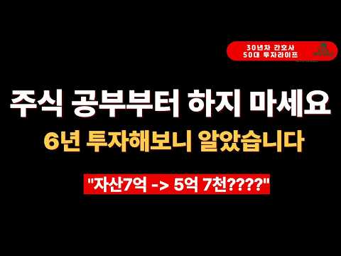
- 설명 앞부분: 주린입니다.
- 같은 채널 평소 대비 ×5.5 (채널 최근 롱폼 중앙값 2,559회) · 평소 영상: 자산 7억 모으고 바뀐 2가지와 이번주 SOXL 수익률 900%로 일부 매도 이야기 #S… (2,559회) / 1년 만에 금융자산 4억에서 7억이 된 이유(50대 직장인 투자 습관) #레버리지etf … (2,461회)
- 대본 없음 (설명) — 음성인식이 끝나면 도입부·흐름이 들어감
- 댓글 20/20: 좋은 점 — 영상 2 · 감사·응원 2 · 더 알고 싶은 것 0 · 아쉬운 점 — 영상 0 · 반박·불만 — 의견 다름 0 · 정치·사회 0 · 경험 공유 0 · 구독·다음 기대 1
  - 좋은 점 — 영상 👍0 “초보에게 맘에 와닿는 얘기네요.”
  - 좋은 점 — 영상 👍0 “옳은 말씀이네요.”
  - 감사·응원 👍0 “항상 부지런 하시네요~ 화이팅~^#♡♡”
  - 감사·응원 👍0 “주식 고수이십니다 화이팅!!!!!”
  - 구독·다음 기대 👍1 “일부이겠지만 보유하신 종목 보니 야수의 심장을 가지셨네요 투자 스타일이 저랑 비슷하신 거 같아 구독합니다^^”

### 122. 월 배당 100만원, JEPQ는 7년 10개월. SCHD는 15년 해도 못 갔다 (그런데 반전) [ 재테크/미국주식/배당주식/슈드/노후대책 ]

- https://www.youtube.com/watch?v=UlkFX8ai4OI · 경제기상도 · 구독자 4,320 · 조회수 23,175 (×5.4, 하루 3,600.0) · 좋아요 54 (0.2%) · 20.1분 · 2026-10-14 · 주제 묶음 4. 미국·해외주식 · 형식 인터뷰·강연·대담 · 폴더 `W_UlkFX8ai4OI` (웹 승인)
- 썸네일: 
- 설명 앞부분: 같은 날, 같은 돈, 같은 15년. 매달 100만원씩 SCHD와 JEPQ에 나눠 넣은 두 친구의 총자산은 3.7억 vs 3.8억으로 거의 같았습니다. 그런데 세후 월 배당은 86만원 vs 280만원, 3배가 넘게 벌어졌습니다. 월 배당 100만원에 먼저 도착한 쪽이 정말 이긴 걸까요? 네 개의 결승선으로 끝까지 따져봤습니다. 이런 분께 추천합니다 매달 일정 금액을 미국 배당 ETF에 적립하고 있는 직장인 SCHD와 JEPQ 중 무엇을 고를지, 또는 어떤 비율로 섞을지 고민 중인 분 분배율 10%가 넘는 커버드콜 ETF로 갈아타고 …
- 같은 채널 평소 대비 ×3.2 (채널 최근 롱폼 중앙값 7,228회) · 평소 영상: JEPI 배당은 줄고 JEPQ 배당은 최고치… '배당률 골짜기'의 정체 [ 재테크/미국주… (7,228회) / 12억 모았는데 월 230만원? 월 배당 300만원 계산이 틀리는 이유 [ 재테크/미국주… (7,436회)
- 대본 없음 (설명) — 음성인식이 끝나면 도입부·흐름이 들어감
- 댓글 2/2: 좋은 점 — 영상 0 · 감사·응원 1 · 더 알고 싶은 것 0 · 아쉬운 점 — 영상 0 · 반박·불만 — 의견 다름 0 · 정치·사회 0 · 경험 공유 0 · 구독·다음 기대 0
  - 감사·응원 👍0 “잘 들었습니다~ 감사합니다 ^^”

### 123. I'm Not Selling — I'm Buying These 4 Stocks After the Selloff

- https://www.youtube.com/watch?v=tgeA8bHVywM · Navellier Market Buzz · 구독자 33,100 · 조회수 164,995 (×5.0, 하루 25,143.1) · 좋아요 2,654 (1.6%) · 13.7분 · 2026-10-14 · 주제 묶음 기타 · 형식 정보·해설 (그 밖) · 폴더 `W_tgeA8bHVywM` (웹 승인)
- 썸네일: 
- 챕터: 0:00 Wall Street Is Panicking Over… · 0:17 Why Big Tech Is Borrowing Bil… · 1:33 Why Memory Stocks Are So Vola… · 2:42 Stock #1: Back Up the Truck · 4:22 Stock #2: Still Growing or Ov… · 5:15 CPI & PPI Preview: What Louie… · 5:56 Europe's Contagion Risk · 7:13 Why Foreign Money Is Pouring … · 8:08 Will the Fed Hike Before the … · 9:04 Stock #3: Louie's Longest-Hel… · 9:33 Stock #4: Head-to-Head Matchup · 10:05 Earnings Season Is About to S… · 11:17 Bonus: 3 Stocks Making Windfa… · 12:49 Final Thoughts
- 설명 앞부분: Memory stocks just took a hit, but Louis Navellier says this could be the buying opportunity investors have been waiting for. With Big Tech borrowing billions to fund AI data centers, is Wall Street overreacting to the selloff? In this week's Navellier Market Buzz, Crystal and Louis Navellier break…
- 같은 채널 평소 대비 ×5.6 (채널 최근 롱폼 중앙값 29,587회) · 평소 영상: 2 Stocks That Could Be the Biggest AI Winners Aft… (30,457회) / Nvidia Reports Today — But Louie Just Made a Surp… (28,717회)
- 대본 없음 (설명) — 음성인식이 끝나면 도입부·흐름이 들어감
- 댓글 201/201: 좋은 점 — 영상 0 · 감사·응원 0 · 더 알고 싶은 것 0 · 아쉬운 점 — 영상 0 · 반박·불만 — 의견 다름 0 · 정치·사회 0 · 경험 공유 0 · 구독·다음 기대 0

### 124. Dividen Rp1 Juta Sebulan: Modal Berapa dan Mulainya dari Mana?

- https://www.youtube.com/watch?v=PBRF4yYyjx4 · STRATEGI FINANSIAL · 구독자 20,500 · 조회수 99,967 (×4.9, 하루 563.7) · 좋아요 1,160 (1.2%) · 22.1분 · 2026-04-27 · 주제 묶음 기타 · 형식 정보·해설 (그 밖) · 폴더 `W_PBRF4yYyjx4` (웹 승인)
- 썸네일: 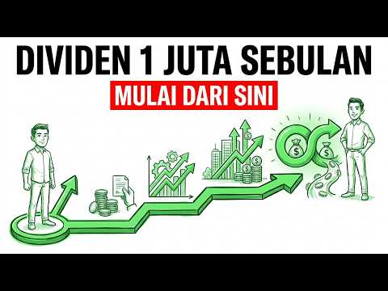
- 설명 앞부분: Disclaimer : Video ini dibuat hanya untuk tujuan edukasi dan literasi keuangan, bukan ajakan membeli atau menjual saham tertentu. Semua contoh perhitungan dividen bersifat simulasi dan dapat berubah sesuai kondisi pasar, kinerja emiten, kebijakan dividen, serta profil risiko masing-masing investor.…
- 같은 채널 평소 대비 ×70.8 (채널 최근 롱폼 중앙값 1,411회) · 평소 영상: Kisah Sukses Bob Sadino: Bukti Nyata Bangkit dari… (1,411회) / 5 Perubahan Psikologi Lo Setelah Lo Berani Tahan … (1,365회)
- 대본 없음 (설명) — 음성인식이 끝나면 도입부·흐름이 들어감
- 댓글 212/212: 좋은 점 — 영상 0 · 감사·응원 0 · 더 알고 싶은 것 0 · 아쉬운 점 — 영상 0 · 반박·불만 — 의견 다름 0 · 정치·사회 0 · 경험 공유 0 · 구독·다음 기대 0

### 125. 206. 사지말아야 할 커버드콜 ETF가 있습니다

- https://www.youtube.com/watch?v=wJWVgIVC7RI · 배당머니 : 숫자로 증명하는 ETF · 구독자 23,800 · 조회수 113,021 (×4.8, 하루 2,116.7) · 좋아요 1,459 (1.3%) · 19.2분 · 2026-08-28 · 주제 묶음 2. 장기투자·ETF·지수 · 형식 정보·해설 (그 밖) · 폴더 `W_wJWVgIVC7RI` (웹 승인)
- 썸네일: 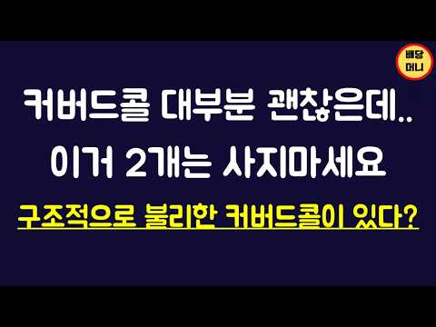
- 챕터: 0:00 인트로 · 2:58 피해야 할 커버드콜 2개 · 4:15 미스매칭 커버드콜 사례 · 7:27 커버드콜의 옵션 자산 · 11:52 KODEX 미국나스닥100데일리커버드콜OTM · 12:54 TIGER vs KODEX 커버드콜 비교 · 17:34 결론
- 설명 앞부분: 커버드콜 ETF는 최근 투자자들 사이에서 필수 선택지 중 하나로 자리잡혔습니다. 특히 은퇴자분들께 큰 인기를 끌고 있는 상품들인데요. 주로 추천하는 커버드콜 ETF들을 말씀드려왔지만 오늘 영상에서는 제가 생각하기에 확률적으로 좋지 못한 구조인 상품들을 두가지 말씀드려봅니다.
- 같은 채널 평소 대비 ×6.4 (채널 최근 롱폼 중앙값 17,537회) · 평소 영상: 174. 나스닥 커버드콜 논란 종결, 숫자로 보여드립니다 (17,537회) / 211. 3억 파이어 가능할지 데이터로 따져보겠습니다 (17,776회)
- 대본 없음 (설명) — 음성인식이 끝나면 도입부·흐름이 들어감
- 댓글 140/142: 좋은 점 — 영상 12 · 감사·응원 25 · 더 알고 싶은 것 9 · 아쉬운 점 — 영상 0 · 반박·불만 — 의견 다름 1 · 정치·사회 0 · 경험 공유 7 · 구독·다음 기대 0
  - 좋은 점 — 영상 👍7 “ETF를 설명하는 유튜브 채널중에 이 채널이 ETF에 대해 가장 심층적으로 분석해서 실제 투자에 도움이 많이 될것라고 추천을 자주 하고 다니는데, 조회수와 좋아요가 많이 증가하는 것 같아서 좋네요^^ 오늘도 좋은 영상 고맙습니다.”
  - 좋은 점 — 영상 👍4 “정말로 유익한 내용이었습니다 감사합니다”
  - 감사·응원 👍7 “ETF를 설명하는 유튜브 채널중에 이 채널이 ETF에 대해 가장 심층적으로 분석해서 실제 투자에 도움이 많이 될것라고 추천을 자주 하고 다니는데, 조회수와 좋아요가 많이 증가하는 것 같아서 좋네요^^ 오늘도 좋은 영상 고맙습니다.”
  - 감사·응원 👍6 “단순히 그냥 본주 추종 커버드콜이라 생각했는데 진짜 제대로 알고 갑니다 ㄷㄷ;; 슈드는 진짜 생각도 못했어요.. 잘보고 갑니다 많이 배워요 감사합니다”
  - 더 알고 싶은 것 👍5 “잘 들었는데요. kodex 미국나스닥100데일리커버드콜OTM에 대하여, 배당머니께서 2026.1.30. '방어력 치중이나 조만간 나스닥이 조정/횡보를 예상한다면 좋은선택지'가 될 수 있다고 하셨는데, 현재는 위 조건 예상을 벗어나서 사지말아야 한다고 하신건가요? 궁금…”
  - 더 알고 싶은 것 👍4 “좀 더 간략하고 핵심위주로 설명해주셨으면 해요. 살짝 장황한 느낌이 그래서 스킵하면서 보게 된다는”
  - 반박·불만 — 의견 다름 👍1 “커버드콜도 하나의 주식입니다. 사고 파는 거에요. 무조건 평단 낮게 관리하는게 최선이고. 사놓고 방치하면 알아서 되는게 아닙니다. 사팔사팔하지 마라는데 좋게 얘기하면 리벨런싱 (사팔,비중조절) 해야해요”
  - 경험 공유 👍10 “제가 보유 중인 종목이 나올까봐 영상 보기 전부터 두근두근.... 😂 다행이 둘 다 아니네요. 😊”
  - 경험 공유 👍3 “저도 TIGER 미국배당다우존스 타겟데일리커버드콜이 숨은 꿀 ETF라고 생각했는데 소개되어서 반갑네요 ㅎㅎ 차트보니 심지어 일반 미국배당다우존스보다 상승률도 좋고 배당도 월등하더라구요~”

### 126. 경제공부 시작하는 법 ∣ 하루 10분이면 됩니다! (해야하는 이유) 🗞️ 📊 💸

- https://www.youtube.com/watch?v=z7fHe2Og-zE · 찌니ZZINI · 구독자 30,600 · 조회수 145,363 (×4.8, 하루 849.0) · 좋아요 0 (0.0%) · 17.5분 · 2026-05-03 · 주제 묶음 1. 주식 기초·초보 · 형식 정보·해설 (그 밖) · 폴더 `W_z7fHe2Og-zE` (웹 승인)
- 썸네일: 
- 챕터: 0:00 영상시작 · 0:12 경제공부 하는 이유? · 2:56 어피니 머니레터 · 5:24 매일경제신문 · 13:42 유튜브/팟캐스트 · 14:18 경제책 · 16:10 디그 · 16:44 마무리
- 설명 앞부분: 다이어리는 meeplus에서 제공받아 촬영되었습니다. 🔻다이어리 + 속지 어느덧 매일경제신문을 읽은지 1년이 다되어가네요 ! 꾸준히 10분씩만 하자였는데 1년을 하게 되었어요 경제공부를 해야하는 이유 투자, 부동산매매가 아니더라도 제가 느낀 이유가 있었어요. 하루 10분만 투자하기 초보자도 누구나 가능 ! 누구나 쉽게 할수있게 제가 정리를 했어요. 영상으로 만들었으니 재미있게 봐주세요 🙂
- 같은 채널 평소 대비 ×9.1 (채널 최근 롱폼 중앙값 15,906회) · 평소 영상: 📓 요즘 내가 좋아하는 다이어리, 모텀 ∣ 프로퍼빌롱잉즈 단테 1달 써봤다! (15,906회) / Vlog ∣ 다이어리 그만좀 사 ∣ 한정선 맛있나..❓∣ 모닝페이지, 경제공부 ∣ 양귀자… (14,843회)
- 대본 없음 (설명) — 음성인식이 끝나면 도입부·흐름이 들어감
- 댓글 147/149: 좋은 점 — 영상 11 · 감사·응원 22 · 더 알고 싶은 것 14 · 아쉬운 점 — 영상 1 · 반박·불만 — 의견 다름 0 · 정치·사회 1 · 경험 공유 6 · 구독·다음 기대 3
  - 좋은 점 — 영상 👍311 “신문사에서 가장 중요하게 생각하는 페이지의 순서는 1> 3면이라고 합니다. 그래서 1면의 심층기사가 3면에 계속되는게 보통이라고 들었습니다. 저는 1,3,world,market 섹션은 꼭 읽고 나머지는 시간이 되면 읽는 편입니다. 못읽는날도 스트레스 없이 그냥 넘기고…”
  - 좋은 점 — 영상 👍111 “안녕하세요 늘 영상 잘 보고 있습니다^^ 하나 꿀팁 드리면 press reader 앱 사용하면 매일경제신문 무료로 읽는거 가능합니다 다른 신문도 볼 수 있어요 저는 제가 졸업한 대학교 이메일 계정으로 이용 중이에요^^ 저도 경제공부 열심히 해봐야겠어요 큰 도움 되는 …”
  - 감사·응원 👍111 “안녕하세요 늘 영상 잘 보고 있습니다^^ 하나 꿀팁 드리면 press reader 앱 사용하면 매일경제신문 무료로 읽는거 가능합니다 다른 신문도 볼 수 있어요 저는 제가 졸업한 대학교 이메일 계정으로 이용 중이에요^^ 저도 경제공부 열심히 해봐야겠어요 큰 도움 되는 …”
  - 감사·응원 👍69 “경제 공부 시작하려고 했는데 이렇게 좋은 타이밍에 좋은 영상을 발견했네요! 귀한 정보 알려주셔서 너무 감사하고 참고해서 열심히 공부해보겠습니다!!”
  - 더 알고 싶은 것 👍5 “정말 세세하네요 신문 보기 시작하는데 어떻게 봐야하는지 몰라서 매번 중간 포기했는데 너무 좋은거같아요! 궁금한점은 하루 몇시간 투자해서 공부하시나요? 저는 아침에유튜브로 한경을 보고 머니레터만 보고있는데 확 공부가 된다는 느낌이 없네요😢”
  - 더 알고 싶은 것 👍3 “저는 해외에 살아서 추천해주신 신문들은 못봐서 여기신문으로 시작할려고 하는데 질문있어요. 모르는 경제용어같은건 어떤식으로 배우시나요? 경제에 대해서 1도 몰라서 처음에는 가볍게 시작하고 싶은데 처음부터 너무 깊이 들어갈까하는 고민이있어요. 그리고 읽어도 뉴스의 흐름을…”
  - 아쉬운 점 — 영상 👍311 “신문사에서 가장 중요하게 생각하는 페이지의 순서는 1> 3면이라고 합니다. 그래서 1면의 심층기사가 3면에 계속되는게 보통이라고 들었습니다. 저는 1,3,world,market 섹션은 꼭 읽고 나머지는 시간이 되면 읽는 편입니다. 못읽는날도 스트레스 없이 그냥 넘기고…”
  - 경험 공유 👍311 “신문사에서 가장 중요하게 생각하는 페이지의 순서는 1> 3면이라고 합니다. 그래서 1면의 심층기사가 3면에 계속되는게 보통이라고 들었습니다. 저는 1,3,world,market 섹션은 꼭 읽고 나머지는 시간이 되면 읽는 편입니다. 못읽는날도 스트레스 없이 그냥 넘기고…”
  - 경험 공유 👍111 “안녕하세요 늘 영상 잘 보고 있습니다^^ 하나 꿀팁 드리면 press reader 앱 사용하면 매일경제신문 무료로 읽는거 가능합니다 다른 신문도 볼 수 있어요 저는 제가 졸업한 대학교 이메일 계정으로 이용 중이에요^^ 저도 경제공부 열심히 해봐야겠어요 큰 도움 되는 …”
  - 구독·다음 기대 👍2 “경제 공부 시작하는 법이라니 어떻게 해야 하는지 궁금하네요 입술에 피어싱을 하셧다니...놀랍네요 주변에 입술 피어싱 한분을 한분도 못봤다 보니 더 신기하고 놀라워요 경제 공부를 시작하신 이유가 더 현실적으로 와 닿네요 내 월급은 조금뿐이 안 올렸는데 계란값만 3배라니…”
  - 구독·다음 기대 👍1 “이 영상으로 처음 뵙는데 구독하고 갈게요! 이북리더기 탐나네요,ㅎㅎㅋㅋㅋ 원래 쓰던게 고장나서 새로 사야하나싶었는데,,,, 어디꺼쓰시나요?! 이뻐서 따라사고싶어용 ㅎㅎ”

### 127. QLD로 10억 만들고 싶다면, 적어도 이 영상 정도는 보세요.

- https://www.youtube.com/watch?v=5vLF2oLQZ_c · 돈재이 DONJAY · 구독자 19,800 · 조회수 92,712 (×4.7, 하루 630.4) · 좋아요 2,165 (2.3%) · 53.2분 · 2026-05-27 · 주제 묶음 2. 장기투자·ETF·지수 · 형식 오디오북·낭독 (명언·인생조언) · 폴더 `W_5vLF2oLQZ_c` (웹 승인)
- 썸네일: 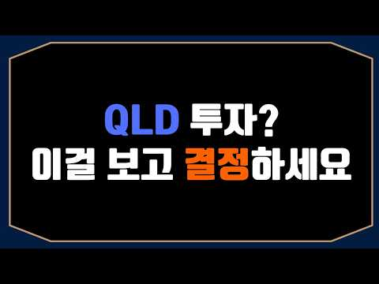
- 설명 앞부분: ⭐안녕하세요, 본 채널은 저의 개인적인 투자 여정과 장기 투자 철학을 기록하는 공간입니다. 제가 겪은 시행착오와 시장을 바라보는 관점이 여러분의 투자 공부에 작은 참고가 되기를 희망합니다. 다만, 채널의 모든 콘텐츠는 정보 전달을 목적으로 제작되었습니다. 여러분의 성공적인 투자 여정을 응원합니다.
- 같은 채널 평소 대비 ×5.4 (채널 최근 롱폼 중앙값 17,324회) · 평소 영상: 환율 계속 떨어지는데 QLD 투자해도 될까? 제 결론입니다 (17,667회) / QLD -12.69%인데도 웃고 있습니다｜월500 적립 7월 투자 계좌 공개 (16,981회)
- 대본 (자막, 5.7 음절/초) 첫 20초: “QLD를 투자하시려는 정말 많은 분들이 계십니다. 심지어 제 영상을 보고 나도 이제 QLD 투자해야 되겠다고 생각하신 분들도 많으시죠. 하지만 저는 QLD 투자를 권장하지 않습니다. 권하지도 않고요. 추천하지도 않습니다. 이유는 단순합니다. 레버리지이기 때문이죠. 변동성이 굉장히 크기 때문에 마음을 다잡고 들어가지 않으면 손해만 보고”
- 첫 1분: “QLD를 투자하시려는 정말 많은 분들이 계십니다. 심지어 제 영상을 보고 나도 이제 QLD 투자해야 되겠다고 생각하신 분들도 많으시죠. 하지만 저는 QLD 투자를 권장하지 않습니다. 권하지도 않고요. 추천하지도 않습니다. 이유는 단순합니다. 레버리지이기 때문이죠. 변동성이 굉장히 크기 때문에 마음을 다잡고 들어가지 않으면 손해만 보고 시작해서 떠날 확률이 굉장히 높습니다. 그래서 저는 추천드리지 않습니다. 하지만 그럼에도 불구하고 나는 QLD를 투자하고 싶다라고 생각하시는 분들이 있을 것 같아서 그렇다면 추천도 하지 않는 제가 어째서 QLD를 투자하기로 결심했는지 특히나 미국 나스닥 100백에 투자하기로 결정했는지 그 이유를 자세하게 알려 드리도록 하겠습니다. 아마이 영상을 끝까지 보시면 확실해질 가능성이”
- 흐름 (90초마다 첫 문장): 0:00 QLD를 투자하시려는 정말 많은 → 1:30 계산한 값들을 전달해 드린다면 혹시나 → 3:00 만들어 내지 못하기 때문에 재개 → 4:32 그런데 20년 중에 최고의 날 딱 → 6:00 수익률뿐만 아니라 안정성 측면에서도 → 7:31 주력으로 하는 그리고 세계 최고 → 9:00 모르겠습니다.이 주식에 10년 동안 → 10:30 끝까지 버티실 수 있을까요? 물론이 → 12:01 그걸 이어간다면 결국에 우리는 높은 → 13:30 이게 가능하려면 내가 투자한 종목 → 15:00 있는 곳은 한국과 미국밖에 없거든요. → 16:30 버블면 어떻게 할 건데 의문을 → 18:02 2.66% 대략 더하면 50%에서 → 19:31 앞으로 한 10년간은 나스닥보다도 → 21:00 있는게 한국 주식이기 때문에 저는 좀 → 22:30 있습니다. 하지만 정말 좋은 건 → 24:01 영어권 문화 아니면은 K화거든요. → 25:30 GTP로 했거든요. 여기 한번 → 27:00 시가 총액의 차이도 크고요. 훈익 → 28:31 그리고 데이터 센터가 있을 거고요.
- 댓글 333/333: 좋은 점 — 영상 17 · 감사·응원 51 · 더 알고 싶은 것 13 · 아쉬운 점 — 영상 6 · 반박·불만 — 의견 다름 1 · 정치·사회 0 · 경험 공유 24 · 구독·다음 기대 5
  - 좋은 점 — 영상 👍11 “긴 영상 감사합니다. 전 tq가 주력이지만 같은 나스닥이라 도움이 많이 되었습니다.😊😊”
  - 좋은 점 — 영상 👍8 “많은 노력이 들어간 정말 좋은 영상입니다. 전혀 지겹지 않았습니다. 귀한 정보 나눠주셔서 감사합니다.”
  - 감사·응원 👍18 “지루하지 않게 정말 잘 시청했습니다 감사합니다”
  - 감사·응원 👍18 “진작 QLD생각 많이 하고 조금 씩 사모으고 있는중 영상알게되어 넘 기쁨니다 감사합니다~^^”
  - 더 알고 싶은 것 👍3 “isa에서 tiger미국나스닥100레버리지 하는건 어떤가요?”
  - 더 알고 싶은 것 👍3 “혹시 매일못살경우 한달에한번은 어떤가요? 아님 일주일에한번정도”
  - 아쉬운 점 — 영상 👍18 “지루하지 않게 정말 잘 시청했습니다 감사합니다”
  - 아쉬운 점 — 영상 👍3 “1. 장기투자 이유 2. 개별주 안하고 지수투자 하는 이유 3. 미국 주식 하는 이유 4. 개별주보단 지수추종 하는 이유 5. 슨피500이랑 나스닥 100중에 뭘 선택했는가 내용 요약하면 이런데 뭐랄까 사실 걍 간단하게 말할 수 있는 것을 너무 길게 말했다 느낌..?…”
  - 경험 공유 👍8 “제가 한 생각과 거의 완벽히 일치하네요.. 저도 돌고돌아 QLD로 정착했는데 그 과정에서 느낀점이 똑같네요”
  - 경험 공유 👍7 “잘들었습니다. 길다 느껴지지않았습니다. TQqq, 6년차, QLD4개월차인데 너무 빨리 많이 올라가서 주춤하고 있습니다.”
  - 구독·다음 기대 👍5 “정주행 했습니다❤️”
  - 구독·다음 기대 👍2 “저도 젊음을 잃기 전 10억을 모으는 것이 목표인데, QQQM으로 만족이 안 돼서 QLD를 힐끗거리다가 이 영상을 접하게 됐어요. 치열하게 고민하신 과정을 공유해 주셔서 감사합니다. 50분 영상이 짧게 느껴지네요. 구독하고 갑니다!”

### 128. The Honest Downside of SCHD Nobody Talks About

- https://www.youtube.com/watch?v=BCG0vPE1Ox0 · Drawn Investor · 구독자 2,800 · 조회수 12,999 (×4.6, 하루 2,964.2) · 좋아요 130 (1.0%) · 12.8분 · 2026-10-16 · 주제 묶음 2. 장기투자·ETF·지수 · 형식 정보·해설 (그 밖) · 폴더 `W_BCG0vPE1Ox0` (웹 승인)
- 썸네일: 
- 챕터: 0:00 The Risk Nobody Puts in a SCH… · 1:05 Why SCHD Owns Just 103 Stocks · 2:30 The Hidden Cost of SCHD's Con… · 3:08 Why SCHD Holds So Little Tech · 4:04 When SCHD Can't Keep Up With … · 5:00 Two Investors, $10,000, One B… · 6:13 The Interest Rate Risk Divide… · 7:30 The 3.22% Yield That Isn't Gu… · 8:47 What Happens If Energy and Ba… · 9:41 The Screen Tax: SCHD's Hidden… · 10:15 Does SCHD's Long-Term Math St… · 11:18 Stress-Test Your Dividend Inc… · 11:44 Three Questions Every SCHD In… · 12:27 The Other Side of SCHD's Story
- 설명 앞부분: SCHD is one of this channel's favorite funds, but liking a fund and being honest about it are two different jobs. This video breaks down the real structural downsides in SCHD's own fact sheet: a tight roster of just 103 holdings, an 8.54% tech weighting that can make it lag during tech-led rallies,…
- 같은 채널 평소 대비 ×22.5 (채널 최근 롱폼 중앙값 579회) · 평소 영상: 3 Reasons NOT To Reinvest Your Dividends (635회) / Three Ways Your Dividend ETF Is Quietly Costing Y… (523회)
- 대본 없음 (설명) — 음성인식이 끝나면 도입부·흐름이 들어감
- 댓글 16/16: 좋은 점 — 영상 0 · 감사·응원 0 · 더 알고 싶은 것 0 · 아쉬운 점 — 영상 0 · 반박·불만 — 의견 다름 0 · 정치·사회 0 · 경험 공유 0 · 구독·다음 기대 0

### 129. QLD는 몇 년 들고 있어야 안전할까? 20년치 모든 매수 시점을 계산해봤습니다.

- https://www.youtube.com/watch?v=PWr2oclRWKs · 여의도 아빠  · 구독자 2,290 · 조회수 10,561 (×4.6, 하루 1,330.5) · 좋아요 75 (0.7%) · 6.7분 · 2026-10-13 · 주제 묶음 7. 매매·전략 · 형식 브이로그·직접 해본 이야기 · 폴더 `W_PWr2oclRWKs` (웹 승인)
- 썸네일: 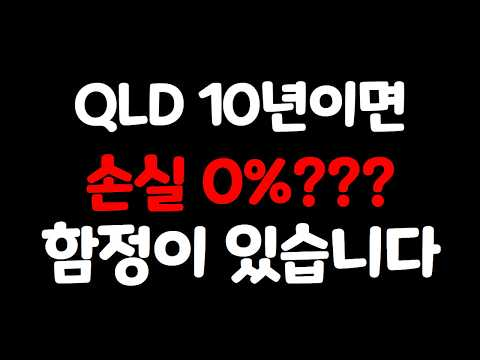
- 설명 앞부분: "QLD, 5년만 버티면 괜찮은 거 아닌가요?" 실제 20년 데이터에선 10년 보유 시 손실 확률 0%. 그런데 OO를 넣자 '5년이면 된다'던 답이 최대 20년으로 늘어났습니다. QLD 보유 기간별 손실 확률 10년 보유 중앙값 13배 금융위기 꼭대기 매수자 닷컴 꼭대기에 2배 나스닥을 샀다면? 같은 최악의 타이밍, 적립을 멈추지 않았다면 본전 20년 → 6년 반 QLD 장기투자가 성립하는 사람 vs 하면 안 되는 사람
- 같은 채널 평소 대비 ×1.7 (채널 최근 롱폼 중앙값 6,370회) · 평소 영상: JEPQ 배당금 어디에 넣어야 가장 많이 벌까? QQQ·QLD·JEPQ 전부 계산해봤습니… (6,370회) / QLD 투자자 대부분이 모르는 사실. 아무리 잘 모아도 '이 순서'를 모르면 무너집니다. (5,541회)
- 대본 없음 (설명) — 음성인식이 끝나면 도입부·흐름이 들어감
- 댓글 11/11: 좋은 점 — 영상 0 · 감사·응원 1 · 더 알고 싶은 것 1 · 아쉬운 점 — 영상 0 · 반박·불만 — 의견 다름 0 · 정치·사회 0 · 경험 공유 0 · 구독·다음 기대 0
  - 감사·응원 👍1 “영상 정말 잘봤습니다. 감사합니다.”
  - 더 알고 싶은 것 👍3 “이번영상도 시청사수입니다! 지금과 같은 고금리가 유지 혹은 더 올라간다면 QQQ대비 QLD의 매력,효율성은 이자비용으로 인해서라도 이전에 비해 많이 떨어질지 궁금하네요”

### 130. 5 High Dividend Stocks That Could Pay Your Monthly Rent By 2030

- https://www.youtube.com/watch?v=Y78TMfV12ic · Invest Like Baniya  · 구독자 15,900 · 조회수 73,263 (×4.6, 하루 527.6) · 좋아요 1,845 (2.5%) · 12.5분 · 2026-06-04 · 주제 묶음 기타 · 형식 정보·해설 (그 밖) · 폴더 `W_Y78TMfV12ic` (웹 승인)
- 썸네일: 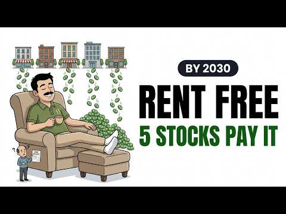
- 설명 앞부분: 5 High Dividend Stocks That Could Pay Your Monthly Rent By 2030 Invest Like Baniya Every month without fail. Salary arrives. Rent leaves. The biggest drain on every Indian urban professional happening automatically before you can do anything about it. But what if five stocks paid that rent instead …
- 같은 채널 평소 대비 ×21.2 (채널 최근 롱폼 중앙값 3,462회) · 평소 영상: How Baniyas Turn Small Money Into Big Wealth (Wit… (3,470회) / ₹30,000 Salary — Zero Savings — I Found The Exact… (3,455회)
- 대본 없음 (설명) — 음성인식이 끝나면 도입부·흐름이 들어감
- 댓글 103/103: 좋은 점 — 영상 0 · 감사·응원 0 · 더 알고 싶은 것 0 · 아쉬운 점 — 영상 0 · 반박·불만 — 의견 다름 0 · 정치·사회 0 · 경험 공유 0 · 구독·다음 기대 0

### 131. 배당으로 사는 은퇴자가 법인을 만든 이유 5가지

- https://www.youtube.com/watch?v=kidc-Cza18s · 은퇴머니 - 은퇴 현금흐름 설계 · 구독자 30,000 · 조회수 137,444 (×4.6, 하루 1,908.0) · 좋아요 1,524 (1.1%) · 10.7분 · 2026-08-10 · 주제 묶음 3. 배당 · 형식 정보·해설 (그 밖) · 폴더 `W_kidc-Cza18s` (웹 승인)
- 썸네일: 
- 챕터: 0:00 은퇴 전에 법인을 만든 이유 · 2:06 금융소득 2,000만원 기준 · 3:27 건강보험료 차이 · 4:40 받는 시점을 정하는 방법 · 5:39 손실 이월 · 6:25 비용 인정 · 7:58 법인 투자에 대한 반론 · 9:11 다섯 가지 정리와 다음 편 예고
- 설명 앞부분: 배당으로 은퇴 현금흐름을 만들면 세금과 건강보험료를 함께 고민하게 됩니다. 제가 은퇴 전에 1인 법인을 만든 이유를 다섯 가지로 정리했습니다. 금융소득 종합과세, 건강보험료, 받는 시점, 손실 이월과 비용 인정까지 살펴봅니다. 법인 투자가 누구에게나 유리한 것은 아닙니다. 실제 결정 전에는 본인 상황을 세무 전문가와 확인하시기 바랍니다. 영상 타임라인 📑 영상 PPT 자료 영상 내용을 정리한 슬라이드를 웹에서 바로 보고, PDF로도 내려받을 수 있습니다.
- 같은 채널 평소 대비 ×10.1 (채널 최근 롱폼 중앙값 13,614회) · 평소 영상: ETF 포트폴리오, 은퇴 전에 확인해야 할 또 하나의 기준 (14,261회) / 은퇴 포트폴리오가 사람마다 다른 이유 (12,966회)
- 대본 없음 (설명) — 음성인식이 끝나면 도입부·흐름이 들어감
- 댓글 70/70: 좋은 점 — 영상 5 · 감사·응원 9 · 더 알고 싶은 것 4 · 아쉬운 점 — 영상 1 · 반박·불만 — 의견 다름 2 · 정치·사회 1 · 경험 공유 8 · 구독·다음 기대 2
  - 좋은 점 — 영상 👍15 “법인 운용을 고민 하는 가장 큰 이유는 건강보험료 아닌가요? 어지간한 자산가가 아니고선 법인 운영을 할 필요는 없어요. 그리고 투자를 위한 자금을 법인에 넣었다면 다시 빼오는것도 가능해요. 법인에 돈을 넣고 투자를 해서 수익을 본 자금이 법인소득이라면 그 금액을 따지…”
  - 좋은 점 — 영상 👍9 “영상 정보 고맙습니다. 저도 은퇴후 건보료 문제로 투자법인을 해야할지 고민입니다. 도움이 많이 되었습니다. 후속편 기대됩니다.”
  - 감사·응원 👍15 “법인 운용을 고민 하는 가장 큰 이유는 건강보험료 아닌가요? 어지간한 자산가가 아니고선 법인 운영을 할 필요는 없어요. 그리고 투자를 위한 자금을 법인에 넣었다면 다시 빼오는것도 가능해요. 법인에 돈을 넣고 투자를 해서 수익을 본 자금이 법인소득이라면 그 금액을 따지…”
  - 감사·응원 👍9 “영상 정보 고맙습니다. 저도 은퇴후 건보료 문제로 투자법인을 해야할지 고민입니다. 도움이 많이 되었습니다. 후속편 기대됩니다.”
  - 더 알고 싶은 것 👍0 “법인을 어떻게 만들고 주식은 어떻게 옮기는지? 그게 중요하지 않나요”
  - 더 알고 싶은 것 👍0 “기타금융투자법인으로 만들어야 하나요? 법인 설립시 비용 절감 노하우가 궁금합니다.”
  - 아쉬운 점 — 영상 👍0 “좋은정보 감사합니다. 예전 유료 컨텐츠도 구매 했었는데 늘 좋네요. 괜찮으시다면 영상을 노트북 lm으로 요약해서 제 유튜브에 출처를 밝히고 올려도 될까 여쭙습니다.^^”
  - 반박·불만 — 의견 다름 👍0 “절댜 법인으로 주투하지 마세요, 그돈 법인돈 갸인돈 아닙니다 말씀하신 장점 다 본인 이익 관점인데 완전 잘못 생각함 ㅡ 번인돈 챙기면 횡령 . 댓글이 필요한가”
  - 정치·사회 👍22 “나라가 그렇게 호락호락하지 않아요.법인이 유리해보이지만 왜 많은 사람들이 개인으로 돌아거는지 사업해본 사람들은 이해하죠”
  - 경험 공유 👍15 “법인 운용을 고민 하는 가장 큰 이유는 건강보험료 아닌가요? 어지간한 자산가가 아니고선 법인 운영을 할 필요는 없어요. 그리고 투자를 위한 자금을 법인에 넣었다면 다시 빼오는것도 가능해요. 법인에 돈을 넣고 투자를 해서 수익을 본 자금이 법인소득이라면 그 금액을 따지…”
  - 경험 공유 👍9 “영상 정보 고맙습니다. 저도 은퇴후 건보료 문제로 투자법인을 해야할지 고민입니다. 도움이 많이 되었습니다. 후속편 기대됩니다.”
  - 구독·다음 기대 👍9 “영상 정보 고맙습니다. 저도 은퇴후 건보료 문제로 투자법인을 해야할지 고민입니다. 도움이 많이 되었습니다. 후속편 기대됩니다.”
  - 구독·다음 기대 👍2 “은퇴 싯점이 점점 다가 오고 있어 꼬마빌딩을 법인으로 구입하여 법인 급여와 일부를 사적연금과공적연금으로 구성할려고 생각중입니다 어느것이 더 세금과 건강보험, 비용등에 유리할지 고민하고 있는데 너무 좋은 영상 감사합니다 그리고 다음편 기다려 집니다”

### 132. Kriz Dinlemeyen Liste: Her Ay Dolar Ödeyen Temettü Kralları (Dividend Kings)

- https://www.youtube.com/watch?v=Qu38GuSvadg · Finansal Özgürlük Yolcusu · 구독자 37,500 · 조회수 171,174 (×4.6, 하루 1,976.6) · 좋아요 4,957 (2.9%) · 18.8분 · 2026-07-26 · 주제 묶음 기타 · 형식 정보·해설 (그 밖) · 폴더 `W_Qu38GuSvadg` (웹 승인)
- 썸네일: 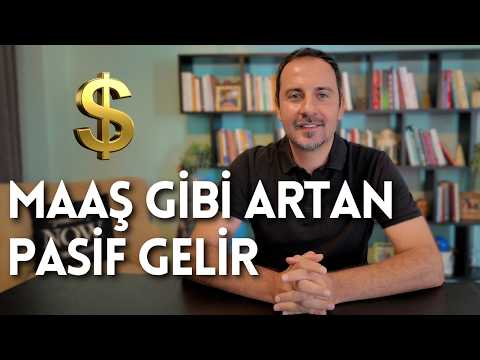
- 설명 앞부분: Dividend Kings Nedir? 50+ Yıldır Temettüsünü Artıran 58 Şirket! ∣ En Kaliteli Temettü Hisseleri Midas'ın Destekleri ile. Midas'ta ABD Borsaları, BIST, Avrupa Borsaları, Tefaş Fonları ve Altın Sertifikası yatırımlarınızı tek bir uygulamadan kolayca yönetebilirsiniz Dividend yatırımcılarının yakından…
- 같은 채널 평소 대비 ×19.7 (채널 최근 롱폼 중앙값 8,678회) · 평소 영상: Bireysel Emeklilik Sistemi (BES) ile Nasıl Daha F… (9,005회) / Hayır Diyemiyorsan Seni Kullanıyorlar! Para, Zama… (8,352회)
- 대본 없음 (설명) — 음성인식이 끝나면 도입부·흐름이 들어감
- 댓글 363/363: 좋은 점 — 영상 0 · 감사·응원 0 · 더 알고 싶은 것 0 · 아쉬운 점 — 영상 0 · 반박·불만 — 의견 다름 0 · 정치·사회 0 · 경험 공유 0 · 구독·다음 기대 0

### 133. 다음주 코스피 심상치 않습니다 '이때' 팔고 바로 현금 챙기세요 (이승조 대표 / 통합본 1부)

- https://www.youtube.com/watch?v=EkR5dj-diWw · 웅달책방_투자 · 구독자 3,260 · 조회수 14,673 (×4.5, 하루 304.2) · 좋아요 262 (1.8%) · 31.7분 · 2026-09-03 · 주제 묶음 5. 국내주식 · 형식 인터뷰·강연·대담 · 폴더 `W_EkR5dj-diWw` (웹 승인)
- 썸네일: 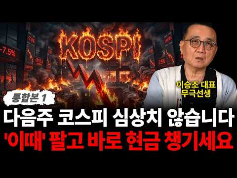
- 설명 앞부분: 🌕 삼전닉스 '이 가격' 아래라면 그냥 겁없이 많이 사세요 (이승조 대표 / 통합본 1부) 본 영상은 9월 3일에 촬영되었습니다 (시청에 참고해 주세요) ※ 출연자에 대한 비난, 욕설, 비속어 등을 포함한 댓글은 무통보 삭제될 수 있습니다. 성숙한 소통 문화 형성에 동참해주시길 바라겠습니다. 감사합니다.
- 같은 채널 평소 대비 ×1.7 (채널 최근 롱폼 중앙값 8,658회) · 평소 영상: "정말 미친듯이 오를 겁니다" 두에빌, 현대건설 절대 아니다 원전 새로운 주도주는 '여기… (8,516회) / 내일 피의 월요일 오나 '이때' 팔고 꼭 현금 챙겨라 (차영주 소장 / 통합본 1부) (8,181회)
- 대본 없음 (설명) — 음성인식이 끝나면 도입부·흐름이 들어감
- 댓글 8/8: 좋은 점 — 영상 1 · 감사·응원 1 · 더 알고 싶은 것 0 · 아쉬운 점 — 영상 1 · 반박·불만 — 의견 다름 1 · 정치·사회 0 · 경험 공유 0 · 구독·다음 기대 0
  - 좋은 점 — 영상 👍1 “썸네일과 내용이 일치하지 않습니다 운영자께서는 낚시에만 치중하지 마시고 독자들이 한눈에 내용을 이해하기 쉽게 썸네일을 작성해 주세요”
  - 감사·응원 👍1 “고맙습니다 날마다 여러번씩 선생님방송보고 주식조금하는거 도움받고있습니다”
  - 아쉬운 점 — 영상 👍1 “썸네일과 내용이 일치하지 않습니다 운영자께서는 낚시에만 치중하지 마시고 독자들이 한눈에 내용을 이해하기 쉽게 썸네일을 작성해 주세요”
  - 반박·불만 — 의견 다름 👍1 “이자식은헛소리만니나팔어라”

### 134. 더이상 배당주는 사지 않아요/40대 워킹맘

- https://www.youtube.com/watch?v=P0j4XK5PaJY · 마스 심플라이프 MasSimpleLife · 구독자 40,800 · 조회수 178,460 (×4.4, 하루 17,270.6) · 좋아요 1,111 (0.6%) · 10.8분 · 2026-10-11 · 주제 묶음 3. 배당 · 형식 브이로그·직접 해본 이야기 · 폴더 `W_P0j4XK5PaJY` (웹 승인)
- 썸네일: 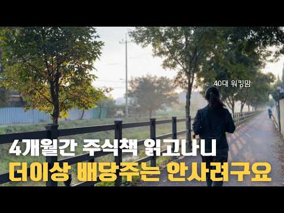
- 설명 앞부분: ⏰ 연 5천만원 모으는 습관 클럽(연오클) 11기를 모집합니다. ^^ 함께 새벽습관을 잡고, 돈공부와 독서를 하면서 경제마인드를 잡아가고 싶으신분들 함께해요~ ^^ 남과 비교하지 않고 어제의 나와 비교하며, 내 삶의 주도권을 되찾아갈 (연오클 11기)멤버를 모집합니다. (연오클이 궁금하시다면 네이버에 '연오클'을 검색해보세요~ ^^) 전 주로 집에 있는 재료를 이용하는 편이구요~ 요리책의 레시피가 있어도 레시피대로 잘 안하고 있는 재료를 주로 활용하고 있답니다~ 사실.. 저도 요리할때마다 레시피가 바뀌어요~ㅋㅋ *^^ 🍒 돼지고기…
- 같은 채널 평소 대비 ×5.9 (채널 최근 롱폼 중앙값 30,417회) · 평소 영상: 무섭게 돈 모으는 40대 워킹맘의 노후준비 라이프(생활비 90만원)(몰아보기영상) (30,417회) / 연6천만원 모으는 방법~(Q&A) /40대 워킹맘 돈모으는 루틴(오이지, 황태계란국) (30,851회)
- 대본 (자막, 5.9 음절/초) 첫 20초: “안녕하세요. 마스입니다. 어느덧 10월입니다. 아침 저녁으로 제법 쌀쌀한 바람이 부는 완연한 가을이 되었어요. 10월부터는 저희 아침 운동 루틴에도 약간의 변화를 주었답니다. 출근을 해야 하는 주 중에는 수영을 하고 조깅은 주말에 하기로 했어요. 가을이 깊어지면서 아침에도 늦게 뜨고”
- 첫 1분: “안녕하세요. 마스입니다. 어느덧 10월입니다. 아침 저녁으로 제법 쌀쌀한 바람이 부는 완연한 가을이 되었어요. 10월부터는 저희 아침 운동 루틴에도 약간의 변화를 주었답니다. 출근을 해야 하는 주 중에는 수영을 하고 조깅은 주말에 하기로 했어요. 가을이 깊어지면서 아침에도 늦게 뜨고 [음악] 새벽 5시에 나가면 아직 깜깜한 데다가 날도 꽤 쌀쌀하더라고요. 무리에서 어둠 속을 달리기보다는 주말에 해가 뜬 후에 따뜻한 햇살 아래 남편과 함께 느긋하게 슬로우 조깅하는 것으로 바꿨습니다. [음악] 이게 저희 중년 부부가 조깅을 포기하지 않고 계속할 수 있는 방법이란 생각이 들더라고요. 영상을 보는 구독자님들도 날은 추워지지만 [음악] 건강을 위해 운동을 멈추지 않으시길 바랍니다. 이제 우린 생존을 위해 운동해야 하”
- 흐름 (90초마다 첫 문장): 0:01 안녕하세요. 마스입니다. 어느덧 → 1:30 하지만 그간 미니벌 라이프로 얻은 → 3:01 주식으로 매월 높은 배당금을 받으면서 → 4:31 현금 흐름이 나올 수 있고 → 6:01 때문입니다. 미국 주식 중에서도 앞서 → 7:32 편안히 쉬면서 매달 나오는 연금만 → 9:01 한시간씩 걸어다니며 극단적으로 → 10:31 바랍니다. 구독과 좋아요는 제가 매주
- 댓글 104/151: 좋은 점 — 영상 1 · 감사·응원 5 · 더 알고 싶은 것 3 · 아쉬운 점 — 영상 0 · 반박·불만 — 의견 다름 2 · 정치·사회 0 · 경험 공유 15 · 구독·다음 기대 0
  - 좋은 점 — 영상 👍2 “매번 좋은 내용을 볼 수 있어서 감사합니다.오늘 특히 정리가 되는 영상이었어요.^^”
  - 감사·응원 👍3 “항상 잘 보고 있어요 채칼 정보 알려주시면 감사하겠습니다😊”
  - 감사·응원 👍2 “매번 좋은 내용을 볼 수 있어서 감사합니다.오늘 특히 정리가 되는 영상이었어요.^^”
  - 더 알고 싶은 것 👍3 “항상 잘 보고 있어요 채칼 정보 알려주시면 감사하겠습니다😊”
  - 더 알고 싶은 것 👍1 “전 1도 몰라요 뭘 어떻게 시작해야할지 모르겠어요 저같은 초짜는 어떻게 시작해야될까요?”
  - 반박·불만 — 의견 다름 👍6 “하락장 아프게 한번 맞아보면 또 생각이 바뀝니다 배당주를 하시던 성장주를 하시던 투자하고 있는 지금 상황에 박수를 드립니다 어느쪽은 중요하지 않습니다 선택한 그 투자를 얼마나 오래 지속 할수있을지만 고민 하시면 됩니다 중요한건 어떤 상품이 아닙니다”
  - 반박·불만 — 의견 다름 👍0 “예전 부모님 세대로서........... "집에서 편안히 쉬면서 연금만으로 살 수 있는 호시절"은 아닌데.......한편, 자녀들의 시대에는 지금 40대 위킹맘의 상황보다 더욱 혹독하겠습니다. 맞아요. 예전에는 돈돈 하면서 살진 않았는데...그렇다고 돈이 중요한 걸 …”
  - 경험 공유 👍49 “난 주식 20년차인데 결국 배당주가 답이라는걸 찾음”
  - 경험 공유 👍14 “남말에 귀닫고 노동소득의 80%는 한국주식을 사고있는 50살 23년차 주식쟁이입니다 에코프로는 10년 이상 3만주 이상을 들고 있으며 에코프로로 노후준비는 다 끝났습니다 개인연금저축펀드 퇴직연금IRP는 20년째 들고 있습니다 주식에는 전문가란게 없고 과학이 아니라서 …”

### 135. 경제신문 무료로 보는법 📰 (경제공부 초보 읽는 방법 👀)

- https://www.youtube.com/watch?v=PIiGnsoTl7I · 찌니ZZINI · 구독자 30,600 · 조회수 132,773 (×4.3, 하루 808.3) · 좋아요 0 (0.0%) · 10.2분 · 2026-05-10 · 주제 묶음 1. 주식 기초·초보 · 형식 정보·해설 (그 밖) · 폴더 `W_PIiGnsoTl7I` (웹 승인)
- 썸네일: 
- 챕터: 0:00 영상시작 · 0:19 첫주식투자 도전 · 1:22 경제신문 무료 방법 · 5:10 경제공부방법 질문 · 9:36 책추천 · 10:00 마무리
- 설명 앞부분: 🔻아래 사이트로 들어가서 국립중앙도서관과 연동하기 오늘은 경제신문 무료로 보는법을 가지고 왔어요 ! 어느덧 1년이 지났더라구요 🙂 연락을 주셨을때 내심 뿌듯하기도 하고 1년전 저의 모습이 보이더라구요 ✨ 많은 분들이 도움 되셨음 좋겠습니다! ⏰ 타임라인
- 같은 채널 평소 대비 ×8.3 (채널 최근 롱폼 중앙값 15,906회) · 평소 영상: 📓 요즘 내가 좋아하는 다이어리, 모텀 ∣ 프로퍼빌롱잉즈 단테 1달 써봤다! (15,906회) / Vlog ∣ 다이어리 그만좀 사 ∣ 한정선 맛있나..❓∣ 모닝페이지, 경제공부 ∣ 양귀자… (14,843회)
- 대본 없음 (설명) — 음성인식이 끝나면 도입부·흐름이 들어감
- 댓글 334/336: 좋은 점 — 영상 37 · 감사·응원 86 · 더 알고 싶은 것 14 · 아쉬운 점 — 영상 1 · 반박·불만 — 의견 다름 0 · 정치·사회 2 · 경험 공유 10 · 구독·다음 기대 2
  - 좋은 점 — 영상 👍26 “경제신문을 굳이 돈 주고 볼 필요는 없다고 생각하는 편입니다. 다만 솔직히 말씀드리면, 복잡한 절차를 거쳐 무료로 보는 방식은 오래 유지하기 쉽지 않더라고요. 물론 잘 활용하시는 분들도 계시겠지만 때마다 로그인하고 도서관 연동하고 매번 들어가는 과정 자체가 생각보다 …”
  - 좋은 점 — 영상 👍17 “와... 경제지 뿐만 아니라 여러나라의 신문도 한번 쯤 보고 싶었는데.. 이런 서비스가 있었는 지 몰랐네요. 정말 감사합니다. 큰 도움이 되었습니다.”
  - 감사·응원 👍74 “헐 이렇게 쉽게 성공하다니..!! 예전에 저도 국립중앙도서관으로 하면 프레스리더로 무료 읽기 된다구 해서 시도했다가 실패했었는데 알려주신대로 시도했더니 바로 인증됐어요ㅠㅠ 정말 감사해요~~!!”
  - 감사·응원 👍17 “와... 경제지 뿐만 아니라 여러나라의 신문도 한번 쯤 보고 싶었는데.. 이런 서비스가 있었는 지 몰랐네요. 정말 감사합니다. 큰 도움이 되었습니다.”
  - 더 알고 싶은 것 👍4 “이런 정보 몰랐다면 덜컥 돈 주고 구독했을 것 같은데… 너무 감사해요!! 🥹 그리고 혹시 1:22 이 기기는 이름이 뭔지 알 수 있을까요?”
  - 더 알고 싶은 것 👍3 “몇일이 지난후에는 무료로 안되네요 로그아웃하고 다시 로긴해도 프리미엄 가입 안내가 나오면서 볼수 없게 되네요 맞나요?”
  - 정치·사회 👍1 “매일경제 경향신문 한겨레 다 좌파 성향 신문이네요ㅠ 그건 좀 아쉽 좌파 우파 둘 다 보고싶은데”
  - 정치·사회 👍0 “나라가 넘어가도 ㅈㅍ언론사 신문을 읽네”
  - 경험 공유 👍74 “헐 이렇게 쉽게 성공하다니..!! 예전에 저도 국립중앙도서관으로 하면 프레스리더로 무료 읽기 된다구 해서 시도했다가 실패했었는데 알려주신대로 시도했더니 바로 인증됐어요ㅠㅠ 정말 감사해요~~!!”
  - 경험 공유 👍26 “경제신문을 굳이 돈 주고 볼 필요는 없다고 생각하는 편입니다. 다만 솔직히 말씀드리면, 복잡한 절차를 거쳐 무료로 보는 방식은 오래 유지하기 쉽지 않더라고요. 물론 잘 활용하시는 분들도 계시겠지만 때마다 로그인하고 도서관 연동하고 매번 들어가는 과정 자체가 생각보다 …”
  - 구독·다음 기대 👍4 “이런 정보 몰랐다면 덜컥 돈 주고 구독했을 것 같은데… 너무 감사해요!! 🥹 그리고 혹시 1:22 이 기기는 이름이 뭔지 알 수 있을까요?”
  - 구독·다음 기대 👍1 “우와 좋은 정보 감사해요 ! 만드시는 컨텐츠 결이 제 관심사랑 맞아서 쭉 보고 싶어지네요 ㅎㅎ 다음 영상도 기다릴게욤💚”

### 136. 지난 폭락과는 완전히 다릅니다…코스피가 진짜 위험한 이유 (Feat. 박병창 MP파트너스 대표) [딥플 Deep-ple]

- https://www.youtube.com/watch?v=y_mvodyrXhQ · 핀플 - Finple · 구독자 45,900 · 조회수 193,740 (×4.2, 하루 39,573.2) · 좋아요 2,910 (1.5%) · 60분 · 2026-10-16 · 주제 묶음 5. 국내주식 · 형식 인터뷰·강연·대담 · 폴더 `W_y_mvodyrXhQ` (웹 승인)
- 썸네일: 
- 설명 앞부분: 딥플 클릭 보기 순서 1Q 코스닥150채권혼합50액티브 ETF (0186S0) 1️⃣ “코스닥 활성화 정책 기대감” 2025.12.19, 금융위원회 ‘코스닥 신뢰+혁신 제고 방안’ 발표 2️⃣ “주식 비중을 높인 2세대 채권혼합형” ‘코스닥150 지수’ 약 50% + ‘단기국공채 지수’ 약 50% 2023.11.16, 퇴직연금감독규정에 따라 주식 편입한도 40% 이내 → 50% 미만으로 상향 성장성과 안정성 둘 다 잡은 ETF 투자도 하나(Hana)면 됩니다. 1Q K반도체TOP2 시리즈 ETF 1Q K반도체TOP2+ ETF (0…
- 같은 채널 평소 대비 ×17.2 (채널 최근 롱폼 중앙값 11,279회) · 평소 영상: 삼성전자 107조에도 코스피 폭락! 외국인이 한국 주식을 버리는 진짜 이유 [더 파이널 … (11,279회) / 반도체 소부장 이제 시작이다? 삼성·하이닉스보다 먼저 움직이는 이유 [더 파이널 콜 핵심… (14,125회)
- 대본 없음 (설명) — 음성인식이 끝나면 도입부·흐름이 들어감
- 댓글 360/360: 좋은 점 — 영상 16 · 감사·응원 26 · 더 알고 싶은 것 1 · 아쉬운 점 — 영상 2 · 반박·불만 — 의견 다름 7 · 정치·사회 28 · 경험 공유 21 · 구독·다음 기대 1
  - 좋은 점 — 영상 👍27 “박병창님의 강의 넘 유익했습니다. 3프로에서 믿을맨중 하나죠”
  - 좋은 점 — 영상 👍20 “와~박병찬 대표님! 제가 가려웠던 부분을 잘 알려주셔서 감사해요~~ 민준님도 핵심을 잘 짚어 질문해주시네요😊”
  - 감사·응원 👍20 “와~박병찬 대표님! 제가 가려웠던 부분을 잘 알려주셔서 감사해요~~ 민준님도 핵심을 잘 짚어 질문해주시네요😊”
  - 감사·응원 👍19 “작년방송에서 올해전망 예측하신대로 흘러감에 경외감을 느낍니다. 상반기 좋고, 하반기 위험, 금리5 돌파시 도망. 경험자의 안목에 큰 도움받았고 감사를 전하고싶습니다.”
  - 더 알고 싶은 것 👍0 “직전에 잘나간주식 장비 두산테스나나 이차전지원통형 신흥 이런거 사면 되나요?”
  - 아쉬운 점 — 영상 👍3 “다시 반복해서 들어봐야겠어요 좋네요”
  - 아쉬운 점 — 영상 👍0 “그러니까 요약좀 해줘요 ㅋ”
  - 반박·불만 — 의견 다름 👍377 “반도체 업계 종사자입니다 중국 반도체 신기술(특히 창신메모리 CXMT의 차세대 D램 '4F²' 연내 출시 발표 등) 정치적·시장적 과장(선동에 가까운 쇼맨십)이 99%, 무시 못 할 기술적 우회 시도가 0.1%' 정도로 보시는 것이 가장 냉정한 팩트입니다. 단순히 '…”
  - 반박·불만 — 의견 다름 👍4 “헛소리를 겁나게 길게하네 말 맨날 바뀌면서ㅋㅋㅋㅋㅋ”
  - 정치·사회 👍16 “내년의 실적을 의심하는 것이 아니라 질적에 관계없이 난 팔겠다는 외국인이 무서운거지 수급”
  - 정치·사회 👍13 “확실히 이번 하락은 좀 다른듯 월요일 쌍바닥도 깨질거같은데 전쟁끝나거나 선거끝날떄까지 관망해야하는 장세인듯”
  - 경험 공유 👍20 “와~박병찬 대표님! 제가 가려웠던 부분을 잘 알려주셔서 감사해요~~ 민준님도 핵심을 잘 짚어 질문해주시네요😊”
  - 경험 공유 👍14 “아저씨 갑자기 이러니까. 세상에 해안이 있는 것처럼 떠들지 마 당신도 언젠가 평탄한 길이 있었을 때 이럴 땐 매수해야 된다고 말했던 사람이잖아. 정답은 없지. 그러나 지금 정답이 있는 것처럼 내가 마치 예언가인 것처럼. 이야기하는 건 너무 창피하지 않아?”
  - 구독·다음 기대 👍0 “이런 채널이 있는줄 물랐는데 박대표님 들으러 들어왔습니다. 일단 구독했습니다.”

### 137. 한국 투자자 실전 가이드 한국에서 SpaceX 주식 사는 법 [스페이스X / 일론머스크]

- https://www.youtube.com/watch?v=Jm6PdCecKJQ · 경제기상도 · 구독자 4,320 · 조회수 18,014 (×4.2, 하루 116.2) · 좋아요 406 (2.2%) · 21.9분 · 2026-05-19 · 주제 묶음 11. 투자 일반 · 형식 정보·해설 (그 밖) · 폴더 `W_Jm6PdCecKJQ` (웹 승인)
- 썸네일: 
- 설명 앞부분: 역대 최대 IPO가 코앞입니다. 스페이스X가 2026년 6월, 나스닥에 상장합니다. 공모 규모 750억 달러(약 113조 원). 기업가치 최대 2조 달러(약 3,000조 원). 사우디 아람코 기록을 두 배 넘게 깨는, 인류 역사상 가장 거대한 상장입니다. 그런데 이번엔 한국 개인 투자자도 참여할 수 있는 길이 열리고 있습니다. 미래에셋증권이 글로벌 주관사단에 선정되면서, 국내 일반 투자자 청약까지 추진 중이거든요. 이 영상 하나로 전부 정리했습니다. 스페이스X가 3,000조 원 가치를 인정받는 진짜 이유 IPO 직접 청약, 현실적…
- 같은 채널 평소 대비 ×2.5 (채널 최근 롱폼 중앙값 7,228회) · 평소 영상: JEPI 배당은 줄고 JEPQ 배당은 최고치… '배당률 골짜기'의 정체 [ 재테크/미국주… (7,228회) / 12억 모았는데 월 230만원? 월 배당 300만원 계산이 틀리는 이유 [ 재테크/미국주… (7,436회)
- 대본 없음 (설명) — 음성인식이 끝나면 도입부·흐름이 들어감
- 댓글 2/2: 좋은 점 — 영상 0 · 감사·응원 1 · 더 알고 싶은 것 0 · 아쉬운 점 — 영상 0 · 반박·불만 — 의견 다름 0 · 정치·사회 0 · 경험 공유 0 · 구독·다음 기대 0
  - 감사·응원 👍2 “감사히잘듣고갑니다”

### 138. [🚨긴급진단] 코스피 7000 붕괴...충격의 오늘 시장 왜 이러나?ㅣ이권희 대표 전화연결ㅣ경제시그널

- https://www.youtube.com/watch?v=g5v83RNywMQ · 경제시그널 · 구독자 27,800 · 조회수 115,135 (×4.1, 하루 1,148.6) · 좋아요 1,770 (1.5%) · 9분 · 2026-07-13 · 주제 묶음 5. 국내주식 · 형식 정보·해설 (그 밖) · 폴더 `W_g5v83RNywMQ` (웹 승인)
- 썸네일: 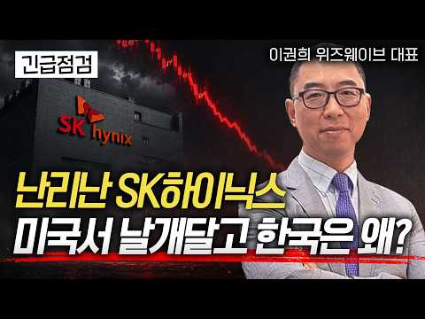
- 챕터: 0:00 Q. 오늘 주식시장 왜이러나? · 2:05 Q. SK하이닉스 미국 상장, 국내 시장 영향은? · 2:37 Q. SK하이닉스 아직도 매수 기회? · 3:33 Q. 상장 조달금, 원화 달러 낮추는 역할하나? · 4:20 Q. 반도체 ETF 투자 이대로 괜찮나? · 5:37 Q. 지정학 충돌, 시장 여파는? · 6:36 Q. 이번 주 투자 전략은?
- 설명 앞부분: 🚨 이권희 대표와 함께 오늘 시장을 긴급 진단했습니다. 이번 급락은 일시적인 조정일까요, 아니면 더 큰 하락의 시작일까요? [속보] 코스피 7000선 붕괴…반도체주 급락 [속보] SK하이닉스 200만 원선 이탈…199만8000원 [속보] 코스피 낙폭 8% 돌파…서킷브레이커 발동 🕥타임스탬프🕥 본 영상에서 제공되는 정보는 참고사항일 뿐, 투자에 대한 모든 결정은 투자자의 몫입니다. 경제를 깊이 있게, 경제시그널 토크, 익스플레인 컨텐츠를 제작하는 경제시그널 콘텐츠 제작 역량을 바탕으로 기업·브랜드의 스토리를 디지털 콘텐츠에 맞는 방…
- 같은 채널 평소 대비 ×5.8 (채널 최근 롱폼 중앙값 19,857회) · 평소 영상: 이번 주 FOMC 시장 분기점! 금리인상 시 안도랠리 펼쳐질 역발상 섹터전략 [이권희 대… (19,857회) / 기대감 0%? 고생했던 주주들 필독! 2차전지 제약바이오 왜 반등하는지 알려드립니다 [민… (32,826회)
- 대본 (자막, 6.1 음절/초) 첫 20초: “그런 이유는 없는데 일단 지금 일단 뭐 SK하이닉스가 ADR 상장은 잘 됐는데 그래서 미국 시장에서 급등을 했는데 오히려 이제 우리 시장에서 이제 급락이 나오고 있잖아요. 일단 예전에 UPBS 보고서에서 국내 주식보다는 ADR를 집중해야 된다. 이런 얘기들이 좀 있었죠. 예. 그런 부분들이 일부 좀 이제 과하게 반영되는 거 같고 그리고 지금”
- 첫 1분: “그런 이유는 없는데 일단 지금 일단 뭐 SK하이닉스가 ADR 상장은 잘 됐는데 그래서 미국 시장에서 급등을 했는데 오히려 이제 우리 시장에서 이제 급락이 나오고 있잖아요. 일단 예전에 UPBS 보고서에서 국내 주식보다는 ADR를 집중해야 된다. 이런 얘기들이 좀 있었죠. 예. 그런 부분들이 일부 좀 이제 과하게 반영되는 거 같고 그리고 지금 에스케하닉스 관련돼서 한국 투자 증권에서 보고서가 나왔는데 보고서 내용을 보면 일단 2분기 실적 추정치가 어 생각보다 이제 가이던스보다 좀 적게 나올 거다. 한 60조 후반대를 예상하고 있었는데 어 한 60조 초반대가 나오지 않겠냐라는 이제 얘기가 좀 나오면서 그 부분 좀 작을 좀 시킨 걸로 보이고요. 그리고 또 이제 글로벌리 보면은 이제 그 우리 MSC 관련된 신흥국”
- 흐름 (90초마다 첫 문장): 0:00 그런 이유는 없는데 일단 지금 일단 → 1:30 영향일 걸로 보입니다. 그래서 지금 → 3:01 하면 지금 그 투자가 어 다른 → 4:31 이제 빠졌다가 제자리 간 이제 주가는 → 6:00 되고 있는 상황인데 → 7:31 이내에서 움직여야
- 댓글 409/409: 좋은 점 — 영상 0 · 감사·응원 0 · 더 알고 싶은 것 2 · 아쉬운 점 — 영상 1 · 반박·불만 — 의견 다름 10 · 정치·사회 33 · 경험 공유 9 · 구독·다음 기대 0
  - 더 알고 싶은 것 👍0 “우리들돈 다 누가 가져갔나? 언제 정상적인 시장이 올까 누가 좀 알려주세요ㅜㅜ”
  - 더 알고 싶은 것 👍0 “아니주식하랄땐언제고지금은말이없나요??”
  - 아쉬운 점 — 영상 👍1 “주식에 전문가가 어딨나 ㅋㅋㅋ 주식용어만 무한반복 씨부리는 좃문가들 뿐이지 ㅋㅋㅋ 주식은 도박이다. 회사 실적?그딴거 하나도 안중요함. 그냥 운빨임 실적 구대기여도 천프로오르는것 허다하다 삼천당제약 봐라 ㅋㅋㅋ 그냥 운좋게 폭등하는 주식 고르면 대박나는거고 ㅋㅋㅋ아니…”
  - 반박·불만 — 의견 다름 👍33 “주식장오늘왜이럽니까?정상아닙니다 좀 제발정상으로돌려주세요”
  - 반박·불만 — 의견 다름 👍12 “또 헛소리”
  - 정치·사회 👍18 “1. 이재명 정부는 차라리 주식시장 문 닫아라. 누구를 위한 시장이냐? 국민들 주머니 다 털리는 데 나 몰라라 대책도 없고, 당에서는 서푼 짜리 정권 잡고 권력 놀음에 빠져 경제는 안중에도 없구나. 2. 단일종목 레버리지 etf의 폐해가 막심하다고 지적하는 전문가들의…”
  - 정치·사회 👍18 “다시는 현 정부가 정권 못잡게 잊지말고 2년뒤 투표 똑바로 합시다 나도 지금 파란거 찍은게 후회 막심 !!!!!!!!!!!!!!!”
  - 경험 공유 👍77 “무조건 사라고 하더니.. 믿은 내가 잘못이긴하지만. 손실 어마어마하네”
  - 경험 공유 👍26 “유튜버들 얘기 참고만하세요 저도 이들이야기들만 듣다가 7천만원 날라갔어요 울화통!!!!!터지기 일보직전”

### 139. 배당 10%를 주면서 동시에 주가도 20% 오른 단 6개의 ETF [1,099개 ETF 모두 뒤져봤습니다.]

- https://www.youtube.com/watch?v=4Gy4lBNuebE · 우아한짠테크 TV · 구독자 37,200 · 조회수 150,866 (×4.1, 하루 952.5) · 좋아요 4,481 (3.0%) · 12.7분 · 2026-05-15 · 주제 묶음 2. 장기투자·ETF·지수 · 형식 정보·해설 (그 밖) · 폴더 `W_4Gy4lBNuebE` (웹 승인)
- 썸네일: 
- 설명 앞부분: 안녕하세요, 우아한짠테크 '우짠'입니다! "배당 많이 받으면 주가는 안 오른다?" 이 상식을 완벽하게 깨부쉈습니다. 국내 상장 ETF 1,099개를 일일이 전수조사해 [배당 10% + 주가 상승 20% + 순자산 3,000억 이상]이라는 미친 조건을 통과한 ETF만 걸러냈습니다. 심지어 이 중에는 수익률 무려 103%를 찍어버린 전설적인 종목도 숨어있는데요! 월배당 투자자라면 무조건 계좌에 담아야 할 상위 0.55%의 기적 같은 ETF, 오늘 영상에서 확인하세요!
- 같은 채널 평소 대비 ×14.0 (채널 최근 롱폼 중앙값 10,746회) · 평소 영상: ISA, 연금계좌 S&P500만 샀다고요? 10년 뒤 땅을 치고 후회합니다. (10,746회) / 가족도 절 버렸졌지만 돈은 끝까지 내옆에 있습니다. (10,634회)
- 대본 없음 (설명) — 음성인식이 끝나면 도입부·흐름이 들어감
- 댓글 316/316: 좋은 점 — 영상 22 · 감사·응원 61 · 더 알고 싶은 것 16 · 아쉬운 점 — 영상 1 · 반박·불만 — 의견 다름 0 · 정치·사회 1 · 경험 공유 10 · 구독·다음 기대 3
  - 좋은 점 — 영상 👍7 “도움이 됩니다.감사합니다.”
  - 좋은 점 — 영상 👍7 “은퇴한지 오래된 주린이. 고정구독자입니다. 아직은 고정현금 흐름이 있기에, 절세계좌 (isa,연금저축, 비과세종합저축계좌) 에서 , 성장주와 고배당주에 투자중입니다. 항상 커버드콜에 관심이 있었는데, 커버드콜에 대한 공부가 아직은 확실히 덜되어 있었는데, 오늘 영상이…”
  - 감사·응원 👍14 “깔끔한 정리 감사합니다.”
  - 감사·응원 👍7 “도움이 됩니다.감사합니다.”
  - 더 알고 싶은 것 👍3 “저기 중에서 1-2개는 담아가야 겠어요:) 없어서 아쉬웠는데! 이렇게 분석해주셔서 감사합니다. 우짠님 어찌 생각하시나요?~ 요즘 장신없어 자주 못왔는데! 우짠님 현재 포트폴리오도 궁금하네요~~~”
  - 더 알고 싶은 것 👍3 “비교분석 감사합니다. 반은 있고 반은 없네요.^^ 다행히 아직까진 수익률도 빨간블이고~ 최근 상장한 ETF들 국내 몇개 있던데요. 비교.예측 부탁드립다. 구독.❤하고 갑니다.”
  - 아쉬운 점 — 영상 👍3 “저기 중에서 1-2개는 담아가야 겠어요:) 없어서 아쉬웠는데! 이렇게 분석해주셔서 감사합니다. 우짠님 어찌 생각하시나요?~ 요즘 장신없어 자주 못왔는데! 우짠님 현재 포트폴리오도 궁금하네요~~~”
  - 경험 공유 👍66 “분석 하시느라 수고 많으셨습니다 언급 하신 여섯개 종목 중에 저희 포트폴리오 안에는 총 4개 종목이 포함되어 있네요 그래서인지 현재 손실 중인 종목은 단 한개도 없고 전체 계좌 총 수익률은 어제 기준 16% 입니다”
  - 경험 공유 👍6 “감사합니다. 제가 기존에 갖고있던 3가지 etf 와 이 6개 모두 총 9가지 etf만 매수해야겠습니다. 유익한 정보 정말 감사드립니다 ~~~~!”
  - 구독·다음 기대 👍12 “깔끔한 정리 아주 좋네요~~ 구독갑니다”
  - 구독·다음 기대 👍2 “왕왕 주린이인대 너무 잘봤어요 매일봐도 모르겟었는데 도움받고가요 근데 커버드콜도 장투하는 개념인지 안전한지 궁금합니다 감사합니다”

### 140. 코스닥 다시 반등할까?📈ㅣ원큐로 끝내는 ETF🎯

- https://www.youtube.com/watch?v=jJu0VhNOH-I · 하나TV [하나자산운용] · 구독자 13,800 · 조회수 55,497 (×4.0, 하루 7,904.6) · 좋아요 24 (0.0%) · 7.5분 · 2026-10-14 · 주제 묶음 2. 장기투자·ETF·지수 · 형식 정보·해설 (그 밖) · 폴더 `W_jJu0VhNOH-I` (웹 승인)
- 썸네일: 
- 설명 앞부분: 코스닥의 향방이 궁금하다면, 지수를 움직일 주요 변수들을 체크해요🔍 과거 사례를 통해 반등에 필요한 조건을 확인하고, 정부의 지원 정책도 함께 살펴봐요📈 코스닥의 높은 변동성이 고민이라면 주식과 채권을 함께 담은 '1Q 코스닥150채권혼합50액티브 ETF' 어때요?💚 하나자산운용 준법감시인 심사필 2026-179(2026.10.14. ~ 2027.10.13.) 1Q ETF 더 알아보기 👀
- 같은 채널 평소 대비 ×8.3 (채널 최근 롱폼 중앙값 6,661회) · 평소 영상: 연린이들 주목! 연금계좌 주식 비중 최대로 높이는 방법📈ㅣ원큐로 끝내는 ETF🎯 (6,661회) / AI 주도권 경쟁은 지금부터? K-소버린 AI 주목!🤖ㅣ원큐로 끝내는 ETF🎯 (22,898회)
- 대본 없음 (설명) — 음성인식이 끝나면 도입부·흐름이 들어감
- 댓글 3/3: 좋은 점 — 영상 0 · 감사·응원 0 · 더 알고 싶은 것 0 · 아쉬운 점 — 영상 0 · 반박·불만 — 의견 다름 0 · 정치·사회 0 · 경험 공유 0 · 구독·다음 기대 0

### 141. 주식으로 전재산 날리는 사람들이 공통적으로 하는 착각 4가지

- https://www.youtube.com/watch?v=3fmFpSlxHIc · 마르지 않는 투자 · 구독자 19,600 · 조회수 76,409 (×3.9, 하루 553.1) · 좋아요 1,360 (1.8%) · 12분 · 2026-06-05 · 주제 묶음 11. 투자 일반 · 형식 사연·드라마 · 폴더 `W_3fmFpSlxHIc` (웹 승인)
- 썸네일: 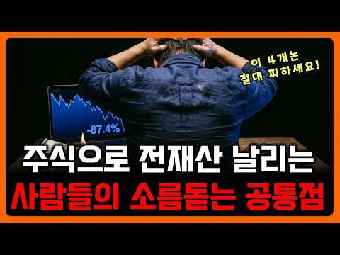
- 챕터: 0:00 전 재산 날린 사람들의 4가지 공통점 · 0:50 단타 매매가 실패하는 구조적 이유 · 3:39 과거 차트 패턴 맹신의 치명적 함정 · 6:14 호재 뉴스 맹신이 부르는 투자 실패 · 7:58 물타기가 계좌를 망치는 치명적 원리 · 9:47 물타기와 추가 매수의 결정적 차이점 · 10:59 계좌를 지켜내는 확실한 투자 원칙
- 설명 앞부분: 주식으로 전 재산을 날렸다는 이야기가 생각보다 자주 벌어지는 진짜 이유는 무엇일까요? 평범하게 직장을 다니며 투자하는 사람들도 빠질 수밖에 없는 4가지 치명적인 착각과 함정이 무엇인지 영상에서 명확히 확인해 보세요. [마르지 않는 투자 ATM] 잠자는 동안에도 돈이 들어오는 방법을 찾아내지 못한다면, 당신은 죽을 때까지 일을 해야만 할 것이다 - 워런 버핏 훌륭한 기업 3개만 찾아낼 수 있다면, 당신은 엄청난 부자가 될 수 있습니다 - 찰리 멍거 저희는 바로 그 '잠자는 동안에도 돈을 버는 방법'을 이야기하고자 합니다. 복잡한 이…
- 같은 채널 평소 대비 ×6.4 (채널 최근 롱폼 중앙값 11,981회) · 평소 영상: 주식수익률을 확실하게 낮추는 단 하나의 행동 (11,981회) / 남편이 저 몰래 친정 유산 3억을 삼성전자2배ETF에 넣어서 -50%입니다. 어떡하죠? (11,777회)
- 대본 없음 (설명) — 음성인식이 끝나면 도입부·흐름이 들어감
- 댓글 122/122: 좋은 점 — 영상 6 · 감사·응원 4 · 더 알고 싶은 것 0 · 아쉬운 점 — 영상 1 · 반박·불만 — 의견 다름 2 · 정치·사회 2 · 경험 공유 7 · 구독·다음 기대 0
  - 좋은 점 — 영상 👍30 “단타 하다가 20년 연속 깡통 찼습니다 공감합니다”
  - 좋은 점 — 영상 👍5 “짧고 정확하게 정리해주시네요”
  - 감사·응원 👍7 “고맙습니다.”
  - 감사·응원 👍3 “극소수에 분들이 그 어려운걸 해내더라구요.. ㅠ 보면 포모 겁나게 옵니다.. 월천 월억 일천 일억.. 유투부 보면 어마무시합니다.. ㅠ 항상 좋은 영상 감사합니다.”
  - 아쉬운 점 — 영상 👍0 “과거에서 패턴을 찾고 그걸로 미래를 예측한다. 여기서 격하게 공감합니다. 주식 방송임. 심지어 티비에서 하는 방송인데 소위 전문가라는 사람이 나와서 그래프를 가지고 그림 그리고 앉았음. 과거에 여기서 이렇게 됐으니 지금 이 모양에서도 이렇게 될 것이다. ㅋㅋ 이게 무…”
  - 반박·불만 — 의견 다름 👍12 “단타로 돈번사람 많던데요 고수들 장난아닙니다!”
  - 반박·불만 — 의견 다름 👍2 “*단타로 돈 버는 사람 많아요 ㅋㅋㅋㅋ 뭔 헛소리이신지 ㅋㅋㅋ 본인이 못하니까 합리화해버리노 ㄷㄷㄷ 유튜브만 봐도 차고 넘치는데... 본인 주제 파악 못하고 대출끌어다가 단타하니까 망하는거지... 자기 실력대로 적당하게 매매하고하면서 실력키워서 몇십억씩 버는 사람 많…”
  - 정치·사회 👍2 “좋은영상입니다 대폭등장에 집팔고 대출끌어다가 올린 삼성전자.하이닉스 외국인인 진작부터 개인한테 계속 팔아재꼈고 기관들 버리기 시작하면 반토막 한달도 안걸립니다. 농담같죠? 한번당해보시고 몸소깨우치십쇼. 아무리말해줘도 본인이 겪은것만큼 뼈져리게 느끼는건 없으니까요. 폭…”
  - 정치·사회 👍2 “1번+2번 단타에 대한 이야기는 공감합니다. 이전에는 대부분의 주식이 9:30분부터 안정적으로 상승했지만, 이젠 9:30~10:30사이에 오르기도 하고, 더 늦은 시간에 오르기도합니다. 혹은 9:00~9:30까지만 상승하고 직후에 탈출시간 없이 곧바로 내리쳐박히는 주…”
  - 경험 공유 👍12 “단타로 버는 사람도 있고 잃는 사람도 있고 장투로 버는 사람도 있고 몆년째 물려서 삼전닉스 비중적은 사람도 있지 주식은 답이 없어 답을 정할려고 하지마”
  - 경험 공유 👍4 “젠슨황도 만나는 페이커가 1대4로 프로선수 이기는거 보고 나도 할 수 있다는 것과 같다 단타는”

### 142. THIS New 20% Dividend ETF Just Changed Passive Income FOREVER!

- https://www.youtube.com/watch?v=WYnRRC18FIk · Viktoriya M Finance · 구독자 19,500 · 조회수 75,789 (×3.9, 하루 1,074.7) · 좋아요 2,243 (3.0%) · 11.5분 · 2026-08-11 · 주제 묶음 2. 장기투자·ETF·지수 · 형식 정보·해설 (그 밖) · 폴더 `W_WYnRRC18FIk` (웹 승인)
- 썸네일: 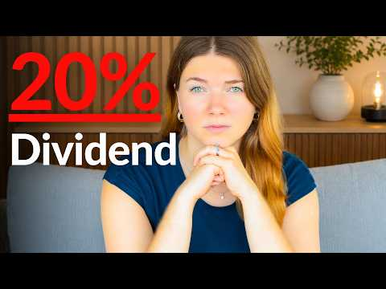
- 설명 앞부분: In this video, I break down a new dividend ETF that has completely changed passive income generation. This fund provides a massive 20% dividend yield (TTM) and uses a unique mix of covered calls and options strategies and aims to provide more growth & income potential than peers like QQQI. But the …
- 같은 채널 평소 대비 ×7.1 (채널 최근 롱폼 중앙값 10,684회) · 평소 영상: My TOP 3 Dividend ETFs to BUY & HOLD FOREVER - Ra… (10,816회) / THIS ETF Just REPLACED my S&P500 in 2026! (10,553회)
- 대본 (자막, 5.9 음절/초) 첫 20초: “고수익 분야에서 가장 저명한 ETF 제공 업체 중 하나 이자 SPYI 나 QQQI 같은 인기 펀드를 운용 하는 팀이 새로운 ETF 시리즈를 출시 했는데, 특정”
- 첫 1분: “고수익 분야에서 가장 저명한 ETF 제공 업체 중 하나 이자 SPYI 나 QQQI 같은 인기 펀드를 운용 하는 팀이 새로운 ETF 시리즈를 출시 했는데, 특정 펀드의 경우 배당 수익률이 20 %를 넘어서고 있습니다. 이 ETF 는 6 개월도 채 되지 않아 3 억 달러에 가까운 운용 자산을 모으며 큰 주목을 받고 있는데, 제가 본 적 없는 완전히 새로운 방식의 고수익 전략을 도입 했습니다. 그들 에게 박수를 보냅니다. 그들은 매우 창의적인 일을 해냈 습니다. 하지만 문제는 이것이 좋은 투자 수단 인가 하는 점 입니다. 그리고 여러분의 포트폴리오에 고려해 볼 만한 가치가 있을까요? 이제이 새로운 ETF 를 이해 하기 위해 꼭 알아야 할 중요한 세부 사항이 하나 있습니다. 그러니”
- 흐름 (90초마다 첫 문장): 0:10 고수익 분야에서 가장 저명한 → 1:31 하나만 매도 할 수 있습니다. → 3:02 하면 43%의 수익을 내야 → 4:30 노출과 NDX 커버 드 콜 전략을 → 6:00 주식 100 주를 사는 것 보다 → 7:30 드 콜 매도에 대해 알아 → 9:00 필요 합니다. 손실이 지수 → 10:31 구독을 눌러 주시고, 유튜브
- 댓글 182/182: 좋은 점 — 영상 0 · 감사·응원 0 · 더 알고 싶은 것 0 · 아쉬운 점 — 영상 0 · 반박·불만 — 의견 다름 0 · 정치·사회 0 · 경험 공유 0 · 구독·다음 기대 0

### 143. 【オルカンvsS&P500】2026年どっちが正解？｜乗り換えた人、50年ぶりの罠にハマってます

- https://www.youtube.com/watch?v=61yzienNygE · シンガポール投資家KAZ · 구독자 36,900 · 조회수 140,712 (×3.8, 하루 932.0) · 좋아요 1,288 (0.9%) · 16.9분 · 2026-05-23 · 주제 묶음 2. 장기투자·ETF·지수 · 형식 정보·해설 (그 밖) · 폴더 `W_61yzienNygE` (웹 승인)
- 썸네일: 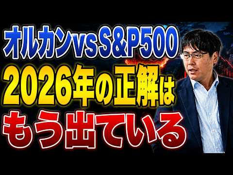
- 챕터: 0:00 ハイライト · 0:10 本日のテーマ · 1:13 背景にある構造的変化 · 4:14 2つの理由について · 6:01 2025年は統計的に異常な年だった · 6:59 ドル安が終わったらどうなる？ · 8:35 今後の考え方 · 11:30 世界の株式市場200年の覇権推移 · 13:10 オルカンの7割はアメリカという事実 · 15:00 本日のまとめ
- 설명 앞부분: 2025年、オルカンがS&P500に初めて明確に勝ちました。 みなさんはオルカンとS&P500、どちらを選んでいますか？ 🔵シンガポール投資家KAZの公式LINEはこちら YouTubeでいえない話をこっそり内緒で共有中👀 🟢シンガポール投資家KAZ（幣原和寿） 英国の大学を卒業後、コカ・コーラやGEでデータサイエンティストとしてデータ分析・モデル構築を担当。 その後、運用額1,500億円規模のファミリーオフィスや日本株ファンドにてCIO / COOを歴任し、約9年間にわたり資産運用の意思決定とファンド運営に携わる。
- 같은 채널 평소 대비 ×5.0 (채널 최근 롱폼 중앙값 28,156회) · 평소 영상: 「円に戻さなければ無税」は嘘だった｜外貨運用者を襲う最高裁の衝撃判決 (29,794회) / 【GDP世界3位】問題だらけなのに株価は最高値。日本とそっくりすぎるドイツ (26,517회)
- 대본 없음 (설명) — 음성인식이 끝나면 도입부·흐름이 들어감
- 댓글 44/44: 좋은 점 — 영상 0 · 감사·응원 0 · 더 알고 싶은 것 0 · 아쉬운 점 — 영상 0 · 반박·불만 — 의견 다름 0 · 정치·사회 0 · 경험 공유 0 · 구독·다음 기대 0

### 144. 삼전·하이닉스 '2배 레버리지 ETF', 5월 22일 상장 사기 전에 꼭 알아야 할 모든 것

- https://www.youtube.com/watch?v=ZG8e0hzaFY0 · 경제가머니 · 구독자 22,500 · 조회수 84,784 (×3.8, 하루 507.9) · 좋아요 1,347 (1.6%) · 28.4분 · 2026-05-07 · 주제 묶음 9. 빚투·레버리지 · 형식 정보·해설 (그 밖) · 폴더 `W_ZG8e0hzaFY0` (웹 승인)
- 썸네일: 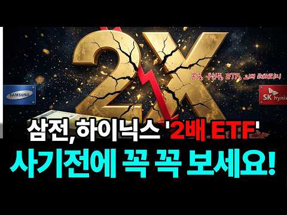
- 설명 앞부분: 5월 22일이면 우리나라 증시에 한 번도 본 적 없는 '단일 종목 2배 레버리지 ETF'가 처음 상장됩니다. 작년에 미국에서 비슷한 상품에 1조 5천억 원을 넣었던 한국 투자자분들 절반 가까이가 반토막 났는데, 같은 구조가 그대로 우리 시장에 들어옵니다. 이번 영상에서는 두 부분으로 나눠서 짚어드려요. 앞부분은 새로 나오는 단일 종목 2배 레버리지 ETF가 정확히 어떤 구조로 작동하고, 어떤 위험이 숨어 있는지를 사례·시뮬레이션·정부 안전장치까지 처음부터 끝까지 풀어드립니다. 뒷부분은 같은 삼성전자·SK하이닉스에 투자하는 본주, …
- 같은 채널 평소 대비 ×150.9 (채널 최근 롱폼 중앙값 562회) · 평소 영상: 한국 직장인 절반이 AI를 쓰고도 시간을 못 아끼는 진짜 이유 (562회) / "종목은 맞았는데 계좌는 왜 이래?" 개인이 고른 주식은 102% 올랐는데 12조가 떠난… (570회)
- 대본 없음 (설명) — 음성인식이 끝나면 도입부·흐름이 들어감
- 댓글 148/148: 좋은 점 — 영상 6 · 감사·응원 11 · 더 알고 싶은 것 0 · 아쉬운 점 — 영상 2 · 반박·불만 — 의견 다름 2 · 정치·사회 3 · 경험 공유 2 · 구독·다음 기대 0
  - 좋은 점 — 영상 👍10 “너무좋은 정보네요 ~”
  - 좋은 점 — 영상 👍5 “도움이 많이되었습니다~ 감사합니다”
  - 감사·응원 👍5 “도움이 많이되었습니다~ 감사합니다”
  - 감사·응원 👍4 “유익한 정보 감사합니다!!!”
  - 아쉬운 점 — 영상 👍2 “AI 음성 첸 백만원..”
  - 아쉬운 점 — 영상 👍1 “AI목소리인듯”
  - 반박·불만 — 의견 다름 👍6 “주린이들 참고용으로 제작해 주셨네요. 에쎈피500도 레버리지는 사는거 아닙니다.”
  - 반박·불만 — 의견 다름 👍2 “인버스,레버리지 이런거 하는거 아닙니다! 궁금하면 한번 당해보시던지 ㅋ”
  - 정치·사회 👍11 “이것은 아마도 말하는 사람이 중국인이거나 중국인이 쓴글이거나 중국인이 운영하는 채널같은데 저는 그렇게 예상되네요. 혹시 국적이 어떻게 되나요? 정직하게 국적을 밝혀줄수 없나요?”
  - 정치·사회 👍0 “나라의 대통령이 국민을 도박판으로 끌어들이네,,ㅋㅋ이게 나라냐”

### 145. 연금저축 IRP 계좌에서 사모을 ETF 3대장 추천! 결국 국내상장 나스닥 S&P500 다우존스 ETF 적립식으로 사모으는 방법이 추천 됩니다

- https://www.youtube.com/watch?v=yITsxwpiFOw · 소금달 - 소액 금 달러 투자 · 구독자 2,770 · 조회수 10,208 (×3.7, 하루 1,683.8) · 좋아요 34 (0.3%) · 20분 · 2026-10-15 · 주제 묶음 2. 장기투자·ETF·지수 · 형식 정보·해설 (그 밖) · 폴더 `W_yITsxwpiFOw` (웹 승인)
- 썸네일: 
- 챕터: 0:00 국내상장 미국 ETF 3대장 · 0:29 나스닥 100 ETF 추천 · 5:12 S&P 500 ETF 추천 · 11:08 미국배당 다우존스 ETF 비교 · 19:24 연금저축 IRP ISA 절세계좌 장기투자
- 설명 앞부분: 국내상장 미국주식은 3대장 모두 적립식 투자 하시는걸 추천 드립니다. IRP, ISA, 연금저축 계좌에서 절세 비교하고, 국내상장 상품별로 수수료 비교하면 그 다음은 꾸준히 사모으면서 장기투자하는게 정답인것 같습니다.
- 같은 채널 평소 대비 ×21.5 (채널 최근 롱폼 중앙값 474회) · 평소 영상: 은퇴없이 죽을 때까지 일만 해야할까? (474회) / 미국주식 대표 S&P 500 ETF 비교 방법! 하나만 골라서 연금저축에서 적립식 투자로… (468회)
- 대본 없음 (설명) — 음성인식이 끝나면 도입부·흐름이 들어감
- 댓글 2/2: 좋은 점 — 영상 0 · 감사·응원 0 · 더 알고 싶은 것 0 · 아쉬운 점 — 영상 0 · 반박·불만 — 의견 다름 0 · 정치·사회 0 · 경험 공유 0 · 구독·다음 기대 0

### 146. Egyptian Guidelines المستثمر المصري يعمل إيه ؟ عقار ولا ذهب ولا دولار ولا بورصة؟ د. حسن ا…

- https://www.youtube.com/watch?v=F_RSQy0sRtM ·   GroWise |  الاستثمار مع مصطفى خليل  · 구독자 23,700 · 조회수 86,372 (×3.6, 하루 24,236.2) · 좋아요 1,038 (1.2%) · 90.3분 · 2026-10-17 · 주제 묶음 기타 · 형식 정보·해설 (그 밖) · 폴더 `W_F_RSQy0sRtM` (웹 승인)
- 썸네일: 
- 챕터: 0:00 ليه المصري بيفضل العقار والذه… · 1:15 رحلة د. حسن الصادي الأكاديمية… · 2:15 إزاي المخاطر الاقتصادية ومخاط… · 4:15 الفرق بين المستثمر والمضارب و… · 5:20 التحليل الأساسي مقابل التحليل… · 6:30 إزاي تقيّم الشركة بدل ما تركز… · 7:30 الأرباح التشغيلية مقابل الأرب… · 8:40 مشاكل هيكل السوق والرقابة وتض… · 10:15 ليه الأرباح التشغيلية مهمة في… · 11:25 دور القواعد التنظيمية في ضبط … · 13:50 الطروحات العامة والطرح الخاص … · 16:40 هل صناديق ضمان خسائر الاكتتاب… · 18:00 تسعير الطروحات: مين بيستفيد م… · 20:40 الاستثمار بالهامش والرافعة ال… · 22:30 التخصيص في الاكتتابات وتأثيره… · 23:30 الحدود السعرية وإيقاف التداول… · 25:00 ليه المستثمر الصغير ممكن يبيع… · 26:15 الاستثمار في الذهب: السبائك و… · 27:30 هل شراء الذهب بيحافظ على الثر… · 29:45 الدولار والذهب والاستثمار الم…
- 설명 앞부분: كيف تختار السهم الصح وتكسب من البورصة؟ Cash Flow, P/E, PEG, Options & Risk Management
- 같은 채널 평소 대비 ×8.0 (채널 최근 롱폼 중앙값 10,760회) · 평소 영상: Money , investment and Interest إزاي الفلوس بتشتغ… (10,760회) / ٣٠عامًا في الاستثمار ∣ خالد عقل يكشف أسرار المال … (11,507회)
- 대본 없음 (설명) — 음성인식이 끝나면 도입부·흐름이 들어감
- 댓글 251/251: 좋은 점 — 영상 0 · 감사·응원 0 · 더 알고 싶은 것 0 · 아쉬운 점 — 영상 0 · 반박·불만 — 의견 다름 0 · 정치·사회 0 · 경험 공유 0 · 구독·다음 기대 0

### 147. Chip Stocks Selling Off: When I Switch From Buying Dips to Shorting (NVDA, AMD, AVGO, TSL…

- https://www.youtube.com/watch?v=JVzvv_YZD7Y · Danielle Shay · 구독자 6,830 · 조회수 24,739 (×3.6, 하루 5,485.2) · 좋아요 135 (0.5%) · 8.3분 · 2026-10-16 · 주제 묶음 기타 · 형식 정보·해설 (그 밖) · 폴더 `W_JVzvv_YZD7Y` (웹 승인)
- 썸네일: 
- 설명 앞부분: Why are semiconductor stocks selling off so hard, and when does a dip buy turn into a short? On Schwab Network's The Watch List, I explain the exact chart levels I watch, plus my plan for NVIDIA, AMD, and Broadcom heading into earnings. What we covered: Why this year's moves have been so exaggerate…
- 같은 채널 평소 대비 ×9.4 (채널 최근 롱폼 중앙값 2,632회) · 평소 영상: Spotlight on Semiconductors: AVGO, MU, STX, AMD &… (2,990회) / Danielle Shay on Fox Business: Space Stocks, Phot… (2,273회)
- 대본 없음 (설명) — 음성인식이 끝나면 도입부·흐름이 들어감
- 댓글 61/61: 좋은 점 — 영상 0 · 감사·응원 0 · 더 알고 싶은 것 0 · 아쉬운 점 — 영상 0 · 반박·불만 — 의견 다름 0 · 정치·사회 0 · 경험 공유 0 · 구독·다음 기대 0

### 148. “아이렌 긴급 ,30달러 깨질듯한 상황.. 손절각인가??(ft.코어위브/CPI)아이렌맨.

- https://www.youtube.com/watch?v=cTlVY95Qzlk · 아이렌맨 : IREN을 사랑하는 남자 · 구독자 7,940 · 조회수 28,672 (×3.6, 하루 4,669.0) · 좋아요 342 (1.2%) · 8.8분 · 2026-10-15 · 주제 묶음 8. 투자 심리·실패 · 형식 인터뷰·강연·대담 · 폴더 `W_cTlVY95Qzlk` (웹 승인)
- 썸네일: 
- 설명 앞부분: 오늘은 급하게 차에서 영상올립니다. 준비해둔 자료가있는데.. 그냥 그게 중요치않기에 아이렌의 운명은 ..?
- 같은 채널 평소 대비 ×2.2 (채널 최근 롱폼 중앙값 12,943회) · 평소 영상: "아이렌, AI 속도조절론에 대니얼 로버츠(ceo)가 답했다… JP모건도 IREN 매수 … (13,419회) / "아이렌 실적발표 D-1 ∣ 시험장 들어가기 전, 이것만 알고 가자 (feat. 엔비디아… (12,467회)
- 대본 없음 (설명) — 음성인식이 끝나면 도입부·흐름이 들어감
- 댓글 395/395: 좋은 점 — 영상 1 · 감사·응원 40 · 더 알고 싶은 것 7 · 아쉬운 점 — 영상 1 · 반박·불만 — 의견 다름 7 · 정치·사회 1 · 경험 공유 23 · 구독·다음 기대 1
  - 감사·응원 👍231 “이 형 인정해 주자, 매일같이 떨어져도 멘탈 지키면서 주식 가격올리고, 가오가 있는 사람이다. 응원합니다.”
  - 감사·응원 👍56 “아이렌이 의외로 이번장이후로 코어. 네비보다 더많이 올라갈수있어요~ 항상응원하니다 힘내고 힘내세요! 장투의길은 원래 힘든법이죠!! 화이팅!”
  - 더 알고 싶은 것 👍16 “주가가 얼마나 떨어지던 물타고 버티고 하는 종목은 대형주에나 해당되는 말이고요.. 아이렌같은 부도날 가능성도 있는 중소형주는 그렇게 하다가 골로간 사람들 한둘이 아닙니다. 아이렌은 절대 부도 안난다구요?? 지금 cds 폭등하는게 안보이시나요? 코로나때 저금리로 유동성…”
  - 더 알고 싶은 것 👍4 “손절좀부탁드려요형님ㅜㅜ 그래야오를듯합니다”
  - 아쉬운 점 — 영상 👍5 “29불에 1억정도 시드 박았네요 장기계좌에 8불 3000만원 있는데 늘 아쉬웠는데 자리 좋은거 같아요”
  - 반박·불만 — 의견 다름 👍16 “주가가 얼마나 떨어지던 물타고 버티고 하는 종목은 대형주에나 해당되는 말이고요.. 아이렌같은 부도날 가능성도 있는 중소형주는 그렇게 하다가 골로간 사람들 한둘이 아닙니다. 아이렌은 절대 부도 안난다구요?? 지금 cds 폭등하는게 안보이시나요? 코로나때 저금리로 유동성…”
  - 반박·불만 — 의견 다름 👍10 “오를수도 있고 떨어질수도 있다. 응원하지도 말고 조롱하지도 말자고 말했더니 선동하지말라고 한다. 지켜보자고 했더니 응원할것도 아니면서 왜 지켜보냐고 시비를 건다. 도대체 어떤것이 선동인것인가?? 이 채널은 아이렌을 응원하는 사람들만 댓글을 달수 밖에 없는 것인가? 합…”
  - 정치·사회 👍2 “데이터 센터 반대의 목소리가 높아지고 있지만 중간선거 끝나면 불확실성이 제거돼서 이유 없이 오를겁니다”
  - 경험 공유 👍18 “이런분이 찐이지 떨어지던 오르던 자기 신념 자기주관 아이렌 저도 이번에 떨어져서 조금식 담아봅니다 올라가길 응원합니다 화이팅!”
  - 경험 공유 👍16 “주가가 얼마나 떨어지던 물타고 버티고 하는 종목은 대형주에나 해당되는 말이고요.. 아이렌같은 부도날 가능성도 있는 중소형주는 그렇게 하다가 골로간 사람들 한둘이 아닙니다. 아이렌은 절대 부도 안난다구요?? 지금 cds 폭등하는게 안보이시나요? 코로나때 저금리로 유동성…”
  - 구독·다음 기대 👍2 “항상 볼때마다 잘생겼어ㅎㅎ아이렌 떨어져도 아이렌남 보면서 버티는 중 하루에 1영상이면 좋겠네요. 기다려집니다”

### 149. Ben Felix: Stock Picking Is Dead ∣ Investi (Ep. 59)

- https://www.youtube.com/watch?v=2uJq7OQhpGg · Investi · 구독자 24,400 · 조회수 87,458 (×3.6, 하루 1,157.4) · 좋아요 1,664 (1.9%) · 80.6분 · 2026-08-06 · 주제 묶음 2. 장기투자·ETF·지수 · 형식 정보·해설 (그 밖) · 폴더 `W_2uJq7OQhpGg` (웹 승인)
- 썸네일: 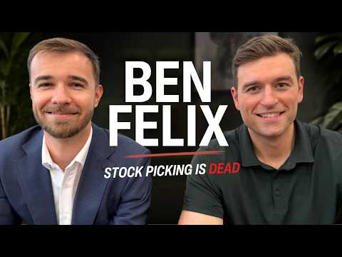
- 챕터: 0:00 Welcome Ben Felix to our firs… · 1:50 Why most investors underperfo… · 24:09 AI, bubbles, and investing · 27:49 Are young investors saving to… · 36:04 Understanding covered-call ET… · 55:24 100% equity portfolios vs. ad… · 62:08 What would change Ben's mind … · 70:03 Private equity: volatility an… · 75:38 Dealing with scams and protec… · 80:13 Closing remarks and episode w…
- 설명 앞부분: In this episode, we discuss why most investors underperform the market, the impact of AI on investing, Bitcoin, wealth management, covered-call ETFs, dividends, expected returns, and the biggest mistakes investors make. Topics covered: Why most investors underperform the market Stock picking vs. in…
- 대본 없음 (설명) — 음성인식이 끝나면 도입부·흐름이 들어감
- 댓글 191/191: 좋은 점 — 영상 0 · 감사·응원 0 · 더 알고 싶은 것 0 · 아쉬운 점 — 영상 0 · 반박·불만 — 의견 다름 0 · 정치·사회 0 · 경험 공유 0 · 구독·다음 기대 0

### 150. This $85,000 Portfolio Helps Me Escape the Rat Race

- https://www.youtube.com/watch?v=U-QBVlDPXm8 · The Dividend Nomad · 구독자 15,200 · 조회수 53,899 (×3.5, 하루 356.1) · 좋아요 1,406 (2.6%) · 17.6분 · 2026-05-23 · 주제 묶음 2. 장기투자·ETF·지수 · 형식 정보·해설 (그 밖) · 폴더 `W_U-QBVlDPXm8` (웹 승인)
- 썸네일: 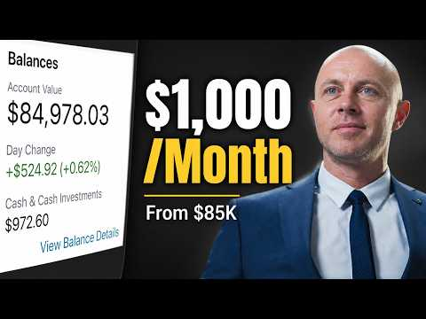
- 설명 앞부분: In this weekly portfolio update, I share my $85,000 investment portfolio that currently generates around $1,000 per month in income through dividend investing, ETFs, and a barbell investing strategy focused on both income and long-term growth. I’ll walk through every holding in my brokerage account…
- 같은 채널 평소 대비 ×16.9 (채널 최근 롱폼 중앙값 3,184회) · 평소 영상: My Portfolio Is Paying Me While I Wait to Invest … (3,184회) / How I Built a Life of Financial Freedom (Without … (3,186회)
- 대본 없음 (설명) — 음성인식이 끝나면 도입부·흐름이 들어감
- 댓글 312/312: 좋은 점 — 영상 0 · 감사·응원 0 · 더 알고 싶은 것 0 · 아쉬운 점 — 영상 0 · 반박·불만 — 의견 다름 0 · 정치·사회 0 · 경험 공유 0 · 구독·다음 기대 0

### 151. Jeden Monat Miete ohne eigene Immobilie - warum ich jetzt Realty Income kaufe

- https://www.youtube.com/watch?v=jeVV2buqJ_k · Aktienhai · 구독자 2,910 · 조회수 10,082 (×3.5, 하루 1,759.8) · 좋아요 124 (1.2%) · 11분 · 2026-10-15 · 주제 묶음 2. 장기투자·ETF·지수 · 형식 정보·해설 (그 밖) · 폴더 `W_jeVV2buqJ_k` (웹 승인)
- 썸네일: 
- 챕터: 0:00 Jeden Monat Miete, trotzdem b… · 0:52 Realty Income (ISIN: US756109… · 1:53 Warum die Aktie seit Jahren f… · 3:22 Umsatz, FFO und AFFO · 5:06 Bewertung, Dividende, Schulden · 7:10 Was bei Realty Income wirklic… · 8:35 NNN REIT und Agree Realty im … · 8:58 Der Haken · 9:57 Score und Fazit · 10:25 Würde ich kaufen?
- 설명 앞부분: Realty Income zahlt über 670 Monatsdividenden in Folge und hat ein Geschäft, das jedes Jahr wächst: Trotzdem steht die Aktie von Realty Income rund ein Viertel unter Ende 2021. Für alle, die sich eine monatliche Miete ins Depot holen wollen, ist das die spannende Frage: Schnäppchen oder Falle? 🎁 Si…
- 같은 채널 평소 대비 ×5.8 (채널 최근 롱폼 중앙값 1,735회) · 평소 영상: Rheinmetall Aktie: Absturz oder Explosion? (1,735회) / Ich investiere 1.000 € in Rheinmetall (1,793회)
- 대본 없음 (설명) — 음성인식이 끝나면 도입부·흐름이 들어감
- 댓글 38/38: 좋은 점 — 영상 0 · 감사·응원 0 · 더 알고 싶은 것 0 · 아쉬운 점 — 영상 0 · 반박·불만 — 의견 다름 0 · 정치·사회 0 · 경험 공유 0 · 구독·다음 기대 0

### 152. 코스피, 사이드카 발동! 5030P까지의 조정(삼전닉스 타점)

- https://www.youtube.com/watch?v=xO9xlsmI6bY · 차트도령 · 구독자 3,890 · 조회수 13,292 (×3.4, 하루 1,659.1) · 좋아요 158 (1.2%) · 12.8분 · 2026-10-13 · 주제 묶음 5. 국내주식 · 형식 정보·해설 (그 밖) · 폴더 `W_xO9xlsmI6bY` (웹 승인)
- 썸네일: 
- 챕터: 0:00 시황 · 2:37 코스피 · 7:17 코스닥 · 8:31 삼성전자 · 9:36 SK하이닉스
- 설명 앞부분: 안녕하세요 차트도령입니다. 10월13일 코스피, 코스닥, 삼성전자, sk하이닉스 차트분석입니다. 금일 오랜만에 사이드카가 발동하며 낙폭이 심화되었는데요, 앞으로 추가적인 하락이 예상되지만, 우선 1차적인 하락은 종료되었다고 생각됩니다. 내일은 반등, 하지만 6400포인트를 넘기지 못한다고 보고 있습니다. 본 채널에서 영상을 통해 소개해드리는 종목은 '정보 공유' 차원일 뿐 '종목 추천'이 아닙니다.
- 같은 채널 평소 대비 ×1.6 (채널 최근 롱폼 중앙값 8,204회) · 평소 영상: 코스피 비상, 반도체 상승 이제 끝일까?(삼전닉스 타점) (8,204회) / 코스피, 장난같나요? 8,000P간다니깐요?(삼전닉스 타점) (8,224회)
- 대본 없음 (설명) — 음성인식이 끝나면 도입부·흐름이 들어감
- 댓글 78/78: 좋은 점 — 영상 2 · 감사·응원 13 · 더 알고 싶은 것 5 · 아쉬운 점 — 영상 1 · 반박·불만 — 의견 다름 0 · 정치·사회 0 · 경험 공유 1 · 구독·다음 기대 0
  - 좋은 점 — 영상 👍0 “좋은 영상 감사합니다👍👍 5000초반 매수 준비 중이긴 하지만 깊은 하락을 맞은 종목들은 바운스~바운스 맛있게 먹어봐야죠 오늘 미국 반도체 시황도 봐야겠지만 눈치게임 하듯 맛있게 발라먹어야겠네요 관점 감사합니다”
  - 좋은 점 — 영상 👍0 “오늘도 좋은 강의 감사합니다😊😊 도령님 혹시 실례가 안된다면 (코스피/코스닥) 차트로도 분석이 가능할까요? 코스닥이 아웃퍼폼나올거 같은 차트인데 분석이 힘드네요..”
  - 감사·응원 👍1 “좋은방송 감사합니다 매일 매일 방송해 주시면 감사하겠습니다”
  - 감사·응원 👍0 “와우.. 좋은 분석 감사드립니다.”
  - 더 알고 싶은 것 👍1 “좋은방송 감사합니다 매일 매일 방송해 주시면 감사하겠습니다”
  - 더 알고 싶은 것 👍0 “5030 코스피면 삼전 닉스는 도대체 얼마인가요??? 코스피 5030은 올거같은데 삼전 닉스가 그 가격까지 밀린다는게 믿겨지지가 않네요 ㄷㄷ”
  - 아쉬운 점 — 영상 👍0 “수렴 이탈이 아래 방향이라 아쉽네요 😢”

### 153. QLD 거치식 투자, 2배까지 얼마나 걸릴까? QQQ와 비교했더니,, 충격!

- https://www.youtube.com/watch?v=dbQ_xk3IiPg · 두배럭 2XLuck · 구독자 3,120 · 조회수 10,397 (×3.3, 하루 1,491.9) · 좋아요 149 (1.4%) · 16분 · 2026-10-14 · 주제 묶음 11. 투자 일반 · 형식 브이로그·직접 해본 이야기 · 폴더 `W_dbQ_xk3IiPg` (웹 승인)
- 썸네일: 
- 설명 앞부분: QLD 거치식 투자하면 언제 2배가 될까? QQQ와 비교하면 결과는 어땠을까요? 이번 영상에서는 QLD와 QQQ에 거치식으로 투자했을 때 투자금이 2배가 되기까지 걸리는 시간을 실제 과거 데이터를 통해 비교해봤습니다. QLD 투자금 2배 달성 기간 2배 달성 과정에서의 최대 낙폭과 회복 기간 QLD와 QQQ의 2배 달성 기간 비교 레버리지 ETF의 수익과 하락 위험 투자 기간과 꾸준한 투자의 중요성 QLD는 과연 QQQ보다 빠르게 2배가 될 수 있었을까요? 실제 과거 데이터를 통해 그 차이와 투자 과정에서 주의해야 할 점까지 확인…
- 같은 채널 평소 대비 ×1.0 (채널 최근 롱폼 중앙값 9,911회) · 평소 영상: QLD 말고 SSO는 어땠을까? 10년 적립식 투자 충격 결과 비교! (9,911회) / QLD 월 200만 원 적립식 충격 결과! 월 100만 원 결과보다 얼마나? 금액과 시간… (9,918회)
- 대본 없음 (설명) — 음성인식이 끝나면 도입부·흐름이 들어감
- 댓글 21/21: 좋은 점 — 영상 2 · 감사·응원 6 · 더 알고 싶은 것 1 · 아쉬운 점 — 영상 0 · 반박·불만 — 의견 다름 0 · 정치·사회 0 · 경험 공유 1 · 구독·다음 기대 0
  - 좋은 점 — 영상 👍2 “좋은영상 감사합니다”
  - 좋은 점 — 영상 👍1 “너무 좋은 정보네요. 감사합니다.”
  - 감사·응원 👍7 “저는 직투에서는 QLD와 USD를 메인으로 매월 적립중이며 TQQQ는 MDD기준 마이너스 60,70,80으로 떨어졌을때 폭이 더 떨어질수록 현금을 더 투입하는 3분할 진입이며 SOXL은 마이너스 70,80,90일때 분할매수 하고 있는데 기회가 자주 오지는 않습니다 영…”
  - 감사·응원 👍3 “와. Qld. 대박이네요. 앞으로도. 이랫음하는 바램. ㅎㅎ. 감사합니당”
  - 더 알고 싶은 것 👍4 “Tqqq도 궁금합니다~”
  - 경험 공유 👍3 “수고 많으셨습니다. '3배 되는 시기' 좀 해주시면 감사하겠습니다. 제가 3배씩 이익실현 하는 플랜을 짜고 있어서 그렇습니다. 감사합니다 ~”

### 154. 208. 국내 커버드콜 액티브 ETF, 최고는 이겁니다

- https://www.youtube.com/watch?v=NW_PJ7iDbQI · 배당머니 : 숫자로 증명하는 ETF · 구독자 23,800 · 조회수 77,668 (×3.3, 하루 1,674.0) · 좋아요 1,246 (1.6%) · 18.2분 · 2026-09-04 · 주제 묶음 2. 장기투자·ETF·지수 · 형식 정보·해설 (그 밖) · 폴더 `W_NW_PJ7iDbQI` (웹 승인)
- 썸네일: 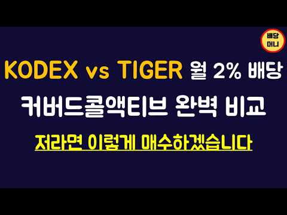
- 챕터: 0:00 인트로 · 2:39 구성종목 비교 · 3:30 옵션자산 비교 · 7:01 상품설명서 비교 · 9:54 KODEX vs TIGER 성과 비교 · 12:39 저라면 이렇게합니다 · 16:59 결론
- 설명 앞부분: KODEX와 TIGER의 커버드콜액티브 요즘 많은 분들이 투자하고 계신것 같습니다. 두 ETF의 차이점은 사실상 크게 없지만 옵션전략은 생각보다 큰 차이를 보입니다. 다소 지루할 수 있겠지만 옵션을 세세하게 분석한 내용입니다.
- 같은 채널 평소 대비 ×4.4 (채널 최근 롱폼 중앙값 17,537회) · 평소 영상: 174. 나스닥 커버드콜 논란 종결, 숫자로 보여드립니다 (17,537회) / 211. 3억 파이어 가능할지 데이터로 따져보겠습니다 (17,776회)
- 대본 없음 (설명) — 음성인식이 끝나면 도입부·흐름이 들어감
- 댓글 73/73: 좋은 점 — 영상 8 · 감사·응원 14 · 더 알고 싶은 것 4 · 아쉬운 점 — 영상 0 · 반박·불만 — 의견 다름 0 · 정치·사회 0 · 경험 공유 3 · 구독·다음 기대 1
  - 좋은 점 — 영상 👍18 “빈말이 아니라 이제껏 본 고배당ETF 영상 중에서 가장 유익했습니다👍👏 구독했구요, 앞으로도 좋은 영상 부탁 드리겠습니다😊”
  - 좋은 점 — 영상 👍6 “감사합니다. 많은 도움이 되는것 같습니다.”
  - 감사·응원 👍8 “이거 진짜 다들 많이 팔린 상품들인데 이런 내용을 알고 투자하시는 분 한명도 없을듯... 귀한 지식 나눔에 감사합니다 배당류 채널중에 압도적 원탑 채널이라고 생각합니다”
  - 감사·응원 👍6 “감사합니다. 많은 도움이 되는것 같습니다.”
  - 더 알고 싶은 것 👍4 “내용 매우 유익합니다. 말씀하신 내용처럼 (TIGER or KODEX) + RISE에 ACE고배당플러스커버드콜액티브를 같이 투자하고 있습니다. 코스피가 변동이 심해 ACE를 추가했는데 이 종목은 어떻게 보시는지 궁금하네요”
  - 더 알고 싶은 것 👍2 “영상 꾸준히 잘보고있어요. 요즘은 금리 상황이 제일 중요한거 같은데요. 채권이 혼합된 etf도 한번 다뤄주셨으면 좋겠습니다.”
  - 경험 공유 👍1 “저도 자가배당주의 지만, 행여나 신경안쓰고 현금흐름이 필요하다 판단되면, 생각해볼수 있는 전략이겠네요. 특히나 국내 커버들콜은 세금적 이득도 있으니, 해외커버드콜에 없는 장점도 있구요.”
  - 경험 공유 👍1 “타임은 환율상승분은 제거 해야 됨 20프로는 다운시켜야 본래 상승분 임....제가 타임 나스닥 가지고 있는데 마이너스 22프로 임”
  - 구독·다음 기대 👍18 “빈말이 아니라 이제껏 본 고배당ETF 영상 중에서 가장 유익했습니다👍👏 구독했구요, 앞으로도 좋은 영상 부탁 드리겠습니다😊”

### 155. 【Eng Sub】AI泡沫會爆嗎？美股一直升？基金經理教你選ETF與科技股｜US Stocks 101

- https://www.youtube.com/watch?v=fMHfTr51OfM · City Spotlight 傾城計話 · 구독자 30,600 · 조회수 99,008 (×3.2, 하루 42,098.5) · 좋아요 1,657 (1.7%) · 50.3분 · 2026-10-19 · 주제 묶음 2. 장기투자·ETF·지수 · 형식 정보·해설 (그 밖) · 폴더 `W_fMHfTr51OfM` (웹 승인)
- 썸네일: 
- 챕터: 0:00 精彩內容 ｜ Highlights · 0:52 美股投資入門介紹 ｜ US Stocks 101 · 2:14 買股票如何賺錢？股息與股東權益 ｜ Stock Owner… · 4:09 GOOG與GOOGL有甚麼分別？ ｜ Share Clas… · 5:28 股票成交量與買賣差價怎樣看？ ｜ Volume & Spr… · 6:53 股票價格由誰決定？為甚麼會升跌？ ｜ Stock Pric… · 8:09 公司有好消息，股價為甚麼不升？ ｜ News & Fund… · 9:38 ETF是甚麼？與買個股有甚麼分別？ ｜ ETFs vs. … · 12:04 標普500與納斯達克100怎樣選？ ｜ S&P 500 v… · 13:27 新手買ETF還是個股？先看風險承受能力 ｜ Risk & … · 14:59 退休後怎樣投資？資金用途比年齡更重要？ ｜ Retirem… · 16:56 基金經理為甚麼跑輸大市？ ｜ Active Fund Pe… · 18:16 美股為甚麼長期跑贏港股？ ｜ US vs. Hong Ko… · 22:20 歐洲與亞洲股市表現為何不同？ ｜ Global Marke… · 24:12 美股大跌後會回升，個股也一樣嗎？ ｜ Market Rec… · 25:51 韓國股市為甚麼大升大跌？ ｜ Leverage & Vol… · 27:58 為甚麼美國有這麼多科技公司？ ｜ Tech & Start… · 29:37 投資未上市公司，上市後一定賺錢嗎？ ｜ Private E… · 30:59 為甚麼海外投資者轉買美股？ ｜ Global Capita… · 31:57 AI股票升了很多，現在買是否太遲？ ｜ AI Stock …
- 설명 앞부분: 📈 美股為甚麼長期向上？AI股票已經升了這麼多，現在入市是否太遲？NVIDIA之後，下一個投資機會在哪裏？ 本集《傾城計話 City Spotlight》邀請擁有基金管理經驗的投資專家Wil，深入拆解美股投資、ETF與個股的分別，以及標普500和納斯達克100的投資策略。連專業基金經理都可能跑輸大市，普通人應該如何選擇？ 從退休投資的「錢的年齡」，到AI會否重演科網泡沫、機械人與自動駕駛的未來機會，帶你看懂美股趨勢、投資風險，以及如何更明智地運用自己的資金！ 📈 Why does the US stock market keep rising? Is it too late to inves…
- 같은 채널 평소 대비 ×1.9 (채널 최근 롱폼 중앙값 52,209회) · 평소 영상: 【Eng Sub】父母出院需要照顧？Medicare到底包甚麼？Home Health、康復院一次… (52,209회) / 【Eng Sub】人在美國還有海外資產？銀行戶口、股票、房產最容易忽略甚麼？ Overseas a… (48,582회)
- 대본 없음 (설명) — 음성인식이 끝나면 도입부·흐름이 들어감
- 댓글 120/120: 좋은 점 — 영상 0 · 감사·응원 0 · 더 알고 싶은 것 0 · 아쉬운 점 — 영상 0 · 반박·불만 — 의견 다름 0 · 정치·사회 0 · 경험 공유 0 · 구독·다음 기대 0

### 156. This New Fidelity ETF Has CRUSHED Every Dividend ETF

- https://www.youtube.com/watch?v=LgszhYR0rFQ · Jake Wealth Hacks · 구독자 6,700 · 조회수 21,526 (×3.2, 하루 3,884.5) · 좋아요 262 (1.2%) · 10.1분 · 2026-10-15 · 주제 묶음 2. 장기투자·ETF·지수 · 형식 정보·해설 (그 밖) · 폴더 `W_LgszhYR0rFQ` (웹 승인)
- 썸네일: 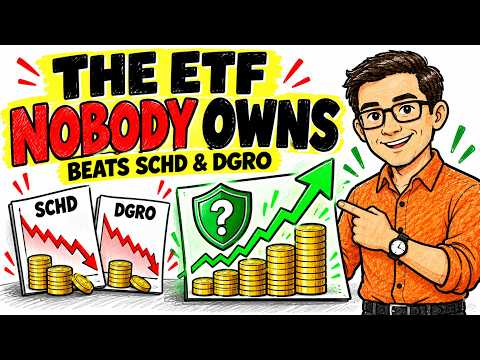
- 설명 앞부분: FELV ETF review: Is Fidelity Enhanced Large Cap Value ETF a better investment than popular dividend ETFs like SCHD, DGRO, and VYM? Discover this hidden Fidelity ETF’s strategy, performance, holdings, expense ratio, dividend yield, and risks for long-term investors and retirees. Most dividend invest…
- 같은 채널 평소 대비 ×6.2 (채널 최근 롱폼 중앙값 3,463회) · 평소 영상: These New ETFs Yield Up to 45% — Should You Buy T… (3,463회) / This New 34% SpaceX ETF Offers Monthly Cash - But… (3,442회)
- 대본 없음 (설명) — 음성인식이 끝나면 도입부·흐름이 들어감
- 댓글 13/13: 좋은 점 — 영상 0 · 감사·응원 0 · 더 알고 싶은 것 0 · 아쉬운 점 — 영상 0 · 반박·불만 — 의견 다름 0 · 정치·사회 0 · 경험 공유 0 · 구독·다음 기대 0

### 157. 원금 손실 우려 없는 최고의 커버드콜 ETF를 드디어 찾았습니다

- https://www.youtube.com/watch?v=2G0epuL2UbI · MZ파이어족 · 구독자 20,700 · 조회수 66,077 (×3.2, 하루 573.0) · 좋아요 2,187 (3.3%) · 18.8분 · 2026-06-28 · 주제 묶음 2. 장기투자·ETF·지수 · 형식 정보·해설 (그 밖) · 폴더 `W_2G0epuL2UbI` (웹 승인)
- 썸네일: 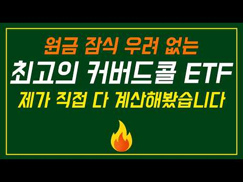
- 같은 채널 평소 대비 ×15.7 (채널 최근 롱폼 중앙값 4,201회) · 평소 영상: 커버드콜이 결국 조삼모사인 이유 (4,306회) / 월 2% 배당 주면서 본주 성과를 뛰어넘고 있는 지수 기반 커버드콜 ETF를 직접 매수해… (4,096회)
- 대본 없음 (없음) — 음성인식이 끝나면 도입부·흐름이 들어감
- 댓글 115/115: 좋은 점 — 영상 12 · 감사·응원 26 · 더 알고 싶은 것 15 · 아쉬운 점 — 영상 0 · 반박·불만 — 의견 다름 0 · 정치·사회 0 · 경험 공유 11 · 구독·다음 기대 2
  - 좋은 점 — 영상 👍9 “근래 봤던 영상중에 가장 유익한 정보를 얻었습니다!”
  - 좋은 점 — 영상 👍8 “좋은 영상 감사합니다~ Kodex 미국성장커버드콜 도 궁금합니다ㅎㅎ”
  - 감사·응원 👍8 “좋은 영상 감사합니다~ Kodex 미국성장커버드콜 도 궁금합니다ㅎㅎ”
  - 감사·응원 👍6 “넘 훌륭하신 분석 풀어주셔서 감사합니다. 고민되네요. 하지만 매우 감사합니다.”
  - 더 알고 싶은 것 👍8 “좋은 영상 감사합니다~ Kodex 미국성장커버드콜 도 궁금합니다ㅎㅎ”
  - 더 알고 싶은 것 👍7 “QDVO는 어떻게 생각하시나요?”
  - 경험 공유 👍2 “은퇴 5년 앞둔 저도 커버드콜 꽤 많은 투자중인데, 좋은 분석 컨텐츠 👍”
  - 경험 공유 👍2 “저도 DIVO+GPIQ랑 GPIX 단독이랑 고민하다가 GPIX로 갔는데 이런것도 비교가 될까요? 또 GPIX SPYI DIVO도 비대칭 수익률 비교가 될까요? 현실적이고 비슷한 고민이라 구독합니다~”
  - 구독·다음 기대 👍2 “저도 DIVO+GPIQ랑 GPIX 단독이랑 고민하다가 GPIX로 갔는데 이런것도 비교가 될까요? 또 GPIX SPYI DIVO도 비대칭 수익률 비교가 될까요? 현실적이고 비슷한 고민이라 구독합니다~”
  - 구독·다음 기대 👍1 “많은 도움이 되엇네여 감사합니다.구독하고 많이 배우겠습니다”

### 158. Top 10 Monthly Income ETFs With NO NAV Erosion! based on Total Returns (growth & Income )

- https://www.youtube.com/watch?v=kok2jmce5gw · Doug The Retirement Guy Monthly ETFS  · 구독자 21,200 · 조회수 67,022 (×3.2, 하루 453.2) · 좋아요 2,907 (4.3%) · 33.2분 · 2026-05-26 · 주제 묶음 2. 장기투자·ETF·지수 · 형식 정보·해설 (그 밖) · 폴더 `W_kok2jmce5gw` (웹 승인)
- 썸네일: 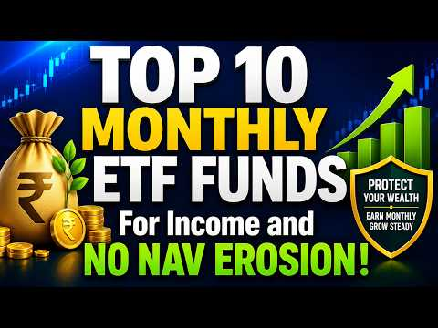
- 설명 앞부분: Find Best Bank Savings account for your Money ! Looking for consistent monthly income without destroying your hard-earned principal? In this video, we break down the Top 10 Monthly Income ETF Funds designed to deliver both high dividend yields and steady capital growth! Many investors get caught in…
- 같은 채널 평소 대비 ×7.3 (채널 최근 롱폼 중앙값 9,144회) · 평소 영상: SCHD vs VOO vs QQQM — Which One Belongs in Your R… (9,144회) / Their Advisor Said NO to Retiring With $527K — He… (8,887회)
- 대본 없음 (설명) — 음성인식이 끝나면 도입부·흐름이 들어감
- 댓글 118/118: 좋은 점 — 영상 0 · 감사·응원 0 · 더 알고 싶은 것 0 · 아쉬운 점 — 영상 0 · 반박·불만 — 의견 다름 0 · 정치·사회 0 · 경험 공유 0 · 구독·다음 기대 0

