# 주식 — 성공 사례 분석: 사례별 자세히 #121–#160

`analysis.md` 의 9번 (같은 # 번호). 자동 생성 — `tools/success_analysis.py` v1.6 (2026-11-06 08:46 UTC). ※ 연구·교육용 — 투자 권유가 아님.

### 121. Stop Guessing! Growth vs Dividend Stocks Explained in 20 Minutes

- https://www.youtube.com/watch?v=hkRXzD3CH3c · Finance Simplified · 구독자 3,640 · 조회수 123,069 (×33.8, 하루 1,173.6) · 좋아요 2,142 (1.7%) · 21.2분 · 2026-07-24 · 주제 묶음 기타 · 형식 정보·해설 (그 밖) · 폴더 `W_hkRXzD3CH3c` (웹 승인)
- 썸네일: 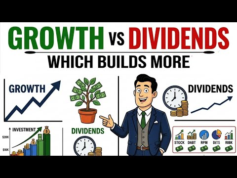
- 챕터: 0:00 The Truth Nobody Tells You Ab… · 0:25 The Biggest Investing Myth · 3:00 What Is a Growth Stock? ($10,… · 5:45 What Is a Dividend Stock? (4%… · 8:30 The $100,000 Challenge: 30-Ye… · 12:15 Who Should Buy Growth Stocks? · 14:15 Who Should Buy Dividend Stock… · 16:15 The Millionaire Strategy (80/… · 18:15 The 6 Biggest Mistakes Invest… · 20:30 The Final Verdict
- 설명 앞부분: Growth vs Dividend Stocks Growth stocks vs dividend stocks — which one actually builds more wealth? We ran the real math on $100,000 over 30 years, and the result surprised us. Most investors pick a side based on a feeling, not a number. Dividends feel safe because cash hits your account every thre…
- 같은 채널 평소 대비 ×27.5 (채널 최근 롱폼 중앙값 4,476회) · 평소 영상: Renting vs. Buying: The 10-Year Math Most America… (4,832회) / High-Dividend ETFs: What Investors Give Up to Get… (4,121회)
- 대본 없음 (설명) — 음성인식이 끝나면 도입부·흐름이 들어감
- 댓글 191/196: 좋은 점 — 영상 0 · 감사·응원 0 · 더 알고 싶은 것 0 · 아쉬운 점 — 영상 0 · 반박·불만 — 의견 다름 0 · 정치·사회 0 · 경험 공유 0 · 구독·다음 기대 0

### 122. SK하이닉스 주당 2만원 쏜다! 역대급 삼전·닉스 주주환원책! 어마어마한 상승 시나리오 [염승환 이사]

- https://www.youtube.com/watch?v=14e-x56p3AY · 경제시그널 · 구독자 28,300 · 조회수 83,083 (×2.9, 하루 8,997.8) · 좋아요 1,146 (1.4%) · 37.1분 · 2026-10-28 · 주제 묶음 기타 · 형식 인터뷰·강연·대담 · 폴더 `W_14e-x56p3AY` (웹 승인)
- 챕터: 0:00 오프닝 · 0:21 시작 · 0:30 최근 증시 흐름 분석 · 3:30 미국채 분산 투자 전략 · 6:00 SK하이닉스 실적 발표 · 9:30 솔리다임 IPO 중단 · 12:35 삼성전자 실적 발표 · 15:32 빅테크 3사 실적 발표 · 21:00 10월 FOMC, 금리 동결 전망 · 23:22 미국 중간선거와 증시 영향 · 27:38 2차전지 수급 반등 · 31:30 제약·바이오 상승 확산 · 33:20 11월 국내 증시 투자 전략
- 설명 앞부분: 🔎[속보] SK하이닉스 3분기 매출 104조·영업익 83조 역대 최대 경신! 주당 2만 원 분기배당 확정! 2026 주주환원 100조 원 역대급 스케일 발표! SK하이닉스의 역대급 실적 폭발 및 주주환원 발표 이후, 과연 AI 반도체 투자 심리와 국장의 향방은 어디로 향할지 염승환 이사와 전격 분석해 봅니다. "솔리다임 상장 철회 참 잘했습니다!" 키옥시아 지분 매각 차익을 활용한 16조 원 특별배당 기대감과 중복상장 노이즈 완벽 해소! 만약 자회사 솔리다임과의 완전 합병 카드까지 터진다면 외국인 매수세가 미친 듯이 쏠릴 역대급 …
- 같은 채널 평소 대비 ×2.5 (채널 최근 롱폼 중앙값 33,523회) · 평소 영상: 기대감 0%? 고생했던 주주들 필독! 2차전지 제약바이오 왜 반등하는지 알려드립니다 [민… (33,523회) / "이건희 추도식 직접 가봤습니다"...반도체에 모든 걸 건 이유는? 이재용이 홀로 참배한… (73,691회)
- 대본 없음 (설명) — 음성인식이 끝나면 도입부·흐름이 들어감
- 댓글 30/30: 좋은 점 — 영상 0 · 감사·응원 0 · 더 알고 싶은 것 0 · 아쉬운 점 — 영상 0 · 반박·불만 — 의견 다름 0 · 정치·사회 1 · 경험 공유 1 · 구독·다음 기대 0
  - 정치·사회 👍4 “주주환원, 노조성과급으로 돈잔치 할 때가 아니다. 정신 차려!! 중국,일본,유럽을 완전히 추월하려면 전략적 공격적 재투자해야지, 무슨 돈잔치 하기 바쁘냐!! 제발 100년에 한번 올까말까한 기회를 현명하게 재투자 하길!! 공격적 전략적 재투자하여 시장 지배력을 공고히…”
  - 경험 공유 👍2 “우리엄마 삼성주식땜시 속상하다”

### 123. 코스피 하락이 끝이라고요? 어딜봐서요?

- https://www.youtube.com/watch?v=hPx5k6DfNWQ · 차트도령 · 구독자 4,290 · 조회수 13,518 (×3.1, 하루 1,360.4) · 좋아요 191 (1.4%) · 16분 · 2026-10-27 · 주제 묶음 5. 국내주식 · 형식 정보·해설 (그 밖) · 폴더 `W_hPx5k6DfNWQ` (웹 승인)
- 설명 앞부분: 10월27일 코스피, 삼성전자, sk하이닉스, 나스닥 차트분석 및 시황브리핑입니다. 본 채널에서 영상을 통해 소개해드리는 종목은 '정보 공유' 차원일 뿐 '종목 추천'이 아닙니다.
- 같은 채널 평소 대비 ×1.2 (채널 최근 롱폼 중앙값 11,230회) · 평소 영상: 코스피, 가짜반등 속임수에 넘어가지 마세요(삼전닉스) (11,265회) / 현대차, 물타기 잘못하면 목 돌아갑니다 (11,195회)
- 대본 없음 (설명) — 음성인식이 끝나면 도입부·흐름이 들어감
- 댓글 193/192: 좋은 점 — 영상 7 · 감사·응원 32 · 더 알고 싶은 것 11 · 아쉬운 점 — 영상 3 · 반박·불만 — 의견 다름 2 · 정치·사회 0 · 경험 공유 12 · 구독·다음 기대 3
  - 좋은 점 — 영상 👍6 “수급이.... 아직인거 같아요. 정말 찐 바닥이 아닌 이상 어중간한 곳에서 괜히 매수 했다가 또... 물릴 거 같아서 관망하고 있습니다. 덕분에 차트 이해하는 데 도움이 많이 되고 있습니다. 관점이야 다들 다르겠지만 여러 관점을 잘 생각해보고 투자는 본인 몫! 분할 …”
  - 좋은 점 — 영상 👍4 “관점을 변경하신다면 빠른 업로드 혹은 게시글 부탁드립니다. 도령님의 관점 공유로 인해 도움이 되거나 더큰피해가 될수 있어서요.”
  - 감사·응원 👍6 “보는사람도 섭섭할지경인데..본인께선 얼마나 서운하실까요. 모두가 그런게아닌 신뢰하고 응원하는 팬과 애청자가 더많으니 부디 마음상하지 않으셨음하네요 정말 매번 도움 많이받고있습니다”
  - 감사·응원 👍5 “차트도령님. 화이팅입니다. 여기는 어차피 도령님 채널. 도령님 마음대로 하셔도 됩니다. 소신껏 하시는 모습 좋아요. 멍멍이들은 그냥 쳐내세요. ㅋㅋ”
  - 더 알고 싶은 것 👍26 “정말 남탓해서 정말 미안한데, 너무 좌절해서 댓글 남깁니다. 6800에서 물려서 5500까지 내려올때 손실액이 4.75억정도 났는데, 거의 전재산이 다 날라갔습니다. 5500부터 근데 5000간다는 영상을 자꾸 보면서 아래로 10%나 더 열려 있으면 일단 짜르고 50…”
  - 더 알고 싶은 것 👍4 “시장이 개판이다보니 다덜 화가 많은 것 같습니다. 그래도 도령님 방향성 덕분에 추매할 현금 꼭 붙들고 있습니다. 차라리 빨리 빼고 털어서 확 올려주길 바랄뿐입니다.”
  - 아쉬운 점 — 영상 👍5 “이분은 비판에 흥분할 이유가없는게 너무 썸네일이나 말을 절대 못간다는 식으로 과하게 반등뷰 보는사람을 긁으면서 어그로로 뽑아냄. 작용에는 반작용이 당연히 있기마련임. ‘응 아냐 거기서 올라가봤자 얼마못가’ ‘응 하락 절대 안끝났어’식이니까 당연히 올라가면 반발이 심한…”
  - 아쉬운 점 — 영상 👍1 “저도 1~2번의 하락은 더 나온다고 봅니다. 세력들이 자선사업가도 아니고 비싼 돈 들여서 주가 올리면서 개미들 다 탈출시켜줄리는 없다고 봅니다. 최대한 빼거나 오래 횡보하면서 개미들 물량 뺐겠죠. 그리고 모두가 절망에 빠지고 지쳐서 주식에 관심이 없고 뉴스조차 조용해…”
  - 반박·불만 — 의견 다름 👍12 “전문가가 분석해주면 참고하여 판단은 본인이 하는겁니다 틀렸니 어쨋니 하지맙시다~~~~~ 차트 분석해주는거보면서 공부도되고 너무 좋습니다~”
  - 반박·불만 — 의견 다름 👍0 “챠트도령님...분석잘해줘도 헛소리하는 인간들한테 너무 대응해주지 마세요 그냥 강퇴시켜 버리세요 ^^ 좋은분석 항상 감사드려요”
  - 경험 공유 👍42 “오늘 실발 내용 감동 없어서 숏 보고 있었는데, 컨콜때 계속 올라가네요. 저도 아직 숏 관점 유지하고 있긴 한데, 차트도령님 유튜브 보고 숏 관점으로 계속 바라보다보니 계속 숏치다가 손실보게 되네요. 이제는 시황 볼 수 있도록 노력해봐야겠습니다. 구취 하겠습니다. 그…”
  - 경험 공유 👍7 “오늘 수급(외인 1조, 기관1조)상황, 하닉 실발, 주주환원, 29년까지 완판, 내일 삼전실적, 마소-구글 실발, 컨콜, 금리(동결우세), 등등 볼때, 위로 한번 더 칠 가능성이 높아보입니다(확신은 마시고 하나의 가능성으로 봐주시길), 트럼프가 이란공습하는 상황만 아…”
  - 구독·다음 기대 👍15 “이정도면 틀린거죠. 삼닉이 단기20%상승나왔는데 인정할건 인정하고 다음영상 기대합니다.”
  - 구독·다음 기대 👍4 “ㅡ감사합니다. 견해 일관되네요. 내일 모습이 기다려집니다.”

### 124. 나스닥은 최고가, 반도체만 반 토막. 지금과 똑같았던 1995년으로 앞으로의 흐름을 찾아봤습니다.

- https://www.youtube.com/watch?v=7hjl_w2aWtA · 테스프레소 · 구독자 9,270 · 조회수 67,556 (×7.3, 하루 2,916.4) · 좋아요 498 (0.7%) · 9.9분 · 2026-10-14 · 주제 묶음 2. 장기투자·ETF·지수 · 형식 정보·해설 (그 밖) · 폴더 `W_7hjl_w2aWtA` (웹 승인)
- 썸네일: 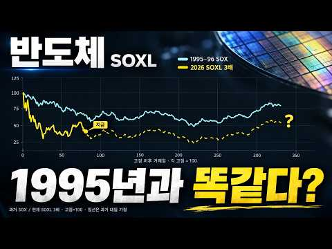
- 설명 앞부분: 나스닥100은 10월 6일 사상 최고치를 찍었는데 SOXL,삼성전자,하이닉스는 6월 고점에서 57% 내려와 있습니다. 30년 전인 1995년에도 나스닥은 최고가를 쓰는데 반도체만 반 토막이 났었고 지금과 똑같은 사건의 순서대로 주가가 반응했습니다. 그때 무슨 일이 있었고 반도체가 언제 반등했는지, 지금과 무엇이 같고 무엇이 다른지 정리했습니다.
- 같은 채널 평소 대비 ×10.9 (채널 최근 롱폼 중앙값 6,188회) · 평소 영상: FOMC 금리 동결, 남은 숙제는 유가? 엇갈린 MS·알파벳의 운명 l 테스프레소 (6,342회) / 머스크의 사업은 커지는데, 테슬라 주주도 돈을 벌 수 있을까? 머스크의 다음 계획을 봤습… (6,034회)
- 대본 없음 (설명) — 음성인식이 끝나면 도입부·흐름이 들어감
- 댓글 26/36: 좋은 점 — 영상 0 · 감사·응원 0 · 더 알고 싶은 것 2 · 아쉬운 점 — 영상 0 · 반박·불만 — 의견 다름 0 · 정치·사회 0 · 경험 공유 0 · 구독·다음 기대 0
  - 더 알고 싶은 것 👍15 “중국산은 시제품 성능이 검증된 게 없잖아요. 그리고 장기 계약분과 향후 로봇에 대한 D램 수요는 아직 잡히지도 않았다고 하는데 과연 어떻게 돌아갈지 궁금하네요.”
  - 더 알고 싶은 것 👍0 “내용 좋은데? 그래서 과거 대로라면 지금 완전히 꺽인 반도체 주가가 언제 다시 살아나서 얼마 즘 뒤에 다시 꺽이나요???”

### 125. Can I Replace My Salary With Dividends? I Ask Someone Who Did

- https://www.youtube.com/watch?v=W2jzvNEVv9c · Get Started Investing · 구독자 10,800 · 조회수 34,728 (×3.2, 하루 3,304.9) · 좋아요 207 (0.6%) · 34.8분 · 2026-10-26 · 주제 묶음 기타 · 형식 정보·해설 (그 밖) · 폴더 `W_W2jzvNEVv9c` (웹 승인)
- 챕터: 0:00 Introduction to Dividends · 3:07 Income vs Growth · 7:01 How Dividends Work · 10:34 ETF Distributions and Reinves… · 13:30 Balancing Income and Growth · 16:41 Planning Your Retirement Inco… · 19:08 Dividend Yields and Risks · 23:40 Managing Dividend Cuts · 28:31 Choosing Dividend Investments · 32:39 Dividends vs Savings Accounts
- 설명 앞부분: Jess just got paid real money from her ETFs for the first time. (a whole 30 bucks, watch out- don’t spend it all at once!) It made her wonder- could payments from investments eventually replace her salary? She sat down with Dave Gow from Strong Money to learn everything you need to know about divid…
- 같은 채널 평소 대비 ×8.3 (채널 최근 롱폼 중앙값 4,164회) · 평소 영상: From Maxing Out Credit Cards in His 20’s to Build… (4,411회) / How This 29-Year-Old Taught Herself to Invest and… (3,916회)
- 대본 없음 (설명) — 음성인식이 끝나면 도입부·흐름이 들어감
- 댓글 29/29: 좋은 점 — 영상 0 · 감사·응원 0 · 더 알고 싶은 것 0 · 아쉬운 점 — 영상 0 · 반박·불만 — 의견 다름 0 · 정치·사회 0 · 경험 공유 0 · 구독·다음 기대 0

### 126. [주식] 🔥목요일 바로 폭등 나올 Best 3종목!🔥반드시 잡아가세요! 자세하게 설명드려볼게요! #급등주 #주식추천 #급등주추천

- https://www.youtube.com/watch?v=4mYOIAc7Q98 · 급등주 장인 폭등남 · 구독자 7,440 · 조회수 20,237 (×2.7, 하루 2,267.5) · 좋아요 618 (3.0%) · 40분 · 2026-10-28 · 주제 묶음 6. 종목 고르기·분석 · 형식 정보·해설 (그 밖) · 폴더 `W_4mYOIAc7Q98` (웹 승인)
- 설명 앞부분: 🔥 내일 주목할 종목 BEST3 ∣ 보안·로봇·AI광통신 집중 분석 오늘 시장은 삼성전자·SK하이닉스를 중심으로 대형주가 강하게 상승한 것뿐만 아니라 중소형주까지 수급이 확산되면서 전반적으로 좋은 흐름을 보여줬습니다. 전날에는 반도체 대형주 위주로 자금이 몰렸다면, 오늘은 중소형 급등주까지 매수세가 확산됐다는 점을 영상에서 중요하게 봤습니다. 다만 단기간 시장이 크게 반등했다고 해서 무작정 비중을 늘리는 것은 주의해야 합니다. FOMC와 금리, 지정학적 변수 등 시장의 변동성을 키울 수 있는 요소가 남아 있기 때문에 장기투자는 한…
- 같은 채널 평소 대비 ×2.8 (채널 최근 롱폼 중앙값 7,321회) · 평소 영상: [주식] 🔥내일 바로 폭등 나올 Best 3종목!🔥반드시 잡아가세요! 자세하게 설명드려볼… (7,321회) / [주식] 🔥내일 바로 폭등 나올 Best 3종목!🔥반드시 잡아가세요! 자세하게 설명드려볼… (7,332회)
- 대본 없음 (설명) — 음성인식이 끝나면 도입부·흐름이 들어감
- 댓글 128/128: 좋은 점 — 영상 4 · 감사·응원 38 · 더 알고 싶은 것 3 · 아쉬운 점 — 영상 0 · 반박·불만 — 의견 다름 0 · 정치·사회 0 · 경험 공유 0 · 구독·다음 기대 0
  - 좋은 점 — 영상 👍3 “입사 축하합니다~^^ 앞으로도 더 좋은 정보 부탁 드립니다”
  - 좋은 점 — 영상 👍2 “아직 저는 듣기만ㅍ해서 수익제로. 천천히 매수 하고 잘 배울께요. 정말 잘 설명해 주셔서 👍👍👍”
  - 감사·응원 👍7 “기다렸어요 정말. 많은. 수익. 감사드립니다 폭등남님. 덕분에. 시드머니가 늘었어요 회사. 들어가심. 축하드립니다”
  - 감사·응원 👍4 “스카웃 되신거 정말 축하드립니다^^ 대장님 잘 따라 가겠습니다 화이팅!”
  - 더 알고 싶은 것 👍2 “축하합니다!!지속적인 좋은 정보 많이 부탁드립니다!!”
  - 더 알고 싶은 것 👍1 “입사를 축하드립니다 오랜만에 오늘 수익 봤어요 무지 감사드립니다 입사후에도 잘 부탁드립니다”

### 127. 라오어 무한매수법, 정말 계속 해도 될까? TQQQ·QLD로 12년 돌려보고 알게 된 의외의 결과

- https://www.youtube.com/watch?v=nCBMBYmFjOU · 여의도 아빠  · 구독자 2,460 · 조회수 62,829 (×25.5, 하루 739.7) · 좋아요 731 (1.2%) · 7.5분 · 2026-08-13 · 주제 묶음 7. 매매·전략 · 형식 정보·해설 (그 밖) · 폴더 `W_nCBMBYmFjOU` (웹 승인)
- 썸네일: 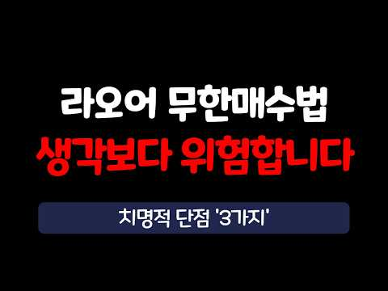
- 설명 앞부분: 라오어의 무한매수법, 12년을 그대로 돌려봤습니다. 그런데 가장 놀란 건 수익률이 아니었어요. 돈이 놀고 있는 시간과 현금이 바닥나는 순간이었습니다. QLD 무한매수 19배 vs 그냥 거치 30배 TQQQ 무한매수 19배 vs 그냥 거치 59배 12년 내내 현금의 3분의 1이 놀고 있었다 최악의 타이밍 2021년 꼭지 진입 QLD vs TQQQ 무한매수 평소엔 QLD, 찐 폭락엔 TQQQ 시작
- 같은 채널 평소 대비 ×9.6 (채널 최근 롱폼 중앙값 6,517회) · 평소 영상: S&P500에 2배 투자했는데 QQQ 1배보다 수익률이 낮았습니다… 20년 동안 무슨 일… (6,638회) / 아이에게 매달 10만원씩 미국 ETF를 사줬더니… 20년 뒤 계좌에 찍힌 금액 (S&P5… (6,396회)
- 대본 없음 (설명) — 음성인식이 끝나면 도입부·흐름이 들어감
- 댓글 186/199: 좋은 점 — 영상 5 · 감사·응원 7 · 더 알고 싶은 것 12 · 아쉬운 점 — 영상 1 · 반박·불만 — 의견 다름 6 · 정치·사회 0 · 경험 공유 13 · 구독·다음 기대 0
  - 좋은 점 — 영상 👍4 “좋은 영상 감사합니다! 멘탈 유지에 도움이 많이 돼요!”
  - 좋은 점 — 영상 👍3 “평소엔 qld 폭락엔 TQQQ무한매수.. 공감합니다만 '진짜 폭락' 이라는걸 어찌 알 수 있는지가 관건이네요ㅎㅎ.. 대부분은 그걸 못맞추니 이런 규칙이 나오는건데”
  - 감사·응원 👍21 “부지런히 할필요없이 무한매수법 공개api로 프로그램만들어서 자동으로 돌리고 있습니다 .qld도 같이 하고 있고요 . 결과 흥미롭게 잘봤습니다 감사합니다 .”
  - 감사·응원 👍7 “다른의미로 감사합니다 😘”
  - 더 알고 싶은 것 👍13 “더 좋은 방법을 알려주세요”
  - 더 알고 싶은 것 👍5 “무한매수법 저자가 서울대 자퇴, 경력 10년차 소아개원의 치과의사 맞나요? 검색해도 저자의 실명도 없고 최소한 어느 치대를 졸업했는지 최소한의 정보조차 검색이 안되고 모두 비공개라, 늘 마스크 쓰고 다니니 😢 주식관련 멤버십 비용도 월 12만원 받는다는데 저자에 대한…”
  - 아쉬운 점 — 영상 👍3 “제목으로 어그로 끄는건 여전하네”
  - 반박·불만 — 의견 다름 👍30 “무한매수법의 가장 큰 장점은 수익률이 아닙니다. 정해진 규칙을 따라서 상승장, 횡보장, 하락장에도 맨탈이 흔들리지 않으면서 꾸준히 수익을 내는 방법이지. 다양한 시나리오를 가정한 12년치 백테스트는 이 투자방법이 실전에서 쓸수 있는지 확인하는 좋은 방법이긴 하지만 수…”
  - 반박·불만 — 의견 다름 👍28 “웃고 갑니다. 직접 몇년간 하는 입장에서 라오어님 입장도 모르고 그냥 방법만 겉핥기 식으로만 평가하는 느낌이네요. 무한매수법은 리스크를 줄이기 위한 "단투"지 장투에 적합한 방법은 아닙니다. 무슨 qld 장기보유랑 비교를 해요.. 라오어님도 그냥 이것저것 귀찮으면 q…”
  - 경험 공유 👍41 “무한매수의 단점은 1. 상방이 막혀있고 하방은 열려 있으며, 2. 복리를 스스로 끊고 리셋하며, 3. 계속해서 수익을 확정하면서 텍스를 내야하는 텍스 이펙트를 고려하지 않았고, 4. 항상 이용할 수 있는 자금의 일부분만 사용하기에 수익률은 좋을수 있으니 수익금 측면에…”
  - 경험 공유 👍40 “2022년에 라오어 카페에 가입해서 꾸준히 글씀. 그때 세상이 참 재미있었음. 하수들이 세상이 망한다고 고래고래 소리지르고 거기서 유일하게 비껴간게 라오어 카페였음. 거기도 순탄하진 않았지만 적어도 tq가 80프로 떨어진 그 순간에도 tq를 믿는 사람들이 모였단 말임…”

### 128. SIP vs Lump Sum: Which Is Better for Beginners? (Explained Simply)

- https://www.youtube.com/watch?v=RydtfFBjNiM · Money Wise School · 구독자 3,190 · 조회수 11,571 (×3.6, 하루 955.3) · 좋아요 37 (0.3%) · 5.3분 · 2026-10-25 · 주제 묶음 2. 장기투자·ETF·지수 · 형식 정보·해설 (그 밖) · 폴더 `W_RydtfFBjNiM` (웹 승인)
- 설명 앞부분: Should you invest all at once or month by month? This beginner's guide explains SIP (regular monthly investing) vs lump sum investing, shows dollar cost averaging with simple examples, and covers what decades of market data say about which wins more often. Plus the middle path for nervous investors…
- 대본 없음 (설명) — 음성인식이 끝나면 도입부·흐름이 들어감
- 댓글 2/2: 좋은 점 — 영상 0 · 감사·응원 0 · 더 알고 싶은 것 0 · 아쉬운 점 — 영상 0 · 반박·불만 — 의견 다름 0 · 정치·사회 0 · 경험 공유 0 · 구독·다음 기대 0

### 129. 트럼프의 폭탄 선언으로 삼성전자와 한국 주식시장, 조정 올 수 있는 이유! #박시동 #매불쇼

- https://www.youtube.com/watch?v=3tIO_BBDMMo · 스타판 · 구독자 3,960 · 조회수 190,465 (×48.1, 하루 1,154.0) · 좋아요 3,010 (1.6%) · 22분 · 2026-05-16 · 주제 묶음 8. 투자 심리·실패 · 형식 오디오북·낭독 (명언·인생조언) · 폴더 `W_3tIO_BBDMMo` (웹 승인)
- 썸네일: 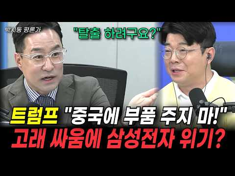
- 설명 앞부분: 따뜻한 위로와 냉철한 조언으로 힘을 주는 명언을 모았습니다 모두의 성공적인 미래가 되도록 응원합니다.
- 대본 없음 (설명) — 음성인식이 끝나면 도입부·흐름이 들어감
- 댓글 133/133: 좋은 점 — 영상 1 · 감사·응원 0 · 더 알고 싶은 것 1 · 아쉬운 점 — 영상 1 · 반박·불만 — 의견 다름 5 · 정치·사회 6 · 경험 공유 2 · 구독·다음 기대 0
  - 좋은 점 — 영상 👍2 “이분은 참 이해하기 쉽게 말씀을 해주시는것 같음”
  - 더 알고 싶은 것 👍12 “역사 그걸 알고 하는 말씀이신지 어디서 읽고 그냥 하는 얘기인지 자료를 좀 보여주면서 얘기해 주세요.”
  - 아쉬운 점 — 영상 👍1 “썸네일 제목이 너무 자극적이네요. 무슨 큰일난줄.”
  - 반박·불만 — 의견 다름 👍16 “최진봉교수는 왜 아직도 프로답지 못하게 최욱한테 너는 어쩌구 개인방송도 아닌데 주의하세요!”
  - 반박·불만 — 의견 다름 👍6 “발음도 애매하고 틀렸다고 지적하는데도 생까는 최진봉 아웃. 제발.”
  - 정치·사회 👍7 “중국이 따라잡고 있는데 한국은 노조가 돈더달라고 이난리 ..민주당아 노봉법개정해라 지선이문제야지금?”
  - 정치·사회 👍6 “민주당이 만든 노란봉투법 반드시 폐지해야합니다”
  - 경험 공유 👍70 “삼성노조중 삼성전자 주식으로 지들회사 투자하는놈들이 몇명인 묻고싶다.코로나이후로 삼전투자해온 투자자로 노저것들 정도껏해야지.나도 처음으로 노조욕하게되네”

### 130. [차트 강의] 100조 운용역이 신입 펀드매니저에게 가르쳤던 차트 패턴 8가지 (박재훈)

- https://www.youtube.com/watch?v=0JHEax_R7DE · 박재훈의 투자농장 · 구독자 22,000 · 조회수 218,477 (×9.9, 하루 6,382.1) · 좋아요 2,089 (1.0%) · 16.5분 · 2026-10-03 · 주제 묶음 6. 종목 고르기·분석 · 형식 인터뷰·강연·대담 · 폴더 `W_0JHEax_R7DE` (웹 승인)
- 썸네일: 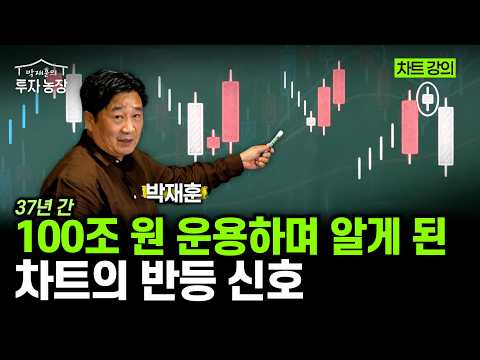
- 설명 앞부분: 10/24(토) 오전 10시, 합정역 인근에서 진행됩니다. 1부는 하반기 투자전략을 점검하고, 2부는 실전 차트강의를 진행합니다. 안녕하세요 이웃님들, 투자 농장지기 박재훈입니다. 저는 투자를 할 때 '손실을 덜 보는 것'이 가장 중요하다고 생각합니다. 그래서 오늘은 차트에서 하락에서 상승, 상승에서 하락으로 추세가 전환되는 신호를 읽는 방법을 알려드렸습니다. 제가 펀드매니저로 일하던 시절, 신입들에게 가르쳤던 내용이기도 합니다. 이웃님들의 투자에 꼭 도움이 되셨기를 바라며.. 하반기 투자전략을 점검하고, 실전 차트 강의를 듣고 …
- 같은 채널 평소 대비 ×19.0 (채널 최근 롱폼 중앙값 11,511회) · 평소 영상: 똑같은 S&P500인데, 수익률은 왜 다를까? (박재훈) (11,511회) / 프랑스 국채 금리 폭등, 주식·채권 시장 영향은? (박재훈) (11,734회)
- 대본 없음 (설명) — 음성인식이 끝나면 도입부·흐름이 들어감
- 댓글 76/83: 좋은 점 — 영상 7 · 감사·응원 17 · 더 알고 싶은 것 5 · 아쉬운 점 — 영상 1 · 반박·불만 — 의견 다름 0 · 정치·사회 0 · 경험 공유 3 · 구독·다음 기대 0
  - 좋은 점 — 영상 👍5 “진작에 이런 공부 배웠으면 작전세력들한테 덜 당했을것인데! 지금이라도 공부하고 암기하면서 실제 나타나는 모양들과 비교분석하는 눈 썰미를 키워 보겠습니다. 선생님덕분에 저의 소중한 돈 잘 지키겠습니다.”
  - 좋은 점 — 영상 👍0 “유익하게 감사히 잘 봤습니다”
  - 감사·응원 👍2 “목소리도 시원시원하시고 설명도 깔끔! 감사히 잘 들었습니다. 무료강의 신청했습니다^^”
  - 감사·응원 👍1 “선생님 안녕하세요. 잘 보고 있습니다. 장대양봉에 대해서 어느정도 기준을 알고싶습니다. 말 뜻은 이해하고 있지만 얼마만큼의 길이가 장대양봉이고 장대음봉인지.. 구분하고싶습니다. 감사합니다.”
  - 더 알고 싶은 것 👍1 “선생님 안녕하세요. 잘 보고 있습니다. 장대양봉에 대해서 어느정도 기준을 알고싶습니다. 말 뜻은 이해하고 있지만 얼마만큼의 길이가 장대양봉이고 장대음봉인지.. 구분하고싶습니다. 감사합니다.”
  - 더 알고 싶은 것 👍0 “선생님 이게 개별종목에도 적용이 되는건지 아님 지수 차트에만 해당하는건지 궁금합니다. 영상 잘 봤습니다.”
  - 아쉬운 점 — 영상 👍0 “쏙쏙 이해가 잘되요 반복해서 봐야지 ㄱㅅ”
  - 경험 공유 👍1 “저 엄청 잘해요 추세 전환 찾는거 제가 고수 ㅋ 6월말에 다 던지고 7월말에 샀어요”
  - 경험 공유 👍0 “저희쪽으로 모시고 싶습니다^^ 영상 볼때마다 느낍니다”

### 131. I Bought 1,000 Shares of JEPQ. Here’s What It Pays Me Every Month

- https://www.youtube.com/watch?v=gC-_mODu2gI · Grounded Life Investments · 구독자 5,940 · 조회수 41,057 (×6.9, 하루 1,721.4) · 좋아요 463 (1.1%) · 11.3분 · 2026-10-13 · 주제 묶음 기타 · 형식 정보·해설 (그 밖) · 폴더 `W_gC-_mODu2gI` (웹 승인)
- 썸네일: 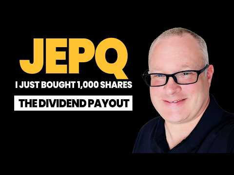
- 설명 앞부분: I Bought 1,000 Shares of JEPQ. Here’s What It Pays Me Every Month. I also talk about who this fund is for and why it is in our investment portfolio. Want to go deeper? The GLI Dashboard gives you dividend screeners, portfolio analysis, and deep dives of the companies and ETF's you need to know abou…
- 같은 채널 평소 대비 ×3.6 (채널 최근 롱폼 중앙값 11,385회) · 평소 영상: SCHD New All-Time High: I've Paused My DCA & What… (11,385회) / Income ETFs Paying 8% to 21% With Zero NAV Erosion (10,709회)
- 대본 없음 (설명) — 음성인식이 끝나면 도입부·흐름이 들어감
- 댓글 68/73: 좋은 점 — 영상 0 · 감사·응원 0 · 더 알고 싶은 것 0 · 아쉬운 점 — 영상 0 · 반박·불만 — 의견 다름 0 · 정치·사회 0 · 경험 공유 0 · 구독·다음 기대 0

### 132. De enfermero a vivir de rentas tras 18 años invirtiendo ∣ Inversores REALES #E61

- https://www.youtube.com/watch?v=-pS9upa00IA · Objetivo : Libertad financiera · 구독자 10,100 · 조회수 34,368 (×3.4, 하루 2,862.1) · 좋아요 656 (1.9%) · 90분 · 2026-10-25 · 주제 묶음 기타 · 형식 정보·해설 (그 밖) · 폴더 `W_-pS9upa00IA` (웹 승인)
- 챕터: 0:00 Por qué cambié los fondos por… · 3:13 Educación financiera y primer… · 9:20 10 años invirtiendo en fondos… · 19:14 Liquidar la hipoteca con las … · 22:46 El problema de vender fondos:… · 29:48 Cómo generar un sueldo pasivo… · 38:06 Estrategia Barbell y mentalid… · 47:53 Inversión en oro y plata físi… · 57:06 Composición y análisis de mi … · 63:21 Rentabilidad por dividendo y … · 70:12 Fiscalidad: Estate Tax en EE.… · 73:43 Educación financiera familiar…
- 설명 앞부분: Ismael Ramírez cuenta cómo pasó de los fondos de inversión a una cartera de dividendos para construir un segundo sueldo. Hablamos de inversión en bolsa, ingresos pasivos y de cómo sus inversiones le permitieron cancelar la hipoteca. Hoy nos acompaña Ismael Ramírez, enfermero, inversor, emprendedor …
- 대본 없음 (설명) — 음성인식이 끝나면 도입부·흐름이 들어감
- 댓글 165/165: 좋은 점 — 영상 0 · 감사·응원 0 · 더 알고 싶은 것 0 · 아쉬운 점 — 영상 0 · 반박·불만 — 의견 다름 0 · 정치·사회 0 · 경험 공유 0 · 구독·다음 기대 0

### 133. 단타 천재가 개발한 초간단 매매법(기본 차트 분석법)

- https://www.youtube.com/watch?v=knblsnwXsfg · 차트9단 · 구독자 469 · 조회수 17,552 (×37.4, 하루 132.0) · 좋아요 422 (2.4%) · 20분 · 2026-06-26 · 주제 묶음 6. 종목 고르기·분석 · 형식 인터뷰·강연·대담 · 폴더 `W_knblsnwXsfg` (웹 승인)
- 썸네일: 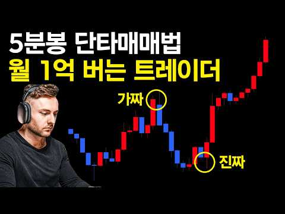
- 챕터: 0:00 시작 · 0:28 이평선 하나면 된다 · 2:21 이평선 사용법 · 5:04 탑다운 매매법 · 8:50 이평선 단타매매법
- 설명 앞부분: 단타 천재가 개발한 초간단 매매법(기본 차트 분석법) 거래량 델타 지표 무료 신청하기 트레이딩 매매법 강의 무료 신청하기 100억 트레이더의 비법서 신청하기 편리한 자동 거래봇 이용 신청하기
- 같은 채널 평소 대비 ×26.1 (채널 최근 롱폼 중앙값 672회) · 평소 영상: 단타 매매법은 딱 두가지만 알면 끝입니다. (이동평균선 거래량 차트보는법) (672회) / 5년동안 단타로 200억 벌어들인 트레이더의 개쉬운 매매법 (253회)
- 대본 없음 (설명) — 음성인식이 끝나면 도입부·흐름이 들어감
- 댓글 7/7: 좋은 점 — 영상 1 · 감사·응원 5 · 더 알고 싶은 것 1 · 아쉬운 점 — 영상 0 · 반박·불만 — 의견 다름 0 · 정치·사회 0 · 경험 공유 0 · 구독·다음 기대 0
  - 좋은 점 — 영상 👍0 “좋은 정보 감사합니다”
  - 감사·응원 👍0 “좋은지표입니다 수고많아요 감사합니다”
  - 감사·응원 👍0 “많이 배웁니다.감사합니다.”
  - 더 알고 싶은 것 👍0 “안녕하십니까 차트9단님 델타거래량지표을 신청합니다 부탁드립니다 감사합니다”

### 134. 【2chお金スレ】定年後も収入が途切れない人は何をしてる？今からできる備えを挙げてけ

- https://www.youtube.com/watch?v=2tSGWp3yGek · 2chお金シニアチャンネル · 구독자 2,150 · 조회수 14,326 (×6.7, 하루 597.5) · 좋아요 38 (0.3%) · 21분 · 2026-10-13 · 주제 묶음 10. 노후·연금 투자 · 형식 정보·해설 (그 밖) · 폴더 `W_2tSGWp3yGek` (웹 승인)
- 썸네일: 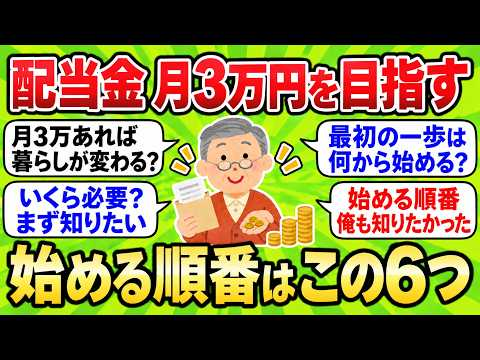
- 챕터: 0:00 はじめに · 0:24 64歳、配当が月3万 · 2:27 きっかけは元上司の一言 · 4:54 順番その1 足りない額を知る · 6:46 順番その2 現金を先に置く · 8:16 順番その3 口座とNISA · 10:38 順番その4 利回りで選ばない · 12:42 順番その5 一度に買わない · 14:38 順番その6 使い始める日 · 17:01 月3万で暮らしは変わるか · 18:45 今からでも間に合うか
- 같은 채널 평소 대비 ×3.0 (채널 최근 롱폼 중앙값 4,754회) · 평소 영상: 【2chお金スレ】45歳でFIREした勝ち組の末路…想像した人生と違う「●●してから狂い始めた」エ… (4,770회) / 【2chお金スレ】資産カーストは●●で決まる。老後2000万を溶かす人の共通点が衝撃すぎる (4,739회)
- 대본 없음 (없음) — 음성인식이 끝나면 도입부·흐름이 들어감
- 댓글 0/0: 좋은 점 — 영상 0 · 감사·응원 0 · 더 알고 싶은 것 0 · 아쉬운 점 — 영상 0 · 반박·불만 — 의견 다름 0 · 정치·사회 0 · 경험 공유 0 · 구독·다음 기대 0

### 135. QLD 10억으로 은퇴하면? 매년 5천만원 vs 1억원 인출, 10년 뒤 결과는?

- https://www.youtube.com/watch?v=e9ur-2TmAcc · 두배럭 2XLuck · 구독자 3,260 · 조회수 12,489 (×3.8, 하루 896.2) · 좋아요 162 (1.3%) · 17.6분 · 2026-10-23 · 주제 묶음 10. 노후·연금 투자 · 형식 브이로그·직접 해본 이야기 · 폴더 `W_e9ur-2TmAcc` (웹 승인)
- 설명 앞부분: QLD 10억으로 은퇴하면 매년 1억원씩 써도 괜찮을까? 이번 영상에서는 QLD에 10억원을 투자한 뒤 매년 5,000만원 또는 1억원씩 인출했을 때, 10년 후 자산이 어떻게 달라지는지 실제 과거 데이터를 통해 분석해봤습니다. QLD 10억원 투자 후 매년 5,000만원 인출 결과 매년 1억원씩 인출했을 때의 자산 변화 금융위기 직전 은퇴했다면 어떻게 달라졌을까? 인출 금액에 따른 최종 평가금과 하락 위험 비교 레버리지 ETF로 은퇴할 때 고려해야 할 위험 최근 10년처럼 시장이 상승한다면 생활비를 인출하고도 자산이 크게 늘어날…
- 같은 채널 평소 대비 ×1.2 (채널 최근 롱폼 중앙값 10,276회) · 평소 영상: QLD 10년 vs 15년 투자 비교! 5년 늘리면 투자금은 얼마나 줄어들까? (10,386회) / QLD 월 200만 원 적립식 충격 결과! 월 100만 원 결과보다 얼마나? 금액과 시간… (10,167회)
- 대본 없음 (설명) — 음성인식이 끝나면 도입부·흐름이 들어감
- 댓글 23/23: 좋은 점 — 영상 1 · 감사·응원 3 · 더 알고 싶은 것 5 · 아쉬운 점 — 영상 0 · 반박·불만 — 의견 다름 0 · 정치·사회 0 · 경험 공유 1 · 구독·다음 기대 0
  - 좋은 점 — 영상 👍0 “좋은 영상감사합니다... 매년 1억을 한번에 인출하는 영상 너무 멋집니다 그리고 만약.. 매달 1000만원씩 인출했을때의 비교 영상을 만들어 주시면 매달 생활비를 인출하는 분들에게 정말 좋은 영상이 될것 같습니다.. 힘드시겠지만 부탁드려도 될지요?❤”
  - 감사·응원 👍6 “영상 너무 감사합니다 이영상 시리즈로 qqq,tqqq도 만들어주시면 감사히 시청하겠습니다”
  - 감사·응원 👍4 “10년뒤 10억 파이어족 희망합니다.. 모두 화이팅 돈길 걸어요👏🏻👏🏻”
  - 더 알고 싶은 것 👍6 “영상 너무 감사합니다 이영상 시리즈로 qqq,tqqq도 만들어주시면 감사히 시청하겠습니다”
  - 더 알고 싶은 것 👍2 “usd 는 어떤가요? 비교 가능할까유 ~”
  - 경험 공유 👍5 “저도 10억정도 된다면 코어를 s&p500 나스닥100 같은 1배 지수로 포트폴리오로 바꿀거 같아요..거기에 qld tqqq는 공격수로ㅋㅋ”

### 136. 배당이 월급을 넘었는데 사표를 안 쓴 진짜 이유 ∣ SCHD 월급 역전 [ 재테크/미국주식/배당주식/슈드/노후대책 ]

- https://www.youtube.com/watch?v=x1xodntCp_g · 경제기상도 · 구독자 4,470 · 조회수 13,845 (×3.1, 하루 1,216.3) · 좋아요 35 (0.2%) · 21.1분 · 2026-10-25 · 주제 묶음 4. 미국·해외주식 · 형식 인터뷰·강연·대담 · 폴더 `W_x1xodntCp_g` (웹 승인)
- 설명 앞부분: 월급보다 배당이 많아진 그날, 20년 동안 떨리던 심장이 처음으로 조용해졌습니다. 매달 200만원씩 SCHD에 넣은 한 직장인이 세후 월 배당 300만원으로 '월급 역전'을 이룬 이야기입니다. 그는 사표를 쓰지 않았습니다. 오히려 회사에 남았습니다. 진짜 경제적 자유가 무엇인지, 그 답이 생각보다 조용한 곳에 있었습니다. 이런 분께 추천합니다 상사 눈치, 인사 평가, 구조조정 소문에 지친 직장인 SCHD 적립식 투자로 배당 파이프라인을 만들고 싶은 분 월급 역전 후 바로 퇴사해도 되는지 궁금한 분 금융소득종합과세와 건강보험료가 내…
- 같은 채널 평소 대비 ×1.5 (채널 최근 롱폼 중앙값 9,093회) · 평소 영상: 통장에 3억이 찍히던 날, 제 인생에서 사라진 한 가지 [ 재테크/미국주식/배당주식/슈드… (9,093회) / 1억 한 번에 vs 매달 50만원, 20년 뒤 누가 더 부자일까? ∣ SCHD 20년 승… (9,015회)
- 대본 없음 (설명) — 음성인식이 끝나면 도입부·흐름이 들어감
- 댓글 10/10: 좋은 점 — 영상 0 · 감사·응원 0 · 더 알고 싶은 것 0 · 아쉬운 점 — 영상 0 · 반박·불만 — 의견 다름 0 · 정치·사회 0 · 경험 공유 1 · 구독·다음 기대 0
  - 경험 공유 👍0 “경제적자유를 이루면 직장생활이 꿀잼으로 바뀝니다. ㅋ 그래서 전 재밌어서 못 그만 두고 있어요ㅎㅎㅎ 할거 하고, 아닌거는 임원에게도 정중하고 자료 근거해서 딱 말씀드립니다. (코스트파이어 2년차인데 올해 팀장 승진도 함😊) p.s (제 키움증권 기준) SCHD 배당금…”

### 137. 美 증시, IT버블보다 거품 심해 ...코스피도 5000까지 더 빠질 것

- https://www.youtube.com/watch?v=L69h-h8rLss · 투벤저스 주간동아 · 구독자 31,100 · 조회수 94,598 (×3.0, 하루 8,415.2) · 좋아요 0 (0.0%) · 18분 · 2026-10-26 · 주제 묶음 5. 국내주식 · 형식 정보·해설 (그 밖) · 폴더 `W_L69h-h8rLss` (웹 승인)
- 챕터: 0:00 하이라이트 · 1:16 현재 국내 증시 진단 · 1:59 현시점에서 보는 코스피 적정치와 근거 · 4:19 삼전닉스 적정주가 · 5:13 미 증시 과대평가됐다? · 9:26 향후 3~4년간 코스피 수익률이 더 높다? · 10:26 미 주식 비중 줄여야할까? · 11:50 자산 배분 전략 · 13:16 채권 투자, 언제 어떻게 해야하나 · 15:16 내년 상반기까지 투자자가 유념해야할 변수 · 16:24 혼란스러운 개인 투자자들에게
- 대본 없음 (없음) — 음성인식이 끝나면 도입부·흐름이 들어감
- 댓글 194/194: 좋은 점 — 영상 3 · 감사·응원 11 · 더 알고 싶은 것 1 · 아쉬운 점 — 영상 1 · 반박·불만 — 의견 다름 2 · 정치·사회 2 · 경험 공유 9 · 구독·다음 기대 0
  - 좋은 점 — 영상 👍1 “주가와 지수 타이밍 못맞추면서 왜자꾸 증권관련 유튜브 나오는지 모르겠네.... 이런 방송 볼수록 타이밍 못맞춰서 계속 돈 잃음. 올해 상반기 내내 비싸다 거품이다 빠진다 빠진다 했는데 계속 올랐음. 이런거 보고 못산사람들이 더더욱 최고점에 사게되는거고 지금도 더 빠진…”
  - 좋은 점 — 영상 👍0 “이번 영상은 설득력이 훌륭한 내용입니다 많은 부분 공감합니다”
  - 감사·응원 👍7 “넓은 해안 존경합니다~~~~^^감사하구요^^*”
  - 감사·응원 👍6 “영상 감사합니다. 김영익님.”
  - 더 알고 싶은 것 👍0 “부동산은 10년 동안 계속 떨어진다는 분이신데, 언제 떨어지나요? 주식도 하시네요.”
  - 아쉬운 점 — 영상 👍0 “제가 지켜보니 큰맥은 정확히 맞추시는것 같습니다, 약간의시차 방송하시면서도 약 2달 차이 나니 생각해서 매매 하라고 하신 말씀도 기억 나네요. 말씀 잠시 잊고 매매한 거이 후회 되는 부분이 있어서 아쉽네요.”
  - 반박·불만 — 의견 다름 👍1 “주가와 지수 타이밍 못맞추면서 왜자꾸 증권관련 유튜브 나오는지 모르겠네.... 이런 방송 볼수록 타이밍 못맞춰서 계속 돈 잃음. 올해 상반기 내내 비싸다 거품이다 빠진다 빠진다 했는데 계속 올랐음. 이런거 보고 못산사람들이 더더욱 최고점에 사게되는거고 지금도 더 빠진…”
  - 반박·불만 — 의견 다름 👍0 “이제와서 헛소리네 개들 저거 못믿음 사짜 저낭반 나오면 구독취소”
  - 정치·사회 👍2 “ai버블은 언젠가는 끝날것입니다. 제 생각에는 삼전과 sk하닉은 전고점까지는 못올거같고, 정부에서 배당주식에 압박해서 배당을 엄청 뿌리게해서 2번째 펌프질을 할거같습니다. 그렇게 마지막 슈팅이 끝나고 일본과 같은 장기저성장에 들어가지않을까...”
  - 정치·사회 👍0 “교수님 말씀 듣고 개미들 던지면 바닥에서 외국인, 기관들은 줍줍해서 올릴겁니다. 한참 올리고 나면 그때서야 개미들이 따라가겠죠~. 그러다 또 물리고 반복 반복 반복 . 에~휴”
  - 경험 공유 👍2 “중국전기차 좋다셔서 -95% 5년째 물려있슴다 교수님 아직도 좋은지요?”
  - 경험 공유 👍1 “코로나 급등때도 교수님이 과열이라고 했었어요. 그게 맞았죠. 이번에도 맞으신거더라구요. 5월경에 코스피지수 과열이라고 하셨는데 맞았네요.”

### 138. "이제 하락 초입이다" 한국 증시 대폭락 임박했다 '이때' 멍때리면 계좌 녹습니다 (전태룡 대표 / 통합본 1부)

- https://www.youtube.com/watch?v=nE1MmCNbA8c · 웅달책방_투자 · 구독자 3,550 · 조회수 12,931 (×3.6, 하루 932.8) · 좋아요 198 (1.5%) · 35.4분 · 2026-10-23 · 주제 묶음 2. 장기투자·ETF·지수 · 형식 인터뷰·강연·대담 · 폴더 `W_nE1MmCNbA8c` (웹 승인)
- 설명 앞부분: 🌕 "급등에 속지 마세요" 월요일 아침 코스피 대폭락? 곧 무시무시한 일 터질 겁니다 (전태룡 대표 / 통합본 1부) 본 영상은 10월 20일에 촬영되었습니다 (시청에 참고해 주세요) ※ 출연자에 대한 비난, 욕설, 비속어 등을 포함한 댓글은 무통보 삭제될 수 있습니다. 성숙한 소통 문화 형성에 동참해주시길 바라겠습니다. 감사합니다.
- 같은 채널 평소 대비 ×1.3 (채널 최근 롱폼 중앙값 10,237회) · 평소 영상: -60% 반토막난 현대차 주가 전망 앞으로 '이렇게 된다 (이재규 차장 / 통합본 2부) (10,286회) / 반도체 다음 2차전지 '이것' 지금부터 정말 무섭게 오른다 (이영훈 영업이사 / 통합본 … (10,188회)
- 대본 없음 (설명) — 음성인식이 끝나면 도입부·흐름이 들어감
- 댓글 34/34: 좋은 점 — 영상 1 · 감사·응원 0 · 더 알고 싶은 것 1 · 아쉬운 점 — 영상 0 · 반박·불만 — 의견 다름 0 · 정치·사회 7 · 경험 공유 0 · 구독·다음 기대 0
  - 좋은 점 — 영상 👍1 “설명잘들었습니다 저는 벌써팔고 나왔습니다”
  - 더 알고 싶은 것 👍1 “그럼그조정 이 얼마로보시나요?”
  - 정치·사회 👍4 “정권 디스카운트는 얘기하는 놈이 없네.. 증시가 문제가 아니고 좌파 정책이 문제로다. 투자관련 기관에 있는 놈들은 현재의 폭락을 단타로 즐기고 있을 것이다.”
  - 정치·사회 👍2 “개소리. 전쟁이 끝나고 주가가 내려야 외국인이 들어온다는 논리네 2차전지는 똑같은 상황이고 수익도 못내는데...하여튼 반도체 패싱 목소리만 높이고 있네 아예 주식하지 말라고 해라...삼전닉스가 국내경제의 반이다 정신 좀 차려라”

### 139. QUANTO EU RECEBO DE RENDA PASSIVA COM R$92 MIL INVESTIDOS!

- https://www.youtube.com/watch?v=-d59yKs5TUw · Papo Renda - Bruna Souza · 구독자 31,100 · 조회수 74,276 (×2.4, 하루 7,915.7) · 좋아요 1,809 (2.4%) · 14.4분 · 2026-10-27 · 주제 묶음 2. 장기투자·ETF·지수 · 형식 정보·해설 (그 밖) · 폴더 `W_-d59yKs5TUw` (웹 승인)
- 챕터: 0:00 Quanto eu ganho de renda pass… · 1:14 Como eu comecei: fevereiro de… · 1:49 Por que muita gente começa pe… · 2:33 Os números da minha carteira · 2:50 Proventos de 2026: R$ 3.395 · 3:53 R$ 800, R$ 900 por mês? Foi e… · 4:32 Carteira em 3 partes: ações, … · 5:04 O objetivo do fim no início · 5:26 Rentabilidade ano a ano (2022… · 8:10 E se tudo estivesse em FIIs? · 8:59 Os ETFs: +86,83% · 9:28 Fase de renda × fase de patri… · 10:38 Qual é a fase que você está? · 11:04 Não copie a carteira de ningu… · 12:04 Se você tem pouco tempo · 13:07 R$ 100 mil é um pequeno objet… · 13:50 Encerramento
- 설명 앞부분: QUANTO RENDE R$ 92 MIL INVESTIDOS? Quanto recebo de renda passiva por mês? 💰 Comecei a investir em fevereiro de 2022 com apenas R$ 250. Hoje, com R$ 92 mil investidos em renda variável, vou abrir os números da minha carteira e mostrar quanto recebo de dividendos, como evoluiu meu patrimônio e quais…
- 같은 채널 평소 대비 ×6.6 (채널 최근 롱폼 중앙값 11,224회) · 평소 영상: Só POBRE compra FII? Ainda vale a pena? (11,236회) / Aproveitei a queda para comprar estes 2 FIIs! (11,212회)
- 대본 없음 (설명) — 음성인식이 끝나면 도입부·흐름이 들어감
- 댓글 63/63: 좋은 점 — 영상 0 · 감사·응원 0 · 더 알고 싶은 것 0 · 아쉬운 점 — 영상 0 · 반박·불만 — 의견 다름 0 · 정치·사회 0 · 경험 공유 0 · 구독·다음 기대 0

### 140. I'm Not Selling — I'm Buying These 4 Stocks After the Selloff

- https://www.youtube.com/watch?v=tgeA8bHVywM · Navellier Market Buzz · 구독자 33,100 · 조회수 187,841 (×5.7, 하루 8,326.7) · 좋아요 2,797 (1.5%) · 13.7분 · 2026-10-14 · 주제 묶음 기타 · 형식 정보·해설 (그 밖) · 폴더 `W_tgeA8bHVywM` (웹 승인)
- 썸네일: 
- 챕터: 0:00 Wall Street Is Panicking Over… · 0:17 Why Big Tech Is Borrowing Bil… · 1:33 Why Memory Stocks Are So Vola… · 2:42 Stock #1: Back Up the Truck · 4:22 Stock #2: Still Growing or Ov… · 5:15 CPI & PPI Preview: What Louie… · 5:56 Europe's Contagion Risk · 7:13 Why Foreign Money Is Pouring … · 8:08 Will the Fed Hike Before the … · 9:04 Stock #3: Louie's Longest-Hel… · 9:33 Stock #4: Head-to-Head Matchup · 10:05 Earnings Season Is About to S… · 11:17 Bonus: 3 Stocks Making Windfa… · 12:49 Final Thoughts
- 설명 앞부분: Memory stocks just took a hit, but Louis Navellier says this could be the buying opportunity investors have been waiting for. With Big Tech borrowing billions to fund AI data centers, is Wall Street overreacting to the selloff? In this week's Navellier Market Buzz, Crystal and Louis Navellier break…
- 같은 채널 평소 대비 ×5.6 (채널 최근 롱폼 중앙값 33,710회) · 평소 영상: Louie Navellier vs. Jason Bodner: Their 6 Best St… (33,710회) / These 2 AI Stocks Could Be the Next Big Winners (33,564회)
- 대본 없음 (설명) — 음성인식이 끝나면 도입부·흐름이 들어감
- 댓글 201/224: 좋은 점 — 영상 0 · 감사·응원 0 · 더 알고 싶은 것 0 · 아쉬운 점 — 영상 0 · 반박·불만 — 의견 다름 0 · 정치·사회 0 · 경험 공유 0 · 구독·다음 기대 0

### 141. The Honest Downside of SCHD Nobody Talks About

- https://www.youtube.com/watch?v=BCG0vPE1Ox0 · Drawn Investor · 구독자 2,930 · 조회수 14,933 (×5.1, 하루 732.7) · 좋아요 141 (0.9%) · 12.8분 · 2026-10-16 · 주제 묶음 2. 장기투자·ETF·지수 · 형식 정보·해설 (그 밖) · 폴더 `W_BCG0vPE1Ox0` (웹 승인)
- 썸네일: 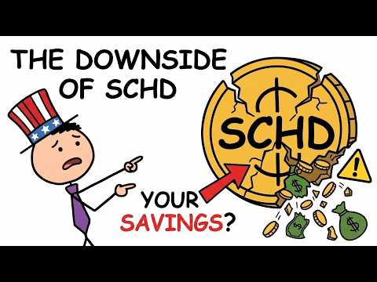
- 챕터: 0:00 The Risk Nobody Puts in a SCH… · 1:05 Why SCHD Owns Just 103 Stocks · 2:30 The Hidden Cost of SCHD's Con… · 3:08 Why SCHD Holds So Little Tech · 4:04 When SCHD Can't Keep Up With … · 5:00 Two Investors, $10,000, One B… · 6:13 The Interest Rate Risk Divide… · 7:30 The 3.22% Yield That Isn't Gu… · 8:47 What Happens If Energy and Ba… · 9:41 The Screen Tax: SCHD's Hidden… · 10:15 Does SCHD's Long-Term Math St… · 11:18 Stress-Test Your Dividend Inc… · 11:44 Three Questions Every SCHD In… · 12:27 The Other Side of SCHD's Story
- 설명 앞부분: SCHD is one of this channel's favorite funds, but liking a fund and being honest about it are two different jobs. This video breaks down the real structural downsides in SCHD's own fact sheet: a tight roster of just 103 holdings, an 8.54% tech weighting that can make it lag during tech-led rallies,…
- 같은 채널 평소 대비 ×3.8 (채널 최근 롱폼 중앙값 3,934회) · 평소 영상: How Many Years Until SCHD Actually Pays You More … (3,967회) / How Much SCHD Do You ACTUALLY Need To Retire Earl… (3,902회)
- 대본 없음 (설명) — 음성인식이 끝나면 도입부·흐름이 들어감
- 댓글 16/16: 좋은 점 — 영상 0 · 감사·응원 0 · 더 알고 싶은 것 0 · 아쉬운 점 — 영상 0 · 반박·불만 — 의견 다름 0 · 정치·사회 0 · 경험 공유 0 · 구독·다음 기대 0

### 142. 찬 바람 부는 퇴근길 마흔의 혼술 , 노후 걱정과 배당주, 그리고 사는 얘기

- https://www.youtube.com/watch?v=qY1joQ1BMg4 · 송차장기록 · 구독자 8,930 · 조회수 17,483 (×2.0, 하루 2,217.7) · 좋아요 274 (1.6%) · 14.3분 · 2026-10-29 · 주제 묶음 3. 배당 · 형식 브이로그·직접 해본 이야기 · 폴더 `W_qY1joQ1BMg4` (웹 승인)
- 설명 앞부분: 찬 바람 부는 퇴근길, 집으로 바로 들어가기 전에 회사 근처 작은 일본 라멘집으로 샜습니다. 돈코츠 라멘에 교자 네 알, 그리고 소주 한 병을 시켜놓고 혼자 마시다 보니 이런저런 생각이 스칩니다. AI 때문에 더 짧아질 것 같은 정년 걱정, 조금씩 물타기 한 주식과 오만 원어치 더 채워 넣은 한 달 천이백 원짜리 배당주, 그리고 아버지로서 비참해지기 싫어 아무도 몰래 만든 딸내미 계좌의 칠만 원까지요. 남들 보기엔 보잘것없는 숫자여도, 그 안에는 도망치지 않고 오늘 하루를 버텨낸 가장의 시간이 다 들어 있는 것 같습니다. 날은 추…
- 같은 채널 평소 대비 ×1.0 (채널 최근 롱폼 중앙값 17,796회) · 평소 영상: 운수 나쁜 날, 되는 게 하나도 없던 하루 40대 직장인의 퇴근길 (17,796회) / 자영업 순이익 월 155만 원이 착시라고요 허수 다 빼고 다시 본 진짜 현실 (17,769회)
- 대본 없음 (설명) — 음성인식이 끝나면 도입부·흐름이 들어감
- 댓글 144/144: 좋은 점 — 영상 0 · 감사·응원 19 · 더 알고 싶은 것 1 · 아쉬운 점 — 영상 1 · 반박·불만 — 의견 다름 1 · 정치·사회 0 · 경험 공유 9 · 구독·다음 기대 0
  - 감사·응원 👍10 “나이 70일 바라 보는 노인(?)입니다! 송차장 기록을 계속해서 보다 보니 그 나이 때를 살았던 그 시절 생각이 나서 글 올려 봅니다! 저도 그 때는 가장이라는 무게와 미래에 대한 불안으로 늘 전전 긍긍했던 것 같네요^ 그러나 지금 그 시절을 지내 놓고 보니 깜캄했던…”
  - 감사·응원 👍6 “"바람 처럼 왔다 바람처럼 가는 인생 뭐! 그리 걱정,고민이 많은건가요?😢😢 송차장님 힘내시고 혼술 한잔에 고민 걱정 다털어 봐요~~화이팅 입니다.”
  - 더 알고 싶은 것 👍3 “가장 편하고 안전한 길을 모르는 이가 있을까요? 위험하고 힘든줄 알지만 그렇게 사는건 그게 주어진 현실을 유일한 길이기 때문이지요!”
  - 아쉬운 점 — 영상 👍1 “편집이 별로네요~ 처음 보는데 잘보다가 검은화면으로 자주 바뀌면서 보내가 끝난줄 알고 또연결 끝난줄 알고 보면 ㅡㅡ또시작”
  - 경험 공유 👍10 “나이 70일 바라 보는 노인(?)입니다! 송차장 기록을 계속해서 보다 보니 그 나이 때를 살았던 그 시절 생각이 나서 글 올려 봅니다! 저도 그 때는 가장이라는 무게와 미래에 대한 불안으로 늘 전전 긍긍했던 것 같네요^ 그러나 지금 그 시절을 지내 놓고 보니 깜캄했던…”
  - 경험 공유 👍5 “술을 너무 자주 드시는듯. 술 좀 줄이세요. 그리고 맨날 이런 푸념 늘어놔봤자 바뀌는 건 하나도 없습니다. 그렇게 미래가 불안하시면 과감히 기술을 배우시던가 다른 일을 하세요. 행동하지 않으면 그 무슨 일도 안 일어나고, 푸념으로만 늘어놨던 말이 현실이 됩니다. 현실…”

### 143. 3억으로 은퇴한 뒤 시작한 단타, 그만두지 못하는 이유

- https://www.youtube.com/watch?v=ii3RugmGMYU · 일억은퇴 · 구독자 10,800 · 조회수 22,206 (×2.1, 하루 2,471.0) · 좋아요 120 (0.5%) · 7.3분 · 2026-10-28 · 주제 묶음 1. 주식 기초·초보 · 형식 정보·해설 (그 밖) · 폴더 `W_ii3RugmGMYU` (웹 승인)
- 설명 앞부분: 우상향서포터즈 모집 3인가구 총 3억으로 시작 1명당 1억으로 은퇴가 가능한지 주식투자를 하며 사회실험 진행중 벌써 5년이 넘었네요.....
- 같은 채널 평소 대비 ×5.1 (채널 최근 롱폼 중앙값 4,382회) · 평소 영상: 미국주식 폭락 후 40대 은퇴자의 고백 다시 일하고 싶습니다 (4,393회) / 3억은퇴 반찬값 벌려고 다시 코스피와 나스닥 주식을 매수했습니다. (4,312회)
- 대본 없음 (설명) — 음성인식이 끝나면 도입부·흐름이 들어감
- 댓글 60/60: 좋은 점 — 영상 0 · 감사·응원 1 · 더 알고 싶은 것 0 · 아쉬운 점 — 영상 0 · 반박·불만 — 의견 다름 1 · 정치·사회 0 · 경험 공유 1 · 구독·다음 기대 0
  - 감사·응원 👍2 “응원합니다. 사실 우상향인사보고 저도 파이어시작했습니다. 일억님처럼 강심장은 못되지만, 싱글파이어로 한국 몇달살다가 가능하다는 판단하에 동남아에서 스타트합니다. 제가 소비력이 별로 되지않아 더욱 용기가됩니다. 근데 형님이 더 성공할수록 저도 자유의 범위가 넓어지는거같…”
  - 반박·불만 — 의견 다름 👍1 “ㅋ ㅋ 본전신은 아닌데 인건비는 어쩌려고요 고품격 주식방송 하는 고급인력께서 나락신 인듯 ㅋ ㅋ”
  - 경험 공유 👍2 “응원합니다. 사실 우상향인사보고 저도 파이어시작했습니다. 일억님처럼 강심장은 못되지만, 싱글파이어로 한국 몇달살다가 가능하다는 판단하에 동남아에서 스타트합니다. 제가 소비력이 별로 되지않아 더욱 용기가됩니다. 근데 형님이 더 성공할수록 저도 자유의 범위가 넓어지는거같…”

### 144. 배당은퇴 3년차 실제하루 생활비 #배당투자 #배당은퇴 #경제적자유 #파이어족 #월배당 #고배당주 #주식투자 #재테크#노후준비#배당금생활 #SCHD #JEPI #…

- https://www.youtube.com/watch?v=pAxnywSAn9I · ttobaedang또배당 · 구독자 7,400 · 조회수 15,100 (×2.0, 하루 1,684.1) · 좋아요 329 (2.2%) · 9.4분 · 2026-10-28 · 주제 묶음 11. 투자 일반 · 형식 정보·해설 (그 밖) · 폴더 `W_pAxnywSAn9I` (웹 승인)
- 같은 채널 평소 대비 ×1.2 (채널 최근 롱폼 중앙값 12,340회) · 평소 영상: 5300만원 증발에도 행복한이유 #배당투자 #배당은퇴 #경제적자유 #파이어족 #월배당 #… (12,458회) / 10만원 아끼다 평생 후회합니다 #배당투자 #배당은퇴 #경제적자유 #파이어족 #월배당 #… (12,223회)
- 대본 없음 (없음) — 음성인식이 끝나면 도입부·흐름이 들어감
- 댓글 152/152: 좋은 점 — 영상 8 · 감사·응원 17 · 더 알고 싶은 것 4 · 아쉬운 점 — 영상 0 · 반박·불만 — 의견 다름 1 · 정치·사회 0 · 경험 공유 14 · 구독·다음 기대 1
  - 좋은 점 — 영상 👍10 “또배당님 오늘도 영상 잘봤습니다. "인생의 전반전은 돈을 모으고, 후반전엔 그 돈을 어떻게 쓰는지를 배운다" 마음에 와닿았습니다. 저역시 제 자신을 돌아봐야겠습니다. 책도 많이 읽으시는 것 같은데 책 리뷰 해주셔도 좋을것 같아요. 오늘 하루도 수고 많으셨습니다....”
  - 좋은 점 — 영상 👍5 “오늘 영상도 잘 보았습니다^^ 철학적이고 진솔한 나레이션이 참 와닿습니다. 가정과 삶에 큰 행복과 풍요가 충만하길 바랍니다^^”
  - 감사·응원 👍8 “요새 쓸데없이 쓰고 있는 생활비가 있는데 반성하게 되네요 직장을 다니기위해 받는 스트레스를 풀기위한 소비들도 있어서 영상보고 동기부여 받고 갑니다 또배당님 영상 항상 감사합니다”
  - 감사·응원 👍8 “행님 화이팅 같이 배당해요 🎉🎉🎉”
  - 더 알고 싶은 것 👍2 “이번 10월 전체 배당내역 한번 영상 만드시는거 추천드립니다 많이 조정 받았을때의 배당내역 궁금합니다 한달 어디서 얼마가 나오는지 궁금합니다❤”
  - 더 알고 싶은 것 👍2 “형님 너무 잘봤습니다 저도 이런영상 촬영해보고 싶은데 촬영 하실때 카메라와 편집 프로그램은 어떤 거 사용 하셨나요??”
  - 반박·불만 — 의견 다름 👍1 “잘보았습니다. 저보다는 좀 아래나이신 듯합니다. 다음과 같은 것들을 생각해 보시면 어떨까 해요 1. 결혼을 하시라는 겁니다 그리고 자녀를 길러보세요. 얘기가 많이 달라집니다. 2. 혼자 사는데 사실 별거 있나요? 저는 올해만도 6천 정도가 생활로 나갔습니다. 3. 혼…”
  - 경험 공유 👍27 “올해 처음으로 제집을 마련 했습니다 고시원 반지하 원룸(그도시의달동네같은데) 그렇게 살다가 40대가 되고 .. 올해 집 마련 참 소중했습니다 이집이 차도 10년탄 스포티지 아직도 짱짱합니다 영상 보다가 공감 되는거는 내가 가지고 있는걸 유지하는거 더 가지려 하는거는 …”
  - 경험 공유 👍7 “04:57 저희 집 윗층에서 들리는 기침소리인가 했네요😅 아내분 감기 조심하시라 전해주세요^^”
  - 구독·다음 기대 👍1 “20, 30, 40대 돈 쓰는 기준이 저도 달라진 것 같아요. 지금은 꼭 필요한 것만, 앞으로 내 생활에 도움이 되는 것만 소비하고 있어요. 집에 물건을 더 들이지 않는 간결한 삶이 이제는 좋더라구요. 언제 세상 떠날지 모르겠지만, 내가 떠난 후 뒷처리가 번거롭지 않…”

### 145. The 5 Levels of SCHD — What Level Are You?

- https://www.youtube.com/watch?v=hasms3By6pA · Mikey Moran · 구독자 12,300 · 조회수 124,156 (×10.1, 하루 2,794.2) · 좋아요 1,594 (1.3%) · 9.6분 · 2026-09-22 · 주제 묶음 기타 · 형식 정보·해설 (그 밖) · 폴더 `W_hasms3By6pA` (웹 승인)
- 썸네일: 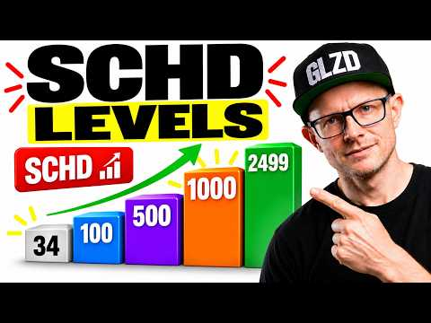
- 챕터: 0:00 The First Goal in SCHD Isn't … · 1:08 The Dividend Math Formula Exp… · 2:04 Level 1: 34 Shares (The Self-… · 2:48 Level 2: 100 Shares (Building… · 3:24 Level 3: 500 Shares (Paying R… · 4:14 Level 4: 1,000 Shares (4-Figu… · 4:55 How SCHD Price Run-Ups & Yiel… · 6:17 SCHD Dividend Growth Rate Rea… · 6:58 Level 5: My Current SCHD Mile… · 7:52 How Many SCHD Shares for $1,0… · 8:26 The 2 Simple Rules to Level U… · 9:04 Which SCHD Level Are You On?
- 설명 앞부분: How many shares of SCHD do you actually need before the dividend starts making a meaningful difference? In this video, I break down what I call the "5 Levels of SCHD", starting with one of the most interesting milestones: the point where your SCHD dividends can generate enough income to effectively…
- 같은 채널 평소 대비 ×14.8 (채널 최근 롱폼 중앙값 8,398회) · 평소 영상: 10 Dividend ETFs Ranked — I Only Own 5 of Them (8,558회) / SCHD Is at an All-Time High. Here’s Why I’m Still… (8,238회)
- 대본 없음 (설명) — 음성인식이 끝나면 도입부·흐름이 들어감
- 댓글 484/528: 좋은 점 — 영상 0 · 감사·응원 0 · 더 알고 싶은 것 0 · 아쉬운 점 — 영상 0 · 반박·불만 — 의견 다름 0 · 정치·사회 0 · 경험 공유 0 · 구독·다음 기대 0

### 146. 내 주변에 주식으로 돈 번 사람이 '진짜' 단 1명도 없는 소름 돋는 이유 ∣ 교수 정선용 (통합본)

- https://www.youtube.com/watch?v=SwW4n0ERlS8 · 너와 나의 경제학교 · 구독자 37,100 · 조회수 617,641 (×16.6, 하루 8,243.1) · 좋아요 11,591 (1.9%) · 52.7분 · 2026-08-14 · 주제 묶음 11. 투자 일반 · 형식 인터뷰·강연·대담 · 폴더 `W_SwW4n0ERlS8` (웹 승인)
- 썸네일: 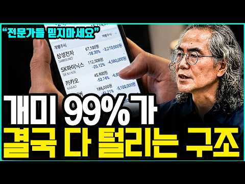
- 설명 앞부분: 정선용, 달리고 읽고 쓰는 사람의 하이
- 같은 채널 평소 대비 ×22.3 (채널 최근 롱폼 중앙값 27,668회) · 평소 영상: 10만 원 하던 우량주, 7만 원 됐다고 덥석 사면 박살 나는 이유 ∣ 교수 정선용 (1… (28,379회) / "지금 당장 도망치세요" AI 버블 붕괴 직전 나타나는 3가지 결정적 신호 ∣ 교수 정선… (26,956회)
- 대본 없음 (설명) — 음성인식이 끝나면 도입부·흐름이 들어감
- 댓글 1,622/1,622: 좋은 점 — 영상 54 · 감사·응원 77 · 더 알고 싶은 것 15 · 아쉬운 점 — 영상 15 · 반박·불만 — 의견 다름 53 · 정치·사회 45 · 경험 공유 131 · 구독·다음 기대 3
  - 좋은 점 — 영상 👍332 “이분이 최고의 주식 전문가 입니다 인정합니다 허황된 꿈을 부추기지 않고 현실적인 필요하고 도움되는 얘기만 하시네요”
  - 좋은 점 — 영상 👍196 “구구절절 맞는말입니다 사람 좋아 보이는거랑 그들의 속마음은 다르다는걸 알았습니다”
  - 감사·응원 👍242 “귀한말씀 너무 늦게 들어서 안타까울 따름입니다 삼전 65만 하닉 400간다고 하면서 정작 자신들은 팔고 있었다는것을 나중에 알게됐습니다. 그렇게 보고서를 낸 증권사나 그걸 유튜브에서 전파한 사람들은 앞으로 다신 보지않을것입니다 귀한말씀 다시한번 감사드립니다”
  - 감사·응원 👍221 “안그래도 느꼈어요 요즘은 증권방송 보기도 싷더라구요 소위 주식 전문가들 증권사 직원들 에널리스트들 전부 자기밥그릇 챙기느라 혈안ᆢ 한통속 이예요 ᆢ 그들의 만행을 속시원히 알려주니 감사하네요 ᆢ”
  - 더 알고 싶은 것 👍3 “어떻게 사셨길래 99%가 잃는 주변인만 뒀나요? 교수님 과장도 적당히 하셔요”
  - 더 알고 싶은 것 👍3 “때가어느때인데유투버보고피같은돈을투자할까요?”
  - 아쉬운 점 — 영상 👍6 “어머니 돈을 불려 주겠다고 600만원을 받아서 투자를 하는데 많이 버는것 보다 잃으면 절대 안되겠다 생각이 먼저 들었습니다. 종목을 결정하는데 얼마나 벌지 모르지만 안 잃을거 같은 종목만 매수 해서 시장의 관심을 받으면 매도하고 다시 반복해서 현재 연복리65% 수익에…”
  - 아쉬운 점 — 영상 👍3 “이 사람도 결국에는 공포 마케팅으로 구독자 어그로 끄는 거임”
  - 반박·불만 — 의견 다름 👍31 “누구 믿고 투자한다는 인간들은 절대 투자하지 말아야 될 사람이에요. 결국 그 의존성 때문에 손실납니다. 그냥 저축하는 편이 안 망하는 길입니다. 주식은 원금 지키며 쌓는 저축이 아닙니다. 손실 볼 수 있는 투자에요.”
  - 반박·불만 — 의견 다름 👍24 “대가들의 책만 몇권 읽어봐도 알게됩니다. 전문가,교수,애널리스트들은 당신들의 편이 아닙니다. 그들은 당신들을 이용해서 돈을 버는것이지, 당신들을 부자로 만들어즐 이유가 1도 없어요.”
  - 정치·사회 👍189 “개미들 돈 누가 다 먹었을까요? 다 외국인 기관들한테 갔습니다 증권사는 수수료로 돈 잔치 했겠죠. 그동안 주식해서 번돈 다시 재투자하면서 이제 원금입니다 ㅠ 그나마 다행이지요. ㅠㅠ 그동안 무료 봉사 했어요 주식에~~~~”
  - 정치·사회 👍88 “딱 맞아요... 애널리스트 증권회사 삐끼들입니다. 개미들은 털리게 돼 있어요. 주식은 전문가가 없어요. 나스닥 하세요. 코스피는 증권회사 외국인들 땜에 절대 돈 벌기 힘든 구조예요. 어느정도 이익오면 우선 반은 빼고 시작하세요”
  - 경험 공유 👍314 “진짜 맞습니다 이번에 처음으로 주식하는 분들 많이 당했을꺼에요 저도 그중 한명이네요 ~~~”
  - 경험 공유 👍302 “피같은 돈 주식으로 다 날리고 몇년째 투잡하고 있습니다... 주식으로 3억잃으니 인생이 골로 가는 듯 합니다 무주식이 상팔자입니다”
  - 구독·다음 기대 👍29 “매일매일 듣고 보고 있습니다교수님 감사해요”
  - 구독·다음 기대 👍12 “미국Etf투자 6년째 평균 70프로. 이익중. 노후자금으로 기대됩니다”

### 147. 【勝率100%】米国株は中間選挙後に爆騰する！過去70年のS&P500・ナスダック100全データと「ねじれ議会」の真実を徹底検証

- https://www.youtube.com/watch?v=V6CZefvKdDc · 投資家外科医　Dr.ゆうま · 구독자 5,030 · 조회수 13,794 (×2.7, 하루 1,113.9) · 좋아요 203 (1.5%) · 25분 · 2026-10-24 · 주제 묶음 2. 장기투자·ETF·지수 · 형식 정보·해설 (그 밖) · 폴더 `W_V6CZefvKdDc` (웹 승인)
- 챕터: 0:00 オープニング（中間選挙前の下落、今は逃げるべき？） · 2:22 この動画でわかること＆本日の目次 · 3:38 1. 中間選挙の仕組みと「秋の株安」が起きるカラクリ · 4:53 ├ 現職大統領の与党は「約90%の確率」で議席を減らす · 5:23 └ 大口機関投資家のヘッジ売りと選挙前の平均最大下落率 · 6:53 2. 中間選挙後から年末・1年後の爆騰データ検証 · 7:13 ├ 選挙当日を境に一変する日次パフォーマンス軌跡 · 8:14 ├ 選挙後から年末ラリー（35営業日）の平均リターンと勝率 · 8:57 ├ S&P500：過去19回の中間選挙後1年間リターン（1… · 10:45 └ ナスダック100：過去10回の中間選挙後1年間リターン… · 11:42 3. 大統領4年サイクル：大統領2年目の秋こそ「最大の仕込… · 12:03 ├ 大統領任期1年目〜4年目の年別リターン比較 · 13:07 └ 3年目（中間選挙翌年）が平均+16.7%・勝率89.5… · 13:50 4. なぜウォール街は「ねじれ議会」を熱烈歓迎するのか？ · 14:43 ├ 過去70年の議会構成別リターン検証（「ねじれは買い」の… · 15:30 └ 株式市場が「政治の停滞（ねじれ議会）」を歓迎する3つの… · 17:10 5. 下落で狼狽売りしてしまう心理とその対策 · 17:38 ├ 個人投資家のリターンが市場平均の半分に激減する理由（D… · 18:17 └ 中間選挙相場を勝ち抜く「3つの処方箋」 · 19:42 本日のまとめ
- 설명 앞부분: 現役投資家外科医のDr.ゆうまです。 今回は「米中間選挙と米国株（S&P500・ナスダック100）の過去データ完全検証」というテーマでお話しします。 本動画では、1950年以降のS&P500（全19回）および1986年以降のナスダック100（全10回）の中間選挙データを徹底解析し、なぜ選挙後1年間の勝率が「100%」なのか、そして今回予想される「ねじれ議会」がなぜ株価にとって最強の追い風になるのかをエビデンスベースで解説します。 中間選挙の年の最大下落率（年初〜選挙日）：S&P500 平均 -17.0% / ナスダック100 平均 -23.1% 中間選挙後から年末のリターン：S&P500 平…
- 같은 채널 평소 대비 ×2.6 (채널 최근 롱폼 중앙값 5,224회) · 평소 영상: 【よくあるレバレッジ批判】逓減について解説、批判に対する僕の意見 (5,224회) / レバレッジ商品✕モンテカルロシミュレーション【ネットでは計算できないので、自作してみた】 (5,231회)
- 대본 없음 (설명) — 음성인식이 끝나면 도입부·흐름이 들어감
- 댓글 31/31: 좋은 점 — 영상 0 · 감사·응원 0 · 더 알고 싶은 것 0 · 아쉬운 점 — 영상 0 · 반박·불만 — 의견 다름 0 · 정치·사회 0 · 경험 공유 0 · 구독·다음 기대 0

### 148. 더이상 배당주는 사지 않아요/40대 워킹맘

- https://www.youtube.com/watch?v=P0j4XK5PaJY · 마스 심플라이프 MasSimpleLife · 구독자 41,200 · 조회수 237,819 (×5.8, 하루 9,032.3) · 좋아요 1,324 (0.6%) · 10.8분 · 2026-10-11 · 주제 묶음 3. 배당 · 형식 브이로그·직접 해본 이야기 · 폴더 `W_P0j4XK5PaJY` (웹 승인)
- 썸네일: 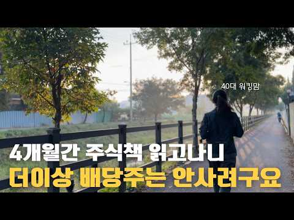
- 설명 앞부분: ⏰ 연 5천만원 모으는 습관 클럽(연오클) 11기를 모집합니다. ^^ 함께 새벽습관을 잡고, 돈공부와 독서를 하면서 경제마인드를 잡아가고 싶으신분들 함께해요~ ^^ 남과 비교하지 않고 어제의 나와 비교하며, 내 삶의 주도권을 되찾아갈 (연오클 11기)멤버를 모집합니다. (연오클이 궁금하시다면 네이버에 '연오클'을 검색해보세요~ ^^) 전 주로 집에 있는 재료를 이용하는 편이구요~ 요리책의 레시피가 있어도 레시피대로 잘 안하고 있는 재료를 주로 활용하고 있답니다~ 사실.. 저도 요리할때마다 레시피가 바뀌어요~ㅋㅋ *^^ 🍒 돼지고기…
- 같은 채널 평소 대비 ×7.4 (채널 최근 롱폼 중앙값 32,168회) · 평소 영상: 무섭게 돈 모으는 40대 워킹맘의 노후준비 라이프(생활비 90만원)(몰아보기영상) (32,252회) / 연6천만원 모으는 방법~(Q&A) /40대 워킹맘 돈모으는 루틴(오이지, 황태계란국) (32,085회)
- 대본 (자막, 5.9 음절/초) 첫 20초: “안녕하세요. 마스입니다. 어느덧 10월입니다. 아침 저녁으로 제법 쌀쌀한 바람이 부는 완연한 가을이 되었어요. 10월부터는 저희 아침 운동 루틴에도 약간의 변화를 주었답니다. 출근을 해야 하는 주 중에는 수영을 하고 조깅은 주말에 하기로 했어요. 가을이 깊어지면서 아침에도 늦게 뜨고”
- 첫 1분: “안녕하세요. 마스입니다. 어느덧 10월입니다. 아침 저녁으로 제법 쌀쌀한 바람이 부는 완연한 가을이 되었어요. 10월부터는 저희 아침 운동 루틴에도 약간의 변화를 주었답니다. 출근을 해야 하는 주 중에는 수영을 하고 조깅은 주말에 하기로 했어요. 가을이 깊어지면서 아침에도 늦게 뜨고 [음악] 새벽 5시에 나가면 아직 깜깜한 데다가 날도 꽤 쌀쌀하더라고요. 무리에서 어둠 속을 달리기보다는 주말에 해가 뜬 후에 따뜻한 햇살 아래 남편과 함께 느긋하게 슬로우 조깅하는 것으로 바꿨습니다. [음악] 이게 저희 중년 부부가 조깅을 포기하지 않고 계속할 수 있는 방법이란 생각이 들더라고요. 영상을 보는 구독자님들도 날은 추워지지만 [음악] 건강을 위해 운동을 멈추지 않으시길 바랍니다. 이제 우린 생존을 위해 운동해야 하”
- 흐름 (90초마다 첫 문장): 0:01 안녕하세요. 마스입니다. 어느덧 → 1:30 하지만 그간 미니벌 라이프로 얻은 → 3:01 주식으로 매월 높은 배당금을 받으면서 → 4:31 현금 흐름이 나올 수 있고 → 6:01 때문입니다. 미국 주식 중에서도 앞서 → 7:32 편안히 쉬면서 매달 나오는 연금만 → 9:01 한시간씩 걸어다니며 극단적으로 → 10:31 바랍니다. 구독과 좋아요는 제가 매주
- 댓글 104/195: 좋은 점 — 영상 1 · 감사·응원 5 · 더 알고 싶은 것 3 · 아쉬운 점 — 영상 0 · 반박·불만 — 의견 다름 2 · 정치·사회 0 · 경험 공유 15 · 구독·다음 기대 0
  - 좋은 점 — 영상 👍2 “매번 좋은 내용을 볼 수 있어서 감사합니다.오늘 특히 정리가 되는 영상이었어요.^^”
  - 감사·응원 👍3 “항상 잘 보고 있어요 채칼 정보 알려주시면 감사하겠습니다😊”
  - 감사·응원 👍2 “매번 좋은 내용을 볼 수 있어서 감사합니다.오늘 특히 정리가 되는 영상이었어요.^^”
  - 더 알고 싶은 것 👍3 “항상 잘 보고 있어요 채칼 정보 알려주시면 감사하겠습니다😊”
  - 더 알고 싶은 것 👍1 “전 1도 몰라요 뭘 어떻게 시작해야할지 모르겠어요 저같은 초짜는 어떻게 시작해야될까요?”
  - 반박·불만 — 의견 다름 👍6 “하락장 아프게 한번 맞아보면 또 생각이 바뀝니다 배당주를 하시던 성장주를 하시던 투자하고 있는 지금 상황에 박수를 드립니다 어느쪽은 중요하지 않습니다 선택한 그 투자를 얼마나 오래 지속 할수있을지만 고민 하시면 됩니다 중요한건 어떤 상품이 아닙니다”
  - 반박·불만 — 의견 다름 👍0 “예전 부모님 세대로서........... "집에서 편안히 쉬면서 연금만으로 살 수 있는 호시절"은 아닌데.......한편, 자녀들의 시대에는 지금 40대 위킹맘의 상황보다 더욱 혹독하겠습니다. 맞아요. 예전에는 돈돈 하면서 살진 않았는데...그렇다고 돈이 중요한 걸 …”
  - 경험 공유 👍49 “난 주식 20년차인데 결국 배당주가 답이라는걸 찾음”
  - 경험 공유 👍14 “남말에 귀닫고 노동소득의 80%는 한국주식을 사고있는 50살 23년차 주식쟁이입니다 에코프로는 10년 이상 3만주 이상을 들고 있으며 에코프로로 노후준비는 다 끝났습니다 개인연금저축펀드 퇴직연금IRP는 20년째 들고 있습니다 주식에는 전문가란게 없고 과학이 아니라서 …”

### 149. "당신이 주식으로 망할 수밖에 없던 이유" 개미 99%의 피를 빨아먹는 잔인한 진짜 구조 ∣ 교수 정선용 (통합본)

- https://www.youtube.com/watch?v=-5NhPWk2zF0 · 너와 나의 경제학교 · 구독자 37,100 · 조회수 378,388 (×10.2, 하루 7,893.7) · 좋아요 2,960 (0.8%) · 117분 · 2026-09-10 · 주제 묶음 8. 투자 심리·실패 · 형식 인터뷰·강연·대담 · 폴더 `W_-5NhPWk2zF0` (웹 승인)
- 썸네일: 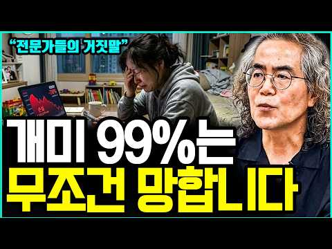
- 설명 앞부분: 정선용, 달리고 읽고 쓰는 사람의 하이
- 같은 채널 평소 대비 ×13.7 (채널 최근 롱폼 중앙값 27,668회) · 평소 영상: 10만 원 하던 우량주, 7만 원 됐다고 덥석 사면 박살 나는 이유 ∣ 교수 정선용 (1… (28,379회) / "지금 당장 도망치세요" AI 버블 붕괴 직전 나타나는 3가지 결정적 신호 ∣ 교수 정선… (26,956회)
- 대본 없음 (설명) — 음성인식이 끝나면 도입부·흐름이 들어감
- 댓글 214/238: 좋은 점 — 영상 9 · 감사·응원 24 · 더 알고 싶은 것 1 · 아쉬운 점 — 영상 4 · 반박·불만 — 의견 다름 5 · 정치·사회 5 · 경험 공유 11 · 구독·다음 기대 1
  - 좋은 점 — 영상 👍30 “교수님 수고 많으세요 항상 맞는말씀만 해주셔서 감사합니다”
  - 좋은 점 — 영상 👍18 “딱ᆢ내이야기 ㅠ 좋은말씀”
  - 감사·응원 👍50 “개미들에게 진심언린 조언 정말 감사합니다ᆢ주식이라는 마귀에홀려서 악어늑대들이 득실거리는 정글에들어간게 후회스럽네요ᆢ돈잃고 건강잃고 집안 잣되고 선생님을 진즉 만나지 못한것이 아쉽네요ᆢ날마다눈물로보내고이슴니다ᆢ마음의 위로가 됩니다ᆢ”
  - 감사·응원 👍49 “1.큰돈 벌생각하면 안됨 2.욕심을 버려야함 3.작은수익도 감사한마음”
  - 더 알고 싶은 것 👍5 “주식잘하는사람이 어떤사람인가요? 이론을 잘아는사람? 매매를 잘하는사람이죠”
  - 아쉬운 점 — 영상 👍50 “개미들에게 진심언린 조언 정말 감사합니다ᆢ주식이라는 마귀에홀려서 악어늑대들이 득실거리는 정글에들어간게 후회스럽네요ᆢ돈잃고 건강잃고 집안 잣되고 선생님을 진즉 만나지 못한것이 아쉽네요ᆢ날마다눈물로보내고이슴니다ᆢ마음의 위로가 됩니다ᆢ”
  - 아쉬운 점 — 영상 👍5 “같은 말만 끊임없이 반복만 하네요”
  - 반박·불만 — 의견 다름 👍3 “그넘어 워렌버픽~~~!! 우리나라 장이 미국장과 같나요??? 절대 같지 않아요 미국장이 기침만해도 우리장은 몸살 걸리는데 이 미친장에서는 오로지 눈치께임~~~!! 그리고 주식 전문가??? 10년전에 주식 시작하면서 의문이 들었던게 저눔들이 추천하는 종목으로 큰돈을번다…”
  - 반박·불만 — 의견 다름 👍2 “주식은 매수시점이 중요하다. 주식은 아무때나 투자 할수 있다는 헛소리 하는 전문가도 있다는게 슬프다. 매도타임 또한 중요하다. 하지만 주식은 익절 손절이 얼마나 힘든지 해보면 안다. 세력에 의해 떨어지는 칼날을 받으면 망하는게 대부분이다.”
  - 정치·사회 👍1 “한국주식,단일종목 흡헐귀 집단● 1.미래에셋 박현주회장:단일종목 상장시키라 김용범 유혹 ㅡ그리하면 김용범과 이찬진 아들 미래에셋 취업시키고,곱버스투자세력 (정권실세50명) 계좌 와 투자관리해서 떼돈 수시로 벌게하겠다 2.국민연금 김성주 이사장:정권 실세들과 짜고 미래…”
  - 정치·사회 👍0 “정지하느놈들이나 대통령 부터 사기치는데 개인들이 벌수 잇겟습니까?”
  - 경험 공유 👍11 “내가 사면 떨어트리고 내가 팔고 나오면 올려데는게 주식입니다 사고 팔고 사고 팔고 해보니 조작이라는걸 알았습니다”
  - 경험 공유 👍7 “처음에 막 벌리길래 놀람. 근데 또 다 털림. 어차피 내돈 아니었어~ 오히려 좋은 경험했다 치고, 자기 합리화~ㅋㅋㅋ”
  - 구독·다음 기대 👍4 “거 희한하다 모두가 정의의 사도라고 자칭하는 사람들은 누구를 위해서 얘기한다는거 .정선용씨는 그러지 않기를 기대합니다 갈수록 태산인라더니 으이그 제발 기관의 나팔수가 아니시길”

### 150. QLD는 몇 년 들고 있어야 안전할까? 20년치 모든 매수 시점을 계산해봤습니다.

- https://www.youtube.com/watch?v=PWr2oclRWKs · 여의도 아빠  · 구독자 2,460 · 조회수 12,316 (×5.0, 하루 514.6) · 좋아요 90 (0.7%) · 6.7분 · 2026-10-13 · 주제 묶음 7. 매매·전략 · 형식 브이로그·직접 해본 이야기 · 폴더 `W_PWr2oclRWKs` (웹 승인)
- 썸네일: 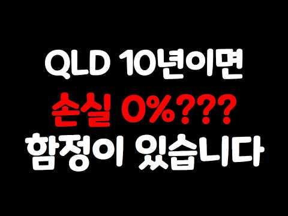
- 설명 앞부분: "QLD, 5년만 버티면 괜찮은 거 아닌가요?" 실제 20년 데이터에선 10년 보유 시 손실 확률 0%. 그런데 OO를 넣자 '5년이면 된다'던 답이 최대 20년으로 늘어났습니다. QLD 보유 기간별 손실 확률 10년 보유 중앙값 13배 금융위기 꼭대기 매수자 닷컴 꼭대기에 2배 나스닥을 샀다면? 같은 최악의 타이밍, 적립을 멈추지 않았다면 본전 20년 → 6년 반 QLD 장기투자가 성립하는 사람 vs 하면 안 되는 사람
- 같은 채널 평소 대비 ×1.9 (채널 최근 롱폼 중앙값 6,517회) · 평소 영상: S&P500에 2배 투자했는데 QQQ 1배보다 수익률이 낮았습니다… 20년 동안 무슨 일… (6,638회) / 아이에게 매달 10만원씩 미국 ETF를 사줬더니… 20년 뒤 계좌에 찍힌 금액 (S&P5… (6,396회)
- 대본 없음 (설명) — 음성인식이 끝나면 도입부·흐름이 들어감
- 댓글 11/14: 좋은 점 — 영상 0 · 감사·응원 1 · 더 알고 싶은 것 1 · 아쉬운 점 — 영상 0 · 반박·불만 — 의견 다름 0 · 정치·사회 0 · 경험 공유 0 · 구독·다음 기대 0
  - 감사·응원 👍1 “영상 정말 잘봤습니다. 감사합니다.”
  - 더 알고 싶은 것 👍3 “이번영상도 시청사수입니다! 지금과 같은 고금리가 유지 혹은 더 올라간다면 QQQ대비 QLD의 매력,효율성은 이자비용으로 인해서라도 이전에 비해 많이 떨어질지 궁금하네요”

### 151. 생활비 한 달 5만원..10년 만에 배당금 월 300만원 받는 이유 (조윤진 1부) #세미파이어 #배당투자

- https://www.youtube.com/watch?v=Wc52vsC6q4U · 자람들 - 자립하는사람들 · 구독자 35,500 · 조회수 827,392 (×23.3, 하루 7,401.1) · 좋아요 6,932 (0.8%) · 29.3분 · 2026-07-17 · 주제 묶음 3. 배당 · 형식 브이로그·직접 해본 이야기 · 폴더 `W_Wc52vsC6q4U` (웹 승인)
- 썸네일: 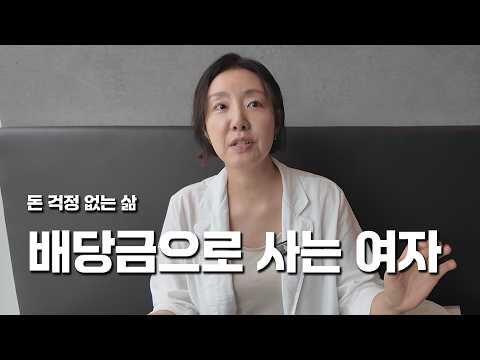
- 설명 앞부분: 👤 오늘의 게스트: 조윤진 작가 '6억으로 시작한 세미파이어' 저자 & 배당으로 부자되기 유튜브 채널 운영 평범한 중소기업 직장인이었던 그녀는 이혼 후 경제적으로 큰 타격을 입고, "목숨 걸고 노후를 준비해야겠다"는 마음으로 10년간 악착같이 아끼고 모았습니다. 5천만 원으로 시작한 시드는 10년 만에 6억 원으로 불어났고, 지금은 매달 통장에 꽂히는 배당금만으로도 마음 편한 노후 시스템을 만들었습니다. 매도 없이 배당만 쌓아가는 그녀만의 투자 철학과, 특별할 것 없는 월급으로도 가능했던 절약과 시드 마련의 여정을 담아 첫 책 '…
- 같은 채널 평소 대비 ×27.2 (채널 최근 롱폼 중앙값 30,382회) · 평소 영상: 금 언제 사야하나요? 그냥 지금부터 당장 금 모으세요. 부자들은 지금 사고 있습니다 (헤… (31,805회) / 무조건 골드바로 사세요. 부자들은 이걸 삽니다. (G1 김봉준 1부) #골드바 #골드 #… (28,959회)
- 대본 없음 (설명) — 음성인식이 끝나면 도입부·흐름이 들어감
- 댓글 613/613: 좋은 점 — 영상 30 · 감사·응원 43 · 더 알고 싶은 것 33 · 아쉬운 점 — 영상 3 · 반박·불만 — 의견 다름 7 · 정치·사회 8 · 경험 공유 43 · 구독·다음 기대 2
  - 좋은 점 — 영상 👍755 “돈 모으려면 거지소리 들어가면서 미친듯이 모아도 될까 말까입니다. 그렇게까지 해야하냐는 말하는 사람들하고는 인간관계를 끊는게 내 인생발전에 훨씬 도움이 됩니다.”
  - 좋은 점 — 영상 👍32 “이 영상 첨 보는 데 정말 가슴에 와닿는 이야기네요 보통 사람들이 공감하고 같이 느낄 수 있는 이야기네요 유익한 영상 잘 보았습니다”
  - 감사·응원 👍416 “안녕하세요 인터뷰했던 '6억으로 시작한 세미파이어' 저자 배당으로 부자되기입니다. 비 오는데 진행 잘 이끌어주셔서 즐겁게 촬영했습니다. 이런 다큐 인터뷰 기회 주셔서 감사합니다. 하필 요즘 코스피가 더 내려서 장이 롤러코스터이긴 한데 끝까지 살아남는 배당투자로 노후를…”
  - 감사·응원 👍30 “귀한 영상 감사합니다.♡ 솔직하신 투자 경험 이야기 유익했습니다.♡ 감사합니다.^^ 성투하세요.❤”
  - 더 알고 싶은 것 👍10 “배당주하다가 귀가앏아 삼성 sk 물렸네요 ㅠ내 자신이 한탄스럽네요 ㅠ50대인데 앞이 깜깜해요~~미국배당다우존스는 sol tiger ace중 어느게 나을까요?공부해도 ㅠ”
  - 더 알고 싶은 것 👍3 “세금. 건보료는 어떻게 하시나요?”
  - 아쉬운 점 — 영상 👍27 “내용은 상당히 좋은데요 촬영을 할 때, 카메라를 고정시켜놓고 찍으셔야겠어요. 화면이 흔들거려요. 이건 아주 기본적인 것인데 많이 아쉽네요.”
  - 반박·불만 — 의견 다름 👍0 “커버드콜 하락장 오면 개박살나는구조다.알고투자해야한다.지금까지 미국장이 폭락장이 없어서 커버드콜 할만하지 하락하면 손실 그대로 다때려맞고 수익은 콜옵션매도 권리행사가로 막혀있으니 이런 말도안되는 상품이없다”
  - 반박·불만 — 의견 다름 👍0 “배당률이 영원한게 아닌데...”
  - 정치·사회 👍2 “이런 영상좀 올리지 마라 정부에서 이러니까 배당투자자들 정조준에서 건보료 개편하자나 시바”
  - 정치·사회 👍2 “이젠 코스피마저 나락가네 요즘 전과4범 범죄자 지지율 계속 뚝뚝 떨어지고있는데 부동산 꼼수거래로 본격적으로 나락 가고있는중..무능하고 부패한 전과4범의 범죄자..경제,주식,부동산, 환율, 물가 어느하나 제대로 하고있는게 없다 환율은 Imf때보다 더 미친듯 치솟고 원화…”
  - 경험 공유 👍37 “저도 배당금 500 이상 받고있어요 노후에는 필요한것같아요 매도 안하니까 일상생활에 집중할 수 있고 마음이 편해요~ etf도 모아가고있어요^^”
  - 경험 공유 👍32 “내가 주식29년차인데 깡통4번차고..겨우 살아만있는데 커버드콜로 계속바꾸고있다.현재는80만정도받고있다.목표는달500..😅😅😅”
  - 구독·다음 기대 👍8 “매일 듣기만했는데 이번엔 정말 시도를 해보고 싶네요. 늦은 감이 있지만 시작해보고 싶네요. 말씀 감사합니다.”
  - 구독·다음 기대 👍0 “좋은 영상 감사합니다~ 작가님 구독했어요^^”

### 152. 주식 거래시간 밤 8시까지?☑️KRX 애프터마켓 꼭 알아야 할 변화

- https://www.youtube.com/watch?v=xXBHBu6hnCc · 주식캐스터 여니 · 구독자 42,700 · 조회수 474,517 (×11.1, 하루 8,790.5) · 좋아요 1,956 (0.4%) · 9분 · 2026-09-13 · 주제 묶음 기타 · 형식 정보·해설 (그 밖) · 폴더 `W_xXBHBu6hnCc` (웹 승인)
- 썸네일: 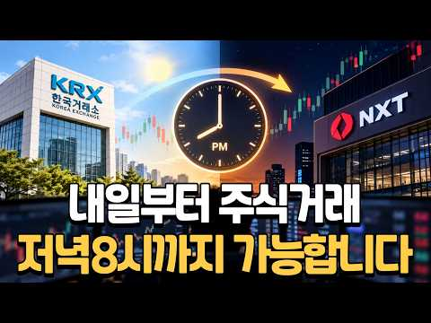
- 같은 채널 평소 대비 ×141.8 (채널 최근 롱폼 중앙값 3,347회) · 평소 영상: 경린이 탈출 1화. 경제가 좋아진다는 말, 우리는 어디까지 이해하고 있을까? (3,452회) / 증권사 목표주가만 보고 투자하면 벌어지는 일 (3,242회)
- 대본 없음 (없음) — 음성인식이 끝나면 도입부·흐름이 들어감
- 댓글 361/361: 좋은 점 — 영상 6 · 감사·응원 20 · 더 알고 싶은 것 2 · 아쉬운 점 — 영상 0 · 반박·불만 — 의견 다름 4 · 정치·사회 30 · 경험 공유 3 · 구독·다음 기대 0
  - 좋은 점 — 영상 👍31 “정리해 주셔서 감사합니다. 그냥 더 피곤해지는 느낌이 드네요..ㅎ”
  - 좋은 점 — 영상 👍1 “좋은 영상 감사합니다. 100% 남이 돈 버는거 배아파서 따라 만든거.”
  - 감사·응원 👍31 “정리해 주셔서 감사합니다. 그냥 더 피곤해지는 느낌이 드네요..ㅎ”
  - 감사·응원 👍27 “개인투자자들에게 꼭 필요한 정보를 똑 부러지게 잘 설명해 주셨습니다. 감사합니다.”
  - 더 알고 싶은 것 👍1 “SOR이 뭔지 알려주세요. 그동안 NXT이용한다고, 설정해둔것 같은데, KRX거래가 안되네요???”
  - 더 알고 싶은 것 👍1 “오전장몇시부터시작해요?아신분댓글부탁해요”
  - 반박·불만 — 의견 다름 👍8 “국민들 소액주주가 원하는건 거래시간 늘리는게 아닌데.. 그저 재벌들이 자회사, 손자회사, 까지만들면서 0.1% 도 안되는 지주사 지분으로 99.9% 지분의 국민들의 회사를 지배하는 이런 구조를 개선해달라는거다... 자회사 IPO 하는거라면 자회사 주식 지분에 따라 무…”
  - 반박·불만 — 의견 다름 👍6 “금융카르텔들만 좋을일 낫구먼유 삼전닉스 거래대금 빼면 언발에 오줌눟킨데 말도 안되는 이유로 카르텔 배불리기만”
  - 정치·사회 👍21 “재명이정권 지지율 떡락하는소리 들린다”
  - 정치·사회 👍12 “개인 투자자에겐 지옥문이 열린것이다 이재명 아웃 정권 타도”
  - 경험 공유 👍0 “도박쟁이들 왜케 많냐?단타만 맨날 쳐하니까 핸드폰만 8시까지 보란소리냐 이딴 소리 하고있지 사팔사팔해봤자 결국엔 손해임 걍 넣어놓고 분기별로 한번씩만 보면 됨 한국사람 주식보유기간 길어봤자 3달이고 평균 10일이라더니 여기다 모여있네 하긴 S&P500 나스닥100 같…”

### 153. [주식차트보는법] 단타말고 이 '차트패턴' 하나로 꾸준히 수익낸 엄청난 비결 지금 딱 한번만 노출하겠습니다. 주식하는법중 이게 최고입니다 (종가베팅 매매기법 및…

- https://www.youtube.com/watch?v=3h7Di1vQHgY · 주식차트연구소 · 구독자 1,380 · 조회수 12,707 (×9.2, 하루 270.4) · 좋아요 134 (1.1%) · 14.6분 · 2026-08-30 · 주제 묶음 6. 종목 고르기·분석 · 형식 정보·해설 (그 밖) · 폴더 `W_3h7Di1vQHgY` (웹 승인)
- 썸네일: 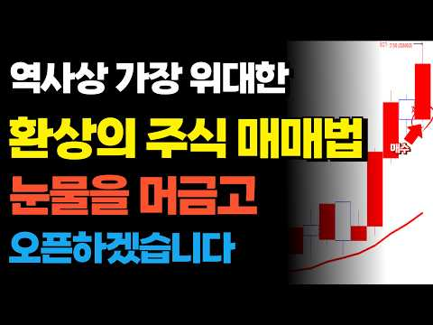
- 설명 앞부분: [주식차트보는법] 단타말고 이 '차트패턴' 하나로 꾸준히 수익낸 엄청난 비결 지금 딱 한번만 노출하겠습니다. 주식하는법중 이게 최고입니다 (종가베팅 매매기법 및 종목선별)
- 같은 채널 평소 대비 ×25.1 (채널 최근 롱폼 중앙값 506회) · 평소 영상: [주식차트보는법] 퇴직후 5년만에, 주식고수들도 알려주지 않았던 엄청난 '단타매매 신호'… (523회) / [주식차트보는법] 간단하지만 이 기법을 능가하는 주식투자 매매법은 앞으로도 없을 겁니다!… (488회)
- 대본 없음 (설명) — 음성인식이 끝나면 도입부·흐름이 들어감
- 댓글 1/1: 좋은 점 — 영상 0 · 감사·응원 0 · 더 알고 싶은 것 0 · 아쉬운 점 — 영상 0 · 반박·불만 — 의견 다름 0 · 정치·사회 0 · 경험 공유 0 · 구독·다음 기대 0

### 154. I've Invested in Dividends for 30 Years. Here's What Most People Get Wrong

- https://www.youtube.com/watch?v=M7l-A6Mk9zQ · BudgetMoney · 구독자 2,550 · 조회수 52,845 (×20.7, 하루 487.8) · 좋아요 1,044 (2.0%) · 27.4분 · 2026-07-21 · 주제 묶음 기타 · 형식 정보·해설 (그 밖) · 폴더 `W_M7l-A6Mk9zQ` (웹 승인)
- 썸네일: 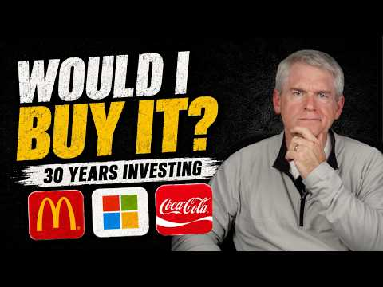
- 챕터: 0:00 Why yield alone can fool you · 1:45 The investor-first approach: … · 1:43 Free tools I use (Value Line … · 3:00 Case study: sorting six Dow s… · 3:59 Dividend growth rates: what t… · 9:32 case study · 11:35 McDonald's case study · 13:06 Home Depot case study · 16:35 Chevron case study · 18:46 Microsoft case study · 20:43 Nvidia case study · 23:01 Earnings predictability
- 설명 앞부분: Not financial advice. For educational purposes only. Most people sort dividend stocks by yield and call it research. That's not analysis — that's sorting a list.After 30 years of dividend investing, I've learned that the question isn't "what's the yield?" It's "does this dividend actually fit my li…
- 같은 채널 평소 대비 ×169.4 (채널 최근 롱폼 중앙값 312회) · 평소 영상: Why RobinHood Wants You to Trade More (345회) / The Real Reason You Can't Find a Starter Home (279회)
- 대본 (자막, 0.0 음절/초) 첫 20초: “Chevron pays 3.9% dividend. Microsoft pays under 1%. Most people would call Chevron the better dividend play. Its own earnings history though says otherwise. I've been investing in dividend stocks for over 30 years and yield alone still doesn't tell you if the company can keep paying it or if that d” — 도입부 유형: 숫자로 시작
- 첫 1분: “Chevron pays 3.9% dividend. Microsoft pays under 1%. Most people would call Chevron the better dividend play. Its own earnings history though says otherwise. I've been investing in dividend stocks for over 30 years and yield alone still doesn't tell you if the company can keep paying it or if that dividend even fits your life. And here's what I mean by fits. My son is 28 and I'm 57. When he mentio”
- 흐름 (90초마다 첫 문장): 0:00 Chevron pays 3.9% dividend. Microsoft → 1:30 30-year-old and a 60-year-old can both → 3:00 On these Value Line sheets, Chevron → 4:30 McDonald's is 7 and 1/2%. Coca-Cola, 4 → 6:00 out um from these growth rates. → 7:30 out as dividends. If a company earns $2 → 9:00 Home Depot is different again. It has → 10:31 But because the business is so → 12:00 period shown here on the sheet. → 13:31 interest rates are high and people → 15:00 another. → 16:30 large-ticket spending. → 18:00 The page shows A++ financial strength → 19:30 all dividends to net profit around the → 21:01 The dividend grew dramatically after the → 22:32 The questions here are different. Can → 24:01 different industries, but they may all → 25:31 Now, in this video, I'm focused on → 27:01 dividend stock?" Ask, "What am I trying
- 댓글 233/233: 좋은 점 — 영상 0 · 감사·응원 0 · 더 알고 싶은 것 0 · 아쉬운 점 — 영상 0 · 반박·불만 — 의견 다름 0 · 정치·사회 0 · 경험 공유 0 · 구독·다음 기대 0

### 155. "수익률에 속지 마세요" 월배당 ETF, '이 1가지' 모르면 망합니다 ∣ 황금별 작가 ∣ 연금받는형

- https://www.youtube.com/watch?v=BJN7kVxwZ_I · 연금 받는 형 · 구독자 23,000 · 조회수 42,087 (×1.8, 하루 4,276.6) · 좋아요 290 (0.7%) · 31.6분 · 2026-10-27 · 주제 묶음 2. 장기투자·ETF·지수 · 형식 정보·해설 (그 밖) · 폴더 `W_BJN7kVxwZ_I` (웹 승인)
- 설명 앞부분: 은퇴가 가까워지면 고배당·월배당 ETF만 믿고 노후 준비를 끝내도 될까요? 많은 은퇴 준비생들이 연 8~10% 이상의 분배율을 주는 상품을 찾지만, 가족 구성원과 필요 생활비, 그리고 은퇴 자금의 현실을 돌아보면 단순한 월배당만으로는 풍요로운 은퇴를 유지하기 어렵습니다. 황금별 작가는 커버드콜 ETF의 진화 과정과 원금 손실 리스크, 그리고 세금과 건강보험료라는 숨겨진 장벽을 짚어줍니다. 이번 영상에서는 금융소득종합과세와 지역가입자 건강보험료 폭탄을 피하는 현실적인 절세 전략부터, ISA·연금저축·IRP 계좌의 현명한 선택법, 그…
- 같은 채널 평소 대비 ×0.9 (채널 최근 롱폼 중앙값 47,043회) · 평소 영상: 설마 이것도 잡힐까? 가족 간 돈 거래, 평소엔 걱정 없지만 '딱 이 3가지'만 조심하면… (47,711회) / 은퇴 후 집 팔기 전 반드시 확인하세요! 양도세·증여세·상속세 폭탄 피하는 법 ∣ 안수남… (46,375회)
- 대본 없음 (설명) — 음성인식이 끝나면 도입부·흐름이 들어감
- 댓글 11/11: 좋은 점 — 영상 0 · 감사·응원 0 · 더 알고 싶은 것 0 · 아쉬운 점 — 영상 0 · 반박·불만 — 의견 다름 0 · 정치·사회 1 · 경험 공유 0 · 구독·다음 기대 0

### 156. 배당 빼서 쓰는 ISA 투자법ㅣ월배당 커버드콜 중도인출 한도,세금 차이까지#isa

- https://www.youtube.com/watch?v=G3js22j-VTU · 주부참치 · 구독자 7,040 · 조회수 17,188 (×2.4, 하루 1,300.5) · 좋아요 218 (1.3%) · 16.3분 · 2026-10-24 · 주제 묶음 10. 노후·연금 투자 · 형식 정보·해설 (그 밖) · 폴더 `W_G3js22j-VTU` (웹 승인)
- 챕터: 0:00 인트로 : 커버드콜로 여행가기 · 1:39 오늘의 목차 · 2:01 ① 쓰기 위한 저축 : 지금을 즐기자, 공짜로 여행가기 · 5:14 ② 어떤 커버드콜을 살까? : 국가와 종목 비교, 얼… · 10:04 ③ ISA활용법 : 세금아끼는 법 · 15:28 마무리 : 커버드콜 배당을 어떻게 활용하고 있으신가요?
- 설명 앞부분: 안녕하세요, 주식으로 부를 쌓는 참치회사 영업사원 주부참치입니다 🐟 커버드콜로 월급처럼 받고, 그 배당을 다시 굴려 마르지 않는 현금흐름을 만드는 법을 다룹니다. 재생목록 (정주행 추천) 📈 커버드콜 ETF｜매달 월급처럼 받는 법 🏦 세금 안 떼이는 계좌 세팅｜ISA·연금저축·IRP 💰 주부참치 월배당 결산｜N년차 현금흐름 기록 ⏱ 타임스탬프
- 같은 채널 평소 대비 ×2.6 (채널 최근 롱폼 중앙값 6,522회) · 평소 영상: 로또 1등 돼도 저는 출근합니다ㅣ9월 현금흐름 결산 #월배당etf (6,647회) / 월300만원 배당, 얼마 있어야 할까?(배당률로 갈립니다) (6,398회)
- 대본 없음 (설명) — 음성인식이 끝나면 도입부·흐름이 들어감
- 댓글 30/30: 좋은 점 — 영상 0 · 감사·응원 0 · 더 알고 싶은 것 3 · 아쉬운 점 — 영상 0 · 반박·불만 — 의견 다름 0 · 정치·사회 0 · 경험 공유 2 · 구독·다음 기대 0
  - 더 알고 싶은 것 👍1 “해당 영상주제와 다른 이야기지만 라이즈 모아가고 있는데 -500 만원 이상 이더라구요 커버드콜 특성이 하락은 게속 상승은 제한인데 만주에서 만오천주 목표긴 한데 큰마이너스보니 흔들리네요 이러할때 마음잡는법 알려주실수 있나요? 주부참치님 멘탈관리 isa 라이즈 ai 벨…”
  - 더 알고 싶은 것 👍1 “490590 맞나요?”
  - 경험 공유 👍2 “저도 isa 에서 커버드콜로 배당금 인출해서 대학생 아이에게 쓰고 있어요 건보료 때문에요 졸업하면 우리 부부 여행비에 추가 할거구요 건보료 제외.. 이거 큰 혜택입니다”
  - 경험 공유 👍0 “인출이 안되는 경우가 생깁니다. 예수금을 계좌해지시 내야할 세금만큼 확보하고 인출해주기 때문에 이익금이 커질수록 인출하기위해 예수금으로 놀려야하는 현금 액수가 커져요. 저도 알고싶지않았네요... 얻어터지기 전 계획이었어요...”

### 157. This New Fidelity ETF Has CRUSHED Every Dividend ETF

- https://www.youtube.com/watch?v=LgszhYR0rFQ · Jake Wealth Hacks · 구독자 6,790 · 조회수 26,916 (×4.0, 하루 1,249.7) · 좋아요 315 (1.2%) · 10.1분 · 2026-10-15 · 주제 묶음 2. 장기투자·ETF·지수 · 형식 정보·해설 (그 밖) · 폴더 `W_LgszhYR0rFQ` (웹 승인)
- 썸네일: 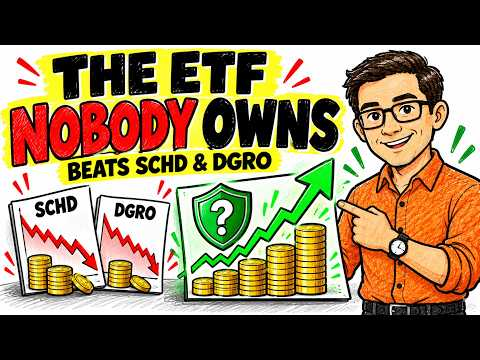
- 설명 앞부분: FELV ETF review: Is Fidelity Enhanced Large Cap Value ETF a better investment than popular dividend ETFs like SCHD, DGRO, and VYM? Discover this hidden Fidelity ETF’s strategy, performance, holdings, expense ratio, dividend yield, and risks for long-term investors and retirees. Most dividend invest…
- 같은 채널 평소 대비 ×6.8 (채널 최근 롱폼 중앙값 3,979회) · 평소 영상: The 23% Total Return ETF No One Is Talking About … (3,979회) / These 5 ETFs Are Destroying the S&P 500 in 2026 (3,964회)
- 대본 없음 (설명) — 음성인식이 끝나면 도입부·흐름이 들어감
- 댓글 13/15: 좋은 점 — 영상 0 · 감사·응원 0 · 더 알고 싶은 것 0 · 아쉬운 점 — 영상 0 · 반박·불만 — 의견 다름 0 · 정치·사회 0 · 경험 공유 0 · 구독·다음 기대 0

### 158. HLB 에이치엘비 주가 - FDA CLASS1 확정 엠바고 논란 종결

- https://www.youtube.com/watch?v=Ja1UVRSKpFs · 돈대니 인사이트 투자 · 구독자 7,680 · 조회수 17,147 (×2.2, 하루 1,375.4) · 좋아요 297 (1.7%) · 13.5분 · 2026-10-24 · 주제 묶음 2. 장기투자·ETF·지수 · 형식 오디오북·낭독 (명언·인생조언) · 폴더 `W_Ja1UVRSKpFs` (웹 승인)
- 설명 앞부분: 본 채널은 글로벌 투자 인사이트와 투자 철학을 바탕으로 기업의 본질적 가치를 함께 통찰하고, 장기적 관점에서 투자 마인드를 키워가는 공간입니다. 🚀 돈대니 네이버 카페에서 소통해보세요! 본 채널은 시청자분들께 최상의 시각적·청각적 경험을 제공하기 위해 최신 AI 기술을 보조 도구로 활용하고 있습니다. 돈대니 인사이트는 투명성을 위해 유튜브의 '변형된 콘텐츠(Altered Content)' 가이드라인을 엄격히 준수합니다. 활용 도구: NotebookLM, Gemini, ChatGPT, Grok, Whisk, Flow, Google …
- 같은 채널 평소 대비 ×2.3 (채널 최근 롱폼 중앙값 7,303회) · 평소 영상: HLB 에이치엘비 글로벌 주가 - 상한가! 진양곤 일가 베팅과 텐베거 🤩🚀 (7,303회) / HLB 에이치엘비 주가 - 그룹 통합 IR 진양곤 의장의 승부수! 🤩🚀 (7,132회)
- 대본 없음 (설명) — 음성인식이 끝나면 도입부·흐름이 들어감
- 댓글 13/13: 좋은 점 — 영상 1 · 감사·응원 4 · 더 알고 싶은 것 0 · 아쉬운 점 — 영상 0 · 반박·불만 — 의견 다름 0 · 정치·사회 0 · 경험 공유 0 · 구독·다음 기대 0
  - 좋은 점 — 영상 👍1 “오늘도 좋은 정보와 인사이트 감사합니다 😊 좋은 소식이 전해지길 바래봅니다^^”
  - 감사·응원 👍2 “감사합니다🙏🙏🙏”
  - 감사·응원 👍1 “감사합니다.”

### 159. Chip Stocks Selling Off: When I Switch From Buying Dips to Shorting (NVDA, AMD, AVGO, TSL…

- https://www.youtube.com/watch?v=JVzvv_YZD7Y · Danielle Shay · 구독자 6,830 · 조회수 24,982 (×3.7, 하루 1,218.2) · 좋아요 135 (0.5%) · 8.3분 · 2026-10-16 · 주제 묶음 기타 · 형식 정보·해설 (그 밖) · 폴더 `W_JVzvv_YZD7Y` (웹 승인)
- 썸네일: 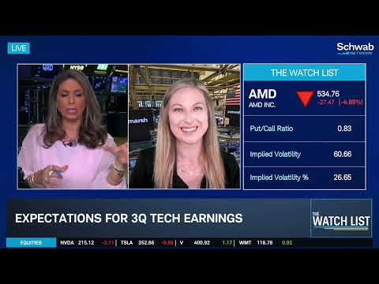
- 설명 앞부분: Why are semiconductor stocks selling off so hard, and when does a dip buy turn into a short? On Schwab Network's The Watch List, I explain the exact chart levels I watch, plus my plan for NVIDIA, AMD, and Broadcom heading into earnings. What we covered: Why this year's moves have been so exaggerate…
- 같은 채널 평소 대비 ×8.3 (채널 최근 롱폼 중앙값 3,002회) · 평소 영상: Spotlight on Semiconductors: AVGO, MU, STX, AMD &… (3,002회) / How to Pick Hot Stocks like NBIS, COHR, ASTS, and… (3,514회)
- 대본 없음 (설명) — 음성인식이 끝나면 도입부·흐름이 들어감
- 댓글 61/61: 좋은 점 — 영상 0 · 감사·응원 0 · 더 알고 싶은 것 0 · 아쉬운 점 — 영상 0 · 반박·불만 — 의견 다름 0 · 정치·사회 0 · 경험 공유 0 · 구독·다음 기대 0

### 160. [초보자필수시청] 1천만원으로 따라하는 추세추종 매매법 / 13년차 현역 투자자의 비법

- https://www.youtube.com/watch?v=1_KnSLKiBos · 직장인 차트매매 - 추세추종 · 구독자 6,030 · 조회수 14,881 (×2.5, 하루 1,065.8) · 좋아요 260 (1.8%) · 16.6분 · 2026-10-23 · 주제 묶음 1. 주식 기초·초보 · 형식 인터뷰·강연·대담 · 폴더 `W_1_KnSLKiBos` (웹 승인)
- 챕터: 0:00 승률 50%로 계좌를 불리는 비밀 · 1:37 부패에서 배우는 주식 매매의 핵심 · 3:08 승률보다 중요한 손익비의 마법 · 6:09 멘탈이 흔들리지 않는 손절 공식 · 10:46 나의 매매 습관 진단하고 고치기
- 설명 앞부분: 추세추종 전략이 왜 주식 투자에서 손실을 막고 수익을 극대화하는 가장 확실한 방법인지 정리했습니다. 이 영상은 손절과 익절의 기준이 모호한 분들을 위해, 어떻게 원칙을 세우고 실행할지 그 핵심만 담았습니다. 구체적인 가이드라인을 통해 여러분만의 투자 기준을 확실하게 정립해보세요.
- 같은 채널 평소 대비 ×4.4 (채널 최근 롱폼 중앙값 3,353회) · 평소 영상: [제1강] 주식으로 돈 벌고 싶다면 꼭 알아야할 공식 (3,353회) / 9년 시행착오 끝에 찾은 투자 전략 (손절·익절의 비밀) (2,968회)
- 대본 없음 (설명) — 음성인식이 끝나면 도입부·흐름이 들어감
- 댓글 45/45: 좋은 점 — 영상 1 · 감사·응원 8 · 더 알고 싶은 것 3 · 아쉬운 점 — 영상 0 · 반박·불만 — 의견 다름 0 · 정치·사회 0 · 경험 공유 1 · 구독·다음 기대 0
  - 감사·응원 👍1 “저는 다 담는 형이요! 그동안 돈과 시간 그리고 가족 모두를 잃은 사람으로 본 강의는 다시 시작 할 수 있을 것 같은 희망이 들어 너무 고맙습니다.”
  - 감사·응원 👍1 “감사합니다^^”
  - 더 알고 싶은 것 👍1 “이번달 매매일지를 올려주세요 이번달 매매일지가 없으면 9월달 매매일지도 가능 하지요 이론보다 실전매매했던 계좌가 보고싶네요”
  - 더 알고 싶은 것 👍1 “대표님 질문 있습니다. 차트 이평선보실때 종가단순하고 종가지수중 어떤것을 보시나요? 추세추종 대가들도 약간의 차이가 있어서요.”

