# 주식 — 성공 사례 분석: 사례별 자세히 #161–#200

`analysis.md` 의 9번 (같은 # 번호). 자동 생성 — `tools/success_analysis.py` v1.6 (2026-11-06 08:46 UTC). ※ 연구·교육용 — 투자 권유가 아님.

### 161. 00406A跌破發行價還能配0.138？月配息能維持多久？主動型ETF優點與風險分析

- https://www.youtube.com/watch?v=o_XndSFP2Wg · 吳馬克 l 幸福理財家 · 구독자 16,200 · 조회수 33,266 (×2.0, 하루 2,809.3) · 좋아요 429 (1.3%) · 12.2분 · 2026-10-25 · 주제 묶음 2. 장기투자·ETF·지수 · 형식 정보·해설 (그 밖) · 폴더 `W_o_XndSFP2Wg` (웹 승인)
- 챕터: 0:00 小短劇｜跌破發行價還能配 0.138？ · 0:22 為什麼第一次研究主動型 ETF？ · 1:28 00406A 基金檔案與投資策略 · 2:01 前十大持股與產業配置 · 3:04 主動型 ETF 的持股會怎麼變？ · 3:29 股票與現金部位分析 · 3:57 Covered Call 掩護性買權是什麼？ · 5:11 收到權利金就比較抗跌嗎？ · 5:40 00406A 與美國 QYLD 的策略差異 · 6:38 盤整、緩漲、暴漲，哪種行情比較適合？ · 7:43 淨值跌破 10 元，為什麼還能配息？ · 8:18 配息不等於報酬，別只看殖利率 · 8:52 每月配息 0.138 元可以持續多久？ · 9:26 00406A 的優點與挑戰 · 10:19 幸福信箱與 LINE 社群 · 10:47 最後總結｜為什麼我覺得值得追蹤？
- 설명 앞부분: 00406A 跌破 10 元發行價，為什麼還能配息 0.138 元？這筆配息到底從哪裡來？Covered Call 真的能增加收益，還是也有我們沒注意到的代價？ 這一集《ETF研究室》，是我第一次正式研究**主動型 ETF**！ 00406A（主動中信台灣收益）不只是月配息 ETF，它還結合了主動選股與 Covered Call（掩護性買權）策略，希望同時兼顧股票成長與現金流。 例如，為什麼電子與半導體比重這麼高？股票部位約 74%、現金接近 26%，又代表什麼？Covered Call 收到權利金，真的就比較抗跌嗎？ 尤其這檔 ETF 成立時間還很短，我覺得現在就說它一定很好，或一定不好，…
- 같은 채널 평소 대비 ×2.6 (채널 최근 롱폼 중앙값 12,991회) · 평소 영상: 4月ETF配息排行榜出爐｜誰配最多？0056領5774元後我怎麼做 (12,991회) / 高股息ETF變了？2026年5月配息月報：00878、00891、00982A怎麼看 (13,627회)
- 대본 없음 (설명) — 음성인식이 끝나면 도입부·흐름이 들어감
- 댓글 56/56: 좋은 점 — 영상 0 · 감사·응원 0 · 더 알고 싶은 것 0 · 아쉬운 점 — 영상 0 · 반박·불만 — 의견 다름 0 · 정치·사회 0 · 경험 공유 0 · 구독·다음 기대 0

### 162. 불기둥 세운 코스피, 코스닥! 폭등한 이유와 향후 전략

- https://www.youtube.com/watch?v=Pel5gTXKRkQ · K파민 · 구독자 6,060 · 조회수 102,739 (×16.9, 하루 1,048.5) · 좋아요 1,605 (1.6%) · 24.8분 · 2026-07-31 · 주제 묶음 5. 국내주식 · 형식 정보·해설 (그 밖) · 폴더 `W_Pel5gTXKRkQ` (웹 승인)
- 썸네일: 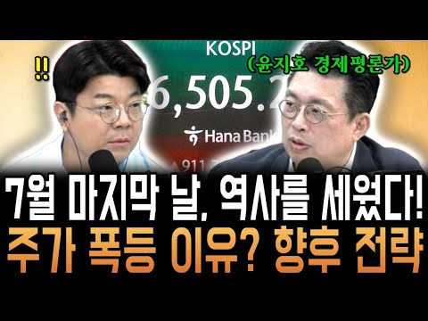
- 설명 앞부분: 7월 31일인 오늘 역사를 세웠습니다. 코스피가 하루 만에 1000포인트 넘게 상승하는 장세를 보이며 단숨에 6500선을 회복했습니다. 또한, 외국인의 일일 순매수액과 개인의 일일 순매도액 모두 역대 최대 규모를 세웠는데요, 주가 폭등의 이유와 향후 전략까지 영상으로 확인해 보세요.
- 같은 채널 평소 대비 ×0.7 (채널 최근 롱폼 중앙값 153,807회) · 평소 영상: (대만 반응) "다 한국 때문이야!" 스페인 케이크 값까지 올려버린 한국인 파워 (153,807회) / (대만 반응) "특히 대단한 건 한국인!" 같이 일하고 싶은 동료로 한국인을 꼽은 외국 … (262,361회)
- 대본 없음 (설명) — 음성인식이 끝나면 도입부·흐름이 들어감
- 댓글 139/139: 좋은 점 — 영상 2 · 감사·응원 2 · 더 알고 싶은 것 1 · 아쉬운 점 — 영상 0 · 반박·불만 — 의견 다름 3 · 정치·사회 7 · 경험 공유 4 · 구독·다음 기대 0
  - 좋은 점 — 영상 👍21 “진짜 맞는 말씀 두 MC. 배워라”
  - 좋은 점 — 영상 👍0 “그래..우리 평범한 사람들은 확실할 대답을 원하지만, 전문가들이 예언자가 아니고 투자는 시장의 변동에 따라 수시로 바뀌니 정답도 예언도 할 수 없죠. 주식 투자는 화단을 가꾸는 것과 같다는 말 공감되네요.”
  - 감사·응원 👍9 “윤지호선생님 대단히 고맙습니다 ❤”
  - 감사·응원 👍3 “1) 부동산 폭등 대출규제로 국민죽이는 정부 2) 부동산 팔아서 주식사라더니 전문가 들도 위험하다고 반대한 ETF강행으로 2000만 투자자를 거지로 내몬 정부 3) 금감원,금융위,대검,감사원, 국민권익위에 접수된지가 도대체 언젠데 하루 1백만원씩 쓰도 1369년 10…”
  - 더 알고 싶은 것 👍0 “인버스 레버리지 없애면 안되나요?”
  - 반박·불만 — 의견 다름 👍6 “뭘 그리 양다리 걸치는 평론을.. 9월에 9천 년말까지 만천갑니다. 수익이 계속 증명되면 수 많은 가정 다 헛소리이예요”
  - 반박·불만 — 의견 다름 👍2 “과한거 아닙니다 실적 대로 가눈거죠”
  - 정치·사회 👍8 “저기여 정부에서 주식재난특별지원금을 언제 지급 하나요?😅”
  - 정치·사회 👍5 “이재명이 만든 도박장!!”
  - 경험 공유 👍2 “코스피 곧 만 넘게 간다고 했었는데😢 재해처럼 어느날 갑자기 뒤집어질 수 있다는 걸 겪으면서 배우네요. 근데 수업료가 너~무 비싸서 과다 출혈이 문제”
  - 경험 공유 👍2 “경제 주식에 대해 공부하지 않고 남들이 하니 나도 해봐야지,주식이 계속 오르네? 나도 들어가 봐야지 란 인식으로 주식을 접해 피해를 보시는 분들이 없었으면 좋겠습니다. 주식 투자는 본인의 의지고 본인의 책임이 따르기 때문에 어설프게 다가가서 힘들어 하지 마시고 그런분…”

### 163. [주식차트보는법] 슈퍼개미들이 절대 말 안해주는 '실전 최고의 단타기법' 제가 욕먹을 각오로 상한가 차트패턴 시원하게 오픈하겠습니다! (차트분석,주식하는법)

- https://www.youtube.com/watch?v=JGzbftUZPXs · 주식차트연구소 · 구독자 1,380 · 조회수 14,324 (×10.4, 하루 235.2) · 좋아요 341 (2.4%) · 33.2분 · 2026-08-28 · 주제 묶음 6. 종목 고르기·분석 · 형식 정보·해설 (그 밖) · 폴더 `W_JGzbftUZPXs` (웹 승인)
- 썸네일: 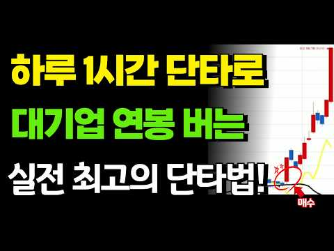
- 설명 앞부분: [주식차트보는법] 슈퍼개미들이 절대 말 안해주는 '실전 최고의 단타기법' 제가 욕먹을 각오로 상한가 차트패턴 시원하게 오픈하겠습니다! (차트분석,주식하는법)
- 같은 채널 평소 대비 ×28.3 (채널 최근 롱폼 중앙값 506회) · 평소 영상: [주식차트보는법] 퇴직후 5년만에, 주식고수들도 알려주지 않았던 엄청난 '단타매매 신호'… (523회) / [주식차트보는법] 간단하지만 이 기법을 능가하는 주식투자 매매법은 앞으로도 없을 겁니다!… (488회)
- 대본 없음 (설명) — 음성인식이 끝나면 도입부·흐름이 들어감
- 댓글 8/8: 좋은 점 — 영상 2 · 감사·응원 1 · 더 알고 싶은 것 0 · 아쉬운 점 — 영상 0 · 반박·불만 — 의견 다름 0 · 정치·사회 0 · 경험 공유 0 · 구독·다음 기대 0
  - 좋은 점 — 영상 👍0 “좋은 정보네요 일봉으로하는건가요? 해당 종목 찾기가 매우 어려울것같네요요..”
  - 좋은 점 — 영상 👍0 “매번 감사합니다. 매매에 큰 도움이 될거 같아요.”
  - 감사·응원 👍0 “매번 감사합니다. 매매에 큰 도움이 될거 같아요.”

### 164. “아이렌 긴급 ,30달러 깨질듯한 상황.. 손절각인가??(ft.코어위브/CPI)아이렌맨.

- https://www.youtube.com/watch?v=cTlVY95Qzlk · 아이렌맨 : IREN을 사랑하는 남자 · 구독자 7,940 · 조회수 29,940 (×3.8, 하루 1,352.5) · 좋아요 342 (1.1%) · 8.8분 · 2026-10-15 · 주제 묶음 8. 투자 심리·실패 · 형식 인터뷰·강연·대담 · 폴더 `W_cTlVY95Qzlk` (웹 승인)
- 썸네일: 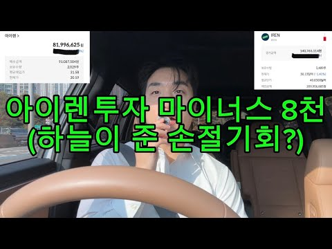
- 설명 앞부분: 오늘은 급하게 차에서 영상올립니다. 준비해둔 자료가있는데.. 그냥 그게 중요치않기에 아이렌의 운명은 ..?
- 같은 채널 평소 대비 ×1.8 (채널 최근 롱폼 중앙값 16,697회) · 평소 영상: “아이렌, 버리는 폭락에 걸고, 앤트로픽은 5,180억 달러 긁었다… 아이렌은..?“ft… (16,697회) / "아이렌, OpenAI도 Anthropic도 몸사린다? 이거 실화냐 (IREN 직격탄 체… (14,582회)
- 대본 없음 (설명) — 음성인식이 끝나면 도입부·흐름이 들어감
- 댓글 395/441: 좋은 점 — 영상 1 · 감사·응원 40 · 더 알고 싶은 것 7 · 아쉬운 점 — 영상 1 · 반박·불만 — 의견 다름 7 · 정치·사회 1 · 경험 공유 23 · 구독·다음 기대 1
  - 감사·응원 👍231 “이 형 인정해 주자, 매일같이 떨어져도 멘탈 지키면서 주식 가격올리고, 가오가 있는 사람이다. 응원합니다.”
  - 감사·응원 👍56 “아이렌이 의외로 이번장이후로 코어. 네비보다 더많이 올라갈수있어요~ 항상응원하니다 힘내고 힘내세요! 장투의길은 원래 힘든법이죠!! 화이팅!”
  - 더 알고 싶은 것 👍16 “주가가 얼마나 떨어지던 물타고 버티고 하는 종목은 대형주에나 해당되는 말이고요.. 아이렌같은 부도날 가능성도 있는 중소형주는 그렇게 하다가 골로간 사람들 한둘이 아닙니다. 아이렌은 절대 부도 안난다구요?? 지금 cds 폭등하는게 안보이시나요? 코로나때 저금리로 유동성…”
  - 더 알고 싶은 것 👍4 “손절좀부탁드려요형님ㅜㅜ 그래야오를듯합니다”
  - 아쉬운 점 — 영상 👍5 “29불에 1억정도 시드 박았네요 장기계좌에 8불 3000만원 있는데 늘 아쉬웠는데 자리 좋은거 같아요”
  - 반박·불만 — 의견 다름 👍16 “주가가 얼마나 떨어지던 물타고 버티고 하는 종목은 대형주에나 해당되는 말이고요.. 아이렌같은 부도날 가능성도 있는 중소형주는 그렇게 하다가 골로간 사람들 한둘이 아닙니다. 아이렌은 절대 부도 안난다구요?? 지금 cds 폭등하는게 안보이시나요? 코로나때 저금리로 유동성…”
  - 반박·불만 — 의견 다름 👍10 “오를수도 있고 떨어질수도 있다. 응원하지도 말고 조롱하지도 말자고 말했더니 선동하지말라고 한다. 지켜보자고 했더니 응원할것도 아니면서 왜 지켜보냐고 시비를 건다. 도대체 어떤것이 선동인것인가?? 이 채널은 아이렌을 응원하는 사람들만 댓글을 달수 밖에 없는 것인가? 합…”
  - 정치·사회 👍2 “데이터 센터 반대의 목소리가 높아지고 있지만 중간선거 끝나면 불확실성이 제거돼서 이유 없이 오를겁니다”
  - 경험 공유 👍18 “이런분이 찐이지 떨어지던 오르던 자기 신념 자기주관 아이렌 저도 이번에 떨어져서 조금식 담아봅니다 올라가길 응원합니다 화이팅!”
  - 경험 공유 👍16 “주가가 얼마나 떨어지던 물타고 버티고 하는 종목은 대형주에나 해당되는 말이고요.. 아이렌같은 부도날 가능성도 있는 중소형주는 그렇게 하다가 골로간 사람들 한둘이 아닙니다. 아이렌은 절대 부도 안난다구요?? 지금 cds 폭등하는게 안보이시나요? 코로나때 저금리로 유동성…”
  - 구독·다음 기대 👍2 “항상 볼때마다 잘생겼어ㅎㅎ아이렌 떨어져도 아이렌남 보면서 버티는 중 하루에 1영상이면 좋겠네요. 기다려집니다”

### 165. SOXL 수익률 2300%에서 700%로 추락. 저의 솔직한 심정을 말씀드립니다.

- https://www.youtube.com/watch?v=7lKGd3E1ZAU · SOXL 연구소 · 구독자 6,640 · 조회수 10,578 (×1.6, 하루 1,127.3) · 좋아요 202 (1.9%) · 7.7분 · 2026-10-27 · 주제 묶음 4. 미국·해외주식 · 형식 정보·해설 (그 밖) · 폴더 `W_7lKGd3E1ZAU` (웹 승인)
- 설명 앞부분: 채널의 원칙 투자를 강력하게 지지해 주시는 연구원분들께 감사드립니다. ■ 속슬 수석 연구원 오직감사-l4z, 안은경-g5f2t, 박규리-r6h, 이정윤-p8y, 성공-v3m, 최미-j4q, songjihye, 행복을찾아-m2r, 임낙균-j2o [면책 조항 (Disclaimer)] 본 영상은 개인적인 투자 의견과 시장 분석을 공유하는 콘텐츠이며, 특정 종목에 대한 매수/매도 추천이나 금융 조언이 아닙니다. 레버리지 상품(SOXL 등)은 변동성이 매우 크므로 본인의 투자 원칙과 위험 감수 능력에 맞게 운용해야 합니다. [해시태그]
- 같은 채널 평소 대비 ×1.7 (채널 최근 롱폼 중앙값 6,163회) · 평소 영상: [TQQQ/SOXL] 투자의 성공, 단순한 룰의 힘 (6,203회) / SOXL/TQQQ 장기투자, 여러분은 결코 혼자가 아닙니다. (6,123회)
- 대본 없음 (설명) — 음성인식이 끝나면 도입부·흐름이 들어감
- 댓글 67/67: 좋은 점 — 영상 2 · 감사·응원 19 · 더 알고 싶은 것 5 · 아쉬운 점 — 영상 0 · 반박·불만 — 의견 다름 0 · 정치·사회 0 · 경험 공유 2 · 구독·다음 기대 0
  - 좋은 점 — 영상 👍4 “항상 좋은 영상 감사드립니다. 속슬 믿고 버틸수 있는 자양분이 됩니다, 믿음이 더욱 강해지고 있습니다. 감사합니다 소장님”
  - 좋은 점 — 영상 👍1 “소장님 늘 좋은 정보 감사합니다.!! 결국 마인드셋이 좋아야 성투하는 것 같습니다”
  - 감사·응원 👍4 “항상 좋은 영상 감사드립니다. 속슬 믿고 버틸수 있는 자양분이 됩니다, 믿음이 더욱 강해지고 있습니다. 감사합니다 소장님”
  - 감사·응원 👍3 “소장님~ 멘탈 솔루션 감사합니다! 아이렌2배 IRE가 MDD -90% 이상 구간이라 매수를 고민하게 되는데요. 다만 올 3월 1:4 역주식분할 이슈가 우려되어서요.. 혹시 소장님께서는 IRE를 어떻게 보시는지 여쭤봐도 될까요?”
  - 더 알고 싶은 것 👍3 “소장님~ 멘탈 솔루션 감사합니다! 아이렌2배 IRE가 MDD -90% 이상 구간이라 매수를 고민하게 되는데요. 다만 올 3월 1:4 역주식분할 이슈가 우려되어서요.. 혹시 소장님께서는 IRE를 어떻게 보시는지 여쭤봐도 될까요?”
  - 더 알고 싶은 것 👍2 “선생님 안녕하세요 속슬 투자한지 2년 정도 된 주린이입니다. 저도 반도체는 현대 산업의 쌀이라는 믿음으로 공학 분야에 전문적인 지식은 없지만 장투를 하고 있는데요 최근에 의문(두려움?)이 생기는게 있어서 질문을 남겨 봅니다. 현재 반도체 수요의 상당 부분은 신규 데이…”
  - 경험 공유 👍2 “선생님 안녕하세요 속슬 투자한지 2년 정도 된 주린이입니다. 저도 반도체는 현대 산업의 쌀이라는 믿음으로 공학 분야에 전문적인 지식은 없지만 장투를 하고 있는데요 최근에 의문(두려움?)이 생기는게 있어서 질문을 남겨 봅니다. 현재 반도체 수요의 상당 부분은 신규 데이…”
  - 경험 공유 👍1 “소장님을 며칠 전 알게되고 매일 영상 보고있습니다 존경스럽습니다 제가 발 맞춰 갈 수 있을지 모르겠지만 잘 따라 가보겠습니다 영상 올려주셔서 감사합니다”

### 166. 배당투자의 함정? 배당 ETF 고르는 법부터 손실난 계좌 복구법까지 알려드립니다 (박재훈)

- https://www.youtube.com/watch?v=6wpI9ePifEA · 박재훈의 투자농장 · 구독자 22,000 · 조회수 36,684 (×1.7, 하루 3,702.2) · 좋아요 111 (0.3%) · 22.7분 · 2026-10-27 · 주제 묶음 2. 장기투자·ETF·지수 · 형식 인터뷰·강연·대담 · 폴더 `W_6wpI9ePifEA` (웹 승인)
- 챕터: 0:00 오프닝 · 2:17 배당금과 분배금의 차이 · 5:58 배당상품의 손익 구조 · 9:17 언제 배당주에 투자하는 게 유리할까? · 14:54 2억으로 생활비 얼마나 만들 수 있을까? · 15:57 원금 2억 원의 배당 포트폴리오 예시
- 설명 앞부분: 안녕하세요 이웃님들, 투자 농장지기 박재훈입니다. 최근 배당 투자에 대한 고민을 털어놓은 이웃님이 계셨습니다. 배당금이 매달 들어오면 계좌가 잘 운용되고 있다는 느낌을 받기 쉽지요.. 그런데 배당을 받는 동안 주가가 크게 떨어지게 되면 전체 순자산은 줄어들게 됩니다. 그래서 오늘은 들어오는 배당금과 남아 있는 자산을 함께 살펴봤습니다. 오늘 영상을 통해 배당 투자 상품을 고르는 방법부터, 예시 포트폴리오까지 확인해보시길 바랍니다.. 고맙습니다. ■ [박재훈의 무료 오피셜클럽] 이용 방법 ② 어스플러스 앱 접속 후 [나의클럽] → …
- 같은 채널 평소 대비 ×3.2 (채널 최근 롱폼 중앙값 11,511회) · 평소 영상: 똑같은 S&P500인데, 수익률은 왜 다를까? (박재훈) (11,511회) / 프랑스 국채 금리 폭등, 주식·채권 시장 영향은? (박재훈) (11,734회)
- 대본 없음 (설명) — 음성인식이 끝나면 도입부·흐름이 들어감
- 댓글 8/8: 좋은 점 — 영상 1 · 감사·응원 2 · 더 알고 싶은 것 1 · 아쉬운 점 — 영상 0 · 반박·불만 — 의견 다름 0 · 정치·사회 0 · 경험 공유 0 · 구독·다음 기대 0
  - 좋은 점 — 영상 👍3 “대본읽듯이 하지마시고 조금더 편하게 구독자들께 와닿는 멘트 부탁합니다^^”
  - 감사·응원 👍0 “잘 봤습니다 !! 감사합니다!!”
  - 감사·응원 👍0 “감사합니다 실제 상품추천은 어려울까요?”
  - 더 알고 싶은 것 👍3 “대본읽듯이 하지마시고 조금더 편하게 구독자들께 와닿는 멘트 부탁합니다^^”

### 167. 연금저축 IRP 계좌에서 사모을 ETF 3대장 추천! 결국 국내상장 나스닥 S&P500 다우존스 ETF 적립식으로 사모으는 방법이 추천 됩니다

- https://www.youtube.com/watch?v=yITsxwpiFOw · 소금달 - 소액 금 달러 투자 · 구독자 2,790 · 조회수 10,281 (×3.7, 하루 466.1) · 좋아요 34 (0.3%) · 20분 · 2026-10-15 · 주제 묶음 2. 장기투자·ETF·지수 · 형식 정보·해설 (그 밖) · 폴더 `W_yITsxwpiFOw` (웹 승인)
- 썸네일: 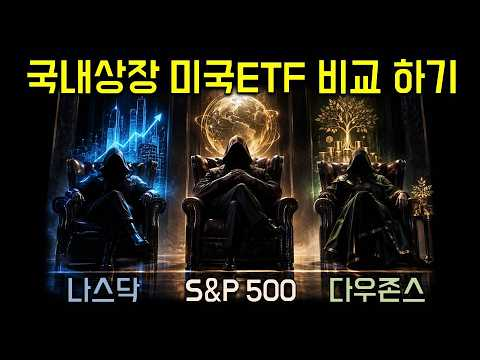
- 챕터: 0:00 국내상장 미국 ETF 3대장 · 0:29 나스닥 100 ETF 추천 · 5:12 S&P 500 ETF 추천 · 11:08 미국배당 다우존스 ETF 비교 · 19:24 연금저축 IRP ISA 절세계좌 장기투자
- 설명 앞부분: 국내상장 미국주식은 3대장 모두 적립식 투자 하시는걸 추천 드립니다. IRP, ISA, 연금저축 계좌에서 절세 비교하고, 국내상장 상품별로 수수료 비교하면 그 다음은 꾸준히 사모으면서 장기투자하는게 정답인것 같습니다.
- 같은 채널 평소 대비 ×24.2 (채널 최근 롱폼 중앙값 425회) · 평소 영상: ㅇㅇㅇ지수보다 수익률 높이는 방법 추천드립니다. 저는 ETF로 분산투자 하고 있습니다. (425회) / 미국주식 대표 S&P 500 ETF 비교 방법! 하나만 골라서 연금저축에서 적립식 투자로… (471회)
- 대본 없음 (설명) — 음성인식이 끝나면 도입부·흐름이 들어감
- 댓글 2/2: 좋은 점 — 영상 0 · 감사·응원 0 · 더 알고 싶은 것 0 · 아쉬운 점 — 영상 0 · 반박·불만 — 의견 다름 0 · 정치·사회 0 · 경험 공유 0 · 구독·다음 기대 0

### 168. 한국주식 또 폭락? 매일 돈삭제... 왜 이럴까 진짜 ㅠ

- https://www.youtube.com/watch?v=-G2MoPlAl5c · 엑스세대 우리들의 이야기 · 구독자 11,500 · 조회수 15,731 (×1.4, 하루 1,914.5) · 좋아요 648 (4.1%) · 6.5분 · 2026-10-29 · 주제 묶음 5. 국내주식 · 형식 정보·해설 (그 밖) · 폴더 `W_-G2MoPlAl5c` (웹 승인)
- 같은 채널 평소 대비 ×0.9 (채널 최근 롱폼 중앙값 17,663회) · 평소 영상: 익선동 산책 ....돈은 끝까지 들고 있어야 하지 않을까? (17,940회) / 경기안좋다...지금은 무조건 관망하는게... (17,386회)
- 대본 없음 (없음) — 음성인식이 끝나면 도입부·흐름이 들어감
- 댓글 82/82: 좋은 점 — 영상 0 · 감사·응원 3 · 더 알고 싶은 것 1 · 아쉬운 점 — 영상 1 · 반박·불만 — 의견 다름 1 · 정치·사회 7 · 경험 공유 5 · 구독·다음 기대 0
  - 감사·응원 👍23 “1억이 딱절반상태네요 !! 방장님 개국장 한탄하는소리듣고싶어서 챙겨듣습니다 조금이나마 미소짓게 해주셔서 감사합니다”
  - 감사·응원 👍1 “엑스님 힘내세요 그리고 모든 투자자 여러분들 힘내세요 스트레스가 모든 만병의 원인입니다.”
  - 더 알고 싶은 것 👍6 “엑스형님, 오전에만 반짝 방송하지 마시고 오전 오후 방송 부탁드립니다...! 형님 넉살만한 소화제가 없어요.”
  - 아쉬운 점 — 영상 👍1 “외인들 진짜 낚시질이 미쳤네요. 떡붕어들이 쑥쑥 낚이네요. 미장은 조정좀 했다고 상승중인데. 아주그냥. 조금 올랐다고 떡락. 역시 개국장…. 개판입니다.”
  - 반박·불만 — 의견 다름 👍0 “연기금이 돈이 없어서 다른 주식 팔아서 반도체 삽니다... 정치인, 언론, 뉴스 모두 반도체 펌핑중인데... 하이닉스는 300만원에서 반토막 나있는 상황인데.... 거기다 연기금을 계속 쏟아붙내요. 돈이 없으니까 네이버 카카오 등등 손절해서 마련한 돈으로 반도체 사내…”
  - 정치·사회 👍5 “연기금이 나라 망하거나 말거나 정권유지위해 코스피 지수 방어는해도 더이상 코스피 끌어올리지는 못함.. 지금도 코스피 너무많이 산게 문제라고 실토를 했는데...제발들 현실을 직시해야.”
  - 정치·사회 👍5 “대통령이 쑈질만 하려고 지랄중인데 주식인들... 안그럴까요..”
  - 경험 공유 👍24 “미장은 반도체 지수 좋은데.. 왜 이려 대우건설 -20% 두산은 -10%이상 하락. 2차전지도 개떡락. 반도체 개떡락. 어제 살찍 기대햇는데 이젠 포기햇습니다. 어제 들어간 분들 다 망햇죠 . 들어가면 하루만에 -5% 물리는 건 한순간이죠. 한마디로 개미지옥이 다 됏…”
  - 경험 공유 👍8 “형님 지금은 하락추세에요.주식 하면 안됩니다.인내심을 가지고 때가되거든 하세요.그때 커버드콜을 쓸어담으세요.제가 그 시기를 기다리고 있어요 .현금비중 95%가지고 있음”

### 169. 주식 상위 2%만 아는 10가지 절대 생존 원칙 (돈의 원리)

- https://www.youtube.com/watch?v=fFURFeLTdAg · 준의 경제노트 (jun’s Note) · 구독자 12,500 · 조회수 307,728 (×24.6, 하루 2,074.2) · 좋아요 6,931 (2.2%) · 21.6분 · 2026-06-10 · 주제 묶음 11. 투자 일반 · 형식 오디오북·낭독 (명언·인생조언) · 폴더 `W_fFURFeLTdAg` (웹 승인)
- 썸네일: 
- 챕터: 0:00 주식 시장, 살아남는 자가 강하다 · 1:25 금융 천재 vs 평범한 경비원, 진짜 승자는? · 3:10 주식 투자는 지능이 아닌 '행동'의 영역 · 3:52 원칙 1. 예측하지 말고, 대응하라 · 5:22 원칙 2. 손실의 비대칭성을 이해하라 (바벨 전략) · 7:23 원칙 3. 승률이 아니라, 손익비로 계산하라 · 9:05 원칙 4. 좋은 회사가 아니라, 싼 주식을 사라 · 11:00 원칙 5. 현금은 쓰레기가 아니라, 무기다 · 12:56 원칙 6. 살 때는 신중하게, 팔 때는 과감하게 · 14:00 원칙 7. 공포에 사고, 환희에 팔아라 · 15:35 원칙 8. 좋은 종목만 사라 · 16:45 원칙 9. 본전 심리를 버려라 · 17:50 원칙 10. 감정과 싸우지 말고, 회피하라 · 19:25 실전 적용: 시장의 주인이 되는 법 · 20:20 마무리: 10년 생존을 위한 자가 진단
- 설명 앞부분: 주식 투자자 10명 중 9명은 왜 돈을 잃을까요?** 📉 예측에 의존하는 투자가 아닌, 진짜 부자들만 아는 '10가지 절대 생존 원칙'을 공개합니다. 평생 경비원으로 일하며 95억 원의 유산을 남긴 로널드 리드와, 화려한 경력에도 파산한 금융 천재의 결정적 차이는 무엇이었을까요? 이 영상에서 자산을 수십 배로 불리는 투자의 본질을 확실히 해부해 드립니다. 핵심 요약 주식 투자는 지능의 게임이 아니라 '행동'의 영역입니다. 10년, 20년 동안 시장에서 살아남아 끝까지 승리하는 상위 2%가 되고 싶다면, 영상에서 제시하는 생존 지도…
- 같은 채널 평소 대비 ×389.5 (채널 최근 롱폼 중앙값 790회) · 평소 영상: 1억을 20억, 30억으로 만드는 4가지 전략 ∣ 99%가 모르는 부자의 비밀 (790회) / 유통물량 5%로 나스닥100 편입까지? 스페이스X 일론 머스크가 그리는 우주 AI 제국의… (612회)
- 대본 없음 (설명) — 음성인식이 끝나면 도입부·흐름이 들어감
- 댓글 189/191: 좋은 점 — 영상 8 · 감사·응원 20 · 더 알고 싶은 것 2 · 아쉬운 점 — 영상 4 · 반박·불만 — 의견 다름 3 · 정치·사회 0 · 경험 공유 13 · 구독·다음 기대 0
  - 좋은 점 — 영상 👍20 “백배 공감합니다 꼭 간직하겠습니다. 감사합니다 ❤”
  - 좋은 점 — 영상 👍17 “정말 큰 도움이 되는 영상이였습니다 덕분에 주식으로 이백억을 벌것 같습니다”
  - 감사·응원 👍20 “백배 공감합니다 꼭 간직하겠습니다. 감사합니다 ❤”
  - 감사·응원 👍14 “항상 좋은정보 감사합니다. 투자를 하다보면은 지키기 어려운데 공감가네요.”
  - 더 알고 싶은 것 👍3 “평생마트주차장 관리인 , 경비원, 미련하게 악착같이 주식모아서 결국 어떻게 되었나요? .... 죽었습니다. 끝.”
  - 더 알고 싶은 것 👍1 “좋은 강의 감사합니다. 싼 주식의 기준은, 또는 평가는 무엇인지요? 저Per? 실적? 수주액? 부탁합니다.”
  - 아쉬운 점 — 영상 👍22 “나는 뻔한 예가 나오면 흐름이 끊겨서 거기까지만 듣고 나갑니다.”
  - 아쉬운 점 — 영상 👍4 “ai목소리 질려서 안보게되네요 다 똑같은 목소리라 채널구분도 안되구”
  - 반박·불만 — 의견 다름 👍6 “맞는말인듯😊전 샀다팔았다 하지 않으려고 연금저축펀드 에쎈피500!!!😊 감사합니다!! 그리고 딴분들이 웃기는겤ㅋㅋㅋㅋ아니 영상만들어 주신분한테 목소리가 어떻니 왜 그러심? 물림? ㅋㅋㅋㅋㅋㅋ 그런 댓글 작성할 시간에 영상 올려주신분께 감사하다고 좋아요 한번 눌러욬ㅋㅋ…”
  - 반박·불만 — 의견 다름 👍5 “모두 맞는 이야기 이지만 2번 손해안보는 안전한 자산에 85~90%를 넣어두고 나머지만 위험을 감수한 투자를 한다는 것은 틀렸네요. 현재 안전한 투자는 한국 단기채권은 3% 초반, 미국단기채권은 4% 초반으로 이자율이 나오는데 대한민국의 최근 10년간 연평균 화폐증가…”
  - 경험 공유 👍137 “120만원으로 시작해서 7년만에 1억 4천넘게 벌어보고 느낀점 버핏옹의 투자원칙 첫번째 원칙 돈을 지켜라 두번째 원칙 첫번째 원칙을 지켜라 이말은 진리고 내가 주식시장에서 돈을 벌 수 있던 말이다 저말을 뜻을 깨닫는다면 시장에서 돈을 벌수 있다 이걸 설명하기 어려운건…”
  - 경험 공유 👍4 “저는 초단타 14년차 1억으로 무한 3%”

### 170. Jeden Monat Miete ohne eigene Immobilie - warum ich jetzt Realty Income kaufe

- https://www.youtube.com/watch?v=jeVV2buqJ_k · Aktienhai · 구독자 2,910 · 조회수 10,397 (×3.6, 하루 478.6) · 좋아요 128 (1.2%) · 11분 · 2026-10-15 · 주제 묶음 2. 장기투자·ETF·지수 · 형식 정보·해설 (그 밖) · 폴더 `W_jeVV2buqJ_k` (웹 승인)
- 썸네일: 
- 챕터: 0:00 Jeden Monat Miete, trotzdem b… · 0:52 Realty Income (ISIN: US756109… · 1:53 Warum die Aktie seit Jahren f… · 3:22 Umsatz, FFO und AFFO · 5:06 Bewertung, Dividende, Schulden · 7:10 Was bei Realty Income wirklic… · 8:35 NNN REIT und Agree Realty im … · 8:58 Der Haken · 9:57 Score und Fazit · 10:25 Würde ich kaufen?
- 설명 앞부분: Realty Income zahlt über 670 Monatsdividenden in Folge und hat ein Geschäft, das jedes Jahr wächst: Trotzdem steht die Aktie von Realty Income rund ein Viertel unter Ende 2021. Für alle, die sich eine monatliche Miete ins Depot holen wollen, ist das die spannende Frage: Schnäppchen oder Falle? 🎁 Si…
- 같은 채널 평소 대비 ×3.7 (채널 최근 롱폼 중앙값 2,831회) · 평소 영상: Kommt bei ServiceNow JETZT der Ausbruch nach oben… (2,930회) / Ich investiere JETZT 2.000€ in die ServiceNow Akt… (2,732회)
- 대본 없음 (설명) — 음성인식이 끝나면 도입부·흐름이 들어감
- 댓글 38/38: 좋은 점 — 영상 0 · 감사·응원 0 · 더 알고 싶은 것 0 · 아쉬운 점 — 영상 0 · 반박·불만 — 의견 다름 0 · 정치·사회 0 · 경험 공유 0 · 구독·다음 기대 0

### 171. 월배당 ETF 10억 투자하면 정말 배당금 얼마? ∣ 종합소득세·건강보험료 계산법 (은퇴 현금흐름 설계)

- https://www.youtube.com/watch?v=yRDpbgaZahc · 은퇴머니 - 은퇴 현금흐름 설계 · 구독자 30,000 · 조회수 759,726 (×25.3, 하루 4,795.5) · 좋아요 10,294 (1.4%) · 11.4분 · 2026-05-31 · 주제 묶음 2. 장기투자·ETF·지수 · 형식 정보·해설 (그 밖) · 폴더 `W_yRDpbgaZahc` (웹 승인)
- 썸네일: 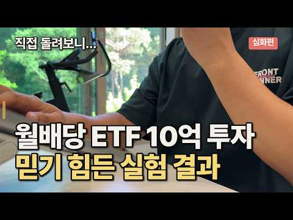
- 챕터: 0:00 평생 모은 10억으로 생활비를 만들어야 한다면 · 1:10 10억을 배당 ETF에 넣고 3년, 직접 따라가 봤습… · 2:00 첫 분배금, 그리고 먼저 떼이는 원천세 · 3:11 예상 못 한 종합소득세 · 4:36 매달 빠져나가는 건강보험료 · 6:25 분배금은 36개월, 세금은 58개월 · 7:04 시뮬레이터 + 커버드콜 ETF 3종 비교 · 8:39 결국 종목이 아니라, 본인의 다섯 변수
- 설명 앞부분: 은퇴 후 10억을 월배당 ETF(JEPQ)에 넣으면 매달 얼마가 들어오고, 세금은 언제 얼마가 빠질까. 2023~2025년 3년 치 통장을 한 화면에 펼쳐 직접 확인해 봤습니다. 타임라인 📑 영상 PPT 자료 영상 내용을 정리한 슬라이드를 웹에서 바로 보고, PDF로도 내려받을 수 있습니다. 🧮 직접 계산해 보기 영상의 사례를 내 조건으로 바꿔 계산할 수 있습니다. 📄 전자책 「은퇴 현금흐름 설계법」 💬 여러분의 은퇴 설계에서 가장 고민되는 부분은? (자산 규모 / 세금 / 건강보험) 댓글로 알려 주세요.
- 같은 채널 평소 대비 ×54.2 (채널 최근 롱폼 중앙값 14,008회) · 평소 영상: 배당 2천만원 넘으면 더 낼 돈? 계산 과정 전부 공개 (14,008회) / ETF 포트폴리오, 은퇴 전에 확인해야 할 또 하나의 기준 (14,304회)
- 대본 없음 (설명) — 음성인식이 끝나면 도입부·흐름이 들어감
- 댓글 967/967: 좋은 점 — 영상 33 · 감사·응원 53 · 더 알고 싶은 것 33 · 아쉬운 점 — 영상 2 · 반박·불만 — 의견 다름 16 · 정치·사회 33 · 경험 공유 47 · 구독·다음 기대 4
  - 좋은 점 — 영상 👍32 “제가 지금 비슷한 처지에 종소세 건보료 때문에 수많은 고민을 하고있읍니다 좋은자료 감사합니다”
  - 좋은 점 — 영상 👍17 “제가 꼭 알고 싶어했던 부분을 영상을 담아주셨습니다. 많은 도움이 되었습니다!! 감사합니다!”
  - 감사·응원 👍32 “제가 지금 비슷한 처지에 종소세 건보료 때문에 수많은 고민을 하고있읍니다 좋은자료 감사합니다”
  - 감사·응원 👍20 “꼭 필요한 내용이네요. 궁금했는데 정말 감사드려요~ 구독, 좋아요 누르고 갑니다.”
  - 더 알고 싶은 것 👍8 “3년후 제피큐에넣은 10억은 얼마가남았나요?”
  - 더 알고 싶은 것 👍6 “좋은 정보 고맙습니다. 능력자 이시네요~ 저도 은퇴후 제일 고민이 건보료입니다. 인별로 나누고 있고 연금저축 IRP ISA 모두 활용중입니다. 국내지수 커버드콜 비중도 점점 커집니다. 은퇴후 투자법인도 고려중입니다. 앞으로도 좋은 컨텐츠 부탁드립니다. 목소리 좋으시네…”
  - 반박·불만 — 의견 다름 👍820 “개인연금 시대에 종합소득 과세 2000은 말도 안되는 시대에 뒤떨어진 정책입니다 최소 4000은 되어야 함”
  - 정치·사회 👍44 “이래서 우리나라가 순자산 100만달러이상 보유한 사람들 유출되는게 전세계 4위인거임ㅋㅋ 부자들이 떠나는 나라...”
  - 정치·사회 👍43 “한국에 사는 한국 국민으로서는 당연한 세금과 의료보험료이고, 외국인보다는 훨씬 낫습니다. 처음 15% 원천 징수는 미국 증시에서 이익을 본거니 미국금융소득에 대한 연방세입니다. 캘리포니아 거주자는 추가로 주 소득세도 꽤 더 냅니다. 미국인의 경우에는 소득의 처분 시점…”
  - 경험 공유 👍499 “저도 은퇴 후 자산정리하고, 분배금으로 살고 있습니다. 님과는 다르게 ETF반 커버드콜반으로 운영중이고, 현재 커버드콜은 전부 국내만 운영중입니다. 커버드콜 자산은 조금더 많은것 같고, 결론적으로 올해 총 수익은 1.2억정도인데 과세기준소득은 약 1천만원, 올해 말은…”
  - 경험 공유 👍74 “건보료 150만원 내도 좋으니 ㅅㅂ 나도 월 분배금 900들어오면 소원이 없겠다😂😂😂😂😂”
  - 구독·다음 기대 👍32 “이제까지 봤던 은퇴관련 배당 컨텐츠중에서 가장 실용적이고 퀄리티높은 !!!! 구독합니다.”
  - 구독·다음 기대 👍19 “제피큐 모으고 있어서 궁금했던 내용인데 영상 잘 봤습니다 ㅎ 구독하고 갑니다”

### 172. 매일 아침 7시, 내 포트폴리오를 관리해주는 AI 주식 비서를 만들어봤습니다

- https://www.youtube.com/watch?v=ITzgH6CeZns · 스티브의 파도타기 | AI 시대 일하는 법 · 구독자 28,800 · 조회수 743,616 (×25.8, 하루 4,598.9) · 좋아요 16,556 (2.2%) · 14.8분 · 2026-05-28 · 주제 묶음 2. 장기투자·ETF·지수 · 형식 정보·해설 (그 밖) · 폴더 `W_ITzgH6CeZns` (웹 승인)
- 썸네일: 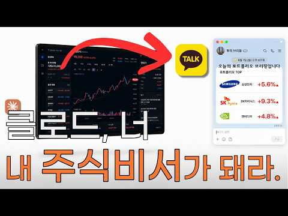
- 챕터: 0:00 Intro · 1:44 시작 전 꼭 알아야 할 것 · 2:37 1단계 - 주식 가격 정확하게 가져오기 · 3:40 2단계 - 관련 뉴스 가져오기 (날짜 문제 해결) · 6:20 3단계 - 브리핑으로 묶기 · 7:54 4단계 - 카카오톡으로 받기 (PlayMCP 연결) · 11:17 5단계 - 매일 아침 7시 자동 실행 (스케줄 등록) · 13:09 다음날 아침, 실제로 작동하는지 확인
- 설명 앞부분: Claude 하나로 매일 아침 7시, 코딩을 모르는 누구나 만들 수 있을만큼 쉽습니다. AI 자동화 콘텐츠가 넘쳐납니다. "주식 자동 매매", "포트폴리오 자동 운영" 같은 것들이요. 저는 개인적으로 추천드리지 않습니다. AI가 주식 판단을 대신할 수 있다면, AI 쓰는 사람들 모두 부자가 됐겠죠. AI는 미래를 알지 못합니다. 반복 노동은 AI에게 넘기고 진짜 중요한 판단은 내가 하는 것. 이게 제가 생각하는 AI 시대의 일하는 방식입니다. 타임라인 ○ 이렇게 AI를 활용하는 법을 직접 배우고 싶다면?
- 같은 채널 평소 대비 ×587.4 (채널 최근 롱폼 중앙값 1,266회) · 평소 영상: 신입사원이 아닌, AI에게 인수인계합니다 ∣ 업무를 회사에 남기는 법 (1,266회) / 기존 업무 AI로 대체하기 전에, 꼭 정리해야 할 게 있었습니다 (1,209회)
- 대본 없음 (설명) — 음성인식이 끝나면 도입부·흐름이 들어감
- 댓글 388/396: 좋은 점 — 영상 23 · 감사·응원 34 · 더 알고 싶은 것 38 · 아쉬운 점 — 영상 2 · 반박·불만 — 의견 다름 0 · 정치·사회 1 · 경험 공유 12 · 구독·다음 기대 5
  - 좋은 점 — 영상 👍11 “클로드 코웤.... 대단한 기능이네요. 꼭 주식이 아니더라도 회사 업무 관련 시장 분석에도 활용해봐야겠습니다. 좋은 정보 감사합니다”
  - 좋은 점 — 영상 👍4 “좋은 정보 입니다 정말 감사드립니다”
  - 감사·응원 👍55 “주식 투자를 하는 사람으로서 정말 감사합니다. 혹시 텔레그램에 팔로우하는 채널들에 수많은 주식 정보가 있는데 그걸 요약해서 브리핑하는 것도 가능할까요? 검토 부탁드립니다.”
  - 감사·응원 👍11 “클로드 코웤.... 대단한 기능이네요. 꼭 주식이 아니더라도 회사 업무 관련 시장 분석에도 활용해봐야겠습니다. 좋은 정보 감사합니다”
  - 더 알고 싶은 것 👍55 “주식 투자를 하는 사람으로서 정말 감사합니다. 혹시 텔레그램에 팔로우하는 채널들에 수많은 주식 정보가 있는데 그걸 요약해서 브리핑하는 것도 가능할까요? 검토 부탁드립니다.”
  - 더 알고 싶은 것 👍4 “내용이 너무 좋아서 저도 해보고 싶은데, 컴퓨터가 켜져 있어야 한다는 부분이 가장 아쉬운 지점이네요... 근데 궁금한게 클로드는 기본적으로 서버에서 작동하는 거 아닌가요? 근데 왜 마치 로컬 프로그램인 것처럼 내 컴퓨터가 켜져 있어야 한다고 하는지 모르겠네요... 대…”
  - 아쉬운 점 — 영상 👍0 “실제로 투자에 사용하기에는 과거데이터를 참고 해서 주거나 잘못된 정보를 주기도 하니 잘 걸러 내야 합니다..”
  - 아쉬운 점 — 영상 👍0 “감사합니다. 주어진 자료 바탕으로 제가 이틀정도 더 씨름하면서 제 스타일로 변동하였습니다. 문제가 되었던 부분들과 제가 수정한 방안 모두 감사한 마음으로 정리해봅니다. 1. 먼저 큰 틀에서 이 영상대로 잘 따라하시면 됩니다 . 전 하루에 3번은 받았으면 해서 8시 1…”
  - 경험 공유 👍4 “컴맹인 제가 해냈어요 . 친절한 설명 감사드립니다.”
  - 경험 공유 👍4 “내용이 너무 좋아서 저도 해보고 싶은데, 컴퓨터가 켜져 있어야 한다는 부분이 가장 아쉬운 지점이네요... 근데 궁금한게 클로드는 기본적으로 서버에서 작동하는 거 아닌가요? 근데 왜 마치 로컬 프로그램인 것처럼 내 컴퓨터가 켜져 있어야 한다고 하는지 모르겠네요... 대…”
  - 구독·다음 기대 👍0 “오~구독했습니다~바로 공유하고~좋아요^^ 이런 유요한 꿀팁이 클로드 써보면서 이런정보가 있는지😅”
  - 구독·다음 기대 👍0 “너무 좋은 정보 감사합니다. 구독하고 갑니다.~”

### 173. 시총 8조 종목, -70% 손실

- https://www.youtube.com/watch?v=nQglTmdsOmw · 와조스키 종목분석 · 구독자 6,680 · 조회수 11,795 (×1.8, 하루 1,061.0) · 좋아요 266 (2.3%) · 7.6분 · 2026-10-26 · 주제 묶음 6. 종목 고르기·분석 · 형식 인터뷰·강연·대담 · 폴더 `W_nQglTmdsOmw` (웹 승인)
- 설명 앞부분: 와조스키 종목 분석 채널입니다. 종목 상담 요청을 받지 않고 있습니다. 지금 보시는 채널은 종목 분석 채널입니다. 라이브 방송 주식 강의 시황 분석 등은 아래 채널로 와주세요.
- 같은 채널 평소 대비 ×1.1 (채널 최근 롱폼 중앙값 10,284회) · 평소 영상: 수상한 매집흔적 (10,284회) / 한화에어로스페이스 투자자 주의사항 (10,223회)
- 대본 없음 (설명) — 음성인식이 끝나면 도입부·흐름이 들어감
- 댓글 22/22: 좋은 점 — 영상 0 · 감사·응원 2 · 더 알고 싶은 것 2 · 아쉬운 점 — 영상 0 · 반박·불만 — 의견 다름 0 · 정치·사회 0 · 경험 공유 2 · 구독·다음 기대 0
  - 감사·응원 👍3 “감사합니다~~힘든시기이지만 잘 버텨보게습니다~❤”
  - 감사·응원 👍1 “감사합니다..~~~”
  - 더 알고 싶은 것 👍1 “저도 LG이노텍이랑 ABL바이오 좀 부탁드립니다”
  - 더 알고 싶은 것 👍0 “엘지전자도 좀 부탁드려요ㅠㅠ....”
  - 경험 공유 👍1 “저도 LG이노텍이랑 ABL바이오 좀 부탁드립니다”

### 174. "LG엔솔이 삼성전자 시총 뛰어넘을것”과연 불가능한 일일까?" (박순혁작가의 2차전지 마인드셋)

- https://www.youtube.com/watch?v=b9q7-J5lCDc · 투자자 W · 구독자 6,670 · 조회수 12,348 (×1.9, 하루 1,011.5) · 좋아요 299 (2.4%) · 11.5분 · 2026-10-25 · 주제 묶음 기타 · 형식 정보·해설 (그 밖) · 폴더 `W_b9q7-J5lCDc` (웹 승인)
- 같은 채널 평소 대비 ×1.5 (채널 최근 롱폼 중앙값 8,288회) · 평소 영상: 이영상을 보면 삼성전자 SK하이닉스 감산의 근거와 담합소송 어떻게 될것인가 명확해진다. (9,025회) / 위험을 함께 지는 것에 대한 보상 (7,552회)
- 대본 없음 (없음) — 음성인식이 끝나면 도입부·흐름이 들어감
- 댓글 10/10: 좋은 점 — 영상 0 · 감사·응원 2 · 더 알고 싶은 것 0 · 아쉬운 점 — 영상 0 · 반박·불만 — 의견 다름 1 · 정치·사회 0 · 경험 공유 0 · 구독·다음 기대 0
  - 감사·응원 👍6 “감사합니다❤”
  - 감사·응원 👍5 “감사합니다”
  - 반박·불만 — 의견 다름 👍21 “35년에 전기차 점유율이 50%라 가정하고 엔솔의 가치, 엘화, 엘화우의 가치를 비교하면 진짜 말도 안되는 수치가 나오긴 함 아는 사람들은 알겠지만 이거 진짜 숨은 진주임”

### 175. QLD 거치식 투자, 2배까지 얼마나 걸릴까? QQQ와 비교했더니,, 충격!

- https://www.youtube.com/watch?v=dbQ_xk3IiPg · 두배럭 2XLuck · 구독자 3,260 · 조회수 11,317 (×3.5, 하루 492.8) · 좋아요 160 (1.4%) · 16분 · 2026-10-14 · 주제 묶음 11. 투자 일반 · 형식 브이로그·직접 해본 이야기 · 폴더 `W_dbQ_xk3IiPg` (웹 승인)
- 썸네일: 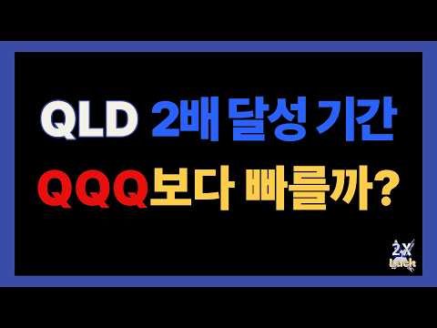
- 설명 앞부분: QLD 거치식 투자하면 언제 2배가 될까? QQQ와 비교하면 결과는 어땠을까요? 이번 영상에서는 QLD와 QQQ에 거치식으로 투자했을 때 투자금이 2배가 되기까지 걸리는 시간을 실제 과거 데이터를 통해 비교해봤습니다. QLD 투자금 2배 달성 기간 2배 달성 과정에서의 최대 낙폭과 회복 기간 QLD와 QQQ의 2배 달성 기간 비교 레버리지 ETF의 수익과 하락 위험 투자 기간과 꾸준한 투자의 중요성 QLD는 과연 QQQ보다 빠르게 2배가 될 수 있었을까요? 실제 과거 데이터를 통해 그 차이와 투자 과정에서 주의해야 할 점까지 확인…
- 같은 채널 평소 대비 ×1.1 (채널 최근 롱폼 중앙값 10,276회) · 평소 영상: QLD 10년 vs 15년 투자 비교! 5년 늘리면 투자금은 얼마나 줄어들까? (10,386회) / QLD 월 200만 원 적립식 충격 결과! 월 100만 원 결과보다 얼마나? 금액과 시간… (10,167회)
- 대본 없음 (설명) — 음성인식이 끝나면 도입부·흐름이 들어감
- 댓글 21/21: 좋은 점 — 영상 2 · 감사·응원 6 · 더 알고 싶은 것 1 · 아쉬운 점 — 영상 0 · 반박·불만 — 의견 다름 0 · 정치·사회 0 · 경험 공유 1 · 구독·다음 기대 0
  - 좋은 점 — 영상 👍2 “좋은영상 감사합니다”
  - 좋은 점 — 영상 👍1 “너무 좋은 정보네요. 감사합니다.”
  - 감사·응원 👍7 “저는 직투에서는 QLD와 USD를 메인으로 매월 적립중이며 TQQQ는 MDD기준 마이너스 60,70,80으로 떨어졌을때 폭이 더 떨어질수록 현금을 더 투입하는 3분할 진입이며 SOXL은 마이너스 70,80,90일때 분할매수 하고 있는데 기회가 자주 오지는 않습니다 영…”
  - 감사·응원 👍3 “와. Qld. 대박이네요. 앞으로도. 이랫음하는 바램. ㅎㅎ. 감사합니당”
  - 더 알고 싶은 것 👍4 “Tqqq도 궁금합니다~”
  - 경험 공유 👍3 “수고 많으셨습니다. '3배 되는 시기' 좀 해주시면 감사하겠습니다. 제가 3배씩 이익실현 하는 플랜을 짜고 있어서 그렇습니다. 감사합니다 ~”

### 176. ಯಾವ್ದು ಈ ಕಂಪನಿ? ಯಾಕೆ Investorsಗೆ ಗೊತ್ತಿಲ್ವಾ? by Team Angel Investments

- https://www.youtube.com/watch?v=QeNVWGk_jwQ · Team Angel investments  · 구독자 23,100 · 조회수 42,010 (×1.8, 하루 3,488.4) · 좋아요 1,179 (2.8%) · 25.8분 · 2026-10-25 · 주제 묶음 기타 · 형식 정보·해설 (그 밖) · 폴더 `W_QeNVWGk_jwQ` (웹 승인)
- 설명 앞부분: Investment Help Form: For investments help: 9035254332 Disclaimer: This video is created purely for education and awareness. It does not give any buy/sell/hold recommendations, price targets, intraday levels, or trading signals. The companies, sectors, economic trends, or financial concepts discuss…
- 같은 채널 평소 대비 ×0.8 (채널 최근 롱폼 중앙값 54,649회) · 평소 영상: CEO ಕೂಡ ಇವರ ಮಾತು ಕೇಳ್ತಾರೆ!.. ∣ CEO vs Company Boa… (54,649회) / Stock Market ಅಂದ್ರೆ ದುಡ್ಡು ಮಾಡೋ ಜಾಗ ಅಲ್ಲ!.. ∣ Exp… (51,654회)
- 대본 없음 (설명) — 음성인식이 끝나면 도입부·흐름이 들어감
- 댓글 113/113: 좋은 점 — 영상 0 · 감사·응원 0 · 더 알고 싶은 것 0 · 아쉬운 점 — 영상 0 · 반박·불만 — 의견 다름 0 · 정치·사회 0 · 경험 공유 0 · 구독·다음 기대 0

### 177. Analista de Banca Enseña Todas sus Inversiones a los 27 Años (Octubre)

- https://www.youtube.com/watch?v=z8tPJhBOUjk · Dani Dominguez Quant · 구독자 12,500 · 조회수 21,477 (×1.7, 하루 1,839.6) · 좋아요 262 (1.2%) · 16.5분 · 2026-10-25 · 주제 묶음 2. 장기투자·ETF·지수 · 형식 정보·해설 (그 밖) · 폴더 `W_z8tPJhBOUjk` (웹 승인)
- 챕터: 0:00 Intro · 0:54 Mi patrimonio en octubre · 1:29 Lo que tengo en cartera y por… · 5:12 Mi inversión más arriesgada · 6:27 Cómo está repartido mi dinero · 11:08 Qué tal ha ido el mes · 15:14 La APP que uso
- 설명 앞부분: Octubre de 2026 y ya he llegado al objetivo que me puse para final de año. En este vídeo te enseño mi patrimonio al completo con 27 años: todo lo que tengo, por qué lo tengo y cómo lo reparto. Y también la nueva inversión que he hecho este mes, la más arriesgada de mi cartera con diferencia. Esta s…
- 같은 채널 평소 대비 ×2.1 (채널 최근 롱폼 중앙값 10,229회) · 평소 영상: La Mejor Formas De Rentabilizar Tus Ahorros en 20… (10,259회) / Te Han Mentido sobre Rebalancear tu Cartera ∣ Aná… (10,199회)
- 대본 없음 (설명) — 음성인식이 끝나면 도입부·흐름이 들어감
- 댓글 31/31: 좋은 점 — 영상 0 · 감사·응원 0 · 더 알고 싶은 것 0 · 아쉬운 점 — 영상 0 · 반박·불만 — 의견 다름 0 · 정치·사회 0 · 경험 공유 0 · 구독·다음 기대 0

### 178. [주식] 🔥월요일 바로 폭등 나올 Best 3종목!🔥반드시 잡아가세요! 자세하게 설명드려볼게요! #급등주 #주식추천 #급등주추천

- https://www.youtube.com/watch?v=tJcfYQkbRWo · 급등주 장인 폭등남 · 구독자 7,440 · 조회수 15,282 (×2.0, 하루 1,089.3) · 좋아요 511 (3.3%) · 39분 · 2026-10-23 · 주제 묶음 6. 종목 고르기·분석 · 형식 정보·해설 (그 밖) · 폴더 `W_tJcfYQkbRWo` (웹 승인)
- 설명 앞부분: 🔥 다음주 주목할 종목 BEST3 ∣ AI·바이오·비만치료제 집중 분석 오늘 시장은 미국 AI·반도체 약세 여파와 금요일 특유의 약한 수급이 겹치면서 전체적으로 쉽지 않은 흐름을 보여줬습니다. 하지만 시장이 흔들릴수록 중요한 것은 단순히 지수가 오르느냐 내리느냐가 아닙니다. 어떤 테마에 돈이 몰리고 있는지, 어떤 기업에 실제 재료와 실적이 있는지, 수급이 어디에서 살아있는지를 확인하는 것이 더 중요합니다. 이번 영상에서는 평소처럼 장 초반 몇 분 안에 끝내는 초단타보다는 조금 더 여유 있게 대응할 수 있는 단기 스윙 관심종목 3개…
- 같은 채널 평소 대비 ×2.1 (채널 최근 롱폼 중앙값 7,321회) · 평소 영상: [주식] 🔥내일 바로 폭등 나올 Best 3종목!🔥반드시 잡아가세요! 자세하게 설명드려볼… (7,321회) / [주식] 🔥내일 바로 폭등 나올 Best 3종목!🔥반드시 잡아가세요! 자세하게 설명드려볼… (7,332회)
- 대본 없음 (설명) — 음성인식이 끝나면 도입부·흐름이 들어감
- 댓글 78/78: 좋은 점 — 영상 2 · 감사·응원 42 · 더 알고 싶은 것 2 · 아쉬운 점 — 영상 3 · 반박·불만 — 의견 다름 0 · 정치·사회 0 · 경험 공유 1 · 구독·다음 기대 1
  - 좋은 점 — 영상 👍1 “많은 도움이 됩니다. 감사합니다.”
  - 좋은 점 — 영상 👍1 “좋은영상 진심으로감사드립니다”
  - 감사·응원 👍2 “폭등님을 이제서야 알다니, 여느때처럼 우연히 영상보다가 맨 똑같은 멘트에 매수,매도타임 알려준다면서 폰으로 문자보내달라는 그런 유투버겠지했는데, 어라?? 그런게 없네? 거기다가 종목추천도 거의 잘 맞아터지고. 구독,좋아요 누르고 앞으로 정기적으로 보고 참고하겠습니다.…”
  - 감사·응원 👍2 “감사합니다”
  - 더 알고 싶은 것 👍1 “늘 감사한 마음을 전합니다~ 어제 추천주 장시작 하자마자 정신없이 올라가는데 전 쳐다만봤어요 ㅠ 오늘 넘 하락장이라 무서워서 매수를 못했네요ㅠ ㅠ 주식의 신 이십니다 정말 대단하십니다 나중에 삼성E&A 사서 쪼끔 벌고 나왔네요 ! 월요일 잘 부탁드립니다~~ 꾸벅...”
  - 더 알고 싶은 것 👍1 “고수님 같이 해박한 시장지식과 종목 설명을 듣는것 만으로 시청자들은 행복 할 따름입니다... 아무튼 앞으로도 좋은 종목 잘 부탁드립니다... 그 이후는 본인들의 몫이라 생각하겠읍니다 ... 주말 즐겁게 보내시길 기원합니다...”
  - 아쉬운 점 — 영상 👍2 “오늘 빅텍 수익 했습니다. 감사합니다. ~. 그전부터 말씀드리고싶었는데 , 1080hd 인데도 화질이 뭉개져 보여집니다.송출 자체가 낮은해상도로 배출 되는거같습니다. 한번 조정해주시면 감사하겠습니다.”
  - 아쉬운 점 — 영상 👍1 “화질이 좋아졌네요^^”
  - 경험 공유 👍1 “오늘은 따라가는거 실패해서 손해봤네요..ㅠ 전부 올랐는데., ㅠ”
  - 구독·다음 기대 👍1 “대표님 감사 합니다 매일구독하고 있는데요 매일공부잘하고 있습니다 수익도잘보고있 었습니다 ^^^^^”

### 179. 배당금으로 혼자 사는 미혼남, 3억 파이어 미니멀라이프

- https://www.youtube.com/watch?v=iGI_fzwOyoY · 배당아저씨 · 구독자 33,200 · 조회수 232,332 (×7.0, 하루 4,813.4) · 좋아요 2,132 (0.9%) · 8.6분 · 2026-09-19 · 주제 묶음 3. 배당 · 형식 정보·해설 (그 밖) · 폴더 `W_iGI_fzwOyoY` (웹 승인)
- 썸네일: 
- 설명 앞부분: 영상 속 배당아저씨의 미니멀라이프 내돈내산 재료&용품들 (쿠팡 파트너스 및 인플루언서 활동의 일환으로 구매시 일정액의 수수료를 제공 받을 수 있습니다) 이 채널은 저의 투자 경험과 생각을 공유하는 공간입니다. 저의 투자 방식을 그대로 따라 하시는 것은 권장드리지 않으며, 충분한 고민과 공부 후 판단하시길 바랍니다.
- 같은 채널 평소 대비 ×4.7 (채널 최근 롱폼 중앙값 49,830회) · 평소 영상: 일하지 않고 배당금 받아 살면 나라가 망한다, 3억으로 시작한 파이어 미니멀라이프 (49,830회) / 배당금으로 혼자사는 미혼남의 현실 (49,021회)
- 대본 없음 (설명) — 음성인식이 끝나면 도입부·흐름이 들어감
- 댓글 612/626: 좋은 점 — 영상 9 · 감사·응원 57 · 더 알고 싶은 것 26 · 아쉬운 점 — 영상 5 · 반박·불만 — 의견 다름 8 · 정치·사회 0 · 경험 공유 82 · 구독·다음 기대 1
  - 좋은 점 — 영상 👍6 “캥거루로 살며 대충 6억 모았는데 연금계좌+퇴직DC에 에슨피1.5억 나스닥 1.5억이라 55세까지 사용못하는돈이고 1-2년 사이 3 억정도로 배당세팅해야하는 입장으로 도움이 됩니다 저도 40대 이제 좋은거 살만큼 다 사봤기에 지금은 다이소 티 사입네요( 작년에 올만에…”
  - 좋은 점 — 영상 👍2 “기다렸어요~나의 정신 안정제 영상😊 배경음악도 목소리도 잔잔하니 듣기 좋네요.”
  - 감사·응원 👍141 “자기가 만족하는 삶 자체가 행복이죠.항상 응원합니다 배당아저씨🙏🏻”
  - 감사·응원 👍115 “집에만 있어 처량하다고 하시는분들은 아직 크나큰 괴로움이 없었다고(?) 볼수도 있습니다. 행복은 하고싶은걸 할때보다 하기싫은걸 하지않을때 훨씬 크다고 생각합니다. 배당아저씨 응원합니다.”
  - 더 알고 싶은 것 👍7 “댓글이 다양하니재미습니다 궁금해서 다봅니다 시간이 좀 많이 소요되네예^^”
  - 더 알고 싶은 것 👍4 “유튜브 수익은 얼마나 되나요?”
  - 아쉬운 점 — 영상 👍1 “이 형은 목소리가 너무 좋아”
  - 아쉬운 점 — 영상 👍1 “혹시 카메라는 뭐쓰세요? 화질이 좋아서요”
  - 반박·불만 — 의견 다름 👍25 “올해 40살 2억으로 파이어했고 1억은 국내 커버드콜 배당주로 isa계좌로 월 180 받고있고 월세 통신비 보험료 합해서 60만원 식비 월60만원으로 써도 월 60만원이 남습니다. 나머지 1억은 성장주 자율 투자중입니다 . 3억원 결코 작은돈 아니고 쉬운 금액 아닙니…”
  - 반박·불만 — 의견 다름 👍2 “다름을 틀림으로 인식하는 안타까운 사람들이 생각보다 많습니다 자기가 생각하는 삶이 아니라면 불쌍하고 틀렸다라고 정의하는것이죠 삶을 살아보고 배우고 느끼다 보면 개개인의 평범한 삶도 가치가있고 리스펙하게 되더군요 저는 배당아저씨님의 소소하고행복한 일상이 너무 부러워요 …”
  - 경험 공유 👍204 “퇴직했습니다~^^ 저도 3억으로 시작해요~.”
  - 경험 공유 👍49 “다른 사람들이 하는 오해가 <집에 있으면 답답할 것 같다>인데 집수니인 저의 입장에서는 너무나 행복한 일이에요 저도 퇴사 해서 집에만 있는 게 너무너무 좋아요.다른 사람 신경 쓰지 말고 삽시다 우리 ^^”
  - 구독·다음 기대 👍1 “안녕하세요. 구독하고 처음으로 댓글 다네요. ^^ 힘내시고 앞으로도 계속 쭉 성공투자 이어가길 응원합니다. 항상 건강하고 편안한 시간 보내세요. 😊 화이팅입니다~~”

### 180. "안정을 기대한다"더니 하루만에 코스피 -10.84%🔥올해 8번째 서킷브레이커🔥정부, 왜 손놓고 있나🔥증안펀드•리밸런싱•공매도🔥삼성전자 -14% SK하이닉스 -…

- https://www.youtube.com/watch?v=AOs5sAd3hKM · 리얼경제 · 구독자 1,340 · 조회수 19,142 (×14.3, 하루 190.1) · 좋아요 745 (3.9%) · 16.1분 · 2026-07-28 · 주제 묶음 2. 장기투자·ETF·지수 · 형식 정보·해설 (그 밖) · 폴더 `W_AOs5sAd3hKM` (웹 승인)
- 썸네일: 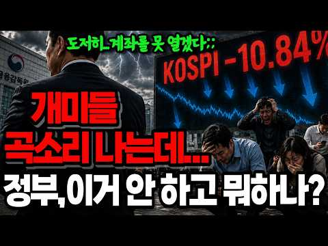
- 챕터: 0:00 인트로 — 어제는 "안정을 기대한다", 오늘은 서킷브… · 0:52 오늘 벌어진 일 — 코스피 6,023.66 / -10… · 2:41 방아쇠는 밖에서 — 중국 창신메모리 상장과 DUV 노… · 4:21 왜 우리만 이렇게 무너지나 — 레버리지라는 확성기 · 6:03 그럼 누가 벌었나 — 외국인 지분율은 오히려 늘었다 · 8:15 스위치는 이미 있었다 — 국민연금 리밸런싱과 7월 1일 · 10:09 당국은 무엇을 했나 — 7/14부터 7/28까지 날짜… · 11:48 안 쓴 카드 — 증안펀드 10조·공매도 금지·리밸런싱… · 13:37 그래서 지금이라도 — 요구 세 가지
- 설명 앞부분: 🔎2026년 7월 28일 코스피가 10.84% 폭락하며 올해 여덟 번째 서킷브레이커가 발동했습니다. 삼성전자 -14.17%, SK하이닉스 -16.02%, 중국 창신메모리 상장과 DUV 노광장비 소식, 외국인 4조 5,009억 순매도, 국민연금 리밸런싱 7월 1일 재개, 증권시장안정펀드 10조원까지 — 하루에 벌어진 일을 처음부터 끝까지 정리했습니다. 왜 떨어졌는지는 다들 아십니다. 이 영상이 따지는 건 떨어질 때 정부가 무엇을 했고, 무엇을 하지 않았는가입니다. 레버리지 근처도 안 가고 빚 한 푼 안 낸 계좌까지 왜 같이 녹았는지…
- 같은 채널 평소 대비 ×101.3 (채널 최근 롱폼 중앙값 189회) · 평소 영상: 삼성노조가 800조 호남 반도체 메가프로젝트 막아선 진짜 이유...부메랑 노란봉투법 삼성… (189회) / 엔비디아 손잡은 네이버 집중분석🔎아시아 AI 인프라회사로?🔥14조 유치🔥GPU 6만장🔥1… (147회)
- 대본 없음 (설명) — 음성인식이 끝나면 도입부·흐름이 들어감
- 댓글 205/205: 좋은 점 — 영상 0 · 감사·응원 2 · 더 알고 싶은 것 1 · 아쉬운 점 — 영상 2 · 반박·불만 — 의견 다름 3 · 정치·사회 60 · 경험 공유 4 · 구독·다음 기대 0
  - 감사·응원 👍1 “하..한숨이 나네요. 국힘에서 대통령 나오면 꼭꼭숨기다 민주당에서 대통령나오면 터뜨리고 대통령 탓하는거.. 그런다고 개개인의 돈이 돌아오는것도 아니고.. 선거 종이쪼가리 하나로 부자되는것도 아닌데 참으로 멍청들 하네요. 개인들의 돈을 지킬수있는 정보 감사합니다. 지가…”
  - 감사·응원 👍1 “재명이 파이팅! 자알한다~~~”
  - 아쉬운 점 — 영상 👍3 “■미국도 시가총액이 시장의 60%를 차지하는 종목에 단일레버리지ETF상품이 상장되어 있는가? 결론부터 말씀드리면 아닙니다. 미국 증시에도 엔비디아, 테슬라, 애플 등을 기초자산으로 하는 단일 종목 레버리지 ETF가 대거 상장되어 있지만, 단일 종목(또는 2개 종목)이…”
  - 아쉬운 점 — 영상 👍2 “쓸 카드를 쥐고 있는 것 자체가 기술입니다ㆍ 이 카드 이럴때 쓸거야..천명하는 순간 그 카드는 쓰지도 않았지만 힘이빠짐ㆍ 손해보고있다면 욕심에 냅다 지른 사람 책임이고 진짜 고수들은 언제 나머지를 투입할까 ㆍㆍㆍ재고있음ㆍ 뇌동매매자에게서 소신 투자자에게 돈은 그렇게 …”
  - 반박·불만 — 의견 다름 👍16 “역대 권력자 중에 국민을 주식에 도박하라고 판짜고 선동하고 국가돈 처 넣은 자는 짜이밍이 유일함.”
  - 반박·불만 — 의견 다름 👍3 “■미국도 시가총액이 시장의 60%를 차지하는 종목에 단일레버리지ETF상품이 상장되어 있는가? 결론부터 말씀드리면 아닙니다. 미국 증시에도 엔비디아, 테슬라, 애플 등을 기초자산으로 하는 단일 종목 레버리지 ETF가 대거 상장되어 있지만, 단일 종목(또는 2개 종목)이…”
  - 정치·사회 👍72 “역시 이재명 보유국이라니까. 결과 다 체험하는구나.”
  - 정치·사회 👍52 “민주당 지금 선거중이라 이런거 신경쓰는 사람 없어. 브라질에서 휴가중인데 코스피 하락하는게 뭐 뭐. 웃겨.”
  - 경험 공유 👍25 “내가보기에 정말 잘못된건 민주당을 20년 지지했다는 고백 그것이 최악의 선택이었다~무능정권을 넘어 야바위정권! 선무당이 사람잡고 반풍수가 집안거들냈다~그래놓고 헌법개정해서 한번 더해 먹겠단다? 우라질~~”
  - 경험 공유 👍13 “저도 평생민주당 .. 이제 뒤도 안돌어 보고 싶네요 신속 실행해야지 이건 아닌거 같네요”

### 181. ETF 이 '2가지'만 사두면 됩니다. '나머지는 필요없어요' 100억 자산 관리자의 꿀팁(백승호 단장 풀버전) #ETF #배당주 #주식 #백승호

- https://www.youtube.com/watch?v=1qlywudP2oY · 자람들 - 자립하는사람들 · 구독자 35,500 · 조회수 261,551 (×7.4, 하루 4,919.7) · 좋아요 2,266 (0.9%) · 69.7분 · 2026-09-14 · 주제 묶음 2. 장기투자·ETF·지수 · 형식 인터뷰·강연·대담 · 폴더 `W_1qlywudP2oY` (웹 승인)
- 썸네일: 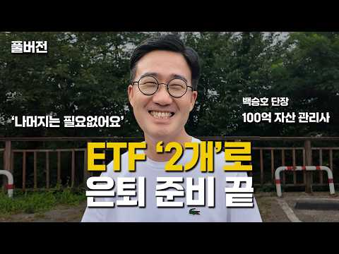
- 설명 앞부분: 👤 오늘의 게스트: 백승호 단장 개인 재무 컨설팅 전문가 & 유튜버·작가로도 활동 20년간 몇백 명의 고객 자산을 관리해온 재무 컨설턴트입니다. 현재 관리하는 총 자산만 100억원이 넘지만, 폭락장에도 노트북에 손 하나 대지 않을 만큼 평온한 태도로 유명합니다. 비결은 단 하나, "투자해도 되는 돈"과 "투자하면 안 되는 돈"을 철저히 구분하는 원칙입니다. 시드머니 없이 매주 조금씩 사 모으는 전략, 차트나 재무제표 대신 "내 지갑"을 믿고 애플·넷플릭스·구글 같은 주식을 고르는 방법, 그리고 레버리지·인버스 상품에 대한 강한 경…
- 같은 채널 평소 대비 ×9.0 (채널 최근 롱폼 중앙값 28,959회) · 평소 영상: 무조건 골드바로 사세요. 부자들은 이걸 삽니다. (G1 김봉준 1부) #골드바 #골드 #… (28,959회) / 금 언제 사야하나요? 그냥 지금부터 당장 금 모으세요. 부자들은 지금 사고 있습니다 (헤… (31,805회)
- 대본 없음 (설명) — 음성인식이 끝나면 도입부·흐름이 들어감
- 댓글 71/77: 좋은 점 — 영상 6 · 감사·응원 11 · 더 알고 싶은 것 3 · 아쉬운 점 — 영상 4 · 반박·불만 — 의견 다름 1 · 정치·사회 1 · 경험 공유 1 · 구독·다음 기대 1
  - 좋은 점 — 영상 👍6 “많이 배웠습니다. 감사합니다.”
  - 좋은 점 — 영상 👍5 “영상 너무 유익해서 메모하면서 보고 돌려 보고 너무 감사했습니다. 주식 입문 2달 조금넘었는데 원칙을 지키면서 잘해보자 합니다.”
  - 감사·응원 👍8 “와..이분 이 영상에서 처음 뵀는데 인상도 정말 좋으시고, 말씀도 편안하고 겸손하신데 무엇보다 내용이 명확하고 깔끔하시네요! 구독과 좋아요 누르고 갑니다. 귀한 영상 감사히 잘 봤습니다^^”
  - 감사·응원 👍7 “영상 감사드립니다🎉 Kodex200커버드콜 같은 것을 지금 사도 될 지 모르갰어오..우리나라가 갑자기 넘 오른 거 같아서요😅”
  - 더 알고 싶은 것 👍3 “오늘 선생님 유튜브 처음 들었는데 저와 투자 철학이 맞네요 좋아요.구독 눌렀습니다. 유선으로 통화하고 싶은데 어떻게 하면 되나요???”
  - 더 알고 싶은 것 👍2 “여기서 추천하는 "2 etf"는 어떤것인가요?”
  - 아쉬운 점 — 영상 👍85 “너무 길어요... AI에 요약을 요청~ 심플이즈 베스트: 일반 투자자에게는 S&P500과 나스닥100 ETF 두 가지만 꾸준히 사 모으는 것을 0순위로 추천합니다 (30:38). 결국 이 2개...ㅋ”
  - 아쉬운 점 — 영상 👍20 “13년전에 별생각없이 가입한 변액연금보험 10년납입 끝나고 2년정도 놔뒀는데 지금 수익률이 250퍼센트 넘어요. 조금더 많이 넣을껄하는 아쉬움이...”
  - 정치·사회 👍7 “영상 감사드립니다🎉 Kodex200커버드콜 같은 것을 지금 사도 될 지 모르갰어오..우리나라가 갑자기 넘 오른 거 같아서요😅”
  - 구독·다음 기대 👍3 “찐 투자의 길라잡이네요. 빽담화TV 구독과 알림 설정 들어갑니다.^^”

### 182. 주식 AI 비서 4명 만들었더니 공부가 쉬워졌어요 (제미나이 활용법)

- https://www.youtube.com/watch?v=02hqxRMURPs · 공부하는 주린이 · 구독자 1,300 · 조회수 31,438 (×24.2, 하루 175.7) · 좋아요 1,002 (3.2%) · 7.1분 · 2026-05-11 · 주제 묶음 1. 주식 기초·초보 · 형식 인터뷰·강연·대담 · 폴더 `W_02hqxRMURPs` (웹 승인)
- 썸네일: 
- 챕터: 0:00 예고 · 0:11 영끌 실패한 썰 · 0:25 AI 비서 4인방 공개 · 1:02 AI에게 역할 부여하기 · 1:30 AI 비서1. 단어 의미 설명가 / AI 비서 만드는… · 3:26 AI 비서2. 20년 경력의 수석 애널리스트 · 5:05 AI 비서 3,4 및 고정하기 · 5:58 마무리 · 6:24 주린이 투자 한 주 브리핑
- 설명 앞부분: 타임라인 템플릿 공유해 드립니다 :) 비서1은 "세컨드브레인연구소", 나머지 2,3,4는 "제미나이 주식투자"의 템플릿을 참고하여, 주린이의 필요에 맞게 변형해 사용했습니다. ㅡAI 비서1ㅡ 이름 : 단어 의미 설명가 설명 : 너는 복잡한 개념을 가장 쉽고 명쾌하게 설명하는 '지식 큐레이터'이자 '비유의 대가'이다. 생소한 용어나 최신 기술 단어를 해부하고, 뇌에 박히는 비유를 통해 완벽한 이해를 돕는 역할을 수행한다. 요청 사항 내가 단어를 제시하면 [사전적 정의/등장 배경/직관적 비유/주식 시장과의 연관성]을 포함한 '개념 요…
- 같은 채널 평소 대비 ×32.4 (채널 최근 롱폼 중앙값 971회) · 평소 영상: 다들 ETF부터 사라길래... 2천 넣으려다 쫄보라 결국 1천만 샀어요 (988회) / 시드 1억으로 늘렸는데... 이제 주식이 무서워졌어요 (954회)
- 대본 (자막, 6.4 음절/초) 첫 20초: “저 집 결국 못 썼어요. 이제 주식 진짜 더 열심히 할 거예요. 오늘은 저희 투자 전담 AI네 명 세팅했거든요. 그 꿀팁을 아낌없이 공개할게요. 저는 부동산 때문에 폭풍 같은 한 주를 보냈는데요. 저희 집 한 여섯 일곱 번 보여줬나? 그러고 팔려고 하는데 제가 사려던 금매가 갑자기 먼저 팔려 버려서 다 무선됐어요. 갈아타기 실패해서 좀 속상한데 주식”
- 첫 1분: “저 집 결국 못 썼어요. 이제 주식 진짜 더 열심히 할 거예요. 오늘은 저희 투자 전담 AI네 명 세팅했거든요. 그 꿀팁을 아낌없이 공개할게요. 저는 부동산 때문에 폭풍 같은 한 주를 보냈는데요. 저희 집 한 여섯 일곱 번 보여줬나? 그러고 팔려고 하는데 제가 사려던 금매가 갑자기 먼저 팔려 버려서 다 무선됐어요. 갈아타기 실패해서 좀 속상한데 주식 공부 더 열심히 하라는 신호 같기도 하더라고요. 그래서 앞으로 진짜 열심히 공부하는 모습 보여 드릴게요. 오늘은 본격적으로 저희 투자를 위해서 AI 비서네 명을 만들었거든요. 그럼 제가 엄한 비서 사인을 공개할게요. [음악] 짜잔. 단어 임의 설명과 20년 경력의 소석 주식 애널리스트, 리스크 관리 [음악] 전문가 그리고 뉴스 분석가입니다. 뭔지 모르시겠죠? 저”
- 흐름 (90초마다 첫 문장): 0:00 저 집 결국 못 썼어요. 이제 주식 → 1:30 템플릿까지 말씀드릴게요. 먼저 단어 → 3:02 맞게 정리를 해줬어요. 한줄 정의 → 4:30 투자에 좀 적합한 방식인데 이거 둘 → 6:01 같아요. 이제 공부만 하면 되는데
- 댓글 36/36: 좋은 점 — 영상 3 · 감사·응원 8 · 더 알고 싶은 것 1 · 아쉬운 점 — 영상 0 · 반박·불만 — 의견 다름 0 · 정치·사회 0 · 경험 공유 5 · 구독·다음 기대 0
  - 좋은 점 — 영상 👍3 “저도 재작년부터 AI를 활용해서 주식을 하는데 1번 단어 설명해주는 AI를 저도 만들어서 사용했어요 정확히는 주식에서 쓰는 용어를 하루에 3단어씩 골라서 설명 해 달라는 식으로 자동 메크로를 달았었는데 이게 도움이 많이 되었네용 지금은 안쓰기는 합니다 그래도 지금 경…”
  - 좋은 점 — 영상 👍2 “좋은정보 감사합니다 올해 주식을 시작했는데 공부를 해야할것 같은데 이런 좋은정보가 있다니... 빨리 집에가서 따라해봐야겠네요”
  - 감사·응원 👍2 “좋은정보 감사합니다 올해 주식을 시작했는데 공부를 해야할것 같은데 이런 좋은정보가 있다니... 빨리 집에가서 따라해봐야겠네요”
  - 감사·응원 👍2 “정말 필요한 정보 였는데.. 더 보기란에 템플릿까지.. 너무 감사합니다^^”
  - 더 알고 싶은 것 👍0 “Ai오프라인 강의는 어디서 어떻게 듣나요?”
  - 경험 공유 👍3 “저도 재작년부터 AI를 활용해서 주식을 하는데 1번 단어 설명해주는 AI를 저도 만들어서 사용했어요 정확히는 주식에서 쓰는 용어를 하루에 3단어씩 골라서 설명 해 달라는 식으로 자동 메크로를 달았었는데 이게 도움이 많이 되었네용 지금은 안쓰기는 합니다 그래도 지금 경…”
  - 경험 공유 👍2 “나도 따라해볼께요~”

### 183. SCHD ETF Analysis: The Most Complete Schwab US Dividend Equity ETF Breakdown

- https://www.youtube.com/watch?v=ys_pR1yxEgo · Goldman Starch · 구독자 6,160 · 조회수 19,406 (×3.1, 하루 831.1) · 좋아요 473 (2.4%) · 32.2분 · 2026-10-14 · 주제 묶음 2. 장기투자·ETF·지수 · 형식 정보·해설 (그 밖) · 폴더 `W_ys_pR1yxEgo` (웹 승인)
- 썸네일: 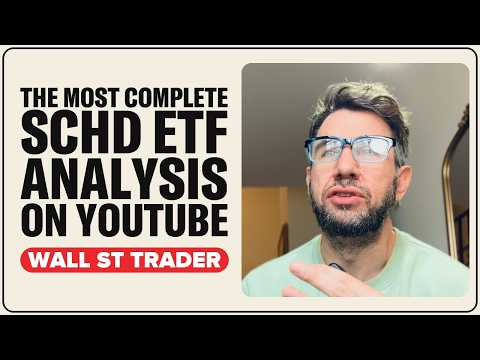
- 챕터: 0:00 SCHD ETF analysis: the record… · 1:13 What SCHD owns: the 4 screens · 2:04 The 4% cap and why Texas Inst… · 2:49 March reconstitution: who got… · 3:18 The 2 biggest holdings are ch… · 4:07 Why SCHD beat the S&P in 2026… · 4:53 The last time SCHD out-yielde… · 5:34 The 5% break: down 6.9% while… · 6:30 2022: why SCHD held up · 7:03 2023 to 2025: trailing the S&P · 7:49 Every calendar year since lau… · 8:29 SCHD's yield vs T-bills, the … · 9:04 SCHD vs TIPS and SGOV · 9:38 The record negative yield gap · 10:19 2023: the last time the gap l… · 10:49 Fewer than 4% of S&P stocks o… · 11:18 The seesaw: yields up, income… · 12:08 SPHD, DVY, VYM, DGRW: every d… · 12:34 Does SCHD trade like a bond? · 13:18 The dividend stalled: up 0.6%
- 설명 앞부분: SCHD ETF analysis: the most complete breakdown of the Schwab US Dividend Equity ETF (NYSE Arca: SCHD), with the 10-year Treasury yield above 5%. On October 5 the 10-year Treasury paid 2.09 percentage points more than SCHD's dividend yield, the biggest gap in the fund's 15-year history. A 3-month T-…
- 같은 채널 평소 대비 ×7.5 (채널 최근 롱폼 중앙값 2,578회) · 평소 영상: FNMA Stock Analysis: The Most Complete Fannie Mae… (2,704회) / SPY ETF Analysis The Most Complete S&P500 Breakdo… (2,451회)
- 대본 없음 (설명) — 음성인식이 끝나면 도입부·흐름이 들어감
- 댓글 76/94: 좋은 점 — 영상 0 · 감사·응원 0 · 더 알고 싶은 것 0 · 아쉬운 점 — 영상 0 · 반박·불만 — 의견 다름 0 · 정치·사회 0 · 경험 공유 0 · 구독·다음 기대 0

### 184. 와..미친.. 캔들 차트 보는 법 핵심을 공개한다고? (주식 강의 추천, 주식 초보 매매 방법)

- https://www.youtube.com/watch?v=KwvGol5A8m4 · 트트남 | 주식 차트 보는법 · 구독자 1,420 · 조회수 12,851 (×9.1, 하루 188.7) · 좋아요 166 (1.3%) · 15.8분 · 2026-08-30 · 주제 묶음 1. 주식 기초·초보 · 형식 인터뷰·강연·대담 · 폴더 `W_KwvGol5A8m4` (웹 승인)
- 썸네일: 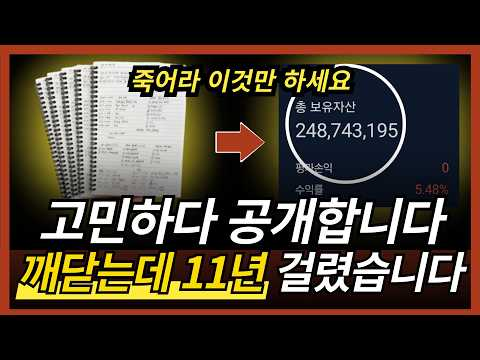
- 설명 앞부분: [수익부터 출금까지 성공시키는 현실적인 방법] [소통방 입장하기] 차트 보는 법, 이 영상 하나로 기준부터 다시 잡아보세요. 주식 공부를 해도 실전 매매가 계속 흔들리는 이유는 기술적 분석을 몰라서만이 아닙니다. 진짜 문제는 이평선, RSI, MACD, 매물대, 지지저항, 피보나치, 추세선, 엘리엇 파동, 하모닉 패턴, 거래량을 따로따로 외우고 실전 차트 앞에서는 무엇을 먼저 봐야 할지 모른다는 것입니다. 이번 영상에서는 차트 보는 법을 기초부터 실전까지 정리합니다. 이평선으로 추세를 보는 법, RSI와 MACD 다이버전스로 반등…
- 같은 채널 평소 대비 ×21.0 (채널 최근 롱폼 중앙값 613회) · 평소 영상: [주식/단타] 평생 써먹는 차트패턴 보는법, 확률 90%의 필수조건입니다 (613회) / 강제 청산 당하고 집문서 날아가는 선물거래, 97% 투자자가 무조건 털리는 이유 (618회)
- 대본 없음 (설명) — 음성인식이 끝나면 도입부·흐름이 들어감
- 댓글 2/2: 좋은 점 — 영상 0 · 감사·응원 1 · 더 알고 싶은 것 0 · 아쉬운 점 — 영상 0 · 반박·불만 — 의견 다름 0 · 정치·사회 0 · 경험 공유 0 · 구독·다음 기대 0
  - 감사·응원 👍1 “😊감사합니다 열씨미 노력해 보겠습니다 ❤”

### 185. [슬기로운 금융생활] 국장 복귀하면 양도세 감면?! – RIA계좌 혜택도, 유의점도 슬기롭게

- https://www.youtube.com/watch?v=O4jq0bK4MbI · 예금보험공사 예보TV · 구독자 7,840 · 조회수 142,713 (×18.2, 하루 1,019.6) · 좋아요 32 (0.0%) · 5.6분 · 2026-05-29 · 주제 묶음 5. 국내주식 · 형식 정보·해설 (그 밖) · 폴더 `W_O4jq0bK4MbI` (웹 승인)
- 썸네일: 
- 설명 앞부분: 세제 혜택은 물론, 꼭 알아야 할 유의사항과 예금자보호 여부까지! 국내시장 복귀계좌(RIA)의 주요 내용과 함께 투자 시 꼭 확인해야 할 사항들을 알기 쉽게 설명해드립니다.
- 같은 채널 평소 대비 ×3.5 (채널 최근 롱폼 중앙값 40,827회) · 평소 영상: [예보광장] 예금보험공사 창립 30주년 기념식 (46,443회) / 30년 사이에 인류는 어디까지 바뀌었을까? (피 튀기는 토론배틀..) ∣ 예금보험공사 x… (35,211회)
- 대본 없음 (설명) — 음성인식이 끝나면 도입부·흐름이 들어감
- 댓글 7/8: 좋은 점 — 영상 3 · 감사·응원 2 · 더 알고 싶은 것 0 · 아쉬운 점 — 영상 0 · 반박·불만 — 의견 다름 0 · 정치·사회 0 · 경험 공유 0 · 구독·다음 기대 0
  - 좋은 점 — 영상 👍1 “유익한 정보 감사합니다”
  - 좋은 점 — 영상 👍1 “정말 좋은 정보네요..”
  - 감사·응원 👍1 “유익한 정보 감사합니다”
  - 감사·응원 👍0 “옥상형수 잘 보았읍니다. 좋은 정보 감사합니다.”

### 186. 폭락장은 기회다. 진짜 반도체 시그널과 레버리지 (SOXL, USD) 대응법

- https://www.youtube.com/watch?v=v-EJlF_0sY8 · SOXL 연구소 · 구독자 6,640 · 조회수 11,438 (×1.7, 하루 854.7) · 좋아요 191 (1.7%) · 12.1분 · 2026-10-23 · 주제 묶음 9. 빚투·레버리지 · 형식 정보·해설 (그 밖) · 폴더 `W_v-EJlF_0sY8` (웹 승인)
- 설명 앞부분: 채널의 원칙 투자를 강력하게 지지해 주시는 연구원분들께 감사드립니다. ■ 속슬 수석 연구원 오직감사-l4z, 안은경-g5f2t, 박규리-r6h, 이정윤-p8y, 정우성-z4d, 성공-v3m, 최미-j4q, songjihye, 행복을찾아-m2r [면책 조항 (Disclaimer)] 본 영상은 개인적인 투자 의견과 시장 분석을 공유하는 콘텐츠이며, 특정 종목에 대한 매수/매도 추천이나 금융 조언이 아닙니다. 레버리지 상품(SOXL 등)은 변동성이 매우 크므로 본인의 투자 원칙과 위험 감수 능력에 맞게 운용해야 합니다. [해시태그]
- 같은 채널 평소 대비 ×1.9 (채널 최근 롱폼 중앙값 6,163회) · 평소 영상: [TQQQ/SOXL] 투자의 성공, 단순한 룰의 힘 (6,203회) / SOXL/TQQQ 장기투자, 여러분은 결코 혼자가 아닙니다. (6,123회)
- 대본 없음 (설명) — 음성인식이 끝나면 도입부·흐름이 들어감
- 댓글 31/31: 좋은 점 — 영상 0 · 감사·응원 12 · 더 알고 싶은 것 7 · 아쉬운 점 — 영상 0 · 반박·불만 — 의견 다름 0 · 정치·사회 0 · 경험 공유 3 · 구독·다음 기대 0
  - 감사·응원 👍5 “2번들어야지 선생님많이배웁니다 감사합니다”
  - 감사·응원 👍4 “소중한 정보 감사합니다.”
  - 더 알고 싶은 것 👍5 “소장님 궁금한게 있는데요 soxl 90달러가 깨졌을때 1차 진입 10% 투입했는데 만약에 더 하락하지 않고 얼마간 상승하다가 다시 90달러를 깨면 다시 10% 진입인가요? 아니면 10%는 이미 투입했으니 2차진입 구간 60달러에 기다렸다가 2차 진입을 해야 하나요?”
  - 더 알고 싶은 것 👍1 “안녕하세요~ 영상 늘 감사히 잘 보고 있어요 혹시 속슬모이기 질문인데용 대폭락시 한계좌에서 모아가시나요? 전 여러계좌 이용하고 있긴한데 궁금해서 여쭙니다 ㅎ”
  - 경험 공유 👍8 “질문이 있습니다. 저는 지금 USD는 없고, 속슬에만 집중하고 있으며. 현재 평단 107.66달러, 보유주수는 467주 입니다. 예수금이 7천만원 있는 상태 입니다. 일단 평단보다 하락중이라서 매일 모으기 10만원씩 진행중이구요. 그러다가 더 크게 빠지면 매일모으기 …”

### 187. "구글·아마존 물타지 마세요" 월가 헤지펀드가 지금 나스닥 탈출해 집중 매집하는 '현금 요새'

- https://www.youtube.com/watch?v=ODAPYwws77Y · NOVA Real Invest 은놀주 노바 미국주식 부동산 · 구독자 29,600 · 조회수 27,181 (×0.9, 하루 3,782.9) · 좋아요 465 (1.7%) · 18.4분 · 2026-10-30 · 주제 묶음 2. 장기투자·ETF·지수 · 형식 인터뷰·강연·대담 · 폴더 `W_ODAPYwws77Y` (웹 승인)
- 챕터: 0:00  · 1:46  · 4:06  · 5:43  · 7:07  · 8:38  · 11:21  · 13:49  · 15:46 
- 설명 앞부분: [NY TIME] 2026-10-29 목요일 ∣ 🚨 "빅테크 700조 증발... 그런데 390개 종목은 왜 폭등했을까요?" $GOOGL 알파벳이 하루 만에 -12.6% 폭락하며 시총 700조 원이 증발하고, $AMZN 아마존마저 시간외 폭락세를 보이며 시장 전체가 공포에 휩싸였습니다. 하지만 지수 착시 뒤에 숨겨진 진실을 보셨습니까? S&P 500 내 무려 390개 종목이 상승했고, 중소형주 $IWM 러셀 2000은 전고점을 뚫었습니다. 월가의 스마트머니와 헤지펀드는 지금 '현금 없는 AI 늪'에 빠진 메가캡을 던지고, 확실한 현…
- 같은 채널 평소 대비 ×14.7 (채널 최근 롱폼 중앙값 1,844회) · 평소 영상: 구글이 5.7조원에 사버린 고물 원전의 비밀 😱 폭락하는 AI 주식과 폭등하는 인프라 대… (1,844회) / 2세대 AI 시작, 바로 급등한 주식들? 데이터센터 3개 중 하나는 먹통 된다!? (1,873회)
- 대본 없음 (설명) — 음성인식이 끝나면 도입부·흐름이 들어감
- 댓글 35/35: 좋은 점 — 영상 1 · 감사·응원 8 · 더 알고 싶은 것 0 · 아쉬운 점 — 영상 0 · 반박·불만 — 의견 다름 0 · 정치·사회 0 · 경험 공유 0 · 구독·다음 기대 0
  - 좋은 점 — 영상 👍5 “조금의 도움이아닌대여 ~ 밥상차려서 다 떠먹여주셨세여 💕”
  - 감사·응원 👍7 “쪽집게 과외~감사합니다❤❤❤”
  - 감사·응원 👍3 “목소리로 녹음하셨네요. 감사합니다^^”

### 188. ETF到底適不適合退休族？買錯帳戶恐多繳稅：退休投資5大必看重點

- https://www.youtube.com/watch?v=5AlaZ9-LF1E · 視角Judy · 구독자 33,700 · 조회수 52,710 (×1.6, 하루 4,271.0) · 좋아요 376 (0.7%) · 13.7분 · 2026-10-24 · 주제 묶음 2. 장기투자·ETF·지수 · 형식 정보·해설 (그 밖) · 폴더 `W_5AlaZ9-LF1E` (웹 승인)
- 설명 앞부분: 很多人的投資組合裡都有ETF，但「ETF到底適不適合退休族？」 雖然ETF具備低成本與分散風險的優勢，但如果多檔ETF前十大持股高度重疊，根本沒有真正分散！更可怕的是，在一般帳戶賣出ETF可能產生龐大資本利得稅，而誤觸「Wash Sale Rule (61天洗售規則)」更會讓虧損無法抵稅！Judy帶您看懂ETF的稅務陷阱，別把投資產品當成退休計畫！ Book a 60-minute 1-on-1 Financial Consultation In this 60-minute consultation, I provide a safe, open space where you can s…
- 같은 채널 평소 대비 ×2.3 (채널 최근 롱폼 중앙값 22,923회) · 평소 영상: Medicare 為什麼突然變貴？小心63歲踩到這3個 IRMAA 地雷！ (22,923회) / 退休金如何活得比你久？做好8件事：不論存30萬或千萬都能安心老 (22,783회)
- 대본 없음 (설명) — 음성인식이 끝나면 도입부·흐름이 들어감
- 댓글 5/5: 좋은 점 — 영상 0 · 감사·응원 0 · 더 알고 싶은 것 0 · 아쉬운 점 — 영상 0 · 반박·불만 — 의견 다름 0 · 정치·사회 0 · 경험 공유 0 · 구독·다음 기대 0

### 189. "역대급 저평가라던 코스피" 하루 만에 620조 추락.. 그 뒤에 숨겨진 코스피의 잔혹한 진실

- https://www.youtube.com/watch?v=6VAsPNYeTRQ · 더 리치 - 돈의 흐름을 읽어라 · 구독자 8,040 · 조회수 116,603 (×14.5, 하루 1,005.8) · 좋아요 3,100 (2.7%) · 21.2분 · 2026-07-13 · 주제 묶음 5. 국내주식 · 형식 정보·해설 (그 밖) · 폴더 `W_6VAsPNYeTRQ` (웹 승인)
- 썸네일: 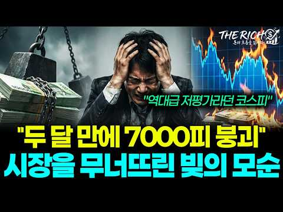
- 챕터: 0:00 역대급 저평가와 폭락의 모순 · 2:11 사이드카와 서킷브레이커 발동 · 3:53 개인이 받아낸 3.9조 매물 폭탄 · 5:15 폭락의 방아쇠 SK하이닉스 · 6:50 시장을 무너뜨린 진짜 원인 빚 · 9:02 반대매매와 레버리지의 함정 · 10:51 코스피가 역사상 가장 싼 이유 · 14:17 반도체 펀더멘털과 빚의 청산 · 16:44 향후 증시 향방과 주요 변수 · 18:20 반드시 확인해야 할 두 가지 지표
- 설명 앞부분: "역대급 저평가라던 시장이 밀린, 38조 원의 빚의 모순" 외국인과 기관의 자금 3조 9천억 원이 시장 밖으로 빠져나가고 그 빈자리를 개인이 홀로 채우며 시장의 주인이 바뀌었습니다. 코스피 7,000선이 무너진 무대 위에서 삼성전자와 SK하이닉스를 지탱하던 거대한 자금 축이 시스템에 의해 강제로 해체되는 흐름이 나타났습니다. 이번 폭락은 반도체의 실적 훼손이 아닌 신용 잔고의 청산 과정에서 발생한 기계적 이동입니다. 저평가라는 본질보다 빚의 무게가 가격을 결정하는 국면에서 금리와 물가라는 매크로 환경이 이 자금의 퇴로를 어떻게 열…
- 같은 채널 평소 대비 ×41.7 (채널 최근 롱폼 중앙값 2,795회) · 평소 영상: “480조 호재에도 1% 상승" 삼성·SK도 예외가 아닌 ‘선반영’의 무서운 함정 (2,812회) / "내가 사서 떨어지는 건가?" 개미만 모르는 외국인들의 소름돋는 수법 (2,778회)
- 대본 없음 (설명) — 음성인식이 끝나면 도입부·흐름이 들어감
- 댓글 294/294: 좋은 점 — 영상 4 · 감사·응원 9 · 더 알고 싶은 것 1 · 아쉬운 점 — 영상 2 · 반박·불만 — 의견 다름 3 · 정치·사회 44 · 경험 공유 6 · 구독·다음 기대 0
  - 좋은 점 — 영상 👍7 “잘썼어요.도움이 됩니다”
  - 좋은 점 — 영상 👍1 “좋은 정보를 감사합니다”
  - 감사·응원 👍2 “탁월한분석 입니다..많은 도움 될것 같네요..감사합니다”
  - 감사·응원 👍1 “상세하고 정확한 설명 감사합니다.🎁 최고의 채널입니다.👍🌹”
  - 더 알고 싶은 것 👍0 “근데 언제 빚이청산 되는가요?”
  - 아쉬운 점 — 영상 👍0 “너무길고 속도가 느려요 고령층 ㆍ노인들에겐 좋은 속도일수도 있지만”
  - 아쉬운 점 — 영상 👍0 “정치 리스크가 이런겁니다 다들 이걸 생각 안하시네요 세계금융의 중심이 어딘지 그돈에 돈줄이 어딘지 기억하세요 불안한 지역엔 투자들 하게나요? 연기금 등 기관의 돈으로 끌어올려봐야 기관은 돈이없고 연기금은 더이상 매수여력이 없읍니다 그래서 도박판이 된겁니다 개인이 개인…”
  - 반박·불만 — 의견 다름 👍18 “무능한 정부의 도박판 국민선동”
  - 반박·불만 — 의견 다름 👍15 “*.헛소리 말고 공매도 없애고 *단일 레리지 페지 해야 합니다”
  - 정치·사회 👍142 “국민연금이 제 때 수익실현 안하고 유예한게 가장 큰원인이다. 결국 외국인만 좋은 일 시키고 개인들은 고점에 물린거다 국민연금 특검해야 한다”
  - 정치·사회 👍63 “이제 5000 으로 내려가야지 그런데 국민연금은 팔지도 못하고 갖고있는 주식만 떨어졌는데 국민들 노후비용은 어떻게 할려나 국민연금이 주가를 9000으로 올릴때 외국인들이 신나게 팔아치웠으니 국민연금 돈을 외국인들이 합법적으로 훔쳐간거다”
  - 경험 공유 👍15 “내가 말햇잖아 낙수효과로 관련 중소형주 사라고 코스닥에 주목해 코스피와 갭차이가 너무나서 이젠 차이가 줄어들게되어있다 삼전닉스로 단타치는 단타쟁이들 재미좀 보다가 작살나는 시기다”
  - 경험 공유 👍1 “근본적으로 경제를 정치논리로 밀어 부치는 이재명 정부 주관도 없고 전문성도 없는 김용범정책실장이 단일종목 레버리지ETF 출시로 주식시장을 투기판으로 만들어 개미투자들에게 깡통차게 한 놈! 이게 시장경제 정책이냐!!! 오죽하면 금융감독원장 이찬진이 레버리지ETF 출시를…”

### 190. 단타 천재가 개발한 하이킨아시 스캘핑 매매법, 죽어라 이것만 하세요.

- https://www.youtube.com/watch?v=55hFmXD0lh0 · 알파개미 · 구독자 2,790 · 조회수 54,542 (×19.6, 하루 347.5) · 좋아요 1,772 (3.2%) · 19.6분 · 2026-06-02 · 주제 묶음 7. 매매·전략 · 형식 인터뷰·강연·대담 · 폴더 `W_55hFmXD0lh0` (웹 승인)
- 썸네일: 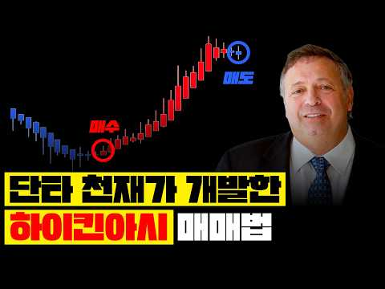
- 챕터: 0:00 인트로 · 1:26 하이킨아시 개요 · 3:09 하이킨아시 캔들 3가지 · 3:47 일반 캔들 vs 하이킨아시 · 4:39 추세 전환 기준 3가지 · 6:17 추세 반전 신호 · 7:21 실전 하이킨아시 패턴 5가지 · 8:42 전략 1.지지/저항 및 돌파 매매법 · 9:42 전략 2.돌파 매매법 · 10:15 전략 3.이동평균선(EMA) 결합 매매법 · 11:51 전략 4.추세반전 매매법 · 12:30 전략 5.RSI 지표 결합 매매법 · 13:43 전략 6.알파 하이킨아시 매매법 · 18:45 마무리 정리[지표 신청방법] / 아웃트로
- 설명 앞부분: 단타 천재가 개발한 하이킨아시 스캘핑 매매법, 죽어라 이것만 하세요. 📈 알파 하이킨아시 지표 무료 신청하기 📈 신청 코드: "알파 하이킨아시" 입력 📈 자동 매매 프로그램 무료 사용 신청하기 📈 📼차트 매매법 무료 강의 신청하기📼 📢 중요 안내: 본 방송에서 제공되는 모든 정보는 전문가의 개인적인 의견입니다.
- 같은 채널 평소 대비 ×85.9 (채널 최근 롱폼 중앙값 635회) · 평소 영상: -5억을 잃고 알았습니다. "이 차트 보는 방법" 하나면 충분하다는 걸 (635회) / 터틀 트레이딩 기법, 이 신호를 알아야 크게 먹습니다. (628회)
- 대본 없음 (설명) — 음성인식이 끝나면 도입부·흐름이 들어감
- 댓글 1,049/1,051: 좋은 점 — 영상 19 · 감사·응원 81 · 더 알고 싶은 것 26 · 아쉬운 점 — 영상 0 · 반박·불만 — 의견 다름 0 · 정치·사회 0 · 경험 공유 3 · 구독·다음 기대 50
  - 좋은 점 — 영상 👍0 “너무 좋은 영상이네요~ 알파 하이킨아시 신청드립니다!^^”
  - 좋은 점 — 영상 👍0 “좋은정보 감사합니다 하이킨아시 신청합니다”
  - 감사·응원 👍1 “구독 좋아요 완료했어요 알파 하이컨아시 신청합니다 미리 감사합니다”
  - 감사·응원 👍1 “주린인데 차트보기가 너무 좋아요.. 신청합니다.감사합니다.. 스마트폰에도 가능한지도 궁금합니다”
  - 더 알고 싶은 것 👍1 “주린인데 차트보기가 너무 좋아요.. 신청합니다.감사합니다.. 스마트폰에도 가능한지도 궁금합니다”
  - 더 알고 싶은 것 👍0 “훌륭한 정보 대단히 감사합니다. 앞으로도 이런 정보 부탁드립니다 구독과 조아요는 기본 체크입니다❤❤❤”
  - 경험 공유 👍0 “우와. 저도 알파하이킨아시 신청합니다”
  - 경험 공유 👍0 “저도 알파 하이킨아시 신청합니다”
  - 구독·다음 기대 👍1 “알파 하이킨아시 신청했습니다. 영상 내용도 좋고 하이킨아시 차트 지표도 좋아보이네요. 영상 잘 챙겨볼께요~”
  - 구독·다음 기대 👍0 “구독했씁니당 알파하이킨아시”

### 191. Trading 212 Portfolio Update - 2 New Positions Bought

- https://www.youtube.com/watch?v=IE9l-jrEAk0 · neil invests · 구독자 20,500 · 조회수 19,301 (×0.9, 하루 2,554.7) · 좋아요 342 (1.8%) · 15.4분 · 2026-10-29 · 주제 묶음 2. 장기투자·ETF·지수 · 형식 정보·해설 (그 밖) · 폴더 `W_IE9l-jrEAk0` (웹 승인)
- 설명 앞부분: In this Trading 212 portfolio update, I break down my full £190k+ portfolio, share my latest returns, and reveal the two new positions I've recently added. With market volatility, shifting bond yields, and ongoing debate around the UK budget and ISAs, sticking to a long-term investing strategy matt…
- 같은 채널 평소 대비 ×1.6 (채널 최근 롱폼 중앙값 11,777회) · 평소 영상: How I Will Reach Financial Independence By 50. (11,777회) / Trading 212 Update - I have Reached The 1st FIRE … (12,244회)
- 대본 없음 (설명) — 음성인식이 끝나면 도입부·흐름이 들어감
- 댓글 63/63: 좋은 점 — 영상 0 · 감사·응원 0 · 더 알고 싶은 것 0 · 아쉬운 점 — 영상 0 · 반박·불만 — 의견 다름 0 · 정치·사회 0 · 경험 공유 0 · 구독·다음 기대 0

### 192. Mon portefeuille après 2 ANS d’investissement en ETF

- https://www.youtube.com/watch?v=duRcMneoLxc · Rémi Lux - Investir en Bourse · 구독자 30,400 · 조회수 44,385 (×1.5, 하루 3,693.1) · 좋아요 533 (1.2%) · 19.1분 · 2026-10-25 · 주제 묶음 2. 장기투자·ETF·지수 · 형식 정보·해설 (그 밖) · 폴더 `W_duRcMneoLxc` (웹 승인)
- 챕터: 0:00 Introduction · 0:25 D’où je suis parti · 1:40 Comment j’ai découvert l’inve… · 2:25 Établissement de mon allocati… · 4:45 Passage à l’action · 7:55 Mes résultats · 16:40 Quels sont mes prochains obje…
- 설명 앞부분: Il y a 2 ans, je commençais à investir en Bourse avec une stratégie simple : investir principalement dans des ETF sur mon PEA. Aujourd’hui, après 2 ans d’investissement, il est temps de faire le bilan : combien ai-je investi, combien ai-je gagné et à quoi ressemble mon portefeuille aujourd’hui ? Da…
- 대본 없음 (설명) — 음성인식이 끝나면 도입부·흐름이 들어감
- 댓글 83/83: 좋은 점 — 영상 0 · 감사·응원 0 · 더 알고 싶은 것 0 · 아쉬운 점 — 영상 0 · 반박·불만 — 의견 다름 0 · 정치·사회 0 · 경험 공유 0 · 구독·다음 기대 0

### 193. 나스닥과 반도체 하락장에 주식 10억 원 빠진 60대 아버지와 통화 ∣ QQQ, QLD, TQQQ, SOXL 레버리지 투자자 현금비중

- https://www.youtube.com/watch?v=y_JIxtzjKKM · 레버리지 하는 미국회계사 장기투자 여정 · 구독자 13,500 · 조회수 15,988 (×1.2, 하루 1,633.2) · 좋아요 290 (1.8%) · 11.2분 · 2026-10-27 · 주제 묶음 9. 빚투·레버리지 · 형식 정보·해설 (그 밖) · 폴더 `W_y_JIxtzjKKM` (웹 승인)
- 챕터: 0:00 나스닥 하락장에 주식 계좌 -10억, 아버지 마음은? · 1:31 주식 계좌 10억 증발한 아버지와 통화 · 5:02 "별다른 감흥이 없다"는 말이 쉽지 않은 이유 · 5:31 하락장이 기회가 되려면: 버틸 시간과 주울 돈 · 6:53 레버리지 투자자의 현금 비중 (QQQ·QLD·SGOV… · 9:11 60대 아버지, 아직 공격적으로 가도 될까? · 10:01 정리: 하락장을 기회로 만드는 법
- 설명 앞부분: 나스닥·반도체 하락장에 주식 계좌가 고점 대비 10억 원 빠진 60대 아버지께, 솔직히 마음이 어떠신지 전화로 여쭤봤습니다. 통화를 그대로 들려드리고, 2022년 하락장을 레버리지로 버텨본 미국회계사로서 제 생각을 정리했습니다.
- 같은 채널 평소 대비 ×1.1 (채널 최근 롱폼 중앙값 14,911회) · 평소 영상: QLD 매일 매월 매수? 타이밍 보다 더 중요한 건 '언제 사서 언제 파느냐'다(QQQ,… (15,027회) / 레버리지 투자자가 나스닥 커버드콜에 1억 넣은 이유 ∣ GPIQ·TDAQ 분배금으로 QL… (14,795회)
- 대본 없음 (설명) — 음성인식이 끝나면 도입부·흐름이 들어감
- 댓글 61/61: 좋은 점 — 영상 0 · 감사·응원 3 · 더 알고 싶은 것 3 · 아쉬운 점 — 영상 0 · 반박·불만 — 의견 다름 0 · 정치·사회 1 · 경험 공유 4 · 구독·다음 기대 1
  - 감사·응원 👍0 “하락장에 흔들리지 않고 차분하게 모아가겠습니다. 감사합니다”
  - 더 알고 싶은 것 👍2 “안녕하세요~ 늘 잘 보고 있습니다. (아버님 말씀 정말 본받을만하네요 😂) 사실 전 지금 엄청난 하락장이란 생각은 하지 않고 있어요. 본격적인 QLD하락장은 몇달러정도라 생각하시나요?”
  - 더 알고 싶은 것 👍0 “회계사님 혹시 장투 한다면 USD도 가져 가도 될까요?? 지금 비중이 QLD5 USD5 반반 거치식이거든요 지금 반도체 때문에 애매해서 나중에 오르면 QLD도 다 옮겨야 할지 아니면 USD를 거치식으로 내버려두고 그냥 QLD를 계속 적립식으로 살지 고민인데 생각이 궁…”
  - 정치·사회 👍0 “아버님 너무 멋지시고 자상하시고 투자 철학 있으시네요. 🎉 이런 멘토분을 아버님으로 두셨으니 회계사님 완전 큰 행운 같아요! ❤ 저도 미국회계사고 해외에서 일하며 은퇴 준비하는 사람이에요. 투자여정 다같이 잘 만들어가요! 😊”
  - 경험 공유 👍5 “대화가 정겹네요ᆢ나도 60대 중반이면서 딸과 투자생활 하고 있는데 비슷한 생각을 갖고 합니다 ᆢ나이가있어 커브드콜 사기 시작했고ᆢ여튼ᆢ반갑습니다”
  - 경험 공유 👍5 “조회수 1 에 댓글달아요. 저도 미국주식 투자법 전자책 보고 엄청난 감흥을 받고 저만의 실행계획과 투자법을 얻었어요. 3층으로 나누어서 은퇴로 가는 여정에 큰 나침반이 될것으로 생각합니다. 50억 100억도 멀지않음이 느껴지고 계속 설레요. 저는 마이너스통장과 연금담…”
  - 구독·다음 기대 👍0 “회계사님 다음영상 기다리고 있어요ㅠ 이런 하락장 급락장 대응법이 있을까요ㅠ 꾸준한 매수겟죠? 아버님은 현재도 계속 같은방식으로 대응하시나요? 주린이라 하락장이 너무 무섭네요ㅜㅠ 두분의 통화는 너무 부럽구요.”

### 194. BSE + CDSL, L&T, ITC Declared High Dividend, Bonus & Split

- https://www.youtube.com/watch?v=uLNk9rO3L0U · FinoStocks - Aarush Chopra · 구독자 22,100 · 조회수 20,503 (×0.9, 하루 2,647.4) · 좋아요 337 (1.6%) · 9.2분 · 2026-10-29 · 주제 묶음 기타 · 형식 정보·해설 (그 밖) · 폴더 `W_uLNk9rO3L0U` (웹 승인)
- 설명 앞부분: BSE + CDSL, L&T, ITC Declared High Dividend, Bonus & Split bonus split dividend dividend stocks dividend stocks for this month upcoming stock bonus bonus shares bonus split dividend stocks stock bonus list stock bonus shares for this month bonus shares highest dividend declared stock split shares t…
- 같은 채널 평소 대비 ×2.9 (채널 최근 롱폼 중앙값 7,128회) · 평소 영상: NSDL, IDFC First Bank, Yes Bank, SBI Bank Stocks … (7,128회) / Tata Steel + Vedanta, Tata Power, ITC Declared Hi… (7,081회)
- 대본 없음 (설명) — 음성인식이 끝나면 도입부·흐름이 들어감
- 댓글 10/10: 좋은 점 — 영상 0 · 감사·응원 0 · 더 알고 싶은 것 0 · 아쉬운 점 — 영상 0 · 반박·불만 — 의견 다름 0 · 정치·사회 0 · 경험 공유 0 · 구독·다음 기대 0

### 195. 【新NISA速報🚨】衝撃のデータ判明！あと数日で相場の流れが一変します。絶対に見逃すな！【NASDAQ,FANG+,S&P500,オルカン,SOXL,半導体,セミリタイア,FIR…

- https://www.youtube.com/watch?v=5-Y7jZigzGw · こどおじマスターK【節約貯金ガチ部】 · 구독자 21,700 · 조회수 25,292 (×1.2, 하루 2,548.4) · 좋아요 397 (1.6%) · 20.3분 · 2026-10-27 · 주제 묶음 2. 장기투자·ETF·지수 · 형식 정보·해설 (그 밖) · 폴더 `W_5-Y7jZigzGw` (웹 승인)
- 설명 앞부분: 「こどおじマスターK【節約貯金ガチ部】」へようこそ！ 指定難病（全身性エリテマトーデス／シェーグレン症候群／混合性結合組織病）や心臓疾患による緊急入院など、人生の大きな壁に直面しながらも、資産1億円・セミリタイア（FIRE）を目指して泥臭く運命に抗い続けるチャンネルです。 実家暮らし・ガチ節約で支出を極限まで絞り、新NISAや米国株（FANG+、NASDAQ100、ゴールド、半導体など）を活用した攻めと守りの資産形成に取り組んでいます。 ・新NISA運用実績・米国株高成長銘柄への投資戦略
- 같은 채널 평소 대비 ×0.9 (채널 최근 롱폼 중앙값 27,053회) · 평소 영상: 【大ピンチ!?😭】新NISAを年初一括で全ツッパした結果がヤバすぎた件…リアルな運用結果がこちらで… (27,053회) / 【大荒れ】FANG+最高値更新！でも半導体が急落…中間選挙までに絶対仕込むべきセクターとは？【新N… (27,349회)
- 대본 없음 (설명) — 음성인식이 끝나면 도입부·흐름이 들어감
- 댓글 106/106: 좋은 점 — 영상 0 · 감사·응원 0 · 더 알고 싶은 것 0 · 아쉬운 점 — 영상 0 · 반박·불만 — 의견 다름 0 · 정치·사회 0 · 경험 공유 0 · 구독·다음 기대 0

### 196. 배당금으로 생존하는 진짜 현실, 찜질방에 왔습니다

- https://www.youtube.com/watch?v=xossGjXogm0 · 배당아저씨 · 구독자 33,200 · 조회수 51,415 (×1.6, 하루 3,890.3) · 좋아요 892 (1.7%) · 8.6분 · 2026-10-24 · 주제 묶음 3. 배당 · 형식 정보·해설 (그 밖) · 폴더 `W_xossGjXogm0` (웹 승인)
- 설명 앞부분: 영상 속 배당아저씨의 미니멀라이프 내돈내산 재료&용품들 (쿠팡 파트너스 및 인플루언서 활동의 일환으로 구매시 일정액의 수수료를 제공 받을 수 있습니다) 이 채널은 저의 투자 경험과 생각을 공유하는 공간입니다. 저의 투자 방식을 그대로 따라 하시는 것은 권장드리지 않으며, 충분한 고민과 공부 후 판단하시길 바랍니다.
- 같은 채널 평소 대비 ×1.0 (채널 최근 롱폼 중앙값 49,830회) · 평소 영상: 일하지 않고 배당금 받아 살면 나라가 망한다, 3억으로 시작한 파이어 미니멀라이프 (49,830회) / 배당금으로 혼자사는 미혼남의 현실 (49,021회)
- 대본 없음 (설명) — 음성인식이 끝나면 도입부·흐름이 들어감
- 댓글 247/247: 좋은 점 — 영상 1 · 감사·응원 27 · 더 알고 싶은 것 19 · 아쉬운 점 — 영상 0 · 반박·불만 — 의견 다름 2 · 정치·사회 1 · 경험 공유 25 · 구독·다음 기대 0
  - 좋은 점 — 영상 👍3 “요즘같은 하락장에서 동요되지 않으시고 특히 손실액도 얼마되지 않는게 대단하네요. 역시 꾸준한 투자가 답인것 같아요. 저는 이번달초에 배당금 빨리 받고 싶어서 예금에 있던 5천만원을 JEPQ에 거의 최고점인 61달러대에 매수했는데... 그이후로 계속 떨어지네요. ㅠㅠ …”
  - 감사·응원 👍50 “계좌를 다 빼서 단타를 해보라니 어느 못된 인간이 에잉.. 그냥 남잘사는 꼴은 못봐서 훈수랍시고 하는 못난놈들 말은 무시해여 진짜 무료해서 단타로 활력얻고 싶으면 100만원이나 1000만원정도로 소소하게 재미보면 될듯요. 안정적으로 배당금받고 사는 삶이 최고죠. 나도…”
  - 감사·응원 👍30 “목표자산이 코앞이라 저도 곧 파이어 시작합니다. 근데 아무나 할수있는건 아니듯합니다. 라이프스타일, 성격, 가족관계, 주변 사람들, 취미 등등 잘 성찰하고 객관적으로 보고 해야할듯 합니다. 전 워낙 욕심도 없고 여행도 안좋아하며 결혼은 관심도 없고 할 생각도 없으며 …”
  - 더 알고 싶은 것 👍5 “너무 잘 보고 있습니다~ 저희는 5인가족인데 배당과 알바로 파이어 준비 중입니다. 혹시 주거는 어떻게 해결하시는 지 궁금합니다. 자가 제외 3억 파이어이신가요?!😀”
  - 더 알고 싶은 것 👍4 “차라리 쿠팡 단기알바 월 8일(60시간)만 채우면 지역가입자에서 직장인가입자로 변경이 되니 건보료부담 줄어들고 4대보험도 가입이 되니 국민연금도 납부 할수도 있고 최소한의 노동으로 세금 절세하고 용돈벌이 하심이 어떤신가요?”
  - 정치·사회 👍0 “국장을 시작 안 하시는 게 성공의 비결이네요. 이 너무 정권 때문에 국장 시작해 갖고 반토막 난 사람 투생입니다. 축하합니다.”
  - 경험 공유 👍50 “계좌를 다 빼서 단타를 해보라니 어느 못된 인간이 에잉.. 그냥 남잘사는 꼴은 못봐서 훈수랍시고 하는 못난놈들 말은 무시해여 진짜 무료해서 단타로 활력얻고 싶으면 100만원이나 1000만원정도로 소소하게 재미보면 될듯요. 안정적으로 배당금받고 사는 삶이 최고죠. 나도…”
  - 경험 공유 👍30 “목표자산이 코앞이라 저도 곧 파이어 시작합니다. 근데 아무나 할수있는건 아니듯합니다. 라이프스타일, 성격, 가족관계, 주변 사람들, 취미 등등 잘 성찰하고 객관적으로 보고 해야할듯 합니다. 전 워낙 욕심도 없고 여행도 안좋아하며 결혼은 관심도 없고 할 생각도 없으며 …”

### 197. 3 Safe Dividend Stocks on Track to Out-Pay a 5% Treasury

- https://www.youtube.com/watch?v=rzG3BMILnOM · Simply Safe Dividends · 구독자 15,900 · 조회수 21,533 (×1.4, 하루 1,829.9) · 좋아요 454 (2.1%) · 14.4분 · 2026-10-25 · 주제 묶음 기타 · 형식 정보·해설 (그 밖) · 폴더 `W_rzG3BMILnOM` (웹 승인)
- 챕터: 0:00 The 5% Treasury · 0:33 $100 in each · 1:20 The raise each needs · 2:46 Paychex (PAYX) · 6:01 Prudential (PRU) · 9:13 Agree Realty (ADC) · 11:26 The risks · 12:53 Why own both
- 설명 앞부분: A 10-year Treasury pays about 5% right now, guaranteed by the US government. These three high-quality dividend stocks yield a bit less today, but if their dividends keep growing even modestly, they'll pay you more than the Treasury within a few years and pull well ahead from there. I screened all 8…
- 같은 채널 평소 대비 ×1.2 (채널 최근 롱폼 중앙값 17,898회) · 평소 영상: Safe 5%+ Dividend Stocks Still Raising Their Payo… (17,956회) / I Built a Portfolio of All 44 BDCs: Here's What H… (17,840회)
- 대본 없음 (설명) — 음성인식이 끝나면 도입부·흐름이 들어감
- 댓글 104/104: 좋은 점 — 영상 0 · 감사·응원 0 · 더 알고 싶은 것 0 · 아쉬운 점 — 영상 0 · 반박·불만 — 의견 다름 0 · 정치·사회 0 · 경험 공유 0 · 구독·다음 기대 0

### 198. Questo portafoglio con 4 ETF resiste a ogni CRISI ∣ justETF Italia

- https://www.youtube.com/watch?v=85k-Ifmm0UY · justETF Italia · 구독자 41,800 · 조회수 40,001 (×1.0, 하루 4,656.1) · 좋아요 866 (2.2%) · 15.5분 · 2026-10-28 · 주제 묶음 2. 장기투자·ETF·지수 · 형식 정보·해설 (그 밖) · 폴더 `W_85k-Ifmm0UY` (웹 승인)
- 챕터: 0:00 Intro · 1:31 Cos’è il Permanent Portfolio · 2:51 La versione europea · 4:25 Come si è comportato nel tempo · 6:18 Cosa succede nel lungo periodo · 8:02 Come si comporta durante le c… · 10:15 L’importanza del ribilanciame… · 12:22 Il PAC con il Permanent Portf… · 13:15 A chi serve questo portafogli…
- 설명 앞부분: ℹ️ Il Permanent Portfolio. 4 ETF divisi in parti uguali (azioni, oro, obbligazioni a lungo termine e liquidità) per proteggere i tuoi risparmi e dormire sereno anche durante i peggiori crolli di mercato. Link Utili Vuoi aprire un conto titoli? Se usi uno dei link affiliati contrassegnati da un aste…
- 같은 채널 평소 대비 ×1.6 (채널 최근 롱폼 중앙값 24,316회) · 평소 영상: Perché gli italiani non sanno gestire i propri so… (25,103회) / Ho scoperto gli ETF adesso - È troppo TARDI? ∣ ju… (23,528회)
- 대본 없음 (설명) — 음성인식이 끝나면 도입부·흐름이 들어감
- 댓글 47/47: 좋은 점 — 영상 0 · 감사·응원 0 · 더 알고 싶은 것 0 · 아쉬운 점 — 영상 0 · 반박·불만 — 의견 다름 0 · 정치·사회 0 · 경험 공유 0 · 구독·다음 기대 0

### 199. How to Borrow Against Your Stock Portfolio: Buy, Borrow, Die

- https://www.youtube.com/watch?v=NPcgV0dq03Q · Sacco Financial  · 구독자 21,600 · 조회수 332,128 (×15.4, 하루 2,393.7) · 좋아요 5,286 (1.6%) · 9.4분 · 2026-06-20 · 주제 묶음 기타 · 형식 정보·해설 (그 밖) · 폴더 `W_NPcgV0dq03Q` (웹 승인)
- 썸네일: 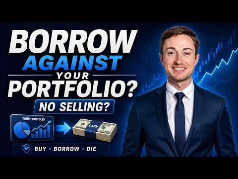
- 설명 앞부분: How do you borrow against your stocks without selling them? I recently moved a significant portion of my investment portfolio to Interactive Brokers so I could access cash through a margin loan instead of selling shares and immediately realizing capital gains. This strategy is often called Buy, Bor…
- 같은 채널 평소 대비 ×74.9 (채널 최근 롱폼 중앙값 4,434회) · 평소 영상: I Bought This Stock Before the Breakout (5,134회) / The Stock Market is Flashing Warning Signs. (3,735회)
- 대본 (자막, 0.0 음절/초) 첫 20초: “What if I told you there's a way to access cash from your portfolio without selling a single share and without paying a dollar in capital gains tax? This is not a loophole. This is how the ultra-wealthy have been doing it for decades. And recently, I started doing this myself. So, today I'm going to”
- 첫 1분: “What if I told you there's a way to access cash from your portfolio without selling a single share and without paying a dollar in capital gains tax? This is not a loophole. This is how the ultra-wealthy have been doing it for decades. And recently, I started doing this myself. So, today I'm going to break down the full strategy, what it is, how I personally set it up, and the stuff that nobody tel”
- 흐름 (90초마다 첫 문장): 0:00 What if I told you there's a way to → 1:31 And here's the answer. Yes, you do. But → 3:01 some blue-chip positions you plan to → 4:31 dedicated structured credit facility → 6:01 That's why sizing matters enormously. → 7:30 it can go sideways fast if you are not → 9:00 The rates, the loan structure, how I'm
- 댓글 603/620: 좋은 점 — 영상 0 · 감사·응원 0 · 더 알고 싶은 것 0 · 아쉬운 점 — 영상 0 · 반박·불만 — 의견 다름 0 · 정치·사회 0 · 경험 공유 0 · 구독·다음 기대 0

### 200. $1M Portfolio: SCHD or Dividend Aristocrats for Income?

- https://www.youtube.com/watch?v=qj-O6aFzPic · Simply Safe Dividends · 구독자 15,900 · 조회수 120,656 (×7.6, 하루 1,737.7) · 좋아요 1,292 (1.1%) · 12.4분 · 2026-08-28 · 주제 묶음 2. 장기투자·ETF·지수 · 형식 정보·해설 (그 밖) · 폴더 `W_qj-O6aFzPic` (웹 승인)
- 썸네일: 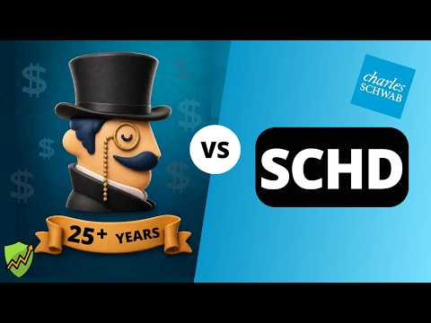
- 챕터: 0:00 SCHD vs. Aristocrats · 0:42 Dividend Aristocrats Overview · 1:50 Current Income · 3:30 Dividend Safety · 5:00 Dividend Growth · 6:35 Total Returns · 8:17 Downside Risk · 9:58 Winner · 11:11 Another Way
- 설명 앞부분: Dividend aristocrats and SCHD are popular choices in retirement portfolios that prioritize income, growth, and safety. But which strategy is best? In this video, we'll build a $1 million portfolio invested in Schwab's dividend ETF SCHD and another invested in all 69 dividend aristocrats. We'll comp…
- 같은 채널 평소 대비 ×6.7 (채널 최근 롱폼 중앙값 17,898회) · 평소 영상: Safe 5%+ Dividend Stocks Still Raising Their Payo… (17,956회) / I Built a Portfolio of All 44 BDCs: Here's What H… (17,840회)
- 대본 없음 (설명) — 음성인식이 끝나면 도입부·흐름이 들어감
- 댓글 131/139: 좋은 점 — 영상 0 · 감사·응원 0 · 더 알고 싶은 것 0 · 아쉬운 점 — 영상 0 · 반박·불만 — 의견 다름 0 · 정치·사회 0 · 경험 공유 0 · 구독·다음 기대 0

