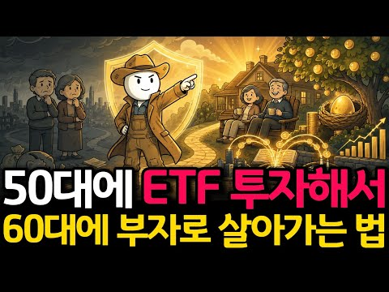

# 주식 — 성공 사례 분석: 사례별 자세히 #201–#209

`analysis.md` 의 9번 (같은 # 번호). 자동 생성 — `tools/success_analysis.py` v1.6 (2026-11-06 08:46 UTC). ※ 연구·교육용 — 투자 권유가 아님.

### 201. I Ranked Canada's Oil & Gas Stocks (They're Printing Cash 🤑)

- https://www.youtube.com/watch?v=ZYB2Muvxoj8 · Stocktrades - Canadian Investment Research · 구독자 24,800 · 조회수 25,397 (×1.0, 하루 2,694.5) · 좋아요 531 (2.1%) · 44.4분 · 2026-10-27 · 주제 묶음 기타 · 형식 정보·해설 (그 밖) · 폴더 `W_ZYB2Muvxoj8` (웹 승인)
- 챕터: 0:00 Introduction · 3:02 Suncor · 9:14 Cenovus · 16:08 Strathcona · 21:11 Whitecap · 27:25 Imperial Oil · 34:31 Canadian Natural · 42:12 Final Rankings
- 설명 앞부분: Grab research on 3 of my favorite opportunities for free: Grab the largest holdings in my portfolio here: Join Stocktrades Premium for $0.99: If you're looking for companies that pay reliable dividends, send most of their free cash flow back to investors and are printing money right now, Canadian e…
- 같은 채널 평소 대비 ×3.9 (채널 최근 롱폼 중앙값 6,561회) · 평소 영상: I Ranked Every Canadian REIT (I Put the Best One … (6,561회) / I Ranked Canada’s Retail Stocks (A Blue Chip Favo… (6,546회)
- 대본 없음 (설명) — 음성인식이 끝나면 도입부·흐름이 들어감
- 댓글 117/117: 좋은 점 — 영상 0 · 감사·응원 0 · 더 알고 싶은 것 0 · 아쉬운 점 — 영상 0 · 반박·불만 — 의견 다름 0 · 정치·사회 0 · 경험 공유 0 · 구독·다음 기대 0

### 202. 월 100만원 ETF 투자하면, 60대에 "진짜 부자"가 됩니다

- https://www.youtube.com/watch?v=WGkQ7wwHHlQ · 농부의 경제학 · 구독자 8,340 · 조회수 78,752 (×9.4, 하루 904.8) · 좋아요 1,377 (1.8%) · 13.4분 · 2026-08-11 · 주제 묶음 2. 장기투자·ETF·지수 · 형식 정보·해설 (그 밖) · 폴더 `W_WGkQ7wwHHlQ` (웹 승인)
- 썸네일: 
- 설명 앞부분: 50세 노후 준비, 결코 늦지 않았습니다. 주변에서 스무 살부터 시작해야 복리가 붙는다고 말하지만, 50세부터 매달 100만 원씩 15년 동안 미국 ETF에 투자하면 65세 은퇴 후 세금을 떼고도 매달 236만 원의 마르지 않는 현금흐름을 만들 수 있습니다. 오늘 영상에서는 미국 대표 ETF인 SCHD(40%), SPYM(40%), QQQM(20%) 포트폴리오를 통해 배당 수익과 자산 성장을 동시에 챙기는 가장 현실적인 노후 자금 설계법을 상세히 풀어드립니다. 은퇴 후 원금을 깎아 먹지 않고 죽을 때까지 통장 잔고가 늘어나는 미국…
- 같은 채널 평소 대비 ×9.3 (채널 최근 롱폼 중앙값 8,430회) · 평소 영상: 상위 1% 투자자들이 주식 창 끄고 매일 하는 '… (8,780회) / 평생 예금만 하셨나요? S&P500으로 은퇴 후 부… (8,080회)
- 대본 없음 (설명) — 음성인식이 끝나면 도입부·흐름이 들어감
- 댓글 82/83: 좋은 점 — 영상 4 · 감사·응원 7 · 더 알고 싶은 것 5 · 아쉬운 점 — 영상 1 · 반박·불만 — 의견 다름 0 · 정치·사회 1 · 경험 공유 5 · 구독·다음 기대 0
  - 좋은 점 — 영상 👍15 “개꿀팁!!이렇게 해볼게요”
  - 좋은 점 — 영상 👍4 “어렵네요. PDF로 정리해 주시면 감사하겠습니다”
  - 감사·응원 👍15 “비슷한 관련된 영상 정말 많이 봤는데, 이 영상이 제일 잘 정리가 되어 있고, 이해 하기가 쉬운 것 같아요. 주변에 많이 공유 하겠습니다. 영상 감사드려요.👍”
  - 감사·응원 👍4 “어렵네요. PDF로 정리해 주시면 감사하겠습니다”
  - 더 알고 싶은 것 👍7 “은퇴후(10년후예상)현금흐름이 있어서 하락장 방어 가능하다면 슨피 500, 나스닥 100을 5:5로 가져가도 괜찮을까요?”
  - 더 알고 싶은 것 👍4 “어렵네요. PDF로 정리해 주시면 감사하겠습니다”
  - 아쉬운 점 — 영상 👍6 “Schd가 월배당 이었으면 좋을텐데, 아쉽습니다”
  - 경험 공유 👍10 “51세, 배당적립식 투자 3년차 입니다 약 월50만원 배당금 받습니다 (가족 1인당 65세전 월100목표로) 월 150만원 적립식으로 모아갑니다 미래를 알수는 없으나 긍정론자라서ㆍㆍㆍ”
  - 경험 공유 👍2 “뻥이다ETF엔터테이먼트4년째 마이너스53%부추기지마라 이ㅅ 본전안올것같음”

### 203. Is NOW The Time To Buy SOFI Stock?! ∣ SoFi 3Q26

- https://www.youtube.com/watch?v=r3oGZpx2kuk · Ken Freeman, CFA · 구독자 38,200 · 조회수 57,530 (×1.5, 하루 4,127.7) · 좋아요 855 (1.5%) · 14.9분 · 2026-10-23 · 주제 묶음 기타 · 형식 정보·해설 (그 밖) · 폴더 `W_r3oGZpx2kuk` (웹 승인)
- 설명 앞부분: Ⓜ️ Become a Member today! 🎯 What I’ll unpack: Why SoFi has $27.5 billion of personal loans marked for sale after selling none in six months How a two-point jump in interest rates could cut hundreds of millions from lending income Four risks hiding inside delinquent loan sales, brokered deposits, ex…
- 같은 채널 평소 대비 ×3.1 (채널 최근 롱폼 중앙값 18,429회) · 평소 영상: Is NOW the Time to BUY Oracle Stock?! ∣ ORCL 1Q27 (19,079회) / Bill Ackman's BIGGEST $5 BILLION Buying Spree in … (17,779회)
- 대본 없음 (설명) — 음성인식이 끝나면 도입부·흐름이 들어감
- 댓글 74/74: 좋은 점 — 영상 0 · 감사·응원 0 · 더 알고 싶은 것 0 · 아쉬운 점 — 영상 0 · 반박·불만 — 의견 다름 0 · 정치·사회 0 · 경험 공유 0 · 구독·다음 기대 0

### 204. Familienvater mit 100.000€ Depot & plötzlich ist der Job weg! 😵 ∣ Über Geld spricht man n…

- https://www.youtube.com/watch?v=2e0PrTtGNXc · Parqet · 구독자 26,100 · 조회수 33,370 (×1.3, 하루 2,808.2) · 좋아요 488 (1.5%) · 33분 · 2026-10-25 · 주제 묶음 2. 장기투자·ETF·지수 · 형식 정보·해설 (그 밖) · 폴더 `W_2e0PrTtGNXc` (웹 승인)
- 설명 앞부분: Trotz Hauskredit und 3 Kindern hat Michael seit 2020 ein 100.000€ Depot aufgebaut. Seine Strategie: solide Dividendenaktien und ETFs mit hoher Sparrate. Nun steht das Werk vor dem Aus - investiert er die Abfindung an der Börse? Über Geld spricht man nicht! 🤫 Wer verdient wie viel? Und wie legt die …
- 같은 채널 평소 대비 ×2.2 (채널 최근 롱폼 중앙값 15,426회) · 평소 영상: 44-jähriger mit 300.000€ Portfolio schlägt den Ma… (15,426회) / Bundespolizist mit 15 ETFs im 200.000€ Depot! 😵 ∣… (14,857회)
- 대본 없음 (설명) — 음성인식이 끝나면 도입부·흐름이 들어감
- 댓글 60/60: 좋은 점 — 영상 0 · 감사·응원 0 · 더 알고 싶은 것 0 · 아쉬운 점 — 영상 0 · 반박·불만 — 의견 다름 0 · 정치·사회 0 · 경험 공유 0 · 구독·다음 기대 0

### 205. 너무 복잡하게 투자하면 장기투자가 어렵더라고요 (Ft. 아이렌 추매)

- https://www.youtube.com/watch?v=IiZIIoeqq8A · 파돌부부(파돌댁) · 구독자 12,000 · 조회수 12,801 (×1.1, 하루 1,289.8) · 좋아요 148 (1.2%) · 11.4분 · 2026-10-27 · 주제 묶음 2. 장기투자·ETF·지수 · 형식 인터뷰·강연·대담 · 폴더 `W_IiZIIoeqq8A` (웹 승인)
- 챕터: 0:00 구독자 질문 - 아이렌 투자금 회수기간 · 0:47 숫자 계산? 안하는 이유 · 2:15 모든 걸 파고드는 투자의 장점 · 2:52 파돌댁의 투자방식 · 3:41 디테일한 숫자보다 큰 흐름을 볼 때 놓치는 것들 · 4:05 큰 흐름을 보는 투자의 장점 · 4:22 아이렌이 제시한 ARR의 함정과 착시 · 6:44 유독 아이렌 ARR 계산방식만 다른 전략적 이유 · 8:05 아이렌은 스캠 기업인가? · 8:21 네비우스에 투자하는게 더 낫지 않나? · 9:45 앞으로 봐야할 것 · 10:09 유튜브 따라하지 마세요 · 10:27 그밖에 봐야할 것이 있다면? · 10:54 아이렌 추매, 이만큼 모았습니다
- 설명 앞부분: AI 성장주 장기투자자 파돌댁입니다 ! 돈공부, 투자공부까지 더 자세히 다루고 있습니다😊 특정 주식을 추천하는 내용이 아닙니다.
- 같은 채널 평소 대비 ×2.1 (채널 최근 롱폼 중앙값 5,988회) · 평소 영상: 앱셀레라 상승했지만 추천안하는 이유 (5,988회) / 아이렌 주가 폭락해도 안 팔 겁니다 (6,022회)
- 대본 없음 (설명) — 음성인식이 끝나면 도입부·흐름이 들어감
- 댓글 30/30: 좋은 점 — 영상 0 · 감사·응원 2 · 더 알고 싶은 것 0 · 아쉬운 점 — 영상 1 · 반박·불만 — 의견 다름 1 · 정치·사회 0 · 경험 공유 0 · 구독·다음 기대 0
  - 아쉬운 점 — 영상 👍2 “연말 기준 $4B ARR 이상이 나오는 건 계약을 기준으로 하는 것은 아니고, 연말에 실제 온라인 되는 용량입니다. 계산 방법은 파돌댁님 말씀이 맞지만, 현재 온라인되고 있는 $1B ARR과 동일한 의미를 연말에 갖게 됩니다. 그래서 말씀하신 연말에 Contracte…”
  - 반박·불만 — 의견 다름 👍2 “연말 기준 $4B ARR 이상이 나오는 건 계약을 기준으로 하는 것은 아니고, 연말에 실제 온라인 되는 용량입니다. 계산 방법은 파돌댁님 말씀이 맞지만, 현재 온라인되고 있는 $1B ARR과 동일한 의미를 연말에 갖게 됩니다. 그래서 말씀하신 연말에 Contracte…”

### 206. "결혼자금, 주식으로 다 잃었습니다.."

- https://www.youtube.com/watch?v=eVfmAgNW5yU · 코리안트_미국주식으로 한국부동산을 · 구독자 12,100 · 조회수 18,094 (×1.5, 하루 1,295.5) · 좋아요 93 (0.5%) · 10.5분 · 2026-10-23 · 주제 묶음 4. 미국·해외주식 · 형식 정보·해설 (그 밖) · 폴더 `W_eVfmAgNW5yU` (웹 승인)
- 설명 앞부분: "결혼자금, 주식으로 다 잃었습니다.."
- 같은 채널 평소 대비 ×2.8 (채널 최근 롱폼 중앙값 6,374회) · 평소 영상: 실시간 앤트로픽 가치 급락, AI 버블 터지나? (7,418회) / 빅테크 실적으로 보는 반도체 전망 (5,101회)
- 대본 없음 (설명) — 음성인식이 끝나면 도입부·흐름이 들어감
- 댓글 25/25: 좋은 점 — 영상 0 · 감사·응원 0 · 더 알고 싶은 것 0 · 아쉬운 점 — 영상 0 · 반박·불만 — 의견 다름 1 · 정치·사회 0 · 경험 공유 2 · 구독·다음 기대 0
  - 경험 공유 👍6 “이재 명이 다했다. 속은 내가 바보지~~”
  - 경험 공유 👍2 “삼전닉스는 지금 힘들어도 놔두면 천천히 올라가겠다는 믿음이 생기는데 현대차는 진짜 눈물밖에 안나옴 ..내가 왜 넣었지 하”

### 207. ¿Están creciendo mis DIVIDENDOS? Cartera de Dividendos Real ∣ Seguimiento de Cartera 35

- https://www.youtube.com/watch?v=wayJW2Rqj9s · Héctor Badal · 구독자 15,800 · 조회수 19,290 (×1.2, 하루 1,659.8) · 좋아요 132 (0.7%) · 14.3분 · 2026-10-25 · 주제 묶음 기타 · 형식 정보·해설 (그 밖) · 폴더 `W_wayJW2Rqj9s` (웹 승인)
- 챕터: 0:00 ¿Están creciendo mis dividend… · 1:57 Cómo conseguir 1.000 € al mes… · 2:53 Mi cartera de dividendos: 62.… · 3:57 Crecimiento de dividendos: de… · 4:31 Empresas que más aumentan sus… · 4:46 Por qué vendo Telefónica · 5:27 Mapfre y Amadeus: nuevas inve… · 6:05 Cómo mejorar el crecimiento d… · 8:00 Por qué cambio de bróker a Fr… · 10:10 Invierto 1.000 €: análisis y … · 11:51 Seguimiento de mis compras y … · 12:50 Resultados y próximos objetiv…
- 설명 앞부분: Freedom24 es el bróker que estoy utilizando para construir esta nueva cartera con el objetivo de conseguir 1.000 euros al mes en dividendos. ✓ Comisión de 0 € en la inversión automática en ETFs y acciones elegibles ✓ 40.000 acciones y 3.600 ETFs para diversificar tu cartera ✓ Acceso directo a más d…
- 같은 채널 평소 대비 ×5.2 (채널 최근 롱폼 중앙값 3,706회) · 평소 영상: Alquilar NO Es Tirar el Dinero ∣ Mi Caso Real con… (3,706회) / 33. Cartera de Dividendos: Seguimiento + Nueva Co… (8,842회)
- 대본 없음 (설명) — 음성인식이 끝나면 도입부·흐름이 들어감
- 댓글 7/7: 좋은 점 — 영상 0 · 감사·응원 0 · 더 알고 싶은 것 0 · 아쉬운 점 — 영상 0 · 반박·불만 — 의견 다름 0 · 정치·사회 0 · 경험 공유 0 · 구독·다음 기대 0

### 208. 주식 12년, 다시 돌아가면 절대 안 할 5가지

- https://www.youtube.com/watch?v=ICNKMpB5AMY · 재테크하는 일개미 · 구독자 46,700 · 조회수 67,644 (×1.4, 하루 4,857.9) · 좋아요 485 (0.7%) · 15.6분 · 2026-10-23 · 주제 묶음 1. 주식 기초·초보 · 형식 인터뷰·강연·대담 · 폴더 `W_ICNKMpB5AMY` (웹 승인)
- 챕터: 0:00 10년 넘게 지우지 못한 체결 문자 · 1:19 첫째, 자주 사고팔기 (4분 만에 판 첫 주식) · 3:24 둘째, 소문과 추천으로 사기 (테마주 · 친구 추천) · 5:59 셋째, 폭락장에서 팔기 (코로나 손절) · 7:45 넷째, 절세계좌 늦게 열기 (연금저축 · ISA) · 9:36 다섯째, 잘될 때 갈아타기 (인도 ETF) · 12:15 그래서 지금은 이렇게 합니다 (규칙 3가지) · 14:08 다섯 가지 정리
- 설명 앞부분: 미국주식과 한국주식으로 제대로 된 재테크를 시작하고 싶다면, 지난 12년간 직접 수업료를 내며 깨달은 '주식 투자 시 절대 하지 말아야 할 5가지 실수'를 꼭 확인하세요. 4분 만의 단타 매매와 테마주 추격 매수, 폭락장 패닉셀로 전 재산 반토막을 겪은 뒤, 연금저축펀드·IRP·ISA 등 절세계좌를 활용해 S&P500 및 나스닥100 등 미국 지수 ETF를 꾸준히 모아가는 흔들리지 않는 장기투자 원칙까지 모두 담았습니다. 시장을 이기려 하기보다 시장에서 끝까지 살아남아 자산을 불리고 싶은 투자자분들께 이 영상이 비싼 수업료를 아껴…
- 같은 채널 평소 대비 ×10.5 (채널 최근 롱폼 중앙값 6,415회) · 평소 영상: 월급 외 소득 1,000만 원 넘으면 건보료 오릅니다. 이 세팅만 피해갑니다 (6,415회) / 장기투자한다면 연금저축 IRP 차이부터 아셔야 합니다 ∣ 연금저축 순입금(이전)하고 최대… (6,780회)
- 대본 없음 (설명) — 음성인식이 끝나면 도입부·흐름이 들어감
- 댓글 41/41: 좋은 점 — 영상 2 · 감사·응원 2 · 더 알고 싶은 것 0 · 아쉬운 점 — 영상 0 · 반박·불만 — 의견 다름 0 · 정치·사회 1 · 경험 공유 3 · 구독·다음 기대 0
  - 좋은 점 — 영상 👍0 “좋은 정보감사합니다 . qld투자는 어떻게 생각하세요?”
  - 좋은 점 — 영상 👍0 “중국원양자원으로 6억 상장폐지 당하고 두달간 집에서 한발도 안나갔었죠.. 매출 영업이익 성장률 완벽했어요. 그게 다 분식회계였을뿐. 몇명 자살하고 뉴스에도 나왔고요.국장은 한국거래소를 믿으면 안되고 이 회사의 실체가 진짜인지 사기인지 공부까지 해야한다는걸 배웠죠. 잘…”
  - 감사·응원 👍1 “초심으로 돌아가네요 감사해요”
  - 감사·응원 👍0 “좋은 정보감사합니다 . qld투자는 어떻게 생각하세요?”
  - 정치·사회 👍2 “정부가 국민연금 퇴직연금 건드리는데, 연금계좌까지 해쳐먹을까봐 연금도 못 만들겠다 이게 나라나”
  - 경험 공유 👍3 “나도 코로나 시기에 백신 테마주 하다 크게 날려봤다 카카오로 손실액 90%까지 회복했지만 진짜 그 때 생각만 해도 아찔하다 테마주는 절대 하지마라 내마음대로 컨트롤이 안된다 그냥 홀짝이라 보면 된다”
  - 경험 공유 👍1 “주식을 시작한지는 5년은 된것 같은데 실제 투자라고 하는건 시작한지 이제 3년입니다. 첫 2년은 너무 무지하고 자신감의 함정에 빠졌던 기억만 나네요. 한번 산 종목은 되도록 손대지 않는다... 내가 투자하는 투자 비중의 50프로 이상은 무조건 지수투자만 지속한다. 지…”

### 209. 32살 부부 동반 퇴사 후, 배당투자로 세계여행 시작합니다

- https://www.youtube.com/watch?v=WXgAtzIynMk · 밍키원 MINKIONE · 구독자 13,800 · 조회수 170,053 (×12.3, 하루 1,430.2) · 좋아요 1,700 (1.0%) · 4.6분 · 2026-07-10 · 주제 묶음 1. 주식 기초·초보 · 형식 정보·해설 (그 밖) · 폴더 `W_WXgAtzIynMk` (웹 승인)
- 썸네일: 
- 설명 앞부분: 안녕하세요 밍키원입니다🫶🏻 22살, 호주 워킹홀리데이를 시작으로 32살, 캐나다를 떠나기까지 저희는 오랫동안 '시간 결정권자'가 되고 싶다는 꿈을 갖고 살아왔습니다. 그리고 정말 많은 준비 끝에, 드디어 그 꿈을 직접 살아보려 합니다. 이번 영상은 그 여정의 첫 번째 이야기입니다 앞으로 세계 곳곳을 여행하며 저희의 일상과 경험, 그리고 배당투자로 여행을 이어가는 과정까지 솔직하게 기록해 보려고 합니다! 사실 새로운 도전이라 설레는 만큼 불안한 마음도 물론 있지만..!! 하지만 늘 그래왔듯 긍정적인 마음으로 모든 순간을 즐기며 기록…
- 같은 채널 평소 대비 ×6.6 (채널 최근 롱폼 중앙값 25,768회) · 평소 영상: 한국인이 먹여 살린다는 이 곳, 베트남 나트랑 여행 한국인 필수코스 (26,079회) / 파이어족이 현실적으로 한 달 살기 할 수 있는 가성비 역대급 도시 (25,457회)
- 대본 없음 (설명) — 음성인식이 끝나면 도입부·흐름이 들어감
- 댓글 274/277: 좋은 점 — 영상 3 · 감사·응원 73 · 더 알고 싶은 것 3 · 아쉬운 점 — 영상 3 · 반박·불만 — 의견 다름 1 · 정치·사회 4 · 경험 공유 25 · 구독·다음 기대 17
  - 좋은 점 — 영상 👍4 “멋져요. 건강 챙기시면서 잘 다니시고 재미있고 유익한 영상 기대할께요. 희원씨 단발도 잘 어울리시네요.”
  - 좋은 점 — 영상 👍1 “케언즈병 ㅜㅜ 저랑거의바톤터치하고 들어가셧네요 워홀경험 매우 공감합니다ㅜㅜ 성실히 잘모으신게 정말 대단합니다 본성이 어디가는게 아니니 알고리즘 잘 타시길 응원합니다”
  - 감사·응원 👍65 “젊음이 너무 부럽습니다.. 서른하나, 그때 밴쿠버를 떠나지 않았다면 나는 지금 어떤 삶을 살고 있을까.. 이제와서 후회하는 부질없음을 경험하는 낼모레 50 인생선배인 저는 세상을 향해 떠난 두분을 응원합니다❤”
  - 감사·응원 👍21 “저희 부부 얘기인 줄 알았네요 대단하세요! 저희 부부도 2009년에 호주 워킹 케언즈를 다녀왔어요. 1년 동안 정말 좋은 추억과 경험으로 해외에서 살고 싶다는 꿈만 꾸고 현실은 일 다니면서 휴가로 여행만 다니다가 당시 여자친구이자 지금은 아내와 서울 생활을 접고 11…”
  - 더 알고 싶은 것 👍6 “응원합니다. 과거부터 현재까지 정주행 재생 목록 만들어 주세요. 하루 종일 틀어놓을게요 세계여행 한바퀴 도시고 토론토 말고 여기 벤쿠버로 오세요 요즘 렌트료 엄청싸지고 항공편도 많고 싸졌어요 다른 추운곳에 갈 필요가 없습니다”
  - 더 알고 싶은 것 👍5 “화이팅~~~ 젊음이 멋지다 !! 두분의 뜻이 함께 하니 두려울게 뭐가 있을까요? 응원합니다”
  - 아쉬운 점 — 영상 👍3 “구독하고 시청만 하다 댓글은 처음 남기는 것 같아요~ 토론토 일상 보며 재밌었어요. 한국으로 돌아가셔서 아쉬웠는데 세계여행이라니요! 역시 대단하세요~👍💕 배당투자는 뭔지 잘 모르지만 10년이나 준비하셨다니 존경스럽습니다. 앞으로의 여행도 응원하며 지켜볼게요. 건강 잘…”
  - 아쉬운 점 — 영상 👍2 “안녕하세요 밍키원님! 😊 현재 밴쿠버에 거주 중인 워홀러입니다. 몇 주 전에 우연히 영상을 보게 되었는데, 어느새 밥친구가 되어 거의 모든 영상을 정주행했을 정도로 너무 재밌게 보고 있어요! 반복되는 일상 속에서 '다른 사람들은 해외에서 어떻게 살아갈까?' 하는 궁금…”
  - 반박·불만 — 의견 다름 👍1 “흠 글쎄”
  - 정치·사회 👍1 “시간결정권자라는 말씀이 가슴에 팍 꽃히네요 낼모레 환갑인 제가 느끼고 배움니다 앞으로 응원합니당”
  - 정치·사회 👍0 “저랑 나이대가 비슷해보여서 적습니다. 사실 국가도 이미 이 여행의 정답을 알고 있습니다. 복지가 거의 없는 미국에서도 401k로 노동연령때에 열심히 투자하고 모으는걸 권장하고 도중에 빼면 위약금까지 걸어서 빼지 못하게 유도하고 은퇴 이후 이 영상처럼 자유롭게 여유롭게…”
  - 경험 공유 👍21 “저희 부부 얘기인 줄 알았네요 대단하세요! 저희 부부도 2009년에 호주 워킹 케언즈를 다녀왔어요. 1년 동안 정말 좋은 추억과 경험으로 해외에서 살고 싶다는 꿈만 꾸고 현실은 일 다니면서 휴가로 여행만 다니다가 당시 여자친구이자 지금은 아내와 서울 생활을 접고 11…”
  - 경험 공유 👍16 “이 사람들은 정말 대단하구나 내가 노력했다고 최선을다했다고 여겼던 영주권비자가 이사람들 청춘앞에서는 아무것도 아니구나. 미친듯이 부럽습니다 성공하실거에요”
  - 구독·다음 기대 👍10 “오 제가 바랐던데로 여행 유튜버가 되시는거군요! ㅎㅎ 요즘 부부 여행 유튜버 분들이 많이 없는데 잘 되실거라 생각합니다. 몇 년 동안 부부 세계여행 유튜버들 많이 봤는데 그 길이 생각보다 즐겁기만 하진 않더라구요. 그래도 두 분은 해외 경험도 있고 많이 긍정적이시니 …”
  - 구독·다음 기대 👍6 “응원합니다. 과거부터 현재까지 정주행 재생 목록 만들어 주세요. 하루 종일 틀어놓을게요 세계여행 한바퀴 도시고 토론토 말고 여기 벤쿠버로 오세요 요즘 렌트료 엄청싸지고 항공편도 많고 싸졌어요 다른 추운곳에 갈 필요가 없습니다”

