# 📊 YouTube '사연' 주제 분석 리포트

> 생성 2026-10-11 12:12 KST · 노트북 v2.3.0 · 실행ID `20261011_120652` · 지역 KR / 언어 ko  
> ⚠️ 연구·교육용 분석 결과입니다. **투자 조언이 아니며**, 통계는 상관관계일 뿐 인과관계를 보장하지 않습니다.

## 0. 한눈에 보기 (TL;DR)

- ⚙️ **설정 파일**: `story/analyzer_config.toml`
- **분석 데이터**: 영상 554개 수집 → 성과 분석 240개 (업로드 2025-10-11 ~ 2026-09-26, 업로드 후 14일 이상 경과), 채널 351개, 검색 키워드 13개(6개 카테고리), 주제 무관 영상 91개 제외
- 📢 **광고 집행 의심 영상 2개 제외**: 조회수는 많은데 좋아요·댓글이 거의 없는 영상(유료 홍보로 조회수를 산 것으로 추정) → 자연 유입으로 재현할 수 없으므로 성과 분석·성공사례에서 뺐습니다 (목록: 2장 하단)
- **성공(아웃라이어) 기준**: 조회수 10,000회 이상 **그리고** 같은 채널 최근 영상 중앙값의 3배 이상 → 79개 (32.9%)
- 🗂️ **기회가 큰 소재(카테고리)**: 1. 가족 갈등 (고부·형제·황혼) (70점), 5. 사연 포맷 (라디오·낭독·오디오북) (67점), 2. 돈·배신·결혼 후회 (48점)
- 🎯 **기회가 가장 큰 키워드**: `고부갈등 사연`(72점), `시아버지 며느리 사연`(70점), `시니어 사연 라디오`(67점), `시어머니 며느리 갈등 사연`(61점), `인간관계 정리하는 방법`(54점)
- 🎬 **포맷별 성공 비율**: 롱폼 33.1% (배수 중앙값 1.26배, n=178) · 쇼츠 32.3% (배수 중앙값 3.29배, n=62) → 추천: **쇼츠** 중심
- ⏱️ **롱폼 추천 길이**: 12~20분, 1~3분 (성공 비율 상위 구간)
- 🏷️ **효과 있는 제목 요소**: 말줄임(…) 8.91배, 해시태그 2.91배*, 초보/방법(초보·기초·정리) 2.36배  /  역효과: 숫자 포함 0.26배, 괄호/대괄호 0.33배, 느낌표 0.36배  (*=다중비교 보정 후 유의, q<0.05)
- 🌱 **작은 채널도 터지나?**: 소규모(<1만) 채널 영상의 성공 비율 42.2% vs 대형(≥10만) 14.8%. 성공한 소규모 채널의 업로드 빈도 중앙값: 주 5.9회
- 🕒 **업로드 타이밍(참고)**: 성공 비율 높은 요일 화, 금 / 시간대 09~11시, 00~05시 (KST)
- 💸 **API 쿼터 사용**: 1,990 / 예산 9,000 (일일 한도 10,000)

## 1. 🎬 추천 영상 아이디어 (데이터 기반)

제목 예시는 이번 데이터에서 효과가 확인된 제목 요소(말줄임(…), 초보/방법(초보·기초·정리); 데이터 기반 (lift≥1.1))를 키워드 성격(실패·손실 사연 / 사기·피해 / 일반 정보)에 맞춰 조합한 **템플릿 예시**입니다. 그대로 쓰기보다 참고 영상의 실제 제목·썸네일·도입부(대본)를 함께 보고 다듬으세요.

### 1. `고부갈등 사연` — 기회점수 **72**/100 · 실패·손실 사연

- 근거: 검색 상위 20개 영상 일평균 조회수 중앙값 **2.6천회**, 소규모 채널 진입 성공 비율 **15.0%**, 최근 90일 영상 비율 50.0%, 경쟁 채널 구독자 중앙값 4.8만명, 아웃라이어 배수 중앙값 10.78배, 성공 영상 9개
- 추천 포맷: **롱폼** · 롱폼이면 12~20분, 1~3분 · 검색 상위 중 쇼츠 비율 0.0%
- 제목 예시: 「고부갈등 사연… 결국 남은 건 빚이었습니다」 / 「고부갈등 사연, 시작하기 전에 꼭 보세요」 / 「고부갈등 사연 — 돌아간다면 절대 안 할 3가지」
- 참고할 성공 영상:
  - [잘 나갈땐 아들. 망하니까 남남? #시니어사연 #고부갈등 #부부갈등 #공감](https://www.youtube.com/watch?v=HtzSxURAKL0) — 조회수 28.7만, 구독자 2.0천, 채널 평균의 170.6배, 롱폼
  - [빈털터리로 쫓겨나는 며느리 신나서 만세 부르며 나가는데 / 고부갈등 / 오디오북 …](https://www.youtube.com/watch?v=9pdpgcMZ3iQ) — 조회수 51.0만, 구독자 2.8만, 채널 평균의 68.1배, 롱폼
  - [［5070고부갈등］“네 엄마가 뭘 가르쳤니?”8년 참은 며느리 김장날 결국 돌아섰…](https://www.youtube.com/watch?v=v1WPOStmNWk) — 조회수 10.7만, 구독자 1.5천, 채널 평균의 43.0배, 롱폼

### 2. `시아버지 며느리 사연` — 기회점수 **70**/100 · 실패·손실 사연

- 근거: 검색 상위 20개 영상 일평균 조회수 중앙값 **579회**, 소규모 채널 진입 성공 비율 **40.0%**, 최근 90일 영상 비율 10.0%, 경쟁 채널 구독자 중앙값 1.6만명, 아웃라이어 배수 중앙값 61.63배, 성공 영상 21개
- 추천 포맷: **롱폼** · 롱폼이면 12~20분, 1~3분 · 검색 상위 중 쇼츠 비율 10.0%
- 제목 예시: 「시아버지 며느리 사연, 시작하기 전에 꼭 보세요」 / 「시아버지 며느리 사연… 결국 남은 건 빚이었습니다」 / 「[시아버지 며느리 사연] 공통적으로 저지른 실수 5가지」
- 참고할 성공 영상:
  - [황혼 시아버지 며느리 사랑 사연 이야기 황혼연애 황혼사랑 황혼사연 오디오북](https://www.youtube.com/watch?v=iK86wgUAo9w) — 조회수 7.4만, 구독자 1.9천, 채널 평균의 1,673.1배, 롱폼
  - [''아버님   버티기 힘들어요 '' 며느리와 시아버지의  멈출 수 없는 밤   황…](https://www.youtube.com/watch?v=1A1iyJKkICs) — 조회수 5.0천, 구독자 54, 채널 평균의 526.2배, 롱폼
  - [며느리를 사랑한 시아버지의 금지된 사랑 이야기 시아버지의 선택은](https://www.youtube.com/watch?v=pemwDrJ7De8) — 조회수 2.1만, 구독자 336, 채널 평균의 511.4배, 롱폼

### 3. `시니어 사연 라디오` — 기회점수 **67**/100 · 실패·손실 사연

- 근거: 검색 상위 20개 영상 일평균 조회수 중앙값 **2.6천회**, 소규모 채널 진입 성공 비율 **5.0%**, 최근 90일 영상 비율 60.0%, 경쟁 채널 구독자 중앙값 1.2만명, 아웃라이어 배수 중앙값 3.32배, 성공 영상 13개
- 추천 포맷: **롱폼** · 롱폼이면 12~20분, 1~3분 · 검색 상위 중 쇼츠 비율 70.0%
- 제목 예시: 「시니어 사연 라디오… 결국 남은 건 빚이었습니다」 / 「시니어 사연 라디오, 시작하기 전에 꼭 보세요」 / 「시니어 사연 라디오 — 돌아간다면 절대 안 할 7가지」
- 참고할 성공 영상:
  - ["형님 피아노 칠 줄은 아세요?" 살림만 하던 형님 비웃던 음대 나온 동서는 1분…](https://www.youtube.com/watch?v=9zGs-M-YTc4) — 조회수 101만, 구독자 1.6만, 채널 평균의 71.8배, 롱폼
  - [이혼 후 8년, 택시 운전하는 전처를 본 재벌회장, 충격적인 진실에 오열하는데 ［…](https://www.youtube.com/watch?v=JnlvIARHwHo) — 조회수 28.0만, 구독자 9.6만, 채널 평균의 53.4배, 롱폼
  - [사별했는데 며느리 부려먹는 시어머니 어쩌죠 #사연라디오 #시니어사연 #인생사연 #…](https://www.youtube.com/watch?v=x_EKp1nWfmw) — 조회수 2.6만, 구독자 5.7천, 채널 평균의 18.2배, 쇼츠

### 4. `시어머니 며느리 갈등 사연` — 기회점수 **61**/100 · 실패·손실 사연

- 근거: 검색 상위 20개 영상 일평균 조회수 중앙값 **903회**, 소규모 채널 진입 성공 비율 **15.0%**, 최근 90일 영상 비율 25.0%, 경쟁 채널 구독자 중앙값 7.2만명, 아웃라이어 배수 중앙값 3.52배, 성공 영상 12개
- 추천 포맷: **롱폼** · 롱폼이면 12~20분, 1~3분 · 검색 상위 중 쇼츠 비율 10.0%
- 제목 예시: 「시어머니 며느리 갈등 사연, 시작하기 전에 꼭 보세요」 / 「시어머니 며느리 갈등 사연… 결국 남은 건 빚이었습니다」 / 「[시어머니 며느리 갈등 사연] 공통적으로 저지른 실수 3가지」
- 참고할 성공 영상:
  - [이혼 하고 마주치자 비웃는 시어머니 며느리는 웃으며 시댁 카드부터 정지시키는데 ［…](https://www.youtube.com/watch?v=wBmNHE6h9bg) — 조회수 16.6만, 구독자 9.6만, 채널 평균의 30.7배, 롱폼
  - [친정엄마가 보낸 미역국을 싱크대에 버린 시어머니… 임신한 아내가 맨손으로 줍는 순…](https://www.youtube.com/watch?v=enxd_M7RlPA) — 조회수 52.3만, 구독자 1.4만, 채널 평균의 17.2배, 롱폼
  - [국자로 며느리 머리 때린 시어머니 사연  \|고부갈등\|툰사연\|시월드\|막장사연](https://www.youtube.com/watch?v=rYNqDhDJX7s) — 조회수 2.7만, 구독자 1.2천, 채널 평균의 3.7배, 롱폼

### 5. `인간관계 정리하는 방법` — 기회점수 **54**/100 · 실패·손실 사연

- 근거: 검색 상위 20개 영상 일평균 조회수 중앙값 **1.4천회**, 소규모 채널 진입 성공 비율 **10.0%**, 최근 90일 영상 비율 5.0%, 경쟁 채널 구독자 중앙값 18.7만명, 아웃라이어 배수 중앙값 4.67배, 성공 영상 9개
- 추천 포맷: **롱폼** · 롱폼이면 12~20분, 1~3분 · 검색 상위 중 쇼츠 비율 45.0%
- 제목 예시: 「인간관계 정리하는 방법… 결국 남은 건 빚이었습니다」 / 「인간관계 정리하는 방법, 시작하기 전에 꼭 보세요」 / 「인간관계 정리하는 방법 — 돌아간다면 절대 안 할 5가지」
- 참고할 성공 영상:
  - ['이 행동' 한번이라도 보인다면, 무조건 거리둬라, 본성이 아주 몹쓸 사람이다 \…](https://www.youtube.com/watch?v=rEyP8Rk1gZA) — 조회수 49.8만, 구독자 2.0만, 채널 평균의 577.5배, 롱폼
  - [인간관계 잘 하려면 3가지 감추고, 2가지 버리고, 1가지 말하라 어딜가도 귀한 …](https://www.youtube.com/watch?v=n8V87tnM-Gg) — 조회수 18.9만, 구독자 10만, 채널 평균의 179.5배, 롱폼
  - [깔끔하게 인간관계 정리하는 이유 #브라이언 #인간관계 #관계정리](https://www.youtube.com/watch?v=XwNZ9QrnmHA) — 조회수 2.5만, 구독자 7천, 채널 평균의 1.7배, 쇼츠

### 6. `돈 빌려주고 못받을때` — 기회점수 **51**/100 · 실패·손실 사연

- 근거: 검색 상위 20개 영상 일평균 조회수 중앙값 **216회**, 소규모 채널 진입 성공 비율 **10.0%**, 최근 90일 영상 비율 0.0%, 경쟁 채널 구독자 중앙값 3.3만명, 아웃라이어 배수 중앙값 0.19배, 성공 영상 0개
- 추천 포맷: **nan** · 롱폼이면 12~20분, 1~3분 · 검색 상위 중 쇼츠 비율 25.0%
- 제목 예시: 「돈 빌려주고 못받을때, 시작하기 전에 꼭 보세요」 / 「돈 빌려주고 못받을때… 결국 남은 건 빚이었습니다」 / 「[돈 빌려주고 못받을때] 공통적으로 저지른 실수 7가지」
- 참고할 성공 영상:
  - [빌려준 돈 못 받았다면 필수 시청! 떼인 돈 받는 방법 총정리 \| 조세영 변호사](https://www.youtube.com/watch?v=UQQQD4LNQvA) — 조회수 4.2천, 구독자 6.3만, 채널 평균의 0.2배, 롱폼

### 7. `죽기 전에 후회하는 것들` — 기회점수 **50**/100 · 실패·손실 사연

- 근거: 검색 상위 20개 영상 일평균 조회수 중앙값 **134회**, 소규모 채널 진입 성공 비율 **5.0%**, 최근 90일 영상 비율 7.1%, 경쟁 채널 구독자 중앙값 3.9만명, 아웃라이어 배수 중앙값 8.22배, 성공 영상 6개
- 추천 포맷: **쇼츠** · 검색 상위 중 쇼츠 비율 50.0%
- 제목 예시: 「죽기 전에 후회하는 것들… 결국 남은 건 빚이었습니다」 / 「죽기 전에 후회하는 것들, 시작하기 전에 꼭 보세요」 / 「죽기 전에 후회하는 것들 — 돌아간다면 절대 안 할 3가지」
- 참고할 성공 영상:
  - ["죽기 전에 가장 후회하는 것 1위: 니체와 쇼펜하우어가 말하는 후회 없는 인생법…](https://www.youtube.com/watch?v=xvsPFAEslus) — 조회수 29.2만, 구독자 2.3천, 채널 평균의 1,436.5배, 롱폼
  - [인간이 죽기 직전에 가장 후회하는 것 네 가지 #shorts #명언 #인간관계 #…](https://www.youtube.com/watch?v=XRYQ2Rl_kNg) — 조회수 123만, 구독자 3.8만, 채널 평균의 33.9배, 쇼츠
  - [인간이 죽을때 후회하는  10가지 #노후지혜 #좋은글 #행복명언 #공감글귀 #오디…](https://www.youtube.com/watch?v=WKWn24dVEWU) — 조회수 1.7만, 구독자 7.4천, 채널 평균의 9.1배, 롱폼

### 8. `사이다 사연 모음` — 기회점수 **47**/100 · 실패·손실 사연

- 근거: 검색 상위 20개 영상 일평균 조회수 중앙값 **292회**, 소규모 채널 진입 성공 비율 **10.0%**, 최근 90일 영상 비율 50.0%, 경쟁 채널 구독자 중앙값 7.1만명, 아웃라이어 배수 중앙값 0.76배, 성공 영상 2개
- 추천 포맷: **롱폼** · 롱폼이면 12~20분, 1~3분 · 검색 상위 중 쇼츠 비율 0.0%
- 제목 예시: 「사이다 사연 모음, 시작하기 전에 꼭 보세요」 / 「사이다 사연 모음… 결국 남은 건 빚이었습니다」 / 「[사이다 사연 모음] 공통적으로 저지른 실수 5가지」
- 참고할 성공 영상:
  - [(실화사연) 고급식당 상견례서 “건물도 없죠?” 비웃던 시어머니… 아빠가 파혼 선…](https://www.youtube.com/watch?v=oGEJ5R--1ko) — 조회수 52.7만, 구독자 4.3천, 채널 평균의 36.1배, 롱폼
  - [(반전신청사연)“초졸 며느리가 7개국어를 한다고?” 비웃던 재벌 시어머니, 국제회…](https://www.youtube.com/watch?v=qo8V6daPnBg) — 조회수 37.0만, 구독자 3.1만, 채널 평균의 6.5배, 롱폼
  - [［톡툰 사연모음집 1탄］ 사연툰 \| 사연 읽기 \| 사연라디오 \| 사연 모음 …](https://www.youtube.com/watch?v=zYc_egV9-2g) — 조회수 2.6만, 구독자 3.2만, 채널 평균의 2.9배, 롱폼

### 🗓️ 첫 10개 영상 업로드 플랜 (제안)

| # | 형식 | 키워드 | 제목 예시 | 근거 |
|---|---|---|---|---|
| 1 | 롱폼 | 고부갈등 사연 | 고부갈등 사연… 결국 남은 건 빚이었습니다 | 기회점수 72 |
| 2 | 쇼츠 | 고부갈등 사연 | 고부갈등 사연, 시작하기 전에 꼭 보세요 | 같은 키워드를 다른 포맷으로 재활용 (제작비↓, 검색·쇼츠 피드 동시 공략) |
| 3 | 롱폼 | 시아버지 며느리 사연 | 시아버지 며느리 사연, 시작하기 전에 꼭 보세요 | 기회점수 70 |
| 4 | 쇼츠 | 시아버지 며느리 사연 | 시아버지 며느리 사연… 결국 남은 건 빚이었습니다 | 같은 키워드를 다른 포맷으로 재활용 (제작비↓, 검색·쇼츠 피드 동시 공략) |
| 5 | 롱폼 | 시니어 사연 라디오 | 시니어 사연 라디오… 결국 남은 건 빚이었습니다 | 기회점수 67 |
| 6 | 쇼츠 | 시니어 사연 라디오 | 시니어 사연 라디오, 시작하기 전에 꼭 보세요 | 같은 키워드를 다른 포맷으로 재활용 (제작비↓, 검색·쇼츠 피드 동시 공략) |
| 7 | 롱폼 | 시어머니 며느리 갈등 사연 | 시어머니 며느리 갈등 사연, 시작하기 전에 꼭 보세요 | 기회점수 61 |
| 8 | 쇼츠 | 시어머니 며느리 갈등 사연 | 시어머니 며느리 갈등 사연… 결국 남은 건 빚이었습니다 | 같은 키워드를 다른 포맷으로 재활용 (제작비↓, 검색·쇼츠 피드 동시 공략) |
| 9 | 롱폼 | 인간관계 정리하는 방법 | 인간관계 정리하는 방법… 결국 남은 건 빚이었습니다 | 기회점수 54 |
| 10 | 쇼츠 | 인간관계 정리하는 방법 | 인간관계 정리하는 방법, 시작하기 전에 꼭 보세요 | 같은 키워드를 다른 포맷으로 재활용 (제작비↓, 검색·쇼츠 피드 동시 공략) |

### 🧩 하위 주제(제목 클러스터)별 기회

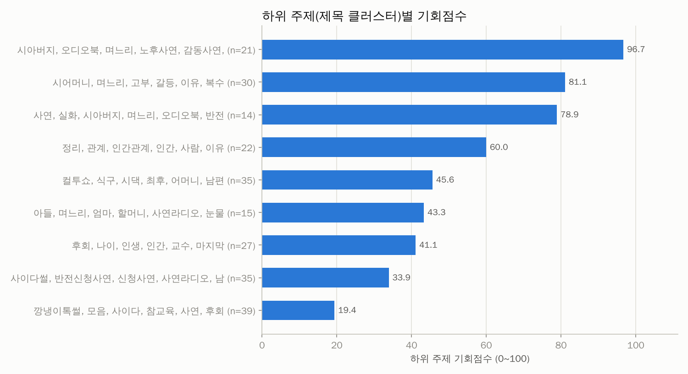

| 기회점수 | 핵심 단어 | 영상 수 | 배수 중앙값 | 성공 비율 | 소규모채널 성공 | 쇼츠 비율 | 예시 제목 |
|---|---|---|---|---|---|---|---|
| 97 | 시아버지, 오디오북, 며느리, 노후사연, 감동사연, 남편 | 21 | 44.95 | 90.5% | 28.6% | 0.0% | 황혼 시아버지 며느리 사랑 사연 이야기 황혼연애 황혼사랑 황혼사연 오디오 / 며느리를 사랑한 시아버지의 금지된 사랑 이야기 시아버지의 선택은 / 혼자 견디던 시아 |
| 81 | 시어머니, 며느리, 고부, 갈등, 이유, 복수 | 30 | 4.08 | 63.3% | 16.7% | 26.7% | ［5070고부갈등］“네 엄마가 뭘 가르쳤니?”8년 참은 며느리 김장날 결 / 며느리 데리고 나가버린 시어머니, 시아버지는 상상도 못 했다 #쇼츠드라마 / 사별했는 |
| 79 | 사연, 실화, 시아버지, 며느리, 오디오북, 반전 | 14 | 33.42 | 64.3% | 42.9% | 0.0% | ''아버님   버티기 힘들어요 '' 며느리와 시아버지의  멈출 수 없는  / ''아버님   버티기 힘들어요 '' 며느리와 시아버지의  멈출 수 없는  / ''아버 |
| 60 | 정리, 관계, 인간관계, 인간, 사람, 이유 | 22 | 4.05 | 45.5% | 4.5% | 27.3% | 인간관계를 정리하면 뇌에서 벌어지는 3가지 변화 / '이 행동' 한번이라도 보인다면, 무조건 거리둬라, 본성이 아주 몹쓸 사 / 인간관계 잘 하려면 3가지 감추고 |
| 46 | 컬투쇼, 식구, 시댁, 최후, 어머니, 남편 | 35 | 3.04 | 20.0% | 11.4% | 65.7% | 돈 뜯어내려던 진상 #사연라디오 #시니어사연 #오디오북 #사연 / 남편 식탐 때문에 이혼하고싶은 아내 #사연라디오 #시니어사연 #인생사연  / 택배기사님께 갑질하 |
| 43 | 아들, 며느리, 엄마, 할머니, 사연라디오, 눈물 | 15 | 2.27 | 26.7% | 6.7% | 26.7% | 잘 나갈땐 아들. 망하니까 남남? #시니어사연 #고부갈등 #부부갈등 #공 / 한겨울 저수지 뚝방에 버려진 치매 엄마, 아들 차가 떠나자마자 보따리에서 / '한가위 |
| 41 | 후회, 나이, 인생, 인간, 교수, 마지막 | 27 | 2.71 | 37.0% | 14.8% | 70.4% | "죽기 전에 가장 후회하는 것 1위: 니체와 쇼펜하우어가 말하는 후회 없 / 인간이 죽기 직전에 가장 후회하는 것 네 가지 #shorts #명언 #인 / "죽기  |
| 34 | 사이다썰, 반전신청사연, 신청사연, 사연라디오, 남편, 아빠 | 35 | 0.78 | 0.0% | 0.0% | 0.0% | (반전신청사연)결혼을 앞둔 시누가 연락도 없이 짐싸들고 왔길래 물었더니  / (반전신청사연)어머니와 합가후 아침까지 멀쩡했던 아내가 쓰러져 병원에 갔 / (반전신 |
| 19 | 깡냉이톡썰, 모음, 사이다, 참교육, 사연, 후회 | 39 | 0.76 | 0.0% | 0.0% | 0.0% | 깡냉이톡썰 몰아보기  - 사이다사연 & 참교육 모음 406편 / 깡냉이톡썰 몰아보기  - 사이다사연 & 참교육 모음 431편 / 깡냉이톡썰 몰아보기  - 사이다사 |

## 2. 🔑 키워드 기회 분석

기회점수 = 수요 25% + 자동완성 15% + 소규모채널 진입 20% + 아웃라이어 10% + 신선도 5% + 경쟁(역) 15% + 콘텐츠 공백 10% (키워드 간 백분위 기준). 수요·경쟁은 **주제 관련 영상만**으로 계산했고, 검색 상위 10개 중 절반 이상이 한 채널인 키워드(채널명 검색)는 제외했습니다. '관련 비율'이 낮다 = 사람들이 찾는데 맞는 영상이 적다(콘텐츠 공백).

### 🗂️ 카테고리(소재)별 기회

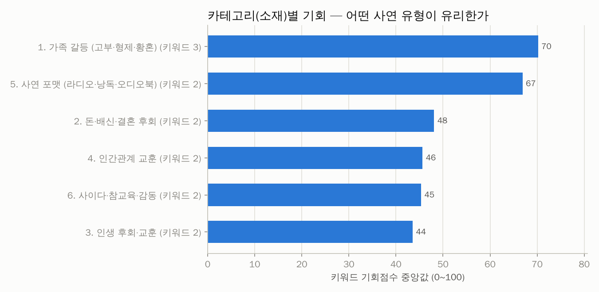

| 카테고리 | 키워드 수 | 기회(중앙) | 기회(최고) | 최고 키워드 | 검색수요 합 | 일평균 조회(중앙) | 소규모 진입 | 관련 비율 | 성공 영상 | 배수(중앙) |
|---|---|---|---|---|---|---|---|---|---|---|
| 1. 가족 갈등 (고부·형제·황혼) | 3 | 70 | 72 | 고부갈등 사연 | 0.0 | 903 | 23.3% | 100.0% | 40 | 11.08 |
| 5. 사연 포맷 (라디오·낭독·오디오북) | 2 | 67 | 67 | 시니어 사연 라디오 | 0.0 | 5.0천 | 2.5% | 100.0% | 13 | 1.60 |
| 2. 돈·배신·결혼 후회 | 2 | 48 | 51 | 돈 빌려주고 못받을때 | 0.0 | 113 | 5.0% | 15.0% | 0 | 2.88 |
| 4. 인간관계 교훈 | 2 | 46 | 54 | 인간관계 정리하는 방법 | 0.0 | 921 | 5.0% | 100.0% | 11 | 4.48 |
| 6. 사이다·참교육·감동 | 2 | 45 | 47 | 사이다 사연 모음 | 0.0 | 543 | 7.5% | 100.0% | 5 | 0.82 |
| 3. 인생 후회·교훈 | 2 | 44 | 50 | 죽기 전에 후회하는 것들 | 0.0 | 81 | 2.5% | 75.0% | 10 | 2.71 |

### 🔑 키워드별 기회

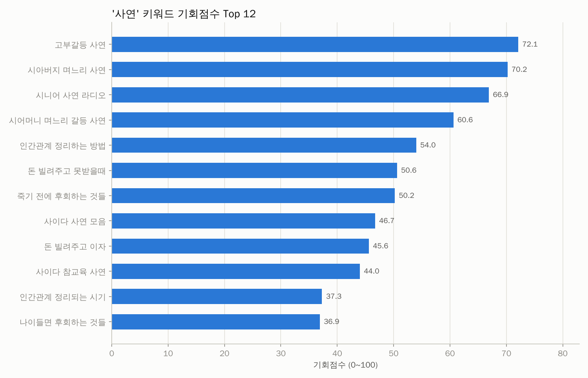
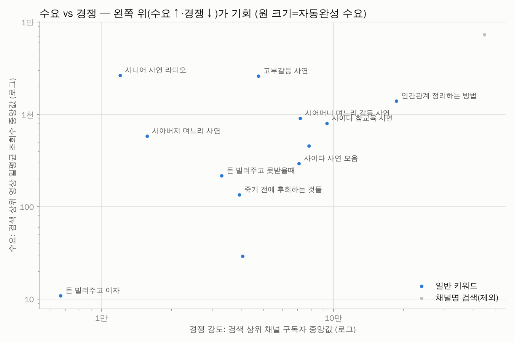

| 키워드 | 카테고리 | 기회점수 | 일평균 조회수(중앙) | 자동완성 | 소규모 진입 | 관련 비율 | 최신 비율 | 경쟁 구독자(중앙) | 배수(중앙) | 성공 수 | 추천 포맷 | 채널명검색 |
|---|---|---|---|---|---|---|---|---|---|---|---|---|
| 고부갈등 사연 | 1. 가족 갈등 (고부·형 | 72 | 2.6천 | 0.00 | 15.0% | 100.0% | 50.0% | 4.8만 | 10.78 | 9 | 롱폼 |  |
| 시아버지 며느리 사연 | 1. 가족 갈등 (고부·형 | 70 | 579 | 0.00 | 40.0% | 100.0% | 10.0% | 1.6만 | 61.63 | 21 | 롱폼 |  |
| 시니어 사연 라디오 | 5. 사연 포맷 (라디오· | 67 | 2.6천 | 0.00 | 5.0% | 100.0% | 60.0% | 1.2만 | 3.32 | 13 | 롱폼 |  |
| 시어머니 며느리 갈등 사연 | 1. 가족 갈등 (고부·형 | 61 | 903 | 0.00 | 15.0% | 100.0% | 25.0% | 7.2만 | 3.52 | 12 | 롱폼 |  |
| 인간관계 정리하는 방법 | 4. 인간관계 교훈 | 54 | 1.4천 | 0.00 | 10.0% | 100.0% | 5.0% | 18.7만 | 4.67 | 9 | 롱폼 |  |
| 돈 빌려주고 못받을때 | 2. 돈·배신·결혼 후회 | 51 | 216 | 0.00 | 10.0% | 20.0% | 0.0% | 3.3만 | 0.19 | 0 | - |  |
| 죽기 전에 후회하는 것들 | 3. 인생 후회·교훈 | 50 | 134 | 0.00 | 5.0% | 70.0% | 7.1% | 3.9만 | 8.22 | 6 | 쇼츠 |  |
| 사이다 사연 모음 | 6. 사이다·참교육·감동 | 47 | 292 | 0.00 | 10.0% | 100.0% | 50.0% | 7.1만 | 0.76 | 2 | 롱폼 |  |
| 돈 빌려주고 이자 | 2. 돈·배신·결혼 후회 | 46 | 11 | 0.00 | 0.0% | 10.0% | 0.0% | 6.7천 | 5.57 | 0 | - |  |
| 사이다 참교육 사연 | 6. 사이다·참교육·감동 | 44 | 795 | 0.00 | 5.0% | 100.0% | 20.0% | 9.4만 | 0.78 | 3 | 롱폼 |  |
| 인간관계 정리되는 시기 | 4. 인간관계 교훈 | 37 | 453 | 0.00 | 0.0% | 100.0% | 0.0% | 7.8만 | 4.67 | 7 | 롱폼 |  |
| 나이들면 후회하는 것들 | 3. 인생 후회·교훈 | 37 | 29 | 0.00 | 0.0% | 80.0% | 18.8% | 4.1만 | 0.94 | 4 | 쇼츠 |  |
| 사연 라디오 | 5. 사연 포맷 (라디오· | - | 7.3천 | 0.00 | 0.0% | 100.0% | 78.9% | 44.7만 | 0.75 | 0 | 롱폼 | 예 |

키워드별 검색 수요 (자동완성이 표현을 어디까지 알아보는지 — 1.0=전체 문구가 자동완성에 뜸, 0=앞 두 단어도 안 뜸)

| 순위 | 검색어 | 카테고리 | 수요 점수 | 자동완성이 알아본 부분 | 일치 제안 수 |
|---|---|---|---|---|---|
| 1 | 시어머니 며느리 갈등 사연 | 1. 가족 갈등 (고부·형제·황혼) | 0.00 | - | 0 |
| 1 | 돈 빌려주고 못받을때 | 2. 돈·배신·결혼 후회 | 0.00 | - | 0 |
| 1 | 죽기 전에 후회하는 것들 | 3. 인생 후회·교훈 | 0.00 | - | 0 |
| 1 | 인간관계 정리하는 방법 | 4. 인간관계 교훈 | 0.00 | - | 0 |
| 1 | 사연 라디오 | 5. 사연 포맷 (라디오·낭독·오디오북) | 0.00 | - | 0 |
| 1 | 사이다 사연 모음 | 6. 사이다·참교육·감동 | 0.00 | - | 0 |
| 1 | 고부갈등 사연 | 1. 가족 갈등 (고부·형제·황혼) | 0.00 | - | 0 |
| 1 | 돈 빌려주고 이자 | 2. 돈·배신·결혼 후회 | 0.00 | - | 0 |
| 1 | 나이들면 후회하는 것들 | 3. 인생 후회·교훈 | 0.00 | - | 0 |
| 1 | 인간관계 정리되는 시기 | 4. 인간관계 교훈 | 0.00 | - | 0 |
| 1 | 시니어 사연 라디오 | 5. 사연 포맷 (라디오·낭독·오디오북) | 0.00 | - | 0 |
| 1 | 사이다 참교육 사연 | 6. 사이다·참교육·감동 | 0.00 | - | 0 |
| 1 | 시아버지 며느리 사연 | 1. 가족 갈등 (고부·형제·황혼) | 0.00 | - | 0 |

📢 광고 집행 의심으로 제외한 영상 2개 (조회수 대비 좋아요·댓글이 극히 적음)

| 영상 | 채널 | 구독자 | 조회수 | 좋아요율 | 댓글 수 |
|---|---|---|---|---|---|
| [죽기 직전에 후회하는 것 #불교명언](https://www.youtube.com/watch?v=iE8zkAOeq2c) | 말씀 | 3.7만 | 335만 | 0.14% | 28 |
| [인간관계는 이렇게 해라. 정리하는 방법](https://www.youtube.com/watch?v=ZyIeAOvYFks) | 땡큐손머치 스튜디오 | 14.5만 | 60.5만 | 0.19% | 3 |

🎯 주제와 무관해서 제외한 영상 91개 (조회수 상위 15개 — 전체는 data/excluded_offtopic.csv)

| 영상 | 채널 | 조회수 | 검색 키워드 |
|---|---|---|---|
| [친구가 돈빌리고 안 갚을때 해결법! #유머…](https://www.youtube.com/watch?v=lE8-Tdc7YC0) | 김켈리 Kellyfornia | 385만 | 돈 빌려주고 못받을때 |
| [임종 전 죽음을 예고하는 5가지 증상](https://www.youtube.com/watch?v=bNysYPd6CoE) | 책썰미 | 378만 | 죽기 전에 후회하는 것들 |
| [통장에서 현금 뽑으면 결국 세금폭탄 맞는 이유](https://www.youtube.com/watch?v=yOGGIBP-Wec) | 세금 아는형 | 187만 | 돈 빌려주고 이자 |
| [서울대 법의학자가 말하는 사람이 죽기 전 느낀다는 '이 감각' ㅣ Ep. 35 책…](https://www.youtube.com/watch?v=1-E9q_3MN4E) | 책과삶 | 167만 | 죽기 전에 후회하는 것들 |
| [돈 빌려줬는데 잠수타는 그 놈을 조지는 방법의 정석](https://www.youtube.com/watch?v=lJyIhO5iaaA) | 호갱구조대 | 136만 | 돈 빌려주고 못받을때 |
| [가족간 계좌이체 '이렇게' 안 하면 세금폭탄 맞는다 (공찬규 세무사)](https://www.youtube.com/watch?v=vucx0tSsOsI) | 김작가 TV | 130만 | 돈 빌려주고 이자 |
| [죽기 전 사람들이 가장 후회한다는 1위 (우리는 서로의 전부이자 지옥이었다)](https://www.youtube.com/watch?v=c9_2vqycFjE) | 1분지혜 | 123만 | 죽기 전에 후회하는 것들 |
| [돈 빌려줄 때 차용증만 작성하면 괜찮을까요?](https://www.youtube.com/watch?v=6MoGr5B1n5U) | 류인규 변호사의 내돈내놔 | 118만 | 돈 빌려주고 이자 |
| [죽음을 맞이하기 전 사람들이 가장 후회하는 1가지 (호스피스 김여환 의사)](https://www.youtube.com/watch?v=rx8qzEuxas8) | 김작가 TV | 88.5만 | 죽기 전에 후회하는 것들 |
| [죽어가던 1000명이 알려준 죽기 전 예외없이 후회하는 일 ［신과대화: 유성호 서…](https://www.youtube.com/watch?v=xcoZdRbuhUc) | 삼프로TV 3PROTV | 84.5만 | 죽기 전에 후회하는 것들 |
| [죽기 전에 가장 많이 하는 후회, 알고 있나요](https://www.youtube.com/watch?v=JrrG22x40wA) | 마업 | 71.9만 | 죽기 전에 후회하는 것들 |
| [대운이 들어오기 전 나타나는 징조 #shorts](https://www.youtube.com/watch?v=kMMIJz087s4) | 용마장군가운신녀 | 66.7만 | 인간관계 정리되는 시기 |
| [제983회 돈을 빌려줬는데 갚지도 않고 거짓말을 해서 분합니다](https://www.youtube.com/watch?v=4Bbb34-N4Ew) | 법륜스님의 즉문즉설 | 62.8만 | 돈 빌려주고 못받을때 |
| [나이 들면 가장 많이 하는 후회, 1위는?](https://www.youtube.com/watch?v=CZOTl_7OQSE) | 책식주의 | 42.6만 | 나이들면 후회하는 것들 |
| [빌려준 돈 안돌려줄 때 해결법](https://www.youtube.com/watch?v=GuCDQxPoxCA) | 짤플리 | 39.2만 | 돈 빌려주고 못받을때 |

## 3. 🏷️ 제목 패턴 분석

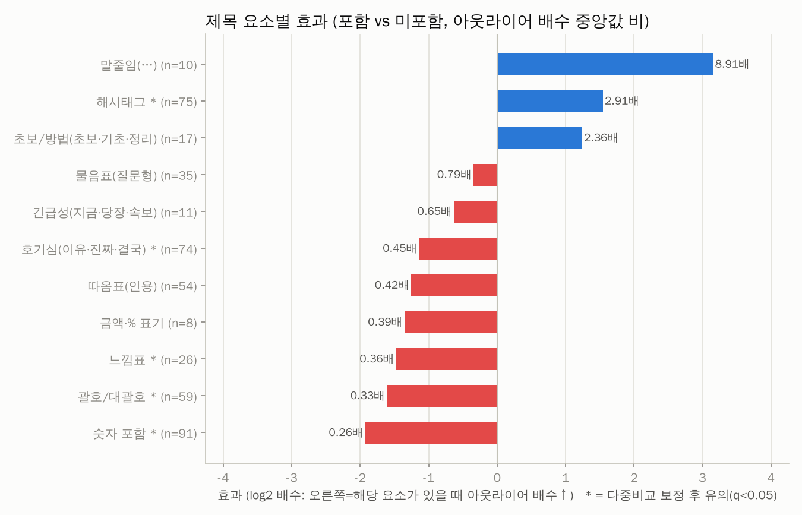
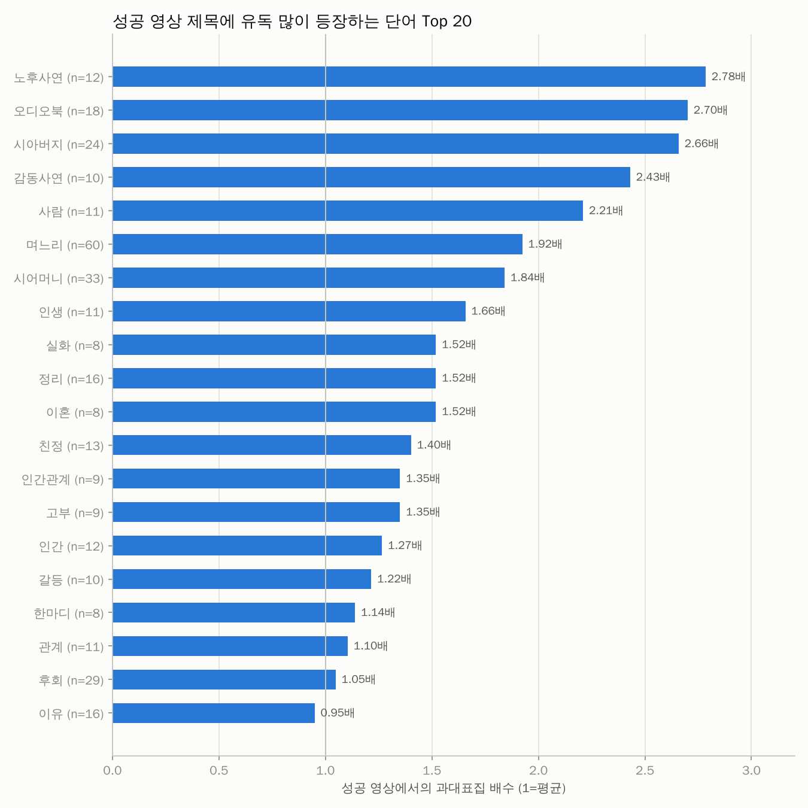
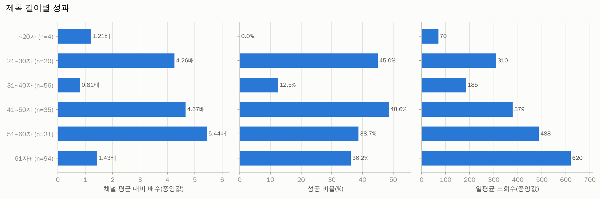

| 제목 요소 | 해당 영상 수 | 배수(있음) | 배수(없음) | 효과(배) | 성공률(있음) | 성공률(없음) | p값 | q값(보정) |
|---|---|---|---|---|---|---|---|---|
| 말줄임(…) | 10 | 15.14 | 1.70 | 8.91 | 80.0% | 32.7% | 0.007 | 0.014 |
| 해시태그 | 75 | 3.33 | 1.14 | 2.91 | 42.7% | 30.9% | 0.002 | 0.005 |
| 초보/방법(초보·기초·정리) | 17 | 4.10 | 1.74 | 2.36 | 58.8% | 32.9% | 0.292 | 0.357 |
| 물음표(질문형) | 35 | 1.52 | 1.93 | 0.79 | 25.7% | 36.5% | 0.510 | 0.561 |
| 긴급성(지금·당장·속보) | 11 | 1.19 | 1.84 | 0.65 | 45.5% | 34.3% | 0.931 | 0.931 |
| 호기심(이유·진짜·결국) | 74 | 1.16 | 2.54 | 0.45 | 27.0% | 38.6% | 0.008 | 0.014 |
| 따옴표(인용) | 54 | 0.96 | 2.28 | 0.42 | 25.9% | 37.6% | 0.059 | 0.081 |
| 금액·% 표기 | 8 | 0.74 | 1.88 | 0.39 | 0.0% | 36.1% | 0.010 | 0.015 |
| 느낌표 | 26 | 0.82 | 2.28 | 0.36 | 23.1% | 36.3% | 0.001 | 0.005 |
| 괄호/대괄호 | 59 | 0.88 | 2.70 | 0.33 | 16.9% | 41.1% | 0.000 | 0.001 |
| 숫자 포함 | 91 | 0.84 | 3.21 | 0.26 | 22.0% | 43.4% | 0.000 | 0.000 |

롱폼/쇼츠 따로 본 제목 요소 효과

| 구분 | 제목 요소 | 영상 수 | 효과(배) | 성공률(있음) | p값 |
|---|---|---|---|---|---|
| 롱폼 | 말줄임(…) | 9 | 14.66 | 88.9% | 0.006 |
| 롱폼 | 해시태그 | 28 | 3.81 | 57.1% | 0.017 |
| 롱폼 | 초보/방법(초보·기초·정리) | 13 | 3.45 | 61.5% | 0.248 |
| 롱폼 | 물음표(질문형) | 30 | 0.98 | 26.7% | 0.696 |
| 롱폼 | 긴급성(지금·당장·속보) | 8 | 0.70 | 25.0% | 0.651 |
| 롱폼 | 따옴표(인용) | 51 | 0.54 | 23.5% | 0.119 |
| 롱폼 | 호기심(이유·진짜·결국) | 65 | 0.51 | 27.7% | 0.019 |
| 롱폼 | 느낌표 | 25 | 0.48 | 20.0% | 0.005 |
| 롱폼 | 괄호/대괄호 | 56 | 0.39 | 14.3% | 0.002 |
| 롱폼 | 숫자 포함 | 80 | 0.27 | 20.0% | 0.000 |
| 쇼츠 | 해시태그 | 47 | 1.73 | 34.0% | 0.777 |
| 쇼츠 | 숫자 포함 | 11 | 1.01 | 36.4% | 0.288 |
| 쇼츠 | 호기심(이유·진짜·결국) | 9 | 0.87 | 22.2% | 0.956 |

**성공 영상 제목에 유독 많이 나오는 단어** (과대표집 배수 = 성공 영상 내 비중 ÷ 전체 비중)

| 단어 | 영상 수 | 성공 수 | 과대표집 | 배수(중앙) | 일평균 조회수 |
|---|---|---|---|---|---|
| 노후사연 | 12 | 11 | 2.78 | 25.50 | 4.4천 |
| 오디오북 | 18 | 16 | 2.70 | 60.77 | 1.1천 |
| 시아버지 | 24 | 21 | 2.66 | 44.28 | 1.0천 |
| 감동사연 | 10 | 8 | 2.43 | 17.24 | 3.2천 |
| 사람 | 11 | 8 | 2.21 | 5.26 | 628 |
| 며느리 | 60 | 38 | 1.92 | 6.53 | 963 |
| 시어머니 | 33 | 20 | 1.84 | 4.09 | 1.9천 |
| 인생 | 11 | 6 | 1.66 | 11.24 | 789 |
| 실화 | 8 | 4 | 1.52 | 44.09 | 215 |
| 정리 | 16 | 8 | 1.52 | 4.36 | 457 |
| 이혼 | 8 | 4 | 1.52 | 3.76 | 680 |
| 친정 | 13 | 6 | 1.40 | 3.33 | 2.7천 |
| 인간관계 | 9 | 4 | 1.35 | 3.31 | 628 |
| 고부 | 9 | 4 | 1.35 | 3.10 | 916 |
| 인간 | 12 | 5 | 1.27 | 3.74 | 429 |
| 갈등 | 10 | 4 | 1.22 | 2.54 | 704 |
| 한마디 | 8 | 3 | 1.14 | 1.77 | 2.4천 |
| 관계 | 11 | 4 | 1.10 | 2.57 | 433 |
| 후회 | 29 | 10 | 1.05 | 2.70 | 66 |
| 이유 | 16 | 5 | 0.95 | 2.76 | 409 |
| 나이 | 16 | 5 | 0.95 | 1.21 | 48 |
| 반전 | 13 | 4 | 0.93 | 0.85 | 532 |
| 시댁 | 14 | 4 | 0.87 | 1.50 | 479 |
| 아들 | 18 | 5 | 0.84 | 2.00 | 424 |
| 남편 | 26 | 7 | 0.82 | 1.21 | 433 |

## 4. 🎞️ 포맷 · 길이

> 쇼츠 조회수는 2025년 3월부터 '재생 시작/반복'마다 집계되어 롱폼 조회수와 직접 비교할 수 없습니다. 그래서 **같은 채널·같은 포맷 대비 배수(아웃라이어)** 와 성공 비율로 비교합니다.

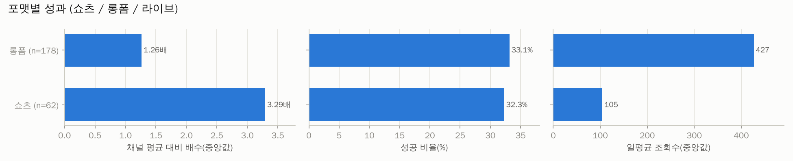
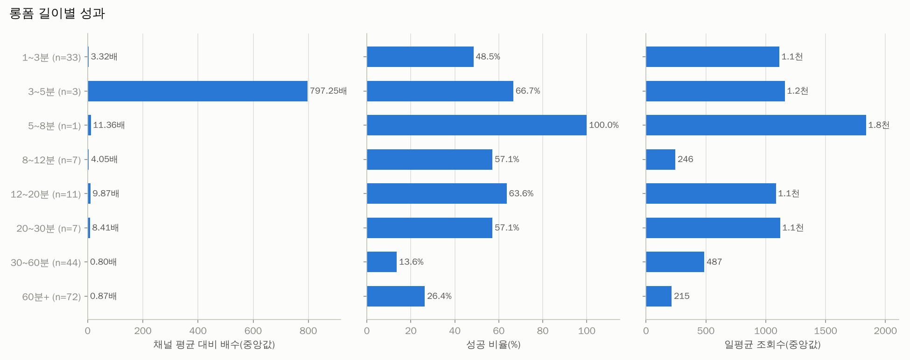

| 포맷 | 영상 수 | 조회수(중앙) | 일평균(중앙) | 배수(중앙) | 성공 비율 | 소규모채널 성공 |
|---|---|---|---|---|---|---|
| 롱폼 | 178 | 5.1만 | 427 | 1.26 | 33.1% | 11.2% |
| 쇼츠 | 62 | 1.8만 | 105 | 3.29 | 32.3% | 11.3% |

| 롱폼 길이 | 영상 수 | 조회수(중앙) | 일평균(중앙) | 배수(중앙) | 성공 비율 | 소규모채널 성공 |
|---|---|---|---|---|---|---|
| 1~3분 | 33 | 9.0만 | 1.1천 | 3.32 | 48.5% | 12.1% |
| 3~5분 | 3 | 23.4만 | 1.2천 | 797.25 | 66.7% | 66.7% |
| 5~8분 | 1 | 43.3만 | 1.8천 | 11.36 | 100.0% | 0.0% |
| 8~12분 | 7 | 5.0만 | 246 | 4.05 | 57.1% | 14.3% |
| 12~20분 | 11 | 4.0만 | 1.1천 | 9.87 | 63.6% | 27.3% |
| 20~30분 | 7 | 18.9만 | 1.1천 | 8.41 | 57.1% | 28.6% |
| 30~60분 | 44 | 5.6만 | 487 | 0.80 | 13.6% | 6.8% |
| 60분+ | 72 | 2.3만 | 215 | 0.87 | 26.4% | 6.9% |

## 5. 🕒 업로드 타이밍 (참고용 — 효과가 작고 혼란변수가 많음)

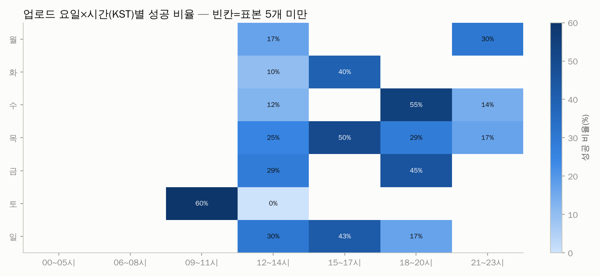

| 요일 | 영상 수 | 조회수(중앙) | 일평균(중앙) | 배수(중앙) | 성공 비율 | 소규모채널 성공 |
|---|---|---|---|---|---|---|
| 월 | 36 | 2.5만 | 236 | 1.51 | 30.6% | 13.9% |
| 화 | 25 | 5.3만 | 893 | 1.58 | 40.0% | 4.0% |
| 수 | 46 | 5.7만 | 418 | 1.87 | 34.8% | 6.5% |
| 목 | 40 | 5.1만 | 484 | 1.70 | 32.5% | 10.0% |
| 금 | 31 | 4.4만 | 381 | 2.31 | 38.7% | 19.4% |
| 토 | 27 | 2.3만 | 205 | 1.19 | 22.2% | 7.4% |
| 일 | 35 | 4.6만 | 311 | 2.53 | 31.4% | 17.1% |

| 시간대(KST) | 영상 수 | 조회수(중앙) | 일평균(중앙) | 배수(중앙) | 성공 비율 | 소규모채널 성공 |
|---|---|---|---|---|---|---|
| 00~05시 | 9 | 1.4만 | 67 | 10.82 | 55.6% | 44.4% |
| 06~08시 | 18 | 8.3만 | 522 | 3.00 | 44.4% | 22.2% |
| 09~11시 | 20 | 13.0만 | 1.0천 | 5.78 | 65.0% | 15.0% |
| 12~14시 | 82 | 2.9만 | 294 | 0.81 | 17.1% | 3.7% |
| 15~17시 | 30 | 2.9만 | 330 | 4.78 | 40.0% | 13.3% |
| 18~20시 | 47 | 6.2만 | 1.4천 | 2.89 | 42.6% | 12.8% |
| 21~23시 | 34 | 5.2만 | 344 | 1.26 | 20.6% | 8.8% |

## 6. 🌱 채널 규모별 분석 — 0명 채널에게 가장 중요한 부분

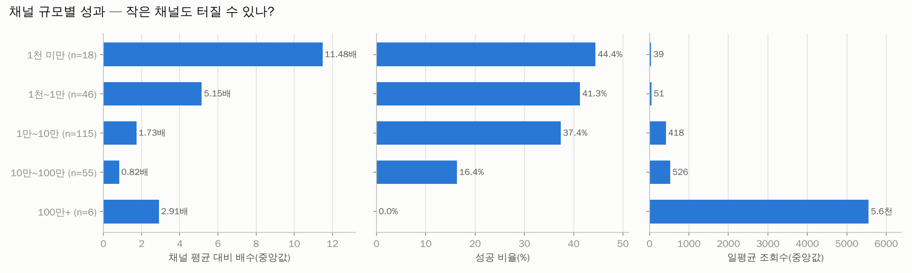
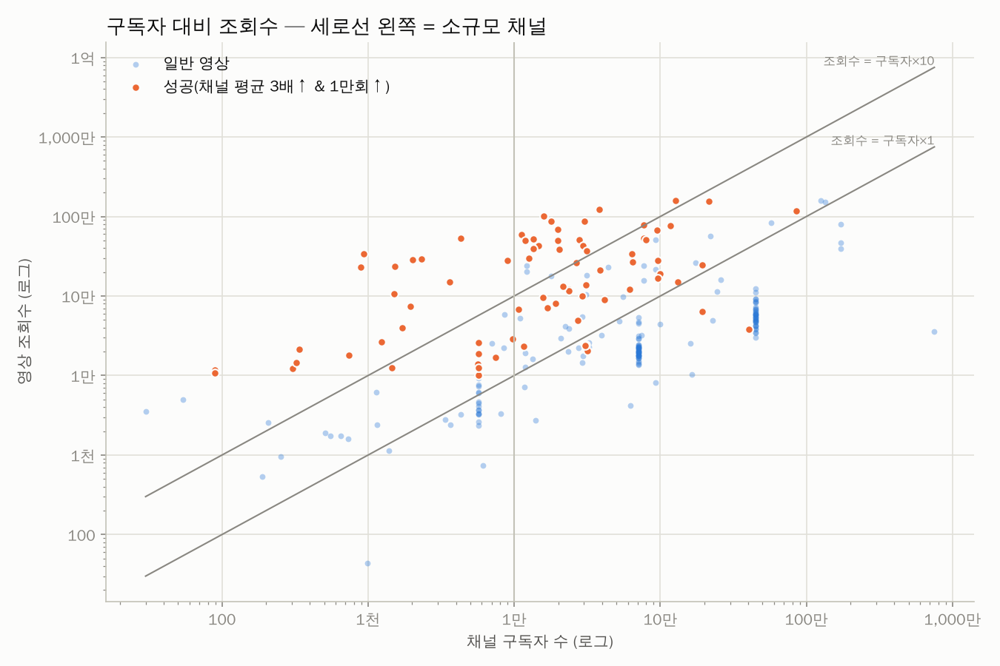

| 구독자 규모 | 영상 수 | 조회수(중앙) | 일평균(중앙) | 배수(중앙) | 성공 비율 | 소규모채널 성공 |
|---|---|---|---|---|---|---|
| 1천 미만 | 18 | 4.3천 | 39 | 11.48 | 44.4% | 44.4% |
| 1천~1만 | 46 | 9.6천 | 51 | 5.15 | 41.3% | 41.3% |
| 1만~10만 | 115 | 4.2만 | 418 | 1.73 | 37.4% | 0.0% |
| 10만~100만 | 55 | 6.0만 | 526 | 0.82 | 16.4% | 0.0% |
| 100만+ | 6 | 63.0만 | 5.6천 | 2.91 | 0.0% | 0.0% |

**개설 1년 이내 채널의 성공 영상** (0개) — 신생 채널이 실제로 터진 사례

_데이터 없음_

## 7. 🔥 최근 14일 이내 급상승 영상 (아직 성과 집계 전 — 트렌드 참고)

| 영상 | 채널 | 구독자 | 조회수 | 일평균 | 경과일 | 포맷 |
|---|---|---|---|---|---|---|
| [［감동 썰］ 며느리가 자고 가지 말라던 아들 집, 밤에 몰래 가 보고 울었습니다 …](https://www.youtube.com/watch?v=7DBajNXWlLE) | Warmth to Inspire | 5.9만 | 13.6만 | 13.5만 | 1.0 | 쇼츠 |
| [“당신은 누구입니까?” 커피를 내온 고졸 며느리의 아랍어 인사에 사우디 회장이 돌…](https://www.youtube.com/watch?v=HWXqYzIQuh0) | 뷰티풀사연 | 3.4천 | 38.0만 | 9.8만 | 3.9 | 롱폼 |
| [반찬가게 사돈 무시하던 예비시아버지 예비며느리의 참교육#상견례#감동시니어#사이다사…](https://www.youtube.com/watch?v=9pHQoCKLF5U) | 은빛펀치 | 3.6천 | 42.7만 | 9.1만 | 4.7 | 롱폼 |
| [고3 아들 방에서 자고 가겠다는 시어머니를 거절했더니 #사연라디오 #고부갈등 #오…](https://www.youtube.com/watch?v=arRL0WH3Zz4) | 한밤의 사연 | 1.2만 | 21.0만 | 7.2만 | 2.9 | 롱폼 |
| [20년간 해오던 김장 안한다는 시어머니 말에 며느리가 한 말이 충격입니다 #썰쇼츠…](https://www.youtube.com/watch?v=hVR8k-kLxG4) | 썰풀때는 | 4.4만 | 5.9만 | 5.9만 | 1.0 | 롱폼 |
| [짠돌이 시아버지의 빚 장부를 우물에 던진 며느리, 수집 년째 못 지운 한 줄 #S…](https://www.youtube.com/watch?v=uHl5J3JhE5M) | 달잠이 들려주는 이야기 | 2.9천 | 16.5만 | 5.7만 | 2.9 | 쇼츠 |
| [상견례도 하기 전에 혼수부터 따지던 예비 시어머니… 그런데 반전이?! #감동사연 …](https://www.youtube.com/watch?v=n-UAfuqYZ64) | 유머한스푼 | 7.7만 | 4.9만 | 4.9만 | 0.8 | 쇼츠 |
| [(반전신청사연)남편이 교통사고로 입원해 간병하는데 옆에 환자가 "아내 맞아요? 아…](https://www.youtube.com/watch?v=1yzvHlO9m2U) | 사연튜브 • 사연라디오 | 44.7만 | 4.2만 | 4.2만 | 0.9 | 롱폼 |
| [(반전신청사연)내가 강남아파트 상속받고 시댁에 한푼도 안주자 내카드 훔쳐간 시모!…](https://www.youtube.com/watch?v=a5YwL-yDdd0) | 사연튜브 • 사연라디오 | 44.7만 | 3.6만 | 3.6만 | 0.6 | 롱폼 |
| [몰래 우는 시아버지를 본 며느리가 한 일 #효도#시부모부양#효부#며느리#시아버지#…](https://www.youtube.com/watch?v=1-ILE7qIURw) | 썰전소 | 21.6만 | 21.8만 | 3.2만 | 6.7 | 롱폼 |
| [시어머니와 함께 가는 신혼여행 #막장드라마 #드라마 #시니어 #drama #반전 …](https://www.youtube.com/watch?v=oY263BpbEc4) | 인생2막TV | 3.5만 | 3.5만 | 3.1만 | 1.2 | 롱폼 |
| [(반전신청사연)저녁밥 앉히고 딸과 통화했더니 집에서 나가란 며느리 "시끄러우니까 …](https://www.youtube.com/watch?v=Nd3KTIprDGs) | 사연튜브 • 사연라디오 | 44.7만 | 5.9만 | 3.1만 | 1.9 | 롱폼 |
| [며느리 기강 잡으려다 자기꾀에 넘어간 시어머니!  #사연 #사이다썰 #시어머니 #…](https://www.youtube.com/watch?v=2ZSm1Lt8ulo) | 노년의연애 | 9.9천 | 14.5만 | 2.7만 | 5.3 | 롱폼 |
| [며느리 부려먹으려다 한방먹은 시어머니 #시…](https://www.youtube.com/watch?v=8_EiTCouhGE) | 희노애락극장 | 9.6만 | 4.3만 | 2.5만 | 1.7 | 롱폼 |
| ["매일 안부 전화하라고요?" 시아버지 요구 한 방에 무너뜨린 며느리의 사이다 한마…](https://www.youtube.com/watch?v=esTz_5-KMqk) | 재밌네 | 6.5천 | 13.4만 | 2.4만 | 5.5 | 롱폼 |

## 8. 🏆 성공사례 — 대본 · 영상 · 썸네일

선정 기준: 종합점수(아웃라이어 40% + 조회수 35% + 구독자 대비 조회수 25%) 상위, 소규모 채널 ≥50%, 롱폼 ≥50%, 채널당 최대 1개. 각 폴더에 `transcript.txt`(대본), `transcript_timestamped.txt`, `video.mp4`, `thumbnail.jpg`, `metadata.json`, `comments.csv` 가 있습니다.

### 1. ["형님 피아노 칠 줄은 아세요?" 살림만 하던 형님 비웃던 음대 나온 동서는 1분 뒤..ㅣ노후사연ㅣ감동사연ㅣ사연라디오ㅣ오디오북](https://www.youtube.com/watch?v=9zGs-M-YTc4)

- 채널 **굿밤이야기** (구독자 1.6만) · 조회수 **101만** · 채널 평균의 **71.8배** · 롱폼 01:27 · 업로드 2026-09-19 · 카테고리: 5. 사연 포맷 (라디오·낭독·오디오북) · 검색어: `시니어 사연 라디오` · 선정: 종합점수 상위 (점수 95)
- 📁 [`success_cases/01_형님_피아노_칠_줄은_아세요_살림만_하던_형님_비웃던_9zGs-M-YTc4/`](success_cases/01_형님_피아노_칠_줄은_아세요_살림만_하던_형님_비웃던_9zGs-M-YTc4/) · 대본: failed · 영상: skipped(DOWNLOAD_VIDEOS=False)

### 2. [혼자 견디던 시아버지의 밤, 제가 문을 열던 순간 모든 게 달라졌습니다ㅣ노후사연 ㅣ오디오북](https://www.youtube.com/watch?v=o-RvIa4PViQ)

- 채널 **마음온도서재** (구독자 934) · 조회수 **34.1만** · 채널 평균의 **296.4배** · 롱폼 28:56 · 업로드 2025-12-11 · 카테고리: 1. 가족 갈등 (고부·형제·황혼) · 검색어: `시아버지 며느리 사연` · 선정: 소규모 채널 쿼터 (점수 93)
- 📁 [`success_cases/02_혼자_견디던_시아버지의_밤_제가_문을_열던_순간_모든_o-RvIa4PViQ/`](success_cases/02_혼자_견디던_시아버지의_밤_제가_문을_열던_순간_모든_o-RvIa4PViQ/) · 대본: failed · 영상: skipped(DOWNLOAD_VIDEOS=False)

### 3. ["죽기 전에 가장 후회하는 것 1위: 니체와 쇼펜하우어가 말하는 후회 없는 인생법"](https://www.youtube.com/watch?v=xvsPFAEslus)

- 채널 **지혜의숲과나무** (구독자 2.3천) · 조회수 **29.2만** · 채널 평균의 **1,436.5배** · 롱폼 03:01 · 업로드 2026-04-06 · 카테고리: 3. 인생 후회·교훈 · 검색어: `죽기 전에 후회하는 것들` · 선정: 소규모 채널 쿼터 (점수 93)
- 📁 [`success_cases/03_죽기_전에_가장_후회하는_것_1위_니체와_쇼펜하우어가_xvsPFAEslus/`](success_cases/03_죽기_전에_가장_후회하는_것_1위_니체와_쇼펜하우어가_xvsPFAEslus/) · 대본: failed · 영상: skipped(DOWNLOAD_VIDEOS=False)

### 4. ['이 행동' 한번이라도 보인다면, 무조건 거리둬라, 본성이 아주 몹쓸 사람이다 \| 정약용 \| 현명한 인간관계 조언  \| …](https://www.youtube.com/watch?v=rEyP8Rk1gZA)

- 채널 **마음보약** (구독자 2.0만) · 조회수 **49.8만** · 채널 평균의 **577.5배** · 롱폼 16:31 · 업로드 2025-12-11 · 카테고리: 4. 인간관계 교훈 · 검색어: `인간관계 정리하는 방법` · 선정: 종합점수 상위 (점수 92)
- 📁 [`success_cases/04_이_행동_한번이라도_보인다면_무조건_거리둬라_본성이_아_rEyP8Rk1gZA/`](success_cases/04_이_행동_한번이라도_보인다면_무조건_거리둬라_본성이_아_rEyP8Rk1gZA/) · 대본: failed · 영상: skipped(DOWNLOAD_VIDEOS=False)

### 5. [(실화사연) 고급식당 상견례서 “건물도 없죠?” 비웃던 시어머니… 아빠가 파혼 선언하자 식당주인 한마디에 얼어붙었다](https://www.youtube.com/watch?v=oGEJ5R--1ko)

- 채널 **시월드 사이다** (구독자 4.3천) · 조회수 **52.7만** · 채널 평균의 **36.1배** · 롱폼 49:38 · 업로드 2026-09-08 · 카테고리: 6. 사이다·참교육·감동 · 검색어: `사이다 사연 모음` · 선정: 소규모 채널 쿼터 (점수 92)
- 📁 [`success_cases/05_실화사연_고급식당_상견례서_건물도_없죠_비웃던_시어머니_oGEJ5R--1ko/`](success_cases/05_실화사연_고급식당_상견례서_건물도_없죠_비웃던_시어머니_oGEJ5R--1ko/) · 대본: failed · 영상: skipped(DOWNLOAD_VIDEOS=False)

### 6. [인간관계를 정리하면 뇌에서 벌어지는 3가지 변화](https://www.youtube.com/watch?v=U_d_HJ2h0Jc)

- 채널 **모찌의 마음공부** (구독자 1.5천) · 조회수 **23.4만** · 채널 평균의 **797.3배** · 롱폼 04:26 · 업로드 2026-03-23 · 카테고리: 4. 인간관계 교훈 · 검색어: `인간관계 정리되는 시기` · 선정: 소규모 채널 쿼터 (점수 92)
- 📁 [`success_cases/06_인간관계를_정리하면_뇌에서_벌어지는_3가지_변화_U_d_HJ2h0Jc/`](success_cases/06_인간관계를_정리하면_뇌에서_벌어지는_3가지_변화_U_d_HJ2h0Jc/) · 대본: failed · 영상: skipped(DOWNLOAD_VIDEOS=False)

### 7. [인간이 죽기 직전에 가장 후회하는 것 네 가지 #shorts #명언 #인간관계 #철학 #지혜 #행복 #니체 #쇼펜하우어 #좋은…](https://www.youtube.com/watch?v=XRYQ2Rl_kNg)

- 채널 **인간혐오** (구독자 3.8만) · 조회수 **123만** · 채널 평균의 **33.9배** · 쇼츠 01:13 · 업로드 2026-08-05 · 카테고리: 3. 인생 후회·교훈 · 검색어: `죽기 전에 후회하는 것들` · 선정: 종합점수 상위 (점수 92)
- 📁 [`success_cases/07_인간이_죽기_직전에_가장_후회하는_것_네_가지_shor_XRYQ2Rl_kNg/`](success_cases/07_인간이_죽기_직전에_가장_후회하는_것_네_가지_shor_XRYQ2Rl_kNg/) · 대본: failed · 영상: skipped(DOWNLOAD_VIDEOS=False)

### 8. [잘 나갈땐 아들. 망하니까 남남? #시니어사연 #고부갈등 #부부갈등 #공감](https://www.youtube.com/watch?v=HtzSxURAKL0)

- 채널 **마음가든** (구독자 2.0천) · 조회수 **28.7만** · 채널 평균의 **170.6배** · 롱폼 01:59 · 업로드 2026-09-04 · 카테고리: 1. 가족 갈등 (고부·형제·황혼) · 검색어: `고부갈등 사연` · 선정: 종합점수 상위 (점수 91)
- 📁 [`success_cases/08_잘_나갈땐_아들_망하니까_남남_시니어사연_고부갈등_부부_HtzSxURAKL0/`](success_cases/08_잘_나갈땐_아들_망하니까_남남_시니어사연_고부갈등_부부_HtzSxURAKL0/) · 대본: failed · 영상: skipped(DOWNLOAD_VIDEOS=False)

## 9. 💬 시청자 질문 (성공 영상 댓글에서 추출) — 다음 영상 주제 후보

질문 댓글에 많이 나오는 단어: `사람`(37), `며느리`(20), `인간`(20), `아들`(16), `나이`(11), `이혼`(10), `사랑`(10), `생각`(9), `행복`(9), `세상`(8), `시아버지`(8), `아버지`(7), `내용`(7), `결혼`(7), `후회`(7), `가족`(7), `소설`(7), `소리`(7), `바보`(6), `카드`(6)

| 질문 댓글 | 좋아요 | 영상 |
|---|---|---|
| 언제부턴가 싫은 사람 그냥 끊어 버림 돌리지 않고 직선적으로 처리하니 너무 깔끔함 | 638 | [사회적 지능 높은 사람들, 나이 들수록 친구를…](https://www.youtube.com/watch?v=acySR2DfK3s) |
| 정확해요. 하나씩 괜찮은 사람은 나타나요. | 118 | [인간관계를 정리하면 뇌에서 벌어지는 3가지 변…](https://www.youtube.com/watch?v=U_d_HJ2h0Jc) |
| 그 어떤 잡소리들 보다 가장 확실하고 명백한 말을 유튜브에서 들을 줄이야...최고네... | 99 | ["죽기 전에 가장 후회하는 것 1위: 니체와 …](https://www.youtube.com/watch?v=xvsPFAEslus) |
| 나이 서른되니까 친구 지인 의미없음 그냥 회사다니고 운동하고 자기개발하는게 최고 어릴 때 왜 그렇게 친구사귈러고 노력했는지 후회 | 97 | [인간관계를 정리하면 뇌에서 벌어지는 3가지 변…](https://www.youtube.com/watch?v=U_d_HJ2h0Jc) |
| 사람들에게 인정받으려면 더 베풀어야 한다고 배웠는데, 정약용의 조언은 정반대네요. 숨길 줄 알고, 버릴 줄 알고, 말해야 할 것만 말하는 사람. 그래서 어디를 가도 귀한 사람이 되는 것 같습니다 | 94 | [인간관계 잘 하려면 3가지 감추고, 2가지 버…](https://www.youtube.com/watch?v=n8V87tnM-Gg) |
| 나쁜아들놈!!천벌받을놈!!어떻게그런짖을 사악한놈 믿을수없는인간 자식 돈에미친자식 천벌이나받아라~~ | 88 | [한겨울 저수지 뚝방에 버려진 치매 엄마, 아들…](https://www.youtube.com/watch?v=Pnrbrya6urQ) |
| 언제 깨닫냐 문제지. 똑똑할 수록 그게 빠를 뿐 | 84 | [사회적 지능 높은 사람들, 나이 들수록 친구를…](https://www.youtube.com/watch?v=acySR2DfK3s) |
| 절대로 용서가 안되는 시모 와 사기꾼 인간말종 남의편 ? 무조건 이혼해야지. | 73 | [빈털터리로 쫓겨나는 며느리 신나서 만세 부르며…](https://www.youtube.com/watch?v=9pdpgcMZ3iQ) |
| 괜찮은사람은 어디든 있고 아닌사람은 멀어지는게답 | 69 | [인간관계를 정리하면 뇌에서 벌어지는 3가지 변…](https://www.youtube.com/watch?v=U_d_HJ2h0Jc) |
| 오늘만 사는 놈이 되었다가는 낼모레부터 언제까지 살게될런지 모르는 기간동안 비참해진다. 그게 두려워서 다들 오늘이 마지막인 것처럼 살지못하는 것일뿐... | 68 | ["죽기 전에 가장 후회하는 것 1위: 니체와 …](https://www.youtube.com/watch?v=xvsPFAEslus) |
| 학교 다닐때 삐리했는데 사회 나와서 겁나 성공하면 절대로 동창 모임에 안나온다. 왜? 다시 원위치 되는게 싫으니까. 다른데 가면 대접 받는데 뭐 하러 스타일 구기게시리 ㅎ | 59 | [사회적 지능 높은 사람들, 나이 들수록 친구를…](https://www.youtube.com/watch?v=acySR2DfK3s) |
| 인간이 어떻게 이렇게 짐승같은 행동을하였는지. 아들과 메느리에게. 중벌을 내려주길. | 53 | [한겨울 저수지 뚝방에 버려진 치매 엄마, 아들…](https://www.youtube.com/watch?v=Pnrbrya6urQ) |
| 언제 죽을 줄도 모르는데 지금 다 써버리다가 거지로 오래오래 장수하는 수도 있다 | 35 | ["죽기 전에 가장 후회하는 것 1위: 니체와 …](https://www.youtube.com/watch?v=xvsPFAEslus) |
| 난 혼자있는게 너무 좋은데 그런 나를 이해못하는 엄마 그리고 학교 선생님 사회 부적응자 될거라며 늘 걱정하셨는데 내 나이 60가까이 되서 느낀건 진짜 가장 나의 편이 되어줄 사람은 언제나 나 자신이었고 진정 나를 이해해 줄 사람도 바로 나 자신이 었음 | 34 | [사회적 지능 높은 사람들, 나이 들수록 친구를…](https://www.youtube.com/watch?v=acySR2DfK3s) |
| 내가 신경 쓰지 않으면 유지 안되는 관계는 그냥 지우면 됨. 몇 달을 연락 끊어 봤는데 한달정도 연락 안한 줄 알고 내가 잠수 탔다고 다른 사람한테 말했단다. 계속 연락 오던 사람이 안오면 궁금해 하고 안하던 연락을 먼저 해야하는거 아닌가? 그래서 그 | 33 | [인간관계를 정리하면 뇌에서 벌어지는 3가지 변…](https://www.youtube.com/watch?v=U_d_HJ2h0Jc) |
| 언제나 오늘이 내 삶에서 가장 젊은 날일테니 | 32 | ["죽기 전에 가장 후회하는 것 1위: 니체와 …](https://www.youtube.com/watch?v=xvsPFAEslus) |
| 이 말들이 진리라는걸 왜 이제야 느낄까? 그나마 다행인가. | 32 | ["죽기 전에 가장 후회하는 것 1위: 니체와 …](https://www.youtube.com/watch?v=xvsPFAEslus) |
| 나이차이가.. 이상하네요 13살 차이가아니라 23살 차이 아닌가요? 사별한 남편이 연하였다고 하더라도... 딸 나이가 이상해요? 또한, 23살차이라도 괜챦습니다 나이는 숫자에불가... 딸만없었으면... 두분이 같이 살았으면 좋게습니자 두분이 행복하시길 | 29 | [43세 며느리가 56세 시아버지와 함께 살게 …](https://www.youtube.com/watch?v=FwpFLZmdOnI) |
| 내가 좀 나무늘보같은 성향이 있는데 어떤이들은 무턱대고 바보취급하고 이래라저래라 훈수두고 하는 통에 사람들 사이에 있는 내가 싫더군요.. 사람들을 안만나면 일상생활이 물흐르듯 질서정연하게 움직이는데.. 사람들을 만나면 뒤죽박죽 꼬이고 지치고 힘듭니다. | 26 | [사회적 지능 높은 사람들, 나이 들수록 친구를…](https://www.youtube.com/watch?v=acySR2DfK3s) |
| ❤❤자업 자득 자기들이 한짖을 모르나? 천벌 받을 인간들 뼈져리게 늦기시길 며늘님 ? 행복하시고 사업에 번창하십시요❤❤❤ | 24 | [빈털터리로 쫓겨나는 며느리 신나서 만세 부르며…](https://www.youtube.com/watch?v=9pdpgcMZ3iQ) |

## 10. 🔖 태그 분석 (성공 영상에서 과대표집된 태그)

| 태그 | 영상 수 | 성공 수 | 과대표집 | 배수(중앙) |
|---|---|---|---|---|
| 노후사연 | 14 | 13 | 2.82 | 28.11 |
| 오디오북 | 11 | 10 | 2.76 | 28.11 |
| 인생사연 | 13 | 10 | 2.34 | 11.77 |
| 인생조언 | 8 | 6 | 2.28 | 26.34 |
| 시니어사연 | 15 | 11 | 2.23 | 18.16 |
| 인간관계 | 9 | 6 | 2.03 | 26.34 |
| 인생명언 | 8 | 5 | 1.90 | 20.31 |
| 인생이야기 | 8 | 5 | 1.90 | 12.75 |
| 고부갈등 | 15 | 9 | 1.82 | 5.69 |
| 사연라디오 | 13 | 7 | 1.64 | 5.00 |
| 시니어 | 11 | 3 | 0.83 | 2.17 |
| 감동사연 | 55 | 11 | 0.61 | 0.87 |
| 며느리 | 49 | 8 | 0.50 | 0.82 |
| 라디오사연 | 45 | 5 | 0.34 | 0.81 |
| 사연 | 48 | 5 | 0.32 | 0.81 |
| 실화사연 | 51 | 5 | 0.30 | 0.81 |
| 시어머니 | 89 | 8 | 0.27 | 0.80 |
| 드라마 | 43 | 3 | 0.21 | 0.77 |
| 참교육 | 44 | 3 | 0.21 | 0.78 |
| 반전사연 | 81 | 4 | 0.15 | 0.77 |

**아웃라이어 배수와의 순위상관(스피어만)** — 절댓값 0.1 미만은 사실상 무관

| 지표 | 상관계수 |
|---|---|
| like_rate | -0.111 |
| comment_rate | -0.320 |
| title_len | -0.021 |
| duration_sec | -0.240 |
| subscribers | -0.524 |
| channel_age_days | 0.116 |
| uploads_per_week | -0.411 |

## 11. ✅ 0명 채널 실행 체크리스트

1. **검색형 키워드로 시작**: 위 기회점수 상위 키워드는 '검색 → 유입'이 가능한 주제입니다. 구독자가 없을 때는 추천 피드보다 검색 유입이 먼저 열립니다.
2. **제목 = 검색어 + 검증된 제목 요소**: 키워드를 제목 앞쪽에 넣고, 3장의 효과 요소를 1~2개만 조합하세요 (과장은 시청 지속률을 떨어뜨립니다).
3. **첫 30초(쇼츠는 첫 3~5초)**: 8장 성공사례의 '도입부'를 비교해 공통 구조(질문 제기 → 결론 예고 → 근거)를 따라 해보세요.
4. **롱폼 1개 → 쇼츠 2~3개 재가공**: 같은 주제를 두 포맷으로 내보내 제작 효율과 노출 채널을 동시에 늘립니다.
5. **업로드 빈도**: 성공한 소규모 채널의 업로드 빈도 중앙값은 주 5.9회입니다. 꾸준함이 우선입니다 (최소 주 1~2회 롱폼 + 쇼츠).
6. **댓글 질문을 다음 영상으로**: 9장의 질문이 바로 수요가 검증된 다음 주제입니다.
7. **주식/금융 주제 주의**: 특정 종목 매수·매도 권유, 수익 보장 표현은 피하고 '투자 권유 아님' 고지를 넣으세요. 유료 리딩방·1:1 종목 추천처럼 대가를 받고 투자 판단을 조언하면 자본시장법상 유사투자자문업 신고 대상이 될 수 있습니다 (사업화 전 확인 필요).
8. **2~4주마다 재분석**: 트렌드는 빠르게 바뀝니다. 이 노트북을 다시 실행해 키워드 순위 변화를 확인하세요.

## 12. 📐 방법론 · 한계 · 재현 정보

- **아웃라이어 배수** = 영상 조회수 ÷ 같은 채널 최근 업로드 50개(업로드 14일 이상 경과, 같은 포맷 우선, 해당 영상 제외)의 조회수 중앙값. 구독자 수와 무관하게 '주제·제목·썸네일의 힘'을 보는 지표입니다.
- **분석 분할**: 성과 분석은 업로드 후 14일 이상 ~ 365일 이내 영상만 사용 (2025-10-11 ~ 2026-09-26). 그보다 최근 영상은 7장(급상승)에서만 참고.
- **미래 정보 누수 방지**: 모든 지표는 수집 시점에 관측 가능한 값만 사용하며, 기준선에서 대상 영상 자신을 제외했습니다.
- **주제 관련성 필터**: 제목·태그에 관련어(사연, 실화, 교훈, 썰, 시어머니, 며느리, 시댁, 고부갈등 등)가 있거나 설명란에 2번 이상 나와야 분석·성공사례에 포함 ('썰매, 썰기, 썰어, 채썰, 썰물, 썰렁, 사이다 식초' 같은 표현은 먼저 제거). 이번 실행 제외 91개.
- **한계**: ① search.list 결과는 YouTube가 고른 표본이며 개인화되지 않은 결과입니다. ② 오래된 영상일수록 조회수가 누적되어 배수가 커질 수 있습니다 (채널 최근 업로드가 짧은 기간에 몰린 경우). ③ 썸네일·시청 지속률·CTR 등 핵심 내부 지표는 API로 볼 수 없습니다. ④ 제목 요소 효과는 상관관계이며 주제·채널 특성과 섞여 있습니다. ⑤ 쇼츠 판별은 길이 + youtube.com/shorts 응답으로 추정합니다.
- **재현성**: 랜덤 시드 42, 캐시 TTL 24시간, API 호출 {'search': 13, 'videos': 336, 'channels': 8, 'playlistItems': 316, 'commentThreads': 30}, 캐시 적중 {'playlistItems': 35}
- **저작권**: 성공사례 대본·영상은 개인 학습·분석용입니다. 재업로드·재배포하지 마세요. 공개 저장소에는 영상 파일을 올리지 않는 것이 기본값입니다.

**이번 실행의 경고/주의 사항**

- ［INIT］ ⚠️ 위험/비용 관련 설정이 기본값과 다릅니다 key=DOWNLOAD_VIDEOS default=True current=False
- ［KEYWORD］ 일부 자동완성(수요 점수) 요청 실패 → 해당 접두어는 수요 0으로 계산 n_failed=89
- ［SUCCESS］ 모든 대본 수집 실패 — YouTube 차단(봇 확인) 또는 네트워크 문제일 수 있음 hint="VPN 끄기 / cookies.txt를 스크립트 폴더에 두고 다시 실행"

## 13. 📁 파일 목록

- `README.md` (이 리포트) · `analysis.xlsx` (모든 표) · `data/*.csv` · `charts/*.png` · `success_cases/` · `run_info.json` · `run_log.txt`
